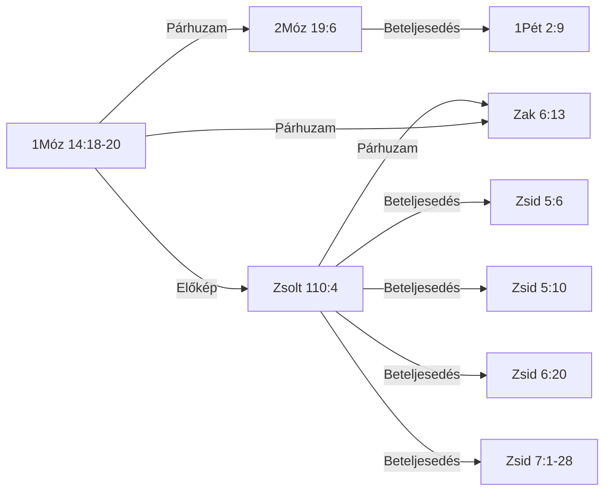

<!-- GENERÁLT: general.py --cel lexikon | rések: tematikus_lezart/Melkizedek_tematikus.md -->

# 📖 KIRALY-001 — Melkizedek — király-pap rendje, kenyér és bor

## Kivonat *(kézi)*

A motívum azt a lexikai azonosságot követi, amelyet a BDB H3548 (*kohén*) "pap-király" jelentés-kategóriája köt össze: Melkizedek (1Móz 14:18-20), Izráel kollektív "papok királysága" (2Móz 19:6), a dávidi eskü-ígéret (Zsolt 110:4), a próféciai "pap a trónon" kép (Zak 6:13) és a Zsidókhoz írt levél Krisztus-alkalmazása (Zsid 5-7) — kilenc tabulált igehely/igehelycsoport, öt lépéses kánoni íven. A legfontosabb lexikai lelet a τάξις (*taxis*, "rend") szó technikai súlya: a Zsidókhoz írt levél öt, minden kritikai kiadásban egységesen igazolt helyen (a hatodik, Zsid 7:21, szövegkritikailag nem egységes) a Melkizedek-rendet a lévitaival szembeállítható, önálló papi rendként azonosítja. Két önálló, egymástól független vitatott pont marad nyitva: Melkizedek kiléte (krisztofánia vs. irodalmi-retorikai olvasat) és az 1Móz 14↔Zsolt 110 kapcsolat iránya.

## Tartalomjegyzék

<!-- GENERÁLT-KEZDET: general.py --cel lexikon#KIRALY-001#tartalom | forrás:  | licenc: minden jog fenntartva | ts=2026-10-17 -->

*Ez a blokk a lexikon-oldal 12 szakaszának tartalomjegyzékét adja (LEXV2_2_BRIEF.md G1).*

- [Kivonat](#kivonat)
- [Jelmagyarázat és rövidítések](#jelmagyarázat-és-rövidítések)
- [1. Előfordulások](#1-előfordulások)
- [1/b. Kizárt és vizsgált helyek](#1b-kizárt-és-vizsgált-helyek)
- [2. Szótári háttér](#2-szótári-háttér)
- [3. LXX-fordítói döntések](#3-lxx-fordítói-döntések)
- [4. Kereszthivatkozások](#4-kereszthivatkozások)
- [5. Kapcsolatok](#5-kapcsolatok)
- [6. Értelmezés](#6-értelmezés)
- [7. Módszertan és nyitott kérdések](#7-módszertan-és-nyitott-kérdések)
- [8. Irodalom és idézés](#8-irodalom-és-idézés)
- [Kolofon](#kolofon)

<!-- GENERÁLT-VÉGE: lexikon#KIRALY-001#tartalom -->

## Jelmagyarázat és rövidítések

<!-- GENERÁLT-KEZDET: general.py --cel lexikon#KIRALY-001#jelmagyarazat | forrás:  | licenc: minden jog fenntartva | ts=2026-10-17 -->

*Ez a blokk közös, minden lexikon-oldalon szó szerint azonos szöveg (G10).*

**PaRDeS-szintek** (`sablonok/PaRDeS_gyorsreferencia.md`):
- **Peshat** — a szöveg szerinti, szó szerinti értelem.
- **Remez** — csak felismerés/azonosítás, következtetés nélkül.
- **Drash** — normatív, következtető, alkalmazó.
- **Sod** — fegyelmezett, csak szövegből levezethető, gematria/allegorizálás nélkül.

**Funkció:** a vers szerepe a motívum ívében — az `adat/SEMA.md` szerint
szabad szöveg (nincs zárt értékkészlet), az alábbi táblákban a motívum
saját study-jából átvett megnevezéssel szerepel.

**Rövidítések:** BDB (Brown–Driver–Briggs), TBESH/TBESG (Tyndale Bible
Encyclopedia — Strong's Hebrew/Greek), Thayer (Thayer's Greek Lexicon),
UBS (UBS Dictionary of New Testament Greek — Louw–Nida szemantikai
doménekkel), L–N (Louw–Nida doménkód), SDBH/SDGNT (Semantic Dictionary
of Biblical Hebrew/Greek), OSHL (Open Scriptures Hebrew Lexicon), TWOT
(Theological Wordbook of the Old Testament — csak számhivatkozás), TSK
(Treasury of Scripture Knowledge), KH (Károli-kereszthivatkozás), LXX
(Septuaginta), MT (Masoretic Text), KJV (King James Version).

A szótári fordításokban a πνεῦμα (pneuma) mindig *szellem*, a ψυχή
(pszükhé) *lélek*; a Károli-idézetek szövege változatlan (pl. »Lélek«).

<!-- GENERÁLT-VÉGE: lexikon#KIRALY-001#jelmagyarazat -->

## 1. Előfordulások

<!-- GENERÁLT-KEZDET: general.py --cel lexikon#KIRALY-001#elofordulasok | forrás: adat/elofordulasok.tsv, konkordancia/Karoli_1908.tsv, konkordancia/UBS_DNTG_referenciak.tsv, konkordancia/UBS_DNTG_jelentesek.tsv, adat/forditasok.tsv | licenc: minden jog fenntartva, közkincs, CC BY-SA 4.0 | ts=2026-10-17 -->

*Ez a blokk a `[ID: KIRALY-001]` motívum 9 igehely-sorát fedi az `elofordulasok.tsv`-ből, kanonikus sorrendben, a Károli-szöveggel (1/a) és az UBS-jelentés renderidejű hozzárendelésével (G3).*

| Igehely | Kulcsszó | Funkció | PaRDeS-szint | Strong | Szótári jelentés | UBS-jelentés | Megbízhatóság · azonosítás módja |
|---|---|---|---|---|---|---|---|
| [1Móz 14:18-20](#ige-1móz-14-18-20) | papja — כֹהֵ֖ן (kho.Hen) | 🌱 alap-előfordulás | Peshat | H3548 | BDB H3548 1 — pap-király | — *(ÓSZ)* | magas · szó-szintű-gépi[^1] |
| [2Móz 19:6](#ige-2móz-19-6) | papok birodalma — כֹּהֲנִ֖ים (ko.ha.Nim); מַמְלֶ֥כֶת (mam.Le.khet) | egyéni → kollektív szintre emelve | Remez | H3548+H4467 | BDB H3548 1 — egyszerre papok és királyok a nemzetekhez való viszonyukban | — *(ÓSZ)* | magas · szó-szintű-gépi[^2] |
| [Zsolt 76:3](#ige-zsolt-76-3) | Sálemben — שָׁלֵ֣ם (sha.Lem) | helynév-azonosítás, lexikai kapocs | Remez | H8004 | BDB H8004 — helynév, Jeruzsálem rövidüléseként/archaizáló neveként; a BDB explicit Zsolt 76:3-at idézi Gen 14:18 mellett | — *(ÓSZ)* | magas · tartalom-alapú[^3] |
| [Zsolt 110:4](#ige-zsolt-110-4) | Pap — כֹהֵ֥ן (kho.Hen) | próféciai megerősítés, dávidi szintre szűkítve | Remez | H3548 | BDB H3548 1 — messiási pap-király, mint Melkizedek | — *(ÓSZ)* | magas · tartalom-alapú[^4] |
| [Zak 6:13](#ige-zak-6-13) | pap — כֹהֵן֙ (kho.Hen); כִּסְא֔ (kis.') | explicit "pap a trónon" kép, próféciai megerősítés | Remez | H3548+H3678 | BDB H3548 1 — messiási pap és király | — *(ÓSZ)* | magas · tartalom-alapú[^5] |
| [Zsid 5:6](#ige-zsid-5-6) | rendje szerint — τάξιν (taxin) | krisztológiai betöltés, első idézet | Drash | G5010 | — | 58.21 — valamely dolog fajtája vagy típusa, más hasonló dolgokkal való szembeállítást és összehasonlítást feltételezve | magas · tartalom-alapú[^6] |
| [Zsid 5:10](#ige-zsid-5-10) | rendje szerint — τάξιν (taxin) | krisztológiai betöltés | Drash | G5010 | — | 58.21 — valamely dolog fajtája vagy típusa, más hasonló dolgokkal való szembeállítást és összehasonlítást feltételezve | magas · tartalom-alapú[^7] |
| [Zsid 6:20](#ige-zsid-6-20) | rendje szerint — τάξιν (taxin) | krisztológiai betöltés | Drash | G5010 | — | 58.21 — valamely dolog fajtája vagy típusa, más hasonló dolgokkal való szembeállítást és összehasonlítást feltételezve | magas · tartalom-alapú[^8] |
| [Zsid 7:1-28](#ige-zsid-7-1-28) | rendje szerint (G5010, 7:17); Apa nélkül (G0540, 7:3); anya nélkül (G0282, 7:3); nemzetség nélkül való (G0035, 7:3) — τάξιν (taxin); ἀμήτωρ (amétór) | krisztológiai betöltés, teljes kifejtés | Drash/Sod | G5010+G0813+G0282 | — | G5010: 58.21 — valamely dolog fajtája vagy típusa, más hasonló dolgokkal való szembeállítást és összehasonlítást feltételezve *(jelölt, nem egyértelmű)* · G0813: *(nincs hozzárendelés)* · G0282: 10.17 — olyan személy, akinek anyjáról nincs feljegyzés, vagy akinek sohasem volt anyja, vagy akinek anyja meghalt *(jelölt, nem egyértelmű)* | magas · tartalom-alapú[^9] |

[^1]: proveniencia: scope=manual | forras=Melkizedek_tematikus.md | ts=2026-09-08 | igazolas: nincs
[^2]: proveniencia: scope=manual | forras=Melkizedek_tematikus.md | ts=2026-09-08 | igazolas: nincs
[^3]: proveniencia: scope=manual | forras=Melkizedek_tematikus.md | ts=2026-09-09 | igazolas: nincs
[^4]: proveniencia: scope=manual | forras=Melkizedek_tematikus.md | ts=2026-09-08 | igazolas: nincs
[^5]: proveniencia: scope=manual | forras=Melkizedek_tematikus.md | ts=2026-09-08 | igazolas: nincs
[^6]: proveniencia: scope=manual | forras=Melkizedek_tematikus.md | ts=2026-09-08 | igazolas: nincs
[^7]: proveniencia: scope=manual | forras=Melkizedek_tematikus.md | ts=2026-09-08 | igazolas: nincs
[^8]: proveniencia: scope=manual | forras=Melkizedek_tematikus.md | ts=2026-09-08 | igazolas: nincs
[^9]: proveniencia: scope=manual | forras=Melkizedek_tematikus.md | ts=2026-09-08 | igazolas: nincs

*Az UBS-jelentés csak újszövetségi soroknál áll: az UBS Greek New Testament Dictionary az Újszövetséget fedi.*

#### 1/a. Az igehelyek szövege

**1Móz 14:18-20**
*Melkhisédek pedig Sálem királya, kenyeret és bort hoza; ő pedig a Magasságos Istennek papja vala.*
*És megáldá őt, és monda: Áldott legyen Ábrám a Magasságos Istentől, ég és föld teremtőjétől.*
*Áldott a Magasságos Isten, a ki kezedbe adta ellenségeidet. És tizedet ada néki mindenből.*
Melkizedek, Sálem királya, egyszerre "a Felséges Isten papja" — kenyeret és bort hoz, megáldja Ábrámot, aki tizedet ad neki. Első előfordulás, minden előzmény és genealógia nélkül.
Funkció: a motívum legelső megjelenése

**2Móz 19:6**
*És lesztek ti nékem papok birodalma és szent nép. Ezek azok az ígék, melyeket el kell mondanod Izráel fiainak.*
"Ti pedig lesztek nékem papok királysága" — a Sínai-szövetségben Izráel egésze kap kollektív király-pap identitást, a lévita papság intézményesítése előtt. Ugyanaz a כֹּהֵן (kóhén) gyök, mint Melkizedeknél, de itt nem egy egyén, hanem egy egész nép viseli.

**Zsolt 76:3**
*Mert hajléka van Sálemben, és lakhelye Sionban.*
"Sálemben van az ő sátora, és lakóhelye Sionban" — a Sálem=Jeruzsálem/Sion azonosítás, ugyanazzal a Strong-számmal (H8004), mint 1Móz 14:18-nál — lexikai, nem csak tematikus kapcsolat.

**Zsolt 110:4**
*Megesküdt az Úr és meg nem másítja: Pap vagy te örökké Melkhisedek rendje szerint.*
"Megesküdt az Úr és meg nem másítja: Te vagy pap örökké Melkhisédek rendje szerint" — próféciai eskü-formula, dávidi/individuális szintre visszavéve a mintát.

**Zak 6:13**
*Mert ő fogja megépíteni az Úrnak templomát, és nagy lesz az ő dicsősége, és ülni és uralkodni fog az ő székében, és pap is lesz az ő székében, és békesség tanácsa lesz kettőjük között.*
"pap lesz az ő királyi székén" — próféciai kép egyetlen alakról, aki egyszerre ül a trónon és visel papi tisztséget.

**Zsid 5:6**
*Miképen másutt is mondja: Te örökké való pap vagy, Melkisédek rendje szerint.*
A Zsolt 110:4 első idézetei, bevezetve Krisztus főpapságának témáját.

**Zsid 5:10**
*Neveztetvén az Istentől Melkisédek rendje szerint való főpapnak.*
A Zsolt 110:4 idézése, Krisztus főpapságának bevezetése.

**Zsid 6:20**
*A hová útnyitóul bement érettünk Jézus, a ki örökké való főpap lett Melkisédek rendje szerint.*
A Zsolt 110:4 idézése, Krisztus "örökkévaló főpap Melkhisédek rendje szerint" bevezetése.

**Zsid 7:1-28**
*Mert ez a Melkisédek Sálem királya, a felséges Isten papja, a ki a királyok leveréséből visszatérő Ábrahámmal találkozván, őt megáldotta,*
*A kinek tizedet is adott Ábrahám mindenből: a ki elsőben is magyarázat szerint igazság királya, azután pedig Sálem királya is, azaz békesség királya,*
*Apa nélkül, anya nélkül, nemzetség nélkül való; sem napjainak kezdete, sem életének vége nincs, de hasonlóvá tétetvén az Isten Fiához, pap marad örökké.*
*Nézzétek meg pedig, mily nagy ez, a kinek a zsákmányból tizedet is adott Ábrahám, a pátriárka;*
*És bár azoknak, kik a Lévi fiai közül nyerik el a papságot, parancsolatjok van, hogy törvény szerint tizedet szedjenek a néptől, azaz az ő atyafiaiktól, jóllehet ők is az Ábrahám ágyékából származtak;*
*De az, a kinek nemzetsége nem azok közül való, tizedet vett Ábrahámtól, és az ígéretek birtokosát megáldotta,*
*Pedig minden ellenmondás nélkül való, hogy a nagyobb áldja meg a kisebbet.*
*És itt halandó emberek szednek tizedet, ott ellenben az, a ki bizonyság szerint él:*
*És hogy úgy szóljak, Ábrahámnál fogva tized vétetett Lévitől is, a tizedszedőtől,*
*Mert ő még az atyja ágyékában vala, a mikor annak elébe ment Melkisédek.*
*Ha tehát a lévitai papság által volna a tökéletesség (mert a nép ez alatt nyerte a törvényt): mi szükség tovább is mondogatni, hogy más pap támadjon a Melkisédek rendje szerint és ne az Áron rendje szerint?*
*Mert a papság megváltozásával szükségképen megváltozik a törvény is.*
*Mert a kiről ezek mondatnak, az más nemzetségből származott, a melyből senki sem szolgált az oltár körül;*
*Mert nyilvánvaló, hogy a mi Urunk Júdából támadott, a mely nemzetségre nézve semmit sem szólott Mózes a papságról.*
*És még inkább nyilvánvaló az, ha a Melkisédek hasonlatossága szerint áll elő más pap,*
*A ki nem testi parancsolatnak törvénye szerint, hanem enyészhetetlen életnek ereje szerint lett.*
*Mert ez a bizonyságtétel: Te pap vagy örökké, Melkisédek rendje szerint.*
*Mert az előbbi parancsolat eltöröltetik, mivelhogy erőtelen és haszontalan,*
*Minthogy a törvény semmiben sem szerzett tökéletességet; de beáll a jobb reménység, a mely által közeledünk az Istenhez.*
*És a mennyiben nem esküvés nélkül való, mert amazok esküvés nélkül lettek papokká,*
*De ez esküvéssel, az által, a ki azt mondá néki: Megesküdött az Úr, és nem bánja meg, te pap vagy örökké, Melkisédek rendje szerint:*
*Annyiban jobb szövetségnek lett kezesévé Jézus.*
*És amazok jóllehet többen lettek papokká, mert a halál miatt meg nem maradhattak:*
*De ennek, minthogy örökké megmarad, változhatatlan a papsága.*
*Ennekokáért ő mindenképen idvezítheti is azokat, a kik ő általa járulnak Istenhez, mert mindenha él, hogy esedezzék érettök.*
*Mert ilyen főpap illet vala minket, szent, ártatlan, szeplőtelen, a bűnösöktől elválasztott, és a ki az egeknél magasságosabb lőn,*
*A kinek nincs szüksége, mint a főpapoknak, hogy napról-napra előbb a saját bűneiért vigyen áldozatot, azután a népéiért, mert ezt egyszer megcselekedte, maga-magát megáldozván.*
*Mert a törvény gyarló embereket rendel főpapokká, de a törvény után való esküvés beszéde örök tökéletes Fiút.*
A Melkizedek-rend teljes kifejtése: nagyobb a lévita rendnél (a tized-jelenetből levezetve), örökkévaló (argumentum e silentio), a törvény megváltozásának alapja.

<!-- GENERÁLT-VÉGE: lexikon#KIRALY-001#elofordulasok -->

## 1/b. Kizárt és vizsgált helyek

<!-- GENERÁLT-KEZDET: general.py --cel lexikon#KIRALY-001#kizart | forrás: adat/jeloltek.tsv, adat/motivumok.tsv | licenc: minden jog fenntartva | ts=2026-10-17 -->

*Ez a blokk a `[ID: KIRALY-001]` motívum 14 elutasított/nyitva maradt jelöltjét fedi a `jeloltek.tsv`-ből (G7).*

- **1Kor 14:40** (elutasítva, `napló: Melkizedek_tematikus_kereszthivatkozas_naplo.md §Tartalmi minősítés minden jelöltre | scope=manual | forras=Melkizedek_tematikus_kereszthivatkozas_naplo.md | ts=2026-10-11`): más sense (papi beosztás / általános rendezettség), nem "Melkizedek-rendi"
- **Kol 2:5** (elutasítva, `napló: Melkizedek_tematikus_kereszthivatkozas_naplo.md §Tartalmi minősítés minden jelöltre | scope=manual | forras=Melkizedek_tematikus_kereszthivatkozas_naplo.md | ts=2026-10-11`): más sense (papi beosztás / általános rendezettség), nem "Melkizedek-rendi"
- **Luk 1:8** (elutasítva, `napló: Melkizedek_tematikus_kereszthivatkozas_naplo.md §Tartalmi minősítés minden jelöltre | scope=manual | forras=Melkizedek_tematikus_kereszthivatkozas_naplo.md | ts=2026-10-11`): más sense (papi beosztás / általános rendezettség), nem "Melkizedek-rendi"
- **1Móz 14:22** (elutasítva, `nevesített tanító: Kenneth Copeland (napló 0. pont); napló: Melkizedek_tematikus_kereszthivatkozas_naplo.md §Tartalmi minősítés minden jelöltre | scope=manual | forras=Melkizedek_tematikus_kereszthivatkozas_naplo.md | ts=2026-10-11`): más igehely/téma a fejezeten belül, nem a Melkizedek-papság motívuma
- **1Móz 14:23** (elutasítva, `nevesített tanító: Kenneth Copeland (napló 0. pont); napló: Melkizedek_tematikus_kereszthivatkozas_naplo.md §Tartalmi minősítés minden jelöltre | scope=manual | forras=Melkizedek_tematikus_kereszthivatkozas_naplo.md | ts=2026-10-11`): más igehely/téma a fejezeten belül, nem a Melkizedek-papság motívuma
- **Jel 1:6** (elutasítva, `napló: Melkizedek_tematikus_kereszthivatkozas_naplo.md §Tartalmi minősítés minden jelöltre | scope=manual | forras=Melkizedek_tematikus_kereszthivatkozas_naplo.md | ts=2026-10-11`): tematikus párhuzam, de más görög szavak (βασιλείαν, ἱερεῖς — nem βασίλειον ἱεράτευμα) — nem szó szerinti LXX-idézés
- **Jel 5:10** (elutasítva, `napló: Melkizedek_tematikus_kereszthivatkozas_naplo.md §Tartalmi minősítés minden jelöltre | scope=manual | forras=Melkizedek_tematikus_kereszthivatkozas_naplo.md | ts=2026-10-11`): ugyanaz, mint Jel 1:6 — tematikus párhuzam, más görög szavak, nem lexikai egyezés
- **1Pét 2:9** (nyitva, `TSK 2Móz 19:6 ↔ 1Pét 2:9 (22); napló: Melkizedek_tematikus_kereszthivatkozas_naplo.md §Tartalmi minősítés | scope=manual | forras=Melkizedek_tematikus_kereszthivatkozas_naplo.md | ts=2026-10-11`): a napló szerint beépítve (2026.09.09, retroaktív pótlás; szó szerinti LXX-idézés, G0934+G2406), de a jeloltek.tsv-ben és az elofordulasok.tsv-ben nincs sor; nincs dokumentált döntés a hiányról; elbírálás: N-F63a
- **2Móz 2:16** (elutasítva, `BDB H3548 »chieftain« (web_search, nem repó-forrás); napló: Melkizedek_tematikus_kereszthivatkozas_naplo.md §Tartalmi minősítés | scope=manual | forras=Melkizedek_tematikus_kereszthivatkozas_naplo.md | ts=2026-10-11`): más BDB-jelentés, lexikai azonosság motívum-azonosság nélkül
- **2Móz 3:1** (elutasítva, `BDB H3548 »chieftain« (web_search, nem repó-forrás); napló: Melkizedek_tematikus_kereszthivatkozas_naplo.md §Tartalmi minősítés | scope=manual | forras=Melkizedek_tematikus_kereszthivatkozas_naplo.md | ts=2026-10-11`): más BDB-jelentés, lexikai azonosság motívum-azonosság nélkül
- **2Móz 18:1** (elutasítva, `BDB H3548 »chieftain« (web_search, nem repó-forrás); napló: Melkizedek_tematikus_kereszthivatkozas_naplo.md §Tartalmi minősítés | scope=manual | forras=Melkizedek_tematikus_kereszthivatkozas_naplo.md | ts=2026-10-11`): más BDB-jelentés, lexikai azonosság motívum-azonosság nélkül
- **2Sám 8:18** (elutasítva, `BDB H3548 »chieftain« (web_search, nem repó-forrás); napló: Melkizedek_tematikus_kereszthivatkozas_naplo.md §Tartalmi minősítés | scope=manual | forras=Melkizedek_tematikus_kereszthivatkozas_naplo.md | ts=2026-10-11`): más BDB-jelentés, lexikai azonosság motívum-azonosság nélkül
- **2Sám 20:26** (elutasítva, `BDB H3548 »chieftain« (web_search, nem repó-forrás); napló: Melkizedek_tematikus_kereszthivatkozas_naplo.md §Tartalmi minősítés | scope=manual | forras=Melkizedek_tematikus_kereszthivatkozas_naplo.md | ts=2026-10-11`): más BDB-jelentés, lexikai azonosság motívum-azonosság nélkül
- **1Kir 4:5** (elutasítva, `BDB H3548 »chieftain« (web_search, nem repó-forrás); napló: Melkizedek_tematikus_kereszthivatkozas_naplo.md §Tartalmi minősítés | scope=manual | forras=Melkizedek_tematikus_kereszthivatkozas_naplo.md | ts=2026-10-11`): más BDB-jelentés, lexikai azonosság motívum-azonosság nélkül

**Negatív kritérium** (`motivumok.tsv`): az igehelynek vagy név szerint Melkizedeket kell megneveznie/rá hivatkoznia (a "rendje szerint" formulával), vagy a BDB H3548 "priest-king" lexikai sense alá kell tartoznia — a puszta "pap" vagy "király" cím külön-külön nem elég (l. a BDB "chieftain (exercising priestly functions)" alkategória kizárása, Jetró/Dávid fiai/Ira)

<!-- GENERÁLT-VÉGE: lexikon#KIRALY-001#kizart -->

## 2. Szótári háttér

<!-- GENERÁLT-KEZDET: general.py --cel lexikon#KIRALY-001#szocikkek | forrás: adat/lexikon_hivatkozasok.tsv, adat/szotar_szerepek.tsv, konkordancia/BDB_etimologia_kezi_hatarok.tsv, konkordancia/BDB_teljes_unabridged.tsv, konkordancia/Karoli_versmegfeleltetes.tsv, konkordancia/LXX_versszintu_parok.tsv, konkordancia/MCGED_teljes.tsv, konkordancia/OSHL_lexikalis_index.tsv, konkordancia/SDBH_domenek.tsv, konkordancia/SDGNT_domenek.tsv, konkordancia/SECE_G_teljes.tsv, konkordancia/SECE_H_teljes.tsv, konkordancia/TBESG.txt, konkordancia/TBESH.txt, konkordancia/Thayer_teljes.tsv, konkordancia/UBS_DBH_jelentesek.tsv, konkordancia/UBS_DBH_referenciak.tsv, konkordancia/UBS_DNTG_jelentesek.tsv, konkordancia/UBS_DNTG_referenciak.tsv, konkordancia/tW_szocikkek.tsv | licenc: CC BY 4.0, CC BY-SA 4.0, közkincs, minden jog fenntartva, © Mounce 1993 | ts=2026-10-17 -->

*Ez a blokk a `[ID: KIRALY-001]` motívum 7 Strong-tokenjét fedi, szerepenként a szerepmátrix (`szotar_szerepek.tsv`) sorrendjében, van jelentés-hivatkozással a `lexikon_hivatkozasok.tsv`-ből.*

### Görög szavak: G0282, G0813, G5010

#### 1. Alapjelentés

<!-- ÜRES-BLOKK: Alapjelentés | adatosítva, nincs bekötve -->
*(üres blokk: a szerep adatosítva (a forrásfájl megvan), de a motívum tokenjeihez a `lexikon_hivatkozasok.tsv`-be nincs bekötve sor; a bekötés még nem történt meg; a hiány nincs kitöltve gyenge vagy asszociatív anyaggal)*

#### 2. Mélységi szócikk

##### Thayer G282 — (teljes szócikk)

> G282 — ἀμήτωρ (ορος, ὁ, ἡ (μήτηρ), without a mother, motherless; in Greek writings: 1. born without a mother, e. g. Minerva, Euripides, Phoen. 666f, others; God himself, inasmuch as he is without origin, Lactantius, instt. 4, 13, 2. 2. bereft of a mother, Herodotus 4, 154, elsewhere. 3. born of a base or unknown mother, Euripides, Ion 109 cf. 837. 4. unmotherly, unworthy of the name of mother: μήτηρ ἀμήτωρ, Sophocles El. 1154. Cf. Bleek on Heb. vol. ii., 2, p. 305ff 5. in a significance unused by the Greeks, 'whose mother is not recorded in the genealogy': of Melchizedek, Heb 7:3; (of Sarah by Philo in de temul. § 14, and rer. div. haer. § 12; (cf. Bleek as above)); cf. the classic ἀνολυμπιάς.

**🇭🇺** G282 — ἀμήτωρ (ορος, ὁ, ἡ (μήτηρ), anya nélküli, anyátlan; a görög írásokban: 1. anya nélkül született, pl. Minerva, Euripidész, Phoen. 666k., mások; maga Isten, amennyiben nincs eredete, Lactantius, instt. 4, 13, 2. 2. anyjától megfosztott, Hérodotosz 4, 154, másutt. 3. alacsony sorú vagy ismeretlen anyától született, Euripidész, Ion 109, vö. 837. 4. anyához nem illő, az anya névre méltatlan: μήτηρ ἀμήτωρ, Szophoklész, El. 1154. Vö. Bleek a Zsidókhoz írt levélhez, II. köt., 2, 305kk. o. 5. a görögöktől nem használt jelentésben: 'akinek az anyja nincs feljegyezve a nemzetségtáblázatban': Melkisédekről, Zsid 7:3; (Sáráról Philónnál, de temul. 14. §, és rer. div. haer. 12. §; (vö. Bleek, mint fent)); vö. a klasszikus ἀνολυμπιάς.

*Forrás: konkordancia/Thayer_teljes.tsv*

##### Thayer G813 — (teljes szócikk)

> G813 — ἄτακτος ἄτακτον (τάσσω), disorderly, out of the ranks, (often so of soldiers); irregular, inordinate (ἀτακτοι ἡδοναι immoderate pleasures, Plato, legg. 2, 660 b.; Plutarch, de book educ. c. 7), deviating from the prescribed order or rule: 1Th 5:14, cf. 2Th 3:6. (In Greek writings from (Herodotus and) Thucydides down; often in Plato.)

**🇭🇺** G813 — ἄτακτος ἄτακτον (τάσσω), rendetlen, a sorból kilépő (gyakran katonákról); szabálytalan, mértéktelen (ἀτακτοι ἡδοναι: mértéktelen gyönyörök, Platón, legg. 2, 660 b.; Plutarkhosz, de book educ. 7. fej.), az előírt rendtől vagy szabálytól eltérő: 1Thessz 5:14, vö. 2Thessz 3:6. (A görög írásokban (Hérodotosztól és) Thuküdidésztől kezdve; Platónnál gyakran.)

*Forrás: konkordancia/Thayer_teljes.tsv*

##### Thayer G5010 — (teljes szócikk)

> G5010 — τάξις τάξεως, ἡ (τάσσω), from Aeschylus and Herodotus down; 1. an arranging, arrangement. 2. order, i. e. a fixed succession observing also a fixed time: Luk 1:8. 3. due or right order: κατά τάξιν, in order, 1Co 14:40; orderly condition, Col 2:5 (some give it here a military sense, 'orderly array', see στερέωμα, c.). 4. the post, rank, or position which one holds in civil or other affairs; and since this position generally depends on one's talents, experience, resources, τάξις becomes equivalent to character, fashion, quality, style, (2 Macc. 9:18 2Macc. 1:19; οὐ γάρ ἱστορίας, ἀλλά κουρεακης λαλιᾶς ἐμοί δοκοῦσι τάξιν ἔχειν, Polybius 3, 20, 5): κατά τήν τάξιν (for which in Heb 7:15 we have κατά τήν ὁμοιότητα) Μελχισέδεκ, after the manner of the priesthood (A. V. order) of Melchizedek (according to the Sept. of Psa 109:5 עַל־דִּבְרָתִי), Heb 5:6, Heb 5:10; Heb 6:20; Heb 7:11, Heb 7:17, Heb 7:21 (where T Tr WH omit the phrase).

**🇭🇺** G5010 — τάξις τάξεως, ἡ (τάσσω), Aiszkhülosztól és Hérodotosztól kezdve; 1. elrendezés, rendezés. 2. rend, azaz meghatározott egymásutániság, amely meghatározott időt is megtart: Luk 1:8. 3. kellő vagy helyes rend: κατά τάξιν, rendben, 1Kor 14:40; rendezett állapot, Kol 2:5 (egyesek itt katonai értelmet tulajdonítanak neki: 'rendezett hadrend', l. στερέωμα, c.). 4. az a tisztség, rang vagy helyzet, amelyet valaki polgári vagy más ügyekben betölt; és mivel ez a helyzet rendszerint az illető tehetségétől, tapasztalatától, eszközeitől függ, a τάξις = jellem, mód, minőség, stílus lesz (2Makk 9:18 2Makk 1:19; οὐ γάρ ἱστορίας, ἀλλά κουρεακης λαλιᾶς ἐμοί δοκοῦσι τάξιν ἔχειν, Polübiosz 3, 20, 5): κατά τήν τάξιν (amely helyett a Zsid 7:15-ben κατά τήν ὁμοιότητα áll) Μελχισέδεκ, Melkisédek papságának módja (A. V. order) szerint (a Septuaginta Zsolt 109:5 עַל־דִּבְרָתִי szövege szerint), Zsid 5:6, Zsid 5:10; Zsid 6:20; Zsid 7:11, Zsid 7:17, Zsid 7:21 (ahol T Tr WH elhagyja a kifejezést).

*Forrás: konkordancia/Thayer_teljes.tsv*

#### 3. Teológiai szócikk

**G0282** · *a forrás nem tárgyalja* *(tW)*

**G0813** · *a forrás nem tárgyalja* *(tW)*

**G5010** · *a forrás nem tárgyalja* *(tW)*

#### 4. Jelentésszerkezet, szemantikai mező

**G0282** · **Szemantikai domén:** 010002 Kinship Relations Involving Successive Generations

**G0813** · **Szemantikai domén:** 088032 Laziness, Idleness

**G5010** · **Szemantikai domén:** 058004 Class, Kind, 061 Sequence, 062002 Organize [of events and states]

#### 5. Tömör jelentés, előfordulás

**G0282** · UBS DNTG: 1 jelentés, 1 hivatkozott hely

| Jelentés (lexid) | Louw–Nida | Glossza | Definíció (rövid) | Hivatkozott helyek |
|---|---|---|---|---|
| `000280001001000` | 10.17 | anya nélküli | olyan személy, akinek anyjáról nincs feljegyzés, vagy akinek sohasem volt anyja, vagy akinek anyja meghalt | 1 |

*Mounce (GK 298):* pr. without mother; independent of maternal descent, Heb 7:3 * *(fordításra vár)*

**G0813** · UBS DNTG: 1 jelentés, 1 hivatkozott hely

| Jelentés (lexid) | Louw–Nida | Glossza | Definíció (rövid) | Hivatkozott helyek |
|---|---|---|---|---|
| `000810001001000` | 88.247 | idle; lazy; lazily *(fordításra vár)* | (derivative of {L:ἀτακτέω<SDBG:ἀτακτέω:000000>} ‘to do nothing,’ {D:88.246}) pertaining to refusing to work *(fordításra vár)* | 1 |

*Mounce (GK 864):* pr. used of soldiers, disorderly; met. irregular in conduct, disorderly, lazy, 1Thess 5:14 * *(fordításra vár)*

**G5010** · UBS DNTG: 3 jelentés, 9 hivatkozott hely

| Jelentés (lexid) | Louw–Nida | Glossza | Definíció (rövid) | Hivatkozott helyek |
|---|---|---|---|---|
| `004915001001000` | 61.3 | in order; in a sequence *(fordításra vár)* | an ordered or arranged sequence *(fordításra vár)* | 1 |
| `004915001002000` | 62.7 | right order; good order; in order; in an orderly manner *(fordításra vár)* | a proper and correct order *(fordításra vár)* | 2 |
| `004915001003000` | 58.21 | fajta; típus | valamely dolog fajtája vagy típusa, más hasonló dolgokkal való szembeállítást és összehasonlítást feltételezve | 6 |

*Mounce (GK 5423):* order, regular disposition, arrangement; order, series, succession, Luke 1:8 ; an order, distinctive class, as of priests, Heb 5:6 , Heb 5:10 ; Heb 6:20 ; Heb 7:11 (2x), 17; order, good order, 1Cor 14:40 ; orderliness, well-regulated conduct, Col 2:5 * *(fordításra vár)*

#### 6. LXX-híd

*Hivatkozás: l. a 3. szakaszt (LXX-fordítói döntések).*

#### 7. Megfelelők a másik nyelven

**G0282** · *a forrás nem tárgyalja* *(SECE: nincs héber megfelelő-lista)*

**G0813** · *a forrás nem tárgyalja* *(SECE: nincs héber megfelelő-lista)*

**G5010** · SECE — héber megfelelők (9): דִּבְרָה, זְבוּל, מוּצַק, מַחֲנֶה, מְסִלָּה, מָקֹום, פֹּעַל, קֵץ, תֹּורָה

*Hivatkozás: a kézi SECE-táblázatok a 2/b szakaszban a #70-ig változatlanul állnak (l. 2/b), ha van.*

#### 8. Nyelvi háttér

*Hivatkozás: a motívum saját tokenjeihez nincs LSJ-sor a `lexikon_hivatkozasok.tsv`-ben; a rokon szavaknál (alább) és a kézi 2/b szakaszban l.*

#### 9. Versenkénti jelentés

*Hivatkozás: l. az 1. szakasz táblázatát (UBS-jelentés oszlop; csak újszövetségi sorok).*

#### 10. Kiejtés (magyaros)

**G0282** · ἀμήτωρ (amétór)

**G0813** · ἄτακτος (ataktosz)

**G5010** · τάξις (taxisz)

### Héber szavak: H3548, H3678, H4467, H8004

#### 1. Alapjelentés

##### TBESH H3548 — (konszolidált szócikk)

**Röviden:** priest

> 1) priest, principal officer or chief ruler 1a) priest-king (Melchizedek, Messiah) 1b) pagan priests 1c) priests of Jehovah 1d) Levitical priests 1e) Zadokite priests 1f) Aaronic priests 1g) the high priest Aramaic equivalent: ka.hen (כָּהֵן "priest" H3549)

*(fordításra vár)*

*Forrás: konkordancia/TBESH.txt (a TBESH.txt szövege)*

##### TBESH H3678 — (konszolidált szócikk)

**Röviden:** throne; (Hall of) the Throne; throne: seat

> 1) seat (of honour), throne, seat, stool 1a) seat (of honour), throne 1b) royal dignity, authority, power (fig.) | Combined with u.lam (אוּלָם "Hall" H0197I) This name means throne, seat

*(fordításra vár)*

*Forrás: konkordancia/TBESH.txt (a TBESH.txt szövege)*

##### TBESH H4467 — (konszolidált szócikk)

**Röviden:** kingdom

> 1) kingdom, dominion, reign, sovereignty 1a) kingdom, realm 1b) sovereignty, dominion 1c) reign

*(fordításra vár)*

*Forrás: konkordancia/TBESH.txt (a TBESH.txt szövege)*

##### TBESH H8004 — (konszolidált szócikk)

**Röviden:** Salem

> Salem = "peace" the place of which Melchizedek was king most Jewish commentators affirm that it is the same as Jerusalem Another name of ye.ru.sha.laim (יְרוּשָׁלִַ֫ם, יְרוּשְׁלֵם "Jerusalem" H3389)

*(fordításra vár)*

*Forrás: konkordancia/TBESH.txt (a TBESH.txt szövege)*

#### 2. Mélységi szócikk

##### BDB H3548 — 1. jelentés

> 1 priest-king: e.g. Melchizedek Gen 14:18 (E ?), compare Psa 110:4 (the Messianic priest-king like Melchizedek); Zech 6:13 (Messianic priest and king); Israel כֹּהֲנִים מַמְלֶכֶת Exod 19:6 (E) a kingdom of priests (priests and kings at once in their relation to the nations); compare Isa 61:6 (of Israel ministering as a priest); or a chieftain (exercising priestly functions) מִדְיָן כֹּהֵן Exod 2:16; 3:1; 18:1 (all J E); so also probably the sons of David 2Sam 8:18, his grandson 1Kin 4:5, and Ira the Jairite 2Sam 20:26, who as princes performed priestly functions. With these we may class the כהנים Exod 19:22, 24 (J).

**🇭🇺** 1 pap-király: pl. Melkisédek 1Móz 14:18 (E ?), vö. Zsolt 110:4 (a Melkisédekhez hasonló messiási pap-király); Zak 6:13 (messiási pap és király); Izráel: כֹּהֲנִים מַמְלֶכֶת (mamlekhet kóhaním) 2Móz 19:6 (E), papok királysága (a népekhez való viszonyukban egyszerre papok és királyok); vö. Ézs 61:6 (Izráelről, amint papként szolgál); vagy törzsfő (aki papi feladatokat lát el): מִדְיָן כֹּהֵן (kóhén midján) 2Móz 2:16; 3:1; 18:1 (mind J E); így valószínűleg Dávid fiai is, 2Sám 8:18, az unokája, 1Kir 4:5, és a jairita Íra, 2Sám 20:26, akik fejedelmekként papi feladatokat végeztek. Velük sorolhatók a כהנים (kóhaním) is, 2Móz 19:22, 24 (J).

*Forrás: konkordancia/BDB_teljes_unabridged.tsv*

*H3678: nincs BDB-sor ehhez a szerephez.*

*H4467: nincs BDB-sor ehhez a szerephez.*

*H8004: nincs BDB-sor ehhez a szerephez.*

#### 3. Teológiai szócikk

**H3548** · **TWOT:** 959a

**H3548** · tW: `kt/highpriest`, `kt/priest`, `other/prince`, `other/ruler`

**H3678** · **TWOT:** 1007

**H3678** · tW: `kt/honor`, `other/throne`

**H4467** · **TWOT:** 1199f

**H4467** · tW: `other/kingdom`, `other/reign`, `other/royal`, `other/ruler`

**H8004** · **TWOT:** —

**H8004** · *a forrás nem tárgyalja* *(tW)*

*A tW-szócikkek szövege (angolul; a magyar fordítás a gyorsítótárból, ahol van, különben fordításra vár). A Strong-kötés a tW saját listáján alapul, nem a projekt azonosítása.*

kt/highpriest — high priest, chief priest (tW; a motívum tokenje: H3548)

> # high priest, chief priest
>
> ## Definition:
>
> The term “high priest” refers to a special priest who was appointed to serve for one year as the leader of all of the other Israelite priests. In New Testament times, some other priests were also considered very important Jewish religious leaders, with authority over other priests and the people. These were the chief priests.
>
> * The high priest had special responsibilities. He was the only one who was permitted to go into the most holy part of the tabernacle or the temple to offer a special sacrifice once per year.
> * The Israelites had many priests, but only one high priest at a time.
> * After high priests retired, they still kept the title, along with some of the responsibilities of the office. For example, Annas was still referred to as high priest during the priesthood of Caiaphas and others.
> * The chief priests were responsible for everything needed for the worship services at the temple. They were also in charge of the money that was given to the temple.
> * The chief priests were higher in rank and power than the ordinary priests. Only the high priest had more authority.
> * The chief priests were some of Jesus’ main enemies and they strongly influenced the Roman leaders to arrest and kill him.
>
> ## Translation Suggestions:
>
> * “High priest” could be translated as “supreme priest” or “highest ranking priest.”
> * The term “chief priests” could be translated as “head priests” or “leading priests” or “ruling priests.”
>
> (See also: [Annas](../names/annas.md), [Caiaphas](../names/caiaphas.md), [priest](../kt/priest.md), [temple](../kt/temple.md))
>
> ## Bible References:
>
> * [Acts 5:27](rc://en/tn/help/act/05/27)
> * [Acts 7:1](rc://en/tn/help/act/07/01)
> * [Acts 9:1](rc://en/tn/help/act/09/01)
> * [Exodus 30:10](rc://en/tn/help/exo/30/10)
> * [Hebrews 6:19-20](rc://en/tn/help/heb/06/19)
> * [Leviticus 16:32](rc://en/tn/help/lev/16/32)
> * [Luke 3:2](rc://en/tn/help/luk/03/02)
> * [Mark 2:25-26](rc://en/tn/help/mrk/02/25)
> * [Matthew 26:3-5](rc://en/tn/help/mat/26/03)
> * [Matthew 26:51-54](rc://en/tn/help/mat/26/51)
>
> ## Examples from the Bible stories:
>
> * __[13:8](rc://en/tn/help/obs/13/08)__ No one could enter the room behind the curtain except the __high priest__, because God lived there.
> * __[21:7](rc://en/tn/help/obs/21/07)__ The Messiah who would come would be the perfect __high priest__ who would offer himself as a perfect sacrifice to God.
> * __[38:3](rc://en/tn/help/obs/38/03)__ The Jewish leaders, led by the __high priest__, paid Judas thirty silver coins to betray Jesus.
> * __[39:1](rc://en/tn/help/obs/39/01)__ The soldiers led Jesus to the house of the __high priest__ in order for the __high priest__ to question him.
> * __[39:3](rc://en/tn/help/obs/39/03)__ Finally, the __high priest__ looked directly at Jesus and said, “Tell us, are you the Messiah, the Son of the living God?”
> * __[44:7](rc://en/tn/help/obs/44/07)__ The next day, the Jewish leaders brought Peter and John to the __high priest__ and the other religious leaders.
> * __[45:2](rc://en/tn/help/obs/45/02)__ So the religious leaders arrested Stephen and brought him to the __high priest__ and the other leaders of the Jews, where more false witnesses lied about Stephen.
> * __[46:1](rc://en/tn/help/obs/46/01)__ The __high priest__ gave Saul permission to go to the city of Damascus to arrest Christians there and bring them back to Jerusalem.
> * __[48:6](rc://en/tn/help/obs/48/06)__ Jesus is the Great __High Priest__. Unlike other priests, he offered himself as the only sacrifice that could to take away the sin of all the people in the world. Jesus was the perfect __high priest__ because he took the punishment for every sin that anyone has ever committed.
>
> ## Word Data:
>
> * Strong’s: H7218, H1419, H3548, G07480, G07490
>

*(fordításra vár)*

kt/priest — priest, priesthood (tW; a motívum tokenje: H3548)

> # priest, priesthood
>
> ## Definition:
>
> In the Bible, a priest was someone who was chosen to offer sacrifices to God on behalf of God’s people. The “priesthood” was the name for the office or condition of being a priest.
>
> * In the Old Testament, God chose Aaron and his descendants to be his priests for the people of Israel.
> * The “priesthood” was a right and a responsibility that was passed down from father to son in the Levite clan.
> * The Israelite priests had the responsibility of offering the people’s sacrifices to God, along with other duties in the temple.
> * Priests also offered regular prayers to God on behalf of his people and performed other religious rites.
> * The priests pronounced formal blessings on people and taught them God’s laws.
> * In Jesus’ time, there were different levels of priests, including the chief priests and the high priest.
> * Jesus is our “great high priest” who intercedes for us in God’s presence. He offered himself as the ultimate sacrifice for sin. This means that the sacrifices made by human priests are no longer needed.
> * In the New Testament, every believer in Jesus is called a “priest” who can come directly to God in prayer to intercede for himself and other people.
> * In ancient times, there were also pagan priests who presented offerings to false gods such as Baal.
>
> ## Translation Suggestions:
>
> * Depending on the context, the term “priest” could be translated as “sacrifice person” or “God’s intermediary” or “sacrificial mediator” or “person God appoints to represent him.”
> * The translation of “priest” should be different from the translation of “mediator.”
> * Some translations may prefer to always say something like “Israelite priest” or “Jewish priest” or “Yahweh’s priest” or “priest of Baal” to make it clear that this does not refer to a modern-day type of priest.
> * The term used to translate “priest” should be different from the terms for “chief priest” and “high priest” and “Levite” and “prophet.”
>
> (See also: [Aaron](../names/aaron.md), [high priest](../kt/highpriest.md), [mediator](../other/mediator.md), [sacrifice](../other/sacrifice.md))
>
> ## Bible References:
>
> * [2 Chronicles 6:41](rc://en/tn/help/2ch/06/41)
> * [Genesis 14:17-18](rc://en/tn/help/gen/14/17)
> * [Genesis 47:22](rc://en/tn/help/gen/47/22)
> * [John 1:19-21](rc://en/tn/help/jhn/01/19)
> * [Luke 10:31](rc://en/tn/help/luk/10/31)
> * [Mark 1:44](rc://en/tn/help/mrk/01/44)
> * [Mark 2:25-26](rc://en/tn/help/mrk/02/25)
> * [Matthew 8:4](rc://en/tn/help/mat/08/4)
> * [Matthew 12:4](rc://en/tn/help/mat/12/04)
> * [Micah 3:9-11](rc://en/tn/help/mic/03/09)
> * [Nehemiah 10:28-29](rc://en/tn/help/neh/10/28)
> * [Nehemiah 10:34-36](rc://en/tn/help/neh/10/34)
> * [Revelation 1:6](rc://en/tn/help/rev/01/06)
>
> ## Examples from the Bible stories:
>
> * __[4:7](rc://en/tn/help/obs/04/07)__ “Melchizedek, the __priest__ of God Most High”
> * __[13:9](rc://en/tn/help/obs/13/09)__ Anyone who disobeyed God’s law could bring an animal to the altar in front of the Tent of Meeting as a sacrifice to God. A __priest__ would kill the animal and burn it on the altar. The blood of the animal that was sacrificed covered the person’s sin and made that person clean in God’s sight. God chose Moses’ brother, Aaron, and Aaron’s descendants to be his __priests__.
> * __[19:7](rc://en/tn/help/obs/19/07)__ So the __priests__ of Baal prepared a sacrifice but did not light the fire.
> * __[21:7](rc://en/tn/help/obs/21/07)__ An Israelite __priest__ was someone who made sacrifices to God on behalf of the people as a substitute for the punishment of their sins. __Priests__ also prayed to God for the people.
>
> ## Word Data:
>
> * Strong’s: H3547, H3548, H3549, H3550, G07480, G07490, G24050, G24060, G24070, G24090, G24200
>

*(fordításra vár)*

other/prince — prince, princess, governor, provincial governor, official, nobleman, noblemen, nobility (tW; a motívum tokenje: H3548)

> # prince, princess, governor, provincial governor, official, nobleman, noblemen, nobility
>
> ## Definition:
>
> A “prince” is the son of a king. A “princess” is a daughter of a king.
>
> * The term “prince” is often used figuratively to refer to a leader, ruler, or other powerful person.
> * Because of Abraham’s wealth and importance, he was referred to as a “prince” by the Hittites he was living among.
> * In the book of Daniel, the term “prince” is used in the expressions “prince of Persia” and “prince of Greece,” which in those contexts probably refer to powerful evil spirits who had authority over those regions.
> * The archangel Michael is also referred to as a “prince” in the book of Daniel.
> * Sometimes in the Bible Satan is referred to as “the prince of this world.”
> * Jesus is called the “Prince of Peace” and the “Prince of Life.”
> * In Acts 2:36, Jesus is referred to as “Lord and Christ” and in Acts 5:31 he is referred to as “Prince and Savior,” showing the parallel meaning of “Lord” and “Prince.”
>
> ## Translation Suggestions:
>
> * Ways to translate “prince” could include, “king’s son” or “ruler” or “leader” or “chieftain” or “captain.”
> * When referring to angels, this could also be translated as “spirit ruler” or “leading angel.”
> * When referring to Satan or other evil spirits, this term could also be translated as “evil spirit ruler” or “powerful spirit leader” or “ruling spirit,” depending on the context.
>
> (See also: [angel](../kt/angel.md), [authority](../kt/authority.md), [Christ](../kt/christ.md), [demon](../kt/demon.md), [lord](../kt/lord.md), [power](../kt/power.md), [ruler](../other/ruler.md), [Satan](../kt/satan.md), [Savior](../kt/savior.md), [spirit](../kt/spirit.md))
>
> ## Bible References:
>
> * [Acts 5:29-32](rc://en/tn/help/act/05/29)
> * [Genesis 12:15](rc://en/tn/help/gen/12/15)
> * [Genesis 49:26](rc://en/tn/help/gen/49/26)
> * [Luke 1:52](rc://en/tn/help/luk/01/52)
>
> ## Word Data:
>
> * Strong’s: H0001, H0117, H0324, H2831, H3548, H4502, H5057, H5081, H5139, H5257, H5387, H5633, H5993, H6579, H7261, H7333, H7786, H8269, H8282, H8323, G07470, G07580, G14130, G31750
>

*(fordításra vár)*

other/ruler — rule, reign, ruler, prefect, official, leader (tW; a motívum tokenje: H3548, H4467)

> # rule, reign, ruler, prefect, official, leader
>
> ## Definition:
>
> The term “ruler” is a general reference to a person who has authority over other people, such as a leader of a country, kingdom, or religious group. A ruler is one who “rules,” and his authority is his “rule.”
>
> * In the Old Testament, a king was sometimes referred to generally as a “ruler,” as in the phrase “appointed him ruler over Israel.”
> * God was referred to as the ultimate ruler, who rules over all other rulers.
> * In the New Testament, the leader of a synagogue was called a “ruler.”
> * Another type of ruler in the New Testament was a “governor.”
> * Depending on the context, “ruler” could be translated as “leader” or “person who has authority over.”
> * The action to “rule” means to “lead” to “have authority over.” It means the same thing as “reign” when it refers to the ruling of a king.
>
> (See also: [authority](../kt/authority.md), [governor](../other/governor.md), [king](../other/king.md), [synagogue](../kt/synagogue.md))
>
> ## Bible References:
>
> * [Acts 3:17-18](rc://en/tn/help/act/03/17)
> * [Acts 7:35-37](rc://en/tn/help/act/07/35)
> * [Luke 12:11](rc://en/tn/help/luk/12/11)
> * [Luke 23:35](rc://en/tn/help/luk/23/35)
> * [Mark 10:42](rc://en/tn/help/mrk/10/42)
> * [Matthew 9:32-34](rc://en/tn/help/mat/09/32)
> * [Matthew 20:25](rc://en/tn/help/mat/20/25)
> * [Titus 3:1](rc://en/tn/help/tit/03/01)
>
> ## Word Data:
>
> * Strong’s: H0995, H1166, H1167, H1404, H2708, H2710, H3027, H3548, H3920, H4043, H4410, H4427, H4428, H4438, H4467, H4474, H4475, H4623, H4910, H4941, H5057, H5065, H5387, H5401, H5461, H5715, H6113, H6213, H6485, H6957, H7101, H7218, H7287, H7300, H7336, H7786, H7860, H7980, H7981, H7985, H7989, H7990, H8199, H8269, H8323, H8451, G07460, G07520, G07550, G07570, G07580, G09320, G09360, G10180, G12030, G12990, G17780, G17850, G18490, G22320, G22330, G25250, G25830, G28880, G29610, G35450, G38410, G41650, G41730, G42910
>

*(fordításra vár)*

kt/honor — honor (tW; a motívum tokenje: H3678)

> # honor
>
> ## Definition:
>
> The terms “honor” and “to honor” refer to giving someone respect, esteem, or reverence.
>
> * Honor is usually given to someone who is of higher status and importance, such as a king or God.
> * God instructs Christians to honor others.
> * Children are instructed to honor their parents in ways that include respecting them and obeying them.
> * The terms “honor” and “glory” are often used together, especially when referring to Jesus. These may be two different ways of referring to the same thing.
> * Ways of honoring God include thanking and praising him, and showing him respect by obeying him and living in a way that shows how great he is.
>
> ## Translation Suggestions:
>
> * Other ways to translate “honor” could include “respect” or “esteem” or “high regard.”
> * The term to “honor” could be translated as to “show special respect to” or to “cause to be praised” or to “show high regard for” or to “highly value.”
>
> (See also: [dishonor](../other/dishonor.md), [glory](../kt/glory.md), [praise](../other/praise.md))
>
> ## Bible References:
>
> * [1 Samuel 2:8](rc://en/tn/help/1sa/02/08)
> * [Acts 19:17](rc://en/tn/help/act/19/17)
> * [John 4:44](rc://en/tn/help/jhn/04/44)
> * [John 12:26](rc://en/tn/help/jhn/12/26)
> * [Mark 6:4](rc://en/tn/help/mrk/06/04)
> * [Matthew 15:6](rc://en/tn/help/mat/15/06)
>
> ## Word Data:
>
> * Strong’s: H1420, H1921, H1922, H1923, H1926, H1927, H1935, H2082, H2142, H3366, H3367, H3368, H3372, H3373, H3374, H3444, H3513, H3519, H3655, H3678, H5081, H5375, H5457, H6213, H6286, H6437, H6942, H6944, H6965, H7236, H7613, H7812, H8597, H8416, G08200, G13910, G13920, G17840, G21510, G25700, G31700, G44110, G45860, G50910, G50920, G50930, G53990
>

*(fordításra vár)*

other/throne — throne, enthroned (tW; a motívum tokenje: H3678)

> # throne, enthroned
>
> ## Definition:
>
> A throne is a specially-designed chair where a ruler sits when he decides important matters and listens to requests from his people.
>
> * A throne is also a symbol of the authority and power that a ruler has.
> * The word “throne” can also be used to refer to the ruler, his reign, or his power.
> * In the Bible, God was often portrayed as a king who sits on his throne. Jesus was described as sitting on a throne at the right hand of God the Father.
> * Jesus said that heaven is God’s throne. One way to translate this could be, “where God reigns as king.”
>
> (See also: [authority](../kt/authority.md), [power](../kt/power.md), [king](../other/king.md), [reign](../other/reign.md))
>
> ## Bible References:
>
> * [Colossians 1:15-17](rc://en/tn/help/col/01/15)
> * [Genesis 41:40](rc://en/tn/help/gen/41/40)
> * [Luke 1:32](rc://en/tn/help/luk/01/32)
> * [Luke 22:30](rc://en/tn/help/luk/22/30)
> * [Matthew 5:34](rc://en/tn/help/mat/05/34)
> * [Matthew 19:28](rc://en/tn/help/mat/19/28)
> * [Revelation 1:4-6](rc://en/tn/help/rev/01/04)
>
> ## Word Data:
>
> * Strong’s: H3427, H3676, H3678, H3764, H7675, G09680, G23620
>

*(fordításra vár)*

other/kingdom — kingdom (tW; a motívum tokenje: H4467)

> # kingdom
>
> ## Definition:
>
> A kingdom is a group of people ruled by a king. It also refers to the realm or political regions over which a king or other ruler has control and authority.
>
> * A kingdom can be of any geographical size. A king might govern a nation or country or only one city.
> * The term “kingdom” can also refer to a spiritual reign or authority, as in the term “kingdom of God.”
> * God is the ruler of all creation, but the term “kingdom of God” especially refers to his reign and authority over the people who have believed in Jesus and who have submitted to his authority.
> * The Bible also talks about Satan having a “kingdom” in which he temporarily rules over many things on this earth. His kingdom is evil and is referred to as “darkness.”
>
> ## Translation Suggestions:
>
> * When referring to a physical region that is ruled over by a king, the term “kingdom” could be translated as “country (ruled by a king)” or “king’s territory” or “region ruled by a king.”
> * In a spiritual sense, “kingdom” could be translated as “ruling” or “reigning” or “controlling” or “governing.”
> * One way to translate “kingdom of priests” might be “spiritual priests who are ruled by God.”
> * The phrase “kingdom of light” could be translated as “God’s reign that is good like light” or “when God, who is light, rules people” or “the light and goodness of God’s kingdom.” It is best to keep the word “light” in this expression since that is a very important term in the Bible.
> * Note that the term “kingdom” is different from an empire, in which an emperor rules over several countries.
>
> (See also: [authority](../kt/authority.md), [king](../other/king.md), [kingdom of God](../kt/kingdomofgod.md), [kingdom of Israel](../names/kingdomofisrael.md), [Judah](../names/judah.md), [Judah](../names/kingdomofjudah.md), [priest](../kt/priest.md))
>
> ## Bible References:
>
> * [1 Thessalonians 2:12](rc://en/tn/help/1th/02/12)
> * [2 Timothy 4:17-18](rc://en/tn/help/2ti/04/17)
> * [Colossians 1:13-14](rc://en/tn/help/col/01/13)
> * [John 18:36](rc://en/tn/help/jhn/18/36)
> * [Mark 3:24](rc://en/tn/help/mrk/03/24)
> * [Matthew 4:7-9](rc://en/tn/help/mat/04/07)
> * [Matthew 13:19](rc://en/tn/help/mat/13/19)
> * [Matthew 16:28](rc://en/tn/help/mat/16/28)
> * [Revelation 1:9](rc://en/tn/help/rev/01/09)
>
> ## Examples from the Bible stories:
>
> * __[13:2](rc://en/tn/help/obs/13/02)__ God said to Moses and the people of Israel, “If you will obey me and keep my covenant, you will be my prized possession, a __kingdom__ of priests, and a holy nation.”
> * __[18:4](rc://en/tn/help/obs/18/04)__ God was angry with Solomon and, as a punishment for Solomon’s unfaithfulness, he promised to divide the nation of Israel in two __kingdoms__ after Solomon’s death.
> * __[18:7](rc://en/tn/help/obs/18/07)__ Ten of the tribes of the nation of Israel rebelled against Rehoboam. Only two tribes remained faithful to him. These two tribes became the __kingdom__ of Judah.
> * __[18:8](rc://en/tn/help/obs/18/08)__ The other ten tribes of the nation of Israel that rebelled against Rehoboam appointed a man named Jeroboam to be their king. They set up their __kingdom__ in the northern part of the land and were called the __kingdom__ of Israel.
> * __[21:8](rc://en/tn/help/obs/21/08)__ A king is someone who rules over a __kingdom__ and judges the people.
>
> ## Word Data:
>
> * Strong’s: H4410, H4437, H4438, H4467, H4468, H4474, H4475, G09320
>

*(fordításra vár)*

other/reign — reign, rule (tW; a motívum tokenje: H4467)

> # reign, rule
>
> ## Definition:
>
> The term to “reign” means to rule over the people of a particular country or kingdom. The reign of a king is the time period during which he is ruling.
>
> * The term “reign” is also used to refer to God reigning as king over the entire world.
> * God allowed human kings to reign over Israel after the people rejected him as their king.
> * When Jesus Christ returns, he will openly reign as king over the whole world, and Christians will reign with Him.
> * This term could also be translated as “absolute rule” or “rule as king.”
>
> (See also: [kingdom](../other/kingdom.md))
>
> ## Bible References:
>
> * [2 Timothy 2:11-13](rc://en/tn/help/2ti/02/11)
> * [Genesis 36:34-36](rc://en/tn/help/gen/36/34)
> * [Luke 1:30-33](rc://en/tn/help/luk/01/30)
> * [Luke 19:26-27](rc://en/tn/help/luk/19/26)
> * [Matthew 2:22-23](rc://en/tn/help/mat/02/22)
>
> ## Word Data:
>
> * Strong’s: H3427, H4427, H4437, H4438, H4467, H4468, H4475, H4791, H4910, H6113, H7287, H7786, G07570, G09360, G22310, G48210
>

*(fordításra vár)*

other/royal — royal, royalty, king’s, queen’s (tW; a motívum tokenje: H4467)

> # royal, royalty, king’s, queen’s
>
> ## Definition:
>
> The term “royal” describes people and things associated with a king or queen.
>
> * Examples of things that could be called “royal” include a king’s (or queen’s) position, clothing, palace, throne, and crown.
> * A king or queen usually lived in a royal palace.
> * A king wore special clothing, sometimes called “royal robes.” Often a king’s robes were purple, this color could only be produced by a rare and expensive type of dye.
> * In the New Testament, believers in Jesus were called a “royal priesthood.” Other ways to translate this could include “priests who serve God the King” or “called to be priests for God the King.”
> * The term “royal” could also be translated as “kingly” or “belonging to a king.”
>
> (See also: [king](../other/king.md). [palace](../other/palace.md), [priest](../kt/priest.md), [purple](../other/purple.md), [queen](../other/queen.md), [robe](../other/robe.md))
>
> ## Bible References:
>
> * [1 Kings 10:13](rc://en/tn/help/1ki/10/13)
> * [2 Chronicles 18:28-30](rc://en/tn/help/2ch/18/28)
> * [Amos 7:13](rc://en/tn/help/amo/07/13)
> * [Genesis 49:19-21](rc://en/tn/help/gen/49/19)
>
> ## Word Data:
>
> * Strong’s: H0643, H1921, H1935, H4410, H4428, H4430, H4437, H4438, H4467, H4468, H7985, G09330, G09340, G09370
>

*(fordításra vár)*

#### 4. Jelentésszerkezet, szemantikai mező

**H3548** · **Szemantikai domén:** 001002007008 Priests

**H3678** · **Szemantikai domén:** 001002008001008 Furnishings, 002001002012 Great, 002003002007 Control

**H4467** · **Szemantikai domén:** 001002001 Land, 001002007004 Groups, 002001001 Attribute, 002003002007 Control

**H8004** · **Szemantikai domén:** 001002007003 Friends, 002001002008 Faithful, 002001003003 Complete, 002003001020 Whole, 002003003019 Safe, 003001010 Names of Locations

#### 5. Tömör jelentés, előfordulás

**H3548** · UBS DBH: 1 jelentés, 750 hivatkozott hely

| Jelentés (lexid) | Glossza | Definíció (rövid) | Hivatkozott helyek |
|---|---|---|---|
| `003257001001000` | priest *(fordításra vár)* | = person {L:ordained<SDBH:מלא>} and {L:consecrated<SDBH:קדשׁ>} to perform religious services on behalf of others *(fordításra vár)* | 750 |

**H3678** · UBS DBH: 3 jelentés, 136 hivatkozott hely

| Jelentés (lexid) | Glossza | Definíció (rövid) | Hivatkozott helyek |
|---|---|---|---|
| `003368001001000` | chair; seat; throne *(fordításra vár)* | = large elaborate seat used by people in a position of authority or wealth *(fordításra vár)* | 43 |
| `003368001002000` | seat *(fordításra vár)* | literally: throne; hence: = a position at a royal court that is represented by an actual seat, and the way this seat is placed represents the actual status of the person sitting on it relative to others *(fordításra vár)* | 5 |
| `003368001003000` | rule; reign; authority *(fordításra vár)* | = the throne representing someone's position as monarch or judge *(fordításra vár)* | 88 |

**H4467** · UBS DBH: 3 jelentés, 117 hivatkozott hely

| Jelentés (lexid) | Glossza | Definíció (rövid) | Hivatkozott helyek |
|---|---|---|---|
| `004089001001000` | kingship; kingdom *(fordításra vár)* | = state in which a person or deity has been entrusted with the office of {L:king<SDBH:מֶלֶךְ>} or {L:queen<SDBH:מַלְכָּה>} *(fordításra vár)* | 32 |
| `004089001002000` | kingdom; realm *(fordításra vár)* | = the realm of a {L:king<SDBH:מֶלֶךְ>} or {L:queen<SDBH:מַלְכָּה>} including the people, the land, and all other assets *(fordításra vár)* | 77 |
| `004089001003000` | royalty; royal *(fordításra vár)* | = state in which people or objects are associated with a {L:king<SDBH:מֶלֶךְ>} or {L:queen<SDBH:מַלְכָּה>} *(fordításra vár)* | 8 |

**H8004** · UBS DBH: 6 jelentés, 30 hivatkozott hely

| Jelentés (lexid) | Glossza | Definíció (rövid) | Hivatkozott helyek |
|---|---|---|---|
| `007418001001000` | whole; complete; intact; full *(fordításra vár)* | = state in which an object or group of objects is in its full state, without anything added to it or removed from it *(fordításra vár)* | 10 |
| `007418001002000` | complete; finished; full *(fordításra vár)* | literally: complete, intact; hence: = state in which a process or action is fully completed *(fordításra vár)* | 2 |
| `007418001003000` | wholehearted; sincere *(fordításra vár)* | literally: (one's) heart is complete; hence: = state in which humans are fully committed to a deity or a certain activity *(fordításra vár)* | 14 |
| `007418001004000` | safe *(fordításra vár)* | literally: complete; hence: = state in which humans are unharmed *(fordításra vár)* | 1 |
| `007418001005000` | friend; ally *(fordításra vár)* | literally: (person of) peace; hence: = someone with whom one has a good relationship and from whom one would expect some degree of loyalty *(fordításra vár)* | 1 |
| `007418002001000` | Salem *(fordításra vár)* | = town, to be identified with {L:Jerusalem<SDBH:יְרוּשָׁלַ͏ִם>}; ► ruled by {L:Melchizedek<SDBH:מַלְכִּי־צֶדֶק>}; time of {L:Abraham<SDBH:אַבְרָהָם>} *(fordításra vár)* | 2 |

#### 6. LXX-híd

*Hivatkozás: l. a 3. szakaszt (LXX-fordítói döntések).*

*Versszintű együtt-előfordulás, nem szóillesztés (a token összes ÓSZ-i helye, a grammatikai szavak szűrésével; nem LXX-fordítói döntés):*

**H3548** · 647 vers az LXX_OS-ben (ebből 647 vers görög tartalmi szóval); leggyakoribb görög társak: ἱερεύς (hiereusz, G2409): 622 vers; κύριος (küriosz, G2962): 221 vers; εἰμί (eimi, G1510): 151 vers; υἱός (ühiosz, G5207): 150 vers; πᾶς (pasz, G3956): 149 vers; λέγω (legó, G3004): 113 vers; οἶκος (oikosz, G3624): 97 vers; Λευΐτης (Leuitész, G3019): 93 vers; λαός (laosz, G2992): 75 vers; ἡμέρα (hémera, G2250): 69 vers

**H3678** · 120 vers az LXX_OS-ben (ebből 120 vers görög tartalmi szóval); leggyakoribb görög társak: θρόνος (thronosz, G2362): 110 vers; κύριος (küriosz, G2962): 45 vers; βασιλεύς (baszileusz, G0935): 41 vers; κάθημαι (kathémai, G2521): 30 vers; λέγω (legó, G3004): 27 vers; οἶκος (oikosz, G3624): 26 vers; καθίζω (kathidzó, G2523): 23 vers; αἰών (aión, G0165): 21 vers; πᾶς (pasz, G3956): 21 vers; υἱός (ühiosz, G5207): 19 vers

**H4467** · 109 vers az LXX_OS-ben (ebből 109 vers görög tartalmi szóval); leggyakoribb görög társak: βασιλεία (baszileia, G0932): 83 vers; κύριος (küriosz, G2962): 43 vers; πᾶς (pasz, G3956): 43 vers; γῆ (gé, G1093): 34 vers; βασιλεύς (baszileusz, G0935): 30 vers; λέγω (legó, G3004): 30 vers; εἰμί (eimi, G1510): 27 vers; ἔθνος (ethnosz, G1484): 22 vers; δίδωμι (didómi, G1325): 19 vers; θεός (theosz, G2316): 19 vers

**H8004** · 2 vers az LXX_OS-ben (ebből 2 vers görög tartalmi szóval); leggyakoribb görög társak: ἄρτος (artosz, G0740): 1 vers; βασιλεύς (baszileusz, G0935): 1 vers; γίνομαι (ginomai, G1096): 1 vers; εἰμί (eimi, G1510): 1 vers; εἰρήνη (eiréné, G1515): 1 vers; ἐκφέρω (ekferó, G1627): 1 vers; θεός (theosz, G2316): 1 vers; ἱερεύς (hiereusz, G2409): 1 vers; κατοικητήριον (katoikétérion, G2732): 1 vers; Μελχισεδέκ (Melkhiszedek, G3198): 1 vers

*Proveniencia (a tábla soraiból): scope=LXX_OS-versszint | forras=LXX_OS/*.tsv+grammatikai_strongok.tsv | ts=2026-10-11T12:00Z*

#### 7. Megfelelők a másik nyelven

**H3548** · *a forrás nem tárgyalja* *(SECE: nincs görög megfelelő-lista)*

**H3678** · SECE — görög megfelelők (1): θρόνος

**H4467** · SECE — görög megfelelők (4): ἀρχή, βασιλεία, βασίλειον, βασίλειος

**H8004** · SECE — görög megfelelők (1): Σαλήμ

*Hivatkozás: a kézi SECE-táblázatok a 2/b szakaszban a #70-ig változatlanul állnak (l. 2/b), ha van.*

#### 8. Nyelvi háttér

##### BDB H3548 — nyelvi háttér (a szócikk feje)

> H3548. kohen כֹּהֵן_750 noun masculine priest (Late Hebrew כֹּהֵן; Aramaic כַּהֲנָא כָּהֵין,, , ; Ethiopic all id.; on Phoenician and Arabic see above);

*(fordításra vár)*

*Forrás: konkordancia/BDB_etimologia_kezi_hatarok.tsv (a szócikk: konkordancia/BDB_teljes_unabridged.tsv); határ: gépi*

##### BDB H3678 — nyelvi háttér (a szócikk feje)

> H3678. kisse or kisseh כִּסֵּה כִּסֵּא, noun masculine^2Sam 7:16 seat of honour, throne (Late Hebrew id.; Phoenician (plural) כרסים; Aramaic כּוּרְסְיָא, ; Biblical Aramaic כָּרְסֵא, Zinjirli כרסא DHM^Sendsch. 58. 44; Arabic ; but Assyrian kussu; perhaps Akkadian loan-word; ideogram iƒ GU. ZA, compare Dl^HWB 343)

*(fordításra vár)*

*Forrás: konkordancia/BDB_etimologia_kezi_hatarok.tsv (a szócikk: konkordancia/BDB_teljes_unabridged.tsv); határ: jóváhagyott*

##### BDB H4467 — nyelvi háttér (a szócikk feje)

> H4467. mamlakah מַמְלָכָה noun feminine kingdom, sovereignty, dominion, reign;

*(fordításra vár)*

*Forrás: konkordancia/BDB_etimologia_kezi_hatarok.tsv (a szócikk: konkordancia/BDB_teljes_unabridged.tsv); határ: gépi*

##### BDB H8004 — nyelvi háttér (a szócikk feje)

> H8004. Shalem II. שָׁלֵם proper name, of a location abbreviated from יְרוּשָׁלַםִ (q. v.), and perhaps (Gunk Dr) intended as archaism Gen 14:18, compare (poetry) Psa 76:3 (|| צִיּוֺן); see Jos^Ant. i. 10, 2; ᵐ5 Σαλημ and (Psalms) εἰρήνη.

*(fordításra vár)*

*Forrás: konkordancia/BDB_etimologia_kezi_hatarok.tsv (a szócikk: konkordancia/BDB_teljes_unabridged.tsv); határ: jóváhagyott*

#### 9. Versenkénti jelentés

*A héber szó jelentése az ÓSZ-i igehelyeken (UBS DBH, MT-számozás szerint párosítva; a glosszák angolul állnak, magyar fordításuk a `forditasok.tsv`-be kerül, ahol van, onnan jön; a többi fordításra vár).*

| Igehely (Károli) | Strong | UBS DBH-jelentés (lexid — glossza) | Megjegyzés |
|---|---|---|---|
| 1Móz 14:18 | H3548 | `003257001001000` — priest | — |
| 1Móz 14:19 | H3548 | — | nincs UBS DBH-hivatkozás erre a Strongra ebben a versben |
| 1Móz 14:20 | H3548 | — | nincs UBS DBH-hivatkozás erre a Strongra ebben a versben |
| 2Móz 19:6 | H3548 | `003257001001000` — priest | — |
| 2Móz 19:6 | H4467 | `004089001002000` — kingdom; realm | — |
| Zsolt 76:3 | H8004 | `007418002001000` — Salem | — |
| Zsolt 110:4 | H3548 | `003257001001000` — priest | — |
| Zak 6:13 | H3548 | `003257001001000` — priest | — |
| Zak 6:13 | H3678 | `003368001003000` — rule; reign; authority | — |

#### 10. Kiejtés (magyaros)

**H3548** · כֹּהֵן (kóhén)

**H3678** · כִּסֵּא (kissé)

**H4467** · מַמְלָכָה (mamláchá)

**H8004** · שָׁלֵם (sálém)

### Nyelvfüggetlen szerepek

#### 12. Tematikus index (témák és igehely-hivatkozások)

<!-- ÜRES-BLOKK: Tematikus index (témák és igehely-hivatkozások) | javaslat -->
*(üres blokk: javaslat; a hiány nincs kitöltve gyenge vagy asszociatív anyaggal)*

#### 13. Károli-megfelelők (+ SZPA)

<!-- ÜRES-BLOKK: Károli-megfelelők (+ SZPA) | javaslat -->
*(üres blokk: javaslat; a hiány nincs kitöltve gyenge vagy asszociatív anyaggal)*

#### 14. Rejtett / hamis párhuzam

<!-- ÜRES-BLOKK: Rejtett / hamis párhuzam | javaslat -->
*(üres blokk: javaslat; a hiány nincs kitöltve gyenge vagy asszociatív anyaggal)*

<!-- GENERÁLT-VÉGE: lexikon#KIRALY-001#szocikkek -->

### 2/b. Kiegészítő szótári adatok *(kézi)*

Nincs kiegészítő szótári adat.

### Miért fontos ez a lelet *(kézi)*

**H3548 (כֹּהֵן, *kohén*)** — "pap." Első előfordulása a Szentírásban éppen itt, Melkizedeknél — még a lévita papság és a Sínai-törvény előtt.

**BDB H3548 — "priest-king" ("pap-király") jelentés:** a BDB szótár a כֹּהֵן szócikk 1. jelentésárnyalatát kifejezetten **"priest-king"** ("pap-király") címkével látja el, és ide sorolja együtt: Melkizedeket (1Móz 14:18), a "Messianic priest-king like Melchizedek" ("messiási pap-király, mint Melkizedek") minősítéssel Zsolt 110:4-et, a "Messianic priest and king" ("messiási pap és király") minősítéssel Zak 6:13-at, és Izráelt mint מַמְלֶכֶת כֹּהֲנִים (*mamlékhet kohaním*, 2Móz 19:6, "priests and kings at once in their relation to the nations" — "egyszerre papok és királyok a nemzetekhez való viszonyukban"), összevetésként Ézs 61:6-ot is megemlítve. **Ez a négy igehely tehát nem a jelen tanulmány szabad asszociációja, hanem magának a BDB-nek egy önálló, elkülönített lexikai jelentés-kategóriája.**

【NAPLO: verifikálva 2026.09.08-án; a négyforrásos audit ezt a kategorizálást önállóan, a study-tól függetlenül erősítette meg.】

⚡ **Fontos elhatárolás:** a BDB ugyanennél a szócikknél egy **másik, elkülönített** alkategóriát is felsorol — "chieftain (exercising priestly functions)" ("törzsfő, aki papi funkciót gyakorol") — Jetró (2Móz 2:16; 3:1; 18:1), Dávid fiai (2Sám 8:18), unokája (1Kir 4:5) és Ira jairita (2Sám 20:26) személyére. **Ez a lexikográfia szerint más jelentés**, nem tartozik a "priest-king" ("pap-király") kategóriához, ezért a jelen motívumba nem kerül be — a lexikai azonosság (ugyanaz a H3548 szó) itt nem jelent motívum-azonosságot.

【NAPLO: Q3 fegyelem (lexikai vs. tematikus kapcsolat szétválasztása) alkalmazva.】

**אֵל עֶלְיוֹן (*Él Eljón*, "Felséges Isten")** — szintén első előfordulás; Ábrám a 22. versben tudatosan azonosítja ezt a JHVH névvel, jelezve, hogy Melkizedek Istene és Ábrám Istene ugyanaz. Az אֵל/אֵלֹוהַּ + עֶלְיוֹן kombináció összesen **9** helyen fordul elő a teljes ÓSZ-ban, ebből **4 magán a Melkizedek-jeleneten belül** (1Móz 14:18,19,20,22) — a fennmaradó 5 hely: 4Móz 24:16 (Bálám-orákulum), Zsolt 57:3, 73:11, 78:35, 107:11.

【NAPLO: teljes-előfordulás scan a TAHOT-on, 2026.09.08.】

**עַל־דִּבְרָתִי מַלְכִּי־צֶדֶק (*al-divrátí Malki-Cedek*, "Melkhisédek rendje/módja szerint")** — a דִּבְרָה (*divrá*, H1700) ritka szó, jelentése "mód, ok, ügy." Ez a szó összesen mindössze **5** helyen fordul elő a teljes ÓSZ-ban (Jób 5:8, Zsolt 110:4, Préd 3:18, 7:14, 8:2) — jóval a `<50` ritkaság-küszöb alatt. A Septuaginta ezt **κατὰ τὴν τάξιν** (*kata tén taxin*) fordítással adja vissza. A *τάξις* (*taxis*) a hellenisztikus görögben technikai, adminisztratív-katonai és papi-rendi szó volt — papi "osztályokra", szolgálati "rendekre" (vö. az 1Krón 24-ben felsorolt lévita szolgálati rendek görög elnevezése is ezt a szócsaládot használja) utaló kifejezés.

【NAPLO: teljes-előfordulás scan a TAHOT-on, 2026.09.08 — a korábbi "ritka szó" minősítés ezzel a számadattal megerősítve.】

**Zsolt 110:4 — az eskü-formula.** "Megesküdt az Úr és meg nem másítja" (נִשְׁבַּע יְהוָה וְלֹא יִנָּחֵם, *nisbá Adonáj velo jinnáchém*). A "megesküdött" (H7650) és a tagadott "megmásítja" (H5162, *jinnáchém*) ige **egyetlen más helyen sem fordul elő együtt** a teljes Ószövetségben — a szöveg tudatosan a legerősebb rendelkezésre álló nyelvi eszközzel fejezi ki a kinevezés visszavonhatatlanságát. (Ugyanez az ige, יִנָּחֵם (*jinnáchém*), jelenik meg 1Sám 15:29-ben is, ott Saul elvetésének visszavonhatatlanságát kifejezve — ellentétes irányú isteni döntésre, de azonos nyelvi eszközzel: ez a kifejezés általában a véglegesség regisztere Istennél, nem csak erre a versre jellemző fordulat.)

【NAPLO: teljes-előfordulás scan a TAHOT-on (H7650+H5162 együttes előfordulás), 2026.09.08.】

**A megszólított — három-szereplős grammatika.** A zsoltár nyelvtana három, egymástól elkülönülő szerepet jelöl ki egyetlen tagmondaton belül: "Mondása az Úrnak az én Uramnak" (נְאֻם יְהוָה לַאדֹנִי, *neúm Adonáj ladóní*). JHVH a mondás alanya; "az én Uram" (אֲדֹנִי, *adóní*) a címzett; az elbeszélő (hagyomány szerint Dávid) pedig nincs jelen szereplőként ebben az isteni párbeszédben — kívülállóként figyeli meg, és a birtokos raggal ("az én Uram") csupán utólag, magára vonatkoztatva azonosítja a címzettet. Ez a kettős távolság — kívülálló megfigyelőként észleli a jelenetet, mégis a sajátjaként ismeri el a benne szereplő alakot — teszi lehetővé Jézus érvelését (Mt 22:41-45): Dávid nem egy jelenlévő emberhez szól, hanem egy rajta kívül eső, transzcendens jelenetről tesz birtokos-jelölésű kijelentést. Ez a nyelvtani tény önmagában eldönti, hogy a megszólított nem lehet Dávid maga.

**Melkizedek-alapú, nem lévita-alapú legitimáció.** A dávidi királyok Júda törzséből származtak, nem Lévi törzséből — törvényesen tehát semmilyen papi funkciót nem gyakorolhattak volna (vö. Uzziás büntetése, 2Krón 26:16-21, amikor egy király papi funkciót próbált gyakorolni). Ha a vers azt mondaná, "pap leszel, mint Áron", az egyenesen ellentmondana a Tórának. Ehelyett egy korábbi, Áron-előtti, ezért a lévita rendnek alá nem rendelt precedenshez — Melkizedekhez — nyúl vissza, és ebbe a kategóriába sorolja be a megígért tisztséget: nem "hasonló papságot" ígér, hanem egy már létező, régebbi és magasabb rangú kategóriába helyezi a leendő király-papot.

【NAPLO: a megszólított-kérdés (nyelvtanilag eldöntött) és a keletkezéskori regiszter kérdése (transzcendens/messiási vs. udvari tiszteletadás-konvenció) két külön kérdés — utóbbi a lenti ⚠️ (b) vitapont egyik dimenziója, nem önálló vitapont.】

A Zsidókhoz írt levél szerzője **öt kritikai szövegkiadásban egységesen igazolt** helyen alkalmazza ezt a LXX-kifejezést: **Zsid 5:6, 5:10, 6:20, 7:11, 7:17** (mindegyik NA28+NA27+SBL+WH+Treg+Tyn-ben). A **Zsid 7:21** hatodik előfordulása **csak a Textus Receptus/Bizánci szövegtípusban** igazolt, a modern kritikai kiadásokban (NA28, SBL, WH) nem szerepel ott a τάξις szó — ez tehát egy valódi szövegkritikai variáns. Az "ötször idézi" megállapítás a kritikai szövegre nézve pontos. **G5010 (τάξις) egyéb ÚSZ-előfordulásai** — Luk 1:8 (papi szolgálati rend/beosztás — más, nem "Melkizedek-rendi" jelentés), 1Kor 14:40 (általános "rendezettség"), Kol 2:5 (általános "rendezettség") — **tematikus rokonság nélkül, más BDB/lexikai jelentés**, ezért nem tartoznak a motívumhoz.

【NAPLO: teljes-előfordulás scan a TAGNT-on, 2026.09.08 — a korábbi zárójeles felsorolás, amely mind a hat helyet, 7:21-et is felsorolta, e lábjegyzet nélkül félrevezető volt.】

Ez az öt/hat-szörös hivatkozás tudatosan kihasználja a szó technikai súlyát: nem egyszerűen "Melkizedek módján" papságról beszél, hanem egy **önálló papi rendről/osztályról**, amely strukturálisan szembeállítható a lévita renddel (7:11: "ha tehát a lévitai papság által volna a tökéletesség... mi szükség még, hogy más pap támadjon a Melkhisédek rendje szerint"). Ez a nyelvi pontosítás erősíti a szerző argumentumát: nem költői metaforáról, hanem egy azonosítható, a lévitaival versengő papi struktúráról van szó.

**Zsid 7:20-22 — önálló, az eddigitől független eskü-érv.** A szerző nemcsak a "rendje" kifejezésre épít, hanem explicit magára az eskü-tényre is: "a mennyiben nem eskü nélkül lett pappá... annyival jobb szövetségnek lett kezesévé Jézus." A lévita papok eskü *nélkül* neveztettek ki; Krisztus eskü *mellett*, pontosan a Zsolt 110:4-et idézve. Ez egy, a τάξις-argumentumtól függetlenül is önálló bizonyítási vonal.

**Görög megfelelő (Zsid 7:3):** ἀπάτωρ, ἀμήτωρ, ἀγενεαλόγητος (*apátór, amétór, ageneálogétosz* — "apa nélkül, anya nélkül, nemzetség nélkül"). Ez nem azt állítja, hogy Melkizedeknek ténylegesen nem volt szülője vagy halála, hanem a Genezis **elhallgatásából** épít argumentumot: mivel a szövegben — szokatlan módon egy ilyen jelentőségű alaknál — nincs genealógia, sem halál-formula (ellentétben pl. az 1Móz 5. fejezet nemzetségtáblájának állandó "és meghala" refrénjével), ez az elhallgatás a szerző retorikájában **tipológiai jellé** válik: Melkizedek irodalmilag "örökkévalónak" jelenik meg, és ez teszi alkalmassá arra, hogy Krisztus örökkévaló papságának előképe legyen. **Deborah Rooke** (*Biblica* 90 [2009]) részletesen elemzi, hogyan építi fel a szerző ezt a *qal va-chomer* (a kisebbről a nagyobbra következtető) jellegű érvelést a genezisbeli hallgatásra alapozva — ez tudatos irodalmi-retorikai technika (*argumentum e silentio*, "hallgatásból való érvelés"), nem a szerző történeti-életrajzi állítása Melkizedek tényleges eredetéről.

**Grammatikai/szerzői konzisztencia:** mindhárom réteg (Genezis-elbeszélő, Dávid zsoltára, a Zsidókhoz írt levél) más szerzőtől, más korból származik, és a köztük lévő kapocs nem szó szerinti idézetlánc, hanem egy név + egy ritka szerkezet ("rendje") tudatos továbbvitele — a Zsid egyértelműen a Zsolt 110:4 LXX-megfogalmazását idézi szó szerint, míg az 1Móz 14 ↔ Zsolt 110 kapcsolat iránya tudományosan vitatott (l. lent, ⚠️ pont). A 2Móz 19:6 és Zak 6:13 kapcsolódása a fenti két igehelyhez **lexikai** (közös H3548 gyök), nem csupán tematikus.

【NAPLO: a Zak 6:13 ↔ Zsolt 110:4 kapcsolatot a TSK is önállóan, 9 szavazattal megerősíti. A Q3 elhatárolás (lexikai vs. tematikus kapcsolat szétválasztása) szerint ez a kapcsolat nem igényel "tematikus, nem lexikai" jelölést.】

⚡ **Mellőzött jelölt, pontosított indoklással:** 1Móz 14:19 "Magasságos Istennek… teremtőjétől" kifejezésben a קֹנֵה (H7069, "birtokló/alkotó") szó — teológiailag súlyos cím (vö. Péld 8:22): a gyök elsődleges jelentése "venni/birtokolni", de a szó egyszerre hordozza a "birtokosa" és az "alkotója" jelentést is (l. 0. pont, a bővített tanulmány 7. pontjának tárgyalása). Ez a *jelen*, Melkizedek-motívum szempontjából nem hordoz önálló többletet: az "Isten mint teremtő/birtokos" egy másik, önálló motívum tárgyköre, nem a "király-pap rendje" mintázaté.

【NAPLO: Q2 audit-átláthatóság — a 0. pont gyűjtése (2026.09.09) tárta fel, hogy a korábbi "nem ritka, egyik réteg sem épül rá" indoklás pontatlan volt: a szó valójában dokumentált a bővített tanulmányban, csak más motívumhoz tartozik.】

## 3. LXX-fordítói döntések

<!-- GENERÁLT-KEZDET: general.py --cel lexikon#KIRALY-001#lxx | forrás: adat/lxx_dontesek.tsv, konkordancia/LXX_OS/exodus.tsv, konkordancia/LXX_OS/genesis.tsv, konkordancia/LXX_OS/psalms-lxx.tsv, konkordancia/LXX_OS/zechariah.tsv | licenc: CC BY 4.0, minden jog fenntartva | ts=2026-10-17 -->

*Ez a blokk a `[ID: KIRALY-001]` motívum ÓSZ-i előfordulásait veti össze az `LXX_OS`-szel (G5), soronként a Károli-vers minden versére.*

| Igehely (Károli) | LXX-igehely | Héber kulcsszó | Görög megfelelő | Egyezés | Forrás |
|---|---|---|---|---|---|
| 1Móz 14:18 | 1Móz 14:18 | כֹהֵ֖ן (kho.Hen) | ἱερεύς (hiereusz G2409) | eltérő | adat/lxx_dontesek.tsv |
| 1Móz 14:19 | 1Móz 14:19 | — | — | kutatói azonosítás függőben | LXX_OS |
| 1Móz 14:20 | 1Móz 14:20 | — | — | kutatói azonosítás függőben | LXX_OS |
| Zsolt 76:3 | Zsolt(LXX) 75:3 | שָׁלֵ֣ם (sha.Lem) | εἰρήνη (eiréné G1515) | eltérő | adat/lxx_dontesek.tsv |
| 2Móz 19:6 | 2Móz 19:6 | כֹּהֲנִ֖ים (ko.ha.Nim) | ἱεράτευμα (hierateuma G2406) | eltérő | adat/lxx_dontesek.tsv |
| Zsolt 110:4 | Zsolt(LXX) 109:4 | כֹהֵ֥ן (kho.Hen) | τάξιν (τάξις, taxisz G5010) | egyező | LXX_OS |
| Zak 6:13 | Zak 6:13 | כֹהֵן֙ (kho.Hen) | ἱερεύς (hiereusz G2409) | eltérő | adat/lxx_dontesek.tsv |

*Összesítés: egyező=1, eltérő=4, LXX-minusz=0, kutatói azonosítás függőben=2, szamozas_elteres=0.*

<!-- GENERÁLT-VÉGE: lexikon#KIRALY-001#lxx -->

## 4. Kereszthivatkozások

<!-- GENERÁLT-KEZDET: general.py --cel lexikon#KIRALY-001#kereszthivatkozasok | forrás: konkordancia/TSK_kereszthivatkozasok.tsv, konkordancia/Karoli_kereszthivatkozasok.tsv | licenc: CC BY 4.0, közkincs | ts=2026-10-17 -->

*Ez a blokk a `[ID: KIRALY-001]` motívum 9 igehelyét veti össze a TSK (Votes ≥ 15) és a Károli-KH táblával; 7 igehely ad legalább egy találatot (18 találat összesen), 2 igehely versenkénti kereséssel nem vizsgálható.*

#### 2Móz 19:6
- TSK: Jel 5:10 (Votes: 23)
- TSK: 1Pét 2:9 (Votes: 22)
- TSK: 1Pét 2:5 (Votes: 18)
- Károli-KH: 1Pét 2:9

#### Zsolt 76:3
- Károli-KH: Zsolt 132:13-14

#### Zsolt 110:4
- TSK: Zsid 7:17 (Votes: 25)
- TSK: Zsid 5:6 (Votes: 24)
- TSK: Zsid 7:21 (Votes: 22)
- TSK: 1Móz 14:18 (Votes: 15)
- Károli-KH: Zsid 5:6
- Károli-KH: Zsid 6:20
- Károli-KH: Zsid 7:17

#### Zak 6:13
- Károli-KH: Zak 11:4

#### Zsid 5:6
- TSK: Zsolt 110:4 (Votes: 21)
- Károli-KH: Zsolt 110:4

#### Zsid 5:10
- Károli-KH: 1Móz 14:18-20
- Károli-KH: Zsolt 110:4

#### Zsid 6:20
- Károli-KH: Jel 3:19

*Versenkénti kereséssel nem vizsgálható: 1Móz 14:18-20, Zsid 7:1-28.*

<!-- GENERÁLT-VÉGE: lexikon#KIRALY-001#kereszthivatkozasok -->

### Minősítés *(kézi)*

| Jelölt | Minősítés | Indoklás |
|---|---|---|
| 2Móz 19:6 | ✅ beépítve | H3548, BDB priest-king sense, önálló kollektív-szintű megjelenés |
| Zak 6:13 | ✅ beépítve | H3548+H3678, BDB priest-king sense, TSK-megerősített kapcsolat |
| Zsolt 76:3 | ✅ beépítve (0. pontból) | H8004 lexikai egyezés, korábban kihagyva a tematikus táblázatból |
| H7069 (קֹנֵה) | ❌ elutasítva, indokolt | más motívum (Isten mint teremtő/birtokos) tárgyköre, nem "priest-king" |
| BDB "chieftain" alkategória (Jetró stb.) | ❌ elutasítva, indokolt | más BDB-sense, lexikai azonosság motívum-azonosság nélkül |
| G5010 Luk 1:8, 1Kor 14:40, Kol 2:5 | ❌ elutasítva, indokolt | más sense (papi beosztás / általános rendezettség), nem "Melkizedek-rendi" |
| Zsid 7:21 (τάξις hatodik előfordulása) | ⚠️ szövegkritikai megjegyzéssel megtartva | csak TR/Bizánci szövegtípusban igazolt, NA28-ban nem |
| Kenneth Copeland (1Móz 14:22-23, Ábrám esküje) | ❌ elutasítva, indokolt | más igehely/téma a fejezeten belül, nem a Melkizedek-papság motívuma |
| 1Pét 2:9 | ✅ beépítve (2026.09.09, retroaktív pótlás) | szó szerinti LXX-idézés (βασίλειον ἱεράτευμα, azonos G0934+G2406 pár, mint LXX 2Móz 19:6) — lexikai, nem csak tematikus kapcsolat. **A TSK 2026.09.08-09-i auditja már megtalálta, de a minősítő táblázatból kimaradt — l. a Q2-szabály 2026.09.09-i kibővítését.** |
| Jel 1:6 | ❌ elutasítva, indokolt | tematikus párhuzam, de más görög szavak (βασιλείαν, ἱερεῖς — nem βασίλειον ἱεράτευμα) — nem szó szerinti LXX-idézés |
| Jel 5:10 | ❌ elutasítva, indokolt | ugyanaz, mint Jel 1:6 — tematikus párhuzam, más görög szavak, nem lexikai egyezés |

A teljes ✅ halmaz (2Móz 19:6, Zak 6:13, Zsolt 76:3) beépítve a study 1. pontjának táblázatába. A H7069 és a BDB "chieftain" alkategória, valamint a G5010 nem-releváns előfordulásai és a Copeland-forrás explicit elutasítva, dokumentált indokkal — egyik sem hallgatólagos kihagyás.

## 5. Kapcsolatok

<!-- GENERÁLT-KEZDET: general.py --cel lexikon#KIRALY-001#kapcsolatok | forrás: adat/kapcsolatok.tsv | licenc: minden jog fenntartva | ts=2026-10-17 -->

*Ez a blokk a `[ID: KIRALY-001]` motívum 9 kapcsolat-sorát fedi a `kapcsolatok.tsv`-ből, 9 igehely-csomóponttal.*

| Forrás | Cél | Típus | Funkció | Bizonyosság | PaRDeS-szint |
|---|---|---|---|---|---|
| 1Móz 14:18-20 | 2Móz 19:6 | Párhuzam | egyéni eset → kollektív, nemzeti szintre emelve, lévita rend előtt | magas | Remez |
| 1Móz 14:18-20 | Zsolt 110:4 | Előkép | egyszeri esemény → örökkévaló, próféciai "rendé" emelve; TSK 14 szavazat | magas | Remez |
| Zsolt 110:4 | Zak 6:13 | Párhuzam | próféciai visszautalás → explicit "pap a trónon" kép; TSK 9 szavazat | magas | Remez |
| 1Móz 14:18-20 | Zak 6:13 | Párhuzam | közös H3548 priest-king sense; TSK csak 2 szavazat, gyenge megerősítés | közepes | Remez |
| 2Móz 19:6 | 1Pét 2:9 | Beteljesedés | szó szerinti LXX-idézés (βασίλειον ἱεράτευμα – baszileion hierateuma); TSK 22 szavazat | magas | Drash |
| Zsolt 110:4 | Zsid 5:6 | Beteljesedés | a Zsolt 110:4 első idézete, Krisztus főpapságának bevezetése | magas | Drash |
| Zsolt 110:4 | Zsid 5:10 | Beteljesedés | a Zsolt 110:4 idézése | magas | Drash |
| Zsolt 110:4 | Zsid 6:20 | Beteljesedés | a Zsolt 110:4 idézése | magas | Drash |
| Zsolt 110:4 | Zsid 7:1-28 | Beteljesedés | a Melkizedek-rend teljes kifejtése, a Zsolt 110:4 nyomán | magas | Drash/Sod |

Mermaid-ábra

<!-- GENERÁLT-VÉGE: lexikon#KIRALY-001#kapcsolatok -->

### Alátámasztás *(kézi)*

Az egyes kapcsolatok indoklása a fenti táblázat Funkció oszlopában áll; külön alátámasztás a tematikus tanulmányban nem készült.

## 6. Értelmezés *(kézi)*

**Peshat:** öt szöveg együttesen egy szokatlan, ismétlődő alakzatot rajzol ki. Egy Ábrahám-kori kánaáni király, aki egyúttal "a Felséges Isten papja" — olyan kombináció, amely a későbbi izraeli rendszerben (király és pap szigorúan elkülönített tisztsége) tiltott lett volna. Melkizedek kenyeret és bort hoz — nem áldozati állatot —, megáldja Ábrámot, és Ábrám önként tizedet ad neki. A Genezis-szöveg semmi mást nem közöl róla: nincs genealógiája, nincs halál-formulája, nem tér vissza többé. Városa, Sálem, azonos a későbbi Jeruzsálem/Sionnal — ezt Zsolt 76:3 ugyanazzal a szóval (H8004) erősíti meg, mint egy, a Genezistől független ószövetségi hang. Alig néhány fejezettel/évszázaddal később, a Sínai-hegynél, Isten **ugyanezt a kombinációt egy egész népre** ruházza: "lesztek nékem papok királysága" (2Móz 19:6) — még mielőtt a lévita papság a maga szigorú, elkülönített intézményeként megszerveződne. Zsolt 110:4 ezt az alakot próféciai mintaként emeli fel egy jövőbeli, immár egyénre (a dávidi királyra) szűkített királyi-papi tisztség számára; Zakariás egy generációval a fogság után explicit próféciai képet fest: "pap lesz az ő királyi székén" (Zak 6:13) — a kombináció ezúttal egyetlen jövőbeli alakra összpontosítva, trónon ülő papként. Zsid 5-7 pedig szisztematikusan kifejti, hogy ez a rend miért és hogyan alkalmazható Krisztusra.

**Remez:** a minta íve **öt lépésben** bontakozik ki, nem háromban. **Először** egy egyszeri, rejtélyes esemény (1Móz 14) — a szöveg szó szerint semmit nem magyaráz meg Melkizedek eredetéről vagy sorsáról. **Másodszor** ugyanez a kombináció — pap + király/uralkodó identitás — váratlanul **kollektív, nemzeti szintre** emelkedik (2Móz 19:6): Izráel egésze kap "papok királysága" elnevezést, még a lévita rend intézményesítése előtt, mintegy jelezve, hogy az egyedi Melkizedek-eset nem elszigetelt kuriózum volt, hanem egy szélesebb isteni minta korai megjelenése. **Harmadszor** egy próféciai visszautalás (Zsolt 110:4), amely az egyszeri genezisi eseményt egy örökkévaló, ismétlődő "rendé" emeli — itt már nem egyetlen történelmi személyről vagy egy egész népről, hanem egy dávidi tisztség-típusról van szó. **Negyedszer** egy önálló, explicit próféciai kép (Zak 6:13) — "pap az ő királyi székén" — amely a Zsolt 110:4 ígéretét vizuálisan, egyetlen trónon ülő alakban sűríti össze; a TSK ezt a kapcsolatot (Zsolt 110:4 ↔ Zak 6:13, 9 szavazat) önállóan, konkordancia-szinten is megerősíti. **Ötödször** egy teljes teológiai kifejtés (Zsid 5-7), amely a próféciai mintát Krisztusra alkalmazza, és a genezisbeli szűkszavúságot (amely Peshat-szinten puszta elbeszélői tömörség) tudatos tipológiai jellé formálja. **Ez a mintázat — egy egyedi eset ismétlődő visszatérése egyre táguló, majd ismét szűkülő körökben (egyén → nép → egyén → próféciai kép → Krisztus) — maga is a Remez tárgya:** azt mutatja, hogy a kánon nem egyszer, hanem többször, egymástól független szerzői rétegekben nyúl vissza ugyanahhoz a kombinációhoz, és hogy a szöveg hallgatása (Gen 14 szűkszavúsága) utólag tudatos teológiai jelentést kap.

**Drash:** a motívum központi tanítása immár háromrétegű. Először azt mutatja be, **honnan származik az áldás, és kinek jár a hála** — Ábrám tudatosan elfogadja Melkizedek áldását és tizedet ad, miközben visszautasítja Sodoma királyának vagyonát; a kettő közötti választás azt fejezi ki, hogy győzelmét és gazdagságát nem akarja emberi forrásnak tulajdonítani. Másodszor, a 2Móz 19:6-tal kiegészülve, a motívum azt is megmutatja, hogy **a király-pap identitás nem kizárólag egy elit, kiválasztott egyén kiváltsága volt** — Isten már a Sínainál felkínálta ezt a kettős identitást egész népének, mielőtt a Sínai utáni intézményrendszer (külön királyi és külön papi tisztség) ezt szétválasztotta volna. Harmadszor, mélyebb szinten, a motívum egy **Áron/lévita rendtől független, azt megelőző és felülmúló papi tekintélyt** mutat be — ez az alap, amelyre Zsid 7 építi Krisztus főpapságának érvelését: ha már Ábrahám, a lévita rend őse is tizedet adott és áldást fogadott el Melkizedektől, akkor a Melkizedek-rend eredendően nagyobb a lévitainál. A feszültség — hogy a "papok királysága" ígérete (2Móz 19:6) a Sínai utáni valóságban mégis kettéválik királyra és papra — nem elsimítandó ellentmondás, hanem maga is a Drash része: a történelem folyamán elveszített egység az, amit Zak 6:13 próféciailag ismét összekapcsol, és amit Zsid 7 szerint végül Krisztusban nyer vissza a maga teljességét.

**Sod** *(tömör, fegyelmezett)*: a kenyér és a bor, amelyet Melkizedek ad — ingyen, kérés nélkül, mielőtt bármit kapna —, előlegezi azt a mintát, amelyet Krisztus az utolsó vacsorán betölt. Isten kegyelme mindig **megelőzi** az ember válaszát: Melkizedek előbb ad, mint ahogy Ábrám tizedet adna; Izráel Sínainál még mielőtt bármit tett volna, már megkapja a "papok királysága" elnevezést, feltételként, nem jutalomként; Krisztus előbb hal meg és támad fel, mint ahogy a hívő bármit "adhatna" cserébe. A Melkizedek-rend örökkévalósága (Zsid 7:3, 7:16 — "levél nélkül való parancsolatnak ereje szerint, hanem enyészhetetlen életnek ereje szerint") azt jelzi, hogy Krisztus papsága nem emberi rendelés, hanem az élet legyőzhetetlen erejéből fakad — ugyanaz az erő, amely Zak 6:13 próféciai zárómondatában "a békesség tanácsaként" (עֲצַת שָׁלוֹם, *acát sálóm*) nyilvánul meg a pap és a király egysége között.

⚠️ **Vitatott pontok**

**(a) Melkizedek kiléte** — krisztofánia (Krisztus pre-inkarnációs megjelenése, a Zsid 7:3-at szó szerint véve — **Derek Prince** és a hagyományos pünkösdi/karizmatikus olvasat) vs. irodalmi-retorikai olvasat (a Zsid 7:3 a Genezis hallgatásából épített *argumentum e silentio*, nem metafizikai állítás egy konkrét történelmi király-papról — **Gordon Wenham, Kenneth Mathews, Victor Hamilton**). A rabbinikus hagyomány (Rási, *Nedárim* 32b) egy harmadik utat követ: Melkizedeket **Sémmel**, Noé fiával azonosítja, elkerülve egy azonosítatlan pogány pap teológiai problémáját.

**Két konkrét nyelvtani érv, mindkét fél számára — a Zsid 7:3 és 7:8 szó szerinti elemzéséből:**

*Az irodalmi-retorikai olvasat mellett — ἀφωμοιωμένος (*afomoioménosz*, ἀφομοιόω tőből, "hasonlóvá tenni/formálni", 7:3).* Ez egy **passzív**, befejezett melléknévi igenév (participium perfectum passivi): "**hasonlóvá téve** az Isten Fiához" (ἀφωμοιωμένος δὲ τῷ υἱῷ τοῦ θεοῦ, *afomoioménosz de tó hüió tú theú*). A passzív szerkezet nyelvtanilag **két különböző alakot** tételez fel — Melkizedek van hasonlóvá *téve* valaki *máshoz* (a Fiúhoz). Ha Melkizedek maga volna a Fiú (krisztofánia), a szöveg furcsán fogalmazna: nehezen értelmezhető, hogy egy alakról azt mondjuk, "hasonlóvá van téve" önmagához.

*A krisztofánia-olvasat mellett — μαρτυρούμενος ὅτι ζῇ (*martüruménosz hoti dzé*, "bizonyságul adatik, hogy él", 7:8).* A vers ellentétes párhuzam-szerkezetben (ὧδε [*hóde*, "itt"] μέν [*men*]... ἐκεῖ [*ekei*, "ott"] δέ [*de*]) áll: "itt egyfelől halandó emberek szednek tizedet, ott másfelől az, akiről bizonyságul adatik, hogy él." A μαρτυρούμενος (**passzív**, "bizonyságul **adatik**") a többségi olvasat szerint nem szó szerinti életrajzi állítás (Melkizedek nyilvánvalóan nem élt még a levél írásakor sem) — hanem retorikai fogás: a Genezis-szöveg *hallgatása* a haláláról kerül át "tanúságtétellé" (ugyanaz a μαρτυρ- tő, mint 7:17-nél Krisztusra alkalmazva, feltehetően tudatos szerzői párhuzamként). A krisztofánia-olvasat számára viszont ez a mondat **könnyebben olvasható szó szerinti ténymegállapításként** — nincs szükség a "hallgatásból bizonyságtétel" retorikai átfordításra, ha Melkizedek ténylegesen nem volt halandó.

**A két érv nem dönti el a vitát, hanem élesebbé teszi mindkét felet** — az ἀφωμοιωμένος passzívuma nyelvtani nehézséget okoz a krisztofánia-olvasatnak, a μαρτυρούμενος viszont annak kedvez. A study nem foglal állást, melyik nyom súlyosabb.

**(b) A Gen 14 ↔ Zsolt 110 kapcsolat iránya** — két, egymással szemben álló olvasat létezik a tudományos irodalomban:
- **Kritikai/redakciós irány (H.H. Rowley; P.J. Nel):** a Zsolt 110 korábbi, önálló királyi-ideológiai hagyományból származik (a jeruzsálemi királyi kultusz Melkizedek-öröksége felől), és az 1Móz 14:18-20 epizódja **utólagos visszavetítés** — a Genezis-elbeszélés Ábrámra vonatkoztatva "kanonizálja" a már létező jeruzsálemi papi-királyi hagyományt, nem pedig fordítva, hogy a zsoltár egy korábbi patriarchai eseményre emlékezne vissza.
- **Kanonikus/hagyományos irány (Derek Kidner; Bruce Waltke; Victor Hamilton):** a Zsolt 110:4 **tudatosan idézi/hivatkozik** az 1Móz 14 eseményére mint már ismert, rögzült hagyományra — Dávid (vagy a zsoltár szerzője) tudatosan von párhuzamot a maga királyi-papi tisztsége és az ősi, Ábrahám korából ismert Melkizedek-alak közé, hogy a dávidi dinasztia legitimitását egy Áron előtti, ezért a lévita rendtől független papi tekintélyhez kösse.

A projekt módszertani állásfoglalása: ez a vita a történeti-kritikai vs. kanonikus-irodalmi olvasat közötti szélesebb feszültség egyik konkrét megnyilvánulása — nem dönthető el pusztán filológiai eszközökkel, mivel mindkét olvasat konzisztens a rendelkezésre álló szöveggel. **Ez a két vita — (a) és (b) — egymástól független**: nem ugyanarról a kérdésről szól, és a projekt egyiket sem tekinti eldöntöttnek. A 2Móz 19:6 és Zak 6:13 bevonása egyik vitát sem dönti el, de a (b) vitát árnyalja: ha a "kritikai/redakciós irány" helyes, a 2Móz 19:6-nál dokumentált korai, kollektív "papok királysága" hagyomány önálló, a Zsolt 110-től és Gen 14-től is független tanúja lehet ugyanannak a régi ideológiai mintának — ez a lehetőség nyitva marad, nincs a projekt által eldöntve.

## 7. Módszertan és nyitott kérdések *(kézi)*

Az 1. pont friss keresése előtt végignézve a kötelező forrásokat:

- **`PaRDeS_motivumok.md`** — a motívum meglévő bejegyzése (l. 1. pont).
- **`genezis/1Moz_14_bovitett.md` 4. pontja** — három 🔗-blokk: Zsolt 76:3 (Sálem-azonosítás, Peshat), Zsolt 110:4 (már ismert), Zsid 7:2 (tized, Drash). **Zsolt 76:3 eddig hiányzott a tematikus táblázatból** — most pótolva.
- **`genezis/1Moz_14_bovitett.md` 7. pontja (Lexikai audit napló)** — a קֹנֵה (H7069, 1Móz 14:19) szót ott a bővített tanulmány már tárgyalja: a gyök elsődleges jelentése "venni/birtokolni", de a Károli "teremtőjétől" fordítást választja — a bővített tanulmány szerint ez tudatos kettősség (nem fordítási pontatlanság): a szó egyszerre hordozza a "birtokosa" és az "alkotója" jelentést, és Ábrám a 22. versben pont ezt a kettősséget használja ki, amikor a kánaáni "Felséges Isten" címet minden átmenet nélkül JHVH-ra vonatkoztatja. Ez pontosítja (nem cáfolja) a lenti ⚡ mellőzési döntést a jelen studyban: a szó nem "kiaknázatlan", csak a *jelen, Melkizedek-motívum* szempontjából nem hordoz önálló többletet.
- **Named teacher, más igehelyre, ezért a jelen motívum szempontjából nem releváns:** a bővített tanulmány szerint **Kenneth Copeland** (kcm.org, *"70 Scriptures That Prove God Is Your Source"*) az 1Móz 14:22-23-at (Ábrám esküje Sodoma királyának) tárgyalja "forrás-reveláció" témában — ez a fejezet egy másik jelenete (nem Melkizedek papsága/tizede), ezért a jelen motívum 5. pontjába nem kerül be.
- **"Nyitva maradó szál" jelzés:** nincs a bővített tanulmányban.
- **Kockázat-szűrő riport:** friss verzió nem található a repóban erre a motívumra.

Ez a tanulmány a Melkizedek-motívumot **kiegészíti**, nem duplikálja a naplóban már rögzített lezárást (v42, mélyelemzés) — a motívum már korábban "lezárt/önállóan feldolgozott mélyelemzési szálként" van megjelölve. E tanulmány (v2) hozzáadja a naplóhoz: (a) a motívum-szintű teljes Peshat/Remez/Drash/Sod bontást, immár öt igehelyre kiterjesztve; (b) két új, lexikailag (nem csak tematikusan) kapcsolódó igehelyet (2Móz 19:6, Zak 6:13), BDB-jelentés szinten is dokumentálva; (c) a nevesített tanítói keresés eredményét (Derek Prince ✅, a többi jóváhagyott tanítónál explicit gap-jelzés) — változatlanul a v1-ből. A `Lezart_tematikus_tanulmanyok_index.md`-ben a motívum mostantól **mindkét formában** szerepel: a "Lezárt mélyelemzések" szekcióban (a filológiai mélyelemzés) és a fő tematikus táblázatban is (a teljes PaRDeS-feldolgozás).

【NAPLO: v1 → v2 bővítés forrása és dátuma: 2026.09.08, chat-munkamenet, önálló négyforrásos audit (TAHOT/TAGNT teljes-előfordulás scan, TSK, Károli-Strong-kivonat, BDB online-ellenőrzés webes kereséssel — a repóban nincs önálló BDB-TSV, l. alábbi Q2 megjegyzés). Nem egy korábbi, elveszett munkamenet tartalmának felidézéséből.】

### Minőségi kapu (Quality Gate) — a Lezárási checklist előtt, `4_PaRDeS_tematikus_sablon.md` szerint

- [x] **Q1. Szerkezeti teljesség** — mind a 6 kötelező szakasz jelen van, egyik sem placeholder; a 3. pont (korábban hiányzott) most explicit Peshat/Remez/Drash/Sod bontással kiegészítve.
- [x] **Q2. Négyforrásos audit nyoma dokumentált** — TAHOT_kivonat.tsv, TAGNT_kivonat.tsv, TSK_kereszthivatkozasok.tsv, Karoli_Strong_kivonat.tsv teljes-előfordulás ellenőrzés lefutott, 2026.09.08. **Korlátozás explicit jelezve:** a repóban jelenleg nincs önálló `BDB_teljes_unabridged.tsv` fájl (l. `sablonok/Javasolt_sablon_kiegeszites_BDB_arnyalat.md` 11. pont, 4. tétel — a görög mélységi lexikon importja is még nyitott); a BDB H3548 "priest-king" ("pap-király") jelentés-adat ezért kivételesen **web_search-ből** származik, nem a determinisztikus repó-forrásból — ez a `Javasolt_sablon_kiegeszites_BDB_arnyalat.md` 3. pontja szerint "nem determinisztikus kiegészítés"-nek minősül, nem ⚡-jegyzetként rögzítve, hanem itt, a Q2 alatt explicit megnevezve.
- [x] **Q3. Lexikai vs. tematikus kapcsolat szétválasztva** — a BDB "chieftain" alkategória (Jetró, Dávid fiai) explicit kizárva mint más jelentés; a τáξις más ÚSZ-előfordulásai (Luk 1:8, 1Kor 14:40, Kol 2:5) explicit kizárva mint más jelentés/tematikus, nem motívum-azonos.
- [x] **Q4. Kereszt-motívum szennyeződés kizárva** — friss `grep` a teljes repón (2026.09.08): sem 2Móz 19:6, sem Zak 6:13 nem szerepel más motívum-fájlban.
- [x] **Q5. Nevesített tanítói szakasz jelen van** — 5. pont, Derek Prince ✅, öt jóváhagyott tanítónál explicit gap.

### Lezárási checklist (a `4_PaRDeS_tematikus_sablon.md` v12 szerint)

- [x] 1. Tanulmányfájl elkészítve — ez a fájl (`Melkizedek_tematikus.md`), a repóban él
- [x] 2. Motívumlog 1. szekció (Tematikus áttekintés) — frissítve 2026.09.10-én (`PaRDeS_motivumok.md`, commit `9b89ef9`)
- [x] 3. Motívumlog 2. szekció (Kulcsszó-index) — frissítve 2026.09.10-én, ugyanott
- [x] 4. Motívumlog 3. szekció (Részletes kulcsszó-magyarázatok) — frissítve 2026.09.10-én, "Visszahivatkozott bővített study-k" sorral kiegészítve
- [x] 5. Motívumlog 4. szekció (Könyv szerinti index) — frissítve 2026.09.10-én (2Mózes/Zakariás/1Péter sorok bővítve)
- [x] 6. Motívumlog 5. szekció (⭐ Emlékeztető küszöb) — nem érintett (a motívum sosem volt ott, küszöb előtti kivételes feldolgozás)
- [x] 7. Motívumlog 6. szekció (Előrejelzett motívumok) — nem érintett
- [x] 8. `Lezart_tematikus_tanulmanyok_index.md` frissítve — 2026.09.10-én, #8 sor
- [x] 9. Motívumlog fejléc-changelog frissítve — v53 bejegyzés, 2026.09.10
- [x] 10. GitHub-feltöltésre emlékeztetés — a fájl a repóban él, commitolva és pusholva (`melkizedek-checklist-sync-20260910` branch, commit `9b89ef9`)
- [x] 11. STEPBible-ellenőrzés dokumentálva — 🔍 STEPBible-ellenőrizve: H3548, H1700, H410, H5945, H7069 (TAHOT teljes ÓSZ), G5010, G0934, G2406 (TAGNT teljes ÚSZ), 2026.09.08–09
- [x] 12. Érintett bővített tanulmányok visszahivatkozása — `1Moz_14_bovitett.md` 📎-jegyzettel kiegészítve, 2026.09.10 (2Móz 19-nek és Zak 6-nak nincs saját bővített study-ja, ezért rájuk nem vonatkozik)

---

*Belső önellenőrzés elvégezve: kiejtés minden héber/görög szónál feltüntetve; a mélyelemzés filológiai eredményei (τάξις, Zsid 7:3 argumentum e silentio, Gen 14↔Zsolt 110 irány-vita) teljes egészében megismételve, hogy a fájl önmagában is olvasható legyen; ⚠️ két elkülönített vita explicit megkülönböztetve (Melkizedek kiléte vs. Gen 14↔Zsolt 110 irány), (b) vita kiegészítve a 2Móz 19:6-lelet lehetséges hatásával; nevesített tanítói keresés az öt lépéses módszertant követte, forrás-erősség jelölve (✅ Prince), hiány esetén explicit jelezve; igehely-formátum egységes; napló-jelölés 【NAPLO: ...】 formában, elkülönítve minden folyamat-jellegű megjegyzésnél; Napló-frissítés és Lezárási checklist elvégezve — **mind a 12 pont lezárva 2026.09.10-én** (l. fent); a korábbi, 2-5/8-9/10/12. pontokat nyitva hagyó megjegyzés elavult volt, törölve.*

## 8. Irodalom és idézés

<!-- GENERÁLT-KEZDET: general.py --cel lexikon#KIRALY-001#idezes | forrás:  | licenc: minden jog fenntartva | ts=2026-10-17 -->

*Ez a blokk a `[ID: KIRALY-001]` motívum hivatkozási adatait, a ténylegesen felhasznált szótárakat (teljes névvel, forrásfájlonként) és az adatforrásokat adja (G9, LEXV2_3-ig szűkítve).*

**Hogyan hivatkozz:**
- ID: `KIRALY-001`
- Cím: Melkizedek — király-pap rendje, kenyér és bor
- Státusz: publikálható (`v2`, 2026.09.10)
- Generálva: 2026-10-17
- Fájl: `https://github.com/Basesoft777/Bible-Study/blob/main/lexikon/KIRALY-001_TUDOMANYOS.md`

**Felhasznált szótárak:**
- BDB (Brown–Driver–Briggs, A Hebrew and English Lexicon of the Old Testament, 1906) (`konkordancia/BDB_etimologia_kezi_hatarok.tsv`, `konkordancia/BDB_teljes_unabridged.tsv`, közkincs)
- LXX (Septuaginta — lxx-morph + GreekWordList szövegkorpusz) (`konkordancia/LXX_OS/exodus.tsv`, `konkordancia/LXX_OS/genesis.tsv`, `konkordancia/LXX_OS/psalms-lxx.tsv`, `konkordancia/LXX_OS/zechariah.tsv`, CC BY 4.0)
- Mounce (Mounce Concise Greek-English Dictionary) (`konkordancia/MCGED_teljes.tsv`, © Mounce 1993)
- OSHL (Open Scriptures Hebrew Lexicon) — csak TWOT-szám (`konkordancia/OSHL_lexikalis_index.tsv`, CC BY 4.0)
- SDBH (Semantic Dictionary of Biblical Hebrew) (`konkordancia/SDBH_domenek.tsv`, CC BY-SA 4.0)
- SDGNT (Semantic Dictionary of Biblical Greek) (`konkordancia/SDGNT_domenek.tsv`, CC BY-SA 4.0)
- SECE (Strong's Exhaustive Concordance, Enhanced) (`konkordancia/SECE_G_teljes.tsv`, `konkordancia/SECE_H_teljes.tsv`, közkincs)
- TBESG (Tyndale Brief lexicon of Extended Strongs for Greek) (`konkordancia/TBESG.txt`, CC BY 4.0)
- TBESH (Tyndale Brief lexicon of Extended Strongs for Hebrew) (`konkordancia/TBESH.txt`, CC BY 4.0)
- TSK (Treasury of Scripture Knowledge) (`konkordancia/TSK_kereszthivatkozasok.tsv`, CC BY 4.0)
- Thayer (Thayer's Greek-English Lexicon of the New Testament) (`konkordancia/Thayer_teljes.tsv`, közkincs)
- UBS (UBS Dictionary of New Testament Greek — Louw–Nida szemantikai domének) (`konkordancia/UBS_DNTG_jelentesek.tsv`, `konkordancia/UBS_DNTG_referenciak.tsv`, CC BY-SA 4.0)
- UBS DBH (UBS Dictionary of Biblical Hebrew — Semantic Dictionary of Biblical Hebrew) (`konkordancia/UBS_DBH_jelentesek.tsv`, `konkordancia/UBS_DBH_referenciak.tsv`, CC BY-SA 4.0)
- tW (Translation Words — unfoldingWord) (`konkordancia/tW_szocikkek.tsv`, CC BY-SA 4.0)

**Adatforrások:**
- `adat/elofordulasok.tsv` (minden jog fenntartva)
- `adat/forditasok.tsv` (minden jog fenntartva)
- `adat/jeloltek.tsv` (minden jog fenntartva)
- `adat/kapcsolatok.tsv` (minden jog fenntartva)
- `adat/lexikon_hivatkozasok.tsv` (közkincs)
- `adat/lxx_dontesek.tsv` (minden jog fenntartva)
- `adat/motivumok.tsv` (minden jog fenntartva)
- `adat/szotar_szerepek.tsv` (minden jog fenntartva)
- `konkordancia/Karoli_1908.tsv` (közkincs)
- `konkordancia/Karoli_kereszthivatkozasok.tsv` (közkincs)
- `konkordancia/Karoli_versmegfeleltetes.tsv` (minden jog fenntartva)
- `konkordancia/LXX_versszintu_parok.tsv` (minden jog fenntartva)

<!-- GENERÁLT-VÉGE: lexikon#KIRALY-001#idezes -->

## Kolofon

<!-- GENERÁLT-KEZDET: general.py --cel lexikon#KIRALY-001#kolofon | forrás: adat/elofordulasok.tsv, adat/forditasok.tsv, adat/jeloltek.tsv, adat/kapcsolatok.tsv, adat/lexikon_hivatkozasok.tsv, adat/lxx_dontesek.tsv, adat/motivumok.tsv, adat/szotar_szerepek.tsv, konkordancia/BDB_etimologia_kezi_hatarok.tsv, konkordancia/BDB_teljes_unabridged.tsv, konkordancia/Karoli_1908.tsv, konkordancia/Karoli_kereszthivatkozasok.tsv, konkordancia/Karoli_versmegfeleltetes.tsv, konkordancia/LXX_OS/exodus.tsv, konkordancia/LXX_OS/genesis.tsv, konkordancia/LXX_OS/psalms-lxx.tsv, konkordancia/LXX_OS/zechariah.tsv, konkordancia/LXX_versszintu_parok.tsv, konkordancia/MCGED_teljes.tsv, konkordancia/OSHL_lexikalis_index.tsv, konkordancia/SDBH_domenek.tsv, konkordancia/SDGNT_domenek.tsv, konkordancia/SECE_G_teljes.tsv, konkordancia/SECE_H_teljes.tsv, konkordancia/TBESG.txt, konkordancia/TBESH.txt, konkordancia/TSK_kereszthivatkozasok.tsv, konkordancia/Thayer_teljes.tsv, konkordancia/UBS_DBH_jelentesek.tsv, konkordancia/UBS_DBH_referenciak.tsv, konkordancia/UBS_DNTG_jelentesek.tsv, konkordancia/UBS_DNTG_referenciak.tsv, konkordancia/tW_szocikkek.tsv | licenc: CC BY 4.0, CC BY-SA 4.0, közkincs, minden jog fenntartva, © Mounce 1993 | ts=2026-10-17 -->

*Ez a blokk a `[ID: KIRALY-001]` motívum törzsadatait (`motivumok.tsv`) és a lexikon-oldalon ténylegesen felhasznált forrásokat sorolja fel.*

| Mező | Érték |
|---|---|
| ID | `KIRALY-001` |
| Rövid UI-címke | Melkizedek-rend |
| Teljes cím | Melkizedek — király-pap rendje, kenyér és bor |
| Téma | Krisztológia |
| PaRDeS-szint | Drash/Sod |
| Státusz | publikálható (`v2`, 2026.09.10) |
| Azonosság típusa | lexikai |
| Negatív kritérium | az igehelynek vagy név szerint Melkizedeket kell megneveznie/rá hivatkoznia (a "rendje szerint" formulával), vagy a BDB H3548 "priest-king" lexikai sense alá kell tartoznia — a puszta "pap" vagy "király" cím külön-külön nem elég (l. a BDB "chieftain (exercising priestly functions)" alkategória kizárása, Jetró/Dávid fiai/Ira) |
| Fölérendelt fogalom | papi és királyi tisztség kombinációja általában (bármely "pap-király" szereplő, Melkizedekre/a H3548 priest-king sense-re való hivatkozás nélkül) |
| Forrás-study | `tematikus_lezart/Melkizedek_tematikus.md` |
| Kereszthivatkozás-napló | `tematikus_lezart/naplok/Melkizedek_tematikus_kereszthivatkozas_naplo.md` |
| Sablon-megfelelőség | v12 |

---

| Forrás | Fájl | Licenc | Blokk |
|---|---|---|---|
| `elofordulasok.tsv` | `adat/elofordulasok.tsv` | minden jog fenntartva | elofordulasok |
| `forditasok.tsv` | `adat/forditasok.tsv` | minden jog fenntartva | elofordulasok |
| `jeloltek.tsv` | `adat/jeloltek.tsv` | minden jog fenntartva | kizart |
| `kapcsolatok.tsv` | `adat/kapcsolatok.tsv` | minden jog fenntartva | kapcsolatok |
| `lexikon_hivatkozasok.tsv` | `adat/lexikon_hivatkozasok.tsv` | közkincs | szocikkek |
| `lxx_dontesek.tsv` | `adat/lxx_dontesek.tsv` | minden jog fenntartva | lxx |
| `motivumok.tsv` | `adat/motivumok.tsv` | minden jog fenntartva | kizart |
| `szotar_szerepek.tsv` | `adat/szotar_szerepek.tsv` | minden jog fenntartva | szocikkek |
| `BDB_etimologia_kezi_hatarok.tsv` | `konkordancia/BDB_etimologia_kezi_hatarok.tsv` | közkincs | szocikkek |
| `BDB_teljes_unabridged.tsv` | `konkordancia/BDB_teljes_unabridged.tsv` | közkincs | szocikkek |
| `Karoli_1908.tsv` | `konkordancia/Karoli_1908.tsv` | közkincs | elofordulasok |
| `Karoli_kereszthivatkozasok.tsv` | `konkordancia/Karoli_kereszthivatkozasok.tsv` | közkincs | kereszthivatkozasok |
| `Karoli_versmegfeleltetes.tsv` | `konkordancia/Karoli_versmegfeleltetes.tsv` | minden jog fenntartva | szocikkek |
| `exodus.tsv` | `konkordancia/LXX_OS/exodus.tsv` | CC BY 4.0 | lxx |
| `genesis.tsv` | `konkordancia/LXX_OS/genesis.tsv` | CC BY 4.0 | lxx |
| `psalms-lxx.tsv` | `konkordancia/LXX_OS/psalms-lxx.tsv` | CC BY 4.0 | lxx |
| `zechariah.tsv` | `konkordancia/LXX_OS/zechariah.tsv` | CC BY 4.0 | lxx |
| `LXX_versszintu_parok.tsv` | `konkordancia/LXX_versszintu_parok.tsv` | minden jog fenntartva | szocikkek |
| `MCGED_teljes.tsv` | `konkordancia/MCGED_teljes.tsv` | © Mounce 1993 | szocikkek |
| `OSHL_lexikalis_index.tsv` | `konkordancia/OSHL_lexikalis_index.tsv` | CC BY 4.0 | szocikkek |
| `SDBH_domenek.tsv` | `konkordancia/SDBH_domenek.tsv` | CC BY-SA 4.0 | szocikkek |
| `SDGNT_domenek.tsv` | `konkordancia/SDGNT_domenek.tsv` | CC BY-SA 4.0 | szocikkek |
| `SECE_G_teljes.tsv` | `konkordancia/SECE_G_teljes.tsv` | közkincs | szocikkek |
| `SECE_H_teljes.tsv` | `konkordancia/SECE_H_teljes.tsv` | közkincs | szocikkek |
| `TBESG.txt` | `konkordancia/TBESG.txt` | CC BY 4.0 | szocikkek |
| `TBESH.txt` | `konkordancia/TBESH.txt` | CC BY 4.0 | szocikkek |
| `TSK_kereszthivatkozasok.tsv` | `konkordancia/TSK_kereszthivatkozasok.tsv` | CC BY 4.0 | kereszthivatkozasok |
| `Thayer_teljes.tsv` | `konkordancia/Thayer_teljes.tsv` | közkincs | szocikkek |
| `UBS_DBH_jelentesek.tsv` | `konkordancia/UBS_DBH_jelentesek.tsv` | CC BY-SA 4.0 | szocikkek |
| `UBS_DBH_referenciak.tsv` | `konkordancia/UBS_DBH_referenciak.tsv` | CC BY-SA 4.0 | szocikkek |
| `UBS_DNTG_jelentesek.tsv` | `konkordancia/UBS_DNTG_jelentesek.tsv` | CC BY-SA 4.0 | elofordulasok, szocikkek |
| `UBS_DNTG_referenciak.tsv` | `konkordancia/UBS_DNTG_referenciak.tsv` | CC BY-SA 4.0 | elofordulasok, szocikkek |
| `tW_szocikkek.tsv` | `konkordancia/tW_szocikkek.tsv` | CC BY-SA 4.0 | szocikkek |

*Mounce Concise Greek-English Dictionary, Copyright 1993 All Rights Reserved, www.teknia.com/greek-dictionary*

*lxx-morph, © Seth Kushniryk, CC BY 4.0, github.com/OpenScriptorium/lxx-morph.; Data created by www.STEPBible.org based on work at Tyndale House Cambridge (CC BY 4.0)*

*TWOT: Theological Wordbook of the Old Testament — csak a szócikk száma áll hivatkozásként (az OSHL-indexből, Open Scriptures Hebrew Bible Project), a mű szövegét a lexikonoldal nem idézi.*

*(UBS Dictionary of Biblical Hebrew © United Bible Societies, 2023.  Adapted from Semantic Dictionary of Biblical Hebrew © 2000-2023 United Bible Societies.)*

*(UBS Dictionary of New Testament Greek, © United Bible Societies, 2023. Adapted from Semantic Dictionary of Biblical Greek: © United Bible Societies 2018-2023, which is adapted from Greek-English Lexicon of the New Testa­ment: Based on Semantic Domains, Eds. J P Louw, Eugene Albert Nida © United Bible Societies 1988, 1989.)*

*Translation Words (tW), CC BY-SA 4.0 (https://creativecommons.org/licenses/by-sa/4.0/). The original work by unfoldingWord is available from unfoldingword.org/utw. Módosítás: a szócikkek szövegét a lexikonoldal idézőblokkba tördelve közli (a forrás `\n` sortörés-jelölései valódi sortörésre cserélve), egyébként változatlanul; a magyar fordítás (ahol van) származékos munka, ugyanazon CC BY-SA 4.0 licenc alatt.*

<!-- GENERÁLT-VÉGE: lexikon#KIRALY-001#kolofon -->
