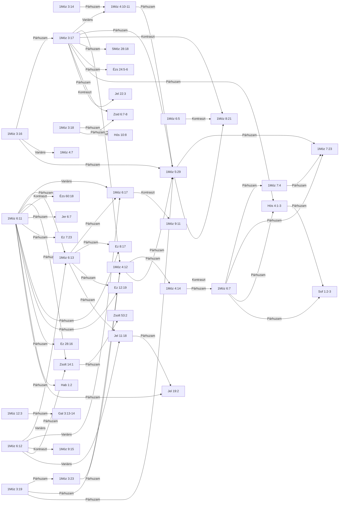

<!-- GENERÁLT: general.py --cel lexikon | rések: motivumok/HAMART-001.md -->

# 📖 HAMART-001 — A bűn következményeinek gyűrűzése — átok, föld és romlás

**A motívum.** A bűn következménye az 1Mózes 3–9. fejezetében nem marad az elkövetőnél: a kígyótól és az első emberpártól Kainon és Lámeken át az özönvíz egész nemzedékéig terjed, a személytől a földig és az egész emberiségig, és ezt a terjedést hat héber szó lánca hordozza (átok, föld, fáradság, bűn, erőszak, romlás). A motívum ezt a láncot és azokat a későbbi bibliai helyeket foglalja magában, amelyek ugyanezekkel a szavakkal idézik fel. Szerkezeti motívum: azonosságát nem egyetlen szó adja, hanem egy szerkezet, amelyet több szó együtt hordoz.

**Mi tartozik ide, és mi nem.** A versben az 1Mózes 3–9. fejezetének szóláncából (átok, föld, fáradság, bűn, erőszak, romlás) egy szó áll — héberül az átok (árar), a föld (adámá), a fájdalom és fáradság (iccávón), a bűn (chattát), az erőszak (chámász) vagy a romlás igéje (sáchat); görögül az átkozott (ἐπικατάρατος, epikataratosz), az átok (κατάρα, katara) vagy a romlás szócsaládja (φθείρω, ftheiró) —, vagy a lánc szópárja (tövis és bogáncs; megtelt erőszakkal), vagy az erőszak szava a hallás igéjével ugyanabban a versben, és a hely ezen a szón át az 1Móz 3–9 láncára utal vissza: az átkot a földön, a föld romlását, az erőszakkal megtelt földet vagy a föld színéről való eltörlést mondja ki, ismétli vagy fordítja meg. Nem tartozik ide a hely, amelyben a szó általános használatban áll (bűnáldozat, föld mint ország vagy talaj, katonai pusztítás, rituális vagy emberi átkozódás, az erőszak a megtelés és a hallás szava nélkül, romlandó test), és az sem, amely az átkot vagy a föld elvesztését a szövetség rendjében, a szövetség megszegésének büntetéseként mondja ki. A lánc szavai nélkül csak az a néhány hely tartozik ide, amely ugyanezt a szerkezetet más szavakkal mondja ki; ezeket a lap egyenként, tematikus helyként veszi fel. Az újszövetségi helyeknél a Textus Receptus a mérce.

**Fölérendelt fogalom** (a tágabb kategória: ha egy hely csak ezen át tartozna ide, kimarad). A bűn és következményei általában, a genezisi lánc szavai és szerkezete nélkül.

*A lap azonosító és technikai adatai (azonosító, téma, PaRDeS-szint, státusz, azonosság típusa) a [Kolofonban](#kolofon) állnak.*

## Kivonat

A motívum rövid összefoglalása: miről szól, és hol fordul elő a Bibliában.<!-- olvasói -->

A motívum azt követi végig, hogyan terjed a bűn következménye az elkövetőn túl, és hogyan tér vissza ugyanez a szerkezet a Biblia későbbi könyveiben. Az 1Mózes 3–9. fejezetében hat héber szó alkot láncot: az átok (árar), a föld (adámá), a fájdalom és fáradság (iccávón), a bűn (chattát), az erőszak (chámász) és a romlás igéje (sáchat). Az átok először a kígyóra szól (1Móz 3:14), majd az ember miatt a földre száll (1Móz 3:17), Kainnál a föld felől a személyt éri (1Móz 4:11), Lámek pedig olyan teherként nevezi meg, amelyből vigasztalást vár (1Móz 5:29). Az özönvíz előtt „megtelék a föld erőszakoskodással” (1Móz 6:11): minden test megrontotta az útját, és Isten ugyanazzal az igével mondja ki az ítéletet, amely a romlást megnevezte (1Móz 6:12-13). A fordulópont az özönvíz utáni mondat: „Nem átkozom meg többé a földet az emberért, mert az ember szívének gondolatja gonosz az ő ifjúságától fogva” (1Móz 8:21). A Genezisben új átok a földre ezután nem hangzik el, az ember szíve viszont ugyanaz marad, ezért a lánc nem ér véget, hanem irányt vált: Ábrám elhívásában a föld szava már az áldás mondatában áll, „megáldatnak te benned a föld minden nemzetségei” (1Móz 12:3). Hogy a korábbi átok mint állapot megmarad-e, azt a lap nem dönti el (l. a vitatott pontokat).

A lap 47 helyet sorol fel 54 versben: 23-at a Genezisből, 18-at az Ószövetség többi könyvéből és 6-ot az Újszövetségből. A későbbi helyek a lánc egy-egy szavát vagy szókapcsolatát hozzák vissza: a törvény átkai közül azt az egyet, amely a föld termésére szól (5Móz 28:18); a próféták mondatait arról, hogy Júda háza erőszakkal tölti meg a földet (Ez 8:17), hogy a város tele van erőszakkal (Ez 7:23), és hogy a városban erőszak hallatszik (Jer 6:7); a föld színéről való eltörlés fordulatát (Sof 1:2-3); az Újszövetségben a teremtett világ romlását (Róm 8:21), határesetként a Galata-levél átok- és áldás-mondatát (Gal 3:13-14), és a föld megrontóinak ítéletét (Jel 11:18, 19:2).

Mivel a motívumot a szavak láncolata tartja össze, a lista keresés eredménye, nem kimerítő felsorolás: a lánc hat héber és három görög szavának, illetve szócsaládjának minden előfordulása átnézésre került, és csak azok a helyek kerültek a listára, amelyek a láncra visszautalnak. Ide az a hely tartozik, amelyben a lánc egyik szava áll — görögül az átkozott (ἐπικατάρατος, epikataratosz), az átok (κατάρα, katara) vagy a romlás szócsaládja (φθείρω, ftheiró) —, vagy a lánc szópárja (tövis és bogáncs; megtelt erőszakkal), vagy az erőszak szava a hallás igéjével ugyanabban a versben, és a hely ezen a szón át az 1Mózes 3–9. fejezetének láncára utal vissza: az átkot a földön, a föld romlását, az erőszakkal megtelt földet vagy a föld színéről való eltörlést mondja ki, ismétli vagy fordítja meg. A hallás igéje háromféleképpen állhat az erőszak mellett: maga az erőszak hallatszik (Jer 6:7), az erőszakról szóló hír hallatszik (Jer 51:46), vagy a miatta kiáltó szó nem talál meghallgatásra (Hab 1:2). Nem tartozik ide a hely, amelyben a szó általános használatban áll: a bűnáldozat törvényei, a föld mint ország vagy talaj, a katonai és fizikai pusztítás, a rituális vagy emberi átkozódás, az erőszak szava a megtelés és a hallás szava nélkül, és a romlandó test. Az sem tartozik ide, amely az átkot vagy a föld elvesztését a szövetség rendjében, a szövetség megszegésének büntetéseként mondja ki: ilyenek a törvény átok-kimondásai (5Móz 27:15-26), és a Királyok könyveinek földvesztés-ítéletei, Jeroboám házának kiirtása „a föld színéről” (1Kir 13:34) és Izrael fogságba vitele „az ő földéből” (2Kir 17:23). Ez utóbbi kettőben a föld szava (adámá) áll; a kizárás oka nem a szó hiánya, hanem az, hogy az ítélet a szövetség megszegésére felel, és nem a Genezis láncát hozza vissza. A listán álló két prófétai ítélet ezzel szemben a lánc képét viszi tovább: az Ez 12:19-ben a föld a lakói erőszaka miatt üresedik ki teljességéből, ahogy az 1Móz 6:11-13-ban a megtelt földet éri az ítélet, a Sof 1:2-3 pedig az özönvíz előtti ítélet felsorolásából az embert, a barmot és az ég madarait hozza vissza (1Móz 6:7), a föld színéről való eltörlés fordulatával.

A motívum tehát nem a bűn és következményei általában, hanem az a sajátos lánc, amelyben a következmény az elkövetőn túl a földre, a családra és az egész emberiségre terjed, és amelyet a Biblia későbbi könyvei ugyanazokkal a szavakkal idéznek fel. Négy hely a lánc szavai nélkül is ide tartozik, mert ugyanezt a szerkezetet más szavakkal mondja ki; ezeket a lap egyenként, tematikus helyként veszi fel. Ilyen az 1Móz 6:5 szív-diagnózisa, az Ézs 24:5-6, ahol az átok más héber szóval (álá) emészti meg a földet, a Hós 4:1-3, ahol a lakók bűne miatt „búsul a föld”, és a Jel 22:3 záró mondata: „semmi elátkozott nem lesz többé”. Az újszövetségi helyeknél a Károli alapszövege, a Textus Receptus a mérce.

## Tartalomjegyzék

<!-- GENERÁLT-KEZDET: general.py --cel lexikon#HAMART-001#tartalom | forrás:  | licenc: minden jog fenntartva | ts=2026-11-12 -->

A lap szakaszai. Hogy melyik szakaszt ki írta, a Kolofon szerzőségi mondata mondja meg.<!-- olvasói -->

*Ez a blokk a lexikon-oldal 15 szakaszának tartalomjegyzékét adja (a lapszerkezet leírása G1).*

- [Kivonat](#kivonat)
- [Jelmagyarázat és rövidítések](#jelmagyarázat-és-rövidítések)
- [1. Döntési út](#1-döntési-út)
- [2. Előfordulások](#2-előfordulások)
- [3. Kizárt és vizsgált helyek](#3-kizárt-és-vizsgált-helyek)
- [4. Szótári háttér](#4-szótári-háttér)
- [5. LXX-fordítói döntések](#5-lxx-fordítói-döntések)
- [6. Kereszthivatkozások](#6-kereszthivatkozások)
- [7. Kapcsolatok](#7-kapcsolatok)
- [8. Kapcsolódó motívumok](#8-kapcsolódó-motívumok)
- [9. Hatástörténet: ókori fordítások és értelmezők](#9-hatástörténet-ókori-fordítások-és-értelmezők)
- [10. Értelmezés](#10-értelmezés)
- [11. Módszertan és nyitott kérdések](#11-módszertan-és-nyitott-kérdések)
- [12. Irodalom és idézés](#12-irodalom-és-idézés)
- [Kolofon](#kolofon)

<!-- GENERÁLT-VÉGE: lexikon#HAMART-001#tartalom -->

## Jelmagyarázat és rövidítések

<!-- GENERÁLT-KEZDET: general.py --cel lexikon#HAMART-001#jelmagyarazat | forrás:  | licenc: minden jog fenntartva | ts=2026-11-12 -->

A lapon használt rövidítések, jelek és forrásnevek feloldása. Ha a lap egy jelét nem érted, itt keresd.<!-- olvasói -->

*Ez a blokk közös, minden lexikon-oldalon szó szerint azonos szöveg.*

**PaRDeS-szintek** (a PaRDeS-gyorsreferencia):
- **Peshat** — a szöveg szerinti, szó szerinti értelem.
- **Remez** — csak felismerés/azonosítás, következtetés nélkül.
- **Drash** — normatív, következtető, alkalmazó.
- **Sod** — fegyelmezett, csak szövegből levezethető, gematria/allegorizálás nélkül.

A szint olvasási módot jelöl, nem a szöveg jelentését: a zsidó írásmagyarázat négyes sémájának kategóriáival mondja
meg, hogyan kapcsolódik a hely a motívumhoz (szó szerint, utalásként, következtetésként vagy spirituális olvasatban). Nem
kritikai állítás arról, mit szándékolt a bibliai szerző, és nem a szöveg eredeti, történeti jelentésének szintje. A
besorolást e munka adja, saját szabályai szerint; nevesített magyarázók olvasatát a lap nem
gyűjti; az ókori fordítások és értelmezők olvasatát a 9. szakasz mutatja. Egy hely motívumhoz tartozásának bizonyítéka a héber és a görög szöveg, nem
a szint (részletesen: [A PaRDeS-szint mint recepciós címke](../kozlemeny/PARDES_RECEPCIOS_KERET.md)).

**Funkció:** a vers szerepe a motívum ívében — az adatséma szerint
szabad szöveg (nincs zárt értékkészlet), az alábbi táblákban a motívum
kézi forrásában rögzített megnevezés áll.

**Rövidítések:** BDB (Brown–Driver–Briggs), TBESH/TBESG (Tyndale Bible
Encyclopedia — Strong's Hebrew/Greek), Thayer (Thayer's Greek Lexicon),
UBS (UBS Dictionary of New Testament Greek — Louw–Nida szemantikai
doménekkel), L–N (Louw–Nida doménkód), SDBH/SDGNT (Semantic Dictionary
of Biblical Hebrew/Greek), OSHL (Open Scriptures Hebrew Lexicon), TWOT
(Theological Wordbook of the Old Testament — csak számhivatkozás), TSK
(Treasury of Scripture Knowledge), KH (Károli-kereszthivatkozás), LXX
(Septuaginta), MT (Masoretic Text), KJV (King James Version), HCF (HistoricalChristianFaith
Commentaries Database, az egyházatyai tanúk adatbázisa; a „HCF: 373” alakban a szám az adatbázisban
a szerzőhöz rendelt évszám).

**Kiejtés:** a héber és a görög szó mellett zárójelben a magyaros kiejtés, mindkét nyelven szabályos átírás. A
héber kiejtés a pontozott héber szövegből rögzített szabályokkal készül (pl. „וַיִּקְרָא (vajjikrá)”); ahol van kézzel
jóváhagyott alak, az áll. A ragozott szó mellett a saját kiejtése áll, nem a szótári alaké.

**A szótári pontok** (4. Szótári háttér): szavanként számozott pontok követik egymást, mindegyik egy kérdésre felel: 4.1 alapjelentés; 4.2 mélységi szócikk; 4.3 teológiai szócikk; 4.4 jelentésszerkezet, szemantikai mező; 4.5 tömör jelentés, előfordulás; 4.6 LXX-híd; 4.7 megfelelők a másik nyelven; 4.8 nyelvi háttér; 4.9 versenkénti jelentés; 4.10 kiejtés (magyaros); 4.11 visszhang: ókori fordítások (a 9. szakaszban); 4.12 tematikus index (témák és igehely-hivatkozások); 4.13 Károli-megfelelők; 4.14 rejtett / hamis párhuzam. A 4.1–4.10 nyelvenként, szavanként áll, a 4.11–4.14 a motívum egészére vonatkozik.

**Olvasói bevezető** — minden blokk elején egy-két mondatos összefoglaló; az alatta álló dőlt, technikai
mondat a lap készítőinek szól.

**Forrásmegjelölés** (dőlt sor vagy lábjegyzet, „forrás: …” alakú): melyik adattáblából vagy lekérdezésből és mikor
származik a fölötte álló adat; a „kézi szerkesztés” kézi rögzítést jelöl. A teljes, gépi alakú forrássor a lap
forrásában, megjegyzésként áll. Az ellenőrzéshez való, olvasáskor átugorható.

**Héber rövidítések a BDB-szövegben** (kiemelve; az egérmutató alatt a feloldás): a BDB a gyakori szavakat egy
betűvel és a rövidítő jellel (׳, geres) írja. **י׳** = יְהוָה (JHVH), a Károliban „az Úr”; a szócikk címszavának
kezdőbetűje (pl. **ק׳** a קָרָא (kárá) szócikkében, **שׁ׳** a שֵׁם (sém) szócikkében) maga a címszó. Más betűnél a feloldás a
szócikk szövegéből derül ki.

A szótári fordításokban a πνεῦμα (pneuma) mindig *szellem*, a ψυχή
(pszükhé) *lélek*; a Károli-idézetek szövege változatlan (pl. »Lélek«).

<!-- GENERÁLT-VÉGE: lexikon#HAMART-001#jelmagyarazat -->

## 1. Döntési út

<!-- GENERÁLT-KEZDET: general.py --cel lexikon#HAMART-001#dontesi_ut | forrás: adat/jeloltek.tsv, adat/elofordulasok.tsv, adat/motivumok.tsv, adat/elutasitasi_okok.tsv, konkordancia/Karoli_1908.tsv | licenc: minden jog fenntartva, közkincs | ts=2026-11-12 -->

A lap első lépése, az igehelyek előtt: mit keres a lap, hol keresett, mi esett ki és miért, és mi maradt. 1 796 megvizsgált versből 54 tartozik a motívumhoz; minden vers egyszer számít, és a számok összeadódnak.<!-- olvasói -->

*A Döntési út: a motívum keresésének és döntéseinek összegzése; a részletek a 2. és a 3. szakaszban.*

### 1.1. A keresés tárgya

**A motívum:** A bűn következményeinek gyűrűzése — átok, föld és romlás.

**Ami ide tartozik:** A versben az 1Mózes 3–9. fejezetének szóláncából (átok, föld, fáradság, bűn, erőszak, romlás) egy szó áll — héberül az átok (árar), a föld (adámá), a fájdalom és fáradság (iccávón), a bűn (chattát), az erőszak (chámász) vagy a romlás igéje (sáchat); görögül az átkozott (ἐπικατάρατος, epikataratosz), az átok (κατάρα, katara) vagy a romlás szócsaládja (φθείρω, ftheiró) —, vagy a lánc szópárja (tövis és bogáncs; megtelt erőszakkal), vagy az erőszak szava a hallás igéjével ugyanabban a versben, és a hely ezen a szón át az 1Móz 3–9 láncára utal vissza: az átkot a földön, a föld romlását, az erőszakkal megtelt földet vagy a föld színéről való eltörlést mondja ki, ismétli vagy fordítja meg.

**Ami nem:** Nem tartozik ide a hely, amelyben a szó általános használatban áll (bűnáldozat, föld mint ország vagy talaj, katonai pusztítás, rituális vagy emberi átkozódás, az erőszak a megtelés és a hallás szava nélkül, romlandó test), és az sem, amely az átkot vagy a föld elvesztését a szövetség rendjében, a szövetség megszegésének büntetéseként mondja ki. A lánc szavai nélkül csak az a néhány hely tartozik ide, amely ugyanezt a szerkezetet más szavakkal mondja ki; ezeket a lap egyenként, tematikus helyként veszi fel. Az újszövetségi helyeknél a Textus Receptus a mérce. A motívum nem a fölérendelt fogalom: a bűn és következményei általában, a genezisi lánc szavai és szerkezete nélkül.

### 1.2. A keresés forrásai

**A motívum szavai:** אֲדָמָה (adámá), föld: talaj; אָרַר (árar), megátkozni; דַּרְדַּר (dardar), bogáncs; חַטָּאת (chattát), bűn; חָמָס (chámász), erőszak; עִצָּבוֹן (iccávón), fáradság; קוֹץ (kóc), tövis; שָׁחַת (sáchat), elpusztítani, megrontani; διαφθείρω (diaftheiró), elpusztítani; ἐπικατάρατος (epikataratosz), átkozott; κατάρα (katara), átok; φθείρω (ftheiró), elpusztítani; φθορά (fthora), megromlás.

| Keresés | Vers | Mit nézett |
|---|---|---|
| A szavak minden előfordulása | 1 403 | A lánc héber és görög szavai a teljes Ó- és Újszövetségben |
| A magyar szavak | 412 | A lánc szavainak magyar megfelelői a teljes Károli-fordításban |
| A szótárak idézőhelyei | 1 074 | ahol a héber és a görög szótár ezeknél a szavaknál egy verset idéz |
| Kereszthivatkozások ajánlásai | 99 | A kereszthivatkozás-gyűjtemények (TSK, Károli) ajánlásai a motívum helyeihez |
| **Összesen, minden vers egyszer számolva** | **1 796** | A keresések és az ajánlások együtt, a motívum helyeivel |

*A keresések versszáma a lap teljesség-méréséből.*<!-- scope=TAHOT-teljes+TAGNT-teljes | forras=TAHOT_kivonat.tsv+TAGNT_kivonat.tsv | strong=G1311+G1944+G2671+G5351+G5356+H0127+H0779+H2403+H2555+H6093+H6975+H7043+H7451+H7843 | n=1403 | ts=2026-11-03T11:43Z --><!-- scope=Karoli_1908-teljes | forras=Karoli_1908.tsv+adat/szoto/karoli_szotari_alak.tsv | szotari_alak=elront+elátkoz+erőszak+megromol+megront+megátkoz+romlás+romol+tövis+átkoz+átkozott+átok | n=412 | ts=2026-11-03T11:43Z --><!-- scope=G1311+G1944+G2671+G5351+G5356+H0127+H0779+H2403+H2555+H6093+H6975+H7043+H7451+H7843 | forras=adat/bdb_vers_jelentes.tsv+adat/thayer_vers_jelentes.tsv (karoli_vers) | n=1074 | ts=2026-11-03T11:43Z -->

### 1.3. Mi esett ki és miért

| Lépés | Vers | Miért |
|---|---|---|
| **Megvizsgált versek összesen** | **1 796** | 1.2. lépés minden találata |
| **Csoportosan kizárva** | **1 506** | A keresés találata, de egy közös ok miatt egyik sem tartozik ide (4 ok, lent lenyitható) |
| **Egyenként elbírálva és elutasítva** | **236** | egyenként olvasott versek, mindegyik saját indokkal (25 ok, lent lenyitható) |
| **A motívumhoz tartozik** | **54** | 47 hely (a tartomány-soroknál több vers egy helyen) |

**Összeadás:** 54 (a motívumhoz tartozik) + 1 506 (csoportosan kizárva) + 236 (egyenként elutasítva) = 1 796 megvizsgált vers. Döntés nélkül maradt vers: 0.

#### Csoportosan kizárt versek, okonként

<strong>más szó áll a versben, nem a motívum lexémája</strong> — 887 vers

a Károli magyar szava itt más héber vagy görög szót fordít; a motívum szava a versben nem áll

Példák (a Károli-szöveggel):
<ul><li>1Kir 1:52: <em>És monda Salamon: Ha jámbor lészen, egy hajszál fejéről le nem esik a földre; de ha gonoszság találtatik ő benne, meg kell halnia.</em></li><li>1Kir 2:8: <em>És ímé veled van Sémei, Gérának fia, a Bahurimbeli Benjáminita, a ki gyalázatosan szidalmazott akkor, mikor Mahanáimba mentem; de aztán, mikor elém alájött a Jordánhoz, megesküdtem néki az Úrra, és mondék: Nem öllek meg téged fegyverrel;</em></li><li>2Móz 22:6: <em>Ha tűz támad, és tövisbe kap, és megég az asztag, vagy a lábon álló gabona, vagy a mező: fizesse meg a kárt, a ki a tüzet gyujtotta.</em></li><li>1Kir 11:27: <em>Annak pedig, a miért felemelte kezét a király ellen, ez volt az oka: Mikor Salamon megépítette Millót, és berakatta az ő atyjának, a Dávid városának romlását;</em></li><li>1Kor 12:3: <em>Azért tudtotokra adom néktek, hogy senki, a ki Istennek Lelke által szól, nem mondja Jézust átkozottnak; és senki sem mondhatja Úrnak Jézust, hanem csak a Szent Lélek által.</em></li></ul>
A csoport mind a 887 verse a <a href="HAMART-001_KIZARASOK.md#más-szó-áll-a-versben-nem-a-motívum-lexémája--887-vers">kizárt helyek mellékletében</a> áll.

<strong>a szó áll, de általános használatban, a lánc nélkül</strong> — 577 vers

a lánc szava áll a versben, de köznapi értelemben (föld mint talaj, bűnáldozat, pusztítás), és a hely nem utal vissza a Genezisre

Példák (a Károli-szöveggel):
<ul><li>1Kir 7:46: <em>A Jordán völgyében önteté ezeket a király az agyagos földben, Sukhót és Sártán között.</em></li><li>1Kir 8:36: <em>Te hallgasd meg őket a mennyekből, és légy kegyelmes a te szolgáidnak és az Izráelnek, a te népednek vétke iránt, tanítsd meg őket a jó útra, a melyen járjanak; és adj esőt a te földedre, a melyet örökségül adtál a te népednek.</em></li><li>1Krón 12:17: <em>És kiméne Dávid elejökbe, és felelvén, monda nékik: Hogyha békesség okáért jöttök hozzám, hogy segítségemre legyetek, az én szívem egy lesz ti veletek; ha pedig meg akartok csalni, hogy eláruljatok az én ellenségeimnek, holott semmi gonoszságot nem követtem el: lássa meg a mi atyáink Istene és büntessen meg.</em></li><li>1Krón 20:1: <em>És lőn az esztendőnek fordulásával, mikor a királyok harczba menni szoktak, elindítá Joáb a hadat, és elpusztítá az Ammon fiainak földjét. És elmenvén megszállá Rabbát, (Dávid pedig Jeruzsálemben marada) és elfoglalá Joáb Rabbát és elrontá azt.</em></li></ul>
A csoport mind a 577 verse a <a href="HAMART-001_KIZARASOK.md#a-szó-áll-de-általános-használatban-a-lánc-nélkül--577-vers">kizárt helyek mellékletében</a> áll.

<strong>a szótár idézi, de a Károli-versben a szó nem áll</strong> — 41 vers

a szótár a héber vagy a görög versszámozás szerint idézi a helyet; a Károli-versben a szó nem áll

Példák (a Károli-szöveggel):
<ul><li>1Krón 2:8: <em>Ethán fia: Azária.</em></li><li>1Krón 12:16: <em>Jövének Dávidhoz a Benjámin és a Júda fiai közül is az erősségbe.</em></li><li>1Móz 18:18: <em>Holott Ábrahám nagy és hatalmas néppé lesz; és benne megáldatnak a földnek minden nemzetségei.</em></li><li>2Móz 21:27: <em>Ha pedig szolgájának fogát, vagy szolgálójának fogát üti ki, bocsássa azt szabadon az ő fogáért.</em></li><li>3Móz 4:2: <em>Szólj az Izráel fiainak, mondván: Ha valaki tévedésből vétkezik az Úrnak valamely parancsolata ellen, úgy a mint nem kellene cselekednie, és a parancsolatok közül valamelyiknek ellene cselekszik:</em></li></ul>
A csoport mind a 41 verse a <a href="HAMART-001_KIZARASOK.md#a-szótár-idézi-de-a-károli-versben-a-szó-nem-áll--41-vers">kizárt helyek mellékletében</a> áll.

<strong>emberi átkozódás, nem a genezisi lánc folytatása</strong> — 1 vers

ember átkoz embert vagy tárgyat; nem a Genezis átkának folytatása

Példák (a Károli-szöveggel):
<ul><li>Ján 7:49: <em>De ez a sokaság, a mely nem ismeri a törvényt, átkozott!</em></li></ul>
A csoport egyetlen verse a <a href="HAMART-001_KIZARASOK.md#emberi-átkozódás-nem-a-genezisi-lánc-folytatása--1-vers">kizárt helyek mellékletében</a> áll.

#### Egyenként elutasított versek, okonként

<strong>átok-kimondás, a következmény továbbterjedése nélkül</strong> — 30 vers

rituális, jogi vagy indulati átok; a hely nem mondja, hogy egy tett következménye továbbterjed

Versek: Jer 17:5, 1Móz 27:29, 1Móz 49:7, 1Sám 14:24, 1Sám 14:28, 1Sám 26:19, 2Kir 9:34, 2Móz 22:28, 4Móz 22:12, 4Móz 22:6, 4Móz 23:7, 4Móz 24:9, 4Móz 5:18, 4Móz 5:19, 4Móz 5:22, 4Móz 5:24, 4Móz 5:27, Bír 21:18, Bír 5:23, Jer 11:3, Jer 20:14, Jer 20:15, Jer 48:10, Jób 3:8, Józs 6:26, Józs 9:23, Mal 1:14, Mal 2:2, Mal 3:9, Zsolt 119:21.

A <a href="HAMART-001_KIZARASOK.md#átok-kimondás-a-következmény-továbbterjedése-nélkül--30-vers">kizárt helyek mellékletében</a> is.

<strong>romlás más értelemben, nem a genezisi szerkezet</strong> — 22 vers

a test enyészete vagy romlandósága, nem a föld romlása

Versek: 1Kor 15:42, 1Kor 15:50, 2Pét 1:4, 2Pét 2:19, Gal 6:8, Kol 2:22, 1Tim 6:5, 2Kor 4:16, Jel 8:9, Luk 12:33, ApCsel 2:27, ApCsel 2:31, ApCsel 13:34, ApCsel 13:35, ApCsel 13:36, ApCsel 13:37, 1Kor 9:25, 1Kor 15:53, 1Kor 15:54, 1Pét 1:18, 1Pét 1:23, Róm 1:23.

A <a href="HAMART-001_KIZARASOK.md#romlás-más-értelemben-nem-a-genezisi-szerkezet--22-vers">kizárt helyek mellékletében</a> is.

<strong>a fáradság bölcsességirodalmi toposza, a genezisi szó nélkül</strong> — 16 vers

a fáradság a bölcsességirodalom témája, a Genezis fáradság-szava nélkül

Versek: Jób 14:1, Jób 21:17, Jób 5:6, Jób 5:7, Préd 1:13, Préd 1:14, Préd 1:2, Préd 1:3, Préd 2:12, Préd 2:18, Préd 2:23, Préd 2:24, Préd 5:17, Zsolt 127:2, Zsolt 90:7, Zsolt 90:9.

A <a href="HAMART-001_KIZARASOK.md#a-fáradság-bölcsességirodalmi-toposza-a-genezisi-szó-nélkül--16-vers">kizárt helyek mellékletében</a> is.

<strong>szövetségi átok-formula, a föld szava nélkül</strong> — 16 vers

a szövetség átkait mondja ki az átok igéjével, de a föld (adámá) szava nélkül; a negatív kritérium szerint a szövetségi rend nem a lánc folytatása

Versek: 5Móz 27:15, 5Móz 27:16, 5Móz 27:17, 5Móz 27:18, 5Móz 27:19, 5Móz 27:20, 5Móz 27:21, 5Móz 27:22, 5Móz 27:23, 5Móz 27:24, 5Móz 27:25, 5Móz 27:26, Gal 3:10, 5Móz 28:16, 5Móz 28:17, 5Móz 28:19.

A <a href="HAMART-001_KIZARASOK.md#szövetségi-átok-formula-a-föld-szava-nélkül--16-vers">kizárt helyek mellékletében</a> is.

<strong>egy másik motívum tárgya</strong> — 14 vers

a hely egy másik motívumhoz tartozik (kereszt-motívum elhatárolás)

Versek: Mt 15:19, Mk 7:21, Mk 7:22, Mk 7:23, Jer 17:9, Jer 4:14, Jób 16:18, Jób 31:38, Jel 12:16, Ézs 26:21, 1Móz 10:9, 1Móz 13:13, Jer 4:23, Jer 4:28.

A <a href="HAMART-001_KIZARASOK.md#egy-másik-motívum-tárgya--14-vers">kizárt helyek mellékletében</a> is.

<strong>tövis-kép, a genezisi szókapcsolat nélkül</strong> — 11 vers

tövis vagy bogáncs képként áll, a Genezis tövis és bogáncs szópárja nélkül

Versek: Jer 12:13, Jer 4:3, Jób 31:40, Jób 5:5, Józs 23:13, Mt 13:7, Péld 22:5, Péld 24:31, Ézs 32:13, Ézs 5:6, Ézs 7:23.

A <a href="HAMART-001_KIZARASOK.md#tövis-kép-a-genezisi-szókapcsolat-nélkül--11-vers">kizárt helyek mellékletében</a> is.

<strong>a föld elvesztése vagy terméketlensége a szövetségi rendben, nem a lánc</strong> — 10 vers

a föld elvesztése vagy terméketlensége a szövetség rendjében, a Genezisre való visszautalás nélkül

Versek: 1Kir 8:34, 1Kir 8:35, 1Kir 13:34, 1Kir 14:15, 1Kir 14:16, 2Kir 17:22, 2Kir 17:23, 2Krón 6:25, 2Krón 6:26, Mal 3:11.

A <a href="HAMART-001_KIZARASOK.md#a-föld-elvesztése-vagy-terméketlensége-a-szövetségi-rendben-nem-a-lánc--10-vers">kizárt helyek mellékletében</a> is.

<strong>szövetségi átok-szakasz, az átok-ige nélkül</strong> — 10 vers

a szövetség átkait sorolja, de a Genezis átok-igéje nélkül

Versek: 3Móz 26:20, 3Móz 26:36, 5Móz 28:15, 5Móz 28:20, 5Móz 28:23, 5Móz 28:24, 5Móz 28:65, 5Móz 28:66, 5Móz 29:19, 5Móz 29:21.

A <a href="HAMART-001_KIZARASOK.md#szövetségi-átok-szakasz-az-átok-ige-nélkül--10-vers">kizárt helyek mellékletében</a> is.

<strong>általános engedetlenség-téma, a föld-átok szerkezete nélkül</strong> — 10 vers

általában szól az engedetlenségről, a föld átkának szerkezete nélkül

Versek: 1Sám 15:23, 1Sám 15:24, Jer 7:23, Jer 7:24, Luk 19:22, Mt 22:12, Mt 25:26, Mt 25:27, Mt 25:45, Róm 3:19.

A <a href="HAMART-001_KIZARASOK.md#általános-engedetlenség-téma-a-föld-átok-szerkezete-nélkül--10-vers">kizárt helyek mellékletében</a> is.

<strong>emberi átkozódás, nem a genezisi lánc folytatása</strong> — 9 vers

ember átkoz embert vagy tárgyat; nem a Genezis átkának folytatása

Versek: 1Móz 9:25, Jak 3:9, Luk 6:28, Mk 11:21, Mt 25:41, Mt 5:44, Róm 12:14, 2Pét 2:14, Jak 3:10.

A <a href="HAMART-001_KIZARASOK.md#emberi-átkozódás-nem-a-genezisi-lánc-folytatása--9-vers">kizárt helyek mellékletében</a> is.

<strong>a szócsalád más használata, nem a romlás szerkezete</strong> — 8 vers

a romlás szócsaládjának más használata, például erkölcsi jellemzés

Versek: 1Kor 15:33, 1Kor 3:17, 2Kor 11:3, 2Kor 7:2, 2Pét 2:12, Ef 4:22, Júd 1:10, 2Tim 3:8.

A <a href="HAMART-001_KIZARASOK.md#a-szócsalád-más-használata-nem-a-romlás-szerkezete--8-vers">kizárt helyek mellékletében</a> is.

<strong>az erőszak szava más használatban, nem a föld megtelése</strong> — 8 vers

az erőszak szava személyek közti sérelemre, a föld megtelése nélkül

Versek: Hab 2:8, Hab 2:17, Jón 3:8, Zsolt 11:5, Zsolt 140:12, Zsolt 55:10, 1Móz 16:5, 1Móz 49:5.

A <a href="HAMART-001_KIZARASOK.md#az-erőszak-szava-más-használatban-nem-a-föld-megtelése--8-vers">kizárt helyek mellékletében</a> is.

<strong>az özönvíz-elbeszélés felidézése, az átok terjedése nélkül</strong> — 8 vers

Noé vagy az özönvíz felidézése, az átok terjedése nélkül

Versek: 2Pét 3:6, 2Pét 3:7, 1Pét 3:19, 1Pét 3:20, 2Pét 2:5, Zsid 11:7, 2Pét 3:10, 2Pét 3:12.

A <a href="HAMART-001_KIZARASOK.md#az-özönvíz-elbeszélés-felidézése-az-átok-terjedése-nélkül--8-vers">kizárt helyek mellékletében</a> is.

<strong>más szókapcsolat (Isten letekint, minden test), nem a romlás szerkezete</strong> — 8 vers

más szókapcsolat (Isten letekint, minden test), nem a romlás láncához tartozik

Versek: 1Móz 18:21, Jób 22:15, Jób 22:17, Jób 33:27, Luk 3:6, Péld 15:3, Zsolt 33:13, Zsolt 33:14.

A <a href="HAMART-001_KIZARASOK.md#más-szókapcsolat-isten-letekint-minden-test-nem-a-romlás-szerkezete--8-vers">kizárt helyek mellékletében</a> is.

<strong>semleges, elbeszélő használat, nem az átok-szerkezet</strong> — 8 vers

a föld szava elbeszélésben áll, átok nélkül

Versek: 1Móz 4:2, 1Móz 4:3, 1Móz 6:1, 1Móz 6:20, 1Móz 8:8, 1Móz 8:13, 1Móz 9:2, 1Móz 9:20.

A <a href="HAMART-001_KIZARASOK.md#semleges-elbeszélő-használat-nem-az-átok-szerkezet--8-vers">kizárt helyek mellékletében</a> is.

<strong>fizikai pusztítás, nem erkölcsi megromlás</strong> — 7 vers

épület, ország vagy termés fizikai pusztulása, nem erkölcsi megromlás

Versek: 2Krón 34:11, Dán 8:24, Jer 36:29, Jer 49:9, Jer 51:20, Ézs 37:12, Jer 51:25.

A <a href="HAMART-001_KIZARASOK.md#fizikai-pusztítás-nem-erkölcsi-megromlás--7-vers">kizárt helyek mellékletében</a> is.

<strong>a mező füve mint táplálék, nem a tövis-átok</strong> — 6 vers

a mező füve mint táplálék, nem az átkozott föld tövise

Versek: Jób 1:21, Róm 14:2, Zsolt 104:14, Zsolt 104:15, Zsolt 104:2, Zsolt 90:3.

A <a href="HAMART-001_KIZARASOK.md#a-mező-füve-mint-táplálék-nem-a-tövis-átok--6-vers">kizárt helyek mellékletében</a> is.

<strong>a romlás igéje a szövetséges nép hűtlenségére, az egyetemes szerkezet nélkül</strong> — 6 vers

a romlás igéje Izrael hűtlenségéről, az egész emberiségre kiterjedő ítélet nélkül

Versek: 5Móz 4:25, Bír 2:19, Sof 3:7, 5Móz 9:26, 5Móz 9:27, Hós 9:9.

A <a href="HAMART-001_KIZARASOK.md#a-romlás-igéje-a-szövetséges-nép-hűtlenségére-az-egyetemes-szerkezet-nélkül--6-vers">kizárt helyek mellékletében</a> is.

<strong>jogi, bűnbánati vagy panasz-használat, a lánc nélkül</strong> — 6 vers

jogi szabály, bűnbánat vagy panasz; a két szó egymás mellett áll, visszautalás nélkül

Versek: 5Móz 19:15, 5Móz 19:16, Neh 9:1, Neh 9:2, Zsolt 25:18, Zsolt 25:19.

A <a href="HAMART-001_KIZARASOK.md#jogi-bűnbánati-vagy-panasz-használat-a-lánc-nélkül--6-vers">kizárt helyek mellékletében</a> is.

<strong>a „vég” formulája, más kulcsszóval</strong> — 5 vers

a „vég” prófétai formulája, más kulcsszóval

Versek: Ez 7:2, Ez 7:6, Jer 51:13, Ámós 8:2, 1Pét 4:7.

A <a href="HAMART-001_KIZARASOK.md#a-vég-formulája-más-kulcsszóval--5-vers">kizárt helyek mellékletében</a> is.

<strong>általános bűn-leírás, a terjedés szerkezete nélkül</strong> — 5 vers

bűnlista vagy általános megállapítás az emberi szívről, a terjedés szerkezete nélkül

Versek: Préd 7:29, Préd 9:5, Róm 1:28, Róm 1:31, Tit 3:3.

A <a href="HAMART-001_KIZARASOK.md#általános-bűn-leírás-a-terjedés-szerkezete-nélkül--5-vers">kizárt helyek mellékletében</a> is.

<strong>egy bent lévő hely folytatása, a szerkezet ott áll</strong> — 4 vers

a szomszédos vers a motívumban van, ott áll a szerkezet

Versek: Ez 28:17, Mik 6:13, Róm 8:20, Róm 8:22.

A <a href="HAMART-001_KIZARASOK.md#egy-bent-lévő-hely-folytatása-a-szerkezet-ott-áll--4-vers">kizárt helyek mellékletében</a> is.

<strong>száműzetés-büntetés, a föld kulcsszava nélkül</strong> — 4 vers

a bujdosás büntetés, de a föld szava nem áll a versben

Versek: Hós 9:17, Jer 20:3, Jer 20:4, Zsolt 109:10.

A <a href="HAMART-001_KIZARASOK.md#száműzetés-büntetés-a-föld-kulcsszava-nélkül--4-vers">kizárt helyek mellékletében</a> is.

<strong>az „Isten előtt” kifejezés, nem a motívum</strong> — 3 vers

az „Isten előtt” kifejezés miatt felhozott hely

Versek: 2Krón 34:27, Luk 1:6, Róm 2:13.

A <a href="HAMART-001_KIZARASOK.md#az-isten-előtt-kifejezés-nem-a-motívum--3-vers">kizárt helyek mellékletében</a> is.

<strong>az öröklött bűnösség kérdése, amelyet a lap nem dönt el</strong> — 2 vers

az öröklött bűnösség kérdése, amelyet a lap nem dönt el

Versek: Ef 2:1, Ef 2:3.

A <a href="HAMART-001_KIZARASOK.md#az-öröklött-bűnösség-kérdése-amelyet-a-lap-nem-dönt-el--2-vers">kizárt helyek mellékletében</a> is.

### 1.4. Mi maradt és miért

<strong>אָרַר (árar) — megátkozni</strong> — 4 hely

4 hely: 3 a Genezisben és 1 az Ószövetség többi könyvében.
<ul><li><a href="#ige-1móz-3-14">1Móz 3:14</a>: Az átok első kimondása, a kígyóra; a lánc minden későbbi tagja erre a szóra épül.</li><li><a href="#ige-1móz-4-10-11">1Móz 4:10-11</a>: Az átok a személyre száll, a föld felől; a 3:17 két szava felcserélt szerepben.</li><li><a href="#ige-1móz-12-3">1Móz 12:3</a>: Az átok az áldás keretébe kerül; a föld nemzetségei áldást kapnak.</li><li><a href="#ige-5móz-28-18">5Móz 28:18</a>: A föld termése az átok alá esik; az 1Móz 3:17 két szava a szövetség átkai között.</li></ul>

<strong>עִצָּבוֹן (iccávón) — fáradság</strong> — 2 hely

2 hely: 2 a Genezisben.
<ul><li><a href="#ige-1móz-3-16">1Móz 3:16</a>: A fájdalom szava az asszonyra; a szó mindhárom előfordulása a láncban áll.</li><li><a href="#ige-1móz-5-29">1Móz 5:29</a>: A lánc három szava egy mondatban; az átok állapot, amelyből vigasztalást várnak.</li></ul>

<strong>אֲדָמָה (adámá) — föld: talaj</strong> — 10 hely

10 hely: 9 a Genezisben és 1 az Ószövetség többi könyvében.
<ul><li><a href="#ige-1móz-3-17">1Móz 3:17</a>: Az átok a földre lép; az átok, a föld és a fáradság szava először áll együtt.</li><li><a href="#ige-1móz-3-19">1Móz 3:19</a>: A föld mint az ember anyaga és sírja; az átok a halálig ér.</li><li><a href="#ige-1móz-3-23">1Móz 3:23</a>: A kiűzetés az átkozott földhöz köti az embert.</li><li><a href="#ige-1móz-4-12">1Móz 4:12</a>: A föld megtagadja termését; a büntetés a 3:17-19-nél súlyosabb.</li><li><a href="#ige-1móz-4-14">1Móz 4:14</a>: Kiűzetés a föld színéről; a fordulat az özönvíz ítéletében tér vissza.</li><li><a href="#ige-1móz-6-7">1Móz 6:7</a>: A föld színéről való eltörlés kimondása; az özönvíz-elbeszélés ezt hajtja végre.</li><li><a href="#ige-1móz-7-4">1Móz 7:4</a>: A 6:7 kimondásának bejelentése, ugyanazzal az igével és fordulattal.</li><li><a href="#ige-1móz-7-23">1Móz 7:23</a>: A 6:7 ítéletének végrehajtása; csak Noé és a vele lévők maradnak meg a bárkában.</li><li><a href="#ige-1móz-8-21">1Móz 8:21</a>: Az ígéret a föld további átkát zárja ki, más igével; a szív állapota változatlan.</li><li><a href="#ige-sof-1-2-3">Sof 1:2-3</a>: Az 1Móz 6:7 felsorolása és fordulata a próféta ítéletében.</li></ul>

<strong>קוֹץ (kóc) + דַּרְדַּר (dardar)</strong> — 2 hely

2 hely: 1 a Genezisben és 1 az Ószövetség többi könyvében.
<ul><li><a href="#ige-1móz-3-18">1Móz 3:18</a>: Az átok látható jele a föld termésén; a szópár később szó szerint visszatér.</li><li><a href="#ige-hós-10-8">Hós 10:8</a>: A genezisi tövis és bogáncs a bűn helyén nő.</li></ul>

<strong>חַטָּאת (chattát) — bűn</strong> — 1 hely

Egy hely, a Genezisben.
<ul><li><a href="#ige-1móz-4-7">1Móz 4:7</a>: A bűn szavának első előfordulása, még az ajtó előtt; a lánc itt még megállítható.</li></ul>

<strong>a lánc szavai nélkül (tematikus, nem lexikai kapcsolat)</strong> — 4 hely

4 hely: 1 a Genezisben, 2 az Ószövetség többi könyvében és 1 az Újszövetségben.
<ul><li><a href="#ige-1móz-6-5">1Móz 6:5</a>: A bűn belső, egyetemes állapottá válik; erre felel a 6:7 és a 6:13 ítélete.</li><li><a href="#ige-ézs-24-5-6">Ézs 24:5-6</a>: A föld, az átok és a lakók hármasa más átok-szóval.</li><li><a href="#ige-hós-4-1-3">Hós 4:1-3</a>: A lakók bűne miatt búsul a föld.</li><li><a href="#ige-jel-22-3">Jel 22:3</a>: A kánon zárása: az átok megszűnik.</li></ul>

<strong>שָׁחַת (sáchat) — elpusztítani, megrontani</strong> — 7 hely

7 hely: 5 a Genezisben és 2 az Ószövetség többi könyvében.
<ul><li><a href="#ige-1móz-6-11">1Móz 6:11</a>: A föld megromlik és megtelik erőszakkal; a romlás és az erőszak szavának első együttállása.</li><li><a href="#ige-1móz-6-12">1Móz 6:12</a>: Minden test megrontotta útját; a Zsoltárok ezt az igealakot veszik át.</li><li><a href="#ige-1móz-6-17">1Móz 6:17</a>: Az ítélet célja ugyanazzal az igével, mint az ember romlása.</li><li><a href="#ige-1móz-9-11">1Móz 9:11</a>: A romlás-ige tagadva; a szövetség kizárja a föld újabb elvesztését.</li><li><a href="#ige-1móz-9-15">1Móz 9:15</a>: A tagadás minden testre szól, a 6:12 körére.</li><li><a href="#ige-zsolt-14-1">Zsolt 14:1</a>: Az 1Móz 6:12 igealakja a zsoltárban; senki sincs kivétel.</li><li><a href="#ige-zsolt-53-2">Zsolt 53:2</a>: A 14. zsoltár párja, ugyanazzal az igealakkal.</li></ul>

<strong>חָמָס (chámász) — erőszak</strong> — 2 hely

2 hely: 1 a Genezisben és 1 az Ószövetség többi könyvében.
<ul><li><a href="#ige-1móz-6-13">1Móz 6:13</a>: Isten ugyanazzal az igével felel, amellyel az ember a földet megrontotta.</li><li><a href="#ige-ez-12-19">Ez 12:19</a>: Az erőszakkal megtelt föld kiürül; az 1Móz 6:11-13 szerkezete Izraelre.</li></ul>

<strong>szópár: málé + chámász</strong> — 6 hely

6 hely: 6 az Ószövetség többi könyvében.
<ul><li><a href="#ige-ez-7-23">Ez 7:23</a>: A föld megtelése erőszakkal Jeruzsálemre alkalmazva.</li><li><a href="#ige-ez-8-17">Ez 8:17</a>: Júda háza megtölti a földet erőszakkal, mint az özönvíz előtti nemzedék.</li><li><a href="#ige-ez-28-16">Ez 28:16</a>: Egy uralkodó belseje telik meg erőszakkal; a vétek és a bukás együtt.</li><li><a href="#ige-zsolt-74-20">Zsolt 74:20</a>: A megtelt föld a szövetségre hivatkozó ima tárgya.</li><li><a href="#ige-mik-6-12">Mik 6:12</a>: A gazdagok telnek meg erőszakkal; a csapás a következő versben.</li><li><a href="#ige-sof-1-9">Sof 1:9</a>: A ház megtöltése erőszakkal, a föld színéről szóló ítélet közelében.</li></ul>

<strong>szópár: sámá + chámász</strong> — 4 hely

4 hely: 4 az Ószövetség többi könyvében.
<ul><li><a href="#ige-ézs-60-18">Ézs 60:18</a>: A földön többé nem hallatszik erőszak: a lánc erőszak-szavának végidei megfordítása.</li><li><a href="#ige-jer-6-7">Jer 6:7</a>: Az erőszak hangja hallatszik a városban.</li><li><a href="#ige-jer-51-46">Jer 51:46</a>: Az erőszak híre Babilon bukásának előjele.</li><li><a href="#ige-hab-1-2">Hab 1:2</a>: A próféta kiált az erőszak miatt.</li></ul>

<strong>φθορά (fthora) — megromlás</strong> — 1 hely

Egy hely, az Újszövetségben.
<ul><li><a href="#ige-róm-8-21">Róm 8:21</a>: A teremtett világ még a romlás rabságában, de szabadulásra vár.</li></ul>

<strong>ἐπικατάρατος (epikataratosz) — átkozott</strong> — 1 hely

Egy hely, az Újszövetségben.
<ul><li><a href="#ige-gal-3-13-14">Gal 3:13-14</a>: Határeset: a kapcsolat az áldás-mondaton át.</li></ul>

<strong>κατάρα (katara) — átok</strong> — 1 hely

Egy hely, az Újszövetségben.
<ul><li><a href="#ige-zsid-6-7-8">Zsid 6:7-8</a>: A 3:17-18 szavai a föld termésének erkölcsi képében.</li></ul>

<strong>διαφθείρω (diaftheiró) — elpusztítani</strong> — 1 hely

Egy hely, az Újszövetségben.
<ul><li><a href="#ige-jel-11-18">Jel 11:18</a>: Ugyanaz az ige a vétekre és az ítéletre, mint az 1Móz 6:12-13-ban.</li></ul>

<strong>φθείρω (ftheiró) — elpusztítani</strong> — 1 hely

Egy hely, az Újszövetségben.
<ul><li><a href="#ige-jel-19-2">Jel 19:2</a>: A föld megrontójának elítélése; az 1Móz 6:11 romlás-mondatának igéjével.</li></ul>

### 1.5. Határesetek és nyitott kérdések

**Határesetek** (nem magas megbízhatóságú azonosítás): [1Móz 6:5](#ige-1móz-6-5) (közepes), [Ézs 24:5-6](#ige-ézs-24-5-6) (közepes), [Hós 4:1-3](#ige-hós-4-1-3) (közepes), [Gal 3:13-14](#ige-gal-3-13-14) (közepes), [Jel 22:3](#ige-jel-22-3) (közepes).

- **Az 1Móz 8:21 hatóköre.** Két olvasat felel arra, mit ígér Isten az özönvíz után.
- **Örökölt bűn vagy terjedő következmény.** A lánc azt mutatja, hogy a bűn következményei kiterjednek, nem azt, hogy a bűnösség öröklődik.
- **A forrásrétegek.** A bibliatudomány egy része az özönvíz-elbeszélést (1Móz 6:5–9:17) egy papi és egy korábbi, nem papi forrás összefésülésének tartja.
- **A föld elvesztése.** A szövetségi földvesztés helyein a föld szava (adámá) áll: az 1Kir 13:34-ben és az Ámós 9:8-ban a „föld színéről” fordulattal, az 1Kir 14:15-ben és a 2Kir 17:23-ban „a földről”, a föld színe fordulat nélkül (a 2Kir 17:23 „színe” Istené: „az ő színe elől”).
- **A kiáltó vér.** A Jób 16:18-ban Jób a földet szólítja meg, hogy ne takarja el a vérét, az 1Móz 4:10 képével (a föld itt az erec); a Jób 31:38-ban a föld (adámá) maga kiált a gazdája ellen, vér nélkül.
- **A „vég” formulája.** Az 1Móz 6:13 „Minden testnek vége elérkezett” mondata Ezékielnél és Ámósnál is visszatér (Ez 7:2, 7:6, Ámós 8:2), ugyanazzal a „vég” szóval (kéc); ez a szó azonban nem tartozik a lánc hat szava közé, ezért a helyek a lap keresésén kívül esnek.
- **A törvény átka és a pogányok.** A Galata-levél címzettjei nem zsidók (a levél szerint egykor azoknak szolgáltak, „a mik természet szerint nem istenek”, Gal 4:8).

A kérdések kifejtése a 10. (Értelmezés) és a 11. szakaszban (Módszertan és nyitott kérdések) áll.

<!-- GENERÁLT-VÉGE: lexikon#HAMART-001#dontesi_ut -->

## 2. Előfordulások

<!-- GENERÁLT-KEZDET: general.py --cel lexikon#HAMART-001#elofordulasok | forrás: adat/elofordulasok.tsv, konkordancia/Karoli_1908.tsv, konkordancia/UBS_DNTG_referenciak.tsv, konkordancia/UBS_DNTG_jelentesek.tsv, adat/forditasok.tsv, adat/szotar_szakasz_cimke.tsv, adat/bdb_vers_jelentes.tsv, adat/thayer_vers_jelentes.tsv, konkordancia/UBS_DBH_referenciak.tsv, konkordancia/UBS_DBH_jelentesek.tsv, konkordancia/Karoli_versmegfeleltetes.tsv, konkordancia/TAHOT_kivonat.tsv | licenc: CC BY 4.0, CC BY-SA 4.0, közkincs, minden jog fenntartva | ts=2026-11-12 -->

A motívum 47 igehelyen fordul elő, 14 bibliai könyvben (41 ószövetségi, 6 újszövetségi hely). 42 hely azonosítása magas megbízhatóságú, 5 alacsonyabb. **Következtetés:** a motívum súlypontja Mózes első könyve (47 helyből 23); főként ószövetségi; az Újszövetségben 6 hely.<!-- olvasói -->

*Ez a blokk a motívum 47 igehely-sorát fedi (forrás: a motívum előfordulás-táblája), kanonikus sorrendben, a Károli-szöveggel (2.1) és az UBS-jelentés renderidejű hozzárendelésével. A „Jelentés (a szó)” oszlop a szó jelentését a szótár tagolásában adja (a szótári szakaszok címketáblája, a BDB-szótár versenkénti jelentései, a Thayer-szótár; a címke forrása a sor lábjegyzetében), a „Funkció (a motívumban)” a hely motívumbeli funkcióját (szerkesztői döntés, 2026-10-19 (d)).*

| Igehely | Kulcsszó | Jelentés (a szó) | Funkció (a motívumban) | PaRDeS-szint | Strong | UBS-jelentés | Megbízhatóság · azonosítás módja |
|---|---|---|---|---|---|---|---|
| [1Móz 3:14](#ige-1móz-3-14) | átkozott — אָר֤וּר (árúr) | átkoz, átkozott · Qal[^1] | első kimondás | Peshat | H0779 | megátkozni; átkot kimondani [ⓘ](/szo/H0779) | magas · tartalom-alapú[^1] |
| [1Móz 3:16](#ige-1móz-3-16) | fájdalmait — עִצְּבוֹנֵ֣ךְ (iccevónéch) | Szócikk egésze — fájdalom, fáradság[^2] | láncszem | Peshat | H6093 | munka; fáradság; kemény munka [ⓘ](/szo/H6093) | magas · tartalom-alapú[^2] |
| [1Móz 3:17](#ige-1móz-3-17) | föld — הָֽאֲדָמָה֙ (háadámá) | A megművelt föld, amely táplál · 1[^3] | kulcsvers | Peshat/Drash | H0127 | talaj; föld; terület; agyag [ⓘ](/szo/H0127) | magas · tartalom-alapú[^3] |
| [1Móz 3:18](#ige-1móz-3-18) | Töviset — וְק֥וֹץ (vekóc) | tövisbokor, a bogánccsal együtt · 1[^4] | láncszem | Peshat | H6975 | tövis; tüskebokor; tövisbokor [ⓘ](/szo/H6975) | magas · tartalom-alapú[^4] |
| [1Móz 3:19](#ige-1móz-3-19) | földbe — הָ֣אֲדָמָ֔ה (háadámá) | A föld mint anyag, amelyből az ember lett · 3[^5] | láncszem | Peshat | H0127 | talaj; föld; terület; agyag [ⓘ](/szo/H0127) | magas · tartalom-alapú[^5] |
| [1Móz 3:23](#ige-1móz-3-23) | földet — הָ֣אֲדָמָ֔ה (háadámá) | A megművelt föld, amely táplál · 1[^6] | láncszem | Peshat | H0127 | talaj; föld; terület; agyag [ⓘ](/szo/H0127) | magas · tartalom-alapú[^6] |
| [1Móz 4:7](#ige-1móz-4-7) | bűn — חַטָּ֣את (chattát) | Isten ellen · 1.b[^7] | küszöb | Peshat/Drash | H2403 | bűn [ⓘ](/szo/H2403) | magas · tartalom-alapú[^7] |
| [1Móz 4:10-11](#ige-1móz-4-10-11) | átkozott — אָר֣וּר (árúr) | átkoz, átkozott · Qal[^8] | fokozás | Peshat/Remez | H0779 | megátkozni; átkot kimondani [ⓘ](/szo/H0779) | magas · tartalom-alapú[^8] |
| [1Móz 4:12](#ige-1móz-4-12) | földet — הָ֣אֲדָמָ֔ה (háadámá) | A megművelt föld, amely táplál · 1[^9] | láncszem | Peshat | H0127 | talaj; föld; terület; agyag [ⓘ](/szo/H0127) | magas · tartalom-alapú[^9] |
| [1Móz 4:14](#ige-1móz-4-14) | földnek színéről — הָֽאֲדָמָ֔ה (háadámá) | A föld látható felszíne, a föld színe · 4[^10] | láncszem | Peshat | H0127 | talaj; föld; terület; agyag [ⓘ](/szo/H0127) | magas · tartalom-alapú[^10] |
| [1Móz 5:29](#ige-1móz-5-29) | fáradozásában — וּמֵעִצְּב֣וֹן (úméiccevón) | Szócikk egésze — fájdalom, fáradság[^11] | forgópont | Remez | H6093 | munka; fáradság; kemény munka [ⓘ](/szo/H6093) | magas · tartalom-alapú[^11] |
| [1Móz 6:5](#ige-1móz-6-5) | gonosz — רַ֖ע (ra) | gonosz (a szív gondolatairól) · 10.c[^12] | tematikus, nem lexikai | Peshat/Drash | H7451 | gonoszság (cselekedetek) [ⓘ](/szo/H7451); gonoszság; gonosz terv; helytelenség [ⓘ](/szo/H7451) | közepes · tartalom-alapú[^12] |
| [1Móz 6:7](#ige-1móz-6-7) | földnek színéről — הָֽאֲדָמָ֔ה (háadámá) | A föld látható felszíne, a föld színe · 4[^13] | egyetemes ítélet | Peshat | H0127 | talaj; föld; terület; agyag [ⓘ](/szo/H0127) | magas · tartalom-alapú[^13] |
| [1Móz 6:11](#ige-1móz-6-11) | romlott — וַתִּשָּׁחֵ֥ת (vattissáchét) | megromlik, tönkremegy · Niph'al[^14] | láncszem | Peshat | H7843 | megromlottnak lenni [ⓘ](/szo/H7843) | magas · tartalom-alapú[^14] |
| [1Móz 6:12](#ige-1móz-6-12) | megrontotta — הִשְׁחִ֧ית (hischít) | erkölcsileg megront, romlottan cselekszik · Hiph'il 2[^15] | egyetemes romlás | Peshat/Drash | H7843 | megromlottnak lenni [ⓘ](/szo/H7843); megrontani [ⓘ](/szo/H7843) | magas · tartalom-alapú[^15] |
| [1Móz 6:13](#ige-1móz-6-13) | erőszakoskodással — חָמָ֖ס (chámász) | Szócikk egésze — erőszak, jogtalanság[^16] | tükörítélet | Peshat/Drash/Sod | H2555 | erőszak [ⓘ](/szo/H2555) | magas · tartalom-alapú[^16] |
| [1Móz 6:17](#ige-1móz-6-17) | elveszessek — לְשַׁחֵ֣ת (lesachét) | elront, elpusztít · Pi'el 1[^17] | özönvíz | Peshat | H7843 | elpusztítani; pusztává tenni; lemészárolni; letarolni [ⓘ](/szo/H7843) | magas · tartalom-alapú[^17] |
| [1Móz 7:4](#ige-1móz-7-4) | föld színéről — הָֽאֲדָמָֽה (háadámá) | A föld látható felszíne, a föld színe · 4[^18] | özönvíz | Peshat | H0127 | talaj; föld; terület; agyag [ⓘ](/szo/H0127) | magas · tartalom-alapú[^18] |
| [1Móz 7:23](#ige-1móz-7-23) | föld színén — הָֽאֲדָמָ֗ה (háadámá) | A föld látható felszíne, a föld színe · 4[^19] | özönvíz | Peshat | H0127 | talaj; föld; terület; agyag [ⓘ](/szo/H0127) | magas · tartalom-alapú[^19] |
| [1Móz 8:21](#ige-1móz-8-21) | földet — הָֽאֲדָמָה֙ (háadámá) | A megművelt föld, amely táplál · 1[^20] | megállás | Remez | H0127 | talaj; föld; terület; agyag [ⓘ](/szo/H0127) | magas · tartalom-alapú[^20] |
| [1Móz 9:11](#ige-1móz-9-11) | elvesztésére — לְשַׁחֵ֥ת (lesachét) | elront, elpusztít · Pi'el 1[^21] | szövetség | Remez | H7843 | elpusztítani; pusztává tenni; lemészárolni; letarolni [ⓘ](/szo/H7843) | magas · tartalom-alapú[^21] |
| [1Móz 9:15](#ige-1móz-9-15) | elvesztésére — לְשַׁחֵ֖ת (lesachét) | elront, elpusztít · Pi'el 1[^22] | szövetség | Remez | H7843 | elpusztítani; pusztává tenni; lemészárolni; letarolni [ⓘ](/szo/H7843) | magas · tartalom-alapú[^22] |
| [1Móz 12:3](#ige-1móz-12-3) | megátkozom — אָאֹ֑ר (áór) | átkoz, átkozott · Qal[^23] | megfordítás | Remez/Drash | H0779 | megátkozni; átkot kimondani [ⓘ](/szo/H0779) | magas · tartalom-alapú[^23] |
| [5Móz 28:18](#ige-5móz-28-18) | Átkozott — אָר֥וּר (árúr) | átkoz, átkozott · Qal[^24] | törvényi formula | Remez | H0779 | megátkozni; átkot kimondani [ⓘ](/szo/H0779) | magas · tartalom-alapú[^24] |
| [Zsolt 14:1](#ige-zsolt-14-1) | Megromlottak — הִֽשְׁחִ֗יתוּ (hischítú) | erkölcsileg megront, romlottan cselekszik · Hiph'il 2[^25] | egyetemes romlás | Remez | H7843 | romlottan cselekedni [ⓘ](/szo/H7843) | magas · tartalom-alapú[^25] |
| [Zsolt 53:2](#ige-zsolt-53-2) | Megromlottak — הִֽ֝שְׁחִ֗יתוּ (hischítú) | erkölcsileg megront, romlottan cselekszik · Hiph'il 2[^26] | egyetemes romlás | Remez | H7843 | romlottan cselekedni [ⓘ](/szo/H7843) | magas · tartalom-alapú[^26] |
| [Zsolt 74:20](#ige-zsolt-74-20) | zsaroló — חָמָֽס (chámász) | Szócikk egésze — erőszak, jogtalanság[^27] | panasz | Remez | H2555 | erőszak [ⓘ](/szo/H2555) | magas · tartalom-alapú[^27] |
| [Ézs 24:5-6](#ige-ézs-24-5-6) | átok — אָלָה֙ (álá) | átok, Istentől · 3[^28] | tematikus, nem lexikai | Drash | H0423 | eskü; átok [ⓘ](/szo/H0423) | közepes · tartalom-alapú[^28] |
| [Ézs 60:18](#ige-ézs-60-18) | erőszaktétel — חָמָס֙ (chámász) | Szócikk egésze — erőszak, jogtalanság[^29] | megfordítás | Sod | H2555 | erőszak [ⓘ](/szo/H2555) | magas · tartalom-alapú[^29] |
| [Jer 6:7](#ige-jer-6-7) | erőszakosság — חָמָ֣ס (chámász) | Szócikk egésze — erőszak, jogtalanság[^30] | visszhang | Remez | H2555 | erőszak [ⓘ](/szo/H2555) | magas · tartalom-alapú[^30] |
| [Jer 51:46](#ige-jer-51-46) | erőszakosság — וְחָמָ֣ס (vechámász) | Szócikk egésze — erőszak, jogtalanság[^31] | visszhang | Remez | H2555 | erőszak [ⓘ](/szo/H2555) | magas · tartalom-alapú[^31] |
| [Ez 7:23](#ige-ez-7-23) | erőszakossággal — חָמָֽס (chámász) | Szócikk egésze — erőszak, jogtalanság[^32] | visszhang | Remez | H2555 | erőszak [ⓘ](/szo/H2555) | magas · tartalom-alapú[^32] |
| [Ez 8:17](#ige-ez-8-17) | erőszakossággal — חָמָ֗ס (chámász) | Szócikk egésze — erőszak, jogtalanság[^33] | visszhang | Remez | H2555 | erőszak [ⓘ](/szo/H2555) | magas · tartalom-alapú[^33] |
| [Ez 12:19](#ige-ez-12-19) | álnoksága — מֵחֲמַ֖ס (méchamasz) | Szócikk egésze — erőszak, jogtalanság[^34] | visszhang | Remez | H2555 | erőszak [ⓘ](/szo/H2555) | magas · tartalom-alapú[^34] |
| [Ez 28:16](#ige-ez-28-16) | erőszakossággal — חָמָ֖ס (chámász) | Szócikk egésze — erőszak, jogtalanság[^35] | visszhang | Remez | H2555 | erőszak [ⓘ](/szo/H2555) | magas · tartalom-alapú[^35] |
| [Hós 4:1-3](#ige-hós-4-1-3) | búsul — תֶּאֱבַ֣ל (teeval) | gyászol, búsul · Qal[^36] | tematikus, nem lexikai | Drash | H0056 | gyászolni; elszáradni; elsenyvedni [ⓘ](/szo/H0056) | közepes · tartalom-alapú[^36] |
| [Hós 10:8](#ige-hós-10-8) | Tövis — ק֣וֹץ (kóc) | tövisbokor, a bogánccsal együtt · 1[^37] | visszatérő szópár | Remez | H6975 | tövis; tüskebokor; tövisbokor [ⓘ](/szo/H6975) | magas · tartalom-alapú[^37] |
| [Mik 6:12](#ige-mik-6-12) | ragadománynyal — חָמָ֔ס (chámász) | Szócikk egésze — erőszak, jogtalanság[^38] | visszhang | Remez | H2555 | erőszak [ⓘ](/szo/H2555) | magas · tartalom-alapú[^38] |
| [Hab 1:2](#ige-hab-1-2) | erőszak — חָמָ֖ס (chámász) | Szócikk egésze — erőszak, jogtalanság[^39] | panasz | Drash | H2555 | erőszak [ⓘ](/szo/H2555) | magas · tartalom-alapú[^39] |
| [Sof 1:2-3](#ige-sof-1-2-3) | föld színéről — הָאֲדָמָ֖ה (háadámá) | A föld látható felszíne, a föld színe · 4[^40] | egyetemes ítélet | Remez | H0127 | talaj; föld; terület; agyag [ⓘ](/szo/H0127) | magas · tartalom-alapú[^40] |
| [Sof 1:9](#ige-sof-1-9) | erőszakkal — חָמָ֥ס (chámász) | Szócikk egésze — erőszak, jogtalanság[^41] | visszhang | Remez | H2555 | agresszióval szerzett javak [ⓘ](/szo/H2555) | magas · tartalom-alapú[^41] |
| [Róm 8:21](#ige-róm-8-21) | rothadandóság — φθορᾶς (fthorasz) | romlás, enyészet, pusztulás · Thayer 1[^42] | állapot | Drash/Sod | G5356 | rothadni; bomlani; bomlás [ⓘ](/szo/G5356) | magas · tartalom-alapú[^42] |
| [Gal 3:13-14](#ige-gal-3-13-14) | Átkozott — ἐπικατάρατος (epikataratosz) | átkozott, Isten átka alatt álló · Thayer fej[^43] | átok és áldás | Remez | G1944 | átkozott; elátkozott [ⓘ](/szo/G1944) *(jelölt, nem egyértelmű)* | közepes · tartalom-alapú[^43] |
| [Zsid 6:7-8](#ige-zsid-6-7-8) | átokhoz — κατάρας (katarasz) | átok, átkozódás · Thayer fej[^44] | példázat | Remez/Drash | G2671 | átkozott; elátkozott [ⓘ](/szo/G2671) *(jelölt, nem egyértelmű)* | magas · tartalom-alapú[^44] |
| [Jel 11:18](#ige-jel-11-18) | pusztítják — διαφθείροντας (diaftheirontasz) | megront, rosszabbá tesz · Thayer 1[^45] | tükörítélet | Sod | G1311 | teljesen elpusztítani [ⓘ](/szo/G1311) *(jelölt, nem egyértelmű)*; megrontani; elferdíteni; tönkretenni; valakinek erkölcsi romlását okozni [ⓘ](/szo/G1311) *(jelölt, nem egyértelmű)* | magas · tartalom-alapú[^45] |
| [Jel 19:2](#ige-jel-19-2) | megrontotta — ἔφθειρεν (eftheiren) | megront, elpusztít · Thayer fej[^46] | ítélet | Remez/Sod | G5351 | megrontani; elferdíteni; tönkretenni; valakinek erkölcsi romlását okozni [ⓘ](/szo/G5351) | magas · tartalom-alapú[^46] |
| [Jel 22:3](#ige-jel-22-3) | elátkozott — κατάθεμα (katathema) | tematikus hely: a lánc szava nélkül | tematikus, nem lexikai | Sod | G2652 | átkozott; elátkozott [ⓘ](/szo/G2652) | közepes · tartalom-alapú[^47] |

[^1]: A héber szöveg (TAHOT) igazolja; a jelentés: a BDB a Qal szakaszban maga idézi a helyet.<!-- eredeti: [^1]: proveniencia: ‹E1› | igazolas: TAHOT-igazolt | jelentés-címke: BDB-példa: a BDB a Qal szakaszban maga idézi a helyet (`adat/bdb_vers_jelentes.tsv` sorszam 12, 23); ez a kutatói hozzárendelés (Qal → Qal) alá esik, a címke a finomabb útvonalé -->
[^2]: A héber szöveg (TAHOT) igazolja; a jelentés: a szócikk egésze (a szótár nem tagolja számozott jelentésekre).<!-- eredeti: [^2]: proveniencia: ‹E1› | igazolas: TAHOT-igazolt | jelentés-címke: a kutatói jelentésszám („tagolatlan”) nincs leképezve a BDB tagolására (`adat/szotar_szakasz_cimke.tsv`) -->
[^3]: A héber szöveg (TAHOT) igazolja; a jelentés: a BDB az 1. szakaszban maga idézi a helyet.<!-- eredeti: [^3]: proveniencia: ‹E1› | igazolas: TAHOT-igazolt | jelentés-címke: BDB-példa: a BDB az 1. szakaszban maga idézi a helyet (`adat/bdb_vers_jelentes.tsv` sorszam 7); ez a kutatói hozzárendelés (1 → 1) alá esik, a címke a finomabb útvonalé -->
[^4]: A héber szöveg (TAHOT) igazolja; a jelentés: a BDB az 1. szakaszban maga idézi a helyet.<!-- eredeti: [^4]: proveniencia: ‹E1› | igazolas: TAHOT-igazolt | jelentés-címke: BDB-példa: a BDB az 1. szakaszban maga idézi a helyet (`adat/bdb_vers_jelentes.tsv` sorszam 7); ez a kutatói hozzárendelés (1 → 1) alá esik, a címke a finomabb útvonalé -->
[^5]: A héber szöveg (TAHOT) igazolja; a jelentés: a BDB a 3. szakaszban maga idézi a helyet.<!-- eredeti: [^5]: proveniencia: ‹E1› | igazolas: TAHOT-igazolt | jelentés-címke: BDB-példa: a BDB a 3. szakaszban maga idézi a helyet (`adat/bdb_vers_jelentes.tsv` sorszam 70); ez a kutatói hozzárendelés (3 → 3) alá esik, a címke a finomabb útvonalé -->
[^6]: A héber szöveg (TAHOT) igazolja; a jelentés: a BDB a helyet a 3. is idézi.<!-- eredeti: [^6]: proveniencia: ‹E1› | igazolas: TAHOT-igazolt | jelentés-címke: a BDB a helyet a 3. is idézi (`adat/bdb_vers_jelentes.tsv` sorszam 71); a kutatói hozzárendelés (1 → 1, `adat/szotar_szakasz_cimke.tsv`) dönt; BDB-példa: a BDB az 1. szakaszban maga idézi a helyet (`adat/bdb_vers_jelentes.tsv` sorszam 8); ez a kutatói hozzárendelés (1 → 1) alá esik, a címke a finomabb útvonalé -->
[^7]: A héber szöveg (TAHOT) igazolja; a jelentés: a BDB az 1.b szakaszban maga idézi a helyet.<!-- eredeti: [^7]: proveniencia: ‹E1› | igazolas: TAHOT-igazolt | jelentés-címke: BDB-példa: a BDB az 1.b szakaszban maga idézi a helyet (`adat/bdb_vers_jelentes.tsv` sorszam 67); ez a kutatói hozzárendelés (1 → 1) alá esik, a címke a finomabb útvonalé -->
[^8]: A héber szöveg (TAHOT) igazolja; a jelentés: a BDB Qal szakasza.<!-- eredeti: [^8]: proveniencia: ‹E1› | igazolas: TAHOT-igazolt | jelentés-címke: kutatói hozzárendelés a BDB tagolása szerint (`elofordulasok.tsv` jelentes_szam „Qal” → Qal, `adat/szotar_szakasz_cimke.tsv`) -->
[^9]: A héber szöveg (TAHOT) igazolja; a jelentés: a BDB az 1. szakaszban maga idézi a helyet.<!-- eredeti: [^9]: proveniencia: ‹E1› | igazolas: TAHOT-igazolt | jelentés-címke: BDB-példa: a BDB az 1. szakaszban maga idézi a helyet (`adat/bdb_vers_jelentes.tsv` sorszam 10); ez a kutatói hozzárendelés (1 → 1) alá esik, a címke a finomabb útvonalé -->
[^10]: A héber szöveg (TAHOT) igazolja; a jelentés: a BDB a 4. szakaszban maga idézi a helyet.<!-- eredeti: [^10]: proveniencia: ‹E1› | igazolas: TAHOT-igazolt | jelentés-címke: BDB-példa: a BDB a 4. szakaszban maga idézi a helyet (`adat/bdb_vers_jelentes.tsv` sorszam 100); ez a kutatói hozzárendelés (4 → 4) alá esik, a címke a finomabb útvonalé -->
[^11]: A héber szöveg (TAHOT) igazolja; a jelentés: a szócikk egésze (a szótár nem tagolja számozott jelentésekre).<!-- eredeti: [^11]: proveniencia: ‹E1› | igazolas: TAHOT-igazolt | jelentés-címke: a kutatói jelentésszám („tagolatlan”) nincs leképezve a BDB tagolására (`adat/szotar_szakasz_cimke.tsv`) -->
[^12]: A héber szöveg (TAHOT) igazolja; a jelentés: a BDB 10.c szakasza.<!-- eredeti: [^12]: proveniencia: ‹E1› | igazolas: TAHOT-igazolt | jelentés-címke: kutatói hozzárendelés a BDB tagolása szerint (`elofordulasok.tsv` jelentes_szam „10.c” → 10.c, `adat/szotar_szakasz_cimke.tsv`); a BDB a verset a 10.c szakaszban idézi (`adat/bdb_vers_jelentes.tsv` sorszam 134), de a versben a szó kétszer áll (`konkordancia/TAHOT_kivonat.tsv`), és a szótár nem jelöli, melyikre gondol; a BDB-példa ezért nem kerül erre a tokenre -->
[^13]: A héber szöveg (TAHOT) igazolja; a jelentés: a BDB a 4. szakaszban maga idézi a helyet.<!-- eredeti: [^13]: proveniencia: ‹E1› | igazolas: TAHOT-igazolt | jelentés-címke: BDB-példa: a BDB a 4. szakaszban maga idézi a helyet (`adat/bdb_vers_jelentes.tsv` sorszam 102); ez a kutatói hozzárendelés (4 → 4) alá esik, a címke a finomabb útvonalé -->
[^14]: A héber szöveg (TAHOT) igazolja; a jelentés: a BDB a Niph'al szakaszban maga idézi a helyet.<!-- eredeti: [^14]: proveniencia: ‹E1› | igazolas: TAHOT-igazolt | jelentés-címke: BDB-példa: a BDB a Niph'al szakaszban maga idézi a helyet (`adat/bdb_vers_jelentes.tsv` sorszam 6); ez a kutatói hozzárendelés (Nif'ál → Niph'al) alá esik, a címke a finomabb útvonalé -->
[^15]: A héber szöveg (TAHOT) igazolja; a jelentés: a BDB Hiph'il 2 szakasza.<!-- eredeti: [^15]: proveniencia: ‹E1› | igazolas: TAHOT-igazolt | jelentés-címke: kutatói hozzárendelés a BDB tagolása szerint (`elofordulasok.tsv` jelentes_szam „Hif'íl 2” → Hiph'il 2, `adat/szotar_szakasz_cimke.tsv`); a BDB a verset a Hiph'il, Hiph'il 2, Niph'al szakaszban idézi (`adat/bdb_vers_jelentes.tsv` sorszam 5, 52, 119), de a versben a szó kétszer áll (`konkordancia/TAHOT_kivonat.tsv`), és a szótár nem jelöli, melyikre gondol; a BDB-példa ezért nem kerül erre a tokenre -->
[^16]: A héber szöveg (TAHOT) igazolja; a jelentés: a szócikk egésze (a szótár nem tagolja számozott jelentésekre).<!-- eredeti: [^16]: proveniencia: ‹E1› | igazolas: TAHOT-igazolt | jelentés-címke: a kutatói jelentésszám („tagolatlan”) nincs leképezve a BDB tagolására (`adat/szotar_szakasz_cimke.tsv`) -->
[^17]: A héber szöveg (TAHOT) igazolja; a jelentés: a BDB a Pi'el 1 szakaszban maga idézi a helyet.<!-- eredeti: [^17]: proveniencia: ‹E1› | igazolas: TAHOT-igazolt | jelentés-címke: BDB-példa: a BDB a Pi'el 1 szakaszban maga idézi a helyet (`adat/bdb_vers_jelentes.tsv` sorszam 20); ez a kutatói hozzárendelés (Pi'él 1 → Pi'el 1) alá esik, a címke a finomabb útvonalé -->
[^18]: A héber szöveg (TAHOT) igazolja; a jelentés: a BDB a 4. szakaszban maga idézi a helyet.<!-- eredeti: [^18]: proveniencia: ‹E1› | igazolas: TAHOT-igazolt | jelentés-címke: BDB-példa: a BDB a 4. szakaszban maga idézi a helyet (`adat/bdb_vers_jelentes.tsv` sorszam 103); ez a kutatói hozzárendelés (4 → 4) alá esik, a címke a finomabb útvonalé -->
[^19]: A héber szöveg (TAHOT) igazolja; a jelentés: a BDB a 4. szakaszban maga idézi a helyet.<!-- eredeti: [^19]: proveniencia: scope=manual | forras=F182 HAMART-001, 1. fázis, F2 (claude-opus-5-5; a Károli-vers teljes tagmondata: konkordancia/Karoli_1908.tsv) | ts=2026-11-10 | igazolas: TAHOT-igazolt | jelentés-címke: BDB-példa: a BDB a 4. szakaszban maga idézi a helyet (`adat/bdb_vers_jelentes.tsv` sorszam 104); ez a kutatói hozzárendelés (4 → 4) alá esik, a címke a finomabb útvonalé -->
[^20]: A héber szöveg (TAHOT) igazolja; a jelentés: a BDB az 1. szakaszban maga idézi a helyet.<!-- eredeti: [^20]: proveniencia: ‹E1› | igazolas: TAHOT-igazolt | jelentés-címke: BDB-példa: a BDB az 1. szakaszban maga idézi a helyet (`adat/bdb_vers_jelentes.tsv` sorszam 12); ez a kutatói hozzárendelés (1 → 1) alá esik, a címke a finomabb útvonalé -->
[^21]: A héber szöveg (TAHOT) igazolja; a jelentés: a BDB a Pi'el 1 szakaszban maga idézi a helyet.<!-- eredeti: [^21]: proveniencia: ‹E1› | igazolas: TAHOT-igazolt | jelentés-címke: BDB-példa: a BDB a Pi'el 1 szakaszban maga idézi a helyet (`adat/bdb_vers_jelentes.tsv` sorszam 40); ez a kutatói hozzárendelés (Pi'él 1 → Pi'el 1) alá esik, a címke a finomabb útvonalé -->
[^22]: A héber szöveg (TAHOT) igazolja; a jelentés: a BDB a Pi'el 1 szakaszban maga idézi a helyet.<!-- eredeti: [^22]: proveniencia: ‹E1› | igazolas: TAHOT-igazolt | jelentés-címke: BDB-példa: a BDB a Pi'el 1 szakaszban maga idézi a helyet (`adat/bdb_vers_jelentes.tsv` sorszam 21); ez a kutatói hozzárendelés (Pi'él 1 → Pi'el 1) alá esik, a címke a finomabb útvonalé -->
[^23]: A héber szöveg (TAHOT) igazolja; a jelentés: a BDB a Qal szakaszban maga idézi a helyet.<!-- eredeti: [^23]: proveniencia: ‹E1› | igazolas: TAHOT-igazolt | jelentés-címke: BDB-példa: a BDB a Qal szakaszban maga idézi a helyet (`adat/bdb_vers_jelentes.tsv` sorszam 5, 13); ez a kutatói hozzárendelés (Qal → Qal) alá esik, a címke a finomabb útvonalé -->
[^24]: A héber szöveg (TAHOT) igazolja; a jelentés: a BDB Qal szakasza.<!-- eredeti: [^24]: proveniencia: ‹E3› | igazolas: TAHOT-igazolt | jelentés-címke: kutatói hozzárendelés a BDB tagolása szerint (`elofordulasok.tsv` jelentes_szam „Qal” → Qal, `adat/szotar_szakasz_cimke.tsv`) -->
[^25]: A héber szöveg (TAHOT) igazolja; a jelentés: a BDB a Hiph'il 2 szakaszban maga idézi a helyet.<!-- eredeti: [^25]: proveniencia: ‹E1› | igazolas: TAHOT-igazolt | jelentés-címke: BDB-példa: a BDB a Hiph'il 2 szakaszban maga idézi a helyet (`adat/bdb_vers_jelentes.tsv` sorszam 123); ez a kutatói hozzárendelés (Hif'íl 2 → Hiph'il 2) alá esik, a címke a finomabb útvonalé -->
[^26]: A héber szöveg (TAHOT) igazolja; a jelentés: a BDB a Hiph'il 2 szakaszban maga idézi a helyet.<!-- eredeti: [^26]: proveniencia: ‹E1› | igazolas: TAHOT-igazolt | jelentés-címke: BDB-példa: a BDB a Hiph'il 2 szakaszban maga idézi a helyet (`adat/bdb_vers_jelentes.tsv` sorszam 124); ez a kutatói hozzárendelés (Hif'íl 2 → Hiph'il 2) alá esik, a címke a finomabb útvonalé -->
[^27]: A héber szöveg (TAHOT) igazolja; a jelentés: a szócikk egésze (a szótár nem tagolja számozott jelentésekre).<!-- eredeti: [^27]: proveniencia: ‹E1› | igazolas: TAHOT-igazolt | jelentés-címke: a kutatói jelentésszám („tagolatlan”) nincs leképezve a BDB tagolására (`adat/szotar_szakasz_cimke.tsv`) -->
[^28]: Szövegigazolás nélkül; a jelentés: a BDB 3 szakasza.<!-- eredeti: [^28]: proveniencia: ‹E1› | igazolas: nincs | jelentés-címke: kutatói hozzárendelés a BDB tagolása szerint (`elofordulasok.tsv` jelentes_szam „3” → 3, `adat/szotar_szakasz_cimke.tsv`) -->
[^29]: A héber szöveg (TAHOT) igazolja; a jelentés: a szócikk egésze (a szótár nem tagolja számozott jelentésekre).<!-- eredeti: [^29]: proveniencia: ‹E1› | igazolas: TAHOT-igazolt | jelentés-címke: a kutatói jelentésszám („tagolatlan”) nincs leképezve a BDB tagolására (`adat/szotar_szakasz_cimke.tsv`) -->
[^30]: A héber szöveg (TAHOT) igazolja; a jelentés: a szócikk egésze (a szótár nem tagolja számozott jelentésekre).<!-- eredeti: [^30]: proveniencia: ‹E2› | igazolas: TAHOT-igazolt | jelentés-címke: a kutatói jelentésszám („tagolatlan”) nincs leképezve a BDB tagolására (`adat/szotar_szakasz_cimke.tsv`) -->
[^31]: A héber szöveg (TAHOT) igazolja; a jelentés: a szócikk egésze (a szótár nem tagolja számozott jelentésekre).<!-- eredeti: [^31]: proveniencia: ‹E1› | igazolas: TAHOT-igazolt | jelentés-címke: a kutatói jelentésszám („tagolatlan”) nincs leképezve a BDB tagolására (`adat/szotar_szakasz_cimke.tsv`) -->
[^32]: A héber szöveg (TAHOT) igazolja; a jelentés: a szócikk egésze (a szótár nem tagolja számozott jelentésekre).<!-- eredeti: [^32]: proveniencia: ‹E1› | igazolas: TAHOT-igazolt | jelentés-címke: a kutatói jelentésszám („tagolatlan”) nincs leképezve a BDB tagolására (`adat/szotar_szakasz_cimke.tsv`) -->
[^33]: A héber szöveg (TAHOT) igazolja; a jelentés: a szócikk egésze (a szótár nem tagolja számozott jelentésekre).<!-- eredeti: [^33]: proveniencia: ‹E1› | igazolas: TAHOT-igazolt | jelentés-címke: a kutatói jelentésszám („tagolatlan”) nincs leképezve a BDB tagolására (`adat/szotar_szakasz_cimke.tsv`) -->
[^34]: A héber szöveg (TAHOT) igazolja; a jelentés: a szócikk egésze (a szótár nem tagolja számozott jelentésekre).<!-- eredeti: [^34]: proveniencia: ‹E1› | igazolas: TAHOT-igazolt | jelentés-címke: a kutatói jelentésszám („tagolatlan”) nincs leképezve a BDB tagolására (`adat/szotar_szakasz_cimke.tsv`) -->
[^35]: A héber szöveg (TAHOT) igazolja; a jelentés: a szócikk egésze (a szótár nem tagolja számozott jelentésekre).<!-- eredeti: [^35]: proveniencia: ‹E2› | igazolas: TAHOT-igazolt | jelentés-címke: a kutatói jelentésszám („tagolatlan”) nincs leképezve a BDB tagolására (`adat/szotar_szakasz_cimke.tsv`) -->
[^36]: Szövegigazolás nélkül; a jelentés: a BDB Qal szakasza.<!-- eredeti: [^36]: proveniencia: ‹E1› | igazolas: nincs | jelentés-címke: kutatói hozzárendelés a BDB tagolása szerint (`elofordulasok.tsv` jelentes_szam „Qal” → Qal, `adat/szotar_szakasz_cimke.tsv`) -->
[^37]: A héber szöveg (TAHOT) igazolja; a jelentés: a BDB az 1. szakaszban maga idézi a helyet.<!-- eredeti: [^37]: proveniencia: ‹E1› | igazolas: TAHOT-igazolt | jelentés-címke: BDB-példa: a BDB az 1. szakaszban maga idézi a helyet (`adat/bdb_vers_jelentes.tsv` sorszam 8); ez a kutatói hozzárendelés (1 → 1) alá esik, a címke a finomabb útvonalé -->
[^38]: A héber szöveg (TAHOT) igazolja; a jelentés: a szócikk egésze (a szótár nem tagolja számozott jelentésekre).<!-- eredeti: [^38]: proveniencia: ‹E2› | igazolas: TAHOT-igazolt | jelentés-címke: a kutatói jelentésszám („tagolatlan”) nincs leképezve a BDB tagolására (`adat/szotar_szakasz_cimke.tsv`) -->
[^39]: A héber szöveg (TAHOT) igazolja; a jelentés: a szócikk egésze (a szótár nem tagolja számozott jelentésekre).<!-- eredeti: [^39]: proveniencia: ‹E2› | igazolas: TAHOT-igazolt | jelentés-címke: a kutatói jelentésszám („tagolatlan”) nincs leképezve a BDB tagolására (`adat/szotar_szakasz_cimke.tsv`) -->
[^40]: A héber szöveg (TAHOT) igazolja; a jelentés: a BDB a 4. szakaszban maga idézi a helyet.<!-- eredeti: [^40]: proveniencia: ‹E1› | igazolas: TAHOT-igazolt | jelentés-címke: BDB-példa: a BDB a 4. szakaszban maga idézi a helyet (`adat/bdb_vers_jelentes.tsv` sorszam 84); ez a kutatói hozzárendelés (4 → 4) alá esik, a címke a finomabb útvonalé -->
[^41]: A héber szöveg (TAHOT) igazolja; a jelentés: a szócikk egésze (a szótár nem tagolja számozott jelentésekre).<!-- eredeti: [^41]: proveniencia: ‹E2› | igazolas: TAHOT-igazolt | jelentés-címke: a kutatói jelentésszám („tagolatlan”) nincs leképezve a BDB tagolására (`adat/szotar_szakasz_cimke.tsv`) -->
[^42]: Újszövetségi hely: a szó a görög szövegből (TAGNT); a jelentés: a Thayer 1 szakasza.<!-- eredeti: [^42]: proveniencia: ‹E3› | igazolas: TAHOT-hatokoron-kivul | jelentés-címke: kutatói hozzárendelés a Thayer tagolása szerint (`elofordulasok.tsv` jelentes_szam „1” → Thayer 1, `adat/szotar_szakasz_cimke.tsv`) -->
[^43]: Újszövetségi hely: a szó a görög szövegből (TAGNT); a jelentés: a Thayer szócikkfeje.<!-- eredeti: [^43]: proveniencia: scope=manual | forras=F123 HAMART-001, N116 döntése (claude-opus-5-5; a felhasználó szövege, DT686; a bizonyosság és a réteg: DT687, szerkesztői döntés) | ts=2026-11-08 | igazolas: TAHOT-hatokoron-kivul | jelentés-címke: kutatói hozzárendelés a Thayer tagolása szerint (`elofordulasok.tsv` jelentes_szam „fej” → Thayer fej, `adat/szotar_szakasz_cimke.tsv`) -->
[^44]: Újszövetségi hely: a szó a görög szövegből (TAGNT); a jelentés: a Thayer szócikkfeje.<!-- eredeti: [^44]: proveniencia: ‹E1› | igazolas: TAHOT-hatokoron-kivul | jelentés-címke: kutatói hozzárendelés a Thayer tagolása szerint (`elofordulasok.tsv` jelentes_szam „fej” → Thayer fej, `adat/szotar_szakasz_cimke.tsv`) -->
[^45]: Újszövetségi hely: a szó a görög szövegből (TAGNT); a jelentés: a Thayer 1 szakasza.<!-- eredeti: [^45]: proveniencia: ‹E1› | igazolas: TAHOT-hatokoron-kivul | jelentés-címke: kutatói hozzárendelés a Thayer tagolása szerint (`elofordulasok.tsv` jelentes_szam „1” → Thayer 1, `adat/szotar_szakasz_cimke.tsv`) -->
[^46]: Újszövetségi hely: a szó a görög szövegből (TAGNT); a jelentés: a Thayer szócikkfeje.<!-- eredeti: [^46]: proveniencia: ‹E3› | igazolas: TAHOT-hatokoron-kivul | jelentés-címke: kutatói hozzárendelés a Thayer tagolása szerint (`elofordulasok.tsv` jelentes_szam „fej” → Thayer fej, `adat/szotar_szakasz_cimke.tsv`) -->
[^47]: Tematikus hely: a vers görög szava, a κατάθεμα (katathema) nem a lánc szava; forrás: a STEPBible görög szövege (TAGNT), G2652.<!-- eredeti: [^47]: proveniencia: ‹E1› | igazolas: TAHOT-hatokoron-kivul | jelentés-címke: Tematikus hely: a vers görög szava, a κατάθεμα (katathema) nem a lánc szava; forrás: a STEPBible görög szövege (TAGNT), G2652 -->

<!-- közös forrásmegjelölés: A közös forrásmegjelölések: ‹E1› = forrás: kézi szerkesztés, 2026-11-05 (37 sor) · ‹E2› = forrás: kézi szerkesztés, 2026-11-10 (5 sor) · ‹E3› = forrás: kézi szerkesztés, 2026-11-08 (3 sor) --><!-- eredeti: *A közös forrásmegjelölések: ‹E1› = `scope=manual | forras=F123 HAMART-001 új cikk, U3 (claude-opus-5-5; a jeloltek.tsv beépített sora, DT683) | ts=2026-11-05` (37 sor) · ‹E2› = `scope=manual | forras=F182 HAMART-001, K4 (DT747 (A), a felhasználó 2026-11-10: „a”; claude-opus-5-5) | ts=2026-11-10` (5 sor) · ‹E3› = `scope=manual | forras=F123 HAMART-001 határkör (claude-opus-5-5; naplok/HATAR_HAMART-001.md K1–K10, DT685) | ts=2026-11-08` (3 sor)* -->

*Az UBS-jelentés az újszövetségi soroknál az UBS Dictionary of New Testament Greek (DNTG), az ószövetségi soroknál az UBS Dictionary of Biblical Hebrew (DBH) igehelyszintű jelentése (az UBS Dictionary of Biblical Hebrew, a Károli-vers az MT-számozásra képezve, a Károli-versmegfeleltetés); szavanként a hivatkozott jelentés(ek) kódja és rövid glosszája; az ⓘ a szónézetre mutat, ahol a teljes UBS-szócikk (definíció és glosszák) áll (szerkesztői döntés, 2026-10-29). A glossza magyarul (forrás: a lap fordítástáblája) jön, ahol van; ahol nincs, az angol eredeti áll (fordításra vár) jelöléssel. Ahol a DBH a versre nem hivatkozik, a cella ezt kimondja.*

#### 2.1. Az igehelyek szövege

A fenti táblázat igehelyeinek teljes szövege a Károli-fordításban, a motívumot hordozó szavakkal.<!-- olvasói -->

**1Móz 3:14**
*És monda az Úr Isten a kígyónak: Mivelhogy ezt cselekedted, átkozott légy minden barom és minden mezei vad között; hasadon járj, és port egyél életed minden napjaiban.*
Az Úr Isten a kígyónak mondja ki az első átkot: „átkozott légy minden barom és minden mezei vad között”. A Biblia itt használja először az átok igéjét (árar), és a sor a kígyóval kezdődik, mielőtt a földre és az emberre lépne.

Funkció: az átok első kimondása, a kígyóra; a lánc minden későbbi tagja erre a szóra épül

**1Móz 3:16**
*Az asszonynak monda: Felette igen megsokasítom viselősséged fájdalmait, fájdalommal szűlsz magzatokat; és epekedel a te férjed után, ő pedig uralkodik te rajtad.*
Az asszonynak szóló ítéletben áll először a fájdalom szava (iccávón): „Felette igen megsokasítom viselősséged fájdalmait”. A szó az egész Ószövetségben csak háromszor fordul elő, mindháromszor ebben a láncban (1Móz 3:16, 3:17, 5:29).

Funkció: a fájdalom szava az asszonyra; a szó mindhárom előfordulása a láncban áll

**1Móz 3:17**
*Az embernek pedig monda: Mivelhogy hallgattál a te feleséged szavára, és ettél arról a fáról, a melyről azt parancsoltam, hogy ne egyél arról: Átkozott legyen a föld te miattad, fáradságos munkával élj belőle életednek minden napjaiban.*
Az ember bűne miatt az átok nem az emberre, hanem a földre száll: „Átkozott legyen a föld te miattad, fáradságos munkával élj belőle”. Ebben a versben áll együtt először az átok (árar), a föld (adámá) és a fáradság (iccávón) szava; a következmény itt lép ki az elkövetőből a környezetébe.

Funkció: az átok a földre lép; az átok, a föld és a fáradság szava először áll együtt

**1Móz 3:18**
*Töviset és bogácskórót teremjen tenéked; s egyed a mezőnek fűvét.*
Az átkozott föld terméke a tövis és a bogáncs: „Töviset és bogácskórót teremjen tenéked”. A héber szópár (kóc vedardar) az Ószövetségben csak még egyszer áll együtt (Hós 10:8), a görög fordítás szavait pedig a Zsid 6:8 veszi át.

Funkció: az átok látható jele a föld termésén; a szópár később szó szerint visszatér

**1Móz 3:19**
*Orczád verítékével egyed a te kenyeredet, míglen visszatérsz a földbe, mert abból vétettél: mert por vagy te s ismét porrá leszesz.*
Az ember a földből vétetett, és oda tér vissza: „míglen visszatérsz a földbe, mert abból vétettél”. A föld itt az anyag, amelyből az ember lett, ezért a halála is a földhöz köti; az átok a földön át az ember életének végét is érinti.

Funkció: a föld mint az ember anyaga és sírja; az átok a halálig ér

**1Móz 3:23**
*Kiküldé őt az Úr Isten az Éden kertjéből, hogy mívelje a földet, a melyből vétetett vala.*
Isten kiküldi az embert az Éden kertjéből, „hogy mívelje a földet, a melyből vétetett vala”. Az ember ettől kezdve azt a földet műveli, amely miatta átkozott; a kiűzetés így ahhoz a földhöz köti, amelyből vétetett.

Funkció: a kiűzetés az átkozott földhöz köti az embert

**1Móz 4:7**
*Hiszen, ha jól cselekszel, emelt fővel járhatsz; ha pedig nem jól cselekszel, a bűn az ajtó előtt leselkedik, és reád van vágyódása; de te uralkodjál rajta.*
Isten Kaint figyelmezteti: „a bűn az ajtó előtt leselkedik, és reád van vágyódása; de te uralkodjál rajta.” Itt áll a Bibliában először a bűn szava (chattát), leselkedő hatalomként, amely még a küszöbön áll, és amelyen az ember még uralkodhat.

Funkció: a bűn szavának első előfordulása, még az ajtó előtt; a lánc itt még megállítható

**1Móz 4:10-11**
*Monda pedig az Úr: Mit cselekedtél? A te atyádfiának vére kiált én hozzám a földről.*
*Mostan azért átkozott légy e földön, mely megnyitotta az ő száját, hogy befogadja a te atyádfiának vérét, a te kezedből.*
Ábel vére „kiált én hozzám a földről”, és Isten kimondja Kainra: „átkozott légy e földön”. Az átok most már nem a földre, hanem a személyre száll, a föld felől; ugyanaz a két szó, az átok és a föld áll itt, mint az 1Móz 3:17-ben, felcserélt szerepben.

Funkció: az átok a személyre száll, a föld felől; a 3:17 két szava felcserélt szerepben

**1Móz 4:12**
*Mikor a földet míveled, ne adja az többé néked az ő termő erejét, bujdosó és vándorló légy a földön.*
A föld megtagadja Kaintól a termést: „Mikor a földet míveled, ne adja az többé néked az ő termő erejét”. Ami az 1Móz 3:17-ben fáradság volt, az itt teljes meddőség, és a földművesből „bujdosó és vándorló” lesz.

Funkció: a föld megtagadja termését; a büntetés a 3:17-19-nél súlyosabb

**1Móz 4:14**
*Ímé elűzöl engem ma e földnek színéről, és a te színed elől el kell rejtőznöm; bujdosó és vándorló leszek a földön, és akkor akárki talál reám, megöl engemet.*
Kain panaszában a büntetés kiűzetés: „Ímé elűzöl engem ma e földnek színéről”. A föld színéről való elűzés itt még egy emberre szól; az 1Móz 6:7-ben ugyanez a fordulat az egész emberiségre kimondott ítélet lesz.

Funkció: kiűzetés a föld színéről; a fordulat az özönvíz ítéletében tér vissza

**1Móz 5:29**
*És nevezé azt Noénak, mondván: Ez vígasztal meg minket munkálkodásunkban s kezünk terhes fáradozásában e földön, melyet megátkozott az Úr.*
Lámek fia születésekor egy mondatban idézi vissza a lánc három szavát: Noé megvigasztal „kezünk terhes fáradozásában e földön, melyet megátkozott az Úr.” A fáradság (iccávón), a föld (adámá) és az átok (árar) itt együtt áll, mint az 1Móz 3:17-ben, és Lámek a terhet vigasztalásra váró állapotként nevezi meg.

Funkció: a lánc három szava egy mondatban; az átok állapot, amelyből vigasztalást várnak

**1Móz 6:5**
*És látá az Úr, hogy megsokasult az ember gonoszsága a földön, és hogy szíve gondolatának minden alkotása szüntelen csak gonosz.*
Az Úr látja, „hogy megsokasult az ember gonoszsága a földön, és hogy szíve gondolatának minden alkotása szüntelen csak gonosz.” A bűn itt már nem a küszöbön leselkedő hatalom (1Móz 4:7), hanem az ember belső, állandó állapota; a vers a lánc szavai nélkül áll a motívumban, mint a diagnózis, amelyre az özönvíz ítélete felel.

Funkció: a bűn belső, egyetemes állapottá válik; erre felel a 6:7 és a 6:13 ítélete

**1Móz 6:7**
*És monda az Úr: Eltörlöm az embert, a kit teremtettem, a földnek színéről; az embert, a barmot, a csúszó-mászó állatokat, és az ég madarait; mert bánom, hogy azokat teremtettem.*
Isten kimondja: „Eltörlöm az embert, a kit teremtettem, a földnek színéről”. A föld színéről való eltörlés, amely Kainnál egy ember elűzése volt (1Móz 4:14), itt az egész élővilágra szól: az emberre, a barmokra, a csúszó-mászókra és az ég madaraira.

Funkció: a föld színéről való eltörlés kimondása; az özönvíz-elbeszélés ezt hajtja végre

**1Móz 6:11**
*A föld pedig romlott vala Isten előtt és megtelék a föld erőszakoskodással.*
A romlás most már a földé: „A föld pedig romlott vala Isten előtt és megtelék a föld erőszakoskodással.” Itt áll először együtt a romlás igéje (sáchat) és az erőszak (chámász), a megtelés igéjével; a lánc ettől a mondattól a romlás és az erőszak szavain halad tovább.

Funkció: a föld megromlik és megtelik erőszakkal; a romlás és az erőszak szavának első együttállása

**1Móz 6:12**
*Tekinte azért Isten a földre, és ímé meg vala romolva, mert minden test megrontotta vala az ő útát a földön.*
Isten a földre tekint, „és ímé meg vala romolva, mert minden test megrontotta vala az ő útát a földön.” Ugyanaz az ige kétszer áll: a föld megromlott, mert minden test megrontotta az útját; a romlás így az egész emberiség tette.

Funkció: minden test megrontotta útját; a Zsoltárok ezt az igealakot veszik át

**1Móz 6:13**
*Monda azért Isten Noénak: Minden testnek vége elérkezett előttem, mivelhogy a föld erőszakoskodással telt meg általok: és ímé elvesztem őket a földdel egybe.*
Isten Noénak mondja: „a föld erőszakoskodással telt meg általok: és ímé elvesztem őket a földdel egybe.” Az ítélet igéje ugyanaz, mint a romlásé az előző versben: amit az ember a földdel tett, azt teszi Isten az emberrel, és a büntetés a bűn formáját követi.

Funkció: Isten ugyanazzal az igével felel, amellyel az ember a földet megrontotta

**1Móz 6:17**
*Én pedig ímé özönvizet hozok a földre, hogy elveszessek minden testet, a melyben élő lélek van az ég alatt; valami a földön van, elvész.*
Isten bejelenti az özönvizet, „hogy elveszessek minden testet, a melyben élő lélek van az ég alatt”. Az elvesztés igéje ugyanaz a romlás-ige (sáchat), amely a 6:11-12-ben az ember tettét nevezte meg; az özönvíz célja a megromlott föld elvesztése.

Funkció: az ítélet célja ugyanazzal az igével, mint az ember romlása

**1Móz 7:4**
*Mert hét nap múlva esőt bocsátok a földre negyven nap és negyven éjjel; és eltörlök a föld színéről minden állatot, melyet teremtettem.*
Isten hét nappal az özönvíz előtt megismétli a 6:7 szavát: „eltörlök a föld színéről minden állatot, melyet teremtettem.” A föld színéről való eltörlés itt már nem szándék, hanem napra kitűzött ítélet.

Funkció: a 6:7 kimondásának bejelentése, ugyanazzal az igével és fordulattal

**1Móz 7:23**
*És eltörle az Isten minden állatot, a mely a föld színén vala, az embertől a baromig, a csúszó-mászó állatig, és az égi madárig; mindenek eltöröltetének a földről; és csak Noé marada meg, és azok a kik vele valának a bárkában.*
Az elbeszélés rögzíti a végrehajtást: „eltörle az Isten minden állatot, a mely a föld színén vala, az embertől a baromig”. A 6:7 felsorolása tér itt vissza, és a vers végén megnevezi, akik megmaradnak: „csak Noé marada meg, és azok a kik vele valának a bárkában”.

Funkció: a 6:7 ítéletének végrehajtása; csak Noé és a vele lévők maradnak meg a bárkában

**1Móz 8:21**
*És megérezé az Úr a kedves illatot, és monda az Úr az ő szívében: Nem átkozom meg többé a földet az emberért, mert az ember szívének gondolatja gonosz az ő ifjúságától fogva; és többé nem vesztem el mind az élő állatot, mint cselekedtem.*
Az özönvíz után az Úr megígéri: „Nem átkozom meg többé a földet az emberért”. A héberben itt nem az átok igéje (árar), hanem egy másik ige (qalal) áll, és az indoklás ugyanaz, mint a 6:5-ben: az ember szívének gondolata gonosz. Az ígéret a földet védi, az ember szívét nem változtatja meg, és hogy Lámek vigasztalás-várását (1Móz 5:29) teljesíti-e, azt a lap vitatott pontként tárgyalja.

Funkció: az ígéret a föld további átkát zárja ki, más igével; a szív állapota változatlan

**1Móz 9:11**
*Szövetséget kötök ti veletek, hogy soha ezután el nem vész özönvíz miatt minden test; és soha sem lesz többé özönvíz a földnek elvesztésére.*
Isten szövetséget köt: „soha sem lesz többé özönvíz a földnek elvesztésére.” Az elvesztés igéje (sáchat) itt tagadva áll: a szövetség éppen azt zárja ki, amit a 6:17 bejelentett.

Funkció: a romlás-ige tagadva; a szövetség kizárja a föld újabb elvesztését

**1Móz 9:15**
*És megemlékezem az én szövetségemről, mely van én közöttem és ti közöttetek, és minden testből való élő állat között; és nem lesz többé a víz özönné minden testnek elvesztésére.*
A szivárvány-szövetség jeleként Isten megemlékezik, és „nem lesz többé a víz özönné minden testnek elvesztésére.” A tagadott elvesztés itt minden testre szól, ugyanarra a körre, amely a 6:12 szerint megrontotta az útját.

Funkció: a tagadás minden testre szól, a 6:12 körére

**1Móz 12:3**
*És megáldom azokat, a kik téged áldanak, és a ki téged átkoz, megátkozom azt: és megáldatnak te benned a föld minden nemzetségei.*
Ábrám elhívásában a lánc megfordul: „a ki téged átkoz, megátkozom azt: és megáldatnak te benned a föld minden nemzetségei.” Az átok szava itt az áldás keretében áll, és a föld (adámá) nemzetségei, amelyek az átok terhét hordozták, áldást kapnak.

Funkció: az átok az áldás keretébe kerül; a föld nemzetségei áldást kapnak

**5Móz 28:18**
*Átkozott lesz a te méhednek gyümölcse és a te földednek gyümölcse, a te teheneidnek fajzása és a te juhaidnak ellése.*
A szövetség átkai között egy mondat a föld termésére szól: „Átkozott lesz a te méhednek gyümölcse és a te földednek gyümölcse.” Az átok igéje (árar) és a föld (adámá) itt együtt áll, ugyanaz a két szó, amely az 1Móz 3:17-ben a föld átkát kimondja.

Funkció: a föld termése az átok alá esik; az 1Móz 3:17 két szava a szövetség átkai között

**Zsolt 14:1**
*Az éneklőmesternek; Dávidé. Azt mondja a balgatag az ő szívében: Nincs Isten. Megromlottak, útálatosságot cselekedtek; nincs, a ki jót cselekedjék.*
A zsoltár a balgatag ember tagadásáról szól, és ítéletet mond: „Megromlottak, útálatosságot cselekedtek; nincs, a ki jót cselekedjék.” A „Megromlottak” ugyanannak az igének ugyanaz a törzse (hif'íl), mint az 1Móz 6:12-ben, és a folytatásban az Úr, mint ott, letekint az emberekre: a zsoltár a Genezis egyetemes romlás-mondatát ismétli.

Funkció: az 1Móz 6:12 igealakja a zsoltárban; senki sincs kivétel

**Zsolt 53:2**
*Ezt mondta a balgatag az ő szívében: Nincs Isten. Megromlottak és útálatos hamisságot cselekedtek, nincs a ki jót cselekedjék.*
A 14. zsoltár párja ugyanezt mondja: „Megromlottak és útálatos hamisságot cselekedtek, nincs a ki jót cselekedjék.” A kettős előfordulás a romlás-mondatot a Zsoltárok könyvében kétszer is rögzíti.

Funkció: a 14. zsoltár párja, ugyanazzal az igealakkal

**Zsolt 74:20**
*Tekints a szövetségre; mert telve vannak e földnek rejtekhelyei zsaroló tanyákkal.*
A zsoltáros Istent a szövetségre emlékezteti, „mert telve vannak e földnek rejtekhelyei zsaroló tanyákkal.” A héberben itt is az erőszak (chámász) és a megtelés igéje áll: a megtelt föld a panasz tárgya, és a zsoltáros a szövetségre hivatkozva kér változást.

Funkció: a megtelt föld a szövetségre hivatkozó ima tárgya

**Ézs 24:5-6**
*A föld megfertőztetett lakosai alatt, mert áthágták a törvényeket, a rendelést megszegték, megtörték az örök szövetséget.*
*Ezért átok emészti meg a földet, és lakolnak a rajta lakók; ezért megégnek a földnek lakói, és kevés ember marad meg.*
Ézsaiás a földről mondja: „A föld megfertőztetett lakosai alatt”, és „Ezért átok emészti meg a földet”. A föld, az átok és a lakók hármasa az 1Móz 3:17 szerkezete, de a héberben itt az átok más szava (álá) áll; a hely ezért tematikus, nem lexikai kapcsolatként tartozik ide.

Funkció: a föld, az átok és a lakók hármasa más átok-szóval

**Ézs 60:18**
*Nem hallatik többé erőszaktétel földeden, pusztítás és romlás határaidban, és a szabadulást hívod kőfalaidnak, és kapuidnak a dicsőséget.*
Ézsaiás a megváltott városnak ígéri: „Nem hallatik többé erőszaktétel földeden, pusztítás és romlás határaidban”. A hallás és az erőszak szókapcsolata (sámá chámász) itt tagadva áll: ami Jeremiásnál a város bűnének hangja volt, az a megváltott városban többé nem hallatszik.

Funkció: a földön többé nem hallatszik erőszak: a lánc erőszak-szavának végidei megfordítása

**Jer 6:7**
*Mint a kút hidegen tartja meg a vizét, úgy tartja meg az ő gonoszságát: erőszakosság és önkény hallatszik benne, és betegség és vereség van előttem szüntelen.*
Jeruzsálemről mondja a próféta: „erőszakosság és önkény hallatszik benne”. A vers két dolgot mond külön: a városban erőszak és önkény hallatszik, Isten előtt pedig szüntelen „betegség és vereség” van. A lánccal az erőszak szava (chámász) köti össze, az 1Móz 6:11 és 6:13 szava; a „hallatszik” ige a Genezis láncában nem áll, a szókapcsolat a próféták saját fordulata.

Funkció: az erőszak hangja hallatszik a városban

**Jer 51:46**
*És el ne olvadjon a ti szívetek és ne féljetek a hírtől, a mely hallatszik e földön, mikor egyik esztendőben hír jő, és a másik esztendőben is a hír, hogy erőszakosság van a földön, uralkodó tör uralkodóra!*
Babilon bukása előtt hír hallatszik, „hogy erőszakosság van a földön, uralkodó tör uralkodóra!” A hallás igéje és az erőszak szava itt is egy versben áll: a földön hallatszó hír az erőszakról szól, és a birodalom összeomlását vetíti előre. A „föld” itt a héberben az erec, nem a lánc szava (adámá); a lánccal az erőszak szava köti össze, az 1Móz 6:11 és 6:13 szava, ahol a föld szintén az erec.

Funkció: az erőszak híre Babilon bukásának előjele

**Ez 7:23**
*Készítsd a lánczot; mert a föld tele van véres ítélettel, és a város tele van erőszakossággal.*
Ezékiel láncot készíttet, „mert a föld tele van véres ítélettel, és a város tele van erőszakossággal.” A megtelés és az erőszak szókapcsolata (málé chámász) az 1Móz 6:11 és 6:13 mondatát viszi át Jeruzsálemre, és a következmény itt is ítélet.

Funkció: a föld megtelése erőszakkal Jeruzsálemre alkalmazva

**Ez 8:17**
*És mondá nékem: Láttad-é, embernek fia? avagy kevés-é Júda házának ily útálatosságokat cselekedni, a milyeneket itt cselekedtek? hogy még a földet is betöltik erőszakossággal, és engem megint haragra ingerelnek, ímé, hogy tartják a venyigét orrukhoz!*
Az Úr megmutatja a prófétának, hogy Júda háza a bálványimádáson túl „még a földet is betöltik erőszakossággal”. A mondat a földet és az erőszakot ugyanúgy köti össze, mint az 1Móz 6:11.

Funkció: Júda háza megtölti a földet erőszakkal, mint az özönvíz előtti nemzedék

**Ez 12:19**
*És szólj a föld népének: Ezt mondja az Úr Isten Jeruzsálem lakóiról, Izráel földjéről: kenyeröket félelemmel eszik és vizöket ájulással iszszák, hogy pusztaságra vetkőzzék földje bőségéből minden lakói álnoksága miatt.*
Ezékiel Izrael földjéről mondja, „hogy pusztaságra vetkőzzék földje bőségéből minden lakói álnoksága miatt.” A héberben az erőszak (chámász), a föld (adámá) és a teljesség (melóá, a megtelés igéjének tövéből) szava áll együtt: a föld a lakói erőszaka miatt üresedik ki, ahogy az 1Móz 6:11-13-ban a megtelt földet éri az ítélet.

Funkció: az erőszakkal megtelt föld kiürül; az 1Móz 6:11-13 szerkezete Izraelre

**Ez 28:16**
*Kereskedésed bősége miatt belsőd erőszakossággal telt meg és vétkezél; azért levetélek téged az Isten hegyéről, és elvesztélek, te oltalmazó Kérub, a tüzes kövek közül.*
Tírus királyáról mondott gyászénekében (Ez 28:12) mondja az Úr: „Kereskedésed bősége miatt belsőd erőszakossággal telt meg és vétkezél”. A megtelés és az erőszak szókapcsolata (málé chámász) itt egy uralkodóra szól, mellette áll a vétek, és az ítélet a bukás. A szópár ugyanaz, mint az 1Móz 6:11 és 6:13 mondatában, de itt nem a föld telik meg erőszakkal, hanem az uralkodó belseje: a hely a szópáron át kötődik a lánchoz, a föld szava nélkül.

Funkció: egy uralkodó belseje telik meg erőszakkal; a vétek és a bukás együtt

**Hós 4:1-3**
*Halljátok meg az Úrnak beszédét Izráel fiai, mert pere van az Úrnak a földnek lakóival, mert nincs igazság és nincsen szeretet és nincsen Istennek ismerete a földön.*
*Hamisan esküsznek és hazudnak és gyilkolnak és lopnak és paráználkodnak, betörnek és egyik vér a másikat éri.*
*Azért búsul a föld és elerőtlenül minden, a mi azon lakik, a mező vada és az ég madara egyaránt, bizony a tenger halai is elveszíttetnek.*
Hóseás az Úr perét hirdeti a föld lakóival, felsorolja bűneiket, és kimondja: „Azért búsul a föld és elerőtlenül minden, a mi azon lakik”. A lakók bűne a föld sorvadását hozza, ahogy a Genezisben, de a lánc szavai nélkül; a hely tematikus, nem lexikai kapcsolatként tartozik ide.

Funkció: a lakók bűne miatt búsul a föld

**Hós 10:8**
*És Aven magaslatai, az Izráel vétke, lerontatnak. Tövis és bogácskóró növi be oltáraikat, és mondják majd a hegyeknek: Borítsatok be minket! a halmoknak pedig: Omoljatok reánk!*
Hóseás Izrael bálványos magaslatairól mondja: „Tövis és bogácskóró növi be oltáraikat”, és ugyanez a vers „az Izráel vétke” szavakkal a bűnt is megnevezi. Az 1Móz 3:18 szópárja (kóc vedardar) az Ószövetségben csak itt tér vissza, és itt is a bűn következménye a föld termésén.

Funkció: a genezisi tövis és bogáncs a bűn helyén nő

**Mik 6:12**
*Mert a gazdagok megtöltöztek köztök ragadománynyal, lakosai pedig hazugságot szólnak, és nyelvök csalárd az ő szájokban.*
Mikeás Jeruzsálem gazdagjairól mondja: „a gazdagok megtöltöztek köztök ragadománynyal”. A „ragadomány” a héberben az erőszak szava (chámász), mellette a megtelés igéje áll, és a következő vers a csapást mondja ki. A szópár ugyanaz, mint az 1Móz 6:11 és 6:13 mondatában, de itt nem a föld telik meg, hanem a gazdagok: a hely a szópáron át kötődik a lánchoz.

Funkció: a gazdagok telnek meg erőszakkal; a csapás a következő versben

**Hab 1:2**
*Meddig kiáltok még oh Uram, és nem hallgatsz meg! Kiáltozom hozzád az erőszak miatt, és nem szabadítasz meg!*
Habakuk panasza így kezdődik: „Meddig kiáltok még oh Uram, és nem hallgatsz meg! Kiáltozom hozzád az erőszak miatt”. A hallás igéje és az erőszak szava itt egy versben áll, de nem egy szókapcsolatban: a „nem hallgatsz meg” alanya Isten, tárgya a próféta kiáltása, az erőszak pedig a kiáltás oka. A hallás igéje itt nem az erőszakra, hanem a kiáltásra vonatkozik; a lánccal az erőszak szava köti össze, az 1Móz 6:11 és 6:13 szava.

Funkció: a próféta kiált az erőszak miatt

**Sof 1:2-3**
*Elvesztek, mindent elvesztek e föld színéről, azt mondja az Úr.*
*Elvesztek embert és barmot; elvesztem az ég madarait, és a tenger halait és a botránkoztatás eszközeit a hitetlenekkel együtt; az embert is kiirtom a föld színéről, azt mondja az Úr.*
Sofóniás könyve az özönvíz ítéletének szavaival kezdődik: „mindent elvesztek e föld színéről”, „Elvesztek embert és barmot; elvesztem az ég madarait”. A próféta az 1Móz 6:7 felsorolását és a föld színéről való eltörlés fordulatát egyetemes ítéletként mondja ki, és a 3. vers végén megismétli: „az embert is kiirtom a föld színéről”.

Funkció: az 1Móz 6:7 felsorolása és fordulata a próféta ítéletében

**Sof 1:9**
*És megfenyítem mindazt, a ki a küszöbön ugrál ama napon, a kik erőszakkal és csalárdsággal töltik meg az ő uroknak házát.*
Az Úr megfenyíti azokat, „a kik erőszakkal és csalárdsággal töltik meg az ő uroknak házát.” A megtelés és az erőszak szókapcsolata (málé chámász) itt egy ház megtöltésére szól, abban a fejezetben, amely a föld színéről való eltörlést hirdeti (Sof 1:2-3). A szópár ugyanaz, mint az 1Móz 6:11 és 6:13 mondatában, de itt nem a föld telik meg, hanem a ház: a hely a szópáron és a fejezet ítéletén át kötődik a lánchoz.

Funkció: a ház megtöltése erőszakkal, a föld színéről szóló ítélet közelében

**Róm 8:21**
*Azzal a reménységgel, hogy maga a teremtett világ is megszabadul a rothadandóság rabságától az Isten fiai dicsőségének szabadságára.*
Pál szerint a teremtett világ „azzal a reménységgel” él, „hogy maga a teremtett világ is megszabadul a rothadandóság rabságától”. A rothadandóság (φθορά, fthora) a görög Ószövetség romlás-szócsaládjából való: a teremtett világ még a romlás rabságában van, és szabadulásra vár.

Funkció: a teremtett világ még a romlás rabságában, de szabadulásra vár

**Gal 3:13-14**
*Krisztus váltott meg minket a törvény átkától, átokká levén érettünk; mert meg van írva: Átkozott minden, a ki fán függ:*
*Hogy az Ábrahám áldása Krisztus Jézusban legyen a pogányokon, hogy a Lélek ígéretét elnyerjük hit által.*
A Gal 3:13 az 5Móz 21:23 átok-mondatát idézi („Átkozott minden, a ki fán függ”). Az idézett versben az átok és a föld együtt áll, és Pál a lánc görög átok-szavát használja. A Genezisre közvetlenül nem utal vissza; a kapcsolatot a 3:14 áldás-mondata adja, amely az 1Móz 12:3 ígéretét veszi fel.

Funkció: határeset: a kapcsolat az áldás-mondaton át

**Zsid 6:7-8**
*Mert a föld, a mely beiszsza a gyakorta reá hulló esőt és hasznos füvet terem azoknak, a kikért műveltetik, áldást nyer Istentől;*
*A mely pedig töviseket és bojtorjánokat terem, megvetett és közel van az átokhoz, annak vége megégetés.*
A levél példázata szerint a föld, amely „töviseket és bojtorjánokat terem, megvetett és közel van az átokhoz”. A föld, a tövis és a bojtorján az 1Móz 3:17-18 görög szövegének szavai, az átok (κατάρα, katara) pedig a Genezis átok-szavának rokona: a genezisi átok itt erkölcsi példázattá lesz.

Funkció: a 3:17-18 szavai a föld termésének erkölcsi képében

**Jel 11:18**
*És megharagudtak a pogányok, és eljött a te haragod, és a halottak ideje, hogy megítéltessenek, és jutalmat adj a te szolgáidnak, a prófétáknak és a szenteknek, és a kik a te nevedet félik, kicsinyeknek és nagyoknak; és elpusztítsd azokat, a kik a földet pusztítják.*
A vének hálaadása szerint eljött az idő, hogy Isten „elpusztítsd azokat, a kik a földet pusztítják.” A görögben ugyanaz az ige (διαφθείρω, diaftheiró) áll mindkét oldalon, ahogy az 1Móz 6:12-13-ban: Isten azzal az igével ítél, amellyel a föld megrontói vétkeztek.

Funkció: ugyanaz az ige a vétekre és az ítéletre, mint az 1Móz 6:12-13-ban

**Jel 19:2**
*Mert igazak és igazságosak az ő ítéletei, és azt a nagy paráznát, a mely a földet megrontotta az ő paráznaságával, elítélte, és megbosszúlta az ő szolgáinak vérét annak kezén.*
A mennyei sokaság Isten ítéletét dicséri a nagy parázna felett, „a mely a földet megrontotta az ő paráznaságával”. A romlás igéje (φθείρω, ftheiró) a földdel együtt az Újszövetségben csak itt és a Jel 11:18-ban áll: ugyanaz az ige, ugyanarra a földre, mint a görög Ószövetségben az 1Móz 6:11 mondata, amely szerint a föld romlott vala.

Funkció: a föld megrontójának elítélése; az 1Móz 6:11 romlás-mondatának igéjével

**Jel 22:3**
*És semmi elátkozott nem lesz többé; és az Istennek és a Báránynak királyiszéke benne lesz; és ő szolgái szolgálnak néki;*
Az új Jeruzsálem leírásában áll: „semmi elátkozott nem lesz többé”. A görög szó (κατάθεμα, katathema; a Textus Receptus egyes kiadásaiban κατανάθεμα, katanathema) nem a Genezis átok-szava, de az élet fája mellett (Jel 22:2) a kánon záró képe az 1Móz 3 átkának megszűnése; a hely ezért tematikus, nem lexikai kapcsolatként tartozik ide.

Funkció: a kánon zárása: az átok megszűnik

<!-- GENERÁLT-VÉGE: lexikon#HAMART-001#elofordulasok -->

## 3. Kizárt és vizsgált helyek

<!-- GENERÁLT-KEZDET: general.py --cel lexikon#HAMART-001#kizart | forrás: adat/jeloltek.tsv, adat/motivumok.tsv | licenc: minden jog fenntartva | ts=2026-11-12 -->

A motívum 47 helyén túl további 1 742 vers került vizsgálat alá: a motívum szavainak keresése a teljes Ó- és Újszövetségre kiterjedt, és a kereszthivatkozások ajánlásaira is. Egyik sem tartozik a motívumhoz: 236 versről egyenként született döntés, 1 506 versről közös ok alapján, csoportosan. A leggyakoribb ok: „más szó áll a versben, nem a motívum lexémája” (887 vers), utána „a szó áll, de általános használatban, a lánc nélkül” (577 vers). A jelöltek forrása (vers): Gépi keresés 1612, TSK-ajánlás 99, Kutatói felvetés 31. **Következtetés:** a motívum minden helyére átlagosan 37 vizsgált vers jut (1742 vizsgált vers, 47 motívumhely). A határt leginkább ez az ok húzza meg: „más szó áll a versben, nem a motívum lexémája”.<!-- olvasói -->

*Ez a blokk a motívum 288 elutasított/nyitva maradt jelöltjét fedi (forrás: a jelöltek döntésnaplója).*

**Az elutasítás okai:**

| Ok | Vers | Mit jelent | Példa |
|---|---|---|---|
| más szó áll a versben, nem a motívum lexémája | 887 | A Károli magyar szava itt más héber vagy görög szót fordít; a motívum szava a versben nem áll | 1Kir 1:52, 1Kir 2:8 |
| A szó áll, de általános használatban, a lánc nélkül | 577 | A lánc szava áll a versben, de köznapi értelemben (föld mint talaj, bűnáldozat, pusztítás), és a hely nem utal vissza a Genezisre | 1Kir 7:46, 1Kir 8:36 |
| A szótár idézi, de a Károli-versben a szó nem áll | 41 | A szótár a héber vagy a görög versszámozás szerint idézi a helyet; a Károli-versben a szó nem áll | 1Krón 2:8, 1Krón 12:16 |
| átok-kimondás, a következmény továbbterjedése nélkül | 30 | rituális, jogi vagy indulati átok; a hely nem mondja, hogy egy tett következménye továbbterjed | Jer 17:5, 1Móz 27:29 |
| romlás más értelemben, nem a genezisi szerkezet | 22 | A test enyészete vagy romlandósága, nem a föld romlása | 1Kor 15:42, 1Kor 15:50 |
| A fáradság bölcsességirodalmi toposza, a genezisi szó nélkül | 16 | A fáradság a bölcsességirodalom témája, a Genezis fáradság-szava nélkül | Jób 14:1, Jób 21:17 |
| szövetségi átok-formula, a föld szava nélkül | 16 | A szövetség átkait mondja ki az átok igéjével, de a föld (adámá) szava nélkül; a negatív kritérium szerint a szövetségi rend nem a lánc folytatása | 5Móz 27:15-26, Gal 3:10 |
| egy másik motívum tárgya | 14 | A hely egy másik motívumhoz tartozik (kereszt-motívum elhatárolás) | Mt 15:19, Mk 7:21-23 |
| tövis-kép, a genezisi szókapcsolat nélkül | 11 | tövis vagy bogáncs képként áll, a Genezis tövis és bogáncs szópárja nélkül | Jer 12:13, Jer 4:3 |
| A föld elvesztése vagy terméketlensége a szövetségi rendben, nem a lánc | 10 | A föld elvesztése vagy terméketlensége a szövetség rendjében, a Genezisre való visszautalás nélkül | 1Kir 8:34-35, 1Kir 13:34 |

További 18 ok, összesen 118 vers: emberi átkozódás, nem a genezisi lánc folytatása (10); szövetségi átok-szakasz, az átok-ige nélkül (10); általános engedetlenség-téma, a föld-átok szerkezete nélkül (10); a szócsalád más használata, nem a romlás szerkezete (8); az erőszak szava más használatban, nem a föld megtelése (8); az özönvíz-elbeszélés felidézése, az átok terjedése nélkül (8); más szókapcsolat (Isten letekint, minden test), nem a romlás szerkezete (8); semleges, elbeszélő használat, nem az átok-szerkezet (8); fizikai pusztítás, nem erkölcsi megromlás (7); a mező füve mint táplálék, nem a tövis-átok (6); a romlás igéje a szövetséges nép hűtlenségére, az egyetemes szerkezet nélkül (6); jogi, bűnbánati vagy panasz-használat, a lánc nélkül (6); a „vég” formulája, más kulcsszóval (5); általános bűn-leírás, a terjedés szerkezete nélkül (5); egy bent lévő hely folytatása, a szerkezet ott áll (4); száműzetés-büntetés, a föld kulcsszava nélkül (4); az „Isten előtt” kifejezés, nem a motívum (3); az öröklött bűnösség kérdése, amelyet a lap nem dönt el (2).

**A jelölés forrása:** TSK-ajánlás 99 · Gépi keresés 1612 · Kutatói felvetés 31

**TSK-ajánlás** (99)

| Igehely | Miért lett jelölt | Döntés és indok |
|---|---|---|
| Jer 17:9 | TSK-ajánlás az 1Móz 6:5 helyről, szavazat: 25 (a Károli is ajánlja)[^k1] | **elutasítva** — egy másik motívum tárgya: „Csalárdabb a szív mindennél” — a szív romlottsága a „jécer — a szív romlott hajlama” motívum tárgya, amely önálló tétel |
| Jer 4:14 | TSK-ajánlás az 1Móz 6:5 helyről, szavazat: 26[^k2] | **elutasítva** — egy másik motívum tárgya: A szív romlottsága a „jécer — a szív romlott hajlama” motívum tárgya, amely önálló tétel |
| Préd 7:29 | TSK-ajánlás az 1Móz 6:5 helyről, szavazat: 20, 21[^k3] | **elutasítva** — általános bűn-leírás, a terjedés szerkezete nélkül: Antropológiai általánosítás az emberi szívről; nem a következmény-terjedésről |
| Préd 9:5 | TSK-ajánlás az 1Móz 6:5 helyről, szavazat: 20, 21[^k4] | **elutasítva** — általános bűn-leírás, a terjedés szerkezete nélkül: Antropológiai általánosítás az emberi szívről; nem a következmény-terjedésről (Az igehely javítva: a TSK az angol, KJV-versszámozás szerint adta meg, Préd 9:3 → Préd 9:5.) |
| Róm 1:28 | TSK-ajánlás az 1Móz 6:5 helyről, szavazat: 33[^k5] | **elutasítva** — általános bűn-leírás, a terjedés szerkezete nélkül: A „kivetett elme” páli katalógusa — hamartológiai rokon, de sem lexikai kapocs, sem a terjedés-szerkezet nincs meg benne |
| Róm 1:31 | TSK-ajánlás az 1Móz 6:5 helyről, szavazat: 33[^k6] | **elutasítva** — általános bűn-leírás, a terjedés szerkezete nélkül: A „kivetett elme” páli katalógusa — hamartológiai rokon, de sem lexikai kapocs, sem a terjedés-szerkezet nincs meg benne |
| Ef 2:1 | TSK-ajánlás az 1Móz 6:5 helyről, szavazat: 25[^k7] | **elutasítva** — az öröklött bűnösség kérdése, amelyet a lap nem dönt el: „Természet szerint a harag fiai” — az öröklött bűnösség kérdése, amelyet a lap nem dönt el (l. az Értelmezés szakasz vitatott pontjait) |
| Ef 2:3 | TSK-ajánlás az 1Móz 6:5 helyről, szavazat: 25[^k8] | **elutasítva** — az öröklött bűnösség kérdése, amelyet a lap nem dönt el: „Természet szerint a harag fiai” — az öröklött bűnösség kérdése, amelyet a lap nem dönt el (l. az Értelmezés szakasz vitatott pontjait) |
| Tit 3:3 | TSK-ajánlás az 1Móz 6:5 helyről, szavazat: 15[^k9] | **elutasítva** — általános bűn-leírás, a terjedés szerkezete nélkül: Megtérés előtti életmód-katalógus; nincs lexikai vagy szerkezeti kapocs |
| Jób 14:1 | TSK-ajánlás az 1Móz 3:17 helyről, szavazat: 1-8[^k10] | **elutasítva** — a fáradság bölcsességirodalmi toposza, a genezisi szó nélkül: Az emberi fáradság/hiábavalóság bölcsességirodalmi toposza. A Zsolt 127:2 kivételesen tartalmazza a rokon [עֶצֶב](/szo/H6089)H6089 (ecev) szót, de nem a H6093 iccávón-t — a három iccávón-hely a Genezisre korlátozódik |
| Jób 21:17 | TSK-ajánlás az 1Móz 3:17 helyről, szavazat: 1-8[^k11] | **elutasítva** — a fáradság bölcsességirodalmi toposza, a genezisi szó nélkül: Az emberi fáradság/hiábavalóság bölcsességirodalmi toposza. A Zsolt 127:2 kivételesen tartalmazza a rokon [עֶצֶב](/szo/H6089)H6089 (ecev) szót, de nem a H6093 iccávón-t — a három iccávón-hely a Genezisre korlátozódik |
| Jób 5:6–7 | TSK-ajánlás az 1Móz 3:17 helyről, szavazat: 1-8[^k12] | **elutasítva** — a fáradság bölcsességirodalmi toposza, a genezisi szó nélkül: Az emberi fáradság/hiábavalóság bölcsességirodalmi toposza. A Zsolt 127:2 kivételesen tartalmazza a rokon [עֶצֶב](/szo/H6089)H6089 (ecev) szót, de nem a H6093 iccávón-t — a három iccávón-hely a Genezisre korlátozódik |
| Préd 1:13–14 | TSK-ajánlás az 1Móz 3:17 helyről, szavazat: 1-8[^k13] | **elutasítva** — a fáradság bölcsességirodalmi toposza, a genezisi szó nélkül: Az emberi fáradság/hiábavalóság bölcsességirodalmi toposza. A Zsolt 127:2 kivételesen tartalmazza a rokon [עֶצֶב](/szo/H6089)H6089 (ecev) szót, de nem a H6093 iccávón-t — a három iccávón-hely a Genezisre korlátozódik |
| Préd 1:2–3 | TSK-ajánlás az 1Móz 3:17 helyről, szavazat: 1-8[^k14] | **elutasítva** — a fáradság bölcsességirodalmi toposza, a genezisi szó nélkül: Az emberi fáradság/hiábavalóság bölcsességirodalmi toposza. A Zsolt 127:2 kivételesen tartalmazza a rokon [עֶצֶב](/szo/H6089)H6089 (ecev) szót, de nem a H6093 iccávón-t — a három iccávón-hely a Genezisre korlátozódik |
| Préd 2:12 | TSK-ajánlás az 1Móz 3:17 helyről, szavazat: 1-8[^k15] | **elutasítva** — a fáradság bölcsességirodalmi toposza, a genezisi szó nélkül: Az emberi fáradság/hiábavalóság bölcsességirodalmi toposza. A Zsolt 127:2 kivételesen tartalmazza a rokon [עֶצֶב](/szo/H6089)H6089 (ecev) szót, de nem a H6093 iccávón-t — a három iccávón-hely a Genezisre korlátozódik (Az igehely javítva: a TSK az angol, KJV-versszámozás szerint adta meg, Préd 2:11 → Préd 2:12.) |
| Préd 2:18 | TSK-ajánlás az 1Móz 3:17 helyről, szavazat: 1-8[^k16] | **elutasítva** — a fáradság bölcsességirodalmi toposza, a genezisi szó nélkül: Az emberi fáradság/hiábavalóság bölcsességirodalmi toposza. A Zsolt 127:2 kivételesen tartalmazza a rokon [עֶצֶב](/szo/H6089)H6089 (ecev) szót, de nem a H6093 iccávón-t — a három iccávón-hely a Genezisre korlátozódik (Az igehely javítva: a TSK az angol, KJV-versszámozás szerint adta meg, Préd 2:17 → Préd 2:18.) |
| Préd 2:23 | TSK-ajánlás az 1Móz 3:17 helyről, szavazat: 1-8[^k17] | **elutasítva** — a fáradság bölcsességirodalmi toposza, a genezisi szó nélkül: Az emberi fáradság/hiábavalóság bölcsességirodalmi toposza. A Zsolt 127:2 kivételesen tartalmazza a rokon [עֶצֶב](/szo/H6089)H6089 (ecev) szót, de nem a H6093 iccávón-t — a három iccávón-hely a Genezisre korlátozódik (Az igehely javítva: a TSK az angol, KJV-versszámozás szerint adta meg, Préd 2:22 → Préd 2:23.) |
| Préd 2:24 | TSK-ajánlás az 1Móz 3:17 helyről, szavazat: 1-8[^k18] | **elutasítva** — a fáradság bölcsességirodalmi toposza, a genezisi szó nélkül: Az emberi fáradság/hiábavalóság bölcsességirodalmi toposza. A Zsolt 127:2 kivételesen tartalmazza a rokon [עֶצֶב](/szo/H6089)H6089 (ecev) szót, de nem a H6093 iccávón-t — a három iccávón-hely a Genezisre korlátozódik (Az igehely javítva: a TSK az angol, KJV-versszámozás szerint adta meg, Préd 2:23 → Préd 2:24.) |
| Préd 5:17 | TSK-ajánlás az 1Móz 3:17 helyről, szavazat: 1-8[^k19] | **elutasítva** — a fáradság bölcsességirodalmi toposza, a genezisi szó nélkül: Az emberi fáradság/hiábavalóság bölcsességirodalmi toposza. A Zsolt 127:2 kivételesen tartalmazza a rokon [עֶצֶב](/szo/H6089)H6089 (ecev) szót, de nem a H6093 iccávón-t — a három iccávón-hely a Genezisre korlátozódik |
| Zsolt 127:2 | TSK-ajánlás az 1Móz 3:17 helyről, szavazat: 1-8[^k20] | **elutasítva** — a fáradság bölcsességirodalmi toposza, a genezisi szó nélkül: Az emberi fáradság/hiábavalóság bölcsességirodalmi toposza. A Zsolt 127:2 kivételesen tartalmazza a rokon [עֶצֶב](/szo/H6089)H6089 (ecev) szót, de nem a H6093 iccávón-t — a három iccávón-hely a Genezisre korlátozódik |
| Zsolt 90:7 | TSK-ajánlás az 1Móz 3:17 helyről, szavazat: 1-8[^k21] | **elutasítva** — a fáradság bölcsességirodalmi toposza, a genezisi szó nélkül: Az emberi fáradság/hiábavalóság bölcsességirodalmi toposza. A Zsolt 127:2 kivételesen tartalmazza a rokon [עֶצֶב](/szo/H6089)H6089 (ecev) szót, de nem a H6093 iccávón-t — a három iccávón-hely a Genezisre korlátozódik |
| Zsolt 90:9 | TSK-ajánlás az 1Móz 3:17 helyről, szavazat: 1-8[^k22] | **elutasítva** — a fáradság bölcsességirodalmi toposza, a genezisi szó nélkül: Az emberi fáradság/hiábavalóság bölcsességirodalmi toposza. A Zsolt 127:2 kivételesen tartalmazza a rokon [עֶצֶב](/szo/H6089)H6089 (ecev) szót, de nem a H6093 iccávón-t — a három iccávón-hely a Genezisre korlátozódik |
| 1Sám 15:23–24 | TSK-ajánlás az 1Móz 3:17 helyről, szavazat: 1-3[^k23] | **elutasítva** — általános engedetlenség-téma, a föld-átok szerkezete nélkül: Engedetlenség/számonkérés általános témája; nincs kapocs a föld-átok szerkezethez |
| Jer 7:23–24 | TSK-ajánlás az 1Móz 3:17 helyről, szavazat: 1-3[^k24] | **elutasítva** — általános engedetlenség-téma, a föld-átok szerkezete nélkül: Engedetlenség/számonkérés általános témája; nincs kapocs a föld-átok szerkezethez |
| Luk 19:22 | TSK-ajánlás az 1Móz 3:17 helyről, szavazat: 1-3[^k25] | **elutasítva** — általános engedetlenség-téma, a föld-átok szerkezete nélkül: Engedetlenség/számonkérés általános témája; nincs kapocs a föld-átok szerkezethez |
| Mt 22:12 | TSK-ajánlás az 1Móz 3:17 helyről, szavazat: 1-3[^k26] | **elutasítva** — általános engedetlenség-téma, a föld-átok szerkezete nélkül: Engedetlenség/számonkérés általános témája; nincs kapocs a föld-átok szerkezethez |
| Mt 25:26–27 | TSK-ajánlás az 1Móz 3:17 helyről, szavazat: 1-3[^k27] | **elutasítva** — általános engedetlenség-téma, a föld-átok szerkezete nélkül: Engedetlenség/számonkérés általános témája; nincs kapocs a föld-átok szerkezethez |
| Mt 25:45 | TSK-ajánlás az 1Móz 3:17 helyről, szavazat: 1-3[^k28] | **elutasítva** — általános engedetlenség-téma, a föld-átok szerkezete nélkül: Engedetlenség/számonkérés általános témája; nincs kapocs a föld-átok szerkezethez |
| Róm 3:19 | TSK-ajánlás az 1Móz 3:17 helyről, szavazat: 1-3[^k29] | **elutasítva** — általános engedetlenség-téma, a föld-átok szerkezete nélkül: Engedetlenség/számonkérés általános témája; nincs kapocs a föld-átok szerkezethez |
| Jób 1:21 | TSK-ajánlás az 1Móz 3:18 helyről, szavazat: 2-3[^k30] | **elutasítva** — a mező füve mint táplálék, nem a tövis-átok: A „mezőnek fűve” táplálék-motívuma; nem a tövis-átok |
| Róm 14:2 | TSK-ajánlás az 1Móz 3:18 helyről, szavazat: 2-3[^k31] | **elutasítva** — a mező füve mint táplálék, nem a tövis-átok: A „mezőnek fűve” táplálék-motívuma; nem a tövis-átok |
| Zsolt 104:14–15 | TSK-ajánlás az 1Móz 3:18 helyről, szavazat: 2-3[^k32] | **elutasítva** — a mező füve mint táplálék, nem a tövis-átok: A „mezőnek fűve” táplálék-motívuma; nem a tövis-átok |
| Zsolt 104:2 | TSK-ajánlás az 1Móz 3:18 helyről, szavazat: 2-3[^k33] | **elutasítva** — a mező füve mint táplálék, nem a tövis-átok: A „mezőnek fűve” táplálék-motívuma; nem a tövis-átok |
| Zsolt 90:3 | TSK-ajánlás az 1Móz 3:18 helyről, szavazat: 2-3[^k34] | **elutasítva** — a mező füve mint táplálék, nem a tövis-átok: A „mezőnek fűve” táplálék-motívuma; nem a tövis-átok |
| Jer 12:13 | TSK-ajánlás az 1Móz 3:18 helyről, szavazat: 2-4[^k35] | **elutasítva** — tövis-kép, a genezisi szókapcsolat nélkül: Tövis/bogáncs mint kép, de nem a LXX 1Móz 3:18 kettős szókapcsolatával (ἄκανθα (akantha) és τρίβολος (tribolosz) együtt) — ezt kizárólag a Zsid 6:8 hozza. A Jób 31:40 héberül más szavakat használt (חוֹחַ (chóach) és בָּאְשָׁה (bosá)) |
| Jer 4:3 | TSK-ajánlás az 1Móz 3:18 helyről, szavazat: 2-4[^k36] | **elutasítva** — tövis-kép, a genezisi szókapcsolat nélkül: Tövis/bogáncs mint kép, de nem a LXX 1Móz 3:18 kettős szókapcsolatával (ἄκανθα (akantha) és τρίβολος (tribolosz) együtt) — ezt kizárólag a Zsid 6:8 hozza. A Jób 31:40 héberül más szavakat használt (חוֹחַ (chóach) és בָּאְשָׁה (bosá)) |
| Jób 31:40 | TSK-ajánlás az 1Móz 3:18 helyről, szavazat: 2-4[^k37] | **elutasítva** — tövis-kép, a genezisi szókapcsolat nélkül: Tövis/bogáncs mint kép, de nem a LXX 1Móz 3:18 kettős szókapcsolatával (ἄκανθα (akantha) és τρίβολος (tribolosz) együtt) — ezt kizárólag a Zsid 6:8 hozza. A Jób 31:40 héberül más szavakat használt (חוֹחַ (chóach) és בָּאְשָׁה (bosá)) |
| Jób 5:5 | TSK-ajánlás az 1Móz 3:18 helyről, szavazat: 2-4[^k38] | **elutasítva** — tövis-kép, a genezisi szókapcsolat nélkül: Tövis/bogáncs mint kép, de nem a LXX 1Móz 3:18 kettős szókapcsolatával (ἄκανθα (akantha) és τρίβολος (tribolosz) együtt) — ezt kizárólag a Zsid 6:8 hozza. A Jób 31:40 héberül más szavakat használt (חוֹחַ (chóach) és בָּאְשָׁה (bosá)) |
| Józs 23:13 | TSK-ajánlás az 1Móz 3:18 helyről, szavazat: 2-4[^k39] | **elutasítva** — tövis-kép, a genezisi szókapcsolat nélkül: Tövis/bogáncs mint kép, de nem a LXX 1Móz 3:18 kettős szókapcsolatával (ἄκανθα (akantha) és τρίβολος (tribolosz) együtt) — ezt kizárólag a Zsid 6:8 hozza. A Jób 31:40 héberül más szavakat használt (חוֹחַ (chóach) és בָּאְשָׁה (bosá)) |
| Mt 13:7 | TSK-ajánlás az 1Móz 3:18 helyről, szavazat: 2-4[^k40] | **elutasítva** — tövis-kép, a genezisi szókapcsolat nélkül: Tövis/bogáncs mint kép, de nem a LXX 1Móz 3:18 kettős szókapcsolatával (ἄκανθα (akantha) és τρίβολος (tribolosz) együtt) — ezt kizárólag a Zsid 6:8 hozza. A Jób 31:40 héberül más szavakat használt (חוֹחַ (chóach) és בָּאְשָׁה (bosá)) |
| Péld 22:5 | TSK-ajánlás az 1Móz 3:18 helyről, szavazat: 2-4[^k41] | **elutasítva** — tövis-kép, a genezisi szókapcsolat nélkül: Tövis/bogáncs mint kép, de nem a LXX 1Móz 3:18 kettős szókapcsolatával (ἄκανθα (akantha) és τρίβολος (tribolosz) együtt) — ezt kizárólag a Zsid 6:8 hozza. A Jób 31:40 héberül más szavakat használt (חוֹחַ (chóach) és בָּאְשָׁה (bosá)) |
| Péld 24:31 | TSK-ajánlás az 1Móz 3:18 helyről, szavazat: 2-4[^k42] | **elutasítva** — tövis-kép, a genezisi szókapcsolat nélkül: Tövis/bogáncs mint kép, de nem a LXX 1Móz 3:18 kettős szókapcsolatával (ἄκανθα (akantha) és τρίβολος (tribolosz) együtt) — ezt kizárólag a Zsid 6:8 hozza. A Jób 31:40 héberül más szavakat használt (חוֹחַ (chóach) és בָּאְשָׁה (bosá)) |
| Ézs 32:13 | TSK-ajánlás az 1Móz 3:18 helyről, szavazat: 2-4[^k43] | **elutasítva** — tövis-kép, a genezisi szókapcsolat nélkül: Tövis/bogáncs mint kép, de nem a LXX 1Móz 3:18 kettős szókapcsolatával (ἄκανθα (akantha) és τρίβολος (tribolosz) együtt) — ezt kizárólag a Zsid 6:8 hozza. A Jób 31:40 héberül más szavakat használt (חוֹחַ (chóach) és בָּאְשָׁה (bosá)) |
| Ézs 5:6 | TSK-ajánlás az 1Móz 3:18 helyről, szavazat: 2-4[^k44] | **elutasítva** — tövis-kép, a genezisi szókapcsolat nélkül: Tövis/bogáncs mint kép, de nem a LXX 1Móz 3:18 kettős szókapcsolatával (ἄκανθα (akantha) és τρίβολος (tribolosz) együtt) — ezt kizárólag a Zsid 6:8 hozza. A Jób 31:40 héberül más szavakat használt (חוֹחַ (chóach) és בָּאְשָׁה (bosá)) |
| Ézs 7:23 | TSK-ajánlás az 1Móz 3:18 helyről, szavazat: 2-4[^k45] | **elutasítva** — tövis-kép, a genezisi szókapcsolat nélkül: Tövis/bogáncs mint kép, de nem a LXX 1Móz 3:18 kettős szókapcsolatával (ἄκανθα (akantha) és τρίβολος (tribolosz) együtt) — ezt kizárólag a Zsid 6:8 hozza. A Jób 31:40 héberül más szavakat használt (חוֹחַ (chóach) és בָּאְשָׁה (bosá)) |
| Jób 16:18 | TSK-ajánlás az 1Móz 4:11 helyről, szavazat: 4, 2[^k46] | **elutasítva** — egy másik motívum tárgya: A föld itt tanúként szólal meg a kiontott vér mellett. Ez a kiáltó vér képe, amely az 1Móz 4:10 vérkiáltásából nő ki, és önálló motívum; a hely nem az átok, a föld és a romlás láncát folytatja. |
| Jób 31:38 | TSK-ajánlás az 1Móz 4:11 helyről, szavazat: 4, 2[^k47] | **elutasítva** — egy másik motívum tárgya: A föld itt tanúként szólal meg a kiontott vér mellett. Ez a kiáltó vér képe, amely az 1Móz 4:10 vérkiáltásából nő ki, és önálló motívum; a hely nem az átok, a föld és a romlás láncát folytatja. |
| 3Móz 26:20 | TSK-ajánlás az 1Móz 4:11 helyről, szavazat: 2-4[^k48] | **elutasítva** — szövetségi átok-szakasz, az átok-ige nélkül: Szövetségi átok-szakaszok, amelyek nem az אָרַר (árar) igét használják (a Strong-keresés szerint az 5Móz-ből csak a 27:15-26 és 28:16-19 verssorok tartalmazzák) |
| 3Móz 26:36 | TSK-ajánlás az 1Móz 4:11 helyről, szavazat: 2-4[^k49] | **elutasítva** — szövetségi átok-szakasz, az átok-ige nélkül: Szövetségi átok-szakaszok, amelyek nem az אָרַר (árar) igét használják (a Strong-keresés szerint az 5Móz-ből csak a 27:15-26 és 28:16-19 verssorok tartalmazzák) |
| 5Móz 28:15 | TSK-ajánlás az 1Móz 4:11 helyről, szavazat: 2-4[^k50] | **elutasítva** — szövetségi átok-szakasz, az átok-ige nélkül: Szövetségi átok-szakaszok, amelyek nem az אָרַר (árar) igét használják (a Strong-keresés szerint az 5Móz-ből csak a 27:15-26 és 28:16-19 verssorok tartalmazzák) |
| 5Móz 28:20 | TSK-ajánlás az 1Móz 4:11 helyről, szavazat: 2-4[^k51] | **elutasítva** — szövetségi átok-szakasz, az átok-ige nélkül: Szövetségi átok-szakaszok, amelyek nem az אָרַר (árar) igét használják (a Strong-keresés szerint az 5Móz-ből csak a 27:15-26 és 28:16-19 verssorok tartalmazzák) |
| 5Móz 28:23–24 | TSK-ajánlás az 1Móz 4:11 helyről, szavazat: 2-4[^k52] | **elutasítva** — szövetségi átok-szakasz, az átok-ige nélkül: Szövetségi átok-szakaszok, amelyek nem az אָרַר (árar) igét használják (a Strong-keresés szerint az 5Móz-ből csak a 27:15-26 és 28:16-19 verssorok tartalmazzák) |
| 5Móz 28:65–66 | TSK-ajánlás az 1Móz 4:11 helyről, szavazat: 2-4[^k53] | **elutasítva** — szövetségi átok-szakasz, az átok-ige nélkül: Szövetségi átok-szakaszok, amelyek nem az אָרַר (árar) igét használják (a Strong-keresés szerint az 5Móz-ből csak a 27:15-26 és 28:16-19 verssorok tartalmazzák) |
| 5Móz 29:19 | TSK-ajánlás az 1Móz 4:11 helyről, szavazat: 2-4[^k54] | **elutasítva** — szövetségi átok-szakasz, az átok-ige nélkül: Szövetségi átok-szakaszok, amelyek nem az אָרַר (árar) igét használják (a Strong-keresés szerint az 5Móz-ből csak a 27:15-26 és 28:16-19 verssorok tartalmazzák) |
| 5Móz 29:21 | TSK-ajánlás az 1Móz 4:11 helyről, szavazat: 2-4[^k55] | **elutasítva** — szövetségi átok-szakasz, az átok-ige nélkül: Szövetségi átok-szakaszok, amelyek nem az אָרַר (árar) igét használják (a Strong-keresés szerint az 5Móz-ből csak a 27:15-26 és 28:16-19 verssorok tartalmazzák) |
| Jel 12:16 | TSK-ajánlás az 1Móz 4:11 helyről, szavazat: 2[^k56] | **elutasítva** — egy másik motívum tárgya: A föld mint vért befogadó/kivető szereplő — l. a Jób 16:18-nál írt indoklást, ugyanaz a másik motívum |
| Ézs 26:21 | TSK-ajánlás az 1Móz 4:11 helyről, szavazat: 2[^k57] | **elutasítva** — egy másik motívum tárgya: A föld mint vért befogadó/kivető szereplő — l. a Jób 16:18-nál írt indoklást, ugyanaz a másik motívum |
| Hós 9:17 | TSK-ajánlás az 1Móz 4:12 helyről, szavazat: 5, 2, 2[^k58] | **elutasítva** — száműzetés-büntetés, a föld kulcsszava nélkül: Bujdosás/száműzetés mint büntetés; az אֲדָמָה (adámá) szava nélkül |
| Jer 20:3–4 | TSK-ajánlás az 1Móz 4:12 helyről, szavazat: 5, 2, 2[^k59] | **elutasítva** — száműzetés-büntetés, a föld kulcsszava nélkül: Bujdosás/száműzetés mint büntetés; az אֲדָמָה (adámá) szava nélkül |
| Zsolt 109:10 | TSK-ajánlás az 1Móz 4:12 helyről, szavazat: 5, 2, 2[^k60] | **elutasítva** — száműzetés-büntetés, a föld kulcsszava nélkül: Bujdosás/száműzetés mint büntetés; az אֲדָמָה (adámá) szava nélkül |
| Zsolt 11:5 | TSK-ajánlás az 1Móz 6:11 helyről, szavazat: 3-4[^k61] | **elutasítva** — az erőszak szava más használatban, nem a föld megtelése: chámász általános használatban, kollokáció nélkül |
| Zsolt 140:12 | TSK-ajánlás az 1Móz 6:11 helyről, szavazat: 3-4[^k62] | **elutasítva** — az erőszak szava más használatban, nem a föld megtelése: chámász általános használatban, kollokáció nélkül (Az igehely javítva: a TSK az angol, KJV-versszámozás szerint adta meg, Zsolt 140:11 → Zsolt 140:12.) |
| Zsolt 55:10 | TSK-ajánlás az 1Móz 6:11 helyről, szavazat: 3-4[^k63] | **elutasítva** — az erőszak szava más használatban, nem a föld megtelése: chámász általános használatban, kollokáció nélkül (Az igehely javítva: a TSK az angol, KJV-versszámozás szerint adta meg, Zsolt 55:9 → Zsolt 55:10.) |
| 1Móz 10:9 | TSK-ajánlás az 1Móz 6:11 helyről, szavazat: 2[^k64] | **elutasítva** — egy másik motívum tárgya: Nimród, ill. Sodoma — mindkettő egy másik, önálló motívum tárgya („vadász gyök”, „Sodoma bűnössége”) |
| 1Móz 13:13 | TSK-ajánlás az 1Móz 6:11 helyről, szavazat: 2[^k65] | **elutasítva** — egy másik motívum tárgya: Nimród, ill. Sodoma — mindkettő egy másik, önálló motívum tárgya („vadász gyök”, „Sodoma bűnössége”) |
| 2Krón 34:27 | TSK-ajánlás az 1Móz 6:11 helyről, szavazat: 1-5[^k66] | **elutasítva** — az „Isten előtt” kifejezés, nem a motívum: Az „Isten előtt” (לִפְנֵי, lifné) kifejezés kapcsán felhozott helyek; nem a motívumhoz |
| Luk 1:6 | TSK-ajánlás az 1Móz 6:11 helyről, szavazat: 1-5[^k67] | **elutasítva** — az „Isten előtt” kifejezés, nem a motívum: Az „Isten előtt” (לִפְנֵי, lifné) kifejezés kapcsán felhozott helyek; nem a motívumhoz |
| Róm 2:13 | TSK-ajánlás az 1Móz 6:11 helyről, szavazat: 1-5[^k68] | **elutasítva** — az „Isten előtt” kifejezés, nem a motívum: Az „Isten előtt” (לִפְנֵי, lifné) kifejezés kapcsán felhozott helyek; nem a motívumhoz |
| 1Móz 18:21 | TSK-ajánlás az 1Móz 6:12 helyről, szavazat: 2-4[^k69] | **elutasítva** — más szókapcsolat (Isten letekint, minden test), nem a romlás szerkezete: Az „Isten látja/letekint” toposza, ill. a „minden test” kifejezés — nem a sáchat szerkezethez |
| Jób 22:15 | TSK-ajánlás az 1Móz 6:12 helyről, szavazat: 2-4[^k70] | **elutasítva** — más szókapcsolat (Isten letekint, minden test), nem a romlás szerkezete: Az „Isten látja/letekint” toposza, ill. a „minden test” kifejezés — nem a sáchat szerkezethez |
| Jób 22:17 | TSK-ajánlás az 1Móz 6:12 helyről, szavazat: 2-4[^k71] | **elutasítva** — más szókapcsolat (Isten letekint, minden test), nem a romlás szerkezete: Az „Isten látja/letekint” toposza, ill. a „minden test” kifejezés — nem a sáchat szerkezethez |
| Jób 33:27 | TSK-ajánlás az 1Móz 6:12 helyről, szavazat: 2-4[^k72] | **elutasítva** — más szókapcsolat (Isten letekint, minden test), nem a romlás szerkezete: Az „Isten látja/letekint” toposza, ill. a „minden test” kifejezés — nem a sáchat szerkezethez |
| Luk 3:6 | TSK-ajánlás az 1Móz 6:12 helyről, szavazat: 2-4[^k73] | **elutasítva** — más szókapcsolat (Isten letekint, minden test), nem a romlás szerkezete: Az „Isten látja/letekint” toposza, ill. a „minden test” kifejezés — nem a sáchat szerkezethez |
| Péld 15:3 | TSK-ajánlás az 1Móz 6:12 helyről, szavazat: 2-4[^k74] | **elutasítva** — más szókapcsolat (Isten letekint, minden test), nem a romlás szerkezete: Az „Isten látja/letekint” toposza, ill. a „minden test” kifejezés — nem a sáchat szerkezethez |
| Zsolt 33:13–14 | TSK-ajánlás az 1Móz 6:12 helyről, szavazat: 2-4[^k75] | **elutasítva** — más szókapcsolat (Isten letekint, minden test), nem a romlás szerkezete: Az „Isten látja/letekint” toposza, ill. a „minden test” kifejezés — nem a sáchat szerkezethez |
| 1Pét 3:19–20 | TSK-ajánlás az 1Móz 6:12 helyről, szavazat: 3, 4, 2[^k76] | **elutasítva** — az özönvíz-elbeszélés felidézése, az átok terjedése nélkül: Noé alakja és az özönvíz-narratíva újszövetségi felidézése; a motívum (az átok/romlás terjedése) nem tárgyuk |
| 2Pét 2:5 | TSK-ajánlás az 1Móz 6:12 helyről, szavazat: 3, 4, 2[^k77] | **elutasítva** — az özönvíz-elbeszélés felidézése, az átok terjedése nélkül: Noé alakja és az özönvíz-narratíva újszövetségi felidézése; a motívum (az átok/romlás terjedése) nem tárgyuk |
| Zsid 11:7 | TSK-ajánlás az 1Móz 6:12 helyről, szavazat: 3, 4, 2[^k78] | **elutasítva** — az özönvíz-elbeszélés felidézése, az átok terjedése nélkül: Noé alakja és az özönvíz-narratíva újszövetségi felidézése; a motívum (az átok/romlás terjedése) nem tárgyuk |
| Ez 7:2 | TSK-ajánlás az 1Móz 6:13 helyről, szavazat: 6, 4, 2[^k79] | **elutasítva** — a „vég” formulája, más kulcsszóval: A „vég elérkezett” (קֵץ, kéc) formula — prófétai visszautalás lehet az 1Móz 6:13-ra, de más kulcsszóval, ezért a motívum lexikai magjához nem tartozik |
| Ez 7:6 | TSK-ajánlás az 1Móz 6:13 helyről, szavazat: 6, 4, 2[^k80] | **elutasítva** — a „vég” formulája, más kulcsszóval: A „vég elérkezett” (קֵץ, kéc) formula — prófétai visszautalás lehet az 1Móz 6:13-ra, de más kulcsszóval, ezért a motívum lexikai magjához nem tartozik |
| Jer 51:13 | TSK-ajánlás az 1Móz 6:13 helyről, szavazat: 6, 4, 2[^k81] | **elutasítva** — a „vég” formulája, más kulcsszóval: A „vég elérkezett” (קֵץ, kéc) formula — prófétai visszautalás lehet az 1Móz 6:13-ra, de más kulcsszóval, ezért a motívum lexikai magjához nem tartozik |
| Ámós 8:2 | TSK-ajánlás az 1Móz 6:13 helyről, szavazat: 6, 4, 2[^k82] | **elutasítva** — a „vég” formulája, más kulcsszóval: A „vég elérkezett” (קֵץ, kéc) formula — prófétai visszautalás lehet az 1Móz 6:13-ra, de más kulcsszóval, ezért a motívum lexikai magjához nem tartozik |
| Jer 4:23 | TSK-ajánlás az 1Móz 6:13 helyről, szavazat: 2[^k83] | **elutasítva** — egy másik motívum tárgya: A Jer 4:23 a „תהו (tóhú)/בהו (tóhú/bóhú) — teremtés-visszavonás” motívum (TEREMT-002) tagja |
| Jer 4:28 | TSK-ajánlás az 1Móz 6:13 helyről, szavazat: 2[^k84] | **elutasítva** — egy másik motívum tárgya: A Jer 4:23 a „תהו/בהו (tóhú/bóhú) — teremtés-visszavonás” motívum (TEREMT-002) tagja |
| 1Pét 4:7 | TSK-ajánlás az 1Móz 6:13 helyről, szavazat: 7[^k85] | **elutasítva** — a „vég” formulája, más kulcsszóval: „Mindeneknek vége elközelgetett” — eszkatológiai formula, l. az Ez 7:2-nél írt indoklást |
| 2Pét 3:10 | TSK-ajánlás az 1Móz 6:13 helyről, szavazat: 4, 5[^k86] | **elutasítva** — az özönvíz-elbeszélés felidézése, az átok terjedése nélkül: Noé alakja és az özönvíz ítélete felidézésként (2Pét 3:6-7), mint a 2Pét 2:5-ben; a tűz-ítélet, az elemek felbomlása és a föld megégése a lánc szavai nélkül áll. |
| 2Pét 3:12 | TSK-ajánlás az 1Móz 6:13 helyről, szavazat: 4, 5[^k87] | **elutasítva** — az özönvíz-elbeszélés felidézése, az átok terjedése nélkül: Noé alakja és az özönvíz ítélete felidézésként (2Pét 3:6-7), mint a 2Pét 2:5-ben; az Isten napjának várása és az egek felbomlása a lánc szavai nélkül áll. |

**Gépi keresés** (174 sor, 1612 vers)

| Igehely | Miért lett jelölt | Döntés és indok |
|---|---|---|
| 1Móz 27:29 | gépi Strong-keresés: H0779[^k88] | **elutasítva** — átok-kimondás, a következmény továbbterjedése nélkül: Az אָרַר (árar) itt rituális, jogi vagy indulati átok-kimondás (áldás-átok formula pátriárkai áldásban, keserű víz próbája, Bálám, eskü, önátok, prófétai feddés) — nincs meg a következmény-terjedés szerkezete: nem egy elkövetett tett hatása száll át egy harmadik közegre. Az אָרַר (árar) önmagában nem a motívum, csak egyik eszköze: a motívumot az אָרַר (árar) és az אֲדָמָה (adámá) együttállása és a fokozás sora hordozza |
| 1Móz 49:7 | gépi Strong-keresés: H0779[^k89] | **elutasítva** — átok-kimondás, a következmény továbbterjedése nélkül: Az אָרַר (árar) itt rituális, jogi vagy indulati átok-kimondás (áldás-átok formula pátriárkai áldásban, keserű víz próbája, Bálám, eskü, önátok, prófétai feddés) — nincs meg a következmény-terjedés szerkezete: nem egy elkövetett tett hatása száll át egy harmadik közegre. Az אָרַר (árar) önmagában nem a motívum, csak egyik eszköze: a motívumot az אָרַר (árar) és az אֲדָמָה (adámá) együttállása és a fokozás sora hordozza |
| 1Sám 14:24 | gépi Strong-keresés: H0779[^k90] | **elutasítva** — átok-kimondás, a következmény továbbterjedése nélkül: Az אָרַר (árar) itt rituális, jogi vagy indulati átok-kimondás (áldás-átok formula pátriárkai áldásban, keserű víz próbája, Bálám, eskü, önátok, prófétai feddés) — nincs meg a következmény-terjedés szerkezete: nem egy elkövetett tett hatása száll át egy harmadik közegre. Az אָרַר (árar) önmagában nem a motívum, csak egyik eszköze: a motívumot az אָרַר (árar) és az אֲדָמָה (adámá) együttállása és a fokozás sora hordozza |
| 1Sám 14:28 | gépi Strong-keresés: H0779[^k91] | **elutasítva** — átok-kimondás, a következmény továbbterjedése nélkül: Az אָרַר (árar) itt rituális, jogi vagy indulati átok-kimondás (áldás-átok formula pátriárkai áldásban, keserű víz próbája, Bálám, eskü, önátok, prófétai feddés) — nincs meg a következmény-terjedés szerkezete: nem egy elkövetett tett hatása száll át egy harmadik közegre. Az אָרַר (árar) önmagában nem a motívum, csak egyik eszköze: a motívumot az אָרַר (árar) és az אֲדָמָה (adámá) együttállása és a fokozás sora hordozza |
| 1Sám 26:19 | gépi Strong-keresés: H0779[^k92] | **elutasítva** — átok-kimondás, a következmény továbbterjedése nélkül: Az אָרַר (árar) itt rituális, jogi vagy indulati átok-kimondás (áldás-átok formula pátriárkai áldásban, keserű víz próbája, Bálám, eskü, önátok, prófétai feddés) — nincs meg a következmény-terjedés szerkezete: nem egy elkövetett tett hatása száll át egy harmadik közegre. Az אָרַר (árar) önmagában nem a motívum, csak egyik eszköze: a motívumot az אָרַר (árar) és az אֲדָמָה (adámá) együttállása és a fokozás sora hordozza |
| 2Kir 9:34 | gépi Strong-keresés: H0779[^k93] | **elutasítva** — átok-kimondás, a következmény továbbterjedése nélkül: Az אָרַר (árar) itt rituális, jogi vagy indulati átok-kimondás (áldás-átok formula pátriárkai áldásban, keserű víz próbája, Bálám, eskü, önátok, prófétai feddés) — nincs meg a következmény-terjedés szerkezete: nem egy elkövetett tett hatása száll át egy harmadik közegre. Az אָרַר (árar) önmagában nem a motívum, csak egyik eszköze: a motívumot az אָרַר (árar) és az אֲדָמָה (adámá) együttállása és a fokozás sora hordozza |
| 2Móz 22:28 | gépi Strong-keresés: H0779[^k94] | **elutasítva** — átok-kimondás, a következmény továbbterjedése nélkül: Az אָרַר (árar) itt rituális, jogi vagy indulati átok-kimondás (áldás-átok formula pátriárkai áldásban, keserű víz próbája, Bálám, eskü, önátok, prófétai feddés) — nincs meg a következmény-terjedés szerkezete: nem egy elkövetett tett hatása száll át egy harmadik közegre. Az אָרַר (árar) önmagában nem a motívum, csak egyik eszköze: a motívumot az אָרַר (árar) és az אֲדָמָה (adámá) együttállása és a fokozás sora hordozza |
| 4Móz 22:12 | gépi Strong-keresés: H0779[^k95] | **elutasítva** — átok-kimondás, a következmény továbbterjedése nélkül: Az אָרַר (árar) itt rituális, jogi vagy indulati átok-kimondás (áldás-átok formula pátriárkai áldásban, keserű víz próbája, Bálám, eskü, önátok, prófétai feddés) — nincs meg a következmény-terjedés szerkezete: nem egy elkövetett tett hatása száll át egy harmadik közegre. Az אָרַר (árar) önmagában nem a motívum, csak egyik eszköze: a motívumot az אָרַר (árar) és az אֲדָמָה (adámá) együttállása és a fokozás sora hordozza |
| 4Móz 22:6 | gépi Strong-keresés: H0779[^k96] | **elutasítva** — átok-kimondás, a következmény továbbterjedése nélkül: Az אָרַר (árar) itt rituális, jogi vagy indulati átok-kimondás (áldás-átok formula pátriárkai áldásban, keserű víz próbája, Bálám, eskü, önátok, prófétai feddés) — nincs meg a következmény-terjedés szerkezete: nem egy elkövetett tett hatása száll át egy harmadik közegre. Az אָרַר (árar) önmagában nem a motívum, csak egyik eszköze: a motívumot az אָרַר (árar) és az אֲדָמָה (adámá) együttállása és a fokozás sora hordozza |
| 4Móz 23:7 | gépi Strong-keresés: H0779[^k97] | **elutasítva** — átok-kimondás, a következmény továbbterjedése nélkül: Az אָרַר (árar) itt rituális, jogi vagy indulati átok-kimondás (áldás-átok formula pátriárkai áldásban, keserű víz próbája, Bálám, eskü, önátok, prófétai feddés) — nincs meg a következmény-terjedés szerkezete: nem egy elkövetett tett hatása száll át egy harmadik közegre. Az אָרַר (árar) önmagában nem a motívum, csak egyik eszköze: a motívumot az אָרַר (árar) és az אֲדָמָה (adámá) együttállása és a fokozás sora hordozza |
| 4Móz 24:9 | gépi Strong-keresés: H0779[^k98] | **elutasítva** — átok-kimondás, a következmény továbbterjedése nélkül: Az אָרַר (árar) itt rituális, jogi vagy indulati átok-kimondás (áldás-átok formula pátriárkai áldásban, keserű víz próbája, Bálám, eskü, önátok, prófétai feddés) — nincs meg a következmény-terjedés szerkezete: nem egy elkövetett tett hatása száll át egy harmadik közegre. Az אָרַר (árar) önmagában nem a motívum, csak egyik eszköze: a motívumot az אָרַר (árar) és az אֲדָמָה (adámá) együttállása és a fokozás sora hordozza |
| 4Móz 5:18–19 | gépi Strong-keresés: H0779[^k99] | **elutasítva** — átok-kimondás, a következmény továbbterjedése nélkül: Az אָרַר (árar) itt rituális, jogi vagy indulati átok-kimondás (áldás-átok formula pátriárkai áldásban, keserű víz próbája, Bálám, eskü, önátok, prófétai feddés) — nincs meg a következmény-terjedés szerkezete: nem egy elkövetett tett hatása száll át egy harmadik közegre. Az אָרַר (árar) önmagában nem a motívum, csak egyik eszköze: a motívumot az אָרַר (árar) és az אֲדָמָה (adámá) együttállása és a fokozás sora hordozza |
| 4Móz 5:22 | gépi Strong-keresés: H0779[^k100] | **elutasítva** — átok-kimondás, a következmény továbbterjedése nélkül: Az אָרַר (árar) itt rituális, jogi vagy indulati átok-kimondás (áldás-átok formula pátriárkai áldásban, keserű víz próbája, Bálám, eskü, önátok, prófétai feddés) — nincs meg a következmény-terjedés szerkezete: nem egy elkövetett tett hatása száll át egy harmadik közegre. Az אָרַר (árar) önmagában nem a motívum, csak egyik eszköze: a motívumot az אָרַר (árar) és az אֲדָמָה (adámá) együttállása és a fokozás sora hordozza |
| 4Móz 5:24 | gépi Strong-keresés: H0779[^k101] | **elutasítva** — átok-kimondás, a következmény továbbterjedése nélkül: Az אָרַר (árar) itt rituális, jogi vagy indulati átok-kimondás (áldás-átok formula pátriárkai áldásban, keserű víz próbája, Bálám, eskü, önátok, prófétai feddés) — nincs meg a következmény-terjedés szerkezete: nem egy elkövetett tett hatása száll át egy harmadik közegre. Az אָרַר (árar) önmagában nem a motívum, csak egyik eszköze: a motívumot az אָרַר (árar) és az אֲדָמָה (adámá) együttállása és a fokozás sora hordozza |
| 4Móz 5:27 | gépi Strong-keresés: H0779[^k102] | **elutasítva** — átok-kimondás, a következmény továbbterjedése nélkül: Az אָרַר (árar) itt rituális, jogi vagy indulati átok-kimondás (áldás-átok formula pátriárkai áldásban, keserű víz próbája, Bálám, eskü, önátok, prófétai feddés) — nincs meg a következmény-terjedés szerkezete: nem egy elkövetett tett hatása száll át egy harmadik közegre. Az אָרַר (árar) önmagában nem a motívum, csak egyik eszköze: a motívumot az אָרַר (árar) és az אֲדָמָה (adámá) együttállása és a fokozás sora hordozza |
| Bír 21:18 | gépi Strong-keresés: H0779[^k103] | **elutasítva** — átok-kimondás, a következmény továbbterjedése nélkül: Az אָרַר (árar) itt rituális, jogi vagy indulati átok-kimondás (áldás-átok formula pátriárkai áldásban, keserű víz próbája, Bálám, eskü, önátok, prófétai feddés) — nincs meg a következmény-terjedés szerkezete: nem egy elkövetett tett hatása száll át egy harmadik közegre. Az אָרַר (árar) önmagában nem a motívum, csak egyik eszköze: a motívumot az אָרַר (árar) és az אֲדָמָה (adámá) együttállása és a fokozás sora hordozza |
| Bír 5:23 | gépi Strong-keresés: H0779[^k104] | **elutasítva** — átok-kimondás, a következmény továbbterjedése nélkül: Az אָרַר (árar) itt rituális, jogi vagy indulati átok-kimondás (áldás-átok formula pátriárkai áldásban, keserű víz próbája, Bálám, eskü, önátok, prófétai feddés) — nincs meg a következmény-terjedés szerkezete: nem egy elkövetett tett hatása száll át egy harmadik közegre. Az אָרַר (árar) önmagában nem a motívum, csak egyik eszköze: a motívumot az אָרַר (árar) és az אֲדָמָה (adámá) együttállása és a fokozás sora hordozza |
| Jer 11:3 | gépi Strong-keresés: H0779[^k105] | **elutasítva** — átok-kimondás, a következmény továbbterjedése nélkül: Az אָרַר (árar) itt rituális, jogi vagy indulati átok-kimondás (áldás-átok formula pátriárkai áldásban, keserű víz próbája, Bálám, eskü, önátok, prófétai feddés) — nincs meg a következmény-terjedés szerkezete: nem egy elkövetett tett hatása száll át egy harmadik közegre. Az אָרַר (árar) önmagában nem a motívum, csak egyik eszköze: a motívumot az אָרַר (árar) és az אֲדָמָה (adámá) együttállása és a fokozás sora hordozza |
| Jer 20:14–15 | gépi Strong-keresés: H0779[^k106] | **elutasítva** — átok-kimondás, a következmény továbbterjedése nélkül: Az אָרַר (árar) itt rituális, jogi vagy indulati átok-kimondás (áldás-átok formula pátriárkai áldásban, keserű víz próbája, Bálám, eskü, önátok, prófétai feddés) — nincs meg a következmény-terjedés szerkezete: nem egy elkövetett tett hatása száll át egy harmadik közegre. Az אָרַר (árar) önmagában nem a motívum, csak egyik eszköze: a motívumot az אָרַר (árar) és az אֲדָמָה (adámá) együttállása és a fokozás sora hordozza |
| Jer 48:10 | gépi Strong-keresés: H0779[^k107] | **elutasítva** — átok-kimondás, a következmény továbbterjedése nélkül: Az אָרַר (árar) itt rituális, jogi vagy indulati átok-kimondás (áldás-átok formula pátriárkai áldásban, keserű víz próbája, Bálám, eskü, önátok, prófétai feddés) — nincs meg a következmény-terjedés szerkezete: nem egy elkövetett tett hatása száll át egy harmadik közegre. Az אָרַר (árar) önmagában nem a motívum, csak egyik eszköze: a motívumot az אָרַר (árar) és az אֲדָמָה (adámá) együttállása és a fokozás sora hordozza |
| Jób 3:8 | gépi Strong-keresés: H0779[^k108] | **elutasítva** — átok-kimondás, a következmény továbbterjedése nélkül: Az אָרַר (árar) itt rituális, jogi vagy indulati átok-kimondás (áldás-átok formula pátriárkai áldásban, keserű víz próbája, Bálám, eskü, önátok, prófétai feddés) — nincs meg a következmény-terjedés szerkezete: nem egy elkövetett tett hatása száll át egy harmadik közegre. Az אָרַר (árar) önmagában nem a motívum, csak egyik eszköze: a motívumot az אָרַר (árar) és az אֲדָמָה (adámá) együttállása és a fokozás sora hordozza |
| Józs 6:26 | gépi Strong-keresés: H0779[^k109] | **elutasítva** — átok-kimondás, a következmény továbbterjedése nélkül: Az אָרַר (árar) itt rituális, jogi vagy indulati átok-kimondás (áldás-átok formula pátriárkai áldásban, keserű víz próbája, Bálám, eskü, önátok, prófétai feddés) — nincs meg a következmény-terjedés szerkezete: nem egy elkövetett tett hatása száll át egy harmadik közegre. Az אָרַר (árar) önmagában nem a motívum, csak egyik eszköze: a motívumot az אָרַר (árar) és az אֲדָמָה (adámá) együttállása és a fokozás sora hordozza |
| Józs 9:23 | gépi Strong-keresés: H0779[^k110] | **elutasítva** — átok-kimondás, a következmény továbbterjedése nélkül: Az אָרַר (árar) itt rituális, jogi vagy indulati átok-kimondás (áldás-átok formula pátriárkai áldásban, keserű víz próbája, Bálám, eskü, önátok, prófétai feddés) — nincs meg a következmény-terjedés szerkezete: nem egy elkövetett tett hatása száll át egy harmadik közegre. Az אָרַר (árar) önmagában nem a motívum, csak egyik eszköze: a motívumot az אָרַר (árar) és az אֲדָמָה (adámá) együttállása és a fokozás sora hordozza |
| Mal 1:14 | gépi Strong-keresés: H0779[^k111] | **elutasítva** — átok-kimondás, a következmény továbbterjedése nélkül: Az אָרַר (árar) itt rituális, jogi vagy indulati átok-kimondás (áldás-átok formula pátriárkai áldásban, keserű víz próbája, Bálám, eskü, önátok, prófétai feddés) — nincs meg a következmény-terjedés szerkezete: nem egy elkövetett tett hatása száll át egy harmadik közegre. Az אָרַר (árar) önmagában nem a motívum, csak egyik eszköze: a motívumot az אָרַר (árar) és az אֲדָמָה (adámá) együttállása és a fokozás sora hordozza |
| Mal 2:2 | gépi Strong-keresés: H0779[^k112] | **elutasítva** — átok-kimondás, a következmény továbbterjedése nélkül: Az אָרַר (árar) itt rituális, jogi vagy indulati átok-kimondás (áldás-átok formula pátriárkai áldásban, keserű víz próbája, Bálám, eskü, önátok, prófétai feddés) — nincs meg a következmény-terjedés szerkezete: nem egy elkövetett tett hatása száll át egy harmadik közegre. Az אָרַר (árar) önmagában nem a motívum, csak egyik eszköze: a motívumot az אָרַר (árar) és az אֲדָמָה (adámá) együttállása és a fokozás sora hordozza |
| Mal 3:9 | gépi Strong-keresés: H0779[^k113] | **elutasítva** — átok-kimondás, a következmény továbbterjedése nélkül: Az אָרַר (árar) itt rituális, jogi vagy indulati átok-kimondás (áldás-átok formula pátriárkai áldásban, keserű víz próbája, Bálám, eskü, önátok, prófétai feddés) — nincs meg a következmény-terjedés szerkezete: nem egy elkövetett tett hatása száll át egy harmadik közegre. Az אָרַר (árar) önmagában nem a motívum, csak egyik eszköze: a motívumot az אָרַר (árar) és az אֲדָמָה (adámá) együttállása és a fokozás sora hordozza |
| Zsolt 119:21 | gépi Strong-keresés: H0779[^k114] | **elutasítva** — átok-kimondás, a következmény továbbterjedése nélkül: Az אָרַר (árar) itt rituális, jogi vagy indulati átok-kimondás (áldás-átok formula pátriárkai áldásban, keserű víz próbája, Bálám, eskü, önátok, prófétai feddés) — nincs meg a következmény-terjedés szerkezete: nem egy elkövetett tett hatása száll át egy harmadik közegre. Az אָרַר (árar) önmagában nem a motívum, csak egyik eszköze: a motívumot az אָרַר (árar) és az אֲדָמָה (adámá) együttállása és a fokozás sora hordozza |
| 5Móz 4:25 | gépi Strong-keresés: H7843[^k115] | **elutasítva** — a romlás igéje a szövetséges nép hűtlenségére, az egyetemes szerkezet nélkül: A romlás igéje (sáchat) itt a szövetséges nép hűtlenségét nevezi meg. Hiányzik belőle az, ami a Zsolt 14:1 és 53:2 helyeit az 1Móz 6:12-höz köti: az egyetemes ítélet („nincs, a ki jót cselekedjék”) és Isten tekintete az egész emberiségre; a hely nem a Genezis romlás-mondatára utal vissza. |
| Bír 2:19 | gépi Strong-keresés: H7843[^k116] | **elutasítva** — a romlás igéje a szövetséges nép hűtlenségére, az egyetemes szerkezet nélkül: A romlás igéje (sáchat) itt a szövetséges nép hűtlenségét nevezi meg. Hiányzik belőle az, ami a Zsolt 14:1 és 53:2 helyeit az 1Móz 6:12-höz köti: az egyetemes ítélet („nincs, a ki jót cselekedjék”) és Isten tekintete az egész emberiségre; a hely nem a Genezis romlás-mondatára utal vissza. |
| Sof 3:7 | gépi Strong-keresés: H7843[^k117] | **elutasítva** — a romlás igéje a szövetséges nép hűtlenségére, az egyetemes szerkezet nélkül: A romlás igéje (sáchat) itt a szövetséges nép hűtlenségét nevezi meg. Hiányzik belőle az, ami a Zsolt 14:1 és 53:2 helyeit az 1Móz 6:12-höz köti: az egyetemes ítélet („nincs, a ki jót cselekedjék”) és Isten tekintete az egész emberiségre; a hely nem a Genezis romlás-mondatára utal vissza. |
| 2Krón 34:11 | gépi Strong-keresés: H7843[^k118] | **elutasítva** — fizikai pusztítás, nem erkölcsi megromlás: Fizikai pusztítás (épületek, országok, szőlő), nem erkölcsi megromlás |
| Dán 8:24 | gépi Strong-keresés: H7843[^k119] | **elutasítva** — fizikai pusztítás, nem erkölcsi megromlás: Fizikai pusztítás (épületek, országok, szőlő), nem erkölcsi megromlás |
| Jer 36:29 | gépi Strong-keresés: H7843[^k120] | **elutasítva** — fizikai pusztítás, nem erkölcsi megromlás: Fizikai pusztítás (épületek, országok, szőlő), nem erkölcsi megromlás |
| Jer 49:9 | gépi Strong-keresés: H7843[^k121] | **elutasítva** — fizikai pusztítás, nem erkölcsi megromlás: Fizikai pusztítás (épületek, országok, szőlő), nem erkölcsi megromlás |
| Jer 51:20 | gépi Strong-keresés: H7843[^k122] | **elutasítva** — fizikai pusztítás, nem erkölcsi megromlás: Fizikai pusztítás (épületek, országok, szőlő), nem erkölcsi megromlás |
| Ézs 37:12 | gépi Strong-keresés: H7843[^k123] | **elutasítva** — fizikai pusztítás, nem erkölcsi megromlás: Fizikai pusztítás (épületek, országok, szőlő), nem erkölcsi megromlás |
| Jak 3:9 | gépi Strong-keresés: G2672[^k124] | **elutasítva** — emberi átkozódás, nem a genezisi lánc folytatása: Emberi átkozódás (ellenség átkozása, fügefa, embertárs) — a Mt 25:41 („Távozzatok tőlem, ti átkozottak”) eszkatológiai ítélet-formula, de nem a genezisi lánc folytatása |
| Luk 6:28 | gépi Strong-keresés: G2672[^k125] | **elutasítva** — emberi átkozódás, nem a genezisi lánc folytatása: Emberi átkozódás (ellenség átkozása, fügefa, embertárs) — a Mt 25:41 („Távozzatok tőlem, ti átkozottak”) eszkatológiai ítélet-formula, de nem a genezisi lánc folytatása |
| Mk 11:21 | gépi Strong-keresés: G2672[^k126] | **elutasítva** — emberi átkozódás, nem a genezisi lánc folytatása: Emberi átkozódás (ellenség átkozása, fügefa, embertárs) — a Mt 25:41 („Távozzatok tőlem, ti átkozottak”) eszkatológiai ítélet-formula, de nem a genezisi lánc folytatása |
| Mt 25:41 | gépi Strong-keresés: G2672[^k127] | **elutasítva** — emberi átkozódás, nem a genezisi lánc folytatása: Emberi átkozódás (ellenség átkozása, fügefa, embertárs) — a Mt 25:41 („Távozzatok tőlem, ti átkozottak”) eszkatológiai ítélet-formula, de nem a genezisi lánc folytatása |
| Mt 5:44 | gépi Strong-keresés: G2672[^k128] | **elutasítva** — emberi átkozódás, nem a genezisi lánc folytatása: Emberi átkozódás (ellenség átkozása, fügefa, embertárs) — a Mt 25:41 („Távozzatok tőlem, ti átkozottak”) eszkatológiai ítélet-formula, de nem a genezisi lánc folytatása |
| Róm 12:14 | gépi Strong-keresés: G2672[^k129] | **elutasítva** — emberi átkozódás, nem a genezisi lánc folytatása: Emberi átkozódás (ellenség átkozása, fügefa, embertárs) — a Mt 25:41 („Távozzatok tőlem, ti átkozottak”) eszkatológiai ítélet-formula, de nem a genezisi lánc folytatása |
| 2Pét 2:14 | gépi Strong-keresés: G2671[^k130] | **elutasítva** — emberi átkozódás, nem a genezisi lánc folytatása: Jak 3:10 emberi beszéd (áldás és átok ugyanabból a szájból); 2Pét 2:14 „átok gyermekei” — jellemzés, nem a motívum |
| Jak 3:10 | gépi Strong-keresés: G2671[^k131] | **elutasítva** — emberi átkozódás, nem a genezisi lánc folytatása: Jak 3:10 emberi beszéd (áldás és átok ugyanabból a szájból); 2Pét 2:14 „átok gyermekei” — jellemzés, nem a motívum |
| 1Kor 15:33 | gépi Strong-keresés: G5351[^k132] | **elutasítva** — a szócsalád más használata, nem a romlás szerkezete: A szócsalád tagjai, de nem a 1Móz 6:11-13 szerkezetében (templom megrontása, jó erkölcs megrontása, elme megrontása) |
| 1Kor 3:17 | gépi Strong-keresés: G5351[^k133] | **elutasítva** — a szócsalád más használata, nem a romlás szerkezete: A szócsalád tagjai, de nem a 1Móz 6:11-13 szerkezetében (templom megrontása, jó erkölcs megrontása, elme megrontása) |
| 2Kor 11:3 | gépi Strong-keresés: G5351[^k134] | **elutasítva** — a szócsalád más használata, nem a romlás szerkezete: A szócsalád tagjai, de nem a 1Móz 6:11-13 szerkezetében (templom megrontása, jó erkölcs megrontása, elme megrontása) |
| 2Kor 7:2 | gépi Strong-keresés: G5351[^k135] | **elutasítva** — a szócsalád más használata, nem a romlás szerkezete: A szócsalád tagjai, de nem a 1Móz 6:11-13 szerkezetében (templom megrontása, jó erkölcs megrontása, elme megrontása) |
| 2Pét 2:12 | gépi Strong-keresés: G5351[^k136] | **elutasítva** — a szócsalád más használata, nem a romlás szerkezete: A szócsalád tagjai, de nem a 1Móz 6:11-13 szerkezetében (templom megrontása, jó erkölcs megrontása, elme megrontása) |
| Ef 4:22 | gépi Strong-keresés: G5351[^k137] | **elutasítva** — a szócsalád más használata, nem a romlás szerkezete: A szócsalád tagjai, de nem a 1Móz 6:11-13 szerkezetében (templom megrontása, jó erkölcs megrontása, elme megrontása) |
| Júd 1:10 | gépi Strong-keresés: G5351[^k138] | **elutasítva** — a szócsalád más használata, nem a romlás szerkezete: A szócsalád tagjai, de nem a 1Móz 6:11-13 szerkezetében (templom megrontása, jó erkölcs megrontása, elme megrontása) |
| 1Kor 15:42 | gépi Strong-keresés: G5356[^k139] | **elutasítva** — romlás más értelemben, nem a genezisi szerkezet: A „romlandóság” antropológiai/eszkatológiai használatban (feltámadás-test, testi vetés); kizárólag a Róm 8:21 köti a teremtett világ állapotához |
| 1Kor 15:50 | gépi Strong-keresés: G5356[^k140] | **elutasítva** — romlás más értelemben, nem a genezisi szerkezet: A „romlandóság” antropológiai/eszkatológiai használatban (feltámadás-test, testi vetés); kizárólag a Róm 8:21 köti a teremtett világ állapotához |
| 2Pét 1:4 | gépi Strong-keresés: G5356[^k141] | **elutasítva** — romlás más értelemben, nem a genezisi szerkezet: A „romlandóság” antropológiai/eszkatológiai használatban (feltámadás-test, testi vetés); kizárólag a Róm 8:21 köti a teremtett világ állapotához |
| 2Pét 2:19 | gépi Strong-keresés: G5356[^k142] | **elutasítva** — romlás más értelemben, nem a genezisi szerkezet: A „romlandóság” antropológiai/eszkatológiai használatban (feltámadás-test, testi vetés); kizárólag a Róm 8:21 köti a teremtett világ állapotához |
| Gal 6:8 | gépi Strong-keresés: G5356[^k143] | **elutasítva** — romlás más értelemben, nem a genezisi szerkezet: A „romlandóság” antropológiai/eszkatológiai használatban (feltámadás-test, testi vetés); kizárólag a Róm 8:21 köti a teremtett világ állapotához |
| Kol 2:22 | gépi Strong-keresés: G5356[^k144] | **elutasítva** — romlás más értelemben, nem a genezisi szerkezet: A „romlandóság” antropológiai/eszkatológiai használatban (feltámadás-test, testi vetés); kizárólag a Róm 8:21 köti a teremtett világ állapotához |
| 1Tim 6:5 | gépi Strong-keresés: G1311[^k145] | **elutasítva** — romlás más értelemben, nem a genezisi szerkezet: Moly rágása, külső ember romlása, elme megromlása, tengeri hajók pusztulása — nem a 6:12-13 tükör-szerkezet |
| 2Kor 4:16 | gépi Strong-keresés: G1311[^k146] | **elutasítva** — romlás más értelemben, nem a genezisi szerkezet: Moly rágása, külső ember romlása, elme megromlása, tengeri hajók pusztulása — nem a 6:12-13 tükör-szerkezet |
| Jel 8:9 | gépi Strong-keresés: G1311[^k147] | **elutasítva** — romlás más értelemben, nem a genezisi szerkezet: Moly rágása, külső ember romlása, elme megromlása, tengeri hajók pusztulása — nem a 6:12-13 tükör-szerkezet |
| Luk 12:33 | gépi Strong-keresés: G1311[^k148] | **elutasítva** — romlás más értelemben, nem a genezisi szerkezet: Moly rágása, külső ember romlása, elme megromlása, tengeri hajók pusztulása — nem a 6:12-13 tükör-szerkezet |
| 1Móz 16:5 | gépi Strong-keresés: H2555[^k149] | **elutasítva** — az erőszak szava más használatban, nem a föld megtelése: a חָמָס (chámász) genezisi előfordulása, de az 1Móz 16:5-ben személyközi sérelem, az 1Móz 49:5-ben fegyverjelző; egyik sem a föld megtelésének szerkezete |
| 1Móz 49:5 | gépi Strong-keresés: H2555[^k150] | **elutasítva** — az erőszak szava más használatban, nem a föld megtelése: a חָמָס (chámász) genezisi előfordulása, de az 1Móz 16:5-ben személyközi sérelem, az 1Móz 49:5-ben fegyverjelző; egyik sem a föld megtelésének szerkezete |
| 1Móz 6:1 | gépi Strong-keresés: H0127[^k151] | **elutasítva** — semleges, elbeszélő használat, nem az átok-szerkezet: semleges, elbeszélő használat: az אֲדָמָה (adámá) itt nem az átok-szerkezetben áll (genezisen belüli határeset) |
| 1Móz 6:20 | gépi Strong-keresés: H0127[^k152] | **elutasítva** — semleges, elbeszélő használat, nem az átok-szerkezet: semleges, elbeszélő használat: az אֲדָמָה (adámá) itt nem az átok-szerkezetben áll (genezisen belüli határeset) |
| 1Móz 8:8 | gépi Strong-keresés: H0127[^k153] | **elutasítva** — semleges, elbeszélő használat, nem az átok-szerkezet: semleges, elbeszélő használat: az אֲדָמָה (adámá) itt nem az átok-szerkezetben áll (genezisen belüli határeset) |
| 1Móz 8:13 | gépi Strong-keresés: H0127[^k154] | **elutasítva** — semleges, elbeszélő használat, nem az átok-szerkezet: semleges, elbeszélő használat: az אֲדָמָה (adámá) itt nem az átok-szerkezetben áll (genezisen belüli határeset) |
| 1Móz 9:2 | gépi Strong-keresés: H0127[^k155] | **elutasítva** — semleges, elbeszélő használat, nem az átok-szerkezet: semleges, elbeszélő használat: az אֲדָמָה (adámá) itt nem az átok-szerkezetben áll (genezisen belüli határeset) |
| 1Móz 9:20 | gépi Strong-keresés: H0127[^k156] | **elutasítva** — semleges, elbeszélő használat, nem az átok-szerkezet: Semleges, elbeszélő használat: Noé „földmívelő kezde lenni, és szőlőt ültete”. Az אֲדָמָה (adámá) itt a megművelt talaj, mint az 1Móz 2:5-ben és 4:2-3-ban; a vers az átkot nem mondja ki, nem ismétli és nem fordítja meg. |
| 2Tim 3:8 | gépi Strong-keresés: G2704[^k157] | **elutasítva** — a szócsalád más használata, nem a romlás szerkezete: A φθείρω (ftheiró) szócsalád tagja áll benne („romlott elméjű emberek”), de erkölcsi jellemzésként, mint a korábban elutasított Ef 4:22 és Júd 1:10 helyeken: a szócsalád tagjai, de nem a föld romlását mondják. |
| ApCsel 2:27 | gépi Strong-keresés a szócsaládban: G1312[^k158] | **elutasítva** — romlás más értelemben, nem a genezisi szerkezet: A test enyészete a sírban: a hely a Zsolt 16:10 idézete vagy magyarázata („nem látja a rothadást”). Ez a romlandóság antropológiai és eszkatológiai értelme, mint a korábban elutasított 1Kor 15:42 és 15:50 helyeken, nem a föld romlása. |
| ApCsel 2:31 | gépi Strong-keresés a szócsaládban: G1312[^k159] | **elutasítva** — romlás más értelemben, nem a genezisi szerkezet: A test enyészete a sírban: a hely a Zsolt 16:10 idézete vagy magyarázata („nem látja a rothadást”). Ez a romlandóság antropológiai és eszkatológiai értelme, mint a korábban elutasított 1Kor 15:42 és 15:50 helyeken, nem a föld romlása. |
| ApCsel 13:34–37 | gépi Strong-keresés a szócsaládban: G1312[^k160] | **elutasítva** — romlás más értelemben, nem a genezisi szerkezet: A test enyészete a sírban: a hely a Zsolt 16:10 idézete vagy magyarázata („nem látja a rothadást”). Ez a romlandóság antropológiai és eszkatológiai értelme, mint a korábban elutasított 1Kor 15:42 és 15:50 helyeken, nem a föld romlása. |
| 1Kor 9:25 | gépi Strong-keresés a szócsaládban: G5349[^k161] | **elutasítva** — romlás más értelemben, nem a genezisi szerkezet: A romlandó és a romolhatatlan ellentéte áll benne: a romlandóság általános értelme, mint a korábban elutasított 1Kor 15:42 és 15:50 helyeken. A teremtett világ romlását az Újszövetségben csak a Róm 8:21 köti a lánchoz. |
| 1Kor 15:53–54 | gépi Strong-keresés a szócsaládban: G5349[^k162] | **elutasítva** — romlás más értelemben, nem a genezisi szerkezet: A romlandó és a romolhatatlan ellentéte áll benne: a romlandóság általános értelme, mint a korábban elutasított 1Kor 15:42 és 15:50 helyeken. A teremtett világ romlását az Újszövetségben csak a Róm 8:21 köti a lánchoz. |
| 1Pét 1:18 | gépi Strong-keresés a szócsaládban: G5349[^k163] | **elutasítva** — romlás más értelemben, nem a genezisi szerkezet: A romlandó és a romolhatatlan ellentéte áll benne: a romlandóság általános értelme, mint a korábban elutasított 1Kor 15:42 és 15:50 helyeken. A teremtett világ romlását az Újszövetségben csak a Róm 8:21 köti a lánchoz. |
| 1Pét 1:23 | gépi Strong-keresés a szócsaládban: G5349[^k164] | **elutasítva** — romlás más értelemben, nem a genezisi szerkezet: A romlandó és a romolhatatlan ellentéte áll benne: a romlandóság általános értelme, mint a korábban elutasított 1Kor 15:42 és 15:50 helyeken. A teremtett világ romlását az Újszövetségben csak a Róm 8:21 köti a lánchoz. |
| Róm 1:23 | gépi Strong-keresés a szócsaládban: G5349[^k165] | **elutasítva** — romlás más értelemben, nem a genezisi szerkezet: A romlandó és a romolhatatlan ellentéte áll benne: a romlandóság általános értelme, mint a korábban elutasított 1Kor 15:42 és 15:50 helyeken. A teremtett világ romlását az Újszövetségben csak a Róm 8:21 köti a lánchoz. |
| 5Móz 9:26-27 | gépi lánc-keresés: legalább két lánc-szó egy versben vagy a szomszédos versben[^k166] | **elutasítva** — a romlás igéje a szövetséges nép hűtlenségére, az egyetemes szerkezet nélkül: Mózes közbenjárása a szövetséges népért: az Úr ne veszítse el (sáchat) a népet a bűne miatt. A romlás és a bűn szava egymás mellett áll, de a hely a pusztában vétkező népre szól, és nem a Genezis egyetemes romlás-mondatára utal vissza. |
| 5Móz 19:15-16 | gépi lánc-keresés: legalább két lánc-szó egy versben vagy a szomszédos versben[^k167] | **elutasítva** — jogi, bűnbánati vagy panasz-használat, a lánc nélkül: Jogi szabály a tanúkról: a bűn és az erőszak (a hamis tanúé) szava egymás mellett áll, de a láncra való visszautalás nélkül. |
| 1Kir 8:34-35 | gépi lánc-keresés: legalább két lánc-szó egy versben vagy a szomszédos versben[^k168] | **elutasítva** — a föld elvesztése vagy terméketlensége a szövetségi rendben, nem a lánc: A bűn és a föld itt a szövetségi rendben kapcsolódik: a vétek miatt a nép fogságba kerül a földről, vagy elmarad az eső, és a megtérés után visszakapja. Ez a szövetségi átok rendje, mint a korábban elutasított 5Móz 28:23-24 és 3Móz 26:20 helyeken; a szöveg a Genezisre nem utal vissza. |
| 1Kir 13:34 | gépi lánc-keresés: legalább két lánc-szó egy versben vagy a szomszédos versben[^k169] | **elutasítva** — a föld elvesztése vagy terméketlensége a szövetségi rendben, nem a lánc: Jeroboám házának bűne és kiirtása: a „föld színéről” fordulat itt a szövetségi rendben áll: egy királyi ház vagy a nép bűne miatti földvesztést mondja. A fordulat közös az 1Móz 6:7-tel, de a hely nem az egyetemes ítéletre utal vissza; hogy a föld elvesztése a kiűzetés ismétlése-e, a következő kiadás nyitott kérdése. |
| 1Kir 14:15-16 | gépi lánc-keresés: legalább két lánc-szó egy versben vagy a szomszédos versben[^k170] | **elutasítva** — a föld elvesztése vagy terméketlensége a szövetségi rendben, nem a lánc: Izrael kigyomlálása a jó földről Jeroboám bűne miatt: a „föld színéről” fordulat itt a szövetségi rendben áll: egy királyi ház vagy a nép bűne miatti földvesztést mondja. A fordulat közös az 1Móz 6:7-tel, de a hely nem az egyetemes ítéletre utal vissza; hogy a föld elvesztése a kiűzetés ismétlése-e, a következő kiadás nyitott kérdése. |
| 2Kir 17:22-23 | gépi lánc-keresés: legalább két lánc-szó egy versben vagy a szomszédos versben[^k171] | **elutasítva** — a föld elvesztése vagy terméketlensége a szövetségi rendben, nem a lánc: Izrael fogságba vitele a földjéről Jeroboám bűnei miatt: a „föld színéről” fordulat itt a szövetségi rendben áll: egy királyi ház vagy a nép bűne miatti földvesztést mondja. A fordulat közös az 1Móz 6:7-tel, de a hely nem az egyetemes ítéletre utal vissza; hogy a föld elvesztése a kiűzetés ismétlése-e, a következő kiadás nyitott kérdése. |
| 2Krón 6:25-26 | gépi lánc-keresés: legalább két lánc-szó egy versben vagy a szomszédos versben[^k172] | **elutasítva** — a föld elvesztése vagy terméketlensége a szövetségi rendben, nem a lánc: A bűn és a föld itt a szövetségi rendben kapcsolódik: a vétek miatt a nép fogságba kerül a földről, vagy elmarad az eső, és a megtérés után visszakapja. Ez a szövetségi átok rendje, mint a korábban elutasított 5Móz 28:23-24 és 3Móz 26:20 helyeken; a szöveg a Genezisre nem utal vissza. |
| Neh 9:1-2 | gépi lánc-keresés: legalább két lánc-szó egy versben vagy a szomszédos versben[^k173] | **elutasítva** — jogi, bűnbánati vagy panasz-használat, a lánc nélkül: Bűnbánati gyűlés: a fejre hintett por (a föld szava) és a bűnvallás egymás mellett áll, de a láncra való visszautalás nélkül. |
| Zsolt 25:18-19 | gépi lánc-keresés: legalább két lánc-szó egy versben vagy a szomszédos versben[^k174] | **elutasítva** — jogi, bűnbánati vagy panasz-használat, a lánc nélkül: Panasz-zsoltár: a zsoltáros a bűnei bocsánatát kéri, és menedéket az erőszakos ellenségek elől; a bűn és az erőszak szava egymás mellett áll, de a láncra való visszautalás nélkül. |
| Ez 28:17 | gépi lánc-keresés: legalább két lánc-szó egy versben vagy a szomszédos versben[^k175] | **elutasítva** — egy bent lévő hely folytatása, a szerkezet ott áll: A hely a szomszédos vers, az Ez 28:16 folytatása: ott áll a „megtelt erőszakkal” szókapcsolat. A 28:17 Tírus királyának megrontott bölcsességét és földre vetését mondja ki, új láncelem nélkül. |
| Hós 9:9 | gépi lánc-keresés: legalább két lánc-szó egy versben vagy a szomszédos versben[^k176] | **elutasítva** — a romlás igéje a szövetséges nép hűtlenségére, az egyetemes szerkezet nélkül: A szövetséges nép mélyen megromlott, „mint Gibea napjaiban”: a próféta itt a Bírák könyvének gibeai gyalázatára utal vissza, nem a Genezisre; a romlás és a bűn szava ezért a lánc nélkül áll egymás mellett. |
| Mik 6:13 | gépi lánc-keresés: legalább két lánc-szó egy versben vagy a szomszédos versben[^k177] | **elutasítva** — egy bent lévő hely folytatása, a szerkezet ott áll: A hely a szomszédos vers, a Mik 6:12 folytatása: a 6:12 mondja ki, hogy a gazdagok megteltek erőszakkal, a 6:13 a rájuk mért csapást, új láncelem nélkül. |
| Mal 3:11 | gépi lánc-keresés: legalább két lánc-szó egy versben vagy a szomszédos versben[^k178] | **elutasítva** — a föld elvesztése vagy terméketlensége a szövetségi rendben, nem a lánc: A föld termésének megóvása a tized szövetségi rendjében (Mal 3:10-11), mint az 1Kir 8:34-35-ben; a 3:9 átka is kint áll, és a szöveg a Genezisre nem utal vissza. |
| 1Kir 1:52 | gépi teljesség-mérés (Strong-háló); csoportos kizárás: 573 vers, az első itt[^k179] | **elutasítva** — más szó áll a versben, nem a motívum lexémája: Összesítő sor 573 versre (a sor igehelye a blokk egy verse áll): a רַע (ra‘, gonoszság, rossz) szava áll bennük, de a negatív kritérium lexémalistáján álló lexéma egyik versben sincs; nem a negatív kritérium lexémája. Szerkesztői döntés (2026-11-03: „kivesszük”) szerint blokk-kizárás. |
| 1Kir 2:8 | gépi teljesség-mérés (Strong-háló); csoportos kizárás: 71 vers, az első itt[^k180] | **elutasítva** — más szó áll a versben, nem a motívum lexémája: Összesítő sor 71 versre (a sor igehelye a blokk egy verse áll): a קָלַל (qalal, megátkoz, könnyűvé tesz) szava áll bennük, de a negatív kritérium lexémalistáján álló lexéma egyik versben sincs; nem a negatív kritérium lexémája. Szerkesztői döntés (2026-11-03: „kivesszük”) szerint blokk-kizárás. |
| 1Kir 7:46 | gépi teljesség-mérés (Strong-háló); csoportos kizárás: 174 vers, az első itt[^k181] | **elutasítva** — a szó áll, de általános használatban, a lánc nélkül: Összesítő sor 174 versre (a sor igehelye a blokk egy verse áll): az אֲדָמָה (adámá: föld, talaj) szava áll bennük, általános használatban: a föld mint talaj, szántó, ország vagy a „föld színe” fordulat, a láncra való visszautalás nélkül. A „föld színéről” fordulat szövetségi földvesztést mondó helyei is ide tartoznak; hogy a föld elvesztése a kiűzetés ismétlése-e, a következő kiadás nyitott kérdése. Az 1Móz 7:4, 7:23 és a Sof 1:2-3 nem tagja a csoportnak: saját sorban, beépítve áll. |
| 1Kir 8:36 | gépi teljesség-mérés (Strong-háló); csoportos kizárás: 255 vers, az első itt[^k182] | **elutasítva** — a szó áll, de általános használatban, a lánc nélkül: Összesítő sor 255 versre (a sor igehelye a blokk egy verse áll): a חַטָּאת (chattát, bűn, bűnáldozat) szava áll bennük, általános használatban: a bűnáldozat törvényeiben, bűnvallásban és a bűn megnevezéseként, a láncra való visszautalás nélkül. A motívumban a szó a lánc első bűn-szavaként (1Móz 4:7) és a tövis-képpel együtt (Hós 10:8) áll. |
| 1Krón 12:17 | gépi teljesség-mérés (Strong-háló); csoportos kizárás: 36 vers, az első itt[^k183] | **elutasítva** — a szó áll, de általános használatban, a lánc nélkül: Összesítő sor 36 versre (a sor igehelye a blokk egy verse áll): a חָמָס (chámász, erőszak) szava áll bennük, általános használatban: a „megtelt erőszakkal” és a „hallatszik az erőszak” szókapcsolata nélkül, a láncra való visszautalás nélkül. |
| 1Krón 20:1 | gépi teljesség-mérés (Strong-háló); csoportos kizárás: 112 vers, az első itt[^k184] | **elutasítva** — a szó áll, de általános használatban, a lánc nélkül: Összesítő sor 112 versre (a sor igehelye a blokk egy verse áll): a שָׁחַת (sáchat, megront, elpusztít) szava áll bennük, általános használatban: katonai vagy fizikai pusztítás, egy nép vagy ház bűne, az egyetemes romlás szerkezete nélkül. A Jer 51:25 nem tagja a csoportnak: saját sorban, fizikai pusztításként elutasítva áll. |
| 2Móz 22:6 | gépi teljesség-mérés (Strong-háló); csoportos kizárás: 7 vers, az első itt[^k185] | **elutasítva** — más szó áll a versben, nem a motívum lexémája: Összesítő sor 7 versre (a sor igehelye a blokk egy verse áll): a קוֹץ (kóc, tövis) szava áll bennük, de a negatív kritérium lexémalistáján álló lexéma egyik versben sincs; nem a negatív kritérium lexémája. Szerkesztői döntés (2026-11-03: „kivesszük”) szerint blokk-kizárás. |
| 1Kir 11:27 | gépi teljesség-mérés (Károli-szó háló); csoportos kizárás: 86 vers, az első itt[^k186] | **elutasítva** — más szó áll a versben, nem a motívum lexémája: Összesítő sor 86 versre (a sor igehelye a blokk egy verse áll): a Károli „romlás”-csoport szava áll bennük, de a gépi glossza-illesztés nem talált a Károli-szó jelentéskörébe eső héber/görög szót. A versekben a kritérium egyik szava sem áll, ezért nem tartoznak a motívumba. |
| 1Kor 12:3 | gépi teljesség-mérés (Károli-szó háló); csoportos kizárás: 5 vers, az első itt[^k187] | **elutasítva** — más szó áll a versben, nem a motívum lexémája: Összesítő sor 5 versre (a sor igehelye a blokk egy verse áll): a Károli „átok”-csoport szava (átok) ezekben a versekben a G0331 szót fordítja; a motívum saját szava a versekben nem áll. A kritérium szava nélkül a versek nem tartoznak a motívumba. |
| 1Kor 15:52 | gépi teljesség-mérés (Károli-szó háló); csoportos kizárás: 2 vers, az első itt[^k188] | **elutasítva** — más szó áll a versben, nem a motívum lexémája: Összesítő sor 2 versre (a sor igehelye a blokk egy verse áll): a Károli „romlás”-csoport szava (romlás) ezekben a versekben a G0862 szót fordítja; a motívum saját szava a versekben nem áll. A kritérium szava nélkül a versek nem tartoznak a motívumba. |
| 1Móz 34:2 | gépi teljesség-mérés (Károli-szó háló); csoportos kizárás: 11 vers, az első itt[^k189] | **elutasítva** — más szó áll a versben, nem a motívum lexémája: Összesítő sor 11 versre (a sor igehelye a blokk egy verse áll): a Károli „erőszak”-csoport szava áll bennük, de a gépi glossza-illesztés nem talált a Károli-szó jelentéskörébe eső héber/görög szót. A versekben a kritérium egyik szava sem áll, ezért nem tartoznak a motívumba. |
| 1Tim 6:9 | gépi teljesség-mérés (Károli-szó háló); csoportos kizárás: 1 vers, az első itt[^k190] | **elutasítva** — más szó áll a versben, nem a motívum lexémája: Összesítő sor 1 versre (a sor igehelye a blokk egy verse áll): a Károli „romlás”-csoport szava (romlás) ezekben a versekben a G3639 szót fordítja; a motívum saját szava a versekben nem áll. A kritérium szava nélkül a versek nem tartoznak a motívumba. |
| 2Kir 22:19 | gépi teljesség-mérés (Károli-szó háló); csoportos kizárás: 13 vers, az első itt[^k191] | **elutasítva** — más szó áll a versben, nem a motívum lexémája: Összesítő sor 13 versre (a sor igehelye a blokk egy verse áll): a Károli „átok”-csoport szava (átok) ezekben a versekben a H7045 szót fordítja; a motívum saját szava a versekben nem áll. A kritérium szava nélkül a versek nem tartoznak a motívumba. |
| 2Kor 12:7 | gépi teljesség-mérés (Károli-szó háló); csoportos kizárás: 1 vers, az első itt[^k192] | **elutasítva** — más szó áll a versben, nem a motívum lexémája: Összesítő sor 1 versre (a sor igehelye a blokk egy verse áll): a Károli „tövis”-csoport szava (tövis) ezekben a versekben a G4647 szót fordítja; a motívum saját szava a versekben nem áll. A kritérium szava nélkül a versek nem tartoznak a motívumba. |
| 2Krón 22:7 | gépi teljesség-mérés (Károli-szó háló); csoportos kizárás: 1 vers, az első itt[^k193] | **elutasítva** — más szó áll a versben, nem a motívum lexémája: Összesítő sor 1 versre (a sor igehelye a blokk egy verse áll): a Károli „romlás”-csoport szava (romlás) ezekben a versekben a H8395 szót fordítja; a motívum saját szava a versekben nem áll. A kritérium szava nélkül a versek nem tartoznak a motívumba. |
| 2Krón 25:18 | gépi teljesség-mérés (Károli-szó háló); csoportos kizárás: 5 vers, az első itt[^k194] | **elutasítva** — más szó áll a versben, nem a motívum lexémája: Összesítő sor 5 versre (a sor igehelye a blokk egy verse áll): a Károli „tövis”-csoport szava (tövis) ezekben a versekben a H2336 szót fordítja; a motívum saját szava a versekben nem áll. A kritérium szava nélkül a versek nem tartoznak a motívumba. |
| 2Móz 10:7 | gépi teljesség-mérés (Károli-szó háló); csoportos kizárás: 5 vers, az első itt[^k195] | **elutasítva** — más szó áll a versben, nem a motívum lexémája: Összesítő sor 5 versre (a sor igehelye a blokk egy verse áll): a Károli „romlás”-csoport szava (romlás) ezekben a versekben a H0006 szót fordítja; a motívum saját szava a versekben nem áll. A kritérium szava nélkül a versek nem tartoznak a motívumba. |
| 2Tim 2:14 | gépi teljesség-mérés (Károli-szó háló); csoportos kizárás: 1 vers, az első itt[^k196] | **elutasítva** — más szó áll a versben, nem a motívum lexémája: Összesítő sor 1 versre (a sor igehelye a blokk egy verse áll): a Károli „romlás”-csoport szava (romlás) ezekben a versekben a G2692 szót fordítja; a motívum saját szava a versekben nem áll. A kritérium szava nélkül a versek nem tartoznak a motívumba. |
| 3Móz 22:25 | gépi teljesség-mérés (Károli-szó háló); csoportos kizárás: 1 vers, az első itt[^k197] | **elutasítva** — más szó áll a versben, nem a motívum lexémája: Összesítő sor 1 versre (a sor igehelye a blokk egy verse áll): a Károli „romlás”-csoport szava (romlás) ezekben a versekben a H4893 szót fordítja; a motívum saját szava a versekben nem áll. A kritérium szava nélkül a versek nem tartoznak a motívumba. |
| 4Móz 5:21 | gépi teljesség-mérés (Károli-szó háló); csoportos kizárás: 8 vers, az első itt[^k198] | **elutasítva** — más szó áll a versben, nem a motívum lexémája: Összesítő sor 8 versre (a sor igehelye a blokk egy verse áll): a Károli „átok”-csoport szava (átok) ezekben a versekben a H0423 szót fordítja; a motívum saját szava a versekben nem áll. A kritérium szava nélkül a versek nem tartoznak a motívumba. |
| 4Móz 22:11 | gépi teljesség-mérés (Károli-szó háló); csoportos kizárás: 11 vers, az első itt[^k199] | **elutasítva** — más szó áll a versben, nem a motívum lexémája: Összesítő sor 11 versre (a sor igehelye a blokk egy verse áll): a Károli „átok”-csoport szava (átok) ezekben a versekben a H6895 szót fordítja; a motívum saját szava a versekben nem áll. A kritérium szava nélkül a versek nem tartoznak a motívumba. |
| 4Móz 33:55 | gépi teljesség-mérés (Károli-szó háló); csoportos kizárás: 1 vers, az első itt[^k200] | **elutasítva** — más szó áll a versben, nem a motívum lexémája: Összesítő sor 1 versre (a sor igehelye a blokk egy verse áll): a Károli „tövis”-csoport szava (tövis) ezekben a versekben a H6796 szót fordítja; a motívum saját szava a versekben nem áll. A kritérium szava nélkül a versek nem tartoznak a motívumba. Ugyanez a vers a teljesség-mérés egy másik csoportjában is szerepel. |
| 5Móz 7:23 | gépi teljesség-mérés (Károli-szó háló); csoportos kizárás: 1 vers, az első itt[^k201] | **elutasítva** — más szó áll a versben, nem a motívum lexémája: Összesítő sor 1 versre (a sor igehelye a blokk egy verse áll): a Károli „romlás”-csoport szava (romlás) ezekben a versekben a H8045 szót fordítja; a motívum saját szava a versekben nem áll. A kritérium szava nélkül a versek nem tartoznak a motívumba. |
| 5Móz 7:26 | gépi teljesség-mérés (Károli-szó háló); csoportos kizárás: 15 vers, az első itt[^k202] | **elutasítva** — más szó áll a versben, nem a motívum lexémája: Összesítő sor 15 versre (a sor igehelye a blokk egy verse áll): a Károli „átok”-csoport szava áll bennük, de a gépi glossza-illesztés nem talált a Károli-szó jelentéskörébe eső héber/görög szót. A versekben a kritérium egyik szava sem áll, ezért nem tartoznak a motívumba. |
| ApCsel 6:14 | gépi teljesség-mérés (Károli-szó háló); csoportos kizárás: 2 vers, az első itt[^k203] | **elutasítva** — más szó áll a versben, nem a motívum lexémája: Összesítő sor 2 versre (a sor igehelye a blokk egy verse áll): a Károli „romlás”-csoport szava (romlás) ezekben a versekben a G2647 szót fordítja; a motívum saját szava a versekben nem áll. A kritérium szava nélkül a versek nem tartoznak a motívumba. |
| Bír 2:3 | gépi teljesség-mérés (Károli-szó háló); csoportos kizárás: 1 vers, az első itt[^k204] | **elutasítva** — más szó áll a versben, nem a motívum lexémája: Összesítő sor 1 versre (a sor igehelye a blokk egy verse áll): a Károli „tövis”-csoport szava áll bennük, de a gépi glossza-illesztés nem talált a Károli-szó jelentéskörébe eső héber/görög szót. A versekben a kritérium egyik szava sem áll, ezért nem tartoznak a motívumba. |
| Bír 4:3 | gépi teljesség-mérés (Károli-szó háló); csoportos kizárás: 1 vers, az első itt[^k205] | **elutasítva** — más szó áll a versben, nem a motívum lexémája: Összesítő sor 1 versre (a sor igehelye a blokk egy verse áll): a Károli „erőszak”-csoport szava (erőszak) ezekben a versekben a H3905 szót fordítja; a motívum saját szava a versekben nem áll. A kritérium szava nélkül a versek nem tartoznak a motívumba. |
| Dán 2:44 | gépi teljesség-mérés (Károli-szó háló); csoportos kizárás: 3 vers, az első itt[^k206] | **elutasítva** — más szó áll a versben, nem a motívum lexémája: Összesítő sor 3 versre (a sor igehelye a blokk egy verse áll): a Károli „romlás”-csoport szava (romlás) ezekben a versekben a H2255 szót fordítja; a motívum saját szava a versekben nem áll. A kritérium szava nélkül a versek nem tartoznak a motívumba. |
| Dán 11:14 | gépi teljesség-mérés (Károli-szó háló); csoportos kizárás: 2 vers, az első itt[^k207] | **elutasítva** — más szó áll a versben, nem a motívum lexémája: Összesítő sor 2 versre (a sor igehelye a blokk egy verse áll): a Károli „erőszak”-csoport szava (erőszak) ezekben a versekben a H6530 szót fordítja; a motívum saját szava a versekben nem áll. A kritérium szava nélkül a versek nem tartoznak a motívumba. |
| Ez 2:6 | gépi teljesség-mérés (Károli-szó háló); csoportos kizárás: 1 vers, az első itt[^k208] | **elutasítva** — más szó áll a versben, nem a motívum lexémája: Összesítő sor 1 versre (a sor igehelye a blokk egy verse áll): a Károli „tövis”-csoport szava (tövis) ezekben a versekben a H5544 szót fordítja; a motívum saját szava a versekben nem áll. A kritérium szava nélkül a versek nem tartoznak a motívumba. Ugyanez a vers a teljesség-mérés egy másik csoportjában is szerepel. |
| Ez 22:26 | gépi teljesség-mérés (Károli-szó háló); csoportos kizárás: 3 vers, az első itt[^k209] | **elutasítva** — más szó áll a versben, nem a motívum lexémája: Összesítő sor 3 versre (a sor igehelye a blokk egy verse áll): a Károli „erőszak”-csoport szava (erőszak) ezekben a versekben a H2554 szót fordítja; a motívum saját szava a versekben nem áll. A kritérium szava nélkül a versek nem tartoznak a motívumba. |
| Hós 2:5 | gépi teljesség-mérés (Károli-szó háló); csoportos kizárás: 3 vers, az első itt[^k210] | **elutasítva** — más szó áll a versben, nem a motívum lexémája: Összesítő sor 3 versre (a sor igehelye a blokk egy verse áll): a Károli „tövis”-csoport szava (tövis) ezekben a versekben a H5518 szót fordítja; a motívum saját szava a versekben nem áll. A kritérium szava nélkül a versek nem tartoznak a motívumba. |
| Hós 9:6 | gépi teljesség-mérés (Károli-szó háló); csoportos kizárás: 2 vers, az első itt[^k211] | **elutasítva** — más szó áll a versben, nem a motívum lexémája: Összesítő sor 2 versre (a sor igehelye a blokk egy verse áll): a Károli „tövis”-csoport szava (tövis) ezekben a versekben a H7057 szót fordítja; a motívum saját szava a versekben nem áll. A kritérium szava nélkül a versek nem tartoznak a motívumba. |
| Jer 19:8 | gépi teljesség-mérés (Károli-szó háló); csoportos kizárás: 1 vers, az első itt[^k212] | **elutasítva** — más szó áll a versben, nem a motívum lexémája: Összesítő sor 1 versre (a sor igehelye a blokk egy verse áll): a Károli „romlás”-csoport szava (romlás) ezekben a versekben a H8047 szót fordítja; a motívum saját szava a versekben nem áll. A kritérium szava nélkül a versek nem tartoznak a motívumba. |
| Jer 22:17 | gépi teljesség-mérés (Károli-szó háló); csoportos kizárás: 1 vers, az első itt[^k213] | **elutasítva** — más szó áll a versben, nem a motívum lexémája: Összesítő sor 1 versre (a sor igehelye a blokk egy verse áll): a Károli „erőszak”-csoport szava (erőszak) ezekben a versekben a H4835 szót fordítja; a motívum saját szava a versekben nem áll. A kritérium szava nélkül a versek nem tartoznak a motívumba. Ugyanez a vers a teljesség-mérés egy másik csoportjában is szerepel. |
| Jer 46:16 | gépi teljesség-mérés (Károli-szó háló); csoportos kizárás: 2 vers, az első itt[^k214] | **elutasítva** — más szó áll a versben, nem a motívum lexémája: Összesítő sor 2 versre (a sor igehelye a blokk egy verse áll): a Károli „erőszak”-csoport szava (erőszak) ezekben a versekben a H3238 szót fordítja; a motívum saját szava a versekben nem áll. A kritérium szava nélkül a versek nem tartoznak a motívumba. |
| Jer 47:4 | gépi teljesség-mérés (Károli-szó háló); csoportos kizárás: 1 vers, az első itt[^k215] | **elutasítva** — más szó áll a versben, nem a motívum lexémája: Összesítő sor 1 versre (a sor igehelye a blokk egy verse áll): a Károli „romlás”-csoport szava (romlás) ezekben a versekben a H7703 szót fordítja; a motívum saját szava a versekben nem áll. A kritérium szava nélkül a versek nem tartoznak a motívumba. |
| Jer 48:3 | gépi teljesség-mérés (Károli-szó háló); csoportos kizárás: 3 vers, az első itt[^k216] | **elutasítva** — más szó áll a versben, nem a motívum lexémája: Összesítő sor 3 versre (a sor igehelye a blokk egy verse áll): a Károli „romlás”-csoport szava (romlás) ezekben a versekben a H7701 szót fordítja; a motívum saját szava a versekben nem áll. A kritérium szava nélkül a versek nem tartoznak a motívumba. |
| Ján 7:49 | gépi teljesség-mérés (Károli-szó háló); csoportos kizárás: 1 vers, az első itt[^k217] | **elutasítva** — emberi átkozódás, nem a genezisi lánc folytatása: Összesítő sor 1 versre (a sor igehelye a blokk egy verse áll): a farizeusok mondják a sokaságról, hogy „átkozott”. A Textus Receptusban itt az átkozott szava (ἐπικατάρατος, epikataratosz) áll, a kritikai kiadásban rokon alak (ἐπάρατος, eparatosz); ez emberi átkozódás, a genezisi láncra való visszautalás nélkül, ezért a vers nem tartozik a motívumba. |
| Ján 19:2 | gépi teljesség-mérés (Károli-szó háló); csoportos kizárás: 9 vers, az első itt[^k218] | **elutasítva** — más szó áll a versben, nem a motívum lexémája: Összesítő sor 9 versre (a sor igehelye a blokk egy verse áll): a Károli „tövis”-csoport szava (tövis) ezekben a versekben a G0173 szót fordítja; a motívum saját szava a versekben nem áll. A kritérium szava nélkül a versek nem tartoznak a motívumba. |
| Ján 19:5 | gépi teljesség-mérés (Károli-szó háló); csoportos kizárás: 2 vers, az első itt[^k219] | **elutasítva** — más szó áll a versben, nem a motívum lexémája: Összesítő sor 2 versre (a sor igehelye a blokk egy verse áll): a Károli „tövis”-csoport szava (tövis) ezekben a versekben a G0174 szót fordítja; a motívum saját szava a versekben nem áll. A kritérium szava nélkül a versek nem tartoznak a motívumba. |
| Jób 35:9 | gépi teljesség-mérés (Károli-szó háló); csoportos kizárás: 2 vers, az első itt[^k220] | **elutasítva** — más szó áll a versben, nem a motívum lexémája: Összesítő sor 2 versre (a sor igehelye a blokk egy verse áll): a Károli „erőszak”-csoport szava (erőszak) ezekben a versekben a H6217 szót fordítja; a motívum saját szava a versekben nem áll. A kritérium szava nélkül a versek nem tartoznak a motívumba. |
| Luk 6:44 | gépi teljesség-mérés (Károli-szó háló); csoportos kizárás: 1 vers, az első itt[^k221] | **elutasítva** — más szó áll a versben, nem a motívum lexémája: Összesítő sor 1 versre (a sor igehelye a blokk egy verse áll): a Károli „tövis”-csoport szava (tövis) ezekben a versekben a G0942 szót fordítja; a motívum saját szava a versekben nem áll. A kritérium szava nélkül a versek nem tartoznak a motívumba. |
| Luk 6:49 | gépi teljesség-mérés (Károli-szó háló); csoportos kizárás: 1 vers, az első itt[^k222] | **elutasítva** — más szó áll a versben, nem a motívum lexémája: Összesítő sor 1 versre (a sor igehelye a blokk egy verse áll): a Károli „romlás”-csoport szava (romlás) ezekben a versekben a G4485 szót fordítja; a motívum saját szava a versekben nem áll. A kritérium szava nélkül a versek nem tartoznak a motívumba. |
| Mal 1:4 | gépi teljesség-mérés (Károli-szó háló); csoportos kizárás: 2 vers, az első itt[^k223] | **elutasítva** — más szó áll a versben, nem a motívum lexémája: Összesítő sor 2 versre (a sor igehelye a blokk egy verse áll): a Károli „romlás”-csoport szava (romlás) ezekben a versekben a H2723 szót fordítja; a motívum saját szava a versekben nem áll. A kritérium szava nélkül a versek nem tartoznak a motívumba. |
| Mik 7:4 | gépi teljesség-mérés (Károli-szó háló); csoportos kizárás: 2 vers, az első itt[^k224] | **elutasítva** — más szó áll a versben, nem a motívum lexémája: Összesítő sor 2 versre (a sor igehelye a blokk egy verse áll): a Károli „tövis”-csoport szava (tövis) ezekben a versekben a H2312 szót fordítja; a motívum saját szava a versekben nem áll. A kritérium szava nélkül a versek nem tartoznak a motívumba. Ugyanez a vers a teljesség-mérés egy másik csoportjában is szerepel. |
| Mk 14:71 | gépi teljesség-mérés (Károli-szó háló); csoportos kizárás: 1 vers, az első itt[^k225] | **elutasítva** — más szó áll a versben, nem a motívum lexémája: Összesítő sor 1 versre (a sor igehelye a blokk egy verse áll): a Károli „átok”-csoport szava (átok) ezekben a versekben a G0332 szót fordítja; a motívum saját szava a versekben nem áll. A kritérium szava nélkül a versek nem tartoznak a motívumba. |
| Mt 7:16 | gépi teljesség-mérés (Károli-szó háló); csoportos kizárás: 1 vers, az első itt[^k226] | **elutasítva** — más szó áll a versben, nem a motívum lexémája: Összesítő sor 1 versre (a sor igehelye a blokk egy verse áll): a Károli „tövis”-csoport szava (tövis) ezekben a versekben a G5146 szót fordítja; a motívum saját szava a versekben nem áll. A kritérium szava nélkül a versek nem tartoznak a motívumba. |
| Mt 11:12 | gépi teljesség-mérés (Károli-szó háló); csoportos kizárás: 1 vers, az első itt[^k227] | **elutasítva** — más szó áll a versben, nem a motívum lexémája: Összesítő sor 1 versre (a sor igehelye a blokk egy verse áll): a Károli „erőszak”-csoport szava (erőszak) ezekben a versekben a G0971 szót fordítja; a motívum saját szava a versekben nem áll. A kritérium szava nélkül a versek nem tartoznak a motívumba. Ugyanez a vers a teljesség-mérés egy másik csoportjában is szerepel. |
| Mt 26:74 | gépi teljesség-mérés (Károli-szó háló); csoportos kizárás: 1 vers, az első itt[^k228] | **elutasítva** — más szó áll a versben, nem a motívum lexémája: Összesítő sor 1 versre (a sor igehelye a blokk egy verse áll): a Károli „átok”-csoport szava (átok) ezekben a versekben a G2653 szót fordítja; a motívum saját szava a versekben nem áll. A kritérium szava nélkül a versek nem tartoznak a motívumba. |
| Náh 3:1 | gépi teljesség-mérés (Károli-szó háló); csoportos kizárás: 1 vers, az első itt[^k229] | **elutasítva** — más szó áll a versben, nem a motívum lexémája: Összesítő sor 1 versre (a sor igehelye a blokk egy verse áll): a Károli „erőszak”-csoport szava (erőszak) ezekben a versekben a H6563 szót fordítja; a motívum saját szava a versekben nem áll. A kritérium szava nélkül a versek nem tartoznak a motívumba. |
| Préd 4:1 | gépi teljesség-mérés (Károli-szó háló); csoportos kizárás: 1 vers, az első itt[^k230] | **elutasítva** — más szó áll a versben, nem a motívum lexémája: Összesítő sor 1 versre (a sor igehelye a blokk egy verse áll): a Károli „erőszak”-csoport szava (erőszak) ezekben a versekben a H6231 szót fordítja; a motívum saját szava a versekben nem áll. A kritérium szava nélkül a versek nem tartoznak a motívumba. |
| Péld 10:15 | gépi teljesség-mérés (Károli-szó háló); csoportos kizárás: 4 vers, az első itt[^k231] | **elutasítva** — más szó áll a versben, nem a motívum lexémája: Összesítő sor 4 versre (a sor igehelye a blokk egy verse áll): a Károli „romlás”-csoport szava (romlás) ezekben a versekben a H4288 szót fordítja; a motívum saját szava a versekben nem áll. A kritérium szava nélkül a versek nem tartoznak a motívumba. |
| Péld 13:13 | gépi teljesség-mérés (Károli-szó háló); csoportos kizárás: 2 vers, az első itt[^k232] | **elutasítva** — más szó áll a versben, nem a motívum lexémája: Összesítő sor 2 versre (a sor igehelye a blokk egy verse áll): a Károli „romlás”-csoport szava (romlás) ezekben a versekben a H2254 szót fordítja; a motívum saját szava a versekben nem áll. A kritérium szava nélkül a versek nem tartoznak a motívumba. |
| Péld 17:19 | gépi teljesség-mérés (Károli-szó háló); csoportos kizárás: 2 vers, az első itt[^k233] | **elutasítva** — más szó áll a versben, nem a motívum lexémája: Összesítő sor 2 versre (a sor igehelye a blokk egy verse áll): a Károli „romlás”-csoport szava (romlás) ezekben a versekben a H7667 szót fordítja; a motívum saját szava a versekben nem áll. A kritérium szava nélkül a versek nem tartoznak a motívumba. |
| Péld 26:28 | gépi teljesség-mérés (Károli-szó háló); csoportos kizárás: 1 vers, az első itt[^k234] | **elutasítva** — más szó áll a versben, nem a motívum lexémája: Összesítő sor 1 versre (a sor igehelye a blokk egy verse áll): a Károli „romlás”-csoport szava (romlás) ezekben a versekben a H4072 szót fordítja; a motívum saját szava a versekben nem áll. A kritérium szava nélkül a versek nem tartoznak a motívumba. |
| Róm 3:14 | gépi teljesség-mérés (Károli-szó háló); csoportos kizárás: 1 vers, az első itt[^k235] | **elutasítva** — más szó áll a versben, nem a motívum lexémája: Összesítő sor 1 versre (a sor igehelye a blokk egy verse áll): a Károli „átok”-csoport szava (átok) ezekben a versekben a G0685 szót fordítja; a motívum saját szava a versekben nem áll. A kritérium szava nélkül a versek nem tartoznak a motívumba. |
| Róm 3:16 | gépi teljesség-mérés (Károli-szó háló); csoportos kizárás: 1 vers, az első itt[^k236] | **elutasítva** — más szó áll a versben, nem a motívum lexémája: Összesítő sor 1 versre (a sor igehelye a blokk egy verse áll): a Károli „romlás”-csoport szava (romlás) ezekben a versekben a G4938 szót fordítja; a motívum saját szava a versekben nem áll. A kritérium szava nélkül a versek nem tartoznak a motívumba. |
| Sir 3:47 | gépi teljesség-mérés (Károli-szó háló); csoportos kizárás: 1 vers, az első itt[^k237] | **elutasítva** — más szó áll a versben, nem a motívum lexémája: Összesítő sor 1 versre (a sor igehelye a blokk egy verse áll): a Károli „romlás”-csoport szava (romlás) ezekben a versekben a H7612 szót fordítja; a motívum saját szava a versekben nem áll. A kritérium szava nélkül a versek nem tartoznak a motívumba. |
| Sof 2:9 | gépi teljesség-mérés (Károli-szó háló); csoportos kizárás: 1 vers, az első itt[^k238] | **elutasítva** — más szó áll a versben, nem a motívum lexémája: Összesítő sor 1 versre (a sor igehelye a blokk egy verse áll): a Károli „tövis”-csoport szava (tövis) ezekben a versekben a H2738 szót fordítja; a motívum saját szava a versekben nem áll. A kritérium szava nélkül a versek nem tartoznak a motívumba. |
| Zsolt 35:8 | gépi teljesség-mérés (Károli-szó háló); csoportos kizárás: 1 vers, az első itt[^k239] | **elutasítva** — más szó áll a versben, nem a motívum lexémája: Összesítő sor 1 versre (a sor igehelye a blokk egy verse áll): a Károli „romlás”-csoport szava (romlás) ezekben a versekben a H7722 szót fordítja; a motívum saját szava a versekben nem áll. A kritérium szava nélkül a versek nem tartoznak a motívumba. |
| Zsolt 58:10 | gépi teljesség-mérés (Károli-szó háló); csoportos kizárás: 1 vers, az első itt[^k240] | **elutasítva** — más szó áll a versben, nem a motívum lexémája: Összesítő sor 1 versre (a sor igehelye a blokk egy verse áll): a Károli „tövis”-csoport szava (tövis) ezekben a versekben a H0329 szót fordítja; a motívum saját szava a versekben nem áll. A kritérium szava nélkül a versek nem tartoznak a motívumba. |
| Ézs 3:7 | gépi teljesség-mérés (Károli-szó háló); csoportos kizárás: 1 vers, az első itt[^k241] | **elutasítva** — más szó áll a versben, nem a motívum lexémája: Összesítő sor 1 versre (a sor igehelye a blokk egy verse áll): a Károli „romlás”-csoport szava (romlás) ezekben a versekben a H4384 szót fordítja; a motívum saját szava a versekben nem áll. A kritérium szava nélkül a versek nem tartoznak a motívumba. |
| Ézs 7:19 | gépi teljesség-mérés (Károli-szó háló); csoportos kizárás: 2 vers, az első itt[^k242] | **elutasítva** — más szó áll a versben, nem a motívum lexémája: Összesítő sor 2 versre (a sor igehelye a blokk egy verse áll): a Károli „tövis”-csoport szava (tövis) ezekben a versekben a H5285 szót fordítja; a motívum saját szava a versekben nem áll. A kritérium szava nélkül a versek nem tartoznak a motívumba. |
| Ézs 7:24 | gépi teljesség-mérés (Károli-szó háló); csoportos kizárás: 5 vers, az első itt[^k243] | **elutasítva** — más szó áll a versben, nem a motívum lexémája: Összesítő sor 5 versre (a sor igehelye a blokk egy verse áll): a Károli „tövis”-csoport szava (tövis) ezekben a versekben a H7898 szót fordítja; a motívum saját szava a versekben nem áll. A kritérium szava nélkül a versek nem tartoznak a motívumba. |
| Ézs 7:25 | gépi teljesség-mérés (Károli-szó háló); csoportos kizárás: 5 vers, az első itt[^k244] | **elutasítva** — más szó áll a versben, nem a motívum lexémája: Összesítő sor 5 versre (a sor igehelye a blokk egy verse áll): a Károli „tövis”-csoport szava (tövis) ezekben a versekben a H8068 szót fordítja; a motívum saját szava a versekben nem áll. A kritérium szava nélkül a versek nem tartoznak a motívumba. |
| Ézs 38:14 | gépi teljesség-mérés (Károli-szó háló); csoportos kizárás: 1 vers, az első itt[^k245] | **elutasítva** — más szó áll a versben, nem a motívum lexémája: Összesítő sor 1 versre (a sor igehelye a blokk egy verse áll): a Károli „erőszak”-csoport szava (erőszak) ezekben a versekben a H6234 szót fordítja; a motívum saját szava a versekben nem áll. A kritérium szava nélkül a versek nem tartoznak a motívumba. |
| Ézs 55:13 | gépi teljesség-mérés (Károli-szó háló); csoportos kizárás: 1 vers, az első itt[^k246] | **elutasítva** — más szó áll a versben, nem a motívum lexémája: Összesítő sor 1 versre (a sor igehelye a blokk egy verse áll): a Károli „tövis”-csoport szava (tövis) ezekben a versekben a H5636 szót fordítja; a motívum saját szava a versekben nem áll. A kritérium szava nélkül a versek nem tartoznak a motívumba. |
| Ézs 65:15 | gépi teljesség-mérés (Károli-szó háló); csoportos kizárás: 1 vers, az első itt[^k247] | **elutasítva** — más szó áll a versben, nem a motívum lexémája: Összesítő sor 1 versre (a sor igehelye a blokk egy verse áll): a Károli „átok”-csoport szava (átok) ezekben a versekben a H7621 szót fordítja; a motívum saját szava a versekben nem áll. A kritérium szava nélkül a versek nem tartoznak a motívumba. |
| 1Krón 2:8 | gépi teljesség-mérés; csoportos kizárás: 6 vers, az első itt[^k248] | **elutasítva** — a szótár idézi, de a Károli-versben a szó nem áll: Összesítő sor 6 versre (a sor igehelye a blokk egy verse áll): a szótár ezeket a verseket a szó szócikkében idézi, de a Károli-versben a szó nem áll: a szótár a héber vagy a görög versszámozás szerint idéz, vagy rokon alakot ért. Ahol a szó ténylegesen áll, ott a szövegkeresés találja meg. |
| 1Krón 12:16 | gépi teljesség-mérés; csoportos kizárás: 2 vers, az első itt[^k249] | **elutasítva** — a szótár idézi, de a Károli-versben a szó nem áll: Összesítő sor 2 versre (a sor igehelye a blokk egy verse áll): a szótár ezeket a verseket a szó szócikkében idézi, de a Károli-versben a szó nem áll: a szótár a héber vagy a görög versszámozás szerint idéz, vagy rokon alakot ért. Ahol a szó ténylegesen áll, ott a szövegkeresés találja meg. |
| 1Móz 18:18 | gépi teljesség-mérés; csoportos kizárás: 5 vers, az első itt[^k250] | **elutasítva** — a szótár idézi, de a Károli-versben a szó nem áll: Összesítő sor 5 versre (a sor igehelye a blokk egy verse áll): a szótár ezeket a verseket a szó szócikkében idézi, de a Károli-versben a szó nem áll: a szótár a héber vagy a görög versszámozás szerint idéz, vagy rokon alakot ért. Ahol a szó ténylegesen áll, ott a szövegkeresés találja meg. |
| 2Móz 21:27 | gépi teljesség-mérés; csoportos kizárás: 1 vers, az első itt[^k251] | **elutasítva** — a szótár idézi, de a Károli-versben a szó nem áll: Összesítő sor 1 versre (a sor igehelye a blokk egy verse áll): a szótár ezeket a verseket a szó szócikkében idézi, de a Károli-versben a szó nem áll: a szótár a héber vagy a görög versszámozás szerint idéz, vagy rokon alakot ért. Ahol a szó ténylegesen áll, ott a szövegkeresés találja meg. |
| 3Móz 4:2 | gépi teljesség-mérés; csoportos kizárás: 21 vers, az első itt[^k252] | **elutasítva** — a szótár idézi, de a Károli-versben a szó nem áll: Összesítő sor 21 versre (a sor igehelye a blokk egy verse áll): a szótár ezeket a verseket a szó szócikkében idézi, de a Károli-versben a szó nem áll: a szótár a héber vagy a görög versszámozás szerint idéz, vagy rokon alakot ért. Ahol a szó ténylegesen áll, ott a szövegkeresés találja meg. |
| 5Móz 4:28 | gépi teljesség-mérés; csoportos kizárás: 4 vers, az első itt[^k253] | **elutasítva** — a szótár idézi, de a Károli-versben a szó nem áll: Összesítő sor 4 versre (a sor igehelye a blokk egy verse áll): a szótár ezeket a verseket a szó szócikkében idézi, de a Károli-versben a szó nem áll: a szótár a héber vagy a görög versszámozás szerint idéz, vagy rokon alakot ért. Ahol a szó ténylegesen áll, ott a szövegkeresés találja meg. |
| Jón 2:7 | gépi teljesség-mérés; csoportos kizárás: 2 vers, az első itt[^k254] | **elutasítva** — a szótár idézi, de a Károli-versben a szó nem áll: Összesítő sor 2 versre (a sor igehelye a blokk egy verse áll): a szótár ezeket a verseket a szó szócikkében idézi, de a Károli-versben a szó nem áll: a szótár a héber vagy a görög versszámozás szerint idéz, vagy rokon alakot ért. Ahol a szó ténylegesen áll, ott a szövegkeresés találja meg. |
| Jer 51:25 | gépi teljesség-mérés (Strong-háló)[^k255] | **elutasítva** — fizikai pusztítás, nem erkölcsi megromlás: Fizikai pusztítás: a romlás igéje (sáchat) itt a BDB 1. jelentésében (elront, elpusztít) áll, mint a kizárt Jer 51:20-ban ugyanarra a Babilonra. Az „egész föld” tárgy ettől nem lesz erkölcsi megromlás. |

**Kutatói felvetés** (15 sor, 31 vers)

| Igehely | Miért lett jelölt | Döntés és indok |
|---|---|---|
| 1Móz 4:2-3 | Motívum korábbi tanulmányának négyforrásos ellenőrzése[^k256] | **elutasítva** — semleges, elbeszélő használat, nem az átok-szerkezet: Semleges, elbeszélő használat: Kain „földmívelő”, és „a föld gyümölcséből” visz ajándékot az Úrnak. Az אֲדָמָה (adámá) itt a megművelt talaj, mint a kint álló 1Móz 2:5-ben és 9:20-ban; a vers az átkot nem mondja ki, nem ismétli és nem fordítja meg. A föld átka Kainnál a 4:10-12-ben hangzik el, azok a versek saját sorban állnak. |
| 1Móz 9:25 | Motívum korábbi tanulmányának négyforrásos ellenőrzése[^k257] | **elutasítva** — emberi átkozódás, nem a genezisi lánc folytatása: Emberi átkozódás: Noé átka egy leszármazottra, Kánaánra szól, a föld (adámá) szava nélkül. Ugyanez a beszédhelyzet, mint az 1Móz 49:7 pátriárkai átka, amely kint áll; a fejezetszám nem határ. |
| 5Móz 27:15-26 | Motívum korábbi tanulmányának négyforrásos ellenőrzése[^k258] | **elutasítva** — szövetségi átok-formula, a föld szava nélkül: Szövetségi átok-formula: tizenkét átok-kimondás a szövetség megszegőjére, a föld (adámá) szava nélkül. A negatív kritérium szerint a szövetség átka nem a lánc folytatása. |
| Jer 17:5 | Motívum korábbi tanulmányának négyforrásos ellenőrzése[^k259] | **elutasítva** — átok-kimondás, a következmény továbbterjedése nélkül: Az אָרַר (árar) itt rituális, jogi vagy indulati átok-kimondás: prófétai feddés egyéni bizalmi döntésre, mint a kizárt Jer 11:3 és Zsolt 119:21. A föld (adámá) szava nem áll benne, és a következmény nem terjed tovább. |
| Hab 2:8 | Motívum korábbi tanulmányának négyforrásos ellenőrzése[^k260] | **elutasítva** — az erőszak szava más használatban, nem a föld megtelése: A chámász szava itt a megtorlás elveként áll, a „megtelt erőszakkal” és a „hallatszik az erőszak” szókapcsolata nélkül, mint a csoportosan kizárt chámász-versekben. |
| Hab 2:17 | Motívum korábbi tanulmányának négyforrásos ellenőrzése[^k261] | **elutasítva** — az erőszak szava más használatban, nem a föld megtelése: A chámász szava itt a megtorlás elveként áll, a „megtelt erőszakkal” és a „hallatszik az erőszak” szókapcsolata nélkül, mint a csoportosan kizárt chámász-versekben. |
| Jón 3:8 | Motívum korábbi tanulmányának négyforrásos ellenőrzése[^k262] | **elutasítva** — az erőszak szava más használatban, nem a föld megtelése: A chámász szava itt a megtérés tárgyaként áll, a „megtelt erőszakkal” és a „hallatszik az erőszak” szókapcsolata nélkül, mint a csoportosan kizárt chámász-versekben. |
| Gal 3:10 | Motívum korábbi tanulmányának négyforrásos ellenőrzése[^k263] | **elutasítva** — szövetségi átok-formula, a föld szava nélkül: Pál az 5Móz 27:26 átok-mondatát idézi; az átok a tóra megszegőjére szól, a szövetség rendjében, a föld szava nélkül, mint az 5Móz 27:15-26 — a motívum határán kívül. |
| Mt 15:19 | Motívum korábbi tanulmányának négyforrásos ellenőrzése[^k264] | **elutasítva** — egy másik motívum tárgya: Ugyanaz a másik motívum, mint a Jer 17:9-nél: a szív romlott hajlama. A lánc egyetlen szava sem áll a versben, és az 1Móz 6:5, amelyre utal, maga is tematikus sor. |
| Mk 7:21-23 | Motívum korábbi tanulmányának négyforrásos ellenőrzése[^k265] | **elutasítva** — egy másik motívum tárgya: Ugyanaz a másik motívum, mint a Jer 17:9-nél: a szív romlott hajlama. A lánc egyetlen szava sem áll a versben, és az 1Móz 6:5, amelyre utal, maga is tematikus sor. |
| 2Pét 3:6-7 | Motívum korábbi tanulmányának négyforrásos ellenőrzése[^k266] | **elutasítva** — az özönvíz-elbeszélés felidézése, az átok terjedése nélkül: Noé alakja és az özönvíz ítélete újszövetségi felidézésként, mint a kizárt 2Pét 2:5-ben; a lánc szavai nélkül. |
| 5Móz 28:16-17 | Motívum korábbi tanulmányának négyforrásos ellenőrzése[^k267] | **elutasítva** — szövetségi átok-formula, a föld szava nélkül: Szövetségi átok-formula: a városra, a mezőre, a kosárra és a teknőre szóló átok, a föld (adámá) szava nélkül; a 28:18 a föld szavával külön sorban áll. |
| 5Móz 28:19 | Motívum korábbi tanulmányának négyforrásos ellenőrzése[^k268] | **elutasítva** — szövetségi átok-formula, a föld szava nélkül: Szövetségi átok-formula: a ki- és bejövetelre szóló átok, a föld (adámá) szava nélkül; a 28:18 a föld szavával külön sorban áll. |
| Róm 8:20 | Motívum korábbi tanulmányának négyforrásos ellenőrzése[^k269] | **elutasítva** — egy bent lévő hely folytatása, a szerkezet ott áll: A hely a szomszédos vers, a Róm 8:21 folytatása: a teremtett világ „hiábavalóság alá vettetett”; a romlás szava (φθορά, fthora) a 8:21-ben áll, és az a motívumban van. |
| Róm 8:22 | Motívum korábbi tanulmányának négyforrásos ellenőrzése[^k270] | **elutasítva** — egy bent lévő hely folytatása, a szerkezet ott áll: A hely a szomszédos vers, a Róm 8:21 folytatása: a teremtett világ „egyetemben fohászkodik és nyög”; a romlás szava (φθορά, fthora) a 8:21-ben áll, és az a motívumban van. |

**Negatív kritérium:** A versben az 1Mózes 3–9. fejezetének szóláncából (átok, föld, fáradság, bűn, erőszak, romlás) egy szó áll — héberül az átok (árar), a föld (adámá), a fájdalom és fáradság (iccávón), a bűn (chattát), az erőszak (chámász) vagy a romlás igéje (sáchat); görögül az átkozott (ἐπικατάρατος, epikataratosz), az átok (κατάρα, katara) vagy a romlás szócsaládja (φθείρω, ftheiró) —, vagy a lánc szópárja (tövis és bogáncs; megtelt erőszakkal), vagy az erőszak szava a hallás igéjével ugyanabban a versben, és a hely ezen a szón át az 1Móz 3–9 láncára utal vissza: az átkot a földön, a föld romlását, az erőszakkal megtelt földet vagy a föld színéről való eltörlést mondja ki, ismétli vagy fordítja meg. Nem tartozik ide a hely, amelyben a szó általános használatban áll (bűnáldozat, föld mint ország vagy talaj, katonai pusztítás, rituális vagy emberi átkozódás, az erőszak a megtelés és a hallás szava nélkül, romlandó test), és az sem, amely az átkot vagy a föld elvesztését a szövetség rendjében, a szövetség megszegésének büntetéseként mondja ki. A lánc szavai nélkül csak az a néhány hely tartozik ide, amely ugyanezt a szerkezetet más szavakkal mondja ki; ezeket a lap egyenként, tematikus helyként veszi fel. Az újszövetségi helyeknél a Textus Receptus a mérce.

[^k1]: Forrás: TSK-ajánlás (1Móz 6:5); a Károli-kereszthivatkozás is.<!-- eredeti: [^k1]: forrás: `TSK 1Móz 6:5 (25); Károli-KH is; napló: Bun_kovetkezmenyeinek_gyuruzese_kereszthivatkozas_naplo.md §4/b | ‹K1›` -->
[^k2]: Forrás: TSK-ajánlás (1Móz 6:5).<!-- eredeti: [^k2]: forrás: `TSK 1Móz 6:5 (26); napló: Bun_kovetkezmenyeinek_gyuruzese_kereszthivatkozas_naplo.md §4/b | ‹K1›` -->
[^k3]: Forrás: TSK-ajánlás (1Móz 6:5).<!-- eredeti: [^k3]: forrás: `TSK 1Móz 6:5 (20, 21); napló: Bun_kovetkezmenyeinek_gyuruzese_kereszthivatkozas_naplo.md §4/b | ‹K1›` -->
[^k4]: Forrás: TSK-ajánlás (1Móz 6:5).<!-- eredeti: [^k4]: forrás: `TSK 1Móz 6:5 (20, 21); napló: Bun_kovetkezmenyeinek_gyuruzese_kereszthivatkozas_naplo.md §4/b | ‹K1›` · a döntés nyoma: `F114 · DT199 · naplok/TSK_VERSSZAM_felmeres.md C. rész` -->
[^k5]: Forrás: TSK-ajánlás (1Móz 6:5).<!-- eredeti: [^k5]: forrás: `TSK 1Móz 6:5 (33); napló: Bun_kovetkezmenyeinek_gyuruzese_kereszthivatkozas_naplo.md §4/b | ‹K1›` -->
[^k6]: Forrás: TSK-ajánlás (1Móz 6:5).<!-- eredeti: [^k6]: forrás: `TSK 1Móz 6:5 (33); napló: Bun_kovetkezmenyeinek_gyuruzese_kereszthivatkozas_naplo.md §4/b | ‹K1›` -->
[^k7]: Forrás: TSK-ajánlás (1Móz 6:5).<!-- eredeti: [^k7]: forrás: `TSK 1Móz 6:5 (25); napló: Bun_kovetkezmenyeinek_gyuruzese_kereszthivatkozas_naplo.md §4/b | ‹K1›` -->
[^k8]: Forrás: TSK-ajánlás (1Móz 6:5).<!-- eredeti: [^k8]: forrás: `TSK 1Móz 6:5 (25); napló: Bun_kovetkezmenyeinek_gyuruzese_kereszthivatkozas_naplo.md §4/b | ‹K1›` -->
[^k9]: Forrás: TSK-ajánlás (1Móz 6:5).<!-- eredeti: [^k9]: forrás: `TSK 1Móz 6:5 (15); napló: Bun_kovetkezmenyeinek_gyuruzese_kereszthivatkozas_naplo.md §4/b | ‹K1›` -->
[^k10]: Forrás: TSK-ajánlás (1Móz 3:17).<!-- eredeti: [^k10]: forrás: `TSK 1Móz 3:17 (1-8); napló: Bun_kovetkezmenyeinek_gyuruzese_kereszthivatkozas_naplo.md §4/b | ‹K1›` -->
[^k11]: Forrás: TSK-ajánlás (1Móz 3:17).<!-- eredeti: [^k11]: forrás: `TSK 1Móz 3:17 (1-8); napló: Bun_kovetkezmenyeinek_gyuruzese_kereszthivatkozas_naplo.md §4/b | ‹K1›` -->
[^k12]: Forrás: TSK-ajánlás (1Móz 3:17).<!-- eredeti: [^k12]: forrás: `TSK 1Móz 3:17 (1-8); napló: Bun_kovetkezmenyeinek_gyuruzese_kereszthivatkozas_naplo.md §4/b | ‹K1›` -->
[^k13]: Forrás: TSK-ajánlás (1Móz 3:17).<!-- eredeti: [^k13]: forrás: `TSK 1Móz 3:17 (1-8); napló: Bun_kovetkezmenyeinek_gyuruzese_kereszthivatkozas_naplo.md §4/b | ‹K1›` -->
[^k14]: Forrás: TSK-ajánlás (1Móz 3:17).<!-- eredeti: [^k14]: forrás: `TSK 1Móz 3:17 (1-8); napló: Bun_kovetkezmenyeinek_gyuruzese_kereszthivatkozas_naplo.md §4/b | ‹K1›` -->
[^k15]: Forrás: TSK-ajánlás (1Móz 3:17).<!-- eredeti: [^k15]: forrás: `TSK 1Móz 3:17 (1-8); napló: Bun_kovetkezmenyeinek_gyuruzese_kereszthivatkozas_naplo.md §4/b | ‹K1›` · a döntés nyoma: `F114 · DT199 · naplok/TSK_VERSSZAM_felmeres.md C. rész` -->
[^k16]: Forrás: TSK-ajánlás (1Móz 3:17).<!-- eredeti: [^k16]: forrás: `TSK 1Móz 3:17 (1-8); napló: Bun_kovetkezmenyeinek_gyuruzese_kereszthivatkozas_naplo.md §4/b | ‹K1›` · a döntés nyoma: `F114 · DT199 · naplok/TSK_VERSSZAM_felmeres.md C. rész` -->
[^k17]: Forrás: TSK-ajánlás (1Móz 3:17).<!-- eredeti: [^k17]: forrás: `TSK 1Móz 3:17 (1-8); napló: Bun_kovetkezmenyeinek_gyuruzese_kereszthivatkozas_naplo.md §4/b | ‹K1›` · a döntés nyoma: `F114 · DT199 · naplok/TSK_VERSSZAM_felmeres.md C. rész` -->
[^k18]: Forrás: TSK-ajánlás (1Móz 3:17).<!-- eredeti: [^k18]: forrás: `TSK 1Móz 3:17 (1-8); napló: Bun_kovetkezmenyeinek_gyuruzese_kereszthivatkozas_naplo.md §4/b | ‹K1›` · a döntés nyoma: `F114 · DT199 · naplok/TSK_VERSSZAM_felmeres.md C. rész` -->
[^k19]: Forrás: TSK-ajánlás (1Móz 3:17).<!-- eredeti: [^k19]: forrás: `TSK 1Móz 3:17 (1-8); napló: Bun_kovetkezmenyeinek_gyuruzese_kereszthivatkozas_naplo.md §4/b | ‹K1›` -->
[^k20]: Forrás: TSK-ajánlás (1Móz 3:17).<!-- eredeti: [^k20]: forrás: `TSK 1Móz 3:17 (1-8); napló: Bun_kovetkezmenyeinek_gyuruzese_kereszthivatkozas_naplo.md §4/b | ‹K1›` -->
[^k21]: Forrás: TSK-ajánlás (1Móz 3:17).<!-- eredeti: [^k21]: forrás: `TSK 1Móz 3:17 (1-8); napló: Bun_kovetkezmenyeinek_gyuruzese_kereszthivatkozas_naplo.md §4/b | ‹K1›` -->
[^k22]: Forrás: TSK-ajánlás (1Móz 3:17).<!-- eredeti: [^k22]: forrás: `TSK 1Móz 3:17 (1-8); napló: Bun_kovetkezmenyeinek_gyuruzese_kereszthivatkozas_naplo.md §4/b | ‹K1›` -->
[^k23]: Forrás: TSK-ajánlás (1Móz 3:17).<!-- eredeti: [^k23]: forrás: `TSK 1Móz 3:17 (1-3); napló: Bun_kovetkezmenyeinek_gyuruzese_kereszthivatkozas_naplo.md §4/b | ‹K1›` -->
[^k24]: Forrás: TSK-ajánlás (1Móz 3:17).<!-- eredeti: [^k24]: forrás: `TSK 1Móz 3:17 (1-3); napló: Bun_kovetkezmenyeinek_gyuruzese_kereszthivatkozas_naplo.md §4/b | ‹K1›` -->
[^k25]: Forrás: TSK-ajánlás (1Móz 3:17).<!-- eredeti: [^k25]: forrás: `TSK 1Móz 3:17 (1-3); napló: Bun_kovetkezmenyeinek_gyuruzese_kereszthivatkozas_naplo.md §4/b | ‹K1›` -->
[^k26]: Forrás: TSK-ajánlás (1Móz 3:17).<!-- eredeti: [^k26]: forrás: `TSK 1Móz 3:17 (1-3); napló: Bun_kovetkezmenyeinek_gyuruzese_kereszthivatkozas_naplo.md §4/b | ‹K1›` -->
[^k27]: Forrás: TSK-ajánlás (1Móz 3:17).<!-- eredeti: [^k27]: forrás: `TSK 1Móz 3:17 (1-3); napló: Bun_kovetkezmenyeinek_gyuruzese_kereszthivatkozas_naplo.md §4/b | ‹K1›` -->
[^k28]: Forrás: TSK-ajánlás (1Móz 3:17).<!-- eredeti: [^k28]: forrás: `TSK 1Móz 3:17 (1-3); napló: Bun_kovetkezmenyeinek_gyuruzese_kereszthivatkozas_naplo.md §4/b | ‹K1›` -->
[^k29]: Forrás: TSK-ajánlás (1Móz 3:17).<!-- eredeti: [^k29]: forrás: `TSK 1Móz 3:17 (1-3); napló: Bun_kovetkezmenyeinek_gyuruzese_kereszthivatkozas_naplo.md §4/b | ‹K1›` -->
[^k30]: Forrás: TSK-ajánlás (1Móz 3:18).<!-- eredeti: [^k30]: forrás: `TSK 1Móz 3:18 (2-3); napló: Bun_kovetkezmenyeinek_gyuruzese_kereszthivatkozas_naplo.md §4/b | ‹K1›` -->
[^k31]: Forrás: TSK-ajánlás (1Móz 3:18).<!-- eredeti: [^k31]: forrás: `TSK 1Móz 3:18 (2-3); napló: Bun_kovetkezmenyeinek_gyuruzese_kereszthivatkozas_naplo.md §4/b | ‹K1›` -->
[^k32]: Forrás: TSK-ajánlás (1Móz 3:18).<!-- eredeti: [^k32]: forrás: `TSK 1Móz 3:18 (2-3); napló: Bun_kovetkezmenyeinek_gyuruzese_kereszthivatkozas_naplo.md §4/b | ‹K1›` -->
[^k33]: Forrás: TSK-ajánlás (1Móz 3:18).<!-- eredeti: [^k33]: forrás: `TSK 1Móz 3:18 (2-3); napló: Bun_kovetkezmenyeinek_gyuruzese_kereszthivatkozas_naplo.md §4/b | ‹K1›` -->
[^k34]: Forrás: TSK-ajánlás (1Móz 3:18).<!-- eredeti: [^k34]: forrás: `TSK 1Móz 3:18 (2-3); napló: Bun_kovetkezmenyeinek_gyuruzese_kereszthivatkozas_naplo.md §4/b | ‹K1›` -->
[^k35]: Forrás: TSK-ajánlás (1Móz 3:18).<!-- eredeti: [^k35]: forrás: `TSK 1Móz 3:18 (2-4); napló: Bun_kovetkezmenyeinek_gyuruzese_kereszthivatkozas_naplo.md §4/b | ‹K1›` -->
[^k36]: Forrás: TSK-ajánlás (1Móz 3:18).<!-- eredeti: [^k36]: forrás: `TSK 1Móz 3:18 (2-4); napló: Bun_kovetkezmenyeinek_gyuruzese_kereszthivatkozas_naplo.md §4/b | ‹K1›` -->
[^k37]: Forrás: TSK-ajánlás (1Móz 3:18).<!-- eredeti: [^k37]: forrás: `TSK 1Móz 3:18 (2-4); napló: Bun_kovetkezmenyeinek_gyuruzese_kereszthivatkozas_naplo.md §4/b | ‹K1›` -->
[^k38]: Forrás: TSK-ajánlás (1Móz 3:18).<!-- eredeti: [^k38]: forrás: `TSK 1Móz 3:18 (2-4); napló: Bun_kovetkezmenyeinek_gyuruzese_kereszthivatkozas_naplo.md §4/b | ‹K1›` -->
[^k39]: Forrás: TSK-ajánlás (1Móz 3:18).<!-- eredeti: [^k39]: forrás: `TSK 1Móz 3:18 (2-4); napló: Bun_kovetkezmenyeinek_gyuruzese_kereszthivatkozas_naplo.md §4/b | ‹K1›` -->
[^k40]: Forrás: TSK-ajánlás (1Móz 3:18).<!-- eredeti: [^k40]: forrás: `TSK 1Móz 3:18 (2-4); napló: Bun_kovetkezmenyeinek_gyuruzese_kereszthivatkozas_naplo.md §4/b | ‹K1›` -->
[^k41]: Forrás: TSK-ajánlás (1Móz 3:18).<!-- eredeti: [^k41]: forrás: `TSK 1Móz 3:18 (2-4); napló: Bun_kovetkezmenyeinek_gyuruzese_kereszthivatkozas_naplo.md §4/b | ‹K1›` -->
[^k42]: Forrás: TSK-ajánlás (1Móz 3:18).<!-- eredeti: [^k42]: forrás: `TSK 1Móz 3:18 (2-4); napló: Bun_kovetkezmenyeinek_gyuruzese_kereszthivatkozas_naplo.md §4/b | ‹K1›` -->
[^k43]: Forrás: TSK-ajánlás (1Móz 3:18).<!-- eredeti: [^k43]: forrás: `TSK 1Móz 3:18 (2-4); napló: Bun_kovetkezmenyeinek_gyuruzese_kereszthivatkozas_naplo.md §4/b | ‹K1›` -->
[^k44]: Forrás: TSK-ajánlás (1Móz 3:18).<!-- eredeti: [^k44]: forrás: `TSK 1Móz 3:18 (2-4); napló: Bun_kovetkezmenyeinek_gyuruzese_kereszthivatkozas_naplo.md §4/b | ‹K1›` -->
[^k45]: Forrás: TSK-ajánlás (1Móz 3:18).<!-- eredeti: [^k45]: forrás: `TSK 1Móz 3:18 (2-4); napló: Bun_kovetkezmenyeinek_gyuruzese_kereszthivatkozas_naplo.md §4/b | ‹K1›` -->
[^k46]: Forrás: TSK-ajánlás (1Móz 4:11).<!-- eredeti: [^k46]: forrás: `TSK 1Móz 4:11 (4, 2); napló: Bun_kovetkezmenyeinek_gyuruzese_kereszthivatkozas_naplo.md §4/b | ‹K1›` · a döntés nyoma: `DT683` -->
[^k47]: Forrás: TSK-ajánlás (1Móz 4:11).<!-- eredeti: [^k47]: forrás: `TSK 1Móz 4:11 (4, 2); napló: Bun_kovetkezmenyeinek_gyuruzese_kereszthivatkozas_naplo.md §4/b | ‹K1›` · a döntés nyoma: `DT683` -->
[^k48]: Forrás: TSK-ajánlás (1Móz 4:11, 4:12).<!-- eredeti: [^k48]: forrás: `TSK 1Móz 4:11, 4:12 (2-4); napló: Bun_kovetkezmenyeinek_gyuruzese_kereszthivatkozas_naplo.md §4/b | ‹K1›` -->
[^k49]: Forrás: TSK-ajánlás (1Móz 4:11, 4:12).<!-- eredeti: [^k49]: forrás: `TSK 1Móz 4:11, 4:12 (2-4); napló: Bun_kovetkezmenyeinek_gyuruzese_kereszthivatkozas_naplo.md §4/b | ‹K1›` -->
[^k50]: Forrás: TSK-ajánlás (1Móz 4:11, 4:12).<!-- eredeti: [^k50]: forrás: `TSK 1Móz 4:11, 4:12 (2-4); napló: Bun_kovetkezmenyeinek_gyuruzese_kereszthivatkozas_naplo.md §4/b | ‹K1›` -->
[^k51]: Forrás: TSK-ajánlás (1Móz 4:11, 4:12).<!-- eredeti: [^k51]: forrás: `TSK 1Móz 4:11, 4:12 (2-4); napló: Bun_kovetkezmenyeinek_gyuruzese_kereszthivatkozas_naplo.md §4/b | ‹K1›` -->
[^k52]: Forrás: TSK-ajánlás (1Móz 4:11, 4:12).<!-- eredeti: [^k52]: forrás: `TSK 1Móz 4:11, 4:12 (2-4); napló: Bun_kovetkezmenyeinek_gyuruzese_kereszthivatkozas_naplo.md §4/b | ‹K1›` -->
[^k53]: Forrás: TSK-ajánlás (1Móz 4:11, 4:12).<!-- eredeti: [^k53]: forrás: `TSK 1Móz 4:11, 4:12 (2-4); napló: Bun_kovetkezmenyeinek_gyuruzese_kereszthivatkozas_naplo.md §4/b | ‹K1›` -->
[^k54]: Forrás: TSK-ajánlás (1Móz 4:11, 4:12).<!-- eredeti: [^k54]: forrás: `TSK 1Móz 4:11, 4:12 (2-4); napló: Bun_kovetkezmenyeinek_gyuruzese_kereszthivatkozas_naplo.md §4/b | ‹K1›` -->
[^k55]: Forrás: TSK-ajánlás (1Móz 4:11, 4:12).<!-- eredeti: [^k55]: forrás: `TSK 1Móz 4:11, 4:12 (2-4); napló: Bun_kovetkezmenyeinek_gyuruzese_kereszthivatkozas_naplo.md §4/b | ‹K1›` -->
[^k56]: Forrás: TSK-ajánlás (1Móz 4:11).<!-- eredeti: [^k56]: forrás: `TSK 1Móz 4:11 (2); napló: Bun_kovetkezmenyeinek_gyuruzese_kereszthivatkozas_naplo.md §4/b | ‹K1›` -->
[^k57]: Forrás: TSK-ajánlás (1Móz 4:11).<!-- eredeti: [^k57]: forrás: `TSK 1Móz 4:11 (2); napló: Bun_kovetkezmenyeinek_gyuruzese_kereszthivatkozas_naplo.md §4/b | ‹K1›` -->
[^k58]: Forrás: TSK-ajánlás (1Móz 4:12).<!-- eredeti: [^k58]: forrás: `TSK 1Móz 4:12 (5, 2, 2); napló: Bun_kovetkezmenyeinek_gyuruzese_kereszthivatkozas_naplo.md §4/b | ‹K1›` -->
[^k59]: Forrás: TSK-ajánlás (1Móz 4:12).<!-- eredeti: [^k59]: forrás: `TSK 1Móz 4:12 (5, 2, 2); napló: Bun_kovetkezmenyeinek_gyuruzese_kereszthivatkozas_naplo.md §4/b | ‹K1›` -->
[^k60]: Forrás: TSK-ajánlás (1Móz 4:12).<!-- eredeti: [^k60]: forrás: `TSK 1Móz 4:12 (5, 2, 2); napló: Bun_kovetkezmenyeinek_gyuruzese_kereszthivatkozas_naplo.md §4/b | ‹K1›` -->
[^k61]: Forrás: TSK-ajánlás (1Móz 6:11).<!-- eredeti: [^k61]: forrás: `TSK 1Móz 6:11 (3-4); napló: Bun_kovetkezmenyeinek_gyuruzese_kereszthivatkozas_naplo.md §4/b | ‹K1›` -->
[^k62]: Forrás: TSK-ajánlás (1Móz 6:11).<!-- eredeti: [^k62]: forrás: `TSK 1Móz 6:11 (3-4); napló: Bun_kovetkezmenyeinek_gyuruzese_kereszthivatkozas_naplo.md §4/b | ‹K1›` · a döntés nyoma: `F114 · DT199 · naplok/TSK_VERSSZAM_felmeres.md C. rész` -->
[^k63]: Forrás: TSK-ajánlás (1Móz 6:11).<!-- eredeti: [^k63]: forrás: `TSK 1Móz 6:11 (3-4); napló: Bun_kovetkezmenyeinek_gyuruzese_kereszthivatkozas_naplo.md §4/b | ‹K1›` · a döntés nyoma: `F114 · DT199 · naplok/TSK_VERSSZAM_felmeres.md C. rész` -->
[^k64]: Forrás: TSK-ajánlás (1Móz 6:11).<!-- eredeti: [^k64]: forrás: `TSK 1Móz 6:11 (2); napló: Bun_kovetkezmenyeinek_gyuruzese_kereszthivatkozas_naplo.md §4/b | ‹K1›` -->
[^k65]: Forrás: TSK-ajánlás (1Móz 6:11).<!-- eredeti: [^k65]: forrás: `TSK 1Móz 6:11 (2); napló: Bun_kovetkezmenyeinek_gyuruzese_kereszthivatkozas_naplo.md §4/b | ‹K1›` -->
[^k66]: Forrás: TSK-ajánlás (1Móz 6:11).<!-- eredeti: [^k66]: forrás: `TSK 1Móz 6:11 (1-5); napló: Bun_kovetkezmenyeinek_gyuruzese_kereszthivatkozas_naplo.md §4/b | ‹K1›` -->
[^k67]: Forrás: TSK-ajánlás (1Móz 6:11).<!-- eredeti: [^k67]: forrás: `TSK 1Móz 6:11 (1-5); napló: Bun_kovetkezmenyeinek_gyuruzese_kereszthivatkozas_naplo.md §4/b | ‹K1›` -->
[^k68]: Forrás: TSK-ajánlás (1Móz 6:11).<!-- eredeti: [^k68]: forrás: `TSK 1Móz 6:11 (1-5); napló: Bun_kovetkezmenyeinek_gyuruzese_kereszthivatkozas_naplo.md §4/b | ‹K1›` -->
[^k69]: Forrás: TSK-ajánlás (1Móz 6:12).<!-- eredeti: [^k69]: forrás: `TSK 1Móz 6:12 (2-4); napló: Bun_kovetkezmenyeinek_gyuruzese_kereszthivatkozas_naplo.md §4/b | ‹K1›` -->
[^k70]: Forrás: TSK-ajánlás (1Móz 6:12).<!-- eredeti: [^k70]: forrás: `TSK 1Móz 6:12 (2-4); napló: Bun_kovetkezmenyeinek_gyuruzese_kereszthivatkozas_naplo.md §4/b | ‹K1›` -->
[^k71]: Forrás: TSK-ajánlás (1Móz 6:12).<!-- eredeti: [^k71]: forrás: `TSK 1Móz 6:12 (2-4); napló: Bun_kovetkezmenyeinek_gyuruzese_kereszthivatkozas_naplo.md §4/b | ‹K1›` -->
[^k72]: Forrás: TSK-ajánlás (1Móz 6:12).<!-- eredeti: [^k72]: forrás: `TSK 1Móz 6:12 (2-4); napló: Bun_kovetkezmenyeinek_gyuruzese_kereszthivatkozas_naplo.md §4/b | ‹K1›` -->
[^k73]: Forrás: TSK-ajánlás (1Móz 6:12).<!-- eredeti: [^k73]: forrás: `TSK 1Móz 6:12 (2-4); napló: Bun_kovetkezmenyeinek_gyuruzese_kereszthivatkozas_naplo.md §4/b | ‹K1›` -->
[^k74]: Forrás: TSK-ajánlás (1Móz 6:12).<!-- eredeti: [^k74]: forrás: `TSK 1Móz 6:12 (2-4); napló: Bun_kovetkezmenyeinek_gyuruzese_kereszthivatkozas_naplo.md §4/b | ‹K1›` -->
[^k75]: Forrás: TSK-ajánlás (1Móz 6:12).<!-- eredeti: [^k75]: forrás: `TSK 1Móz 6:12 (2-4); napló: Bun_kovetkezmenyeinek_gyuruzese_kereszthivatkozas_naplo.md §4/b | ‹K1›` -->
[^k76]: Forrás: TSK-ajánlás (1Móz 6:12, 6:13).<!-- eredeti: [^k76]: forrás: `TSK 1Móz 6:12, 6:13 (3, 4, 2); napló: Bun_kovetkezmenyeinek_gyuruzese_kereszthivatkozas_naplo.md §4/b | ‹K1›` -->
[^k77]: Forrás: TSK-ajánlás (1Móz 6:12, 6:13).<!-- eredeti: [^k77]: forrás: `TSK 1Móz 6:12, 6:13 (3, 4, 2); napló: Bun_kovetkezmenyeinek_gyuruzese_kereszthivatkozas_naplo.md §4/b | ‹K1›` -->
[^k78]: Forrás: TSK-ajánlás (1Móz 6:12, 6:13).<!-- eredeti: [^k78]: forrás: `TSK 1Móz 6:12, 6:13 (3, 4, 2); napló: Bun_kovetkezmenyeinek_gyuruzese_kereszthivatkozas_naplo.md §4/b | ‹K1›` -->
[^k79]: Forrás: TSK-ajánlás (1Móz 6:13).<!-- eredeti: [^k79]: forrás: `TSK 1Móz 6:13 (6, 4, 2); napló: Bun_kovetkezmenyeinek_gyuruzese_kereszthivatkozas_naplo.md §4/b | ‹K1›` · a döntés nyoma: `gerinc` -->
[^k80]: Forrás: TSK-ajánlás (1Móz 6:13).<!-- eredeti: [^k80]: forrás: `TSK 1Móz 6:13 (6, 4, 2); napló: Bun_kovetkezmenyeinek_gyuruzese_kereszthivatkozas_naplo.md §4/b | ‹K1›` · a döntés nyoma: `gerinc` -->
[^k81]: Forrás: TSK-ajánlás (1Móz 6:13).<!-- eredeti: [^k81]: forrás: `TSK 1Móz 6:13 (6, 4, 2); napló: Bun_kovetkezmenyeinek_gyuruzese_kereszthivatkozas_naplo.md §4/b | ‹K1›` · a döntés nyoma: `gerinc` -->
[^k82]: Forrás: TSK-ajánlás (1Móz 6:13).<!-- eredeti: [^k82]: forrás: `TSK 1Móz 6:13 (6, 4, 2); napló: Bun_kovetkezmenyeinek_gyuruzese_kereszthivatkozas_naplo.md §4/b | ‹K1›` · a döntés nyoma: `gerinc` -->
[^k83]: Forrás: TSK-ajánlás (1Móz 6:13).<!-- eredeti: [^k83]: forrás: `TSK 1Móz 6:13 (2); napló: Bun_kovetkezmenyeinek_gyuruzese_kereszthivatkozas_naplo.md §4/b | ‹K1›` -->
[^k84]: Forrás: TSK-ajánlás (1Móz 6:13).<!-- eredeti: [^k84]: forrás: `TSK 1Móz 6:13 (2); napló: Bun_kovetkezmenyeinek_gyuruzese_kereszthivatkozas_naplo.md §4/b | ‹K1›` -->
[^k85]: Forrás: TSK-ajánlás (1Móz 6:13).<!-- eredeti: [^k85]: forrás: `TSK 1Móz 6:13 (7); napló: Bun_kovetkezmenyeinek_gyuruzese_kereszthivatkozas_naplo.md §4/b | ‹K1›` -->
[^k86]: Forrás: TSK-ajánlás (1Móz 6:13).<!-- eredeti: [^k86]: forrás: `TSK 1Móz 6:13 (4, 5); napló: Bun_kovetkezmenyeinek_gyuruzese_kereszthivatkozas_naplo.md §4/b | ‹K1›` · a döntés nyoma: `DT683` -->
[^k87]: Forrás: TSK-ajánlás (1Móz 6:13).<!-- eredeti: [^k87]: forrás: `TSK 1Móz 6:13 (4, 5); napló: Bun_kovetkezmenyeinek_gyuruzese_kereszthivatkozas_naplo.md §4/b | ‹K1›` · a döntés nyoma: `DT683` -->
[^k88]: Forrás: szókeresés: אָרַר (árar).<!-- eredeti: [^k88]: forrás: `scan: H0779 (arar); napló: Bun_kovetkezmenyeinek_gyuruzese_kereszthivatkozas_naplo.md §4/c | ‹K1›` -->
[^k89]: Forrás: szókeresés: אָרַר (árar).<!-- eredeti: [^k89]: forrás: `scan: H0779 (arar); napló: Bun_kovetkezmenyeinek_gyuruzese_kereszthivatkozas_naplo.md §4/c | ‹K1›` -->
[^k90]: Forrás: szókeresés: אָרַר (árar).<!-- eredeti: [^k90]: forrás: `scan: H0779 (arar); napló: Bun_kovetkezmenyeinek_gyuruzese_kereszthivatkozas_naplo.md §4/c | ‹K1›` -->
[^k91]: Forrás: szókeresés: אָרַר (árar).<!-- eredeti: [^k91]: forrás: `scan: H0779 (arar); napló: Bun_kovetkezmenyeinek_gyuruzese_kereszthivatkozas_naplo.md §4/c | ‹K1›` -->
[^k92]: Forrás: szókeresés: אָרַר (árar).<!-- eredeti: [^k92]: forrás: `scan: H0779 (arar); napló: Bun_kovetkezmenyeinek_gyuruzese_kereszthivatkozas_naplo.md §4/c | ‹K1›` -->
[^k93]: Forrás: szókeresés: אָרַר (árar).<!-- eredeti: [^k93]: forrás: `scan: H0779 (arar); napló: Bun_kovetkezmenyeinek_gyuruzese_kereszthivatkozas_naplo.md §4/c | ‹K1›` -->
[^k94]: Forrás: szókeresés: אָרַר (árar).<!-- eredeti: [^k94]: forrás: `scan: H0779 (arar); napló: Bun_kovetkezmenyeinek_gyuruzese_kereszthivatkozas_naplo.md §4/c | ‹K1›` -->
[^k95]: Forrás: szókeresés: אָרַר (árar).<!-- eredeti: [^k95]: forrás: `scan: H0779 (arar); napló: Bun_kovetkezmenyeinek_gyuruzese_kereszthivatkozas_naplo.md §4/c | ‹K1›` -->
[^k96]: Forrás: szókeresés: אָרַר (árar).<!-- eredeti: [^k96]: forrás: `scan: H0779 (arar); napló: Bun_kovetkezmenyeinek_gyuruzese_kereszthivatkozas_naplo.md §4/c | ‹K1›` -->
[^k97]: Forrás: szókeresés: אָרַר (árar).<!-- eredeti: [^k97]: forrás: `scan: H0779 (arar); napló: Bun_kovetkezmenyeinek_gyuruzese_kereszthivatkozas_naplo.md §4/c | ‹K1›` -->
[^k98]: Forrás: szókeresés: אָרַר (árar).<!-- eredeti: [^k98]: forrás: `scan: H0779 (arar); napló: Bun_kovetkezmenyeinek_gyuruzese_kereszthivatkozas_naplo.md §4/c | ‹K1›` -->
[^k99]: Forrás: szókeresés: אָרַר (árar).<!-- eredeti: [^k99]: forrás: `scan: H0779 (arar); napló: Bun_kovetkezmenyeinek_gyuruzese_kereszthivatkozas_naplo.md §4/c | ‹K1›` -->
[^k100]: Forrás: szókeresés: אָרַר (árar).<!-- eredeti: [^k100]: forrás: `scan: H0779 (arar); napló: Bun_kovetkezmenyeinek_gyuruzese_kereszthivatkozas_naplo.md §4/c | ‹K1›` -->
[^k101]: Forrás: szókeresés: אָרַר (árar).<!-- eredeti: [^k101]: forrás: `scan: H0779 (arar); napló: Bun_kovetkezmenyeinek_gyuruzese_kereszthivatkozas_naplo.md §4/c | ‹K1›` -->
[^k102]: Forrás: szókeresés: אָרַר (árar).<!-- eredeti: [^k102]: forrás: `scan: H0779 (arar); napló: Bun_kovetkezmenyeinek_gyuruzese_kereszthivatkozas_naplo.md §4/c | ‹K1›` -->
[^k103]: Forrás: szókeresés: אָרַר (árar).<!-- eredeti: [^k103]: forrás: `scan: H0779 (arar); napló: Bun_kovetkezmenyeinek_gyuruzese_kereszthivatkozas_naplo.md §4/c | ‹K1›` -->
[^k104]: Forrás: szókeresés: אָרַר (árar).<!-- eredeti: [^k104]: forrás: `scan: H0779 (arar); napló: Bun_kovetkezmenyeinek_gyuruzese_kereszthivatkozas_naplo.md §4/c | ‹K1›` -->
[^k105]: Forrás: szókeresés: אָרַר (árar).<!-- eredeti: [^k105]: forrás: `scan: H0779 (arar); napló: Bun_kovetkezmenyeinek_gyuruzese_kereszthivatkozas_naplo.md §4/c | ‹K1›` -->
[^k106]: Forrás: szókeresés: אָרַר (árar).<!-- eredeti: [^k106]: forrás: `scan: H0779 (arar); napló: Bun_kovetkezmenyeinek_gyuruzese_kereszthivatkozas_naplo.md §4/c | ‹K1›` -->
[^k107]: Forrás: szókeresés: אָרַר (árar).<!-- eredeti: [^k107]: forrás: `scan: H0779 (arar); napló: Bun_kovetkezmenyeinek_gyuruzese_kereszthivatkozas_naplo.md §4/c | ‹K1›` -->
[^k108]: Forrás: szókeresés: אָרַר (árar).<!-- eredeti: [^k108]: forrás: `scan: H0779 (arar); napló: Bun_kovetkezmenyeinek_gyuruzese_kereszthivatkozas_naplo.md §4/c | ‹K1›` -->
[^k109]: Forrás: szókeresés: אָרַר (árar).<!-- eredeti: [^k109]: forrás: `scan: H0779 (arar); napló: Bun_kovetkezmenyeinek_gyuruzese_kereszthivatkozas_naplo.md §4/c | ‹K1›` -->
[^k110]: Forrás: szókeresés: אָרַר (árar).<!-- eredeti: [^k110]: forrás: `scan: H0779 (arar); napló: Bun_kovetkezmenyeinek_gyuruzese_kereszthivatkozas_naplo.md §4/c | ‹K1›` -->
[^k111]: Forrás: szókeresés: אָרַר (árar).<!-- eredeti: [^k111]: forrás: `scan: H0779 (arar); napló: Bun_kovetkezmenyeinek_gyuruzese_kereszthivatkozas_naplo.md §4/c | ‹K1›` -->
[^k112]: Forrás: szókeresés: אָרַר (árar).<!-- eredeti: [^k112]: forrás: `scan: H0779 (arar); napló: Bun_kovetkezmenyeinek_gyuruzese_kereszthivatkozas_naplo.md §4/c | ‹K1›` -->
[^k113]: Forrás: szókeresés: אָרַר (árar).<!-- eredeti: [^k113]: forrás: `scan: H0779 (arar); napló: Bun_kovetkezmenyeinek_gyuruzese_kereszthivatkozas_naplo.md §4/c | ‹K1›` -->
[^k114]: Forrás: szókeresés: אָרַר (árar).<!-- eredeti: [^k114]: forrás: `scan: H0779 (arar); napló: Bun_kovetkezmenyeinek_gyuruzese_kereszthivatkozas_naplo.md §4/c | ‹K1›` -->
[^k115]: Forrás: szókeresés: שָׁחַת (sáchat) Hif'íl-alakok.<!-- eredeti: [^k115]: forrás: `scan: H7843 Hif'íl-alakok; napló: Bun_kovetkezmenyeinek_gyuruzese_kereszthivatkozas_naplo.md §4/c | ‹K1›` · a döntés nyoma: `DT683` -->
[^k116]: Forrás: szókeresés: שָׁחַת (sáchat) Hif'íl-alakok.<!-- eredeti: [^k116]: forrás: `scan: H7843 Hif'íl-alakok; napló: Bun_kovetkezmenyeinek_gyuruzese_kereszthivatkozas_naplo.md §4/c | ‹K1›` · a döntés nyoma: `DT683` -->
[^k117]: Forrás: szókeresés: שָׁחַת (sáchat) Hif'íl-alakok.<!-- eredeti: [^k117]: forrás: `scan: H7843 Hif'íl-alakok; napló: Bun_kovetkezmenyeinek_gyuruzese_kereszthivatkozas_naplo.md §4/c | ‹K1›` · a döntés nyoma: `DT683` -->
[^k118]: Forrás: szókeresés: שָׁחַת (sáchat) Hif'íl-alakok.<!-- eredeti: [^k118]: forrás: `scan: H7843 Hif'íl-alakok; napló: Bun_kovetkezmenyeinek_gyuruzese_kereszthivatkozas_naplo.md §4/c | ‹K1›` -->
[^k119]: Forrás: szókeresés: שָׁחַת (sáchat) Hif'íl-alakok.<!-- eredeti: [^k119]: forrás: `scan: H7843 Hif'íl-alakok; napló: Bun_kovetkezmenyeinek_gyuruzese_kereszthivatkozas_naplo.md §4/c | ‹K1›` -->
[^k120]: Forrás: szókeresés: שָׁחַת (sáchat) Hif'íl-alakok.<!-- eredeti: [^k120]: forrás: `scan: H7843 Hif'íl-alakok; napló: Bun_kovetkezmenyeinek_gyuruzese_kereszthivatkozas_naplo.md §4/c | ‹K1›` -->
[^k121]: Forrás: szókeresés: שָׁחַת (sáchat) Hif'íl-alakok.<!-- eredeti: [^k121]: forrás: `scan: H7843 Hif'íl-alakok; napló: Bun_kovetkezmenyeinek_gyuruzese_kereszthivatkozas_naplo.md §4/c | ‹K1›` -->
[^k122]: Forrás: szókeresés: שָׁחַת (sáchat) Hif'íl-alakok.<!-- eredeti: [^k122]: forrás: `scan: H7843 Hif'íl-alakok; napló: Bun_kovetkezmenyeinek_gyuruzese_kereszthivatkozas_naplo.md §4/c | ‹K1›` -->
[^k123]: Forrás: szókeresés: שָׁחַת (sáchat) Hif'íl-alakok.<!-- eredeti: [^k123]: forrás: `scan: H7843 Hif'íl-alakok; napló: Bun_kovetkezmenyeinek_gyuruzese_kereszthivatkozas_naplo.md §4/c | ‹K1›` -->
[^k124]: Forrás: szókeresés: καταράομαι (kataraomai).<!-- eredeti: [^k124]: forrás: `scan: G2672 (kataraomai); napló: Bun_kovetkezmenyeinek_gyuruzese_kereszthivatkozas_naplo.md §4/c | ‹K1›` -->
[^k125]: Forrás: szókeresés: καταράομαι (kataraomai).<!-- eredeti: [^k125]: forrás: `scan: G2672 (kataraomai); napló: Bun_kovetkezmenyeinek_gyuruzese_kereszthivatkozas_naplo.md §4/c | ‹K1›` -->
[^k126]: Forrás: szókeresés: καταράομαι (kataraomai).<!-- eredeti: [^k126]: forrás: `scan: G2672 (kataraomai); napló: Bun_kovetkezmenyeinek_gyuruzese_kereszthivatkozas_naplo.md §4/c | ‹K1›` -->
[^k127]: Forrás: szókeresés: καταράομαι (kataraomai).<!-- eredeti: [^k127]: forrás: `scan: G2672 (kataraomai); napló: Bun_kovetkezmenyeinek_gyuruzese_kereszthivatkozas_naplo.md §4/c | ‹K1›` -->
[^k128]: Forrás: szókeresés: καταράομαι (kataraomai).<!-- eredeti: [^k128]: forrás: `scan: G2672 (kataraomai); napló: Bun_kovetkezmenyeinek_gyuruzese_kereszthivatkozas_naplo.md §4/c | ‹K1›` -->
[^k129]: Forrás: szókeresés: καταράομαι (kataraomai).<!-- eredeti: [^k129]: forrás: `scan: G2672 (kataraomai); napló: Bun_kovetkezmenyeinek_gyuruzese_kereszthivatkozas_naplo.md §4/c | ‹K1›` -->
[^k130]: Forrás: szókeresés: κατάρα (katara).<!-- eredeti: [^k130]: forrás: `scan: G2671 (katara); napló: Bun_kovetkezmenyeinek_gyuruzese_kereszthivatkozas_naplo.md §4/c | ‹K1›` -->
[^k131]: Forrás: szókeresés: κατάρα (katara).<!-- eredeti: [^k131]: forrás: `scan: G2671 (katara); napló: Bun_kovetkezmenyeinek_gyuruzese_kereszthivatkozas_naplo.md §4/c | ‹K1›` -->
[^k132]: Forrás: szókeresés: φθείρω (ftheiró).<!-- eredeti: [^k132]: forrás: `scan: G5351 (ftheiró); napló: Bun_kovetkezmenyeinek_gyuruzese_kereszthivatkozas_naplo.md §4/c | ‹K1›` -->
[^k133]: Forrás: szókeresés: φθείρω (ftheiró).<!-- eredeti: [^k133]: forrás: `scan: G5351 (ftheiró); napló: Bun_kovetkezmenyeinek_gyuruzese_kereszthivatkozas_naplo.md §4/c | ‹K1›` -->
[^k134]: Forrás: szókeresés: φθείρω (ftheiró).<!-- eredeti: [^k134]: forrás: `scan: G5351 (ftheiró); napló: Bun_kovetkezmenyeinek_gyuruzese_kereszthivatkozas_naplo.md §4/c | ‹K1›` -->
[^k135]: Forrás: szókeresés: φθείρω (ftheiró).<!-- eredeti: [^k135]: forrás: `scan: G5351 (ftheiró); napló: Bun_kovetkezmenyeinek_gyuruzese_kereszthivatkozas_naplo.md §4/c | ‹K1›` -->
[^k136]: Forrás: szókeresés: φθείρω (ftheiró).<!-- eredeti: [^k136]: forrás: `scan: G5351 (ftheiró); napló: Bun_kovetkezmenyeinek_gyuruzese_kereszthivatkozas_naplo.md §4/c | ‹K1›` -->
[^k137]: Forrás: szókeresés: φθείρω (ftheiró).<!-- eredeti: [^k137]: forrás: `scan: G5351 (ftheiró); napló: Bun_kovetkezmenyeinek_gyuruzese_kereszthivatkozas_naplo.md §4/c | ‹K1›` -->
[^k138]: Forrás: szókeresés: φθείρω (ftheiró).<!-- eredeti: [^k138]: forrás: `scan: G5351 (ftheiró); napló: Bun_kovetkezmenyeinek_gyuruzese_kereszthivatkozas_naplo.md §4/c | ‹K1›` -->
[^k139]: Forrás: szókeresés: φθορά (fthora).<!-- eredeti: [^k139]: forrás: `scan: G5356 (fthorá); napló: Bun_kovetkezmenyeinek_gyuruzese_kereszthivatkozas_naplo.md §4/c | ‹K1›` -->
[^k140]: Forrás: szókeresés: φθορά (fthora).<!-- eredeti: [^k140]: forrás: `scan: G5356 (fthorá); napló: Bun_kovetkezmenyeinek_gyuruzese_kereszthivatkozas_naplo.md §4/c | ‹K1›` -->
[^k141]: Forrás: szókeresés: φθορά (fthora).<!-- eredeti: [^k141]: forrás: `scan: G5356 (fthorá); napló: Bun_kovetkezmenyeinek_gyuruzese_kereszthivatkozas_naplo.md §4/c | ‹K1›` -->
[^k142]: Forrás: szókeresés: φθορά (fthora).<!-- eredeti: [^k142]: forrás: `scan: G5356 (fthorá); napló: Bun_kovetkezmenyeinek_gyuruzese_kereszthivatkozas_naplo.md §4/c | ‹K1›` -->
[^k143]: Forrás: szókeresés: φθορά (fthora).<!-- eredeti: [^k143]: forrás: `scan: G5356 (fthorá); napló: Bun_kovetkezmenyeinek_gyuruzese_kereszthivatkozas_naplo.md §4/c | ‹K1›` -->
[^k144]: Forrás: szókeresés: φθορά (fthora).<!-- eredeti: [^k144]: forrás: `scan: G5356 (fthorá); napló: Bun_kovetkezmenyeinek_gyuruzese_kereszthivatkozas_naplo.md §4/c | ‹K1›` -->
[^k145]: Forrás: szókeresés: διαφθείρω (diaftheiró).<!-- eredeti: [^k145]: forrás: `scan: G1311 (diaftheiró); napló: Bun_kovetkezmenyeinek_gyuruzese_kereszthivatkozas_naplo.md §4/c | ‹K1›` -->
[^k146]: Forrás: szókeresés: διαφθείρω (diaftheiró).<!-- eredeti: [^k146]: forrás: `scan: G1311 (diaftheiró); napló: Bun_kovetkezmenyeinek_gyuruzese_kereszthivatkozas_naplo.md §4/c | ‹K1›` -->
[^k147]: Forrás: szókeresés: διαφθείρω (diaftheiró).<!-- eredeti: [^k147]: forrás: `scan: G1311 (diaftheiró); napló: Bun_kovetkezmenyeinek_gyuruzese_kereszthivatkozas_naplo.md §4/c | ‹K1›` -->
[^k148]: Forrás: szókeresés: διαφθείρω (diaftheiró).<!-- eredeti: [^k148]: forrás: `scan: G1311 (diaftheiró); napló: Bun_kovetkezmenyeinek_gyuruzese_kereszthivatkozas_naplo.md §4/c | ‹K1›` -->
[^k149]: Forrás: szókeresés: חָמָס (chámász).<!-- eredeti: [^k149]: forrás: `scan: H2555; napló: Bun_kovetkezmenyeinek_gyuruzese_kereszthivatkozas_naplo.md §4/c | ‹K1›` -->
[^k150]: Forrás: szókeresés: חָמָס (chámász).<!-- eredeti: [^k150]: forrás: `scan: H2555; napló: Bun_kovetkezmenyeinek_gyuruzese_kereszthivatkozas_naplo.md §4/c | ‹K1›` -->
[^k151]: Forrás: szókeresés: אֲדָמָה (adámá).<!-- eredeti: [^k151]: forrás: `scan: H0127; napló: Bun_kovetkezmenyeinek_gyuruzese_kereszthivatkozas_naplo.md §4/c | ‹K1›` -->
[^k152]: Forrás: szókeresés: אֲדָמָה (adámá).<!-- eredeti: [^k152]: forrás: `scan: H0127; napló: Bun_kovetkezmenyeinek_gyuruzese_kereszthivatkozas_naplo.md §4/c | ‹K1›` -->
[^k153]: Forrás: szókeresés: אֲדָמָה (adámá).<!-- eredeti: [^k153]: forrás: `scan: H0127; napló: Bun_kovetkezmenyeinek_gyuruzese_kereszthivatkozas_naplo.md §4/c | ‹K1›` -->
[^k154]: Forrás: szókeresés: אֲדָמָה (adámá).<!-- eredeti: [^k154]: forrás: `scan: H0127; napló: Bun_kovetkezmenyeinek_gyuruzese_kereszthivatkozas_naplo.md §4/c | ‹K1›` -->
[^k155]: Forrás: szókeresés: אֲדָמָה (adámá).<!-- eredeti: [^k155]: forrás: `scan: H0127; napló: Bun_kovetkezmenyeinek_gyuruzese_kereszthivatkozas_naplo.md §4/c | ‹K1›` -->
[^k156]: Forrás: szókeresés: אֲדָמָה (adámá).<!-- eredeti: [^k156]: forrás: `scan: H0127; napló: Bun_kovetkezmenyeinek_gyuruzese_kereszthivatkozas_naplo.md §4/c | ‹K1›` · a döntés nyoma: `DT744` -->
[^k157]: Forrás: keresés G2704; a STEPBible görög szövege (TAGNT).<!-- eredeti: [^k157]: forrás: `scan G2704 | scope=TAGNT-teljes | forras=TAGNT_kivonat.tsv | strong=G2704 | n=1 | ts=2026-10-17T16:59Z | csatorna=cli` · a döntés nyoma: `DT683` -->
[^k158]: Forrás: szócsalád-keresés: διαφθορά (diafthora).<!-- eredeti: [^k158]: forrás: `csalad G1312 | ‹K4›` · a döntés nyoma: `DT683` -->
[^k159]: Forrás: szócsalád-keresés: διαφθορά (diafthora).<!-- eredeti: [^k159]: forrás: `csalad G1312 | ‹K4›` · a döntés nyoma: `DT683` -->
[^k160]: Forrás: szócsalád-keresés: διαφθορά (diafthora).<!-- eredeti: [^k160]: forrás: `csalad G1312 | ‹K4›` · a döntés nyoma: `DT683` -->
[^k161]: Forrás: szócsalád-keresés: φθαρτός (fthartosz).<!-- eredeti: [^k161]: forrás: `csalad G5349 | ‹K3›` · a döntés nyoma: `DT683` -->
[^k162]: Forrás: szócsalád-keresés: φθαρτός (fthartosz).<!-- eredeti: [^k162]: forrás: `csalad G5349 | ‹K3›` · a döntés nyoma: `DT683` -->
[^k163]: Forrás: szócsalád-keresés: φθαρτός (fthartosz).<!-- eredeti: [^k163]: forrás: `csalad G5349 | ‹K3›` · a döntés nyoma: `DT683` -->
[^k164]: Forrás: szócsalád-keresés: φθαρτός (fthartosz).<!-- eredeti: [^k164]: forrás: `csalad G5349 | ‹K3›` · a döntés nyoma: `DT683` -->
[^k165]: Forrás: szócsalád-keresés: φθαρτός (fthartosz).<!-- eredeti: [^k165]: forrás: `csalad G5349 | ‹K3›` · a döntés nyoma: `DT683` -->
[^k166]: Forrás: lánc-keresés (két lánc-szó egy versben vagy a szomszédos versben); a STEPBible héber szövege (TAHOT); a STEPBible görög szövege (TAGNT).<!-- eredeti: [^k166]: forrás: `lanc ±1 | scope=TAHOT-teljes+TAGNT-teljes: legalább 2 különböző lánc-lexéma (H0779|H0127|H6093|H2403|H2555|H7843|G1944|G2671|G5351|G5356|G1311|G1312|G2704|G5349) egy versben vagy ±1 versen belül, azonos fejezet | forras=konkordancia/TAHOT_kivonat.tsv, TAGNT_kivonat.tsv (lekerdez.load_tahot/load_tagnt), split('\t') | állapot: adat/elofordulasok.tsv, adat/jeloltek.tsv (HAMART-001) | ts=2026-11-02T13:17Z` · a döntés nyoma: `DT683` -->
[^k167]: Forrás: lánc-keresés (két lánc-szó egy versben vagy a szomszédos versben); a STEPBible héber szövege (TAHOT); a STEPBible görög szövege (TAGNT).<!-- eredeti: [^k167]: forrás: `lanc ±1 | scope=TAHOT-teljes+TAGNT-teljes: legalább 2 különböző lánc-lexéma (H0779|H0127|H6093|H2403|H2555|H7843|G1944|G2671|G5351|G5356|G1311|G1312|G2704|G5349) egy versben vagy ±1 versen belül, azonos fejezet | forras=konkordancia/TAHOT_kivonat.tsv, TAGNT_kivonat.tsv (lekerdez.load_tahot/load_tagnt), split('\t') | állapot: adat/elofordulasok.tsv, adat/jeloltek.tsv (HAMART-001) | ts=2026-11-02T13:17Z` · a döntés nyoma: `DT683` -->
[^k168]: Forrás: lánc-keresés (két lánc-szó egy versben vagy a szomszédos versben); a STEPBible héber szövege (TAHOT); a STEPBible görög szövege (TAGNT).<!-- eredeti: [^k168]: forrás: `lanc ±1 | scope=TAHOT-teljes+TAGNT-teljes: legalább 2 különböző lánc-lexéma (H0779|H0127|H6093|H2403|H2555|H7843|G1944|G2671|G5351|G5356|G1311|G1312|G2704|G5349) egy versben vagy ±1 versen belül, azonos fejezet | forras=konkordancia/TAHOT_kivonat.tsv, TAGNT_kivonat.tsv (lekerdez.load_tahot/load_tagnt), split('\t') | állapot: adat/elofordulasok.tsv, adat/jeloltek.tsv (HAMART-001) | ts=2026-11-02T13:17Z` · a döntés nyoma: `DT683` -->
[^k169]: Forrás: lánc-keresés (két lánc-szó egy versben vagy a szomszédos versben); a STEPBible héber szövege (TAHOT); a STEPBible görög szövege (TAGNT).<!-- eredeti: [^k169]: forrás: `lanc ±1 | scope=TAHOT-teljes+TAGNT-teljes: legalább 2 különböző lánc-lexéma (H0779|H0127|H6093|H2403|H2555|H7843|G1944|G2671|G5351|G5356|G1311|G1312|G2704|G5349) egy versben vagy ±1 versen belül, azonos fejezet | forras=konkordancia/TAHOT_kivonat.tsv, TAGNT_kivonat.tsv (lekerdez.load_tahot/load_tagnt), split('\t') | állapot: adat/elofordulasok.tsv, adat/jeloltek.tsv (HAMART-001) | ts=2026-11-02T13:17Z` · a döntés nyoma: `DT683` -->
[^k170]: Forrás: lánc-keresés (két lánc-szó egy versben vagy a szomszédos versben); a STEPBible héber szövege (TAHOT); a STEPBible görög szövege (TAGNT).<!-- eredeti: [^k170]: forrás: `lanc ±1 | scope=TAHOT-teljes+TAGNT-teljes: legalább 2 különböző lánc-lexéma (H0779|H0127|H6093|H2403|H2555|H7843|G1944|G2671|G5351|G5356|G1311|G1312|G2704|G5349) egy versben vagy ±1 versen belül, azonos fejezet | forras=konkordancia/TAHOT_kivonat.tsv, TAGNT_kivonat.tsv (lekerdez.load_tahot/load_tagnt), split('\t') | állapot: adat/elofordulasok.tsv, adat/jeloltek.tsv (HAMART-001) | ts=2026-11-02T13:17Z` · a döntés nyoma: `DT683` -->
[^k171]: Forrás: lánc-keresés (két lánc-szó egy versben vagy a szomszédos versben); a STEPBible héber szövege (TAHOT); a STEPBible görög szövege (TAGNT).<!-- eredeti: [^k171]: forrás: `lanc ±1 | scope=TAHOT-teljes+TAGNT-teljes: legalább 2 különböző lánc-lexéma (H0779|H0127|H6093|H2403|H2555|H7843|G1944|G2671|G5351|G5356|G1311|G1312|G2704|G5349) egy versben vagy ±1 versen belül, azonos fejezet | forras=konkordancia/TAHOT_kivonat.tsv, TAGNT_kivonat.tsv (lekerdez.load_tahot/load_tagnt), split('\t') | állapot: adat/elofordulasok.tsv, adat/jeloltek.tsv (HAMART-001) | ts=2026-11-02T13:17Z` · a döntés nyoma: `DT683` -->
[^k172]: Forrás: lánc-keresés (két lánc-szó egy versben vagy a szomszédos versben); a STEPBible héber szövege (TAHOT); a STEPBible görög szövege (TAGNT).<!-- eredeti: [^k172]: forrás: `lanc ±1 | scope=TAHOT-teljes+TAGNT-teljes: legalább 2 különböző lánc-lexéma (H0779|H0127|H6093|H2403|H2555|H7843|G1944|G2671|G5351|G5356|G1311|G1312|G2704|G5349) egy versben vagy ±1 versen belül, azonos fejezet | forras=konkordancia/TAHOT_kivonat.tsv, TAGNT_kivonat.tsv (lekerdez.load_tahot/load_tagnt), split('\t') | állapot: adat/elofordulasok.tsv, adat/jeloltek.tsv (HAMART-001) | ts=2026-11-02T13:17Z` · a döntés nyoma: `DT683` -->
[^k173]: Forrás: lánc-keresés (két lánc-szó egy versben vagy a szomszédos versben); a STEPBible héber szövege (TAHOT); a STEPBible görög szövege (TAGNT).<!-- eredeti: [^k173]: forrás: `lanc ±1 | scope=TAHOT-teljes+TAGNT-teljes: legalább 2 különböző lánc-lexéma (H0779|H0127|H6093|H2403|H2555|H7843|G1944|G2671|G5351|G5356|G1311|G1312|G2704|G5349) egy versben vagy ±1 versen belül, azonos fejezet | forras=konkordancia/TAHOT_kivonat.tsv, TAGNT_kivonat.tsv (lekerdez.load_tahot/load_tagnt), split('\t') | állapot: adat/elofordulasok.tsv, adat/jeloltek.tsv (HAMART-001) | ts=2026-11-02T13:17Z` · a döntés nyoma: `DT683` -->
[^k174]: Forrás: lánc-keresés (két lánc-szó egy versben vagy a szomszédos versben); a STEPBible héber szövege (TAHOT); a STEPBible görög szövege (TAGNT).<!-- eredeti: [^k174]: forrás: `lanc ±1 | scope=TAHOT-teljes+TAGNT-teljes: legalább 2 különböző lánc-lexéma (H0779|H0127|H6093|H2403|H2555|H7843|G1944|G2671|G5351|G5356|G1311|G1312|G2704|G5349) egy versben vagy ±1 versen belül, azonos fejezet | forras=konkordancia/TAHOT_kivonat.tsv, TAGNT_kivonat.tsv (lekerdez.load_tahot/load_tagnt), split('\t') | állapot: adat/elofordulasok.tsv, adat/jeloltek.tsv (HAMART-001) | ts=2026-11-02T13:17Z` · a döntés nyoma: `DT683` -->
[^k175]: Forrás: lánc-keresés (két lánc-szó egy versben vagy a szomszédos versben); a STEPBible héber szövege (TAHOT); a STEPBible görög szövege (TAGNT).<!-- eredeti: [^k175]: forrás: `lanc ±1 | scope=TAHOT-teljes+TAGNT-teljes: legalább 2 különböző lánc-lexéma (H0779|H0127|H6093|H2403|H2555|H7843|G1944|G2671|G5351|G5356|G1311|G1312|G2704|G5349) egy versben vagy ±1 versen belül, azonos fejezet | forras=konkordancia/TAHOT_kivonat.tsv, TAGNT_kivonat.tsv (lekerdez.load_tahot/load_tagnt), split('\t') | állapot: adat/elofordulasok.tsv, adat/jeloltek.tsv (HAMART-001) | ts=2026-11-02T13:17Z` · a döntés nyoma: `DT683 · lap-javit, javítókör: az indoklás szövege a vers szerint · scope=manual | forras=chat:/lap-javit HAMART-001 | ts=2026-11-11` -->
[^k176]: Forrás: lánc-keresés (két lánc-szó egy versben vagy a szomszédos versben); a STEPBible héber szövege (TAHOT); a STEPBible görög szövege (TAGNT).<!-- eredeti: [^k176]: forrás: `lanc ±1 | scope=TAHOT-teljes+TAGNT-teljes: legalább 2 különböző lánc-lexéma (H0779|H0127|H6093|H2403|H2555|H7843|G1944|G2671|G5351|G5356|G1311|G1312|G2704|G5349) egy versben vagy ±1 versen belül, azonos fejezet | forras=konkordancia/TAHOT_kivonat.tsv, TAGNT_kivonat.tsv (lekerdez.load_tahot/load_tagnt), split('\t') | állapot: adat/elofordulasok.tsv, adat/jeloltek.tsv (HAMART-001) | ts=2026-11-02T13:17Z` · a döntés nyoma: `DT683` -->
[^k177]: Forrás: lánc-keresés (két lánc-szó egy versben vagy a szomszédos versben); a STEPBible héber szövege (TAHOT); a STEPBible görög szövege (TAGNT).<!-- eredeti: [^k177]: forrás: `lanc ±1 | scope=TAHOT-teljes+TAGNT-teljes: legalább 2 különböző lánc-lexéma (H0779|H0127|H6093|H2403|H2555|H7843|G1944|G2671|G5351|G5356|G1311|G1312|G2704|G5349) egy versben vagy ±1 versen belül, azonos fejezet | forras=konkordancia/TAHOT_kivonat.tsv, TAGNT_kivonat.tsv (lekerdez.load_tahot/load_tagnt), split('\t') | állapot: adat/elofordulasok.tsv, adat/jeloltek.tsv (HAMART-001) | ts=2026-11-02T13:17Z` · a döntés nyoma: `DT683` -->
[^k178]: Forrás: lánc-keresés (két lánc-szó egy versben vagy a szomszédos versben); a STEPBible héber szövege (TAHOT); a STEPBible görög szövege (TAGNT).<!-- eredeti: [^k178]: forrás: `lanc ±1 | scope=TAHOT-teljes+TAGNT-teljes: legalább 2 különböző lánc-lexéma (H0779|H0127|H6093|H2403|H2555|H7843|G1944|G2671|G5351|G5356|G1311|G1312|G2704|G5349) egy versben vagy ±1 versen belül, azonos fejezet | forras=konkordancia/TAHOT_kivonat.tsv, TAGNT_kivonat.tsv (lekerdez.load_tahot/load_tagnt), split('\t') | állapot: adat/elofordulasok.tsv, adat/jeloltek.tsv (HAMART-001) | ts=2026-11-02T13:17Z` · a döntés nyoma: `DT685` -->
[^k179]: Forrás: csoportos kizárás, 573 vers.<!-- eredeti: [^k179]: forrás: `F123 U1 teljesség-mérés, Strong-háló, blokk-sor (DT564 minta): 573 vers, a sor igehelye a blokk egy verse; a lista: naplok/F123_teljesseg_HAMART-001_blokkok.tsv (halo=nf63e, blokk=H7451), naplok/F123_teljesseg_HAMART-001.md | ‹K2›` -->
[^k180]: Forrás: csoportos kizárás, 71 vers.<!-- eredeti: [^k180]: forrás: `F123 U1 teljesség-mérés, Strong-háló, blokk-sor (DT564 minta): 71 vers, a sor igehelye a blokk egy verse; a lista: naplok/F123_teljesseg_HAMART-001_blokkok.tsv (halo=nf63e, blokk=H7043), naplok/F123_teljesseg_HAMART-001.md | ‹K2›` -->
[^k181]: Forrás: csoportos kizárás, 174 vers.<!-- eredeti: [^k181]: forrás: `F123 U1 teljesség-mérés, Strong-háló, blokk-sor (DT564 minta): 174 vers, a sor igehelye a blokk egy verse; a lista: naplok/F123_teljesseg_HAMART-001_blokkok.tsv (halo=strong, blokk=H0127), naplok/F123_teljesseg_HAMART-001.md | ‹K2›` · a döntés nyoma: `DT683` -->
[^k182]: Forrás: csoportos kizárás, 255 vers.<!-- eredeti: [^k182]: forrás: `F123 U1 teljesség-mérés, Strong-háló, blokk-sor (DT564 minta): 255 vers, a sor igehelye a blokk egy verse; a lista: naplok/F123_teljesseg_HAMART-001_blokkok.tsv (halo=strong, blokk=H2403), naplok/F123_teljesseg_HAMART-001.md | ‹K2›` · a döntés nyoma: `DT683` -->
[^k183]: Forrás: csoportos kizárás, 36 vers.<!-- eredeti: [^k183]: forrás: `F123 U1 teljesség-mérés, Strong-háló, blokk-sor (DT564 minta): 36 vers, a sor igehelye a blokk egy verse; a lista: naplok/F123_teljesseg_HAMART-001_blokkok.tsv (halo=strong, blokk=H2555), naplok/F123_teljesseg_HAMART-001.md | ‹K2›` · a döntés nyoma: `DT683` -->
[^k184]: Forrás: csoportos kizárás, 112 vers.<!-- eredeti: [^k184]: forrás: `F123 U1 teljesség-mérés, Strong-háló, blokk-sor (DT564 minta): 112 vers, a sor igehelye a blokk egy verse; a lista: naplok/F123_teljesseg_HAMART-001_blokkok.tsv (halo=strong, blokk=H7843), naplok/F123_teljesseg_HAMART-001.md | ‹K2›` · a döntés nyoma: `DT683` -->
[^k185]: Forrás: csoportos kizárás, 7 vers.<!-- eredeti: [^k185]: forrás: `F123 U1 teljesség-mérés, Strong-háló, blokk-sor (DT564 minta): 7 vers, a sor igehelye a blokk egy verse; a lista: naplok/F123_teljesseg_HAMART-001_blokkok.tsv (halo=nf63e, blokk=H6975), naplok/F123_teljesseg_HAMART-001.md | ‹K2›` -->
[^k186]: Forrás: csoportos kizárás, 86 vers.<!-- eredeti: [^k186]: forrás: `F123 U1 teljesség-mérés, Károli-szó háló, blokk-sor (DT564 minta): 86 vers, a sor igehelye a blokk egy verse; a lista: naplok/F123_teljesseg_HAMART-001_blokkok.tsv (halo=karoli, blokk=romlás|osztálytalan), naplok/F123_teljesseg_HAMART-001.md | ‹K2›` · a döntés nyoma: `DT683` -->
[^k187]: Forrás: csoportos kizárás, 5 vers.<!-- eredeti: [^k187]: forrás: `F123 U1 teljesség-mérés, Károli-szó háló, blokk-sor (DT564 minta): 5 vers, a sor igehelye a blokk egy verse; a lista: naplok/F123_teljesseg_HAMART-001_blokkok.tsv (halo=karoli, blokk=átok|G0331), naplok/F123_teljesseg_HAMART-001.md | ‹K2›` · a döntés nyoma: `DT683` -->
[^k188]: Forrás: csoportos kizárás, 2 vers.<!-- eredeti: [^k188]: forrás: `F123 U1 teljesség-mérés, Károli-szó háló, blokk-sor (DT564 minta): 2 vers, a sor igehelye a blokk egy verse; a lista: naplok/F123_teljesseg_HAMART-001_blokkok.tsv (halo=karoli, blokk=romlás|G0862), naplok/F123_teljesseg_HAMART-001.md | ‹K2›` · a döntés nyoma: `DT683` -->
[^k189]: Forrás: csoportos kizárás, 11 vers.<!-- eredeti: [^k189]: forrás: `F123 U1 teljesség-mérés, Károli-szó háló, blokk-sor (DT564 minta): 11 vers, a sor igehelye a blokk egy verse; a lista: naplok/F123_teljesseg_HAMART-001_blokkok.tsv (halo=karoli, blokk=erőszak|osztálytalan), naplok/F123_teljesseg_HAMART-001.md | ‹K2›` · a döntés nyoma: `DT683` -->
[^k190]: Forrás: csoportos kizárás, 1 vers.<!-- eredeti: [^k190]: forrás: `F123 U1 teljesség-mérés, Károli-szó háló, blokk-sor (DT564 minta): 1 vers, a sor igehelye a blokk egy verse; a lista: naplok/F123_teljesseg_HAMART-001_blokkok.tsv (halo=karoli, blokk=romlás|G3639), naplok/F123_teljesseg_HAMART-001.md | ‹K2›` · a döntés nyoma: `DT683` -->
[^k191]: Forrás: csoportos kizárás, 13 vers.<!-- eredeti: [^k191]: forrás: `F123 U1 teljesség-mérés, Károli-szó háló, blokk-sor (DT564 minta): 13 vers, a sor igehelye a blokk egy verse; a lista: naplok/F123_teljesseg_HAMART-001_blokkok.tsv (halo=karoli, blokk=átok|H7045), naplok/F123_teljesseg_HAMART-001.md | ‹K2›` · a döntés nyoma: `DT683` -->
[^k192]: Forrás: csoportos kizárás, 1 vers.<!-- eredeti: [^k192]: forrás: `F123 U1 teljesség-mérés, Károli-szó háló, blokk-sor (DT564 minta): 1 vers, a sor igehelye a blokk egy verse; a lista: naplok/F123_teljesseg_HAMART-001_blokkok.tsv (halo=karoli, blokk=tövis|G4647), naplok/F123_teljesseg_HAMART-001.md | ‹K2›` · a döntés nyoma: `DT683` -->
[^k193]: Forrás: csoportos kizárás, 1 vers.<!-- eredeti: [^k193]: forrás: `F123 U1 teljesség-mérés, Károli-szó háló, blokk-sor (DT564 minta): 1 vers, a sor igehelye a blokk egy verse; a lista: naplok/F123_teljesseg_HAMART-001_blokkok.tsv (halo=karoli, blokk=romlás|H8395), naplok/F123_teljesseg_HAMART-001.md | ‹K2›` · a döntés nyoma: `DT683` -->
[^k194]: Forrás: csoportos kizárás, 5 vers.<!-- eredeti: [^k194]: forrás: `F123 U1 teljesség-mérés, Károli-szó háló, blokk-sor (DT564 minta): 5 vers, a sor igehelye a blokk egy verse; a lista: naplok/F123_teljesseg_HAMART-001_blokkok.tsv (halo=karoli, blokk=tövis|H2336), naplok/F123_teljesseg_HAMART-001.md | ‹K2›` · a döntés nyoma: `DT683` -->
[^k195]: Forrás: csoportos kizárás, 5 vers.<!-- eredeti: [^k195]: forrás: `F123 U1 teljesség-mérés, Károli-szó háló, blokk-sor (DT564 minta): 5 vers, a sor igehelye a blokk egy verse; a lista: naplok/F123_teljesseg_HAMART-001_blokkok.tsv (halo=karoli, blokk=romlás|H0006), naplok/F123_teljesseg_HAMART-001.md | ‹K2›` · a döntés nyoma: `DT683` -->
[^k196]: Forrás: csoportos kizárás, 1 vers.<!-- eredeti: [^k196]: forrás: `F123 U1 teljesség-mérés, Károli-szó háló, blokk-sor (DT564 minta): 1 vers, a sor igehelye a blokk egy verse; a lista: naplok/F123_teljesseg_HAMART-001_blokkok.tsv (halo=karoli, blokk=romlás|G2692), naplok/F123_teljesseg_HAMART-001.md | ‹K2›` · a döntés nyoma: `DT683` -->
[^k197]: Forrás: csoportos kizárás, 1 vers.<!-- eredeti: [^k197]: forrás: `F123 U1 teljesség-mérés, Károli-szó háló, blokk-sor (DT564 minta): 1 vers, a sor igehelye a blokk egy verse; a lista: naplok/F123_teljesseg_HAMART-001_blokkok.tsv (halo=karoli, blokk=romlás|H4893), naplok/F123_teljesseg_HAMART-001.md | ‹K2›` · a döntés nyoma: `DT683` -->
[^k198]: Forrás: csoportos kizárás, 8 vers.<!-- eredeti: [^k198]: forrás: `F123 U1 teljesség-mérés, Károli-szó háló, blokk-sor (DT564 minta): 8 vers, a sor igehelye a blokk egy verse; a lista: naplok/F123_teljesseg_HAMART-001_blokkok.tsv (halo=karoli, blokk=átok|H0423), naplok/F123_teljesseg_HAMART-001.md | ‹K2›` · a döntés nyoma: `DT683` -->
[^k199]: Forrás: csoportos kizárás, 11 vers.<!-- eredeti: [^k199]: forrás: `F123 U1 teljesség-mérés, Károli-szó háló, blokk-sor (DT564 minta): 11 vers, a sor igehelye a blokk egy verse; a lista: naplok/F123_teljesseg_HAMART-001_blokkok.tsv (halo=karoli, blokk=átok|H6895), naplok/F123_teljesseg_HAMART-001.md | ‹K2›` · a döntés nyoma: `DT683` -->
[^k200]: Forrás: csoportos kizárás, 1 vers.<!-- eredeti: [^k200]: forrás: `F123 U1 teljesség-mérés, Károli-szó háló, blokk-sor (DT564 minta): 1 vers, a sor igehelye a blokk egy verse; a lista: naplok/F123_teljesseg_HAMART-001_blokkok.tsv (halo=karoli, blokk=tövis|H6796), naplok/F123_teljesseg_HAMART-001.md | ‹K2›` · a döntés nyoma: `DT683` -->
[^k201]: Forrás: csoportos kizárás, 1 vers.<!-- eredeti: [^k201]: forrás: `F123 U1 teljesség-mérés, Károli-szó háló, blokk-sor (DT564 minta): 1 vers, a sor igehelye a blokk egy verse; a lista: naplok/F123_teljesseg_HAMART-001_blokkok.tsv (halo=karoli, blokk=romlás|H8045), naplok/F123_teljesseg_HAMART-001.md | ‹K2›` · a döntés nyoma: `DT683` -->
[^k202]: Forrás: csoportos kizárás, 15 vers.<!-- eredeti: [^k202]: forrás: `F123 U1 teljesség-mérés, Károli-szó háló, blokk-sor (DT564 minta): 15 vers, a sor igehelye a blokk egy verse; a lista: naplok/F123_teljesseg_HAMART-001_blokkok.tsv (halo=karoli, blokk=átok|osztálytalan), naplok/F123_teljesseg_HAMART-001.md | ‹K2›` · a döntés nyoma: `DT683` -->
[^k203]: Forrás: csoportos kizárás, 2 vers.<!-- eredeti: [^k203]: forrás: `F123 U1 teljesség-mérés, Károli-szó háló, blokk-sor (DT564 minta): 2 vers, a sor igehelye a blokk egy verse; a lista: naplok/F123_teljesseg_HAMART-001_blokkok.tsv (halo=karoli, blokk=romlás|G2647), naplok/F123_teljesseg_HAMART-001.md | ‹K2›` · a döntés nyoma: `DT683` -->
[^k204]: Forrás: csoportos kizárás, 1 vers.<!-- eredeti: [^k204]: forrás: `F123 U1 teljesség-mérés, Károli-szó háló, blokk-sor (DT564 minta): 1 vers, a sor igehelye a blokk egy verse; a lista: naplok/F123_teljesseg_HAMART-001_blokkok.tsv (halo=karoli, blokk=tövis|osztálytalan), naplok/F123_teljesseg_HAMART-001.md | ‹K2›` · a döntés nyoma: `DT683` -->
[^k205]: Forrás: csoportos kizárás, 1 vers.<!-- eredeti: [^k205]: forrás: `F123 U1 teljesség-mérés, Károli-szó háló, blokk-sor (DT564 minta): 1 vers, a sor igehelye a blokk egy verse; a lista: naplok/F123_teljesseg_HAMART-001_blokkok.tsv (halo=karoli, blokk=erőszak|H3905), naplok/F123_teljesseg_HAMART-001.md | ‹K2›` · a döntés nyoma: `DT683` -->
[^k206]: Forrás: csoportos kizárás, 3 vers.<!-- eredeti: [^k206]: forrás: `F123 U1 teljesség-mérés, Károli-szó háló, blokk-sor (DT564 minta): 3 vers, a sor igehelye a blokk egy verse; a lista: naplok/F123_teljesseg_HAMART-001_blokkok.tsv (halo=karoli, blokk=romlás|H2255), naplok/F123_teljesseg_HAMART-001.md | ‹K2›` · a döntés nyoma: `DT683` -->
[^k207]: Forrás: csoportos kizárás, 2 vers.<!-- eredeti: [^k207]: forrás: `F123 U1 teljesség-mérés, Károli-szó háló, blokk-sor (DT564 minta): 2 vers, a sor igehelye a blokk egy verse; a lista: naplok/F123_teljesseg_HAMART-001_blokkok.tsv (halo=karoli, blokk=erőszak|H6530), naplok/F123_teljesseg_HAMART-001.md | ‹K2›` · a döntés nyoma: `DT683` -->
[^k208]: Forrás: csoportos kizárás, 1 vers.<!-- eredeti: [^k208]: forrás: `F123 U1 teljesség-mérés, Károli-szó háló, blokk-sor (DT564 minta): 1 vers, a sor igehelye a blokk egy verse; a lista: naplok/F123_teljesseg_HAMART-001_blokkok.tsv (halo=karoli, blokk=tövis|H5544), naplok/F123_teljesseg_HAMART-001.md | ‹K2›` · a döntés nyoma: `DT683` -->
[^k209]: Forrás: csoportos kizárás, 3 vers.<!-- eredeti: [^k209]: forrás: `F123 U1 teljesség-mérés, Károli-szó háló, blokk-sor (DT564 minta): 3 vers, a sor igehelye a blokk egy verse; a lista: naplok/F123_teljesseg_HAMART-001_blokkok.tsv (halo=karoli, blokk=erőszak|H2554), naplok/F123_teljesseg_HAMART-001.md | ‹K2›` · a döntés nyoma: `DT683` -->
[^k210]: Forrás: csoportos kizárás, 3 vers.<!-- eredeti: [^k210]: forrás: `F123 U1 teljesség-mérés, Károli-szó háló, blokk-sor (DT564 minta): 3 vers, a sor igehelye a blokk egy verse; a lista: naplok/F123_teljesseg_HAMART-001_blokkok.tsv (halo=karoli, blokk=tövis|H5518), naplok/F123_teljesseg_HAMART-001.md | ‹K2›` · a döntés nyoma: `DT683` -->
[^k211]: Forrás: csoportos kizárás, 2 vers.<!-- eredeti: [^k211]: forrás: `F123 U1 teljesség-mérés, Károli-szó háló, blokk-sor (DT564 minta): 2 vers, a sor igehelye a blokk egy verse; a lista: naplok/F123_teljesseg_HAMART-001_blokkok.tsv (halo=karoli, blokk=tövis|H7057), naplok/F123_teljesseg_HAMART-001.md | ‹K2›` · a döntés nyoma: `DT683` -->
[^k212]: Forrás: csoportos kizárás, 1 vers.<!-- eredeti: [^k212]: forrás: `F123 U1 teljesség-mérés, Károli-szó háló, blokk-sor (DT564 minta): 1 vers, a sor igehelye a blokk egy verse; a lista: naplok/F123_teljesseg_HAMART-001_blokkok.tsv (halo=karoli, blokk=romlás|H8047), naplok/F123_teljesseg_HAMART-001.md | ‹K2›` · a döntés nyoma: `DT683` -->
[^k213]: Forrás: csoportos kizárás, 1 vers.<!-- eredeti: [^k213]: forrás: `F123 U1 teljesség-mérés, Károli-szó háló, blokk-sor (DT564 minta): 1 vers, a sor igehelye a blokk egy verse; a lista: naplok/F123_teljesseg_HAMART-001_blokkok.tsv (halo=karoli, blokk=erőszak|H4835), naplok/F123_teljesseg_HAMART-001.md | ‹K2›` · a döntés nyoma: `DT683` -->
[^k214]: Forrás: csoportos kizárás, 2 vers.<!-- eredeti: [^k214]: forrás: `F123 U1 teljesség-mérés, Károli-szó háló, blokk-sor (DT564 minta): 2 vers, a sor igehelye a blokk egy verse; a lista: naplok/F123_teljesseg_HAMART-001_blokkok.tsv (halo=karoli, blokk=erőszak|H3238), naplok/F123_teljesseg_HAMART-001.md | ‹K2›` · a döntés nyoma: `DT683` -->
[^k215]: Forrás: csoportos kizárás, 1 vers.<!-- eredeti: [^k215]: forrás: `F123 U1 teljesség-mérés, Károli-szó háló, blokk-sor (DT564 minta): 1 vers, a sor igehelye a blokk egy verse; a lista: naplok/F123_teljesseg_HAMART-001_blokkok.tsv (halo=karoli, blokk=romlás|H7703), naplok/F123_teljesseg_HAMART-001.md | ‹K2›` · a döntés nyoma: `DT683` -->
[^k216]: Forrás: csoportos kizárás, 3 vers.<!-- eredeti: [^k216]: forrás: `F123 U1 teljesség-mérés, Károli-szó háló, blokk-sor (DT564 minta): 3 vers, a sor igehelye a blokk egy verse; a lista: naplok/F123_teljesseg_HAMART-001_blokkok.tsv (halo=karoli, blokk=romlás|H7701), naplok/F123_teljesseg_HAMART-001.md | ‹K2›` · a döntés nyoma: `DT683` -->
[^k217]: Forrás: csoportos kizárás, 1 vers.<!-- eredeti: [^k217]: forrás: `F123 U1 teljesség-mérés, Károli-szó háló, blokk-sor (DT564 minta): 1 vers, a sor igehelye a blokk egy verse; a lista: naplok/F123_teljesseg_HAMART-001_blokkok.tsv (halo=karoli, blokk=átok|G6035), naplok/F123_teljesseg_HAMART-001.md | ‹K2›` · a döntés nyoma: `DT683` -->
[^k218]: Forrás: csoportos kizárás, 9 vers.<!-- eredeti: [^k218]: forrás: `F123 U1 teljesség-mérés, Károli-szó háló, blokk-sor (DT564 minta): 9 vers, a sor igehelye a blokk egy verse; a lista: naplok/F123_teljesseg_HAMART-001_blokkok.tsv (halo=karoli, blokk=tövis|G0173), naplok/F123_teljesseg_HAMART-001.md | ‹K2›` · a döntés nyoma: `DT683` -->
[^k219]: Forrás: csoportos kizárás, 2 vers.<!-- eredeti: [^k219]: forrás: `F123 U1 teljesség-mérés, Károli-szó háló, blokk-sor (DT564 minta): 2 vers, a sor igehelye a blokk egy verse; a lista: naplok/F123_teljesseg_HAMART-001_blokkok.tsv (halo=karoli, blokk=tövis|G0174), naplok/F123_teljesseg_HAMART-001.md | ‹K2›` · a döntés nyoma: `DT683` -->
[^k220]: Forrás: csoportos kizárás, 2 vers.<!-- eredeti: [^k220]: forrás: `F123 U1 teljesség-mérés, Károli-szó háló, blokk-sor (DT564 minta): 2 vers, a sor igehelye a blokk egy verse; a lista: naplok/F123_teljesseg_HAMART-001_blokkok.tsv (halo=karoli, blokk=erőszak|H6217), naplok/F123_teljesseg_HAMART-001.md | ‹K2›` · a döntés nyoma: `DT683` -->
[^k221]: Forrás: csoportos kizárás, 1 vers.<!-- eredeti: [^k221]: forrás: `F123 U1 teljesség-mérés, Károli-szó háló, blokk-sor (DT564 minta): 1 vers, a sor igehelye a blokk egy verse; a lista: naplok/F123_teljesseg_HAMART-001_blokkok.tsv (halo=karoli, blokk=tövis|G0942), naplok/F123_teljesseg_HAMART-001.md | ‹K2›` · a döntés nyoma: `DT683` -->
[^k222]: Forrás: csoportos kizárás, 1 vers.<!-- eredeti: [^k222]: forrás: `F123 U1 teljesség-mérés, Károli-szó háló, blokk-sor (DT564 minta): 1 vers, a sor igehelye a blokk egy verse; a lista: naplok/F123_teljesseg_HAMART-001_blokkok.tsv (halo=karoli, blokk=romlás|G4485), naplok/F123_teljesseg_HAMART-001.md | ‹K2›` · a döntés nyoma: `DT683` -->
[^k223]: Forrás: csoportos kizárás, 2 vers.<!-- eredeti: [^k223]: forrás: `F123 U1 teljesség-mérés, Károli-szó háló, blokk-sor (DT564 minta): 2 vers, a sor igehelye a blokk egy verse; a lista: naplok/F123_teljesseg_HAMART-001_blokkok.tsv (halo=karoli, blokk=romlás|H2723), naplok/F123_teljesseg_HAMART-001.md | ‹K2›` · a döntés nyoma: `DT683` -->
[^k224]: Forrás: csoportos kizárás, 2 vers.<!-- eredeti: [^k224]: forrás: `F123 U1 teljesség-mérés, Károli-szó háló, blokk-sor (DT564 minta): 2 vers, a sor igehelye a blokk egy verse; a lista: naplok/F123_teljesseg_HAMART-001_blokkok.tsv (halo=karoli, blokk=tövis|H2312), naplok/F123_teljesseg_HAMART-001.md | ‹K2›` · a döntés nyoma: `DT683` -->
[^k225]: Forrás: csoportos kizárás, 1 vers.<!-- eredeti: [^k225]: forrás: `F123 U1 teljesség-mérés, Károli-szó háló, blokk-sor (DT564 minta): 1 vers, a sor igehelye a blokk egy verse; a lista: naplok/F123_teljesseg_HAMART-001_blokkok.tsv (halo=karoli, blokk=átok|G0332), naplok/F123_teljesseg_HAMART-001.md | ‹K2›` · a döntés nyoma: `DT683` -->
[^k226]: Forrás: csoportos kizárás, 1 vers.<!-- eredeti: [^k226]: forrás: `F123 U1 teljesség-mérés, Károli-szó háló, blokk-sor (DT564 minta): 1 vers, a sor igehelye a blokk egy verse; a lista: naplok/F123_teljesseg_HAMART-001_blokkok.tsv (halo=karoli, blokk=tövis|G5146), naplok/F123_teljesseg_HAMART-001.md | ‹K2›` · a döntés nyoma: `DT683` -->
[^k227]: Forrás: csoportos kizárás, 1 vers.<!-- eredeti: [^k227]: forrás: `F123 U1 teljesség-mérés, Károli-szó háló, blokk-sor (DT564 minta): 1 vers, a sor igehelye a blokk egy verse; a lista: naplok/F123_teljesseg_HAMART-001_blokkok.tsv (halo=karoli, blokk=erőszak|G0971), naplok/F123_teljesseg_HAMART-001.md | ‹K2›` · a döntés nyoma: `DT683` -->
[^k228]: Forrás: csoportos kizárás, 1 vers.<!-- eredeti: [^k228]: forrás: `F123 U1 teljesség-mérés, Károli-szó háló, blokk-sor (DT564 minta): 1 vers, a sor igehelye a blokk egy verse; a lista: naplok/F123_teljesseg_HAMART-001_blokkok.tsv (halo=karoli, blokk=átok|G2653), naplok/F123_teljesseg_HAMART-001.md | ‹K2›` · a döntés nyoma: `DT683` -->
[^k229]: Forrás: csoportos kizárás, 1 vers.<!-- eredeti: [^k229]: forrás: `F123 U1 teljesség-mérés, Károli-szó háló, blokk-sor (DT564 minta): 1 vers, a sor igehelye a blokk egy verse; a lista: naplok/F123_teljesseg_HAMART-001_blokkok.tsv (halo=karoli, blokk=erőszak|H6563), naplok/F123_teljesseg_HAMART-001.md | ‹K2›` · a döntés nyoma: `DT683` -->
[^k230]: Forrás: csoportos kizárás, 1 vers.<!-- eredeti: [^k230]: forrás: `F123 U1 teljesség-mérés, Károli-szó háló, blokk-sor (DT564 minta): 1 vers, a sor igehelye a blokk egy verse; a lista: naplok/F123_teljesseg_HAMART-001_blokkok.tsv (halo=karoli, blokk=erőszak|H6231), naplok/F123_teljesseg_HAMART-001.md | ‹K2›` · a döntés nyoma: `DT683` -->
[^k231]: Forrás: csoportos kizárás, 4 vers.<!-- eredeti: [^k231]: forrás: `F123 U1 teljesség-mérés, Károli-szó háló, blokk-sor (DT564 minta): 4 vers, a sor igehelye a blokk egy verse; a lista: naplok/F123_teljesseg_HAMART-001_blokkok.tsv (halo=karoli, blokk=romlás|H4288), naplok/F123_teljesseg_HAMART-001.md | ‹K2›` · a döntés nyoma: `DT683` -->
[^k232]: Forrás: csoportos kizárás, 2 vers.<!-- eredeti: [^k232]: forrás: `F123 U1 teljesség-mérés, Károli-szó háló, blokk-sor (DT564 minta): 2 vers, a sor igehelye a blokk egy verse; a lista: naplok/F123_teljesseg_HAMART-001_blokkok.tsv (halo=karoli, blokk=romlás|H2254), naplok/F123_teljesseg_HAMART-001.md | ‹K2›` · a döntés nyoma: `DT683` -->
[^k233]: Forrás: csoportos kizárás, 2 vers.<!-- eredeti: [^k233]: forrás: `F123 U1 teljesség-mérés, Károli-szó háló, blokk-sor (DT564 minta): 2 vers, a sor igehelye a blokk egy verse; a lista: naplok/F123_teljesseg_HAMART-001_blokkok.tsv (halo=karoli, blokk=romlás|H7667), naplok/F123_teljesseg_HAMART-001.md | ‹K2›` · a döntés nyoma: `DT683` -->
[^k234]: Forrás: csoportos kizárás, 1 vers.<!-- eredeti: [^k234]: forrás: `F123 U1 teljesség-mérés, Károli-szó háló, blokk-sor (DT564 minta): 1 vers, a sor igehelye a blokk egy verse; a lista: naplok/F123_teljesseg_HAMART-001_blokkok.tsv (halo=karoli, blokk=romlás|H4072), naplok/F123_teljesseg_HAMART-001.md | ‹K2›` · a döntés nyoma: `DT683` -->
[^k235]: Forrás: csoportos kizárás, 1 vers.<!-- eredeti: [^k235]: forrás: `F123 U1 teljesség-mérés, Károli-szó háló, blokk-sor (DT564 minta): 1 vers, a sor igehelye a blokk egy verse; a lista: naplok/F123_teljesseg_HAMART-001_blokkok.tsv (halo=karoli, blokk=átok|G0685), naplok/F123_teljesseg_HAMART-001.md | ‹K2›` · a döntés nyoma: `DT683` -->
[^k236]: Forrás: csoportos kizárás, 1 vers.<!-- eredeti: [^k236]: forrás: `F123 U1 teljesség-mérés, Károli-szó háló, blokk-sor (DT564 minta): 1 vers, a sor igehelye a blokk egy verse; a lista: naplok/F123_teljesseg_HAMART-001_blokkok.tsv (halo=karoli, blokk=romlás|G4938), naplok/F123_teljesseg_HAMART-001.md | ‹K2›` · a döntés nyoma: `DT683` -->
[^k237]: Forrás: csoportos kizárás, 1 vers.<!-- eredeti: [^k237]: forrás: `F123 U1 teljesség-mérés, Károli-szó háló, blokk-sor (DT564 minta): 1 vers, a sor igehelye a blokk egy verse; a lista: naplok/F123_teljesseg_HAMART-001_blokkok.tsv (halo=karoli, blokk=romlás|H7612), naplok/F123_teljesseg_HAMART-001.md | ‹K2›` · a döntés nyoma: `DT683` -->
[^k238]: Forrás: csoportos kizárás, 1 vers.<!-- eredeti: [^k238]: forrás: `F123 U1 teljesség-mérés, Károli-szó háló, blokk-sor (DT564 minta): 1 vers, a sor igehelye a blokk egy verse; a lista: naplok/F123_teljesseg_HAMART-001_blokkok.tsv (halo=karoli, blokk=tövis|H2738), naplok/F123_teljesseg_HAMART-001.md | ‹K2›` · a döntés nyoma: `DT683` -->
[^k239]: Forrás: csoportos kizárás, 1 vers.<!-- eredeti: [^k239]: forrás: `F123 U1 teljesség-mérés, Károli-szó háló, blokk-sor (DT564 minta): 1 vers, a sor igehelye a blokk egy verse; a lista: naplok/F123_teljesseg_HAMART-001_blokkok.tsv (halo=karoli, blokk=romlás|H7722), naplok/F123_teljesseg_HAMART-001.md | ‹K2›` · a döntés nyoma: `DT683` -->
[^k240]: Forrás: csoportos kizárás, 1 vers.<!-- eredeti: [^k240]: forrás: `F123 U1 teljesség-mérés, Károli-szó háló, blokk-sor (DT564 minta): 1 vers, a sor igehelye a blokk egy verse; a lista: naplok/F123_teljesseg_HAMART-001_blokkok.tsv (halo=karoli, blokk=tövis|H0329), naplok/F123_teljesseg_HAMART-001.md | ‹K2›` · a döntés nyoma: `DT683` -->
[^k241]: Forrás: csoportos kizárás, 1 vers.<!-- eredeti: [^k241]: forrás: `F123 U1 teljesség-mérés, Károli-szó háló, blokk-sor (DT564 minta): 1 vers, a sor igehelye a blokk egy verse; a lista: naplok/F123_teljesseg_HAMART-001_blokkok.tsv (halo=karoli, blokk=romlás|H4384), naplok/F123_teljesseg_HAMART-001.md | ‹K2›` · a döntés nyoma: `DT683` -->
[^k242]: Forrás: csoportos kizárás, 2 vers.<!-- eredeti: [^k242]: forrás: `F123 U1 teljesség-mérés, Károli-szó háló, blokk-sor (DT564 minta): 2 vers, a sor igehelye a blokk egy verse; a lista: naplok/F123_teljesseg_HAMART-001_blokkok.tsv (halo=karoli, blokk=tövis|H5285), naplok/F123_teljesseg_HAMART-001.md | ‹K2›` · a döntés nyoma: `DT683` -->
[^k243]: Forrás: csoportos kizárás, 5 vers.<!-- eredeti: [^k243]: forrás: `F123 U1 teljesség-mérés, Károli-szó háló, blokk-sor (DT564 minta): 5 vers, a sor igehelye a blokk egy verse; a lista: naplok/F123_teljesseg_HAMART-001_blokkok.tsv (halo=karoli, blokk=tövis|H7898), naplok/F123_teljesseg_HAMART-001.md | ‹K2›` · a döntés nyoma: `DT683` -->
[^k244]: Forrás: csoportos kizárás, 5 vers.<!-- eredeti: [^k244]: forrás: `F123 U1 teljesség-mérés, Károli-szó háló, blokk-sor (DT564 minta): 5 vers, a sor igehelye a blokk egy verse; a lista: naplok/F123_teljesseg_HAMART-001_blokkok.tsv (halo=karoli, blokk=tövis|H8068), naplok/F123_teljesseg_HAMART-001.md | ‹K2›` · a döntés nyoma: `DT683` -->
[^k245]: Forrás: csoportos kizárás, 1 vers.<!-- eredeti: [^k245]: forrás: `F123 U1 teljesség-mérés, Károli-szó háló, blokk-sor (DT564 minta): 1 vers, a sor igehelye a blokk egy verse; a lista: naplok/F123_teljesseg_HAMART-001_blokkok.tsv (halo=karoli, blokk=erőszak|H6234), naplok/F123_teljesseg_HAMART-001.md | ‹K2›` · a döntés nyoma: `DT683` -->
[^k246]: Forrás: csoportos kizárás, 1 vers.<!-- eredeti: [^k246]: forrás: `F123 U1 teljesség-mérés, Károli-szó háló, blokk-sor (DT564 minta): 1 vers, a sor igehelye a blokk egy verse; a lista: naplok/F123_teljesseg_HAMART-001_blokkok.tsv (halo=karoli, blokk=tövis|H5636), naplok/F123_teljesseg_HAMART-001.md | ‹K2›` · a döntés nyoma: `DT683` -->
[^k247]: Forrás: csoportos kizárás, 1 vers.<!-- eredeti: [^k247]: forrás: `F123 U1 teljesség-mérés, Károli-szó háló, blokk-sor (DT564 minta): 1 vers, a sor igehelye a blokk egy verse; a lista: naplok/F123_teljesseg_HAMART-001_blokkok.tsv (halo=karoli, blokk=átok|H7621), naplok/F123_teljesseg_HAMART-001.md | ‹K2›` · a döntés nyoma: `DT683` -->
[^k248]: Forrás: csoportos kizárás, 6 vers.<!-- eredeti: [^k248]: forrás: `F123 U1 teljesség-mérés, szótár-háló (BDB/Thayer), blokk-sor (DT564 minta): 6 vers, a sor igehelye a blokk egy verse; a lista: naplok/F123_teljesseg_HAMART-001_blokkok.tsv (halo=szotar, blokk=H7451), naplok/F123_teljesseg_HAMART-001.md | ‹K2›` · a döntés nyoma: `DT683` -->
[^k249]: Forrás: csoportos kizárás, 2 vers.<!-- eredeti: [^k249]: forrás: `F123 U1 teljesség-mérés, szótár-háló (BDB/Thayer), blokk-sor (DT564 minta): 2 vers, a sor igehelye a blokk egy verse; a lista: naplok/F123_teljesseg_HAMART-001_blokkok.tsv (halo=szotar, blokk=H2555), naplok/F123_teljesseg_HAMART-001.md | ‹K2›` · a döntés nyoma: `DT683` -->
[^k250]: Forrás: csoportos kizárás, 5 vers.<!-- eredeti: [^k250]: forrás: `F123 U1 teljesség-mérés, szótár-háló (BDB/Thayer), blokk-sor (DT564 minta): 5 vers, a sor igehelye a blokk egy verse; a lista: naplok/F123_teljesseg_HAMART-001_blokkok.tsv (halo=szotar, blokk=H0127), naplok/F123_teljesseg_HAMART-001.md | ‹K2›` · a döntés nyoma: `DT683` -->
[^k251]: Forrás: csoportos kizárás, 1 vers.<!-- eredeti: [^k251]: forrás: `F123 U1 teljesség-mérés, szótár-háló (BDB/Thayer), blokk-sor (DT564 minta): 1 vers, a sor igehelye a blokk egy verse; a lista: naplok/F123_teljesseg_HAMART-001_blokkok.tsv (halo=szotar, blokk=H7043), naplok/F123_teljesseg_HAMART-001.md | ‹K2›` · a döntés nyoma: `DT683` -->
[^k252]: Forrás: csoportos kizárás, 21 vers.<!-- eredeti: [^k252]: forrás: `F123 U1 teljesség-mérés, szótár-háló (BDB/Thayer), blokk-sor (DT564 minta): 21 vers, a sor igehelye a blokk egy verse; a lista: naplok/F123_teljesseg_HAMART-001_blokkok.tsv (halo=szotar, blokk=H2403), naplok/F123_teljesseg_HAMART-001.md | ‹K2›` · a döntés nyoma: `DT683` -->
[^k253]: Forrás: csoportos kizárás, 4 vers.<!-- eredeti: [^k253]: forrás: `F123 U1 teljesség-mérés, szótár-háló (BDB/Thayer), blokk-sor (DT564 minta): 4 vers, a sor igehelye a blokk egy verse; a lista: naplok/F123_teljesseg_HAMART-001_blokkok.tsv (halo=szotar, blokk=H7843), naplok/F123_teljesseg_HAMART-001.md | ‹K2›` · a döntés nyoma: `DT683` -->
[^k254]: Forrás: csoportos kizárás, 2 vers.<!-- eredeti: [^k254]: forrás: `F123 U1 teljesség-mérés, szótár-háló (BDB/Thayer), blokk-sor (DT564 minta): 2 vers, a sor igehelye a blokk egy verse; a lista: naplok/F123_teljesseg_HAMART-001_blokkok.tsv (halo=szotar, blokk=G5356), naplok/F123_teljesseg_HAMART-001.md | ‹K2›` · a döntés nyoma: `DT683` -->
[^k255]: Forrás: a lap adatai.<!-- eredeti: [^k255]: forrás: `F123 U2: a teljesség-mérés Strong-hálójának szűretlen versei, mintamérés (a föld színe + pusztító ige; a romlás igéje + föld) | scope=manual | forras=F123 HAMART-001 új cikk, U2 (DT683) | ts=2026-11-05` · a döntés nyoma: `DT685` -->
[^k256]: Forrás: a motívum korábbi kereszthivatkozás-naplója.<!-- eredeti: [^k256]: forrás: `négyforrásos audit a napló §7 szerint, retroaktív N14 betöltés` · a döntés nyoma: `DT744` -->
[^k257]: Forrás: a motívum korábbi kereszthivatkozás-naplója.<!-- eredeti: [^k257]: forrás: `négyforrásos audit a napló §7 szerint, retroaktív N14 betöltés` · a döntés nyoma: `DT685` -->
[^k258]: Forrás: a motívum korábbi kereszthivatkozás-naplója.<!-- eredeti: [^k258]: forrás: `négyforrásos audit a napló §7 szerint, retroaktív N14 betöltés` · a döntés nyoma: `DT685` -->
[^k259]: Forrás: a motívum korábbi kereszthivatkozás-naplója.<!-- eredeti: [^k259]: forrás: `négyforrásos audit a napló §7 szerint, retroaktív N14 betöltés` · a döntés nyoma: `DT685` -->
[^k260]: Forrás: a motívum korábbi kereszthivatkozás-naplója.<!-- eredeti: [^k260]: forrás: `négyforrásos audit a napló §7 szerint, retroaktív N14 betöltés` · a döntés nyoma: `DT685` -->
[^k261]: Forrás: a motívum korábbi kereszthivatkozás-naplója.<!-- eredeti: [^k261]: forrás: `négyforrásos audit a napló §7 szerint, retroaktív N14 betöltés` · a döntés nyoma: `DT685` -->
[^k262]: Forrás: a motívum korábbi kereszthivatkozás-naplója.<!-- eredeti: [^k262]: forrás: `négyforrásos audit a napló §7 szerint, retroaktív N14 betöltés` · a döntés nyoma: `DT685` -->
[^k263]: Forrás: a motívum korábbi kereszthivatkozás-naplója.<!-- eredeti: [^k263]: forrás: `négyforrásos audit a napló §7 szerint, retroaktív N14 betöltés` · a döntés nyoma: `DT686` -->
[^k264]: Forrás: a motívum korábbi kereszthivatkozás-naplója.<!-- eredeti: [^k264]: forrás: `négyforrásos audit a napló §7 szerint, retroaktív N14 betöltés` · a döntés nyoma: `DT685` -->
[^k265]: Forrás: a motívum korábbi kereszthivatkozás-naplója.<!-- eredeti: [^k265]: forrás: `négyforrásos audit a napló §7 szerint, retroaktív N14 betöltés` · a döntés nyoma: `DT685` -->
[^k266]: Forrás: a motívum korábbi kereszthivatkozás-naplója.<!-- eredeti: [^k266]: forrás: `négyforrásos audit a napló §7 szerint, retroaktív N14 betöltés` · a döntés nyoma: `DT685` -->
[^k267]: Forrás: a motívum korábbi kereszthivatkozás-naplója.<!-- eredeti: [^k267]: forrás: `négyforrásos audit a napló §7 szerint, retroaktív N14 betöltés` · a döntés nyoma: `DT685` -->
[^k268]: Forrás: a motívum korábbi kereszthivatkozás-naplója.<!-- eredeti: [^k268]: forrás: `négyforrásos audit a napló §7 szerint, retroaktív N14 betöltés` · a döntés nyoma: `DT685` -->
[^k269]: Forrás: a motívum korábbi kereszthivatkozás-naplója.<!-- eredeti: [^k269]: forrás: `négyforrásos audit a napló §7 szerint, retroaktív N14 betöltés` · a döntés nyoma: `DT685` -->
[^k270]: Forrás: a motívum korábbi kereszthivatkozás-naplója.<!-- eredeti: [^k270]: forrás: `négyforrásos audit a napló §7 szerint, retroaktív N14 betöltés` · a döntés nyoma: `DT685` -->

<!-- közös forrásmegjelölés: A közös forrásmegjelölések: ‹K1› = forrás: a motívum korábbi kereszthivatkozás-naplója; kézi szerkesztés, 2026-10-11 (156 sor) · ‹K2› = forrás: a teljesség-mérő; a lap munkanaplója; kézi szerkesztés, 2026-11-03 (76 sor) · ‹K3› = forrás: a STEPBible görög szövege (TAGNT), 2026-11-02 (5 sor) · ‹K4› = forrás: a STEPBible görög szövege (TAGNT), 2026-11-02 (3 sor) --><!-- eredeti: *A közös forrásmegjelölések: ‹K1› = `scope=manual | forras=Bun_kovetkezmenyeinek_gyuruzese_kereszthivatkozas_naplo.md | ts=2026-10-11` (156 sor) · ‹K2› = `scope=manual | forras=eszkozok/teljesseg_meres.py, naplok/F123_HAMART2_u1_blokkok.py | ts=2026-11-03` (76 sor) · ‹K3› = `scope=TAGNT-teljes | forras=TAGNT_kivonat.tsv | strong=G5349 | n=6 | ts=2026-11-02T13:17Z | csatorna=cli` (5 sor) · ‹K4› = `scope=TAGNT-teljes | forras=TAGNT_kivonat.tsv | strong=G1312 | n=6 | ts=2026-11-02T13:17Z | csatorna=cli` (3 sor)* -->

<!-- GENERÁLT-VÉGE: lexikon#HAMART-001#kizart -->

## 4. Szótári háttér

<!-- GENERÁLT-KEZDET: general.py --cel lexikon#HAMART-001#szocikkek | forrás: adat/bdb_szakasz_hu.tsv, adat/bdb_szakaszok.tsv, adat/bdb_vers_jelentes.tsv, adat/elofordulasok.tsv, adat/forditasok.tsv, adat/glosszak_heber_hu.tsv, adat/jeloltek.tsv, adat/karoli_strong, adat/lexikon_hivatkozasok.tsv, adat/nave_tema_hu.tsv, adat/szotar_szakasz_cimke.tsv, adat/szotar_szerepek.tsv, adat/szoto/karoli_szotari_alak.tsv, adat/tematikus_temak.tsv, adat/thayer_szakaszok.tsv, adat/thayer_vers_jelentes.tsv, adat/tiltott_fordulatok.tsv, konkordancia/BDB_teljes_unabridged.tsv, konkordancia/Karoli_1908.tsv, konkordancia/LXX_versszintu_parok.tsv, konkordancia/MCGED_teljes.tsv, konkordancia/Nave_basokant.tsv, konkordancia/OSHL_lexikalis_index.tsv, konkordancia/SDBH_domenek.tsv, konkordancia/SDGNT_domenek.tsv, konkordancia/SECE_G_teljes.tsv, konkordancia/SECE_H_teljes.tsv, konkordancia/TAGNT_kivonat.tsv, konkordancia/TAHOT_kivonat.tsv, konkordancia/TBESG.txt, konkordancia/TBESH.txt, konkordancia/Thayer_teljes.tsv, konkordancia/UBS_DNTG_jelentesek.tsv, konkordancia/tW_szocikkek.tsv | licenc: CC BY 4.0, CC BY-SA 4.0, közkincs, minden jog fenntartva, © Mounce 1993 | ts=2026-11-12 -->

A motívumot 10 héber szó és 5 görög szó hordozza; héberül: אָבַל (ával), אֲדָמָה (adámá), אָלָה (álá), אָרַר (árar), חַטָּאת (chattát), חָמָס (chámász), עִצָּבוֹן (iccávón), קוֹץ (kóc), רַע (ra) és שָׁחַת (sáchat); görögül: διαφθείρω (diaftheiró), ἐπικατάρατος (epikataratosz), κατάρα (katara), φθείρω (ftheiró) és φθορά (fthora). Szavanként számozott pontok követik egymást (a pontok rendje a Jelmagyarázatban áll); a 4.2 pont a fő szótár (héberül a BDB, görögül a Thayer) szócikke. Ott elöl, kibontva állnak azok a jelentések, amelyek a motívumot hordozzák; a többi szótár utána következik.<!-- olvasói -->

*Ez a blokk a motívum 15 Strong-számát fedi, szerepenként a szerepmátrix (a szótári pontok rendje) sorrendjében, van jelentés-hivatkozással (forrás: a lap szótári hivatkozástáblája).*

### Áttekintés: a motívum szavai

A motívum 15 szava egy táblában: a kiejtés, a rövid alapjelentés, a görög fordítás (Septuaginta) az a szava, amely a héber szó verseiben a legjellemzőbben áll vele együtt (a társulás mértéke szerint, nem a puszta gyakoriság szerint), és hogy hány helyen áll a szó a motívumban. A részletek szavanként a 4.1–4.10 pontban.<!-- olvasói -->

| Szó (kiejtés) | Alapjelentés | LXX-megfelelő | Helyek a motívumban |
|---|---|---|---|
| אָבַל (ával) | gyászolni | — | 1 |
| אֲדָמָה (adámá) | föld: talaj | γῆ (gé) · 200 vers | 10 |
| אָלָה (álá) | eskü | — | 1 |
| אָרַר (árar) | megátkozni | ἐπικατάρατος (epikataratosz) · 36 vers | 4 |
| חַטָּאת (chattát) | bűn | ἁμαρτία (hamartia) · 243 vers | 1 |
| חָמָס (chámász) | erőszak | ἀσέβεια (aszebeia) · 12 vers | 12 |
| עִצָּבוֹן (iccávón) | fáradság | λύπη (lüpé) · 3 vers | 2 |
| קוֹץ (kóc) | tövis | ἄκανθα (akantha) · 12 vers | 2 |
| רַע (ra) | nyomorúság: kár | πονηρός (ponérosz) · 235 vers | 1 |
| שָׁחַת (sáchat) | elpusztítani, megrontani | διαφθείρω (diaftheiró) · 48 vers | 7 |
| διαφθείρω (diaftheiró) | elpusztítani | héberül: שָׁחַת (sáchat) · 48 vers | 1 |
| ἐπικατάρατος (epikataratosz) | átkozott | héberül: אָרַר (árar) · 36 vers | 1 |
| κατάρα (katara) | átok | — | 1 |
| φθείρω (ftheiró) | elpusztítani | héberül: שָׁחַת (sáchat) · 9 vers | 1 |
| φθορά (fthora) | megromlás | — | 1 |

*Az LXX-megfelelő versszintű együtt-előfordulás (a 4.6 pont párjai, Dice-társulással), nem szóillesztés, és a szó minden ószövetségi versén mér, nem csak a motívum helyein; a motívum láncverseiben álló görög megfelelőt a 9. szakasz (Hatástörténet) ószövetségi táblázata adja, ezért a kettő eltérhet.*

### Görög szavak: G1311, G1944, G2671, G5351, G5356

A motívumot hordozó görög szavak: διαφθείρω (diaftheiró), ἐπικατάρατος (epikataratosz), κατάρα (katara), φθείρω (ftheiró) és φθορά (fthora). Szavanként a szótári adatok a 4.1–4.10 pontban.<!-- olvasói -->

#### 4.1. Alapjelentés

A szó alapjelentése röviden, a STEPBible görög rövid szótára (TBESG, CC BY 4.0) szerint, magyarul; a teljes szócikk a szónézetben.<!-- olvasói -->

**διαφθείρω (diaftheiró)** — elpusztítani · G1311 · [szónézet](/szo/G1311)

**ἐπικατάρατος (epikataratosz)** — átkozott · G1944 · [szónézet](/szo/G1944)

**κατάρα (katara)** — átok · G2671 · [szónézet](/szo/G2671)

**φθείρω (ftheiró)** — elpusztítani · G5351 · [szónézet](/szo/G5351)

**φθορά (fthora)** — megromlás · G5356 · [szónézet](/szo/G5356)

#### 4.2. Mélységi szócikk

A szó jelentéseinek teljes rendje a fő szótárban (Thayer). Kibontva azok a jelentések állnak, amelyek a motívumot hordozzák; a többi összecsukva.<!-- olvasói -->

*Szavanként előbb a jelentések rendje áll a Thayer szerint, rövid magyar meghatározással, és az, hogy a motívum helyein melyik jelentésben áll a szó; ahol a szótár a helyet nem idézi, ott jelentéspont sincs. Alatta, összecsukva, a szótári apparátus: a teljes Thayer-szócikk magyarul, a görög alakok jegyzékével, a klasszikus párhuzamokkal és az igehelyekkel. A szócikkben kiemelve áll minden vers, amely a motívum helye, bármelyik szón áll a motívum sora; az egérmutató alatt a teljes igehellyel. A szótári rész a szóról szól; a hely funkcióját a motívumban a 2. szakasz táblázata adja.*

##### G1311 — διαφθείρω (diaftheiró) · Thayer

**A jelentések rendje a Thayer szerint** (félkövér: a motívum helyein álló jelentés)

- **1.** megront, rosszabbá tesz
- 2\. elpusztítani, tönkretenni
  - 2.a felemészteni, a testi erőről és erőnlétről
  - **2.b** elpusztítani

**A motívum helyein:** Jel 11:18 → 1. megront, rosszabbá tesz; 2.b elpusztítani.

<!-- APPARATUS-KEZDET: G1311 -->

Szótári apparátus

*A magyar szöveg a szakaszonkénti Thayer-fordításból (a lap fordítástáblája, sz<n> sorok,; szerkesztői döntés, 2026-10-26).*

**A szócikk feje (nyelvi háttér).** 1. aorisztosz διεφθειρα; szenvedő alakban (jelen idő διαφθείρομαι); befejezett melléknévi igenév διεφθαρμενος; 2. aorisztosz διεφθαρην; a Septuaginta nagyon gyakran a שִׁחֵת szóra, olykor a חִבֵּל szóra használja; a görög írásokban Homérosztól kezdve;

- **1 — megront, rosszabbá tesz**

  > rosszabbra változtatni, megrontani: az elméket, az erkölcsöket; τήν γῆν, azaz a földet lakó embereket, <mark class="motivumhely" title="a motívum helye: Jel 11:18">Jel 11:18</mark>; διεφθαρμένοι τόν νοῦν, 1Tim 6:5 (τήν διάνοιαν, Platón, legg. 10, o. 888 a.; τόν γνώμην, Dionysius Halicarnassus Antiquities 5, 21; τούς ὀφθαλμούς, Xenophón, an. 4, 5, 12).

2. – 2.a (2 szakasz): elpusztítani, tönkretenni · felemészteni, a testi erőről és erőnlétről

- 2 — elpusztítani, tönkretenni, (latin perdere)
- 2.a — felemészteni, a testi erőről és erőnlétről …

- **2.b — elpusztítani**

  > elpusztítani (latin delere): Jel 8:9; megölni, διαφθείρειν τούς, stb. <mark class="motivumhely" title="a motívum helye: Jel 11:18">Jel 11:18</mark>.

*A teljes szócikk: [szónézet](/szo/G1311) · forrás: a Thayer-szótár*

<!-- APPARATUS-VÉGE: G1311 -->

**UBS-domének (Louw–Nida):** 20.40 teljesen elpusztítani · 88.266 megrontani; elferdíteni; tönkretenni; valakinek erkölcsi romlását okozni · 23.146 elveszíteni saját erejét; elsorvadni

##### G1944 — ἐπικατάρατος (epikataratosz) · Thayer

**A jelentések rendje a Thayer szerint** (félkövér: a motívum helyein álló jelentés)

- **A szócikk egésze** (nincs számozott jelentése) — átkozott, utálatos, isteni bosszúnak kitett, Isten átka alatt álló

**A motívum helyein:** Gal 3:13 → a szócikk egésze — átkozott, utálatos, isteni bosszúnak kitett, Isten átka alatt álló. A szótár ezt a helyet nem idézi: Gal 3:14.

<!-- APPARATUS-KEZDET: G1944 -->

Szótári apparátus

*A magyar szöveg a szakaszonkénti Thayer-fordításból (a lap fordítástáblája, sz<n> sorok,; szerkesztői döntés, 2026-10-26).*

**A szócikk feje (nyelvi háttér).** ἐπικατάρατον (ἐπικαταράομαι átkot mondani valakire), csak bibliai és egyházi használatban: átkozott, utálatos, isteni bosszúnak kitett, Isten átka alatt álló: Ján 7:49 R G; Gal 3:10 (5Móz 27:26); <mark class="motivumhely" title="a motívum helye: Gal 3:13">Gal 3:13</mark> (5Móz 21:23); (Bölcs 3:12 ( Bölcs 3:13); Bölcs 14:8>; 4Makk 2:19; a Septuaginta gyakran használja a אָרוּר szóra).

*ⓘ Kutatói megjegyzés: a szótár nem idézi: Gal 3:14.*

*A teljes szócikk: [szónézet](/szo/G1944) · forrás: a Thayer-szótár*

<!-- APPARATUS-VÉGE: G1944 -->

**UBS-domének (Louw–Nida):** 33.475 átkozott; elátkozott · 33.475 átkozott; elátkozott

##### G2671 — κατάρα (katara) · Thayer

**A jelentések rendje a Thayer szerint** (félkövér: a motívum helyein álló jelentés)

- **A szócikk eleje** — kiátkozás, elátkozás, átok
- c — a szótár csak párhuzamot közöl

**A motívum helyein:** Zsid 6:8 → a szócikk eleje — kiátkozás, elátkozás, átok. A szótár ezt a helyet nem idézi: Zsid 6:7.

<!-- APPARATUS-KEZDET: G2671 -->

Szótári apparátus

*A magyar szöveg a szakaszonkénti Thayer-fordításból (a lap fordítástáblája, sz<n> sorok,; szerkesztői döntés, 2026-10-26).*

**A szócikk feje (nyelvi háttér).** κατάρας, ἡ (κατά és ἄρα, vö. német Verfiuchung,Verwünschung (vö. κατά, III. 4)); a Septuaginta főként a כְּלָלָה szóra; kiátkozás, elátkozás, átok: szemben a εὐλογία szóval, az elátkozottsággal szemben (l. ott), Jak 3:10; γῆ κατάρας ἐγγύς, Isten közelében, azaz a terméketlenségnek való kiszolgáltatottság közelében (utalás az <mark class="motivumhely" title="a motívum helye: 1Móz 3:17">1Móz 3:17</mark>k.-ra), <mark class="motivumhely" title="a motívum helye: Zsid 6:8">Zsid 6:8</mark>; ὑπό κατάραν εἶναι, átok alatt lenni, azaz az elátkozás megszabott büntetésének hatálya alá tartozni, Gal 3:10; ἐξαγοράζειν τινα ἐκ τῆς κατάρας, megváltani azt, aki az átok kimondott büntetésének van kitéve, <mark class="motivumhely" title="a motívum helye: Gal 3:13">Gal 3:13</mark>; τέκνα κατάρας, kiátkozásra méltó emberek, 2Pét 2:14; elvont jelentés konkrétként: az, akiben az átok megmutatkozik, azaz aki az elátkozás megszabott büntetését szenvedi, <mark class="motivumhely" title="a motívum helye: Gal 3:13">Gal 3:13</mark>; ἐγώ κατάρα ἐγενήθην, Protevangelium Jacobi,

c (hivatkozás nélkül)

- c — (Aeschylus, Euripides, Platón, mások.)

*ⓘ Kutatói megjegyzés: a szótár nem idézi: Zsid 6:7.*

*A teljes szócikk: [szónézet](/szo/G2671) · forrás: a Thayer-szótár*

<!-- APPARATUS-VÉGE: G2671 -->

**UBS-domének (Louw–Nida):** 33.471 megátkozni; átok · 33.473 átok · 33.474 átkozott; elátkozott

##### G5351 — φθείρω (ftheiró) · Thayer

**A jelentések rendje a Thayer szerint** (félkövér: a motívum helyein álló jelentés)

- **A szócikk egésze** (nincs számozott jelentése) — megrontani, elpusztítani

**A motívum helyein:** Jel 19:2 → a szócikk egésze — megrontani, elpusztítani.

<!-- APPARATUS-KEZDET: G5351 -->

Szótári apparátus

*A magyar szöveg a szakaszonkénti Thayer-fordításból (a lap fordítástáblája, sz<n> sorok,; szerkesztői döntés, 2026-10-26).*

**A szócikk feje (nyelvi háttér).** jövő idő φθερῶ; 1. aorisztosz ἐφθειρα; szenvedő alak, jelen idő φθείρομαι; 2. aorisztosz ἐφθάρην; 2. jövő idő φθαρήσομαι; (rokon a német verderben szóval); a Septuaginta a שִׁחֵת szóra; (Homérosztól kezdve); megrontani, elpusztítani: tulajdonképpen τόν ναόν τοῦ Θεοῦ (a zsidók véleménye szerint a templom megrontatott, vagy 'elpusztult', ha valaki bármit beszennyezett vagy a legkisebb mértékben megrongált benne, vagy ha őrei elhanyagolták kötelességeiket; vö. Deyling, Observations, sacrae, II. köt., o. 505 kk.), a képet elhagyva: egy keresztény gyülekezetet elvezetni attól az ismereti és szentségi állapottól, amelyben maradnia kellene, 1Kor 3:17a; τινα, halállal büntetni, 1Kor 3:17{b}; = szükségbe vagy koldusságra juttatni (vö. a mi 'tönkretenni' szavunkat (A. V. corrupt)), 2Kor 7:2; szenvedő alakban: elpusztulni, elveszni: ἐν τίνι, valamitől, Júd 1:10; ἐν részes esettel, amely az állapotot jelöli, ἐν τῇ φθορά αὐτῶν, 2Pét 2:12 L T Tr WH. Erkölcsi értelemben megrontani, megvesztegetni: φθείρουσιν ἔθη χρηστά ὁμιλίαι κακαί (Menander mondása (l. ἦθος, 2), amely úgy látszik, közmondássá vált (l. Wetstein a helynél; Gataker, Advers. misc. l. i. c. 1, o. 174 kk.)), 1Kor 15:33; a föld lakóinak jelleme, <mark class="motivumhely" title="a motívum helye: Jel 19:2">Jel 19:2</mark>; szenvedő alakban φθείρομαι ἀπό τίνος, annyira megromlani, hogy valamitől elpártol (l. ἀπό, I. 3 d.), 2Kor 11:3; φθειρόμενον κατά τάς ἐπιθυμίας (R. V. waxeth corrupt stb.), Ef 4:22. (Hasonlítsd össze: διαφθείρω, καταφθείρω.)

*A teljes szócikk: [szónézet](/szo/G5351) · forrás: a Thayer-szótár*

<!-- APPARATUS-VÉGE: G5351 -->

**UBS-domének (Louw–Nida):** 20.39 elpusztítani · 20.23 kárt okozni; tönkretenni · 88.266 megrontani; elferdíteni; tönkretenni; valakinek erkölcsi romlását okozni

##### G5356 — φθορά (fthora) · Thayer

**A jelentések rendje a Thayer szerint** (félkövér: a motívum helyein álló jelentés)

- **1.** romlás, enyészet, pusztulás

**A motívum helyein:** Róm 8:21 → 1. romlás, enyészet, pusztulás.

<!-- APPARATUS-KEZDET: G5356 -->

Szótári apparátus

*A magyar szöveg a szakaszonkénti Thayer-fordításból (a lap fordítástáblája, sz<n> sorok,; szerkesztői döntés, 2026-10-26).*

**A szócikk feje (nyelvi háttér).** φθορᾶς, ἡ (φθείρω), Aeschylus és Hérodotosz óta:

- **1 — romlás, enyészet, pusztulás**

  > megromlás, pusztulás, elmúlás (szemben a γένεσις szóval, eredet, gyakran Platón, Arisztotelész, Plutarkhosz; szemben a σωτηρία szóval, Platón, Phileb., o. 35 e.; a שַׁחַת szóra, Zsolt 102:4; Jón 2:7): <mark class="motivumhely" title="a motívum helye: Róm 8:21">Róm 8:21</mark> (ehhez l. δουλεία); 2Pét 2:12a (egyesek (vö. R. V. széljegyzet) a φθορά szót itt cselekvő értelemben veszik: εἰς φθοράν, elpusztítani); ἐν φθορά, a megromlás vagy bomlás állapotában (a testről a temetéskor), 1Kor 15:42; metonímiával: ami a romlásnak van kitéve, ami mulandó, szemben a ἀφθαρσία szóval, 1Kor 15:50; keresztény értelemben az üdvösség elvesztése, örök nyomorúság (amelyet másutt ἀπώλεια néven neveznek), Kol 2:22 (l. ἀπόχρησις); szemben a ζωή αἰώνιος kifejezéssel, Gal 6:8, vö. Schott a helynél. 2. az Újszövetségben erkölcsi értelemben romlottság, azaz erkölcsi hanyatlás: 2Pét 1:4; 2Pét 2:12{b} (egyesek itt a szót cselekvő értelemben veszik (R. V. szöveg: in their destroying), mások az 1. ponthoz kötik), 2Pét 2:19; a τῆς ζωῆς hozzátételével, Bölcs 14:12.

*A teljes szócikk: [szónézet](/szo/G5356) · forrás: a Thayer-szótár*

<!-- APPARATUS-VÉGE: G5356 -->

**UBS-domének (Louw–Nida):** 20.38 romlás; pusztulás · 23.205 rothadni; bomlani; bomlás · 88.267 erkölcsi romlás; elvetemültség

#### 4.3. Teológiai szócikk

Szavanként a translationWords (unfoldingWord, CC BY-SA 4.0) magyar szócikkcímei; a szócikkek a szónézetben olvashatók.<!-- olvasói -->

**διαφθείρω (diaftheiró)** — *elpusztul* · *romlott, megromlott, romlás, romolhatatlanság, elvetemült* · *pusztít, pusztulás, megsemmisít* · [szónézet](/szo/G1311)

**ἐπικατάρατος (epikataratosz)** — *átok, átkozott, átkozódás* · [szónézet](/szo/G1944)

**κατάρα (katara)** — *átok, átkozott, átkozódás* · [szónézet](/szo/G2671)

**φθείρω (ftheiró)** — *romlott, megromlott, romlás, romolhatatlanság, elvetemült* · *pusztít, pusztulás, megsemmisít* · [szónézet](/szo/G5351)

**φθορά (fthora)** — *elpusztul* · *romlott, megromlott, romlás, romolhatatlanság, elvetemült* · *pusztít, pusztulás, megsemmisít* · [szónézet](/szo/G5356)

#### 4.4. Jelentésszerkezet, szemantikai mező

A szó helye a jelentéstani mezők rendszerében: milyen rokon jelentésű szavakkal tartozik egy csoportba.<!-- olvasói -->

**διαφθείρω (diaftheiró)** · **Szemantikai domén:** Pusztítás; Betegség, kór, gyengeség; Kicsapongás, romlottság

**ἐπικατάρατος (epikataratosz)** · **Szemantikai domén:** Áldás, átok

**κατάρα (katara)** · **Szemantikai domén:** Áldás, átok

**φθείρω (ftheiró)** · **Szemantikai domén:** Ártalom, seb; Pusztítás; Kicsapongás, romlottság

**φθορά (fthora)** · **Szemantikai domén:** Pusztítás; Rothadás, bomlás; Kicsapongás, romlottság

#### 4.5. Tömör jelentés, előfordulás

A szó jelentései tömören, vagy a hivatkozás arra, ahol a jelentések teljes listája olvasható.<!-- olvasói -->

**G1311** · a teljes UBS DNTG-szócikk és a Mounce-glossza a szónézetben: [szónézet](/szo/G1311) · forrás: az UBS Dictionary of New Testament Greek; a Louw–Nida-doménsor a fenti jelentéstartományban áll.

**G1944** · a teljes UBS DNTG-szócikk és a Mounce-glossza a szónézetben: [szónézet](/szo/G1944) · forrás: az UBS Dictionary of New Testament Greek; a Louw–Nida-doménsor a fenti jelentéstartományban áll.

**G2671** · a teljes UBS DNTG-szócikk és a Mounce-glossza a szónézetben: [szónézet](/szo/G2671) · forrás: az UBS Dictionary of New Testament Greek; a Louw–Nida-doménsor a fenti jelentéstartományban áll.

**G5351** · a teljes UBS DNTG-szócikk és a Mounce-glossza a szónézetben: [szónézet](/szo/G5351) · forrás: az UBS Dictionary of New Testament Greek; a Louw–Nida-doménsor a fenti jelentéstartományban áll.

**G5356** · a teljes UBS DNTG-szócikk és a Mounce-glossza a szónézetben: [szónézet](/szo/G5356) · forrás: az UBS Dictionary of New Testament Greek; a Louw–Nida-doménsor a fenti jelentéstartományban áll.

#### 4.6. LXX-híd

A motívum ószövetségi helyei 46 versre terjednek. A görög Ószövetség és az Újszövetség közti szóhíd két szón át vezet, az אָרַר (árar) és a שָׁחַת (sáchat) szaván: ezek 11 megállapított versében a görög fordítás 6 versben ugyanazt a szót használja, mint az Újszövetség, 4 versben ugyanannak a szócsaládnak egy másik tagját, 1 versben mást. A többi szónak a motívumban nincs újszövetségi párja (23 vers), ott egyezés nem várható. 11 versben a megfelelő nincs megállapítva és 1 versben a versszámozás eltérése miatt nincs párosítva. **Következtetés:** a nyelvi híd két szón át vezet, és ott erős: szócsalád szerint 10/11 vers.<!-- olvasói -->

A motívum görög szavai (διαφθείρω (diaftheiró), ἐπικατάρατος (epikataratosz), κατάρα (katara), φθείρω (ftheiró) és φθορά (fthora)) az ószövetségi helyek 46 verséből 6 versben állnak a Septuaginta szövegében is; további 4 versben ugyanannak a szócsaládnak egy másik tagja áll. Versenként: [5. LXX-fordítói döntések](#5-lxx-fordítói-döntések).

#### 4.7. Megfelelők a másik nyelven

Az Újszövetség görög szavai a görög Bibliában héber szavakat fordítanak. Ha a héber szó a motívum saját szava, a két rész szó szerint is összekapcsolódik. A διαφθείρω (diaftheiró) és a φθείρω (ftheiró) ilyen: a kétnyelvű szótár szerint héberül a שָׁחַת (sáchat) felel meg nekik, és a motívum ószövetségi helyein ez a szó áll (1Móz 6:11, 1Móz 6:12, 1Móz 6:17, 1Móz 9:11, …). A többi szónál a szótár nem ad ilyen kapcsolatot.<!-- olvasói -->

**G1311 — διαφθείρω (diaftheiró)** · SECE — héber megfelelők (7):

| Szó | Kiejtés | Strong | Rövid jelentés |
|---|---|---|---|
| חָבַל | chával | H2254 | zálogba venni |
| חָרַב | chárav | H2717 | pusztává lenni; elpusztítani |
| סוּת | szút | H5496 vagy H5497 *(a SECE csak a szóalakot adja)* | H5496: felbújtani / H5497: ruha |
| פָּלַל | pálal | H6419 | imádkozni |
| רוּק | rúk | H7324 | kiüríteni; kiönteni; kardot kirántani |
| **שָׁחַת** *(a motívum szava)* | sáchat | H7843 | elpusztítani, megrontani |
| שָׁמֵם | sámém | H8074 vagy H8076 *(a SECE csak a szóalakot adja)* | H8074: elhagyatottnak lenni: lerombolt / H8076: elpusztult |

**G1944** · *a forrás nem tárgyalja* *(SECE: nincs héber megfelelő-lista)*

**G2671 — κατάρα (katara)** · SECE — héber megfelelők (6):

| Szó | Kiejtés | Strong | Rövid jelentés |
|---|---|---|---|
| בֶּהָלָה | behálá | H0928 | rémület |
| מְאֵרָה | meérá | H3994 | átok |
| עָלָה | álá | H5927 | felmenni: emelkedni |
| קָבַב | kávav | H6895 | megátkozni |
| קְלָלָה | kelálá | H7045 | átok |
| שְׁמָמָה | semámá | H8077 | pusztulás |

**G5351 — φθείρω (ftheiró)** · SECE — héber megfelelők (5):

| Szó | Kiejtés | Strong | Rövid jelentés |
|---|---|---|---|
| בָּקַק | bákak | H1238 | kiüríteni |
| חָבַל | chával | H2254 | zálogba venni |
| נָבֵל | návél | H5034 | elszáradni |
| נוּס | núsz | H5127 | menekülni |
| **שָׁחַת** *(a motívum szava)* | sáchat | H7843 | elpusztítani, megrontani |

**G5356 — φθορά (fthora)** · SECE — héber megfelelők (4):

| Szó | Kiejtés | Strong | Rövid jelentés |
|---|---|---|---|
| בָּקַק | bákak | H1238 | kiüríteni |
| חֶבֶל | chevel | H2256 | kötél |
| נָבֵל | návél | H5034 | elszáradni |
| שַׁחַת | sachat | H7845 | Verem: alvilág |

*A szólista és a sorrend a SECE-é (gyakoriságot nem ad; az ismétlődő szóalak egyszer áll); a Strong-szám a TBESG/TBESH lemmájából vagy a SECE címszavából párosul; a rövid jelentés: héberül a héber glosszák magyar táblája, görögül a TBESG angol glosszája (magyar rövid glossza-tábla a görögre még nincs).*

#### 4.8. Nyelvi háttér

A szó tágabb nyelvi háttere a klasszikus görög nagyszótárban (LSJ).<!-- olvasói -->

*Hivatkozás: a motívum saját szavaihoz nincs LSJ-sor (forrás: a lap szótári hivatkozástáblája), és a rokon szavaknál sincs: jelölt hiány.*

#### 4.9. Versenkénti jelentés

A görög szavak közül a φθείρω (ftheiró) és a φθορά (fthora) jelentése a helyén egyértelmű; a διαφθείρω (diaftheiró) (Jel 11:18), az ἐπικατάρατος (epikataratosz) (Gal 3:13-14) és a κατάρα (katara) (Zsid 6:7-8) helyén a szótár több jelentést enged, ezeknél a vers dönt (ez 3 hely a motívum 5 újszövetségi helyéből).<!-- olvasói -->

**G1311 — διαφθείρω (diaftheiró)** · a motívum 1 újszövetségi helyén a vers-szintű jelentést a [2. Előfordulások](#2-előfordulások) táblázatának „UBS-jelentés” oszlopa mutatja (1 helyen több vagy jelölt, nem egyértelmű jelentés); a szó teljes versenkénti listája a szónézetben: [szónézet](/szo/G1311) · forrás: az UBS Dictionary of New Testament Greek.

**G1944 — ἐπικατάρατος (epikataratosz)** · a motívum 1 újszövetségi helyén a vers-szintű jelentést a [2. Előfordulások](#2-előfordulások) táblázatának „UBS-jelentés” oszlopa mutatja (1 helyen több vagy jelölt, nem egyértelmű jelentés); a szó teljes versenkénti listája a szónézetben: [szónézet](/szo/G1944) · forrás: az UBS Dictionary of New Testament Greek.

**G2671 — κατάρα (katara)** · a motívum 1 újszövetségi helyén a vers-szintű jelentést a [2. Előfordulások](#2-előfordulások) táblázatának „UBS-jelentés” oszlopa mutatja (1 helyen több vagy jelölt, nem egyértelmű jelentés); a szó teljes versenkénti listája a szónézetben: [szónézet](/szo/G2671) · forrás: az UBS Dictionary of New Testament Greek.

**G5351 — φθείρω (ftheiró)** · a motívum 1 újszövetségi helyén a vers-szintű jelentést a [2. Előfordulások](#2-előfordulások) táblázatának „UBS-jelentés” oszlopa mutatja (1 helyen egy jelentés); a szó teljes versenkénti listája a szónézetben: [szónézet](/szo/G5351) · forrás: az UBS Dictionary of New Testament Greek.

**G5356 — φθορά (fthora)** · a motívum 1 újszövetségi helyén a vers-szintű jelentést a [2. Előfordulások](#2-előfordulások) táblázatának „UBS-jelentés” oszlopa mutatja (1 helyen egy jelentés); a szó teljes versenkénti listája a szónézetben: [szónézet](/szo/G5356) · forrás: az UBS Dictionary of New Testament Greek.

#### 4.10. Kiejtés (magyaros)

A szó magyaros kiejtése.<!-- olvasói -->

**G1311** · διαφθείρω (diaftheiró)

**G1944** · ἐπικατάρατος (epikataratosz)

**G2671** · κατάρα (katara)

**G5351** · φθείρω (ftheiró)

**G5356** · φθορά (fthora)

### Héber szavak: H0056, H0127, H0423, H0779, H2403, H2555, H6093, H6975, H7451, H7843

A motívumot hordozó héber szavak: אָבַל (ával), אֲדָמָה (adámá), אָלָה (álá), אָרַר (árar), חַטָּאת (chattát), חָמָס (chámász), עִצָּבוֹן (iccávón), קוֹץ (kóc), רַע (ra) és שָׁחַת (sáchat). Szavanként a szótári adatok a 4.1–4.10 pontban.<!-- olvasói -->

#### 4.1. Alapjelentés

A szó alapjelentése röviden, a STEPBible héber rövid szótára (TBESH, CC BY 4.0) szerint, magyarul; a teljes szócikk a szónézetben.<!-- olvasói -->

**אָבַל (ával)** — gyászolni · H0056 · [szónézet](/szo/H0056)

**אֲדָמָה (adámá)** — föld: talaj · H0127 · [szónézet](/szo/H0127)

**אָלָה (álá)** — eskü · H0423 · [szónézet](/szo/H0423)

**אָרַר (árar)** — megátkozni · H0779 · [szónézet](/szo/H0779)

**חַטָּאת (chattát)** — bűn · H2403 · [szónézet](/szo/H2403)

**חָמָס (chámász)** — erőszak · H2555 · [szónézet](/szo/H2555)

**עִצָּבוֹן (iccávón)** — fáradság · H6093 · [szónézet](/szo/H6093)

**קוֹץ (kóc)** — tövis · H6975 · [szónézet](/szo/H6975)

**רַע (ra)** — nyomorúság: kár · H7451 · [szónézet](/szo/H7451)

**שָׁחַת (sáchat)** — elpusztítani, megrontani · H7843 · [szónézet](/szo/H7843)

#### 4.2. Mélységi szócikk

A szó jelentéseinek teljes rendje a fő szótárban (BDB). Kibontva azok a jelentések állnak, amelyek a motívumot hordozzák; a többi összecsukva.<!-- olvasói -->

*Szavanként előbb a jelentések rendje áll a BDB szerint, rövid magyar meghatározással, és az, hogy a motívum helyein melyik jelentésben áll a szó; ahol a szótár a helyet nem idézi, ott jelentéspont sincs. Alatta, összecsukva, a szótári apparátus: a teljes BDB-szócikk magyarul, a rövidítésekkel, az alakok jegyzékével és az igehelyekkel. A szócikkben kiemelve áll minden vers, amely a motívum helye, bármelyik szón áll a motívum sora; az egérmutató alatt a teljes igehellyel. A szótári rész a szóról szól; a hely funkcióját a motívumban a 2. szakasz táblázata adja.*

##### H0056 — אָבַל (ával) · BDB

**A jelentések rendje a BDB szerint** (félkövér: a motívum helyein álló jelentés)

- **Qal** — gyászol, búsul
- Hithpa'el — gyászolni
- Hiph'il — gyászoltatni

**A motívum helyein:** Hós 4:3 → Qal — gyászol, búsul. A szótár ezt a helyet nem idézi: Hós 4:1, 4:2.

<!-- APPARATUS-KEZDET: H0056 -->

Szótári apparátus

**A szócikk feje (nyelvi háttér).** I. אָבַל ige gyászolni (asszír [abâlu] l. Dl w) —

- **Qal — gyászol, búsul**

  > Qal perfectum אָבַל Ézs 24:7 összesen 2-szer stb. imperfectum 3. nőnemű egyes szám תֶּאֱבַל <mark class="motivumhely" title="a motívum helye: Hós 4:3">Hós 4:3</mark> összesen 3-szor — gyászolni, siratni (költői és emelkedett stílusban); abszolút, emberi alany Jóel 1:9; Ámós 8:8; 9:5; Ézs 19:8 (|| אנה) vö. Jób 14:22 (alany נַפְשׁוֺ); követve על Hós 10:5; gyakrabban képletesen, élettelen alany, kapuk 1Sám 3:26 *(a Károliban nincs ilyen vers: a szótár hivatkozása)*; föld 1Sám 24:4; Ézs 33:9; <mark class="motivumhely" title="a motívum helye: Hós 4:3">Hós 4:3</mark>; Jóel 1:10; Jer 4:28 (követve על‎) 12:4; 23:10; vö. 12:11 (követve על), יְהוּדָה‎ 14:2; legelők Ámós 1:2.

Hithpa'el – Hiph'il (2 szakasz): gyászolni · gyászoltatni

- Hithpa'el — perfectum הִתְאַבֵּל (hiteabbél)‎ 1Sám 15:35 …
- Hiph'il — perfectum הֶאֱבַלְתִּי (heevaltí) Ez 31:15 …

*ⓘ Kutatói megjegyzés: a szótár nem idézi: Hós 4:1, Hós 4:2.*

*A teljes szócikk: [szónézet](/szo/H0056) · forrás: a BDB-szótár*

<!-- APPARATUS-VÉGE: H0056 -->

##### H0127 — אֲדָמָה (adámá) · BDB

**A jelentések rendje a BDB szerint** (félkövér: a motívum helyein álló jelentés)

- **1.** a megművelt föld, amely táplál
- 2\. földdarab, földbirtok
- **3.** a föld mint anyag, amelyből az ember lett
- **4.** a föld látható felszíne, a föld színe
- 5\. ország, terület, vidék
- 6\. az egész föld, a lakott föld
- 7\. tulajdonnév, helynév

**A motívum helyein:** 1Móz 3:17, 4:12, 8:21 → 1. a megművelt föld, amely táplál · 1Móz 3:19 → 3. a föld mint anyag, amelyből az ember lett · 1Móz 3:23 → 1. a megművelt föld, amely táplál; 3. a föld mint anyag, amelyből az ember lett · 1Móz 4:14, 6:7, 7:4, 7:23, Sof 1:2 → 4. a föld látható felszíne, a föld színe. Csak egy verstartomány részeként idézi, jelentésponthoz nem köthető: Sof 1:3.

<!-- APPARATUS-KEZDET: H0127 -->

Szótári apparátus

**A szócikk feje (nyelvi háttér).** אֲדָמָה nőnemű főnév: föld, termőföld (mint megművelt, német bebaut ? Dl Pr 105, de Fleisch. (Merx Archiv 1, 236 k.) vö. arab, bőr, mint ami simán befed & szorosan illeszkedik; √ דם vö. arab bekenni (felületen szétteríteni); vö. még Nö ZMG 1886, 737) — <abbr class="rovidites" title="a címszó: אֲדָמָה (adámá)">א׳</abbr>‎ 1Móz 1:25 és máshol; status constructus אַדְמַת‎ 47:20 és máshol; suffixummal אַדְמָתִי Jób 31:38, összesen 2-szer stb.; többes szám אֲדָמוֺת Zsolt 49:12 —

- **1 — a megművelt föld, amely táplál**

  > föld (mint megművelt, eltartást adó) 1Móz 2:5, 9; <mark class="motivumhely" title="a motívum helye: 1Móz 3:17">3:17</mark>, <mark class="motivumhely" title="a motívum helye: 1Móz 3:23">23</mark>; 4:2-3, <mark class="motivumhely" title="a motívum helye: 1Móz 4:12">12</mark>; <mark class="motivumhely" title="a motívum helye: 1Móz 5:29">5:29</mark>; <mark class="motivumhely" title="a motívum helye: 1Móz 8:21">8:21</mark>; 19:25; 47:23; 2Móz 34:26 (mind J); 23:19 (E) 5Móz 7:13; 11:17; 26:2, 10, 15; 28:4, 11, 18, 33, 42, 51; 30:9; 2Sám 9:10; Ézs 1:7; 28:24; 30:23 (a versben kétszer); 30:24; Jer 7:20; 14:4; 25:33; Hag 1:11; Mal 3:11; Zsolt 83:11; 105:35; Péld 12:10 (héber számozás: 12:11); 28:19; 1Krón 27:26; Neh 10:35 (héber számozás: 10:36); 10:37 (héber számozás: 10:38), vö. átvitt értelemben Jób 5:6 (|| עפר); megszemélyesítve 31:38; Jóel 1:10; továbbá אִישׁ הָא׳‎ 1Móz 9:20 (J): földművelő, gazda; metonímiával אֹהֵב <abbr class="rovidites" title="a címszó: אֲדָמָה (adámá)">א׳</abbr>‎ 2Krón 26:10, azaz a földművelés kedvelője (vagy ezek a földművelés korábbi jelentésére utalnak ? vö. Dl Pr 105) אִישׁ עֹבֵד <abbr class="rovidites" title="a címszó: אֲדָמָה (adámá)">א׳</abbr> Zak 13:5.

2. — földdarab, földbirtok (6 hivatkozás)

- 2 — földdarab, földbirtok 1Móz 47:18-19, (a versben 3-szor) …

- **3 — a föld mint anyag, amelyből az ember lett**

  > föld mint anyag; amiből az ember készült 1Móz 2:7 (מִן־הָא ׳עָפָר); így az állatok 2:19 (׳מִן־הָא); oltár 2Móz 20:24; cserépedények חַרְשֵׂי <abbr class="rovidites" title="a címszó: אֲדָמָה (adámá)">א׳</abbr> Ézs 45:9; a fejen, a gyász jeleként 1Sám 4:12; 2Sám 1:2; 15:32; a bűnbánatéként Neh 9:1 (vö. עָפָר אֵפֶר,; מַעֲבֵה הָא׳‎ 1Kir 7:46, vö. 2Krón 4:17 (a föld szilárdsága, szilárd föld, agyagos talaj öntőformákhoz; vagy agyagformák (Berthau) ? vagy ez tulajdonnév ? Klo הָאֲדֻמָּה בַּמְּעָרָה-t javasol: a vörös barlangban); öszvérterhek belőle 2Kir 5:17; benne fekszenek a halottak מִיְּשֵׁנֵי אַדְמַת־עָפָר Dán 12:2, vö. <mark class="motivumhely" title="a motívum helye: 1Móz 3:19">1Móz 3:19</mark>, <mark class="motivumhely" title="a motívum helye: 1Móz 3:23">23</mark>; Zsolt 146:4.

- **4 — a föld látható felszíne, a föld színe**

  > föld mint a föld látható felszíne; הָא ׳רֶמֶס‎ 1Móz 1:25; 6:20 (mindkettő P) Hós 2:17 (héber számozás: 2:20), vö. 1Móz 7:8; 9:2 (J ?) 3Móz 20:25 (P) 5Móz 4:18; Ez 38:20; továbbá <mark class="motivumhely" title="a motívum helye: 1Móz 4:10">1Móz 4:10</mark> (J) Ézs 24:21; Ámós 3:5; <mark class="motivumhely" title="a motívum helye: Sof 1:2">Sof 1:2</mark>-3, mint harmattal nedves 2Sám 17:12; eső 1Kir 17:14; 18:1; vö. megszemélyesítve פָּֽצְתָה הָא׳ אֶת־מִּיהָ‎ 4Móz 16:30 (P) (|| ארץ‎ 16:32), l. 16:31; egy bizonyos helyről, pontról <abbr class="rovidites" title="a címszó: אֲדָמָה (adámá)">א׳</abbr> קֹדֶשׁ‎ 2Móz 3:5, különösen mint az ember lakóhelye <mark class="motivumhely" title="a motívum helye: 1Móz 4:11">1Móz 4:11</mark>; 2Móz 10:6; 5Móz 4:10, 40; 12:1; 1Sám 20:31; 2Sám 14:7; gyakran פְּנֵי הָא׳‎ 1Móz 2:6; <mark class="motivumhely" title="a motívum helye: 1Móz 4:14">4:14</mark>; 6:1, <mark class="motivumhely" title="a motívum helye: 1Móz 6:7">7</mark>; <mark class="motivumhely" title="a motívum helye: 1Móz 7:4">7:4</mark>, <mark class="motivumhely" title="a motívum helye: 1Móz 7:23">23</mark>; 8:8, 13; 2Móz 32:12; 33:16; 4Móz 12:3; 5Móz 6:15; 7:6 (mind J, D) 1Sám 20:15, összesen 9-szer.

5. – 7. (3 szakasz): ország, terület, vidék · az egész föld, a lakott föld · tulajdonnév, helynév

- 5 — ország, terület, vidék (= ארץ‎) 1Móz 47:19 (J) 3Móz 20:24 (J ? — || ארץ) status constructus…
- 6 — az egész föld, a lakott föld (ritkán; vö. még פְּנֵי הָא׳ (pené há) lent 4, fent) 1Móz 12:3 …
- 7 — tulajdonnév, helynév …

*ⓘ Kutatói megjegyzés: Sof 1:3: a BDB a helyet nem önállóan idézi, hanem a 4. szakaszban a Sof 1:2–3 verstartomány belsejében (a BDB-ben: „Zeph 1:2-3”; a BDB-szótár versenkénti jelentései); a tartomány nincs kibontva (szerkesztői döntés, 2026-10-28 (A)), ezért a hely nem BDB-példa.*

*A teljes szócikk: [szónézet](/szo/H0127) · forrás: a BDB-szótár*

<!-- APPARATUS-VÉGE: H0127 -->

##### H0423 — אָלָה (álá) · BDB

**A jelentések rendje a BDB szerint** (félkövér: a motívum helyein álló jelentés)

- 1\. eskü tanúságtételben
- 2\. szövetségi eskü
- **3.** átok, Istentől
- 4\. átkozódás

**A motívum helyein:** Ézs 24:6 → 3. átok, Istentől. A szótár ezt a helyet nem idézi: Ézs 24:5.

<!-- APPARATUS-KEZDET: H0423 -->

Szótári apparátus

**A szócikk feje (nyelvi háttér).** אָלָה főnév nőnemű eskü 1Móz 26:28 +; suffixummal אָלָתוֺ אָלָתִי‎, 24:11 + (4-szer); többes szám אָלוֺת‎ 5Móz 29:21 (héber számozás: 29:20) + (4-szer).

1. – 2. (2 szakasz): eskü tanúságtételben · szövetségi eskü

- 1 — eskü tanúságtételben 3Móz 5:1 …
- 2 — szövetségi eskü 1Móz 24:41 (a versben kétszer) …

- **3 — átok, Istentől**

  > átok (a) Istentől 4Móz 5:23 (P) 5Móz 29:19 (héber számozás: 29:18); 29:20 (héber számozás: 29:19); 29:21 (héber számozás: 29:20); 30:7; 2Krón 34:24; <mark class="motivumhely" title="a motívum helye: Ézs 24:6">Ézs 24:6</mark>; Jer 23:10; Dán 9:11; Zak 5:3; (b) emberektől Jób 31:30; Zsolt 10:7; 59:13.

4. — átkozódás (4 hivatkozás)

- 4 — átkozódás a היה לאלה kifejezésben átokká lesz 4Móz 5:27 (P) Jer 29:18 …

*ⓘ Kutatói megjegyzés: a szótár nem idézi: Ézs 24:5.*

*A teljes szócikk: [szónézet](/szo/H0423) · forrás: a BDB-szótár*

<!-- APPARATUS-VÉGE: H0423 -->

##### H0779 — אָרַר (árar) · BDB

**A jelentések rendje a BDB szerint** (félkövér: a motívum helyein álló jelentés)

- **Qal** — átkoz, átkozott
- Niph'al — átkozott
- Pi'el — átkozni, átok alá vetni
- Hoph'al — átkozottnak lenni

**A motívum helyein:** 1Móz 3:14, 4:11, 12:3 → Qal — átkoz, átkozott. A szótár ezt a helyet nem idézi: 1Móz 4:10, 5Móz 28:18.

<!-- APPARATUS-KEZDET: H0779 -->

Szótári apparátus

**A szócikk feje (nyelvi háttér).** [אָרַר] ige: átkozni (asszír arâru Zim BP 68; a kötni & átkozni jelentés viszonyáról az asszírban l. Dl Pr 101) —

- **Qal — átkoz, átkozott**

  > Qal perfectum אָרוֺתִיהָ וְאָרוֺתִ֫י, Mal 2:2; imperfectum 2. hímnemű egyes szám תָּאֹר‎ 2Móz 22:28 (héber számozás: 22:27); 4Móz 22:6, 12; אָאֹר‎ <mark class="motivumhely" title="a motívum helye: 1Móz 12:3">1Móz 12:3</mark>; imperativus אָ֫רָה‎ 4Móz 22:6; 23:7; אֹרוּ אוֺרוּ, & infinitivus absolutus אָרוֺר mind Bír 5:23; participium אֹרֲרֵי Jób 3:8; אֹרֲרֶיךָ‎ 1Móz 27:29; 4Móz 24:9; אָרוּר‎ <mark class="motivumhely" title="a motívum helye: 1Móz 3:14">1Móz 3:14</mark>, összesen 36-szor stb.; — átkozni || בֵּרֵךְ áldani, főként a J E D költői és jogi forrásaiban & későbbi utánzataikban: <mark class="motivumhely" title="a motívum helye: 1Móz 12:3">12:3</mark>; 27:29 (J) 4Móz 22:6, 12; 23:7; 24:9 (E) 2Móz 22:28 (héber számozás: 22:27) (E) Mal 2:2; אֹרוּ אָרוֺר ישְׁבֶיהָ = átkozzátok örökre a lakóit Bír 5:23; אֹרֲרֵי יוֺם a nap átkozói (varázslók, akiknek átkai szerencsétlenné tették a napokat) Jób 3:8. Passzív participium אָרוּר, főként felkiáltásként, || בָּרוּךְ‎ <mark class="motivumhely" title="a motívum helye: 1Móz 3:14">1Móz 3:14</mark>, <mark class="motivumhely" title="a motívum helye: 1Móz 3:17">17</mark>; <mark class="motivumhely" title="a motívum helye: 1Móz 4:11">4:11</mark>; 9:25; 27:29; 49:7; 4Móz 22:12; 24:9 (E, költészet) 5Móz 27:15-26 Bír 21:18; 1Sám 14:24; 14:28; 1Sám 26:29 *(a Károliban nincs ilyen vers: a szótár hivatkozása)*; Jer 11:3; 17:5; 20:14-15, 48:10 (a versben kétszer); Mal 1:14; אֲרוּרִים הַשֹּׁגִים מִמִּצְוֺתֶיךָ átkozottak, akik eltévelyednek parancsolataidtól Zsolt 119:21 (ᵑ6 ᵐ5 Jerome De Ri), הָאֲרוּרָה הַזּאֹת ez az átkozott asszony 2Kir 9:34.

Niph'al – Hoph'al (3 szakasz): átkozott · átkozni, átok alá vetni · átkozottnak lenni

- Niph'al — participium נֵאָרִים (néárím) átkozott Mal 3:9.
- Pi'el — 3. hímnemű egyes szám suffixummal אֵרֲרָהּ (éraráh) átkozni, átok alá vetni 1Móz 5:29 (J) …
- Hoph'al — imperfectum יוּאָ֑ר (júár) átkozottnak lenni 4Móz 22:6 (E).

*ⓘ Kutatói megjegyzés: a szótár nem idézi: 1Móz 4:10, 5Móz 28:18.*

*A teljes szócikk: [szónézet](/szo/H0779) · forrás: a BDB-szótár*

<!-- APPARATUS-VÉGE: H0779 -->

##### H2403 — חַטָּאת (chattát) · BDB

**A jelentések rendje a BDB szerint** (félkövér: a motívum helyein álló jelentés)

- *első szócikk*
  - **1.** bűn
    - 1.a ember ellen
    - **1.b** Isten ellen
    - 1.c az embereknek meg kell térniük a bűnből
    - 1.d Isten bánása a bűnnel
    - 1.e engesztelés szerezhető érte
    - 1.f a pap engesztelést szerez valakiért
  - 2\. a bűn állapota, a bűn vétke
  - 3\. a bűn büntetése
  - 4\. bűnért való áldozat
    - 4.a a fejedelem bakkecskét mutasson be
    - 4.b bikát mutattak be a papokért
    - 4.c az engesztelés napján a főpap bűnért való áldozata egy bika volt
  - 5\. megtisztulás a szertartási tisztátalanság bűneitől
- *második szócikk (arámi)*
  - A szócikk egésze (nincs számozott jelentése) — bűnért való áldozat

**A motívum helyein:** 1Móz 4:7 → első szócikk, 1.b Isten ellen.

<!-- APPARATUS-KEZDET: H2403 -->

Szótári apparátus

**BDB 2699. szócikk** *(a H2403 1. BDB-szócikke a 2-ből)*

**A szócikk feje (nyelvi háttér).** חַטָּאת nőnemű főnév 1Sám 14:38 (az <mark class="motivumhely" title="a motívum helye: 1Móz 4:7">1Móz 4:7</mark> nem kivétel, mert a רֹבֵץ főnév = lesben kuporgó vadállat): bűn, bűnért való áldozat, <abbr class="rovidites" title="a címszó: חַטָּאת (chattát)">ח׳</abbr>‎ <mark class="motivumhely" title="a motívum helye: 1Móz 4:7">4:7</mark>, összesen 124-szer; לְחַטָּ֯ת‎ 4Móz 15:24 (szövegromlás לחטאת helyett), לְחַטַּאת Zak 13:1 (de olv. לְחַטָּאת Sta ZAW i. 35); status constructus חַטַּאת‎ 2Móz 30:10, összesen 19-szer; suffixummal חַטָּאתִי‎ 1Móz 31:36, összesen 16-szor; חַטָּאתֹיו֯ 1Kir 16:26, חַטַּאתְכֶם‎ 2Móz 32:30, összesen 3-szor; stb., + 52-szer suffixummal; többes szám חַטָּאוֺת‎ 2Kir 12:16 (héber számozás: 12:17), összesen 3-szor; status constructus חַטּאֹות Zsolt 25:7, összesen 17-szer; חַטּאֹת‎ 4Móz 5:6, összesen 6-szor; suffixummal חַטּאֹותָ֑י Zsolt 25:18; חַטּאֹתָו֯ Ez 18:21; 33:16 stb., + 40-szer suffixummal; —

- **1 — bűn**

  > bűn:

1.a — ember ellen (5 hivatkozás)

- 1.a — ember ellen 1Móz 31:36 …

- **1.b**

  > Isten ellen 3Móz 4:14, 23, 28 (P), 1Sám 2:17; 14:38; 1Kir 16:13 (a versben kétszer); 2Kir 21:16; 21:17; 2Krón 33:19; Ézs 3:10 (héber számozás: 3:9); 30:1; 58:1; 59:2; 59:12; 16:10; Jer 16:18; 30:14; 30:15; Jer 50:20; JSir 4:6, 22; Ez 16:51; 18:14; 21:24 (héber számozás: 21:29); 33:10, 16; Ámós 5:12 (We Kl. Proph. olvasata חטאיכם), mint Ézs 1:18 — l. חֵטא — a hímnemű עצומים tárgyesetéről), Mik 1:13; 3:8; Zsolt 32:5; 51:5; 59:4; Péld 5:22; 13:6; 14:34; 21:4; 24:9; Jób 13:23; Jób 14:23 *(a Károliban nincs ilyen vers: a szótár hivatkozása)*; Dán 9:20 (a versben kétszer); <abbr class="rovidites" title="a címszó: חַטָּאת (chattát)">ח׳</abbr> נעורי ifjúságom bűnei Zsolt 25:7; פרי בטני <abbr class="rovidites" title="a címszó: חַטָּאת (chattát)">ח׳</abbr> נפשׁי Mik 6:7: testem gyümölcsét (gyermekemet áldozatul) a magam bűnéért; a jóslás bűne 1Sám 15:23; a szájé Zsolt 59:13; <abbr class="rovidites" title="a címszó: חַטָּאת (chattát)">ח׳</abbr> עמי יאכלו Hós 4:8: népem bűnét eszik (abból szerzik mindennapi eledelüket, vö. We; ᵑ7 Hi Or és mások: bűnért való áldozat, de ez a korai prófétáknál másutt nem fordul elő, és || עָוֺן ez ellen szól, l. We Prol. 3. 76); לפתח חטאת רבץ‎ <mark class="motivumhely" title="a motívum helye: 1Móz 4:7">1Móz 4:7</mark> (J): az ajtónál (Káinénál) a bűn lesben kuporgó vadállat; a nép bűne az aranyborjúban testesül meg 5Móz 9:21; és Bét-Áven magaslataiban <mark class="motivumhely" title="a motívum helye: Hós 10:8">Hós 10:8</mark>; בְּ-val: a bűn miatt Neh 9:37; a bűnért Mik 1:5; 2Kir 24:3; Ézs 40:2; Jer 15:13; 17:3; Ez 16:52; bűnnel vagy bűn által 1Kir 14:22; 16:2; Ézs 43:24; בח ׳הלך bűnben járni 1Kir 15:3, 26, 34; 16:19, 26, 31; 2Kir 17:22; בח ׳דבק ragaszkodni a bűnhöz 3:3; עַל-val: a bűn miatt 5Móz 9:18; 1Kir 15:30; 16:19; Mik 6:13; a bűnért 3Móz 4:3, 28, 35; 5:6, 13 (P) 19:22; 26:18, 24, 28 (H); ח על ׳יסף bűnt bűnre halmozni 1Sám 12:19; 2Krón 28:13; Ézs 30:1; Jób 34:37; כְּ-val: a bűn szerint 3Móz 26:21; לְ-val: bűnre vagy bűnért 16:16, 21; 5Móz 19:15; 1Kir 12:30; 13:34; Péld 10:16; Zak 13:1; מִן-val: a bűn miatt 3Móz 4:26; 5:6, 10; 16:34 (P), 19:22 (H), JSir 4:13; inkább, mint a bűn Jób 35:3; טָהַרְתִּי מֵחַטָּאתִי tiszta vagyok bűnömtől Péld 20:9; ח ׳מגני a bűn miatt Zsolt 38:4; בגלל <abbr class="rovidites" title="a címszó: חַטָּאת (chattát)">ח׳</abbr> a bűn miatt 1Kir 14:16; ח ׳אחר הלך a bűn után járni 2Kir 13:2.

1.c – 5. (11 szakasz): az embereknek meg kell térniük a bűnből · Isten bánása a bűnnel · engesztelés szerezhető érte · a pap engesztelést szerez valakiért …

- 1.c — az embereknek meg kell térniük a bűnből שׁוּב מִן (súv min)‎ 1Kir 8:35 2Krón 6:26 …
- 1.d — Isten bánása a bűnnel …
- 1.e — engesztelés szerezhető érte, ח בעד ׳כפּר (kpr)‎ 2Móz 32:30 (J E; Mózes, közbenjárásával).
- 1.f — P (H) szerint a pap engesztelést szerez valakiért (כפּר על) bűnért való vagy vétekért való…
- 2 — bűn állapota, a bűn vétke 1Móz 18:20 …
- 3 — bűn büntetése …
- 4 — bűnért való áldozat …
- 4.a — fejedelem bakkecskét mutasson be 3Móz 4:24-25, 4Móz 7:16, 22, 28, 34, 40, 46, 52, 58, 64,…
- 4.b — bikát mutattak be a papokért 2Móz 29:14, 36 …
- 4.c — az engesztelés napján a főpap bűnért való áldozata egy bika volt 3Móz 16:3, 6 …
- 5 — megtisztulás a szertartási tisztátalanság bűneitől, mind P …

**BDB 9520. szócikk · חַטָּיָא (chattájá) · arámi** *(a H2403 2. BDB-szócikke a 2-ből)*

**A szócikk feje (nyelvi háttér).** חַטָּיָא nőnemű főnév: bűnért való áldozat (bibliai héber חַטָּאת‎ 4; nabateus חטיאת büntetés, SAC 51 szerint); — status absolutus <abbr class="rovidites" title="a BDB rövidítése; a feloldás a szócikk szövegéből derül ki">ת׳</abbr> Ezsd 6:17 Kt, Qr הַטָּאָה.

*A teljes szócikk: [szónézet](/szo/H2403) · forrás: a BDB-szótár*

<!-- APPARATUS-VÉGE: H2403 -->

##### H2555 — חָמָס (chámász) · BDB

**A jelentések rendje a BDB szerint** (félkövér: a motívum helyein álló jelentés)

- **A szócikk egésze** (nincs számozott jelentése) — erőszak, jogtalanság

**A motívum helyein:** 1Móz 6:13, Zsolt 74:20, Ézs 60:18, Jer 6:7, 51:46, Ez 7:23, 8:17, 12:19, 28:16, Mik 6:12, Hab 1:2, Sof 1:9 → a szócikk egésze — erőszak, jogtalanság.

<!-- APPARATUS-KEZDET: H2555 -->

Szótári apparátus

**A szócikk feje (nyelvi háttér).** חָמָס hímnemű főnév Zsolt 7:17: erőszak, jogtalanság — status absolutus <abbr class="rovidites" title="a címszó: חָמָס (chámász)">ח׳</abbr>‎ <mark class="motivumhely" title="a motívum helye: 1Móz 6:11">1Móz 6:11</mark> és máshol, összesen 44-szer; status constructus חֲמַס Bír 9:24, összesen 7-szer; suffixummal חֲמָסִי‎ 1Móz 16:5; Jer 51:35 (mindkettőben = a nekem okozott jogtalanság); חֲמָסוֺ Zsolt 7:17; többes szám חֲמָסִים‎ 2Sám 22:49, összesen 3-szor; — erőszak, kifejezetten fizikai erőszak Bír 9:24; 2Sám 22:3 (nem || Zsolt 18:3), Abd 10; Hab 1:9; Jer 51:35 (a káldeusokról), Hab 2:8, 17 (a versben kétszer); Jóel 3:19 (héber számozás: 4:19); Zsolt 72:14; de jogtalanság is, beleértve a sértő beszédet, a durva bánásmódot stb. 1Móz 16:5 (J, a Hágár által Sárának okozott jogtalanságról), Jób 19:7; Mal 2:16; általában az emberek nyers gonoszságáról, lármás, vad kíméletlenségükről <mark class="motivumhely" title="a motívum helye: Mik 6:12">Mik 6:12</mark>; <mark class="motivumhely" title="a motívum helye: Hab 1:2">Hab 1:2</mark>; <mark class="motivumhely" title="a motívum helye: Sof 1:9">Sof 1:9</mark>; Péld 10:6, 11; 13:2; 26:6 + Ez 7:11 (si vera lectio, l. Co), || שֹׁד Ámós 3:10; Hab 1:3; <mark class="motivumhely" title="a motívum helye: Jer 6:7">Jer 6:7</mark>; 20:8; Ez 45:9; <mark class="motivumhely" title="a motívum helye: Ézs 60:18">Ézs 60:18</mark>, || רִיב Zsolt 55:10, || עָמָל‎ 7:17, || גַּאֲוָה‎ 73:6, אֹהֵב <abbr class="rovidites" title="a címszó: חָמָס (chámász)">ח׳</abbr>‎ 11:5 (|| רָשָׁע), tagadva, a <abbr class="rovidites" title="יְהוָה (JHVH), az Úr">י׳</abbr> szolgájáról Ézs 53:9, <abbr class="rovidites" title="a címszó: חָמָס (chámász)">ח׳</abbr> בארץ <mark class="motivumhely" title="a motívum helye: Jer 51:46">Jer 51:46</mark>, vö. <mark class="motivumhely" title="a motívum helye: 1Móz 6:11">1Móz 6:11</mark>, <mark class="motivumhely" title="a motívum helye: 1Móz 6:13">13</mark> (P), <mark class="motivumhely" title="a motívum helye: Ez 8:17">Ez 8:17</mark>; <mark class="motivumhely" title="a motívum helye: Ez 12:19">12:19</mark>; ח נְאוֺת ׳מַחֲשַׁכֵּי־אֶרֶץ מָֽלְאוּ <mark class="motivumhely" title="a motívum helye: Zsolt 74:20">Zsolt 74:20</mark>, הָעִיר מָֽלְאָה <abbr class="rovidites" title="a címszó: חָמָס (chámász)">ח׳</abbr> <mark class="motivumhely" title="a motívum helye: Ez 7:23">Ez 7:23</mark>; <mark class="motivumhely" title="a motívum helye: Ez 28:16">28:16</mark>, שֶׁבֶת <abbr class="rovidites" title="a címszó: חָמָס (chámász)">ח׳</abbr> Ámós 6:3: (valószínűleg) az erőszak trónra emelése; כְּלֵי <abbr class="rovidites" title="a címszó: חָמָס (chámász)">ח׳</abbr>‎ 1Móz 49:5 (költemény): az erőszak eszközei, fegyverei; — további kifejezések: <abbr class="rovidites" title="a címszó: חָמָס (chámász)">ח׳</abbr> בְּיָדַיִם Jón 3:8; 1Krón 12:16 (héber számozás: 12:17), vö. Jób 16:17, <abbr class="rovidites" title="a címszó: חָמָס (chámász)">ח׳</abbr> יְדֵיכֶם Zsolt 58:3 és פֹּעַל <abbr class="rovidites" title="a címszó: חָמָס (chámász)">ח׳</abbr> בְּכַפֵּיהֶם Ézs 59:6; ח ׳עֵד, azaz erőszakot és jogtalanságot előmozdító tanú 2Móz 23:1 (JE), 5Móz 19:16, עֵדֵי <abbr class="rovidites" title="a címszó: חָמָס (chámász)">ח׳</abbr> Zsolt 35:11; חָמָס וִיפֵהַ שֶׁקֶר עֵדֵי‎ 27:12; שׂנאת <abbr class="rovidites" title="a címszó: חָמָס (chámász)">ח׳</abbr>‎ 25:19 +? erőszak; אִישׁ חָמָס = erőszakos ember 18:49 (a 2Sám 22:49 a későbbi <abbr class="rovidites" title="a BDB rövidítése; a feloldás a szócikk szövegéből derül ki">א׳</abbr> חמסים alakot adja, vö. alább) Zsolt 140:12; Péld 3:31; 16:29; אישׁ חמסים (későbbi) Zsolt 140:2; 140:5; 2Sám 22:49; יֵין חֲמָסִים Péld 4:17, azaz erőszakkal szerzett bor (|| לֶחֶם רֶשַׁע).

*A teljes szócikk: [szónézet](/szo/H2555) · forrás: a BDB-szótár*

<!-- APPARATUS-VÉGE: H2555 -->

##### H6093 — עִצָּבוֹן (iccávón) · BDB

**A jelentések rendje a BDB szerint** (félkövér: a motívum helyein álló jelentés)

- **A szócikk egésze** (nincs számozott jelentése) — fájdalom, fáradság

**A motívum helyein:** 1Móz 3:16, 5:29 → a szócikk egésze — fájdalom, fáradság.

<!-- APPARATUS-KEZDET: H6093 -->

Szótári apparátus

**A szócikk feje (nyelvi háttér).** עִצָּבוֺן főnév [hímnemű]: fájdalom, fáradság; — <abbr class="rovidites" title="a címszó: עִצָּבוֹן (iccávón)">ע׳</abbr> status absolutus <mark class="motivumhely" title="a motívum helye: 1Móz 3:17">1Móz 3:17</mark> fáradság; status constructus עִצְּבוֺן יָדֵינוּ‎ <mark class="motivumhely" title="a motívum helye: 1Móz 5:29">5:29</mark> (mindkettő a földművelésről); suffixummal עִצְּבוֺנֵךְ‎ <mark class="motivumhely" title="a motívum helye: 1Móz 3:16">3:16</mark> (a szülés fájdalmáról; mind J).

*A teljes szócikk: [szónézet](/szo/H6093) · forrás: a BDB-szótár*

<!-- APPARATUS-VÉGE: H6093 -->

##### H6975 — קוֹץ (kóc) · BDB

**A jelentések rendje a BDB szerint** (félkövér: a motívum helyein álló jelentés)

- **1.** tövisbokor, a bogánccsal együtt
- 2\. tövis, átvitt értelemben

**A motívum helyein:** 1Móz 3:18, Hós 10:8 → 1. tövisbokor, a bogánccsal együtt.

<!-- APPARATUS-KEZDET: H6975 -->

Szótári apparátus

**A szócikk feje (nyelvi háttér).** I. קוֺץ hímnemű főnév Ez 28:24: tövisbokor, tövis; — status absolutus <abbr class="rovidites" title="a címszó: קוֹץ (kóc)">ק׳</abbr>‎ <mark class="motivumhely" title="a motívum helye: 1Móz 3:18">1Móz 3:18</mark> és máshol; többes szám קֹצִים‎ 2Móz 22:6 (héber számozás: 22:5) és máshol, קוֺצִים Ézs 33:12 és máshol; status constructus קוֺצֵי Bír 8:7, 16; —

- **1 — tövisbokor, a bogánccsal együtt**

  > tövisbokor, + דַּרְדַּר (l. ott) <mark class="motivumhely" title="a motívum helye: 1Móz 3:18">1Móz 3:18</mark> (J), <mark class="motivumhely" title="a motívum helye: Hós 10:8">Hós 10:8</mark>; + שָׁמִיר Ézs 32:13; + בַּרְקָנִים (l. ott), <abbr class="rovidites" title="a címszó: קוֹץ (kóc)">ק׳</abbr> הַמִדְבָּר Bír 8:7, 16; <abbr class="rovidites" title="a címszó: קוֹץ (kóc)">ק׳</abbr> önmagában 2Móz 22:6 (héber számozás: 22:5) (E); קוֺצִים בְּאֵשׁ Zsolt 118:12 (az ellenségek hasonlataként); különféle átvitt értelemben Ézs 33:12; Jer 4:3; Jer 12:18 *(a Károliban nincs ilyen vers: a szótár hivatkozása)*.

2. — tövis, átvitt értelemben (2 hivatkozás)

- 2 — tövis, átvitt értelemben, Ez 28:24 (a מַכְאִב (macheiv) szóval, l. כאב; || סִלּוֺן (szillón); l. ott) …

*A teljes szócikk: [szónézet](/szo/H6975) · forrás: a BDB-szótár*

<!-- APPARATUS-VÉGE: H6975 -->

##### H7451 — רַע (ra) · BDB

**A jelentések rendje a BDB szerint** (félkövér: a motívum helyein álló jelentés)

- *első szócikk*
  - 1\. rossz, kellemetlen, ártalmas
  - 2\. rossz, kellemetlen, fájdalmat, boldogtalanságot, nyomorúságot okozó
  - 3\. rossz, nem tetsző
  - 4\. a maga nemében rossz
  - 5\. rossz, azaz csekély értékű
  - 6\. rosszabb
  - 7\. szomorú, boldogtalan
  - 8\. gonosz tervet kigondolni
  - 9\. rossz, barátságtalan, rosszindulatú hajlamú vagy természetű
  - 10\. erkölcsileg rossz, gonosz, istentelen
    - 10.a általában
    - 10.b személyekről
    - **10.c** gonosz (a szív gondolatairól)
    - 10.d tettekről, cselekedetekről
- *második szócikk*
  - 1\. rossz, szorongattatás, balszerencse
  - 2\. rossz, sérelem, jogtalanság
  - 3\. erkölcsi rossz
- *harmadik szócikk*
  - 1\. rossz, nyomorúság, szorongattatás
  - 2\. rossz, sérelem, jogtalanság
  - 3\. erkölcsi rossz

**A motívum helyein:** 1Móz 6:5 → első szócikk, 10.c gonosz (a szív gondolatairól).

<!-- APPARATUS-KEZDET: H7451 -->

Szótári apparátus

**BDB 8032. szócikk** *(a H7451 1. BDB-szócikke a 3-ből)*

**A szócikk feje (nyelvi háttér).** I. רַע melléknév: rossz, gonosz (a főnévtől és az ige perfectum 3. hímnemű egyes számú alakjától néha nem könnyű megkülönböztetni, és a vélemények eltérnek); — hímnemű egyes szám רַע‎ <mark class="motivumhely" title="a motívum helye: 1Móz 6:5">1Móz 6:5</mark> és máshol; רָ֑ע‎ 31:24 és máshol; többes szám רָעַים‎ 13:13 és máshol; status constructus רָעֵי Ez 7:24 (Co törli); nőnemű egyes szám רָעָה‎ 1Móz 37:2, összesen 37-szer (ez az alak rendszerint főnév), többes szám רָעוֺת‎ 28:8, összesen 14-szer; רָעֹת‎ 41:27 (18-szor főnév); —

1. – 10.b (12 szakasz): rossz, kellemetlen, ártalmas · rossz, kellemetlen, fájdalmat, boldogtalanságot, nyomorúságot okozó · rossz, nem tetsző · a maga nemében rossz …

- 1 — rossz, kellemetlen, ártalmas …
- 2 — rossz, kellemetlen, fájdalmat, boldogtalanságot, nyomorúságot okozó …
- 3 — rossz, nem tetsző פְלשְׁתִּים סַרְנֵי בְּעֵינֵי רָ֔ע עָשָׂח (pelstím szarné beéné rá ászách)‎ 1Sám 29:7.
- 4 — maga nemében rossz …
- 5 — rossz, azaz csekély értékű 3Móz 27:10 (a versben kétszer) …
- 6 — + מִן comparativus … *(a magyar szakaszhatár gépi illesztésű)*
- 7 — szomorú, boldogtalan …
- 8 — מַחֲשֶׁבֶת (machasevet)(ה)רָעָה חָשַׁב (ráá chásav) gonosz (ártalmas) tervet kigondolni Ez 38:10 …
- 9 — rossz, barátságtalan, rosszindulatú hajlamú vagy természetű …
- 10 — erkölcsileg rossz, gonosz, istentelen
- 10.a — általában, אם טוב ואם רע Préd 12:16 (héber számozás: 12:14) …
- 10.b — személyekről, רע אושׁ‎ 1Sám 30:22 …

- **10.c — gonosz (a szív gondolatairól)**

  > gondolatokról, יֵצֶר‎ <mark class="motivumhely" title="a motívum helye: 1Móz 6:5">1Móz 6:5</mark>; <mark class="motivumhely" title="a motívum helye: 1Móz 8:21">8:21</mark> (J), הָרָע הַלֵּב Jer 3:17; 7:24; 11:8; 16:12; 18:12; szavakról, רעות Péld 15:28.

10.d — tettekről, cselekedetekről (28 hivatkozás)

- 10.d — tettekről, cselekedetekről, הרע (כ)דבר עשׂה‎ 5Móz 13:11 (héber számozás: 13:12) …

**BDB 8033. szócikk · II. רַע** *(a H7451 2. BDB-szócikke a 3-ből)*

**A szócikk feje (nyelvi háttér).** II. רַע hímnemű főnév Jób 30:26: rossz, szorongattatás, nyomorúság, sérelem, csapás; — status absolutus רַע‎ 4Móz 11:1 és máshol, בְּרָע‎ 2Móz 5:19 és máshol, רָ֑ע‎ 1Móz 48:16 és máshol; —

1. – 3. (3 szakasz): rossz, szorongattatás, balszerencse · rossz, sérelem, jogtalanság · erkölcsi rossz

- 1 — rossz, szorongattatás, balszerencse …
- 2 — rossz, sérelem, jogtalanság …
- 3 — erkölcsi rossz, 5Móz 30:15 …

**BDB 8034. szócikk · רָעָה** *(a H7451 3. BDB-szócikke a 3-ből)*

**A szócikk feje (nyelvi háttér).** רָעָה nőnemű főnév: rossz, nyomorúság, szorongattatás, sérelem; — status absolutus <abbr class="rovidites" title="a címszó: רַע (ra)">ר׳</abbr>‎ 1Móz 26:29 és máshol; status constructus רָעַת‎ <mark class="motivumhely" title="a motívum helye: 1Móz 6:5">6:5</mark> és máshol; suffixummal רָֽעָתִי Zsolt 35:4 és máshol; רָעָֽתְךָ‎ 1Kir 2:44 és máshol; רָֽעָתֵכִי Jer 11:15 (a szöveg kétséges); רָֽעַתְכֶם‎ 1Sám 12:17 stb.; többes szám רָעוֺת‎ 5Móz 31:17 és máshol; רָעֹת Jer 44:9; 2Móz 23:2; suffixummal רָעוֺתֵיכֶם‎ 1Sám 10:19 és máshol, stb.; —

1. – 3. (3 szakasz): rossz, nyomorúság, szorongattatás · rossz, sérelem, jogtalanság · erkölcsi rossz

- 1 — rossz, nyomorúság, szorongattatás …
- 2 — rossz, sérelem, jogtalanság …
- 3 — erkölcsi rossz, 1Sám 12:17, 19 …

*ⓘ Kutatói megjegyzés: a szótári példahely a magyar szövegben nem található, kiemelés nincs: a BDB-szótár versenkénti jelentései sorszám 267 (1Móz 6:5, fej): nem azonosítható, melyik szócikkében (a fej útvonal a H7451 szócikkében áll (BDB 8032. szócikk, BDB 8033. szócikk, BDB 8034. szócikk), a hivatkozás helye (poz 6238) szerint: BDB 8033. szócikk, BDB 8034. szócikk).*

*A teljes szócikk: [szónézet](/szo/H7451) · forrás: a BDB-szótár*

<!-- APPARATUS-VÉGE: H7451 -->

##### H7843 — שָׁחַת (sáchat) · BDB

**A jelentések rendje a BDB szerint** (félkövér: a motívum helyein álló jelentés)

- **Niph'al** — megromlik, tönkremegy
- Pi'el — a szótár csak alakot közöl (5 hely)
  - **Pi'el 1** — elront, elpusztít
  - Pi'el 2 — elferdíteni, megrontani, a bölcsesség tárgyesetével
- Hiph'il — a szótár csak alakot közöl (13 hely)
  - Hiph'il 1 — elront, tönkretesz (termést, földet)
  - **Hiph'il 2** — erkölcsileg megront, romlottan cselekszik
- Hoph'al — elrontott, tönkretett, forrásról

**A motívum helyein:** 1Móz 6:11 → Niph'al — megromlik, tönkremegy · 1Móz 6:12 → Niph'al — megromlik, tönkremegy; Hiph'il 2 — erkölcsileg megront, romlottan cselekszik · 1Móz 6:17, 9:11, 9:15 → Pi'el 1 — elront, elpusztít · Zsolt 14:1, 53:2 → Hiph'il 2 — erkölcsileg megront, romlottan cselekszik.

<!-- APPARATUS-KEZDET: H7843 -->

Szótári apparátus

**A szócikk feje (nyelvi háttér).** [שָׁחַת‎] ige: tönkremenni (?), csak származékos igetörzsekben (késői héber Hiphil = bibliai héber, Ecclus. שחיתה Sir 30:11: romlottan cselekedni; arab kiirtani; etióp megsérteni, megszegni; Tel Amarna ša—âtu: elesni (különösen városról), leterítve lenni (? földről), talán kánaánizmus (l. Wkl TelAm. Vocab.), asszír talán šêtu, menekülni, megszökni (vö. אבד); óarámi (Zendzsirli) שחת elpusztítani Lzb 374, arámi שְׁחַת, ( asszimilációja), megcsonkítani; — igen valószínűtlen Gerber 179: denominativum a שַׁחַת-ből); —

- **Niph'al — megromlik, tönkremegy**

  > Niphal: megromlani, elrontódni, perfectum 3. hímnemű egyes szám נִשְׁחַת, ágyékkötőről Jer 13:7, edényről 18:4; megsérülni, sőt (túlzással) tönkremenni, imperfectum 3. nőnemű egyes szám תִּשָּׁחֵת‎ 2Móz 8:24 (héber számozás: 8:20) (J), földről (מִפְנֵי הֶעָרֹב); megromlani, romlottnak lenni erkölcsben és vallásban, a földről, perfectum 3. nőnemű egyes szám נִשְׁחָ֑תָה‎ <mark class="motivumhely" title="a motívum helye: 1Móz 6:12">1Móz 6:12</mark> (P), imperfectum 3. nőnemű egyes szám וַתִּשּׁ׳ לִפְנֵי הָא׳‎ <mark class="motivumhely" title="a motívum helye: 1Móz 6:11">6:11</mark> (P); így a nőnemű többes számú participium melléknévként נִשְׁחָתוֺת Ez 20:44.

Pi'el (5 hivatkozás)

- Pi'el — perfectum 3. hímnemű egyes szám שִׁחֵת (sichét)‎ 2Móz 32:7 és máshol, suffixummal שִׁחֶתְךָ (sichetchá) Hós…

- **Pi'el 1 — elront, elpusztít**

  > elrontani, tönkretenni, a szem tárgyesetével 2Móz 21:26 (E), szőlőé Jer 12:10 (átvitt értelemben), ágaké Náh 2:2 (héber számozás: 2:3) (átvitt értelemben), továbbá = elpusztítani, a személy tárgyesetével 2Sám 1:14; 14:11 (a tárgyeset elmarad), Ez 5:16; 20:17, כָּלבָשָׂר‎ <mark class="motivumhely" title="a motívum helye: 1Móz 6:17">1Móz 6:17</mark>; <mark class="motivumhely" title="a motívum helye: 1Móz 9:15">9:15</mark> (P), várost, erődöt stb., 13:10; 19:13, 29 (mind J), 2Sám 24:16; Jer 5:10 (a tárgyeset elmarad), 48:18; Ez 26:4; 43:3; JSir 2:5, templomot tönkretenni 2:6, nemzetet Hós 11:9; 13:9 (olv. talán שִׁחַתִּךָ Oort Now), földet 2Kir 19:12 (Hiphil a || Ézs 37:12-ben), Bír 6:5; Józs 22:33 (P), Ez 22:30; 30:11, a földet <mark class="motivumhely" title="a motívum helye: 1Móz 9:11">1Móz 9:11</mark> (P); ל tárggyal (ל‎ 3b), várost 1Sám 23:10, személyt 4Móz 32:15 (P); רַחֲמָיו tárgyesettel Ámós 1:11: elfojtotta könyörületét (vagy RS K 28 és mások szerint a rokonság kötelékeit, l. רַחֲמִים), בְּרִית Mal 2:8, azaz megszegni, l. különösen ׳וְשׁ אַרְצָה (azaz a magot) 1Móz 38:9 (J): a földre vesztegette (azt), hatástalanná tette, = szavakat vesztegetni Péld 23:8.

Pi'el 2 — elferdíteni, megrontani, a bölcsesség tárgyesetével (5 hivatkozás)

- Pi'el 2 — elferdíteni, megrontani, a bölcsesség tárgyesetével Ez 28:17, abszolút használatban = roml…

- **Hiph'il**

  > Hiphil perfectum 3. hímnemű egyes szám הִשְׁחִית‎ <mark class="motivumhely" title="a motívum helye: 1Móz 6:12">1Móz 6:12</mark> és máshol;

Hiph'il 1 — elront, tönkretesz (termést, földet) (54 hivatkozás)

- Hiph'il 1 — elront, tönkretesz (termést, földet)

- **Hiph'il 2 — erkölcsileg megront, romlottan cselekszik**

  > hímnemű többes szám תַּשְׁחִתוּן‎ 5Móz 4:16; 31:29; imperativus hímnemű egyes szám suffixummal הַשְׁחִיתָהּ‎ 2Kir 18:25 = Ézs 36:10; infinitivus absolutus הַשְׁחֵת‎ 5Móz 31:29; constructus הַשְׁחִית‎ 1Sám 26:15 és máshol, stb.; participium מַשְׁחִית‎ 1Móz 19:14 és máshol, stb.; — 1 elrontani, tönkretenni, a termés tárgyesetével Bír 6:4; Mal 3:11, fákét 5Móz 20:19-20, Jer 11:19 (átvitt értelemben), edényekét 2Krón 36:19, házakét 34:11, palotákét Jer 6:5, vö. Ézs 65:8; 3Móz 19:27 (H), Ruth 4:6; ׳הִשׁ דַּיָּם Jer 49:9: a tolvajok annyi kárt tesznek, amennyit akarnak; a személy tárgyesetével = tönkretenni, elpusztítani, 1Sám 26:9, 15; Bír 20:21, 25 (+ אַ֫רְצָה‎), 20:35; 20:42; 2Kir 13:23; 2Krón 24:23 (+ מִן separ.), + 12-szer, + (a személy tárgyesete elmarad) Ézs 51:13, összesen 4-szer, דָּוִד בֵּית tárgyesettel 2Krón 21:7, abszolút használatban Ézs 11:9 = 65:25; továbbá valakit (szavakkal) tönkretenni Péld 11:9; עַם tárgyesettel 2Sám 24:16; 5Móz 9:26; földet 1Sám 6:5; Jer 36:29; Dán 11:17 (l. Dr); városfalat 2Sám 20:15 (Ew Th itt denominativumnak veszi a שַׁחַת-ből: vermet ástak; < ᵐ5 We (?) Klo Dr Bu HPS Now מְחַשְּׁבִים: tervelték), JSir 2:8, városokat és nemzeteket 1Móz 18:28 (a versben kétszer) (J, a tárgyeset elmarad), 19:13-14, (J), Ézs 37:12 (Pi`el a || 2Kir 19:12-ben), Ézs 36:10 (a versben kétszer) = 18:25 *(a Károliban nincs ilyen vers: a szótár hivatkozása)* (a versben kétszer) + 11-szer + (a megszemélyesített Izráelt) 5Móz 4:31; 10:10; 2Kir 8:19, Júda kevélységét Jer 13:9, a földet 51:1; abszolút használatban határozói tárgyesettel Dán 8:24 (l. Dr; Bev sejtése יְשׂחֵחַ vagy יָשִׂיחַ: szörnyűségeket beszél), vö. 1Krón 21:12; a participium melléknévként, oroszlánról Jer 2:30, angyalról 1Krón 21:15; = pusztító 2Móz 12:23 (J), Jer 22:7; Ézs 54:16, <abbr class="rovidites" title="a BDB rövidítése; a feloldás a szócikk szövegéből derül ki">מ׳</abbr> גּוֺיִם Jer 4:7, רוּחַ <abbr class="rovidites" title="a BDB rövidítése; a feloldás a szócikk szövegéből derül ki">מ׳</abbr>‎ 51:1; egyes szám gyűjtőnévként (׳הַמּ Ges § 126l; a pusztító csapat, vö. Dr Bu Now) 1Sám 13:17; 14:15 (fosztogatók, pusztítók); átvitt értelemben tőrről, csapdáról, Jer 5:26. 2 elferdíteni, megrontani, erkölcsileg, דֶּרֶךְ tárgyesettel <mark class="motivumhely" title="a motívum helye: 1Móz 6:12">1Móz 6:12</mark> (P; l. דֶּרֶךְ‎ 6), נַפְשׁוֺ Péld 6:32, vö. Sof 3:7; Ez 23:11 (מִן comparativus); עֲלִילָה הִתְעִיבוּ ׳הִשׁ <mark class="motivumhely" title="a motívum helye: Zsolt 14:1">Zsolt 14:1</mark> = <mark class="motivumhely" title="a motívum helye: Zsolt 53:2">53:2</mark>; הַשְׁחֵת תַּשְׁח׳ (+ egy bizonyos cselekedet igéje) 5Móz 4:16; 31:29; declar. = romlottan cselekedni, Ézs 1:4; 5Móz 4:28 (+ a cselekedet igéje), 2Krón 27:2, + מִן comparativus Bír 2:19; Ez 16:47; a participium főnévként Jer 6:28, אִישׁ מַשׁ׳ Péld 28:24 (a 18:9-hez l. alább). — אַלתַּשְׁחֵת ne pusztítsd el (egy régi ének vagy dallam kezdőszava ?) a zsoltárfeliratokban: Péld 57:1 *(a Károliban nincs ilyen vers: a szótár hivatkozása)*; Péld 58:1 *(a Károliban nincs ilyen vers: a szótár hivatkozása)*; Péld 59:1 *(a Károliban nincs ilyen vers: a szótár hivatkozása)*; Zsolt 75:1.

Hoph'al — elrontott, tönkretett, forrásról (2 hivatkozás)

- Hoph'al — participium מָשְׁחָת (máschát) elrontott, tönkretett, forrásról, מָקוֺר (mákór) Péld 25:26…

*A teljes szócikk: [szónézet](/szo/H7843) · forrás: a BDB-szótár*

<!-- APPARATUS-VÉGE: H7843 -->

#### 4.3. Teológiai szócikk

Szavanként a translationWords (unfoldingWord, CC BY-SA 4.0) magyar szócikkcímei és a szó TWOT-száma: a szócikk száma a Theological Wordbook of the Old Testamentben. A szócikkek a szónézetben olvashatók.<!-- olvasói -->

**אָבַל (ával)** — *sirat, siralom* · *gyászol, gyászoló, sírás* · TWOT 6 · [szónézet](/szo/H0056)

**אֲדָמָה (adámá)** — *föld, ország* · TWOT 25b · [szónézet](/szo/H0127)

**אָלָה (álá)** — *átok, átkozott, átkozódás* · *eskü, fogadalom, esküszik, esküvés, megesküszik valamire, megesküdött* · TWOT 94a · [szónézet](/szo/H0423)

**אָרַר (árar)** — *átok, átkozott, átkozódás* · TWOT 168 · [szónézet](/szo/H0779)

**חַטָּאת (chattát)** — *tiszta, megtisztít, megtisztulás* · *bűn, bűnös, bűnös ember, vétkezés* · *elkövet, elkövetett* · *áldozat, felajánlás* · *bűnáldozat, megtisztulási áldozat* · TWOT 638c, 638e · [szónézet](/szo/H2403)

**חָמָס (chámász)** — *igazságos, igazság, igazságtalan, igazságtalanság, megigazít, megigazulás* · *igaz, igazság, igaztalan, igaztalanság, becsületes, becsületesség* · *helytelen, megbántott, gonosztevő, rosszul bánik, bánt, bántó* · TWOT 678a · [szónézet](/szo/H2555)

**עִצָּבוֹן (iccávón)** — a translationWords nem tárgyalja · TWOT 1666e · [szónézet](/szo/H6093)

**קוֹץ (kóc)** — *tövis, tüskebokor, bogáncs* · TWOT 2003a · [szónézet](/szo/H6975)

**רַע (ra)** — *démon, gonosz szellem, tisztátalan szellem* · *gonosz, rossz, gonoszság, kellemetlen* · *sanyargat, nyomorúság, szorongatás* · *rom, romok, romba dőlt* · *zaklat, megzavar, felkavar, szorongatás, nehézség, csapás* · *helytelen, megbántott, gonosztevő, rosszul bánik, bánt, bántó* · TWOT 2191a, 2191c · [szónézet](/szo/H7451)

**שָׁחַת (sáchat)** — *romlott, megromlott, romlás, romolhatatlanság, elvetemült* · *pusztít, pusztulás, megsemmisít* · *pusztít, pusztaság* · *kívánság, kéjes, szenvedély, vágy* · *rom, romok, romba dőlt* · *pusztaság, elpusztított, puszta vidék, elgyengül* · TWOT 2370 · [szónézet](/szo/H7843)

#### 4.4. Jelentésszerkezet, szemantikai mező

A szó helye a jelentéstani mezők rendszerében: milyen rokon jelentésű szavakkal tartozik egy csoportba.<!-- olvasói -->

**אָבַל (ával)** · **Szemantikai domén:** Szárazság; Gyász, bánkódás

**אֲדָמָה (adámá)** · **Szemantikai domén:** Föld; Helynevek

**אָלָה (álá)** · **Szemantikai domén:** Átok; Fogadalom

**אָרַר (árar)** · **Szemantikai domén:** Ütközés; Átok

**חַטָּאת (chattát)** · **Szemantikai domén:** Tisztaság; Fenyítés; Áldozat; Bűn

**חָמָס (chámász)** · **Szemantikai domén:** Tárgyak; Ütközés; Vad, kegyetlen; Helytelenség; Veszély

**עִצָּבוֹן (iccávón)** · **Szemantikai domén:** Görcs

**קוֹץ (kóc)** · **Szemantikai domén:** Növények; Személynevek

**רַע (ra)** · **Szemantikai domén:** Rossz; Harag; Gonosz; Vad, kegyetlen; Gyász, bánkódás; Helytelenség; Veszély

**שָׁחַת (sáchat)** · **Szemantikai domén:** Ütközés; Gonosz; Helytelenség; Vég

#### 4.5. Tömör jelentés, előfordulás

A szó jelentései tömören, vagy a hivatkozás arra, ahol a jelentések teljes listája olvasható.<!-- olvasói -->

**H0056** · az UBS DBH jelentései a szónézetben: [szónézet](/szo/H0056) · forrás: az UBS Dictionary of Biblical Hebrew

**H0127** · az UBS DBH jelentései a szónézetben: [szónézet](/szo/H0127) · forrás: az UBS Dictionary of Biblical Hebrew

**H0423** · az UBS DBH jelentései a szónézetben: [szónézet](/szo/H0423) · forrás: az UBS Dictionary of Biblical Hebrew

**H0779** · az UBS DBH jelentései a szónézetben: [szónézet](/szo/H0779) · forrás: az UBS Dictionary of Biblical Hebrew

**H2403** · az UBS DBH jelentései a szónézetben: [szónézet](/szo/H2403) · forrás: az UBS Dictionary of Biblical Hebrew

**H2555** · az UBS DBH jelentései a szónézetben: [szónézet](/szo/H2555) · forrás: az UBS Dictionary of Biblical Hebrew

**H6093** · az UBS DBH jelentései a szónézetben: [szónézet](/szo/H6093) · forrás: az UBS Dictionary of Biblical Hebrew

**H6975** · az UBS DBH jelentései a szónézetben: [szónézet](/szo/H6975) · forrás: az UBS Dictionary of Biblical Hebrew

**H7451** · az UBS DBH jelentései a szónézetben: [szónézet](/szo/H7451) · forrás: az UBS Dictionary of Biblical Hebrew

**H7843** · az UBS DBH jelentései a szónézetben: [szónézet](/szo/H7843) · forrás: az UBS Dictionary of Biblical Hebrew

#### 4.6. LXX-híd

A motívum ószövetségi helyei 46 versre terjednek. A görög Ószövetség és az Újszövetség közti szóhíd két szón át vezet, az אָרַר (árar) és a שָׁחַת (sáchat) szaván: ezek 11 megállapított versében a görög fordítás 6 versben ugyanazt a szót használja, mint az Újszövetség, 4 versben ugyanannak a szócsaládnak egy másik tagját, 1 versben mást. A többi szónak a motívumban nincs újszövetségi párja (23 vers), ott egyezés nem várható. 11 versben a megfelelő nincs megállapítva és 1 versben a versszámozás eltérése miatt nincs párosítva. **Következtetés:** a nyelvi híd két szón át vezet, és ott erős: szócsalád szerint 10/11 vers.<!-- olvasói -->

*Hivatkozás: l. az 5. szakaszt (LXX-fordítói döntések).*

Az אָבַל (ával) a motívum 3 ószövetségi versében áll; a szónak a motívumban nincs újszövetségi párja, ezért egyezés nem várható. A görög fordításban 3 versben a megfelelő nincs megállapítva. Versenként: [5. LXX-fordítói döntések](#5-lxx-fordítói-döntések).

Az אֲדָמָה (adámá) a motívum 11 ószövetségi versében áll; a szónak a motívumban nincs újszövetségi párja, ezért egyezés nem várható. A görög fordításban 9 versben más görög szó áll; 2 versben a megfelelő nincs megállapítva. Versenként: [5. LXX-fordítói döntések](#5-lxx-fordítói-döntések).

Az אָלָה (álá) a motívum 2 ószövetségi versében áll; a szónak a motívumban nincs újszövetségi párja, ezért egyezés nem várható. A görög fordításban 2 versben a megfelelő nincs megállapítva. Versenként: [5. LXX-fordítói döntések](#5-lxx-fordítói-döntések).

Az אָרַר (árar) a motívum 5 ószövetségi versében áll; a görög fordításban 3 versben ugyanaz a görög szó áll, mint az Újszövetségben; 1 versben ugyanannak a szócsaládnak egy másik tagja áll; 1 versben a megfelelő nincs megállapítva. **Következtetés:** ennél a szónál a görög Ószövetség az újszövetségi szót vagy annak szócsaládját használja (4/5 vers). Versenként: [5. LXX-fordítói döntések](#5-lxx-fordítói-döntések).

A חַטָּאת (chattát) a motívum 1 ószövetségi versében áll; a szónak a motívumban nincs újszövetségi párja, ezért egyezés nem várható. A görög fordításban 1 versben más görög szó áll. Versenként: [5. LXX-fordítói döntések](#5-lxx-fordítói-döntések).

A חָמָס (chámász) a motívum 12 ószövetségi versében áll; a szónak a motívumban nincs újszövetségi párja, ezért egyezés nem várható. A görög fordításban 9 versben más görög szó áll; 2 versben a megfelelő nincs megállapítva; 1 versben a versszámozás eltérése miatt nincs párosítva. Versenként: [5. LXX-fordítói döntések](#5-lxx-fordítói-döntések).

Az עִצָּבוֹן (iccávón) a motívum 2 ószövetségi versében áll; a szónak a motívumban nincs újszövetségi párja, ezért egyezés nem várható. A görög fordításban 2 versben más görög szó áll. Versenként: [5. LXX-fordítói döntések](#5-lxx-fordítói-döntések).

A קוֹץ (kóc) a motívum 2 ószövetségi versében áll; a szónak a motívumban nincs újszövetségi párja, ezért egyezés nem várható. A görög fordításban 1 versben más görög szó áll; 1 versben a megfelelő nincs megállapítva. Versenként: [5. LXX-fordítói döntések](#5-lxx-fordítói-döntések).

A רַע (ra) a motívum 1 ószövetségi versében áll; a szónak a motívumban nincs újszövetségi párja, ezért egyezés nem várható. A görög fordításban 1 versben más görög szó áll. Versenként: [5. LXX-fordítói döntések](#5-lxx-fordítói-döntések).

A שָׁחַת (sáchat) a motívum 7 ószövetségi versében áll; a görög fordításban 3 versben ugyanaz a görög szó áll, mint az Újszövetségben; 3 versben ugyanannak a szócsaládnak egy másik tagja áll; 1 versben más görög szó áll. **Következtetés:** ennél a szónál a görög Ószövetség az újszövetségi szót vagy annak szócsaládját használja (6/7 vers). Versenként: [5. LXX-fordítói döntések](#5-lxx-fordítói-döntések).

*Versszintű együtt-előfordulás, nem szóillesztés (a szó összes ÓSZ-i helye, a grammatikai szavak szűrésével; nem LXX-fordítói döntés):*

**H0056** · *a forrás nem tárgyalja* *(LXX versszintű párok)*

**H0127** · 209 vers a Septuagintában (ebből 209 vers görög tartalmi szóval); leggyakoribb görög társak: γῆ ([gé](/szo/G1093)G1093): 200 vers; κύριος ([küriosz](/szo/G2962)G2962): 81 vers; πᾶς ([pasz](/szo/G3956)G3956): 74 vers; εἰμί ([eimi](/szo/G1510)G1510): 50 vers; δίδωμι ([didómi](/szo/G1325)G1325): 49 vers; λέγω ([legó](/szo/G3004)G3004): 47 vers; θεός ([theosz](/szo/G2316)G2316): 46 vers; ἡμέρα ([hémera](/szo/G2250)G2250): 34 vers; πρόσωπον ([proszópon](/szo/G4383)G4383): 34 vers; πατήρ ([patér](/szo/G3962)G3962): 24 vers

**H0423** · *a forrás nem tárgyalja* *(LXX versszintű párok)*

**H0779** · 52 vers a Septuagintában (ebből 52 vers görög tartalmi szóval); leggyakoribb görög társak: ἐπικατάρατος ([epikataratosz](/szo/G1944)G1944): 36 vers; λέγω ([legó](/szo/G3004)G3004): 32 vers; λαός ([laosz](/szo/G2992)G2992): 18 vers; πᾶς ([pasz](/szo/G3956)G3956): 17 vers; γίνομαι ([ginomai](/szo/G1096)G1096): 15 vers; κύριος ([küriosz](/szo/G2962)G2962): 13 vers; εἰμί ([eimi](/szo/G1510)G1510): 10 vers; καταράομαι ([kataraomai](/szo/G2672)G2672): 10 vers; ἄνθρωπος ([anthróposz](/szo/G0444)G0444): 9 vers; γυνή ([güné](/szo/G1135)G1135): 9 vers

**H2403** · 267 vers a Septuagintában (ebből 267 vers görög tartalmi szóval); leggyakoribb görög társak: ἁμαρτία ([hamartia](/szo/G0266)G0266): 243 vers; κύριος ([küriosz](/szo/G2962)G2962): 85 vers; πᾶς ([pasz](/szo/G3956)G3956): 66 vers; ποιέω ([poieó](/szo/G4160)G4160): 59 vers; εἰμί ([eimi](/szo/G1510)G1510): 53 vers; λέγω ([legó](/szo/G3004)G3004): 39 vers; υἱός ([ühiosz](/szo/G5207)G5207): 35 vers; ὁλοκαύτωμα ([holokautóma](/szo/G3646)G3646): 33 vers; ἁμαρτάνω ([hamartanó](/szo/G0264)G0264): 32 vers; ἀνομία ([anomia](/szo/G0458)G0458): 31 vers

**H2555** · 58 vers a Septuagintában (ebből 58 vers görög tartalmi szóval); leggyakoribb görög társak: ἀδικία ([adikia](/szo/G0093)G0093): 15 vers; ἀσέβεια ([aszebeia](/szo/G0763)G0763): 12 vers; γῆ ([gé](/szo/G1093)G1093): 12 vers; κύριος ([küriosz](/szo/G2962)G2962): 12 vers; ἄδικος ([adikosz](/szo/G0094)G0094): 11 vers; θεός ([theosz](/szo/G2316)G2316): 10 vers; λέγω ([legó](/szo/G3004)G3004): 10 vers; ἄνθρωπος ([anthróposz](/szo/G0444)G0444): 8 vers; ἀνομία ([anomia](/szo/G0458)G0458): 8 vers; ταλαιπωρία ([talaipória](/szo/G5004)G5004): 8 vers

**H6093** · 3 vers a Septuagintában (ebből 3 vers görög tartalmi szóval); leggyakoribb görög társak: λέγω ([legó](/szo/G3004)G3004): 3 vers; λύπη ([lüpé](/szo/G3077)G3077): 3 vers; γῆ ([gé](/szo/G1093)G1093): 2 vers; γυνή ([güné](/szo/G1135)G1135): 2 vers; ἔργον ([ergon](/szo/G2041)G2041): 2 vers; Ἀδάμ ([Adam](/szo/G0076)G0076): 1 vers; ἀκούω ([akúó](/szo/G0191)G0191): 1 vers; ἀνήρ ([anér](/szo/G0435)G0435): 1 vers; ἐντέλλω ([entelló](/szo/G1781)G1781): 1 vers; ἐπικατάρατος ([epikataratosz](/szo/G1944)G1944): 1 vers

**H6975** · 12 vers a Septuagintában (ebből 12 vers görög tartalmi szóval); leggyakoribb görög társak: ἄκανθα ([akantha](/szo/G0173)G0173): 12 vers; κύριος ([küriosz](/szo/G2962)G2962): 5 vers; λέγω ([legó](/szo/G3004)G3004): 3 vers; πᾶς ([pasz](/szo/G3956)G3956): 3 vers; ἀγρός ([agrosz](/szo/G0068)G0068): 2 vers; ἀλοάω ([aloaó](/szo/G0248)G0248): 2 vers; ἀναβαίνω ([anabainó](/szo/G0305)G0305): 2 vers; ἀνήρ ([anér](/szo/G0435)G0435): 2 vers; εἰμί ([eimi](/szo/G1510)G1510): 2 vers; ἐκκαίω ([ekkaió](/szo/G1572)G1572): 2 vers

**H7451** · 609 vers a Septuagintában (ebből 609 vers görög tartalmi szóval); leggyakoribb görög társak: πονηρός ([ponérosz](/szo/G4190)G4190): 235 vers; κύριος ([küriosz](/szo/G2962)G2962): 209 vers; κακός ([kakosz](/szo/G2556)G2556): 198 vers; ποιέω ([poieó](/szo/G4160)G4160): 157 vers; πᾶς ([pasz](/szo/G3956)G3956): 155 vers; λέγω ([legó](/szo/G3004)G3004): 140 vers; εἰμί ([eimi](/szo/G1510)G1510): 121 vers; κακία ([kakia](/szo/G2549)G2549): 90 vers; θεός ([theosz](/szo/G2316)G2316): 84 vers; υἱός ([ühiosz](/szo/G5207)G5207): 68 vers

**H7843** · 135 vers a Septuagintában (ebből 135 vers görög tartalmi szóval); leggyakoribb görög társak: κύριος ([küriosz](/szo/G2962)G2962): 58 vers; διαφθείρω ([diaftheiró](/szo/G1311)G1311): 48 vers; λέγω ([legó](/szo/G3004)G3004): 43 vers; γῆ ([gé](/szo/G1093)G1093): 36 vers; πᾶς ([pasz](/szo/G3956)G3956): 33 vers; εἰμί ([eimi](/szo/G1510)G1510): 26 vers; ποιέω ([poieó](/szo/G4160)G4160): 25 vers; θεός ([theosz](/szo/G2316)G2316): 23 vers; βασιλεύς ([baszileusz](/szo/G0935)G0935): 15 vers; λαός ([laosz](/szo/G2992)G2992): 15 vers

*Proveniencia (a tábla soraiból): forrás: a grammatikai szavak listája, 2026-10-11*<!-- eredeti: *Proveniencia (a tábla soraiból): scope=LXX_OS-versszint | forras=LXX_OS/*.tsv+grammatikai_strongok.tsv | ts=2026-10-11T12:00Z* -->

#### 4.7. Megfelelők a másik nyelven

A görög Biblia a héber szavakat görög szavakkal adja vissza. Ha ez a görög szó ugyanaz, amely az Újszövetségben áll, a két rész szó szerint is összekapcsolódik. Az אָרַר (árar) a szótár szerint görögül καταράομαι (kataraomai) ’megátkozni’; ennek szócsaládjából az ἐπικατάρατος (epikataratosz) ’átkozott’ és a κατάρα (katara) ’átok’ áll az Újszövetségben (Gal 3:13-14, Zsid 6:7-8). A שָׁחַת (sáchat) ilyen: a kétnyelvű szótár szerint görögül διαφθείρω (diaftheiró) és φθείρω (ftheiró), és az Újszövetség is ezekkel a szavakkal beszél (Jel 11:18, Jel 19:2). A többi szónál a szótár nem ad ilyen kapcsolatot.<!-- olvasói -->

**H0056 — אָבַל (ával)** · SECE — görög megfelelők (5):

| Szó | Kiejtés | Strong | Rövid jelentés |
|---|---|---|---|
| θρηνέω | thréneó | G2354 | gyászolni |
| ἰδού | idú | G2400 | íme! |
| πενθέω | pentheó | G3996 | gyászolni |
| πλήν | plén | G4133 | de/azonban |
| στενάζω | sztenadzó | G4727 | nyögni |

**H0127 — אֲדָמָה (adámá)** · SECE — görög megfelelők (2):

| Szó | Kiejtés | Strong | Rövid jelentés |
|---|---|---|---|
| γῆ | gé | G1093 | föld: bolygó |
| χώρα | khóra | G5561 | vidék |

**H0423** · *a forrás nem tárgyalja* *(SECE: nincs görög megfelelő-lista)*

**H0779 — אָרַר (árar)** · SECE — görög megfelelők (5):

| Szó | Kiejtés | Strong | Rövid jelentés |
|---|---|---|---|
| γυμνός | gümnosz | G1131 | meztelen |
| κακῶς | kakósz | G2560 | rosszul |
| καταράομαι | kataraomai | G2672 | megátkozni |
| πτωχός | ptókhosz | G4434 | szegény |
| ταπεινός | tapeinosz | G5011 | alázatos |

**H2403 — חַטָּאת (chattát)** · SECE — görög megfelelők (9):

| Szó | Kiejtés | Strong | Rövid jelentés |
|---|---|---|---|
| ἁγνισμός | hagniszmosz | G0049 | megtisztulás |
| ἀδικία | adikia | G0093 | igazságtalanság |
| ἁμάρτημα | hamartéma | G0265 | bűn |
| ἁμαρτία | hamartia | G0266 | bűn |
| ἀνομία | anomia | G0458 | törvénytelenség |
| ἀσέβεια | aszebeia | G0763 | istentelenség |
| ἱλασμός | hilaszmosz | G2434 | engesztelés |
| καρδία | kardia | G2588 | szív |
| μάταιος | mataiosz | G3152 | hiábavaló |

**H2555 — חָמָס (chámász)** · SECE — görög megfelelők (7):

| Szó | Kiejtés | Strong | Rövid jelentés |
|---|---|---|---|
| ἀδικία | adikia | G0093 | igazságtalanság |
| ἄδικος | adikosz | G0094 | igazságtalan |
| ἀνομία | anomia | G0458 | törvénytelenség |
| ἀπώλεια | apóleia | G0684 | pusztulás |
| ἀσέβεια | aszebeia | G0763 | istentelenség |
| ἀσεβής | aszebész | G0765 | istentelen |
| ὄνειδος | oneidosz | G3681 | gyalázat |

**H6093** · *a forrás nem tárgyalja* *(SECE: nincs görög megfelelő-lista)*

**H6975 — קוֹץ (kóc)** · SECE — görög megfelelők (1):

| Szó | Kiejtés | Strong | Rövid jelentés |
|---|---|---|---|
| ἄκανθα | akantha | G0173 | tövis |

**H7451 — רַע (ra)** · SECE — görög megfelelők (14):

| Szó | Kiejtés | Strong | Rövid jelentés |
|---|---|---|---|
| ἀδίκημα | adikéma | G0092 | bűncselekmény |
| ἀδικία | adikia | G0093 | igazságtalanság |
| ἄδικος | adikosz | G0094 | igazságtalan |
| ἀδίκως | adikósz | G0095 | igazságtalanul |
| ἁμαρτωλός | hamartólosz | G0268 | bűnös |
| ἀρκέω | arkeó | G0714 | elegendőnek lenni |
| εὐαρεστέω | euareszteó | G2100 | tetszeni |
| ἐχθρός | ekhthrosz | G2190 | ellenség |
| κακός | kakosz | G2556 | gonosz/kár: gonosz |
| λοιμός | loimosz | G3061 | dögvész |
| πονηρία | ponéria | G4189 | gonoszság |
| πονηρός | ponérosz | G4190 | gonosz/rossz |
| πονηρότερος | ponéroterosz | G4191 | gonoszabb |
| σκυθρωπός | szküthróposz | G4659 | szomorú |

**H7843 — שָׁחַת (sáchat)** · SECE — görög megfelelők (30):

| Szó | Kiejtés | Strong | Rövid jelentés |
|---|---|---|---|
| ἀγρεύω | agreuó | G0064 | elkapni |
| αἴρω | airó | G0142 | felvinni |
| ἁμαρτάνω | hamartanó | G0264 | vétkezni |
| ἀνομία | anomia | G0458 | törvénytelenség |
| ἄνομος | anomosz | G0459 | törvénytelen |
| ἀπόλλυμι | apollümi | G0622 | elpusztítani |
| ἀπώλεια | apóleia | G0684 | pusztulás |
| ἀσεβής | aszebész | G0765 | istentelen |
| ἀφανίζω | afanidzó | G0853 | elpusztítani |
| ἀφανισμός | afaniszmosz | G0854 | eltűnés |
| διασπορά | diaszpora | G1290 | szétszóratás |
| **διαφθείρω** *(a motívum szava)* | diaftheiró | G1311 | elpusztítani |
| διαφθορά | diafthora | G1312 | rothadás |
| ἐκχέω | ekkheó | G1632 | kiönteni |
| ἐμβάλλω | emballó | G1685 | bevetni |
| ἐξαίρω | exairó | G1808 | kiűzni |
| ἐξαλείφω | exaleifó | G1813 | eltörölni |
| ἐξολοθρεύω | exolothreuó | G1842 | kiirtani |
| ἐπιτίθημι | epitithémi | G2007 | ráhelyezni/ráfektetni |
| θύω | thüó | G2380 | áldozni |
| καταβάλλω | kataballó | G2598 | ledobni/letaszítani |
| κατασκάπτω | kataszkaptó | G2679 | tönkretenni |
| καταστρώννυμι | katasztrónnümi | G2693 | ledöntöttnek lenni |
| καταφθείρω | kataftheiró | G2704 | megrontani |
| λυμαίνομαι | lümainomai | G3075 | pusztítani |
| νοιέω | noieó | G3539 | megérteni |
| ὀλοθρεύω | olothreuó | G3645 | elpusztítani |
| πίπτω | piptó | G4098 | összeomlani |
| ταπεινόω | tapeinoó | G5013 | megalázni |
| **φθείρω** *(a motívum szava)* | ftheiró | G5351 | elpusztítani |

*A szólista és a sorrend a SECE-é (gyakoriságot nem ad; az ismétlődő szóalak egyszer áll); a Strong-szám a TBESG/TBESH lemmájából vagy a SECE címszavából párosul; a rövid jelentés: héberül a héber glosszák magyar táblája, görögül a TBESG angol glosszája (magyar rövid glossza-tábla a görögre még nincs).*

#### 4.8. Nyelvi háttér

A szó eredete és nyelvi háttere.<!-- olvasói -->

**אָבַל (ával)** · alapjelentés: gyászolni *(a STEPBible rövid szótára szerint)*

**אֲדָמָה (adámá)** · alapjelentés: föld, termőföld · gyök (√): דם vö. arab bekenni

**אָלָה (álá)** · alapjelentés: eskü *(a STEPBible rövid szótára szerint)*

**אָרַר (árar)** · alapjelentés: átkozni

**חַטָּאת (chattát)** · alapjelentés: bűn *(a STEPBible rövid szótára szerint)*

**חָמָס (chámász)** · alapjelentés: erőszak, jogtalanság

**עִצָּבוֹן (iccávón)** · alapjelentés: fájdalom, fáradság

**קוֹץ (kóc)** · alapjelentés: tövisbokor, tövis

**רַע (ra)** · alapjelentés: rossz, gonosz

**שָׁחַת (sáchat)** · alapjelentés: tönkremenni

A szavak teljes BDB-szócikkfeje (a nyelvtani alakokkal) a 4.2 pontban áll.

##### Háttér: rokon nyelvek (BDB)

A lánc héber szavainak rokon nyelvi alakjai a BDB-szótár szerint (akkád/asszír, arab, etióp, szír, arámi, óarámi, Tell el-Amarna, sabeus), kiejtéssel és magyar jelentéssel. A rokon nyelv a szó eredetéről szól, nem a motívum funkciójáról.<!-- olvasói -->

| Szó | Rokon nyelv · szó (kiejtés) | Jelentés | Megjegyzés |
|---|---|---|---|
| אָרַר (árar) — megátkozni | asszír arâru (aráru) | átkozni | — |
| עִצָּבוֹן (iccávón) — fáradság | A rokon írások lekérdezése a BDB-szócikket nem azonosította; a helyi BDB-szövegben rokon nyelvi alak nem áll; a tő, a עָצַב (ácav) ige szócikke szerint: | — | — |
| ↳ tő: עָצַב (ácav) | etióp | kemény, nehéz | A BDB az alakot írás nélkül adja |
| ↳ tő: עָצַב (ácav) | arab | haragos, mérges | A BDB az alakot írás nélkül adja; a BDB szerint bizonytalan vagy ritka |
| אֲדָמָה (adámá) — föld: talaj | arab أَدَمَة (adama) · دَمَّ (damma) | bőr (simán befedő, szorosan simuló); kenni, bekenni (felületen szétteríteni) | — |
| חַטָּאת (chattát) — bűn | Nincs rokon nyelvi alak a BDB szócikkében; az igei tő, a חָטָא (chátá) szócikke ad rokon alakokat, ezek a táblában nem szerepelnek | — | — |
| שָׁחַת (sáchat) — elpusztítani, megrontani | asszír šêtu (sétu) | menekülni, megmenekülni | BDB szerint bizonytalan vagy ritka |
| שָׁחַת (sáchat) — elpusztítani, megrontani | arámi שְׁחַת (sechat) | megcsonkítani | — |
| שָׁחַת (sáchat) — elpusztítani, megrontani | óarámi (Zindzsirli) שחת (s-ch-t) | elpusztít | — |
| שָׁחַת (sáchat) — elpusztítani, megrontani | arab سَحَتَ (szaháta) | kiirtani | — |
| שָׁחַת (sáchat) — elpusztítani, megrontani | szír ܫܰܚܶܛ (sachet) | megcsonkítani | — |
| שָׁחַת (sáchat) — elpusztítani, megrontani | etióp ሰሐጠ (szeháta) | megsérteni, erőszakot tenni | — |
| חָמָס (chámász) — erőszak | A főnév szócikkében nincs rokon nyelvi adat; a tő, a חָמַס (chámasz) ige szócikke szerint: | — | — |
| ↳ tő: חָמַס (chámasz) | arab | kemény, szigorú, könyörtelen | A BDB az alakot írás nélkül adja |
| ↳ tő: חָמַס (chámasz) | arámi חֲמַס (chamasz) | erőszakosan megragad | BDB szerint bizonytalan vagy ritka |

#### 4.9. Versenkénti jelentés

A héber szavak közül az אָבַל (ával), az אֲדָמָה (adámá), az אָלָה (álá), az אָרַר (árar), a חַטָּאת (chattát), a חָמָס (chámász), az עִצָּבוֹן (iccávón) és a קוֹץ (kóc) jelentése a helyén egyértelmű; a רַע (ra) (1Móz 6:5) és a שָׁחַת (sáchat) (1Móz 6:12) helyén a szótár több jelentést enged, ezeknél a vers dönt (ez 2 hely a motívum 41 ószövetségi helyéből). **Következtetés:** a szavak jelentése a motívum helyein szinte mindenütt egyértelmű.<!-- olvasói -->

**H0056 — אָבַל (ával)** · a motívum 1 ószövetségi helyén a vers-szintű jelentést a [2. Előfordulások](#2-előfordulások) táblázatának „UBS-jelentés” oszlopa mutatja (1 helyen egy jelentés); a szó teljes versenkénti listája a szónézetben: [szónézet](/szo/H0056) · forrás: az UBS Dictionary of Biblical Hebrew.

**H0127 — אֲדָמָה (adámá)** · a motívum 10 ószövetségi helyén a vers-szintű jelentést a [2. Előfordulások](#2-előfordulások) táblázatának „UBS-jelentés” oszlopa mutatja (10 helyen egy jelentés); a szó teljes versenkénti listája a szónézetben: [szónézet](/szo/H0127) · forrás: az UBS Dictionary of Biblical Hebrew.

**H0423 — אָלָה (álá)** · a motívum 1 ószövetségi helyén a vers-szintű jelentést a [2. Előfordulások](#2-előfordulások) táblázatának „UBS-jelentés” oszlopa mutatja (1 helyen egy jelentés); a szó teljes versenkénti listája a szónézetben: [szónézet](/szo/H0423) · forrás: az UBS Dictionary of Biblical Hebrew.

**H0779 — אָרַר (árar)** · a motívum 4 ószövetségi helyén a vers-szintű jelentést a [2. Előfordulások](#2-előfordulások) táblázatának „UBS-jelentés” oszlopa mutatja (4 helyen egy jelentés); a szó teljes versenkénti listája a szónézetben: [szónézet](/szo/H0779) · forrás: az UBS Dictionary of Biblical Hebrew.

**H2403 — חַטָּאת (chattát)** · a motívum 1 ószövetségi helyén a vers-szintű jelentést a [2. Előfordulások](#2-előfordulások) táblázatának „UBS-jelentés” oszlopa mutatja (1 helyen egy jelentés); a szó teljes versenkénti listája a szónézetben: [szónézet](/szo/H2403) · forrás: az UBS Dictionary of Biblical Hebrew.

**H2555 — חָמָס (chámász)** · a motívum 12 ószövetségi helyén a vers-szintű jelentést a [2. Előfordulások](#2-előfordulások) táblázatának „UBS-jelentés” oszlopa mutatja (12 helyen egy jelentés); a szó teljes versenkénti listája a szónézetben: [szónézet](/szo/H2555) · forrás: az UBS Dictionary of Biblical Hebrew.

**H6093 — עִצָּבוֹן (iccávón)** · a motívum 2 ószövetségi helyén a vers-szintű jelentést a [2. Előfordulások](#2-előfordulások) táblázatának „UBS-jelentés” oszlopa mutatja (2 helyen egy jelentés); a szó teljes versenkénti listája a szónézetben: [szónézet](/szo/H6093) · forrás: az UBS Dictionary of Biblical Hebrew.

**H6975 — קוֹץ (kóc)** · a motívum 2 ószövetségi helyén a vers-szintű jelentést a [2. Előfordulások](#2-előfordulások) táblázatának „UBS-jelentés” oszlopa mutatja (2 helyen egy jelentés); a szó teljes versenkénti listája a szónézetben: [szónézet](/szo/H6975) · forrás: az UBS Dictionary of Biblical Hebrew.

**H7451 — רַע (ra)** · a motívum 1 ószövetségi helyén a vers-szintű jelentést a [2. Előfordulások](#2-előfordulások) táblázatának „UBS-jelentés” oszlopa mutatja (1 helyen több vagy jelölt, nem egyértelmű jelentés); a szó teljes versenkénti listája a szónézetben: [szónézet](/szo/H7451) · forrás: az UBS Dictionary of Biblical Hebrew.

**H7843 — שָׁחַת (sáchat)** · a motívum 7 ószövetségi helyén a vers-szintű jelentést a [2. Előfordulások](#2-előfordulások) táblázatának „UBS-jelentés” oszlopa mutatja (6 helyen egy jelentés, 1 helyen több vagy jelölt, nem egyértelmű jelentés); a szó teljes versenkénti listája a szónézetben: [szónézet](/szo/H7843) · forrás: az UBS Dictionary of Biblical Hebrew.

#### 4.10. Kiejtés (magyaros)

A szó magyaros kiejtése.<!-- olvasói -->

**H0056** · אָבַל (ával)

**H0127** · אֲדָמָה (adámá)

**H0423** · אָלָה (álá)

**H0779** · אָרַר (árar)

**H2403** · חַטָּאת (chattát)

**H2555** · חָמָס (chámász)

**H6093** · עִצָּבוֹן (iccávón)

**H6975** · קוֹץ (kóc)

**H7451** · רַע (ra)

**H7843** · שָׁחַת (sáchat)

### Nyelvfüggetlen szerepek

A szavakon túli, a motívum egészére vonatkozó pontok: tematikus mutató, a Károli-fordítás magyar szavai, és a rejtett vagy hamis párhuzamok.<!-- olvasói -->

#### 4.11. Visszhang: ókori fordítások

Az ókori fordítások és értelmezők olvasata a [9. Hatástörténet: ókori fordítások és értelmezők](#9-hatástörténet-ókori-fordítások-és-értelmezők) szakaszban áll.<!-- olvasói -->

#### 4.12. Tematikus index (témák és igehely-hivatkozások)

Egy régi, klasszikus bibliai tárgymutató (Nave, 1897) témái közül azok, amelyek a motívum helyeinek jelentős részét érintik: 7 téma (például: átok). Mindegyiknél látszik, a motívum melyik versei tartoznak hozzá. Ezek a témák a motívum környezetét mutatják, nem a meghatározását; a tágabb, általános témák (a bűn és következményei általában, a genezisi lánc szavai és szerkezete nélkül) szándékosan kimaradtak.<!-- olvasói -->

*Nave tematikus indexe (Nave's Topical Bible, 1897, közkincs). Jelölt az a téma, amely legalább 2 motívumverset érint, a motívumversek aránya a téma összes verséhez legalább 1%, és nem a fölérendelt fogalom felé mutat (2 tiltott téma); a 31 jelöltből a motívumhoz kiválasztott 7 téma áll itt — a döntés és a kimaradt jelöltek indoka: a tematikus index döntései. Csak megjelenítés: ezekből a témákból jelölt csak döntéssel lesz, a jelölt- és döntéstáblán át (a jelöltek döntésnaplója).*

- **átok** — 7 motívumvers / 51 témavers (13,7%): 1Móz 3:14, 1Móz 3:16, 1Móz 3:17, 1Móz 3:18, 1Móz 3:19, 1Móz 4:12, 1Móz 4:14
  - Ádámra és Évára: 1Móz 3:16, 1Móz 3:17, 1Móz 3:18, 1Móz 3:19
  - Kainra: 1Móz 4:12, 1Móz 4:14
  - a földre: 1Móz 3:17, 1Móz 3:18
  - a kígyóra: 1Móz 3:14
- **a bűneset** — 5 motívumvers / 34 témavers (14,7%): 1Móz 3:14, 1Móz 3:16, 1Móz 3:17, 1Móz 3:18, 1Móz 3:19
  - általános igehelyek: 1Móz 3:14, 1Móz 3:16, 1Móz 3:17, 1Móz 3:18, 1Móz 3:19
- **a föld** — 4 motívumvers / 9 témavers (44,4%): 1Móz 3:17, 1Móz 3:19, 1Móz 3:23, 1Móz 5:29
  - megátkozott: 1Móz 3:17, 1Móz 5:29
  - az ember belőle teremtetett: 1Móz 3:19, 1Móz 3:23
- **az özönvíz előtti nemzedék** — 4 motívumvers / 38 témavers (10,5%): 1Móz 6:5, 1Móz 6:7, 1Móz 6:17, 1Móz 7:23
  - mesterségeik: 1Móz 6:17
  - pusztulásuk: 1Móz 7:23
  - gonoszságuk: 1Móz 6:5, 1Móz 6:7
- **az özönvíz** — 3 motívumvers / 13 témavers (23,1%): 1Móz 6:13, 1Móz 6:17, 1Móz 8:21
  - előre megjövendölve: 1Móz 6:13, 1Móz 6:17
  - az ígéret, hogy nem ismétlődik meg: 1Móz 8:21
- **bogáncs** — 2 motívumvers / 6 témavers (33,3%): 1Móz 3:18, Hós 10:8
  - káros növény: 1Móz 3:18, Hós 10:8
- **kiűzetés** — 2 motívumvers / 7 témavers (28,6%): 1Móz 3:23, 1Móz 4:14
  - Ádámé és Éváé Édenből: 1Móz 3:23
  - Kainé, hogy „bujdosó és vándorló” legyen: 1Móz 4:14

*(forrás: Nave tárgymutatója (1897); a tematikus index döntései; a Nave-témák magyar nevei)*<!-- eredeti: *(proveniencia: scope=adat/elofordulasok.tsv (id=HAMART-001) | forras=Nave_basokant.tsv+adat/tematikus_temak.tsv+adat/nave_tema_hu.tsv (eszkozok/szerep_nave.py) | n=7 | ts=2026-11-12)* -->

#### 4.13. Károli-megfelelők

A motívum 47 igehelyén a Károli 23 különböző magyar szót használ (szócsaládonként). A motívumot több héber és görög szó hordozza, ezért a magyar szavakat szavanként érdemes nézni: a legalább 3 helyen álló szavaknál a leggyakoribb magyar szó a חָמָס (chámász) 12 helyéből 9 helyen „erőszak”; az אֲדָמָה (adámá) 10 helyéből 10 helyen „föld”; a שָׁחַת (sáchat) 7 helyéből 2 helyen „elvesztés”; az אָרַר (árar) 4 helyéből 3 helyen „átkoz”. A többi 11 szó 3 helynél kevesebben áll, ezekről nincs következtetés. **Következtetés:** a חָמָס (chámász), az אֲדָמָה (adámá) és az אָרַר (árar) helyein a Károli többnyire ugyanazzal a magyar szóval fordít, ezért ezek a szavak magyarul is követhetők; a שָׁחַת (sáchat) helyein váltakozó szavakkal, ezért ez magyarul nehezen követhető. A sorokban a ragozott alakok és az igehelyek állnak.<!-- olvasói -->

*A motívum igehelyeinek Károli-szóalakjai (a motívum előfordulás-táblája, a Károli-szó mezője), szócsaládonként: a szótári alak (a Károli-szavak szótári alakjai, mai helyesírás), a ragozott maradék a rövidebb szótári alakba olvasztva, névelő nélkül; a szóalakok, és hány igehelyen, melyiken.*

- **föld** (10) — föld, földbe, földet, földnek: 1Móz 3:17, 1Móz 3:19, 1Móz 3:23, 1Móz 4:12, 1Móz 4:14, 1Móz 6:7, 1Móz 7:4, 1Móz 7:23, 1Móz 8:21, Sof 1:2-3
- **erőszak** (9) — erőszak, erőszakkal, erőszakoskodással, erőszakossággal, erőszakosság, erőszaktétel: 1Móz 6:13, Ézs 60:18, Jer 6:7, Jer 51:46, Ez 7:23, Ez 8:17, Ez 28:16, Hab 1:2, Sof 1:9
- **színe** (5) — színéről, színén: 1Móz 4:14, 1Móz 6:7, 1Móz 7:4, 1Móz 7:23, Sof 1:2-3
- **átkoz** (4) — átkozott, Átkozott: 1Móz 3:14, 1Móz 4:10-11, 5Móz 28:18, Gal 3:13-14
- **elvesztés** (2) — elvesztésére: 1Móz 9:11, 1Móz 9:15
- **megromlik** (2) — Megromlottak: Zsolt 14:1, Zsolt 53:2
- **megrontott** (2) — megrontotta: 1Móz 6:12, Jel 19:2
- **tövis** (2) — Töviset, Tövis: 1Móz 3:18, Hós 10:8
- **átok** (2) — átok, átokhoz: Ézs 24:5-6, Zsid 6:7-8
- **búsul** (1) — búsul: Hós 4:1-3
- **bűn** (1) — bűn: 1Móz 4:7
- **elveszessek** (1) — elveszessek: 1Móz 6:17
- **elátkoz** (1) — elátkozott: Jel 22:3
- **fájdalma** (1) — fájdalmait: 1Móz 3:16
- **fáradozás** (1) — fáradozásában: 1Móz 5:29
- **gonosz** (1) — gonosz: 1Móz 6:5
- **megátkoz** (1) — megátkozom: 1Móz 12:3
- **pusztít** (1) — pusztítják: Jel 11:18
- **ragadománnyal** (1) — ragadománynyal: Mik 6:12
- **romlott** (1) — romlott: 1Móz 6:11
- **rothadandóság** (1) — rothadandóság: Róm 8:21
- **zsaroló** (1) — zsaroló: Zsolt 74:20
- **álnokság** (1) — álnoksága: Ez 12:19

*(forrás: a motívum előfordulás-táblája; a Károli-szavak szótári alakjai)*<!-- eredeti: *(proveniencia: scope=adat/elofordulasok.tsv (id=HAMART-001, karoli_szo) | forras=adat/elofordulasok.tsv+adat/szoto/karoli_szotari_alak.tsv (eszkozok/szerep_karoli.py) | n=47 | ts=2026-11-12)* -->

#### 4.14. Rejtett / hamis párhuzam

A rejtett és a hamis párhuzam a Károli állandó magyar kulcsszavával mérhető: azzal a magyar szóval, amely a szó motívumhelyeinek legalább felében ugyanabban a szótári alakban áll (legalább 3 helyen álló szónál). Ilyen kulcsszava a motívum 15 szava közül 2-nak van: az אֲדָמָה (adámá): „föld” és az אָרַר (árar): „átkoz”. A többi szónál nincs ilyen szótári alak (vagy a szó 3 helynél kevesebben áll), ezért azoknál a rejtett és a hamis párhuzam ezzel a módszerrel nem mérhető; a magyar szavaik a 4.13-ban állnak. **Rejtett párhuzam** (a motívum szava áll, de a Károli nem a kulcsszóval fordítja): 1 hely, 1Móz 12:3 — „megátkozom”. **Hamis párhuzam** (a magyar kulcsszó áll, de az eredetiben nem a motívum szava): 2312 vers, a „föld” mögött leggyakrabban az אֶ֫רֶץ (erec) (1953 versben); az „átkoz” mögött leggyakrabban a קָלַל (kálal) (9 versben). **Következtetés:** aki a Károliban a „föld” vagy az „átkoz” szóra keres, a 2325 találat 99%-a nem a motívumhoz tartozik, és a motívum 1 helyét nem találja meg; a motívum ezért ezeknél a szavaknál is az eredeti szavak alapján kereshető, nem a magyar fordítás alapján.<!-- olvasói -->

*Kulcsszó szavanként: אֲדָמָה (adámá): „föld”; אָרַר (árar): „átkoz” — a szó motívumhelyein a Károli-szóalakok legalább felében álló szótári alak (a Károli–Strong párosításban csak más szóra párosuló magyar szó nélkül). A lista csak megjelenítés: motívumhely ebből csak egyedi döntéssel lehet (a jelöltek döntésnaplóján át).*

**Rejtett párhuzam** (a motívum szava áll, de a Károli nem a kulcsszóval fordítja) — 1 hely.

- 1Móz 12:3 — „megátkozom” (a szó: אָרַר (árar); a kulcsszó: „átkoz”)

**Hamis párhuzam** (a magyar kulcsszó áll, de az eredetiben nem a motívum szava): a motívumon kívüli Károli-versek, amelyekben valamely kulcsszó áll, a hozzá tartozó motívumszó pedig nem — 2312 vers, könyvenként. Ha a versben a motívum egy másik szava áll, a hely után zárójelben.

A 2312 vers

- 1Móz 1:1, 1:2, 1:10, 1:11, 1:12, 1:15, 1:17, 1:20, 1:22, 1:24, 1:26, 1:28, 1:29, 1:30, 2:1, 2:4, 2:11, 2:12, 2:13, 4:16, 6:4, 6:6, 7:3, 7:6, 7:10, 7:12, 7:14, 7:17, 7:18, 7:19, 7:21, 7:24, 8:1, 8:3, 8:7, 8:9, 8:11, 8:14, 8:17, 8:19, 8:22, 9:1, 9:7, 9:10, 9:13, 9:14, 9:16, 9:17, 9:19, 10:8, 10:10, 10:11, 10:20, 10:25, 10:31, 10:32, 11:1, 11:2, 11:4, 11:8, 11:9, 11:28, 11:31, 12:1, 12:5, 12:6, 12:7, 13:6, 13:7, 13:9, 13:10, 13:12, 13:15, 13:16, 14:19, 14:22, 15:7, 15:13, 15:18, 16:3, 17:8, 18:2, 18:18, 18:25, 19:1, 19:23, 19:28, 19:31, 21:21, 21:32, 21:34, 22:2, 22:18, 23:2, 23:7, 23:12, 23:13, 23:15, 23:19, 24:3, 24:5, 24:7, 24:37, 24:52, 26:2, 26:3, 26:4, 26:12, 26:15, 26:22, 27:28, 27:39, 28:4, 28:12, 28:13, 29:1, 30:36, 31:3, 31:13, 31:18, 31:23, 32:3, 33:3, 33:18, 34:1, 34:10, 34:21, 34:30, 35:6, 35:12, 35:22, 36:5, 36:6, 36:7, 36:20, 36:31, 36:34, 36:43, 37:1, 37:10, 38:9, 40:15, 41:19, 41:30, 41:31, 41:33, 41:34, 41:36, 41:41, 41:43, 41:44, 41:45, 41:46, 41:47, 41:48, 41:52, 41:53, 41:54, 41:55, 41:56, 41:57, 42:5, 42:6, 42:7, 42:13, 42:29, 42:30, 42:32, 42:33, 43:11, 43:26, 44:8, 44:11, 44:14, 45:6, 45:7, 45:8, 45:10, 45:17, 45:18, 45:19, 45:20, 45:25, 45:26, 46:6, 46:12, 46:20, 46:28, 46:31, 46:34, 47:1, 47:4, 47:6, 47:11, 47:13, 47:14, 47:15, 47:27, 47:28, 48:3, 48:4, 48:5, 48:7, 48:12, 48:16, 48:21, 49:15, 49:30, 50:5, 50:7, 50:8, 50:13, 50:24 — 213 vers
- 2Móz 2:15, 2:22, 3:8, 3:17, 4:3, 4:20, 5:5, 5:12, 6:1, 6:4, 6:8, 6:11, 6:13, 6:26, 6:28, 7:2, 7:3, 7:4, 7:19, 7:21, 8:5, 8:6, 8:7, 8:14, 8:16, 8:17, 8:22, 8:24, 8:25, 8:27, 9:5, 9:9, 9:14, 9:15, 9:16, 9:22, 9:23, 9:24, 9:25, 9:26, 9:29, 9:33, 10:5, 10:12, 10:13, 10:14, 10:15, 10:21, 10:22, 11:3, 11:5, 11:6, 11:9, 11:10, 12:1, 12:12, 12:13, 12:17, 12:25, 12:29, 12:41, 12:42, 12:51, 13:5, 13:11, 13:15, 13:17, 13:18, 14:3, 15:12, 16:1, 16:3, 16:6, 16:14, 16:32, 16:35, 18:3, 19:1, 19:5, 20:2, 20:4, 20:11, 22:21, 23:9, 23:10, 23:26, 23:29, 23:30, 23:31, 23:33, 29:46, 31:17, 32:1, 32:4, 32:7, 32:8, 32:11, 32:13, 32:23, 33:1, 33:3, 34:8, 34:10, 34:12, 34:15, 34:24 — 106 vers
- 3Móz 4:27, 11:2, 11:21, 11:29, 11:41, 11:42, 11:44, 11:45, 11:46, 14:34, 16:22, 17:13, 18:3, 18:25, 18:27, 18:28, 19:9, 19:23, 19:29, 19:33, 19:34, 19:36, 20:2, 20:4, 20:22, 22:24, 22:33, 23:10, 23:22, 23:39, 23:43, 24:15, 25:2, 25:4, 25:5, 25:6, 25:7, 25:9, 25:10, 25:11, 25:18, 25:19, 25:23, 25:24, 25:31, 25:38, 25:42, 25:45, 25:55, 26:1, 26:4, 26:5, 26:6, 26:13, 26:19, 26:20, 26:32, 26:33, 26:34, 26:36, 26:38, 26:39, 26:41, 26:42, 26:43, 26:44, 26:45, 27:21, 27:24, 27:30 — 70 vers
- 4Móz 1:1, 3:13, 8:17, 9:1, 9:14, 10:9, 10:30, 11:31, 13:3, 13:17, 13:18, 13:19, 13:20, 13:21, 13:22, 13:26, 13:27, 13:28, 13:29, 13:30, 13:31, 13:33, 14:2, 14:3, 14:6, 14:7, 14:8, 14:9, 14:14, 14:16, 14:21, 14:23, 14:24, 14:30, 14:31, 14:34, 14:36, 14:37, 14:38, 15:2, 15:18, 15:19, 15:41, 16:13, 16:14, 16:32, 16:33, 16:34, 18:13, 18:20, 20:12, 20:17, 20:18, 20:23, 20:24, 21:4, 21:22, 21:24, 21:26, 21:31, 21:34, 21:35, 22:5, 22:11, 22:13, 22:17, 23:8, 23:13, 23:25, 24:10, 26:4, 26:10, 26:19, 26:53, 26:55, 27:12, 32:1, 32:4, 32:5, 32:7, 32:8, 32:9, 32:17, 32:22, 32:29, 32:30, 32:32, 32:33, 33:1, 33:37, 33:38, 33:40, 33:51, 33:52, 33:53, 33:54, 33:55, 34:2, 34:12, 34:13, 34:17, 34:18, 34:29, 35:10, 35:14, 35:28, 35:33, 35:34, 36:2 — 109 vers
- 5Móz 1:5, 1:7, 1:8, 1:21, 1:22, 1:25, 1:27, 1:35, 1:36, 2:5, 2:9, 2:12, 2:19, 2:20, 2:24, 2:27, 2:29, 2:31, 2:37, 3:2, 3:8, 3:12, 3:13, 3:18, 3:20, 3:24, 3:25, 3:28, 4:1, 4:5, 4:14, 4:17, 4:21, 4:22, 4:25, 4:26, 4:32, 4:36, 4:38, 4:39, 4:43, 4:46, 4:47, 5:6, 5:8, 5:15, 5:31, 5:33, 6:1, 6:3, 6:10, 6:12, 6:18, 6:23, 7:1, 7:26, 8:1, 8:7, 8:8, 8:9, 8:10, 8:14, 9:4, 9:5, 9:6, 9:7, 9:23, 9:28, 10:7, 10:11, 10:14, 10:19, 11:3, 11:6, 11:8, 11:10, 11:11, 11:12, 11:14, 11:25, 11:29, 11:30, 11:31, 12:10, 12:16, 12:24, 12:29, 13:5, 13:7, 13:10, 15:4, 15:7, 15:11, 15:15, 15:23, 16:3, 16:20, 17:14, 18:9, 19:1, 19:2, 19:8, 19:10, 19:14, 20:1, 21:2, 22:6, 23:7, 23:20, 24:4, 24:14, 24:22, 25:19, 26:1, 26:3, 26:9, 27:2, 27:3, 28:1, 28:8, 28:10, 28:12, 28:23, 28:24, 28:25, 28:26, 28:49, 28:52, 28:56, 28:64, 29:1, 29:2, 29:8, 29:16, 29:22, 29:23, 29:24, 29:25, 29:27, 30:5, 30:16, 30:19, 31:7, 31:16, 31:21, 31:23, 31:28, 32:1, 32:10, 32:13, 32:22, 32:49, 32:52, 33:13, 33:16, 33:17, 33:28, 34:1, 34:2, 34:4, 34:5, 34:6, 34:11 — 163 vers
- Józs 1:2, 1:4, 1:6, 1:11, 1:13, 1:14, 1:15, 2:1, 2:2, 2:3, 2:9, 2:11, 2:14, 2:18, 2:24, 3:11, 3:13, 4:24, 5:6, 5:11, 5:12, 5:14, 6:18, 6:22, 6:27, 7:2, 7:6, 7:9, 7:12, 7:21, 8:1, 9:6, 9:9, 9:11, 9:24, 10:40, 10:41, 10:42, 11:3, 11:16, 11:22, 11:23, 12:1, 12:6, 12:7, 12:8, 13:1, 13:2, 13:4, 13:5, 13:7, 13:9, 13:16, 13:17, 13:21, 13:25, 14:1, 14:4, 14:5, 14:7, 14:9, 14:15, 15:19, 17:5, 17:6, 17:8, 17:12, 17:15, 18:1, 18:3, 18:4, 18:6, 18:8, 18:9, 18:10, 19:49, 19:51, 20:8, 21:2, 21:43, 22:4, 22:9, 22:10, 22:11, 22:13, 22:15, 22:19, 22:32, 22:33, 23:5, 23:14, 23:16, 24:3, 24:8, 24:9, 24:13, 24:15, 24:17, 24:18 — 99 vers
- Bír 1:2, 1:26, 1:27, 1:32, 1:33, 2:1, 2:2, 2:6, 2:12, 3:11, 3:25, 3:30, 4:21, 5:4, 5:31, 6:4, 6:5, 6:9, 6:10, 6:37, 6:39, 6:40, 8:28, 10:4, 10:8, 11:3, 11:5, 11:12, 11:13, 11:15, 11:18, 11:21, 12:12, 12:15, 13:20, 16:24, 18:2, 18:9, 18:10, 18:14, 18:17, 18:30, 19:30, 20:1, 20:21, 20:25, 21:12, 21:21 — 48 vers
- Ruth 1:1, 1:7, 2:10, 2:11 — 4 vers
- 1Sám 2:8, 2:10, 3:19, 4:5, 5:3, 5:4, 6:1, 6:5, 9:4, 9:5, 9:16, 12:6, 13:7, 13:17, 13:19, 14:14, 14:15, 14:25, 14:32, 14:45, 17:46, 17:49, 20:41, 22:3, 22:5, 24:9, 25:23, 25:41, 26:7, 26:8, 26:20, 27:7, 27:8, 27:11, 28:3, 28:9, 28:13, 28:14, 28:20, 28:23, 29:11 — 41 vers
- 2Sám 2:22, 4:11, 5:6, 7:9, 8:2, 10:2, 12:16, 12:17, 12:20, 13:31, 14:4, 14:11, 14:14, 14:20, 14:22, 14:33, 15:4, 15:23, 17:26, 18:9, 18:11, 18:28, 20:10, 21:14, 22:8, 22:43, 23:4, 23:12, 24:13, 24:20, 24:25 — 31 vers
- 1Kir 1:23, 1:31, 1:40, 1:52, 2:2, 4:10, 4:19, 4:21, 4:34, 6:1, 8:9, 8:21, 8:23, 8:27, 8:36, 8:37, 8:41, 8:43, 8:46, 8:47, 8:48, 8:53, 8:60, 9:8, 9:9, 9:11, 9:13, 9:18, 9:19, 9:21, 9:26, 10:6, 10:13, 10:15, 10:23, 10:24, 11:21, 11:22, 12:28, 15:20, 17:7, 18:6, 18:42, 19:4, 20:27, 22:36 — 46 vers
- 2Kir 2:15, 2:19, 3:20, 3:27, 4:37, 5:15, 6:23, 8:1, 8:2, 8:3, 8:6, 8:12, 9:36, 9:37, 10:10, 10:33, 11:14, 11:18, 11:19, 11:20, 13:18, 15:5, 15:29, 16:15, 17:7, 17:26, 17:27, 17:36, 18:25, 18:32, 18:33, 18:35, 19:7, 19:15, 19:19, 19:37, 20:14, 21:24, 23:24, 23:30, 23:33, 23:35, 24:7, 24:14, 25:3, 25:12, 25:19, 25:22 — 48 vers
- 1Krón 1:10, 1:19, 1:43, 1:45, 2:22, 4:40, 5:9, 5:11, 5:23, 5:25, 6:55, 6:56, 7:21, 11:4, 11:13, 11:14, 16:14, 16:18, 16:19, 16:23, 16:30, 16:31, 16:33, 17:8, 17:21, 19:2, 19:3, 20:1, 21:12, 21:16, 21:21, 22:2, 22:8, 22:18, 27:21, 28:8, 29:11, 29:15, 29:30 — 39 vers
- 2Krón 1:9, 2:12, 2:17, 6:5, 6:14, 6:18, 6:27, 6:28, 6:32, 6:33, 6:36, 6:37, 6:38, 7:3, 7:13, 7:14, 7:22, 8:6, 8:8, 8:17, 9:12, 9:14, 9:22, 9:23, 9:26, 11:23, 14:1, 14:6, 14:7, 15:5, 15:8, 16:9, 17:10, 19:3, 19:5, 20:7, 20:10, 20:18, 20:24, 23:13, 23:21, 27:4, 30:9, 30:10, 30:25, 32:13, 32:17, 32:19, 32:21, 32:31, 33:25, 34:7, 34:8, 34:33, 36:1, 36:3, 36:21, 36:23 — 58 vers
- Ezsd 1:2, 3:3, 3:13, 5:11, 6:21, 9:7, 9:11, 9:12, 10:1, 10:2, 10:11 — 11 vers
- Neh 4:4, 5:14, 8:6, 9:6, 9:8, 9:10, 9:15, 9:22, 9:23, 9:24, 9:30, 9:35, 9:36, 10:30, 10:31 — 15 vers
- Eszt 8:17, 10:1 — 2 vers
- Jób 1:1, 1:7, 1:8, 1:10, 1:11, 1:20, 2:2, 2:3, 2:5, 2:9, 2:13, 5:10, 7:1, 8:9, 9:6, 9:24, 10:21, 10:22, 11:9, 12:8, 12:15, 12:24, 14:8, 14:19, 15:19, 15:29, 16:13, 16:18, 18:4, 18:10, 18:17, 18:18, 20:4, 20:27, 24:4, 24:18, 26:7, 28:2, 28:5, 28:13, 28:24, 30:3, 30:6, 34:13, 37:2, 37:5, 37:11, 37:12, 37:16, 38:4, 38:13, 38:18, 38:24, 38:26, 38:33, 39:17, 39:27, 41:33 — 58 vers
- Zsolt 2:2, 2:8, 2:10, 7:6, 8:2, 8:10, 10:16, 10:18, 12:7, 16:3, 17:11, 18:8, 19:5, 21:11, 22:28, 22:30, 24:1, 25:13, 27:13, 33:5, 33:8, 33:14, 34:17, 35:20, 37:3, 37:9, 37:11, 37:22, 37:29, 37:34, 41:3, 42:7, 44:4, 44:26, 45:17, 46:3, 46:7, 46:9, 46:10, 46:11, 47:3, 47:8, 47:10, 48:3, 48:11, 50:1, 50:4, 52:7, 57:6, 57:12, 58:3, 58:12, 59:14, 61:3, 62:5, 63:2, 63:10, 65:6, 65:10, 66:1, 66:4, 67:3, 67:5, 67:7, 67:8, 68:9, 68:33, 69:35, 71:20, 72:6, 72:8, 72:16, 72:19, 73:9, 73:18, 73:25, 74:7, 74:12, 74:17, 75:4, 75:9, 76:9, 76:10, 76:13, 77:19, 78:12, 78:69, 79:2, 80:10, 81:6, 81:11, 82:5, 82:8, 83:19, 85:2, 85:10, 85:12, 85:13, 88:13, 89:12, 89:28, 89:40, 89:45, 90:2, 93:1, 94:2, 95:4, 96:1, 96:9, 96:10, 96:11, 96:13, 97:1, 97:4, 97:5, 97:9, 98:3, 98:4, 98:9, 99:1, 100:1, 101:6, 101:8, 102:11, 102:16, 102:20, 102:26, 103:11, 104:5, 104:9, 104:13, 104:14, 104:24, 104:32, 104:35, 105:7, 105:11, 105:16, 105:23, 105:27, 105:30, 105:32, 105:36, 105:44, 106:17, 106:24, 106:38, 107:3, 107:34, 107:35, 108:6, 109:15, 109:28, 110:6, 112:2, 113:6, 114:7, 115:15, 115:16, 116:9, 119:19, 119:64, 119:87, 119:90, 119:119, 121:2, 124:8, 126:4, 134:3, 135:6, 135:7, 135:12, 136:6, 136:21, 138:4, 139:15, 140:12, 141:7, 142:6, 143:3, 143:6, 143:10, 146:6, 147:6, 147:8, 147:15, 148:7, 148:11, 148:13 — 189 vers
- Péld 2:21, 2:22, 3:19, 8:16, 8:23, 8:26, 8:29, 8:31, 10:30, 11:26, 11:31, 17:24, 21:19, 25:3, 25:25, 30:4, 30:10, 30:11, 30:14, 30:16, 30:21, 30:24 — 22 vers
- Préd 1:4, 3:21, 5:2, 7:20, 7:21, 8:14, 9:1, 10:4, 10:17, 11:2, 11:3, 12:9 — 12 vers
- Én 2:12 — 1 vers
- Ézs 1:2, 1:19, 2:7, 2:8, 2:19, 2:21, 3:27, 4:2, 5:8, 5:26, 5:30, 6:3, 6:12, 7:18, 7:22, 7:24, 8:8, 8:21, 8:22, 9:1, 9:2, 9:19, 10:14, 10:23, 11:4, 11:9, 11:12, 11:16, 12:5, 13:5, 13:9, 13:11, 13:13, 13:14, 14:7, 14:9, 14:12, 14:16, 14:17, 14:20, 14:21, 14:25, 14:26, 16:1, 16:4, 16:8, 18:2, 18:3, 18:6, 18:7, 19:18, 19:19, 19:20, 19:24, 21:1, 21:9, 21:14, 22:18, 23:1, 23:8, 23:9, 23:10, 23:13, 24:1, 24:3, 24:4, 24:11, 24:13, 24:16, 24:17, 24:18, 24:19, 24:20, 25:5, 25:8, 25:10, 25:12, 26:1, 26:5, 26:9, 26:10, 26:15, 26:18, 26:19, 26:21, 27:6, 27:13, 28:2, 28:22, 28:25, 29:4, 30:6, 32:2, 33:9, 34:1, 34:6, 34:7, 34:9, 35:7, 36:10, 36:17, 36:18, 36:20, 37:7, 37:16, 37:18, 37:20, 37:38, 38:11, 39:3, 40:12, 40:21, 40:22, 40:23, 40:24, 40:28, 41:5, 41:9, 41:18, 42:4, 42:5, 42:10, 42:16, 43:6, 44:23, 44:24, 45:8, 45:12, 45:18, 45:19, 45:22, 46:11, 47:1, 48:13, 48:20, 49:6, 49:8, 49:12, 49:13, 49:19, 49:23, 51:6, 51:13, 51:16, 51:23, 52:10, 53:2, 53:8, 54:5, 54:9, 55:9, 55:10, 57:9, 57:13, 58:14, 60:2, 60:21, 61:7, 61:11, 62:4, 62:7, 62:11, 63:6, 63:18, 65:16, 65:17, 66:1, 66:22 — 168 vers
- Jer 1:1, 1:14, 1:18, 2:2, 2:6, 2:7, 2:15, 2:31, 3:1, 3:2, 3:9, 3:16, 3:18, 3:19, 4:7, 4:16, 4:20, 4:23, 4:26, 4:28, 5:19, 5:30, 6:8, 6:12, 6:19, 6:20, 6:22, 7:7, 7:22, 7:25, 7:34, 8:16, 8:19, 9:3, 9:12, 9:19, 9:24, 10:10, 10:11, 10:12, 10:13, 10:17, 10:18, 10:22, 11:4, 11:5, 11:7, 11:19, 12:4, 12:5, 12:11, 12:12, 12:15, 13:13, 14:2, 14:8, 14:15, 14:18, 15:4, 15:7, 15:10, 15:14, 16:3, 16:6, 16:13, 16:14, 16:18, 16:19, 17:4, 17:6, 17:26, 18:16, 22:12, 22:26, 22:27, 22:28, 22:29, 23:3, 23:5, 23:7, 23:10, 23:15, 23:24, 24:5, 24:6, 24:8, 24:9, 25:9, 25:11, 25:12, 25:13, 25:20, 25:29, 25:30, 25:31, 25:32, 25:38, 26:6, 26:20, 27:5, 27:6, 27:7, 29:18, 30:3, 30:10, 31:8, 31:16, 31:22, 31:23, 31:32, 31:37, 32:8, 32:15, 32:17, 32:20, 32:21, 32:22, 32:37, 32:41, 32:43, 32:44, 33:9, 33:11, 33:13, 33:15, 33:25, 34:1, 34:13, 34:17, 34:19, 34:20, 35:11, 36:29, 37:1, 37:2, 37:7, 37:12, 37:19, 39:5, 39:10, 40:4, 40:6, 40:7, 40:9, 40:12, 41:2, 41:18, 42:10, 42:13, 42:14, 42:16, 43:4, 43:5, 43:7, 43:11, 43:12, 43:13, 44:1, 44:8, 44:9, 44:12, 44:13, 44:14, 44:15, 44:21, 44:22, 44:24, 44:26, 44:27, 44:28, 45:4, 46:8, 46:10, 46:12, 46:13, 46:27, 47:2, 48:21, 48:24, 48:33, 49:21, 50:1, 50:3, 50:8, 50:9, 50:16, 50:18, 50:21, 50:22, 50:23, 50:25, 50:28, 50:34, 50:38, 50:41, 50:46, 51:2, 51:4, 51:5, 51:7, 51:9, 51:15, 51:16, 51:25, 51:28, 51:29, 51:41, 51:43, 51:47, 51:48, 51:49, 51:52, 51:54, 51:58, 52:6, 52:7, 52:9, 52:16, 52:25 — 219 vers
- Sir 2:1, 2:2, 2:9, 2:10, 2:11, 2:15, 2:21, 3:34, 4:12, 4:21 — 10 vers
- Ez 1:3, 1:15, 1:19, 1:21, 6:14, 7:7, 7:21, 7:27, 8:3, 8:12, 9:9, 10:16, 10:19, 11:15, 12:6, 12:12, 12:13, 12:20, 13:14, 15:8, 16:3, 16:29, 17:4, 17:5, 17:8, 17:13, 19:4, 19:7, 19:12, 19:13, 20:5, 20:6, 20:8, 20:9, 20:10, 20:15, 20:28, 20:36, 20:40, 21:19, 21:30, 21:32, 22:24, 22:29, 23:19, 23:27, 23:48, 24:7, 26:11, 26:16, 26:20, 27:17, 27:33, 28:17, 28:18, 29:5, 29:9, 29:10, 29:12, 29:14, 29:19, 29:20, 30:5, 30:11, 30:12, 30:13, 30:25, 31:4, 31:12, 32:4, 32:6, 32:8, 32:9, 32:15, 32:23, 32:24, 32:25, 32:26, 32:27, 32:32, 33:2, 33:3, 33:25, 33:26, 33:28, 33:29, 34:6, 34:25, 34:28, 34:29, 35:10, 35:14, 36:5, 36:18, 36:20, 36:28, 36:34, 36:35, 37:22, 37:25, 38:2, 38:8, 38:9, 38:11, 38:12, 38:16, 39:12, 39:14, 39:15, 39:16, 39:18, 39:27, 40:2, 41:16, 41:20, 43:2, 43:14, 45:1, 45:4, 45:8, 45:15, 45:16, 45:22, 46:9, 47:13, 47:14, 47:15, 47:18, 47:21, 48:12, 48:14, 48:29 — 132 vers
- Dán 1:2, 2:10, 2:35, 2:39, 3:31, 4:7, 4:8, 4:12, 4:17, 4:19, 4:20, 4:32, 6:25, 6:27, 7:4, 7:17, 7:23, 8:5, 8:7, 8:9, 8:10, 8:12, 8:18, 9:7, 9:15, 10:9, 10:15, 11:16, 11:20, 11:28, 11:41, 11:42 — 32 vers
- Hós 1:2, 2:2, 2:20, 2:21, 2:22, 4:16, 6:3, 7:16, 9:3, 10:1, 10:14, 11:5, 11:11, 12:9, 12:12, 13:4, 13:5, 14:1 — 18 vers
- Jóel 1:2, 1:6, 1:14, 2:1, 2:3, 2:10, 2:18, 2:30, 3:2, 3:16, 3:19 — 11 vers
- Ámós 2:7, 2:10, 3:1, 3:9, 3:11, 3:14, 4:13, 5:7, 5:8, 7:2, 7:12, 8:4, 8:8, 8:9, 8:11, 9:5, 9:6, 9:7, 9:9 — 19 vers
- Jón 2:7, 3:3 — 2 vers
- Mik 1:2, 1:3, 4:3, 4:13, 5:4, 5:5, 5:6, 5:11, 6:2, 6:4, 7:2, 7:13, 7:15, 7:17 — 14 vers
- Náh 1:5, 2:13, 3:13 — 3 vers
- Hab 1:6, 2:14, 2:20, 3:3, 3:6, 3:7, 3:9, 3:12 — 8 vers
- Sof 1:18, 2:3, 2:5, 2:9, 2:11, 3:8, 3:19, 3:20 — 8 vers
- Hag 1:10, 2:4, 2:6, 2:21 — 4 vers
- Zak 1:10, 1:11, 1:21, 2:6, 3:9, 4:10, 4:14, 5:3, 5:6, 5:9, 5:11, 6:5, 6:6, 6:7, 6:8, 7:7, 7:14, 8:7, 8:12, 9:1, 9:10, 10:9, 10:10, 11:6, 11:16, 12:1, 12:3, 12:12, 13:2, 13:8, 14:9, 14:10, 14:17 — 33 vers
- Mal 3:12, 4:6 — 2 vers
- Mt 2:6, 2:20, 2:21, 4:15, 4:16, 5:5, 5:13, 5:18, 5:35, 5:44, 6:10, 6:19, 9:6, 10:15, 10:29, 10:34, 11:24, 11:25, 12:40, 12:42, 13:5, 13:8, 13:23, 13:24, 13:27, 14:34, 15:35, 16:19, 17:25, 18:18, 18:19, 23:9, 23:15, 23:35, 24:30, 24:35, 25:18, 25:25, 25:41, 27:45, 27:51, 28:18 — 42 vers
- Mk 2:10, 4:1, 4:5, 4:8, 4:20, 4:26, 4:28, 4:31, 5:1, 6:53, 8:6, 9:3, 9:20, 13:27, 13:31, 14:35, 15:33 — 17 vers
- Luk 2:1, 2:14, 2:44, 4:5, 5:3, 5:24, 6:28, 6:49, 8:8, 8:15, 8:27, 9:42, 10:21, 11:2, 11:31, 12:16, 12:51, 12:56, 13:7, 14:35, 16:17, 18:8, 19:44, 21:23, 21:25, 21:26, 21:33, 21:35, 22:44, 24:5 — 30 vers
- Ján 3:12, 3:22, 3:31, 6:21, 7:49, 8:6, 8:8, 9:6, 12:24, 12:32, 17:4, 18:6 — 12 vers
- ApCsel 1:8, 2:19, 3:25, 4:24, 4:26, 4:34, 5:8, 7:3, 7:4, 7:6, 7:11, 7:29, 7:33, 7:36, 7:40, 7:49, 8:33, 9:4, 9:8, 10:11, 10:12, 11:6, 11:28, 13:17, 13:19, 13:47, 14:15, 17:24, 17:26, 17:31, 22:7, 23:5, 24:5, 26:14 — 34 vers
- Róm 9:17, 9:28, 10:18, 12:14 — 4 vers
- 1Kor 8:5, 10:26, 10:28, 12:3, 15:40, 15:47, 15:48, 15:49, 16:22 — 9 vers
- 2Kor 5:1 — 1 vers
- Gal 3:10 — 1 vers
- Ef 1:10, 3:15, 4:9, 6:3 — 4 vers
- Fil 2:10 — 1 vers
- Kol 1:16, 1:20, 3:5 — 3 vers
- Zsid 1:10, 8:4, 11:9, 11:13, 11:38, 12:25, 12:26 — 7 vers
- Jak 3:9, 3:15, 5:5, 5:7, 5:12, 5:17, 5:18 — 7 vers
- 2Pét 3:5, 3:7, 3:10, 3:13 — 4 vers
- 1Ján 5:8 — 1 vers
- Júd 1:5 — 1 vers
- Jel 1:5, 1:7, 3:10, 5:3, 5:6, 5:10, 5:13, 6:4, 6:8, 6:10, 6:13, 6:15, 7:1, 7:2, 7:3, 8:5, 8:7, 8:13, 9:1, 9:3, 9:4, 10:2, 10:5, 10:6, 10:8, 11:4, 11:6, 11:10, 12:4, 12:9, 12:12, 12:13, 12:16, 13:3, 13:8, 13:11, 13:12, 13:13, 13:14, 14:3, 14:6, 14:7, 14:15, 14:16, 14:18, 14:19, 16:1, 16:2, 16:14, 16:18, 17:2, 17:5, 17:8, 17:18, 18:1, 18:3, 18:9, 18:11, 18:23, 18:24, 19:19, 20:8, 20:9, 20:11, 21:1, 21:24 — 66 vers

*(forrás: a Károli-fordítás (1908); a STEPBible héber szövege (TAHOT); a STEPBible görög szövege (TAGNT); a motívum előfordulás-táblája; a Károli-szavak szótári alakjai)*<!-- eredeti: *(proveniencia: scope=Károli teljes (H0127: „föld”; H0779: „átkoz”) | forras=Karoli_1908.tsv+TAHOT_kivonat.tsv+TAGNT_kivonat.tsv+adat/elofordulasok.tsv+adat/szoto/karoli_szotari_alak.tsv+adat/karoli_strong (eszkozok/szerep_karoli.py) | n=2313 | ts=2026-11-12)* -->

<!-- GENERÁLT-VÉGE: lexikon#HAMART-001#szocikkek -->

### Miért fontos ez a lelet

Miért jelentős a fenti szótári anyag a motívum szempontjából.<!-- olvasói -->

#### H0779 — אָרַר (árar) · BDB

**Jelentősége:** a BDB az átok igéjét törzsek szerint tagolja. A lánc kimondásai (1Móz 3:14, 3:17, 4:11) mind az alapalak befejezett melléknévi igenevei: „átkozott”, felkiáltásként, ahogy az áldás ellentétpárja is áll („áldott”). A törzs egyetlen helyen más: Lámek mondatában az ige erősítő törzsben áll, és a szótár ezt így írja le: megátkozni, átok alá vetni (1Móz 5:29). Lámek tehát nem új átkot mond ki, hanem azt az állapotot nevezi meg, amelyben a föld az 1Móz 3:17 óta van. Az ige az Ószövetségben 52 versben áll; a lap ezek közül azokat veszi fel, amelyekben az átok a lánc szerkezetében, a földre vagy a földről terjedve hangzik el. A törvény átok-formulái közül ezért csak az áll a listán, amely a föld termésére szól (5Móz 28:18).

#### H0127 — אֲדָמָה (adámá) · BDB

**Jelentősége:** a föld a lánc legtöbbször visszatérő szava: a lap genezisi helyei közül 12 versben áll, az 1Móz 3:17-től a 8:21-ig, és Ábrám elhívásában is (1Móz 12:3). A BDB jelentései a lánc állomásait is kijelölik: a megművelt, tápláló föld (1Móz 3:17, 3:23, 4:12, 8:21), a föld mint anyag, amelyből az ember lett (1Móz 3:19), és a föld látható felszíne, „a föld színe”, amelyről Kain elűzetik (1Móz 4:14), és amelyről Isten eltörli az élővilágot (1Móz 6:7, 7:4, 7:23). Az özönvíz előtti erőszak-mondatok (1Móz 6:11-13) „földje” viszont a héberben más szó, az erec, amely nem tartozik a lánc szavai közé; a magyar fordítás a kettőt ugyanazzal a szóval adja. A szó 211 versben áll, legtöbbször köznapi értelemben; a motívumot az teszi felismerhetővé, hogy a föld itt nem díszlet, hanem a következmény hordozója.

#### H6093 — עִצָּבוֹן (iccávón) · BDB

**Jelentősége:** a fájdalom és fáradság szava az egész Ószövetségben csak háromszor áll, és a szótár mindhármat felsorolja: a viselősség fájdalmát (1Móz 3:16), a föld művelésének fáradságát (1Móz 3:17), és Lámek mondatában „kezünk terhes fáradozásában” (1Móz 5:29). Mindhárom a láncban van. Lámek tehát nem általában beszél a munka terhéről, hanem az 1Móz 3:17 szavát ismétli, és ugyanabban a mondatban a földet és az átkot is megnevezi.

#### H2555 — חָמָס (chámász) és H7843 — שָׁחַת (sáchat) · BDB

**Jelentősége:** az özönvíz előtti diagnózis két szava. Az erőszak (chámász) szócikke tagolatlan, a szótár egy szócikkben vezeti végig a használatát az 1Móz 6:11-től. A romlás igéjénél (sáchat) a szótár két jelentést különít el ugyanabban a törzsben: a termés vagy a föld tönkretételét (ide sorolja a Mal 3:11-et) és az erkölcsi megrontást, amelynek tárgya az ember útja („megrontotta vala az ő útát”, 1Móz 6:12), és ugyanide a Zsolt 14:1-et és 53:2-t. A lánc ereje abban áll, hogy a két jelentés egymásba fordul: a föld megromlott, mert minden test megrontotta az útját, és Isten ugyanazzal az igével veszti el őket: „elvesztem őket” (1Móz 6:13), „elveszessek” (1Móz 6:17). Az erőszak a prófétáknál két szókapcsolatban tér vissza: a megtelés igéjével (málé), ahogy az 1Móz 6:11-13-ban, és a hallás igéjével (sámá), amely a Genezisben nem áll mellette.

#### A görög szavak — ἐπικατάρατος, κατάρα, φθείρω · Thayer

**Jelentősége:** a görög Ószövetség a Genezis átok-kimondásait az ἐπικατάρατος (epikataratosz) szóval fordítja, és a Thayer szerint ez a szó csak a bibliai és egyházi nyelvben él, jelentése: Isten átka alatt álló. Pál a Gal 3:13-ban az 5Móz 21:23 idézetében a görög Ószövetség ott álló szava helyett ezt a szót írja. A romlás szócsaládjából a διαφθείρω (diaftheiró) első jelentése a Thayer szerint: rosszabbá tenni, megrontani, és a szótár a Jel 11:18-ban álló „földet” úgy érti, mint a földön lakó embereket. A φθορά (fthora) a romlás, enyészet szava, a Róm 8:21-ben a teremtett világ állapota.

#### A Károli-fordítás szavai

**Jelentősége:** a Károli a lánc szavait nem mindig ugyanazzal a magyar szóval adja vissza, ezért a magyar olvasó a láncot csak részben látja. Az átok igéje többnyire „átkozott” és „megátkoz”, de az 1Móz 8:21-ben, ahol a héberben más ige áll, szintén „átkozom”. A romlás igéje az 1Móz 6:11-12-ben „romlott”, „megrontotta”, az 1Móz 6:13 és 6:17 ítéletében viszont „elvesztem” és „elveszessek”, így a magyar szövegben elvész, hogy a bűn és az ítélet ugyanaz az ige. Az erőszak szava „erőszakoskodás”, „erőszakosság”, „erőszak” (Hab 1:2, Sof 1:9), „erőszaktétel” (Ézs 60:18), „ragadomány” (Mik 6:12), „zsaroló” (Zsolt 74:20) és „álnokság” (Ez 12:19). A fáradság szava „fájdalom” (1Móz 3:16), „fáradságos munkával” (1Móz 3:17) és „terhes fáradozás” (1Móz 5:29).

*Forrás: a Károli-fordítás (1908); a Károli-szavak szótári alakjai; a STEPBible héber szövege (TAHOT).*<!-- eredeti: *Proveniencia: scope=adat/elofordulasok.tsv (id=HAMART-001, n=48; karoli_szo) | forras=split('\t') | ts=2026-11-08 · scope=Karoli_1908-teljes | forras=Karoli_1908.tsv+adat/szoto/karoli_szotari_alak.tsv (eszkozok/teljesseg_meres.py) | szotari_alak=elront+elátkoz+erőszak+megromol+megront+megátkoz+romlás+romol+tövis+átkoz+átkozott+átok | n=412 | ts=2026-11-03T11:43Z · a föld (adámá) a lap genezisi verseiben: scope=adat/elofordulasok.tsv (HAMART-001, 1Móz-sorok, a tartományok versenként) × TAHOT_kivonat.tsv | strong=H0127 | n=13 (12 a 3:17–8:21 között, és a 12:3) | ts=2026-11-11 · az 1Móz 6:11-13 földje: scope=1Móz 6:11-13 | forras=TAHOT_kivonat.tsv | strong=H0776 | ts=2026-11-11* -->

## 5. LXX-fordítói döntések

<!-- GENERÁLT-KEZDET: general.py --cel lexikon#HAMART-001#lxx | forrás: adat/lxx_dontesek.tsv, adat/visszhang_megfelelok.tsv, konkordancia/LXX_OS/deuteronomy.tsv, konkordancia/LXX_OS/ezekiel.tsv, konkordancia/LXX_OS/genesis.tsv, konkordancia/LXX_OS/habakkuk.tsv, konkordancia/LXX_OS/hosea.tsv, konkordancia/LXX_OS/isaiah.tsv, konkordancia/LXX_OS/jeremiah-lxx.tsv, konkordancia/LXX_OS/micah.tsv, konkordancia/LXX_OS/psalms-lxx.tsv, konkordancia/LXX_OS/zephaniah.tsv | licenc: CC BY 4.0, minden jog fenntartva | ts=2026-11-12 -->

A motívum ószövetségi helyei 46 versre terjednek. A görög Ószövetség és az Újszövetség közti szóhíd két szón át vezet, az אָרַר (árar) és a שָׁחַת (sáchat) szaván: ezek 11 megállapított versében a görög fordítás 6 versben ugyanazt a szót használja, mint az Újszövetség, 4 versben ugyanannak a szócsaládnak egy másik tagját, 1 versben mást. A többi szónak a motívumban nincs újszövetségi párja (23 vers), ott egyezés nem várható. 11 versben a megfelelő nincs megállapítva és 1 versben a versszámozás eltérése miatt nincs párosítva. **Következtetés:** a nyelvi híd két szón át vezet, és ott erős: szócsalád szerint 10/11 vers.<!-- olvasói -->

*Ez a blokk a motívum ÓSZ-i előfordulásait veti össze a Septuaginta szövegével, soronként a Károli-vers minden versére.*

| Igehely (Károli) | LXX-igehely | Héber kulcsszó | Görög megfelelő | Egyezés | Forrás |
|---|---|---|---|---|---|
| 1Móz 3:14 | 1Móz 3:14 | אָר֤וּר (árúr) | ἐπικατάρατος (epikataratosz) (ἐπικατάρατος, [epikataratosz](/szo/G1944)G1944) | egyező | Septuaginta |
| 1Móz 3:16 | 1Móz 3:16 | עִצְּבוֹנֵ֣ךְ (iccevónéch) | λύπη ([lüpé](/szo/G3077)G3077) | nincs újszövetségi pár | LXX-fordítói döntések táblája |
| 1Móz 3:17 | 1Móz 3:17 | הָֽאֲדָמָה֙ (háadámá) | γῆ (gé) | nincs újszövetségi pár | gépi társítás (versszintű) |
| 1Móz 3:18 | 1Móz 3:18 | וְק֥וֹץ (vekóc) | ἄκανθα ([akantha](/szo/G0173)G0173) | nincs újszövetségi pár | LXX-fordítói döntések táblája |
| 1Móz 3:19 | 1Móz 3:19 | הָ֣אֲדָמָ֔ה (háadámá) | γῆ ([gé](/szo/G1093)G1093) | nincs újszövetségi pár | LXX-fordítói döntések táblája |
| 1Móz 3:23 | 1Móz 3:23 | הָ֣אֲדָמָ֔ה (háadámá) | γῆ ([gé](/szo/G1093)G1093) | nincs újszövetségi pár | LXX-fordítói döntések táblája |
| 1Móz 4:7 | 1Móz 4:7 | חַטָּ֣את (chattát) | ἁμαρτάνω ([hamartanó](/szo/G0264)G0264) | nincs újszövetségi pár | LXX-fordítói döntések táblája |
| 1Móz 4:10 | 1Móz 4:10 | — | — | Megfelelő nincs megállapítva | Septuaginta |
| 1Móz 4:11 | 1Móz 4:11 | אָר֣וּר (árúr) | ἐπικατάρατος (ἐπικατάρατος, [epikataratosz](/szo/G1944)G1944) | egyező | Septuaginta |
| 1Móz 4:12 | 1Móz 4:12 | הָ֣אֲדָמָ֔ה (háadámá) | γῆ ([gé](/szo/G1093)G1093) | nincs újszövetségi pár | LXX-fordítói döntések táblája |
| 1Móz 4:14 | 1Móz 4:14 | הָֽאֲדָמָ֔ה (háadámá) | γῆ ([gé](/szo/G1093)G1093) | nincs újszövetségi pár | LXX-fordítói döntések táblája |
| 1Móz 5:29 | 1Móz 5:29 | וּמֵעִצְּב֣וֹן (úméiccevón) | λύπη (lüpé) | nincs újszövetségi pár | gépi társítás (versszintű) |
| 1Móz 6:5 | 1Móz 6:5 | רַ֖ע (ra) | πονηρός ([ponérosz](/szo/G4190)G4190) | nincs újszövetségi pár | LXX-fordítói döntések táblája |
| 1Móz 6:7 | 1Móz 6:7 | הָֽאֲדָמָ֔ה (háadámá) | γῆ ([gé](/szo/G1093)G1093) | nincs újszövetségi pár | LXX-fordítói döntések táblája |
| 1Móz 6:11 | 1Móz 6:11 | וַתִּשָּׁחֵ֥ת (vattissáchét) | ἐφθάρη (eftharé) (φθείρω, [ftheiró](/szo/G5351)G5351) | egyező | Septuaginta |
| 1Móz 6:12 | 1Móz 6:12 | הִשְׁחִ֧ית (hischít) | καταφθείρω ([kataftheiró](/szo/G2704)G2704) | ugyanaz a szócsalád | LXX-fordítói döntések táblája |
| 1Móz 6:13 | 1Móz 6:13 | חָמָ֖ס (chámász) | ἀδικία ([adikia](/szo/G0093)G0093) | nincs újszövetségi pár | LXX-fordítói döntések táblája |
| 1Móz 6:17 | 1Móz 6:17 | לְשַׁחֵ֣ת (lesachét) | καταφθείρω ([kataftheiró](/szo/G2704)G2704) | ugyanaz a szócsalád | LXX-fordítói döntések táblája |
| 1Móz 7:4 | 1Móz 7:4 | הָֽאֲדָמָֽה (háadámá) | γῆ (gé) | nincs újszövetségi pár | gépi társítás (versszintű) |
| 1Móz 7:23 | 1Móz 7:23 | הָֽאֲדָמָ֗ה (háadámá) | γῆ (gé) | nincs újszövetségi pár | gépi társítás (versszintű) |
| 1Móz 8:21 | 1Móz 8:21 | הָֽאֲדָמָה֙ (háadámá) | γῆ (gé) | nincs újszövetségi pár | gépi társítás (versszintű) |
| 1Móz 9:11 | 1Móz 9:11 | לְשַׁחֵ֥ת (lesachét) | καταφθείρω ([kataftheiró](/szo/G2704)G2704) | ugyanaz a szócsalád | LXX-fordítói döntések táblája |
| 1Móz 9:15 | 1Móz 9:15 | לְשַׁחֵ֖ת (lesachét) | ἐξαλείφω ([exaleifó](/szo/G1813)G1813) | eltérő | LXX-fordítói döntések táblája |
| 1Móz 12:3 | 1Móz 12:3 | אָאֹ֑ר (áór) | καταράομαι ([kataraomai](/szo/G2672)G2672) | ugyanaz a szócsalád | LXX-fordítói döntések táblája |
| 5Móz 28:18 | 5Móz 28:18 | אָר֥וּר (árúr) | ἐπικατάρατα (epikatarata) (ἐπικατάρατος, [epikataratosz](/szo/G1944)G1944) | egyező | Septuaginta |
| Zsolt 14:1 | Zsolt(LXX) 13:1 | הִֽשְׁחִ֗יתוּ (hischítú) | διέφθειραν (dieftheiran) (διαφθείρω, [diaftheiró](/szo/G1311)G1311) | egyező | Septuaginta |
| Zsolt 53:2 | Zsolt(LXX) 52:2 | הִֽ֝שְׁחִ֗יתוּ (hischítú) | διεφθάρησαν (dieftharészan) (διαφθείρω, [diaftheiró](/szo/G1311)G1311) | egyező | Septuaginta |
| Ez 7:23 | Ez 7:23 | חָמָֽס (chámász) | ἀνομία ([anomia](/szo/G0458)G0458) | nincs újszövetségi pár | LXX-fordítói döntések táblája |
| Ez 8:17 | Ez 8:17 | חָמָ֗ס (chámász) | ἀνομία ([anomia](/szo/G0458)G0458) | nincs újszövetségi pár | LXX-fordítói döntések táblája |
| Ez 12:19 | Ez 12:19 | מֵחֲמַ֖ס (méchamasz) | — | Megfelelő nincs megállapítva | Septuaginta |
| Ez 28:16 | Ez 28:16 | חָמָ֖ס (chámász) | ἀνομία ([anomia](/szo/G0458)G0458) | nincs újszövetségi pár | LXX-fordítói döntések táblája |
| Zsolt 74:20 | Zsolt(LXX) 73:20 | חָמָֽס (chámász) | ἀνομία ([anomia](/szo/G0458)G0458) | nincs újszövetségi pár | LXX-fordítói döntések táblája |
| Mik 6:12 | Mik 6:12 | חָמָ֔ס (chámász) | — | Megfelelő nincs megállapítva | Septuaginta |
| Sof 1:2 | Sof 1:2 | הָאֲדָמָ֖ה (háadámá) | — | Megfelelő nincs megállapítva | Septuaginta |
| Sof 1:3 | Sof 1:3 | הָאֲדָמָ֖ה (háadámá) | — | Megfelelő nincs megállapítva | Septuaginta |
| Sof 1:9 | Sof 1:9 | חָמָ֥ס (chámász) | ἀσέβεια ([aszebeia](/szo/G0763)G0763) | nincs újszövetségi pár | LXX-fordítói döntések táblája |
| Ézs 60:18 | Ézs 60:18 | חָמָס֙ (chámász) | ἀδικία ([adikia](/szo/G0093)G0093) | nincs újszövetségi pár | LXX-fordítói döntések táblája |
| Jer 6:7 | Jer 6:7 | חָמָ֣ס (chámász) | ἀσέβεια ([aszebeia](/szo/G0763)G0763) | nincs újszövetségi pár | LXX-fordítói döntések táblája |
| Jer 51:46 | — | וְחָמָ֣ס (vechámász) | — | versszámozás miatt nem párosítva | Septuaginta |
| Hab 1:2 | Hab 1:2 | חָמָ֖ס (chámász) | ἀδικέω ([adikeó](/szo/G0091)G0091) | nincs újszövetségi pár | LXX-fordítói döntések táblája |
| Hós 10:8 | Hós 10:8 | ק֣וֹץ (kóc) | — | Megfelelő nincs megállapítva | Septuaginta |
| Ézs 24:5 | Ézs 24:5 | — | — | Megfelelő nincs megállapítva | Septuaginta |
| Ézs 24:6 | Ézs 24:6 | אָלָה֙ (álá) | — | Megfelelő nincs megállapítva | Septuaginta |
| Hós 4:1 | Hós 4:1 | — | — | Megfelelő nincs megállapítva | Septuaginta |
| Hós 4:2 | Hós 4:2 | — | — | Megfelelő nincs megállapítva | Septuaginta |
| Hós 4:3 | Hós 4:3 | תֶּאֱבַ֣ל (teeval) | — | Megfelelő nincs megállapítva | Septuaginta |

*Összesítés: egyező=6, ugyanaz a szócsalád=4, eltérő=1, nincs újszövetségi pár=23, LXX-minusz=0, a megfelelő nincs megállapítva=11, versszámozás miatt nem párosítva=1.*

<!-- GENERÁLT-VÉGE: lexikon#HAMART-001#lxx -->

## 6. Kereszthivatkozások

<!-- GENERÁLT-KEZDET: general.py --cel lexikon#HAMART-001#kereszthivatkozasok | forrás: konkordancia/TSK_kereszthivatkozasok.tsv, konkordancia/Karoli_kereszthivatkozasok.tsv | licenc: CC BY 4.0, közkincs | ts=2026-11-12 -->

A motívum 47 helyéből 26 helyről mutat utalás más bibliai helyre a hagyományos gyűjteményekben (TSK, Károli), összesen 112. **Következtetés:** a helyek 55%-át a régi kereszthivatkozások is összekötik más helyekkel; hogy ezek közül melyik mutat a motívum saját helyeire, azt a Minősítés mondja meg.<!-- olvasói -->

*Ez a blokk a motívum 47 helyét veti össze két hagyományos kereszthivatkozás-gyűjteménnyel: a Treasury of Scripture Knowledge (TSK) erős, legalább 15 olvasói szavazatot kapott utalásaival és a Károli-fordítás utalásaival; 26 hely ad legalább egy utalást (összesen 112). 6 hely több versre terjed (1Móz 4:10-11, Ézs 24:5-6, Hós 4:1-3, Sof 1:2-3, Gal 3:13-14, Zsid 6:7-8): a gyűjtemények versenként adnak utalást, ezért ezekre a lap nem keres. 2 hely Károli-utalásai nem állnak itt, mert egy másik vers utalás-listájának (teljes vagy részleges) másolatai: Jer 6:7 (a Jer 10:12 listája); Sof 1:9 (a Mt 12:22 listája).*

#### 1Móz 3:14
- TSK: Mik 7:17 (Votes: 17)
- Károli-KH: Ézs 65:25
- Károli-KH: Mik 7:17

#### 1Móz 3:16
- TSK: Tit 2:5 (Votes: 30)
- TSK: Kol 3:18 (Votes: 24)
- TSK: 1Kor 11:3 (Votes: 21)
- TSK: 1Tim 2:15 (Votes: 15)
- TSK: Ef 5:22 (Votes: 15)
- TSK: Ef 5:24 (Votes: 15)
- Károli-KH: 1Kor 14:34
- Károli-KH: 1Tim 2:11-12
- Károli-KH: 1Pét 3:5

#### 1Móz 3:18
- Károli-KH: 1Móz 4:12

#### 1Móz 3:19
- TSK: Préd 12:9 (Votes: 25)
- TSK: Jób 34:15 (Votes: 17)
- Károli-KH: Zsolt 146:4
- Károli-KH: 2Thessz 3:10

#### 1Móz 4:7
- TSK: Jak 1:15 (Votes: 58)
- TSK: Róm 2:6 (Votes: 33)
- TSK: Róm 2:10 (Votes: 33)
- TSK: Ézs 3:11 (Votes: 27)
- TSK: Ézs 3:12 (Votes: 27)
- TSK: Róm 6:16 (Votes: 24)
- TSK: Zsid 11:4 (Votes: 23)
- TSK: 4Móz 32:23 (Votes: 21)
- TSK: Róm 12:1 (Votes: 19)
- TSK: Róm 7:8 (Votes: 17)
- TSK: Róm 7:9 (Votes: 17)
- TSK: Mal 1:13 (Votes: 17)
- TSK: Péld 21:27 (Votes: 16)
- TSK: Mal 1:10 (Votes: 15)

#### 1Móz 6:5
- TSK: Mt 15:19 (Votes: 43)
- TSK: Róm 1:28 (Votes: 33)
- TSK: Róm 1:31 (Votes: 33)
- TSK: Mk 7:21 (Votes: 30)
- TSK: Mk 7:23 (Votes: 30)
- TSK: Jer 4:14 (Votes: 26)
- TSK: Ef 2:1 (Votes: 25)
- TSK: Ef 2:3 (Votes: 25)
- TSK: Jer 17:9 (Votes: 25)
- TSK: Préd 9:5 (Votes: 21)
- TSK: Préd 7:29 (Votes: 20)
- TSK: 1Móz 8:21 (Votes: 18)
- TSK: Zsolt 53:3 (Votes: 16)
- TSK: Tit 3:3 (Votes: 15)
- Károli-KH: 1Móz 8:21
- Károli-KH: Jer 17:9
- Károli-KH: Mt 15:19

#### 1Móz 6:12
- Károli-KH: Zsolt 14:2-3

#### 1Móz 7:23
- Károli-KH: 2Pét 2:5

#### 1Móz 8:21
- TSK: 2Kor 2:15 (Votes: 17)
- Károli-KH: 1Móz 6:5
- Károli-KH: Ézs 54:9
- Károli-KH: Mt 15:19

#### 1Móz 9:11
- TSK: Ézs 54:9 (Votes: 17)

#### 1Móz 12:3
- TSK: Gal 3:8 (Votes: 35)
- TSK: 1Móz 22:18 (Votes: 28)
- TSK: 1Móz 27:29 (Votes: 26)
- TSK: 4Móz 24:9 (Votes: 24)
- TSK: 1Móz 26:4 (Votes: 24)
- TSK: ApCsel 3:25 (Votes: 23)
- TSK: ApCsel 3:26 (Votes: 23)
- TSK: 1Móz 28:14 (Votes: 20)
- TSK: Gal 3:16 (Votes: 16)
- TSK: 1Móz 18:18 (Votes: 15)
- Károli-KH: 1Móz 18:18
- Károli-KH: Ézs 51:2
- Károli-KH: ApCsel 3:25
- Károli-KH: Gal 3:8

#### Zsolt 14:1
- TSK: Zsolt 10:4 (Votes: 35)
- TSK: Zsolt 53:2 (Votes: 21)
- TSK: Róm 3:10 (Votes: 16)
- TSK: Róm 3:12 (Votes: 16)
- Károli-KH: Zsolt 10:4
- Károli-KH: Zsolt 53:3

#### Zsolt 74:20
- Károli-KH: 2Móz 24:8

#### Ézs 60:18
- Károli-KH: Ez 48:35

#### Jer 51:46
- Károli-KH: Hós 4:4

#### Ez 7:23
- Károli-KH: Jer 27:2

#### Ez 8:17
- Károli-KH: Ez 9:10

#### Ez 12:19
- Károli-KH: 2Kir 17:15-19
- Károli-KH: 2Kir 21:15-16

#### Ez 28:16
- Károli-KH: Ez 28:14

#### Hós 10:8
- Károli-KH: Ézs 2:19
- Károli-KH: Jel 6:16

#### Mik 6:12
- Károli-KH: Ézs 16:6-12

#### Hab 1:2
- Károli-KH: Zsolt 13:2

#### Róm 8:21
- Károli-KH: Luk 21:28

#### Jel 11:18
- Károli-KH: Jel 6:15-17

#### Jel 19:2
- Károli-KH: Jel 16:7
- Károli-KH: Zsolt 19:10
- Károli-KH: Zsolt 119:137

#### Jel 22:3
- TSK: Mt 25:21 (Votes: 147)
- TSK: Jel 21:3 (Votes: 89)
- TSK: Jel 21:4 (Votes: 89)
- TSK: Ján 12:26 (Votes: 63)
- TSK: Jel 7:15 (Votes: 59)
- TSK: Jel 7:17 (Votes: 59)
- TSK: Ján 14:3 (Votes: 55)
- TSK: Ez 37:27 (Votes: 35)
- TSK: Zak 14:11 (Votes: 35)
- TSK: Zsolt 17:15 (Votes: 29)
- TSK: Zsolt 16:11 (Votes: 28)
- TSK: Ézs 12:6 (Votes: 26)
- TSK: Jel 21:22 (Votes: 25)
- TSK: Jel 21:23 (Votes: 25)
- TSK: Mt 25:41 (Votes: 22)
- TSK: Ján 17:24 (Votes: 20)
- TSK: 1Móz 3:10 (Votes: 19)
- TSK: 1Móz 3:13 (Votes: 19)
- TSK: 5Móz 27:26 (Votes: 18)
- TSK: Ez 48:35 (Votes: 17)

<!-- GENERÁLT-VÉGE: lexikon#HAMART-001#kereszthivatkozasok -->

### Minősítés

A 112 utalásból 5 a motívum két saját helyét köti össze, ez 6 helyet érint a 47-ből. **Következtetés:** a motívum helyeinek a 13%-a két független gyűjteményben is összetartozik, ez gyenge külső megerősítés.<!-- olvasói -->

<!-- GENERÁLT-RÉS: minosites | general.py --cel lexikon | forrás: adat/jeloltek.tsv, adat/elofordulasok.tsv, konkordancia/TSK_kereszthivatkozasok.tsv, konkordancia/Karoli_kereszthivatkozasok.tsv -->

*Generált: a független megerősítés a TSK (Votes ≥ 15) és a Károli-KH találatainak metszete a motívum előfordulás-igehelyeivel; a minősített jelöltek (forrás: a jelöltek döntésnaplója) (a keresés forrása: TSK / Károli-KH).*

**Független megerősítés** (5 pár):

- 1Móz 3:18 → 1Móz 4:12 — Károli-KH
- 1Móz 6:5 → 1Móz 8:21 — TSK (Votes 18)
- 1Móz 6:5 → 1Móz 8:21 — Károli-KH
- 1Móz 8:21 → 1Móz 6:5 — Károli-KH
- Zsolt 14:1 → Zsolt 53:2 — TSK (Votes 21)

Kereszthivatkozásból minősített jelöltek (99 sor; elutasítva 99)

| Igehely | Miért lett jelölt | Döntés és indok |
|---|---|---|
| Jer 17:9 | TSK-ajánlás az 1Móz 6:5 helyről, szavazat: 25 (a Károli is ajánlja)[^mj1] | **elutasítva** — egy másik motívum tárgya: „Csalárdabb a szív mindennél” — a szív romlottsága a „jécer — a szív romlott hajlama” motívum tárgya, amely önálló tétel |
| Jer 4:14 | TSK-ajánlás az 1Móz 6:5 helyről, szavazat: 26[^mj2] | **elutasítva** — egy másik motívum tárgya: A szív romlottsága a „jécer — a szív romlott hajlama” motívum tárgya, amely önálló tétel |
| Préd 7:29 | TSK-ajánlás az 1Móz 6:5 helyről, szavazat: 20, 21[^mj3] | **elutasítva** — általános bűn-leírás, a terjedés szerkezete nélkül: Antropológiai általánosítás az emberi szívről; nem a következmény-terjedésről |
| Préd 9:5 | TSK-ajánlás az 1Móz 6:5 helyről, szavazat: 20, 21[^mj4] | **elutasítva** — általános bűn-leírás, a terjedés szerkezete nélkül: Antropológiai általánosítás az emberi szívről; nem a következmény-terjedésről (Az igehely javítva: a TSK az angol, KJV-versszámozás szerint adta meg, Préd 9:3 → Préd 9:5.) |
| Róm 1:28 | TSK-ajánlás az 1Móz 6:5 helyről, szavazat: 33[^mj5] | **elutasítva** — általános bűn-leírás, a terjedés szerkezete nélkül: A „kivetett elme” páli katalógusa — hamartológiai rokon, de sem lexikai kapocs, sem a terjedés-szerkezet nincs meg benne |
| Róm 1:31 | TSK-ajánlás az 1Móz 6:5 helyről, szavazat: 33[^mj6] | **elutasítva** — általános bűn-leírás, a terjedés szerkezete nélkül: A „kivetett elme” páli katalógusa — hamartológiai rokon, de sem lexikai kapocs, sem a terjedés-szerkezet nincs meg benne |
| Ef 2:1 | TSK-ajánlás az 1Móz 6:5 helyről, szavazat: 25[^mj7] | **elutasítva** — az öröklött bűnösség kérdése, amelyet a lap nem dönt el: „Természet szerint a harag fiai” — az öröklött bűnösség kérdése, amelyet a lap nem dönt el (l. az Értelmezés szakasz vitatott pontjait) |
| Ef 2:3 | TSK-ajánlás az 1Móz 6:5 helyről, szavazat: 25[^mj8] | **elutasítva** — az öröklött bűnösség kérdése, amelyet a lap nem dönt el: „Természet szerint a harag fiai” — az öröklött bűnösség kérdése, amelyet a lap nem dönt el (l. az Értelmezés szakasz vitatott pontjait) |
| Tit 3:3 | TSK-ajánlás az 1Móz 6:5 helyről, szavazat: 15[^mj9] | **elutasítva** — általános bűn-leírás, a terjedés szerkezete nélkül: Megtérés előtti életmód-katalógus; nincs lexikai vagy szerkezeti kapocs |
| Jób 14:1 | TSK-ajánlás az 1Móz 3:17 helyről, szavazat: 1-8[^mj10] | **elutasítva** — a fáradság bölcsességirodalmi toposza, a genezisi szó nélkül: Az emberi fáradság/hiábavalóság bölcsességirodalmi toposza. A Zsolt 127:2 kivételesen tartalmazza a rokon [עֶצֶב](/szo/H6089)H6089 (ecev) szót, de nem a H6093 iccávón-t — a három iccávón-hely a Genezisre korlátozódik |
| Jób 21:17 | TSK-ajánlás az 1Móz 3:17 helyről, szavazat: 1-8[^mj11] | **elutasítva** — a fáradság bölcsességirodalmi toposza, a genezisi szó nélkül: Az emberi fáradság/hiábavalóság bölcsességirodalmi toposza. A Zsolt 127:2 kivételesen tartalmazza a rokon [עֶצֶב](/szo/H6089)H6089 (ecev) szót, de nem a H6093 iccávón-t — a három iccávón-hely a Genezisre korlátozódik |
| Jób 5:6 | TSK-ajánlás az 1Móz 3:17 helyről, szavazat: 1-8[^mj12] | **elutasítva** — a fáradság bölcsességirodalmi toposza, a genezisi szó nélkül: Az emberi fáradság/hiábavalóság bölcsességirodalmi toposza. A Zsolt 127:2 kivételesen tartalmazza a rokon [עֶצֶב](/szo/H6089)H6089 (ecev) szót, de nem a H6093 iccávón-t — a három iccávón-hely a Genezisre korlátozódik |
| Jób 5:7 | TSK-ajánlás az 1Móz 3:17 helyről, szavazat: 1-8[^mj13] | **elutasítva** — a fáradság bölcsességirodalmi toposza, a genezisi szó nélkül: Az emberi fáradság/hiábavalóság bölcsességirodalmi toposza. A Zsolt 127:2 kivételesen tartalmazza a rokon [עֶצֶב](/szo/H6089)H6089 (ecev) szót, de nem a H6093 iccávón-t — a három iccávón-hely a Genezisre korlátozódik |
| Préd 1:13 | TSK-ajánlás az 1Móz 3:17 helyről, szavazat: 1-8[^mj14] | **elutasítva** — a fáradság bölcsességirodalmi toposza, a genezisi szó nélkül: Az emberi fáradság/hiábavalóság bölcsességirodalmi toposza. A Zsolt 127:2 kivételesen tartalmazza a rokon [עֶצֶב](/szo/H6089)H6089 (ecev) szót, de nem a H6093 iccávón-t — a három iccávón-hely a Genezisre korlátozódik |
| Préd 1:14 | TSK-ajánlás az 1Móz 3:17 helyről, szavazat: 1-8[^mj15] | **elutasítva** — a fáradság bölcsességirodalmi toposza, a genezisi szó nélkül: Az emberi fáradság/hiábavalóság bölcsességirodalmi toposza. A Zsolt 127:2 kivételesen tartalmazza a rokon [עֶצֶב](/szo/H6089)H6089 (ecev) szót, de nem a H6093 iccávón-t — a három iccávón-hely a Genezisre korlátozódik |
| Préd 1:2 | TSK-ajánlás az 1Móz 3:17 helyről, szavazat: 1-8[^mj16] | **elutasítva** — a fáradság bölcsességirodalmi toposza, a genezisi szó nélkül: Az emberi fáradság/hiábavalóság bölcsességirodalmi toposza. A Zsolt 127:2 kivételesen tartalmazza a rokon [עֶצֶב](/szo/H6089)H6089 (ecev) szót, de nem a H6093 iccávón-t — a három iccávón-hely a Genezisre korlátozódik |
| Préd 1:3 | TSK-ajánlás az 1Móz 3:17 helyről, szavazat: 1-8[^mj17] | **elutasítva** — a fáradság bölcsességirodalmi toposza, a genezisi szó nélkül: Az emberi fáradság/hiábavalóság bölcsességirodalmi toposza. A Zsolt 127:2 kivételesen tartalmazza a rokon [עֶצֶב](/szo/H6089)H6089 (ecev) szót, de nem a H6093 iccávón-t — a három iccávón-hely a Genezisre korlátozódik |
| Préd 2:12 | TSK-ajánlás az 1Móz 3:17 helyről, szavazat: 1-8[^mj18] | **elutasítva** — a fáradság bölcsességirodalmi toposza, a genezisi szó nélkül: Az emberi fáradság/hiábavalóság bölcsességirodalmi toposza. A Zsolt 127:2 kivételesen tartalmazza a rokon [עֶצֶב](/szo/H6089)H6089 (ecev) szót, de nem a H6093 iccávón-t — a három iccávón-hely a Genezisre korlátozódik (Az igehely javítva: a TSK az angol, KJV-versszámozás szerint adta meg, Préd 2:11 → Préd 2:12.) |
| Préd 2:18 | TSK-ajánlás az 1Móz 3:17 helyről, szavazat: 1-8[^mj19] | **elutasítva** — a fáradság bölcsességirodalmi toposza, a genezisi szó nélkül: Az emberi fáradság/hiábavalóság bölcsességirodalmi toposza. A Zsolt 127:2 kivételesen tartalmazza a rokon [עֶצֶב](/szo/H6089)H6089 (ecev) szót, de nem a H6093 iccávón-t — a három iccávón-hely a Genezisre korlátozódik (Az igehely javítva: a TSK az angol, KJV-versszámozás szerint adta meg, Préd 2:17 → Préd 2:18.) |
| Préd 2:23 | TSK-ajánlás az 1Móz 3:17 helyről, szavazat: 1-8[^mj20] | **elutasítva** — a fáradság bölcsességirodalmi toposza, a genezisi szó nélkül: Az emberi fáradság/hiábavalóság bölcsességirodalmi toposza. A Zsolt 127:2 kivételesen tartalmazza a rokon [עֶצֶב](/szo/H6089)H6089 (ecev) szót, de nem a H6093 iccávón-t — a három iccávón-hely a Genezisre korlátozódik (Az igehely javítva: a TSK az angol, KJV-versszámozás szerint adta meg, Préd 2:22 → Préd 2:23.) |
| Préd 2:24 | TSK-ajánlás az 1Móz 3:17 helyről, szavazat: 1-8[^mj21] | **elutasítva** — a fáradság bölcsességirodalmi toposza, a genezisi szó nélkül: Az emberi fáradság/hiábavalóság bölcsességirodalmi toposza. A Zsolt 127:2 kivételesen tartalmazza a rokon [עֶצֶב](/szo/H6089)H6089 (ecev) szót, de nem a H6093 iccávón-t — a három iccávón-hely a Genezisre korlátozódik (Az igehely javítva: a TSK az angol, KJV-versszámozás szerint adta meg, Préd 2:23 → Préd 2:24.) |
| Préd 5:17 | TSK-ajánlás az 1Móz 3:17 helyről, szavazat: 1-8[^mj22] | **elutasítva** — a fáradság bölcsességirodalmi toposza, a genezisi szó nélkül: Az emberi fáradság/hiábavalóság bölcsességirodalmi toposza. A Zsolt 127:2 kivételesen tartalmazza a rokon [עֶצֶב](/szo/H6089)H6089 (ecev) szót, de nem a H6093 iccávón-t — a három iccávón-hely a Genezisre korlátozódik |
| Zsolt 127:2 | TSK-ajánlás az 1Móz 3:17 helyről, szavazat: 1-8[^mj23] | **elutasítva** — a fáradság bölcsességirodalmi toposza, a genezisi szó nélkül: Az emberi fáradság/hiábavalóság bölcsességirodalmi toposza. A Zsolt 127:2 kivételesen tartalmazza a rokon [עֶצֶב](/szo/H6089)H6089 (ecev) szót, de nem a H6093 iccávón-t — a három iccávón-hely a Genezisre korlátozódik |
| Zsolt 90:7 | TSK-ajánlás az 1Móz 3:17 helyről, szavazat: 1-8[^mj24] | **elutasítva** — a fáradság bölcsességirodalmi toposza, a genezisi szó nélkül: Az emberi fáradság/hiábavalóság bölcsességirodalmi toposza. A Zsolt 127:2 kivételesen tartalmazza a rokon [עֶצֶב](/szo/H6089)H6089 (ecev) szót, de nem a H6093 iccávón-t — a három iccávón-hely a Genezisre korlátozódik |
| Zsolt 90:9 | TSK-ajánlás az 1Móz 3:17 helyről, szavazat: 1-8[^mj25] | **elutasítva** — a fáradság bölcsességirodalmi toposza, a genezisi szó nélkül: Az emberi fáradság/hiábavalóság bölcsességirodalmi toposza. A Zsolt 127:2 kivételesen tartalmazza a rokon [עֶצֶב](/szo/H6089)H6089 (ecev) szót, de nem a H6093 iccávón-t — a három iccávón-hely a Genezisre korlátozódik |
| 1Sám 15:23 | TSK-ajánlás az 1Móz 3:17 helyről, szavazat: 1-3[^mj26] | **elutasítva** — általános engedetlenség-téma, a föld-átok szerkezete nélkül: Engedetlenség/számonkérés általános témája; nincs kapocs a föld-átok szerkezethez |
| 1Sám 15:24 | TSK-ajánlás az 1Móz 3:17 helyről, szavazat: 1-3[^mj27] | **elutasítva** — általános engedetlenség-téma, a föld-átok szerkezete nélkül: Engedetlenség/számonkérés általános témája; nincs kapocs a föld-átok szerkezethez |
| Jer 7:23 | TSK-ajánlás az 1Móz 3:17 helyről, szavazat: 1-3[^mj28] | **elutasítva** — általános engedetlenség-téma, a föld-átok szerkezete nélkül: Engedetlenség/számonkérés általános témája; nincs kapocs a föld-átok szerkezethez |
| Jer 7:24 | TSK-ajánlás az 1Móz 3:17 helyről, szavazat: 1-3[^mj29] | **elutasítva** — általános engedetlenség-téma, a föld-átok szerkezete nélkül: Engedetlenség/számonkérés általános témája; nincs kapocs a föld-átok szerkezethez |
| Luk 19:22 | TSK-ajánlás az 1Móz 3:17 helyről, szavazat: 1-3[^mj30] | **elutasítva** — általános engedetlenség-téma, a föld-átok szerkezete nélkül: Engedetlenség/számonkérés általános témája; nincs kapocs a föld-átok szerkezethez |
| Mt 22:12 | TSK-ajánlás az 1Móz 3:17 helyről, szavazat: 1-3[^mj31] | **elutasítva** — általános engedetlenség-téma, a föld-átok szerkezete nélkül: Engedetlenség/számonkérés általános témája; nincs kapocs a föld-átok szerkezethez |
| Mt 25:26 | TSK-ajánlás az 1Móz 3:17 helyről, szavazat: 1-3[^mj32] | **elutasítva** — általános engedetlenség-téma, a föld-átok szerkezete nélkül: Engedetlenség/számonkérés általános témája; nincs kapocs a föld-átok szerkezethez |
| Mt 25:27 | TSK-ajánlás az 1Móz 3:17 helyről, szavazat: 1-3[^mj33] | **elutasítva** — általános engedetlenség-téma, a föld-átok szerkezete nélkül: Engedetlenség/számonkérés általános témája; nincs kapocs a föld-átok szerkezethez |
| Mt 25:45 | TSK-ajánlás az 1Móz 3:17 helyről, szavazat: 1-3[^mj34] | **elutasítva** — általános engedetlenség-téma, a föld-átok szerkezete nélkül: Engedetlenség/számonkérés általános témája; nincs kapocs a föld-átok szerkezethez |
| Róm 3:19 | TSK-ajánlás az 1Móz 3:17 helyről, szavazat: 1-3[^mj35] | **elutasítva** — általános engedetlenség-téma, a föld-átok szerkezete nélkül: Engedetlenség/számonkérés általános témája; nincs kapocs a föld-átok szerkezethez |
| Jób 1:21 | TSK-ajánlás az 1Móz 3:18 helyről, szavazat: 2-3[^mj36] | **elutasítva** — a mező füve mint táplálék, nem a tövis-átok: A „mezőnek fűve” táplálék-motívuma; nem a tövis-átok |
| Róm 14:2 | TSK-ajánlás az 1Móz 3:18 helyről, szavazat: 2-3[^mj37] | **elutasítva** — a mező füve mint táplálék, nem a tövis-átok: A „mezőnek fűve” táplálék-motívuma; nem a tövis-átok |
| Zsolt 104:14 | TSK-ajánlás az 1Móz 3:18 helyről, szavazat: 2-3[^mj38] | **elutasítva** — a mező füve mint táplálék, nem a tövis-átok: A „mezőnek fűve” táplálék-motívuma; nem a tövis-átok |
| Zsolt 104:15 | TSK-ajánlás az 1Móz 3:18 helyről, szavazat: 2-3[^mj39] | **elutasítva** — a mező füve mint táplálék, nem a tövis-átok: A „mezőnek fűve” táplálék-motívuma; nem a tövis-átok |
| Zsolt 104:2 | TSK-ajánlás az 1Móz 3:18 helyről, szavazat: 2-3[^mj40] | **elutasítva** — a mező füve mint táplálék, nem a tövis-átok: A „mezőnek fűve” táplálék-motívuma; nem a tövis-átok |
| Zsolt 90:3 | TSK-ajánlás az 1Móz 3:18 helyről, szavazat: 2-3[^mj41] | **elutasítva** — a mező füve mint táplálék, nem a tövis-átok: A „mezőnek fűve” táplálék-motívuma; nem a tövis-átok |
| Jer 12:13 | TSK-ajánlás az 1Móz 3:18 helyről, szavazat: 2-4[^mj42] | **elutasítva** — tövis-kép, a genezisi szókapcsolat nélkül: Tövis/bogáncs mint kép, de nem a LXX 1Móz 3:18 kettős szókapcsolatával (ἄκανθα (akantha) és τρίβολος (tribolosz) együtt) — ezt kizárólag a Zsid 6:8 hozza. A Jób 31:40 héberül más szavakat használt (חוֹחַ (chóach) és בָּאְשָׁה (bosá)) |
| Jer 4:3 | TSK-ajánlás az 1Móz 3:18 helyről, szavazat: 2-4[^mj43] | **elutasítva** — tövis-kép, a genezisi szókapcsolat nélkül: Tövis/bogáncs mint kép, de nem a LXX 1Móz 3:18 kettős szókapcsolatával (ἄκανθα (akantha) és τρίβολος (tribolosz) együtt) — ezt kizárólag a Zsid 6:8 hozza. A Jób 31:40 héberül más szavakat használt (חוֹחַ (chóach) és בָּאְשָׁה (bosá)) |
| Jób 31:40 | TSK-ajánlás az 1Móz 3:18 helyről, szavazat: 2-4[^mj44] | **elutasítva** — tövis-kép, a genezisi szókapcsolat nélkül: Tövis/bogáncs mint kép, de nem a LXX 1Móz 3:18 kettős szókapcsolatával (ἄκανθα (akantha) és τρίβολος (tribolosz) együtt) — ezt kizárólag a Zsid 6:8 hozza. A Jób 31:40 héberül más szavakat használt (חוֹחַ (chóach) és בָּאְשָׁה (bosá)) |
| Jób 5:5 | TSK-ajánlás az 1Móz 3:18 helyről, szavazat: 2-4[^mj45] | **elutasítva** — tövis-kép, a genezisi szókapcsolat nélkül: Tövis/bogáncs mint kép, de nem a LXX 1Móz 3:18 kettős szókapcsolatával (ἄκανθα (akantha) és τρίβολος (tribolosz) együtt) — ezt kizárólag a Zsid 6:8 hozza. A Jób 31:40 héberül más szavakat használt (חוֹחַ (chóach) és בָּאְשָׁה (bosá)) |
| Józs 23:13 | TSK-ajánlás az 1Móz 3:18 helyről, szavazat: 2-4[^mj46] | **elutasítva** — tövis-kép, a genezisi szókapcsolat nélkül: Tövis/bogáncs mint kép, de nem a LXX 1Móz 3:18 kettős szókapcsolatával (ἄκανθα (akantha) és τρίβολος (tribolosz) együtt) — ezt kizárólag a Zsid 6:8 hozza. A Jób 31:40 héberül más szavakat használt (חוֹחַ (chóach) és בָּאְשָׁה (bosá)) |
| Mt 13:7 | TSK-ajánlás az 1Móz 3:18 helyről, szavazat: 2-4[^mj47] | **elutasítva** — tövis-kép, a genezisi szókapcsolat nélkül: Tövis/bogáncs mint kép, de nem a LXX 1Móz 3:18 kettős szókapcsolatával (ἄκανθα (akantha) és τρίβολος (tribolosz) együtt) — ezt kizárólag a Zsid 6:8 hozza. A Jób 31:40 héberül más szavakat használt (חוֹחַ (chóach) és בָּאְשָׁה (bosá)) |
| Péld 22:5 | TSK-ajánlás az 1Móz 3:18 helyről, szavazat: 2-4[^mj48] | **elutasítva** — tövis-kép, a genezisi szókapcsolat nélkül: Tövis/bogáncs mint kép, de nem a LXX 1Móz 3:18 kettős szókapcsolatával (ἄκανθα (akantha) és τρίβολος (tribolosz) együtt) — ezt kizárólag a Zsid 6:8 hozza. A Jób 31:40 héberül más szavakat használt (חוֹחַ (chóach) és בָּאְשָׁה (bosá)) |
| Péld 24:31 | TSK-ajánlás az 1Móz 3:18 helyről, szavazat: 2-4[^mj49] | **elutasítva** — tövis-kép, a genezisi szókapcsolat nélkül: Tövis/bogáncs mint kép, de nem a LXX 1Móz 3:18 kettős szókapcsolatával (ἄκανθα (akantha) és τρίβολος (tribolosz) együtt) — ezt kizárólag a Zsid 6:8 hozza. A Jób 31:40 héberül más szavakat használt (חוֹחַ (chóach) és בָּאְשָׁה (bosá)) |
| Ézs 32:13 | TSK-ajánlás az 1Móz 3:18 helyről, szavazat: 2-4[^mj50] | **elutasítva** — tövis-kép, a genezisi szókapcsolat nélkül: Tövis/bogáncs mint kép, de nem a LXX 1Móz 3:18 kettős szókapcsolatával (ἄκανθα (akantha) és τρίβολος (tribolosz) együtt) — ezt kizárólag a Zsid 6:8 hozza. A Jób 31:40 héberül más szavakat használt (חוֹחַ (chóach) és בָּאְשָׁה (bosá)) |
| Ézs 5:6 | TSK-ajánlás az 1Móz 3:18 helyről, szavazat: 2-4[^mj51] | **elutasítva** — tövis-kép, a genezisi szókapcsolat nélkül: Tövis/bogáncs mint kép, de nem a LXX 1Móz 3:18 kettős szókapcsolatával (ἄκανθα (akantha) és τρίβολος (tribolosz) együtt) — ezt kizárólag a Zsid 6:8 hozza. A Jób 31:40 héberül más szavakat használt (חוֹחַ (chóach) és בָּאְשָׁה (bosá)) |
| Ézs 7:23 | TSK-ajánlás az 1Móz 3:18 helyről, szavazat: 2-4[^mj52] | **elutasítva** — tövis-kép, a genezisi szókapcsolat nélkül: Tövis/bogáncs mint kép, de nem a LXX 1Móz 3:18 kettős szókapcsolatával (ἄκανθα (akantha) és τρίβολος (tribolosz) együtt) — ezt kizárólag a Zsid 6:8 hozza. A Jób 31:40 héberül más szavakat használt (חוֹחַ (chóach) és בָּאְשָׁה (bosá)) |
| Jób 16:18 | TSK-ajánlás az 1Móz 4:11 helyről, szavazat: 4, 2[^mj53] | **elutasítva** — egy másik motívum tárgya: A föld itt tanúként szólal meg a kiontott vér mellett. Ez a kiáltó vér képe, amely az 1Móz 4:10 vérkiáltásából nő ki, és önálló motívum; a hely nem az átok, a föld és a romlás láncát folytatja. |
| Jób 31:38 | TSK-ajánlás az 1Móz 4:11 helyről, szavazat: 4, 2[^mj54] | **elutasítva** — egy másik motívum tárgya: A föld itt tanúként szólal meg a kiontott vér mellett. Ez a kiáltó vér képe, amely az 1Móz 4:10 vérkiáltásából nő ki, és önálló motívum; a hely nem az átok, a föld és a romlás láncát folytatja. |
| 3Móz 26:20 | TSK-ajánlás az 1Móz 4:11 helyről, szavazat: 2-4[^mj55] | **elutasítva** — szövetségi átok-szakasz, az átok-ige nélkül: Szövetségi átok-szakaszok, amelyek nem az אָרַר (árar) igét használják (a Strong-keresés szerint az 5Móz-ből csak a 27:15-26 és 28:16-19 verssorok tartalmazzák) |
| 3Móz 26:36 | TSK-ajánlás az 1Móz 4:11 helyről, szavazat: 2-4[^mj56] | **elutasítva** — szövetségi átok-szakasz, az átok-ige nélkül: Szövetségi átok-szakaszok, amelyek nem az אָרַר (árar) igét használják (a Strong-keresés szerint az 5Móz-ből csak a 27:15-26 és 28:16-19 verssorok tartalmazzák) |
| 5Móz 28:15 | TSK-ajánlás az 1Móz 4:11 helyről, szavazat: 2-4[^mj57] | **elutasítva** — szövetségi átok-szakasz, az átok-ige nélkül: Szövetségi átok-szakaszok, amelyek nem az אָרַר (árar) igét használják (a Strong-keresés szerint az 5Móz-ből csak a 27:15-26 és 28:16-19 verssorok tartalmazzák) |
| 5Móz 28:20 | TSK-ajánlás az 1Móz 4:11 helyről, szavazat: 2-4[^mj58] | **elutasítva** — szövetségi átok-szakasz, az átok-ige nélkül: Szövetségi átok-szakaszok, amelyek nem az אָרַר (árar) igét használják (a Strong-keresés szerint az 5Móz-ből csak a 27:15-26 és 28:16-19 verssorok tartalmazzák) |
| 5Móz 28:23 | TSK-ajánlás az 1Móz 4:11 helyről, szavazat: 2-4[^mj59] | **elutasítva** — szövetségi átok-szakasz, az átok-ige nélkül: Szövetségi átok-szakaszok, amelyek nem az אָרַר (árar) igét használják (a Strong-keresés szerint az 5Móz-ből csak a 27:15-26 és 28:16-19 verssorok tartalmazzák) |
| 5Móz 28:24 | TSK-ajánlás az 1Móz 4:11 helyről, szavazat: 2-4[^mj60] | **elutasítva** — szövetségi átok-szakasz, az átok-ige nélkül: Szövetségi átok-szakaszok, amelyek nem az אָרַר (árar) igét használják (a Strong-keresés szerint az 5Móz-ből csak a 27:15-26 és 28:16-19 verssorok tartalmazzák) |
| 5Móz 28:65 | TSK-ajánlás az 1Móz 4:11 helyről, szavazat: 2-4[^mj61] | **elutasítva** — szövetségi átok-szakasz, az átok-ige nélkül: Szövetségi átok-szakaszok, amelyek nem az אָרַר (árar) igét használják (a Strong-keresés szerint az 5Móz-ből csak a 27:15-26 és 28:16-19 verssorok tartalmazzák) |
| 5Móz 28:66 | TSK-ajánlás az 1Móz 4:11 helyről, szavazat: 2-4[^mj62] | **elutasítva** — szövetségi átok-szakasz, az átok-ige nélkül: Szövetségi átok-szakaszok, amelyek nem az אָרַר (árar) igét használják (a Strong-keresés szerint az 5Móz-ből csak a 27:15-26 és 28:16-19 verssorok tartalmazzák) |
| 5Móz 29:19 | TSK-ajánlás az 1Móz 4:11 helyről, szavazat: 2-4[^mj63] | **elutasítva** — szövetségi átok-szakasz, az átok-ige nélkül: Szövetségi átok-szakaszok, amelyek nem az אָרַר (árar) igét használják (a Strong-keresés szerint az 5Móz-ből csak a 27:15-26 és 28:16-19 verssorok tartalmazzák) |
| 5Móz 29:21 | TSK-ajánlás az 1Móz 4:11 helyről, szavazat: 2-4[^mj64] | **elutasítva** — szövetségi átok-szakasz, az átok-ige nélkül: Szövetségi átok-szakaszok, amelyek nem az אָרַר (árar) igét használják (a Strong-keresés szerint az 5Móz-ből csak a 27:15-26 és 28:16-19 verssorok tartalmazzák) |
| Jel 12:16 | TSK-ajánlás az 1Móz 4:11 helyről, szavazat: 2[^mj65] | **elutasítva** — egy másik motívum tárgya: A föld mint vért befogadó/kivető szereplő — l. a Jób 16:18-nál írt indoklást, ugyanaz a másik motívum |
| Ézs 26:21 | TSK-ajánlás az 1Móz 4:11 helyről, szavazat: 2[^mj66] | **elutasítva** — egy másik motívum tárgya: A föld mint vért befogadó/kivető szereplő — l. a Jób 16:18-nál írt indoklást, ugyanaz a másik motívum |
| Hós 9:17 | TSK-ajánlás az 1Móz 4:12 helyről, szavazat: 5, 2, 2[^mj67] | **elutasítva** — száműzetés-büntetés, a föld kulcsszava nélkül: Bujdosás/száműzetés mint büntetés; az אֲדָמָה (adámá) szava nélkül |
| Jer 20:3 | TSK-ajánlás az 1Móz 4:12 helyről, szavazat: 5, 2, 2[^mj68] | **elutasítva** — száműzetés-büntetés, a föld kulcsszava nélkül: Bujdosás/száműzetés mint büntetés; az אֲדָמָה (adámá) szava nélkül |
| Jer 20:4 | TSK-ajánlás az 1Móz 4:12 helyről, szavazat: 5, 2, 2[^mj69] | **elutasítva** — száműzetés-büntetés, a föld kulcsszava nélkül: Bujdosás/száműzetés mint büntetés; az אֲדָמָה (adámá) szava nélkül |
| Zsolt 109:10 | TSK-ajánlás az 1Móz 4:12 helyről, szavazat: 5, 2, 2[^mj70] | **elutasítva** — száműzetés-büntetés, a föld kulcsszava nélkül: Bujdosás/száműzetés mint büntetés; az אֲדָמָה (adámá) szava nélkül |
| Zsolt 11:5 | TSK-ajánlás az 1Móz 6:11 helyről, szavazat: 3-4[^mj71] | **elutasítva** — az erőszak szava más használatban, nem a föld megtelése: chámász általános használatban, kollokáció nélkül |
| Zsolt 140:12 | TSK-ajánlás az 1Móz 6:11 helyről, szavazat: 3-4[^mj72] | **elutasítva** — az erőszak szava más használatban, nem a föld megtelése: chámász általános használatban, kollokáció nélkül (Az igehely javítva: a TSK az angol, KJV-versszámozás szerint adta meg, Zsolt 140:11 → Zsolt 140:12.) |
| Zsolt 55:10 | TSK-ajánlás az 1Móz 6:11 helyről, szavazat: 3-4[^mj73] | **elutasítva** — az erőszak szava más használatban, nem a föld megtelése: chámász általános használatban, kollokáció nélkül (Az igehely javítva: a TSK az angol, KJV-versszámozás szerint adta meg, Zsolt 55:9 → Zsolt 55:10.) |
| 1Móz 10:9 | TSK-ajánlás az 1Móz 6:11 helyről, szavazat: 2[^mj74] | **elutasítva** — egy másik motívum tárgya: Nimród, ill. Sodoma — mindkettő egy másik, önálló motívum tárgya („vadász gyök”, „Sodoma bűnössége”) |
| 1Móz 13:13 | TSK-ajánlás az 1Móz 6:11 helyről, szavazat: 2[^mj75] | **elutasítva** — egy másik motívum tárgya: Nimród, ill. Sodoma — mindkettő egy másik, önálló motívum tárgya („vadász gyök”, „Sodoma bűnössége”) |
| 2Krón 34:27 | TSK-ajánlás az 1Móz 6:11 helyről, szavazat: 1-5[^mj76] | **elutasítva** — az „Isten előtt” kifejezés, nem a motívum: Az „Isten előtt” (לִפְנֵי, lifné) kifejezés kapcsán felhozott helyek; nem a motívumhoz |
| Luk 1:6 | TSK-ajánlás az 1Móz 6:11 helyről, szavazat: 1-5[^mj77] | **elutasítva** — az „Isten előtt” kifejezés, nem a motívum: Az „Isten előtt” (לִפְנֵי, lifné) kifejezés kapcsán felhozott helyek; nem a motívumhoz |
| Róm 2:13 | TSK-ajánlás az 1Móz 6:11 helyről, szavazat: 1-5[^mj78] | **elutasítva** — az „Isten előtt” kifejezés, nem a motívum: Az „Isten előtt” (לִפְנֵי, lifné) kifejezés kapcsán felhozott helyek; nem a motívumhoz |
| 1Móz 18:21 | TSK-ajánlás az 1Móz 6:12 helyről, szavazat: 2-4[^mj79] | **elutasítva** — más szókapcsolat (Isten letekint, minden test), nem a romlás szerkezete: Az „Isten látja/letekint” toposza, ill. a „minden test” kifejezés — nem a sáchat szerkezethez |
| Jób 22:15 | TSK-ajánlás az 1Móz 6:12 helyről, szavazat: 2-4[^mj80] | **elutasítva** — más szókapcsolat (Isten letekint, minden test), nem a romlás szerkezete: Az „Isten látja/letekint” toposza, ill. a „minden test” kifejezés — nem a sáchat szerkezethez |
| Jób 22:17 | TSK-ajánlás az 1Móz 6:12 helyről, szavazat: 2-4[^mj81] | **elutasítva** — más szókapcsolat (Isten letekint, minden test), nem a romlás szerkezete: Az „Isten látja/letekint” toposza, ill. a „minden test” kifejezés — nem a sáchat szerkezethez |
| Jób 33:27 | TSK-ajánlás az 1Móz 6:12 helyről, szavazat: 2-4[^mj82] | **elutasítva** — más szókapcsolat (Isten letekint, minden test), nem a romlás szerkezete: Az „Isten látja/letekint” toposza, ill. a „minden test” kifejezés — nem a sáchat szerkezethez |
| Luk 3:6 | TSK-ajánlás az 1Móz 6:12 helyről, szavazat: 2-4[^mj83] | **elutasítva** — más szókapcsolat (Isten letekint, minden test), nem a romlás szerkezete: Az „Isten látja/letekint” toposza, ill. a „minden test” kifejezés — nem a sáchat szerkezethez |
| Péld 15:3 | TSK-ajánlás az 1Móz 6:12 helyről, szavazat: 2-4[^mj84] | **elutasítva** — más szókapcsolat (Isten letekint, minden test), nem a romlás szerkezete: Az „Isten látja/letekint” toposza, ill. a „minden test” kifejezés — nem a sáchat szerkezethez |
| Zsolt 33:13 | TSK-ajánlás az 1Móz 6:12 helyről, szavazat: 2-4[^mj85] | **elutasítva** — más szókapcsolat (Isten letekint, minden test), nem a romlás szerkezete: Az „Isten látja/letekint” toposza, ill. a „minden test” kifejezés — nem a sáchat szerkezethez |
| Zsolt 33:14 | TSK-ajánlás az 1Móz 6:12 helyről, szavazat: 2-4[^mj86] | **elutasítva** — más szókapcsolat (Isten letekint, minden test), nem a romlás szerkezete: Az „Isten látja/letekint” toposza, ill. a „minden test” kifejezés — nem a sáchat szerkezethez |
| 1Pét 3:19 | TSK-ajánlás az 1Móz 6:12 helyről, szavazat: 3, 4, 2[^mj87] | **elutasítva** — az özönvíz-elbeszélés felidézése, az átok terjedése nélkül: Noé alakja és az özönvíz-narratíva újszövetségi felidézése; a motívum (az átok/romlás terjedése) nem tárgyuk |
| 1Pét 3:20 | TSK-ajánlás az 1Móz 6:12 helyről, szavazat: 3, 4, 2[^mj88] | **elutasítva** — az özönvíz-elbeszélés felidézése, az átok terjedése nélkül: Noé alakja és az özönvíz-narratíva újszövetségi felidézése; a motívum (az átok/romlás terjedése) nem tárgyuk |
| 2Pét 2:5 | TSK-ajánlás az 1Móz 6:12 helyről, szavazat: 3, 4, 2[^mj89] | **elutasítva** — az özönvíz-elbeszélés felidézése, az átok terjedése nélkül: Noé alakja és az özönvíz-narratíva újszövetségi felidézése; a motívum (az átok/romlás terjedése) nem tárgyuk |
| Zsid 11:7 | TSK-ajánlás az 1Móz 6:12 helyről, szavazat: 3, 4, 2[^mj90] | **elutasítva** — az özönvíz-elbeszélés felidézése, az átok terjedése nélkül: Noé alakja és az özönvíz-narratíva újszövetségi felidézése; a motívum (az átok/romlás terjedése) nem tárgyuk |
| Ez 7:2 | TSK-ajánlás az 1Móz 6:13 helyről, szavazat: 6, 4, 2[^mj91] | **elutasítva** — a „vég” formulája, más kulcsszóval: A „vég elérkezett” (קֵץ, kéc) formula — prófétai visszautalás lehet az 1Móz 6:13-ra, de más kulcsszóval, ezért a motívum lexikai magjához nem tartozik |
| Ez 7:6 | TSK-ajánlás az 1Móz 6:13 helyről, szavazat: 6, 4, 2[^mj92] | **elutasítva** — a „vég” formulája, más kulcsszóval: A „vég elérkezett” (קֵץ, kéc) formula — prófétai visszautalás lehet az 1Móz 6:13-ra, de más kulcsszóval, ezért a motívum lexikai magjához nem tartozik |
| Jer 51:13 | TSK-ajánlás az 1Móz 6:13 helyről, szavazat: 6, 4, 2[^mj93] | **elutasítva** — a „vég” formulája, más kulcsszóval: A „vég elérkezett” (קֵץ, kéc) formula — prófétai visszautalás lehet az 1Móz 6:13-ra, de más kulcsszóval, ezért a motívum lexikai magjához nem tartozik |
| Ámós 8:2 | TSK-ajánlás az 1Móz 6:13 helyről, szavazat: 6, 4, 2[^mj94] | **elutasítva** — a „vég” formulája, más kulcsszóval: A „vég elérkezett” (קֵץ, kéc) formula — prófétai visszautalás lehet az 1Móz 6:13-ra, de más kulcsszóval, ezért a motívum lexikai magjához nem tartozik |
| Jer 4:23 | TSK-ajánlás az 1Móz 6:13 helyről, szavazat: 2[^mj95] | **elutasítva** — egy másik motívum tárgya: A Jer 4:23 a „תהו (tóhú)/בהו (tóhú/bóhú) — teremtés-visszavonás” motívum (TEREMT-002) tagja |
| Jer 4:28 | TSK-ajánlás az 1Móz 6:13 helyről, szavazat: 2[^mj96] | **elutasítva** — egy másik motívum tárgya: A Jer 4:23 a „תהו/בהו (tóhú/bóhú) — teremtés-visszavonás” motívum (TEREMT-002) tagja |
| 1Pét 4:7 | TSK-ajánlás az 1Móz 6:13 helyről, szavazat: 7[^mj97] | **elutasítva** — a „vég” formulája, más kulcsszóval: „Mindeneknek vége elközelgetett” — eszkatológiai formula, l. az Ez 7:2-nél írt indoklást |
| 2Pét 3:10 | TSK-ajánlás az 1Móz 6:13 helyről, szavazat: 4, 5[^mj98] | **elutasítva** — az özönvíz-elbeszélés felidézése, az átok terjedése nélkül: Noé alakja és az özönvíz ítélete felidézésként (2Pét 3:6-7), mint a 2Pét 2:5-ben; a tűz-ítélet, az elemek felbomlása és a föld megégése a lánc szavai nélkül áll. |
| 2Pét 3:12 | TSK-ajánlás az 1Móz 6:13 helyről, szavazat: 4, 5[^mj99] | **elutasítva** — az özönvíz-elbeszélés felidézése, az átok terjedése nélkül: Noé alakja és az özönvíz ítélete felidézésként (2Pét 3:6-7), mint a 2Pét 2:5-ben; az Isten napjának várása és az egek felbomlása a lánc szavai nélkül áll. |

[^mj1]: Forrás: TSK-ajánlás (1Móz 6:5); a Károli-kereszthivatkozás is.<!-- eredeti: [^mj1]: forrás: `TSK 1Móz 6:5 (25); Károli-KH is; napló: Bun_kovetkezmenyeinek_gyuruzese_kereszthivatkozas_naplo.md §4/b | ‹M1›` -->
[^mj2]: Forrás: TSK-ajánlás (1Móz 6:5).<!-- eredeti: [^mj2]: forrás: `TSK 1Móz 6:5 (26); napló: Bun_kovetkezmenyeinek_gyuruzese_kereszthivatkozas_naplo.md §4/b | ‹M1›` -->
[^mj3]: Forrás: TSK-ajánlás (1Móz 6:5).<!-- eredeti: [^mj3]: forrás: `TSK 1Móz 6:5 (20, 21); napló: Bun_kovetkezmenyeinek_gyuruzese_kereszthivatkozas_naplo.md §4/b | ‹M1›` -->
[^mj4]: Forrás: TSK-ajánlás (1Móz 6:5).<!-- eredeti: [^mj4]: forrás: `TSK 1Móz 6:5 (20, 21); napló: Bun_kovetkezmenyeinek_gyuruzese_kereszthivatkozas_naplo.md §4/b | ‹M1›` · a döntés nyoma: `F114 · DT199 · naplok/TSK_VERSSZAM_felmeres.md C. rész` -->
[^mj5]: Forrás: TSK-ajánlás (1Móz 6:5).<!-- eredeti: [^mj5]: forrás: `TSK 1Móz 6:5 (33); napló: Bun_kovetkezmenyeinek_gyuruzese_kereszthivatkozas_naplo.md §4/b | ‹M1›` -->
[^mj6]: Forrás: TSK-ajánlás (1Móz 6:5).<!-- eredeti: [^mj6]: forrás: `TSK 1Móz 6:5 (33); napló: Bun_kovetkezmenyeinek_gyuruzese_kereszthivatkozas_naplo.md §4/b | ‹M1›` -->
[^mj7]: Forrás: TSK-ajánlás (1Móz 6:5).<!-- eredeti: [^mj7]: forrás: `TSK 1Móz 6:5 (25); napló: Bun_kovetkezmenyeinek_gyuruzese_kereszthivatkozas_naplo.md §4/b | ‹M1›` -->
[^mj8]: Forrás: TSK-ajánlás (1Móz 6:5).<!-- eredeti: [^mj8]: forrás: `TSK 1Móz 6:5 (25); napló: Bun_kovetkezmenyeinek_gyuruzese_kereszthivatkozas_naplo.md §4/b | ‹M1›` -->
[^mj9]: Forrás: TSK-ajánlás (1Móz 6:5).<!-- eredeti: [^mj9]: forrás: `TSK 1Móz 6:5 (15); napló: Bun_kovetkezmenyeinek_gyuruzese_kereszthivatkozas_naplo.md §4/b | ‹M1›` -->
[^mj10]: Forrás: TSK-ajánlás (1Móz 3:17).<!-- eredeti: [^mj10]: forrás: `TSK 1Móz 3:17 (1-8); napló: Bun_kovetkezmenyeinek_gyuruzese_kereszthivatkozas_naplo.md §4/b | ‹M1›` -->
[^mj11]: Forrás: TSK-ajánlás (1Móz 3:17).<!-- eredeti: [^mj11]: forrás: `TSK 1Móz 3:17 (1-8); napló: Bun_kovetkezmenyeinek_gyuruzese_kereszthivatkozas_naplo.md §4/b | ‹M1›` -->
[^mj12]: Forrás: TSK-ajánlás (1Móz 3:17).<!-- eredeti: [^mj12]: forrás: `TSK 1Móz 3:17 (1-8); napló: Bun_kovetkezmenyeinek_gyuruzese_kereszthivatkozas_naplo.md §4/b | ‹M1›` -->
[^mj13]: Forrás: TSK-ajánlás (1Móz 3:17).<!-- eredeti: [^mj13]: forrás: `TSK 1Móz 3:17 (1-8); napló: Bun_kovetkezmenyeinek_gyuruzese_kereszthivatkozas_naplo.md §4/b | ‹M1›` -->
[^mj14]: Forrás: TSK-ajánlás (1Móz 3:17).<!-- eredeti: [^mj14]: forrás: `TSK 1Móz 3:17 (1-8); napló: Bun_kovetkezmenyeinek_gyuruzese_kereszthivatkozas_naplo.md §4/b | ‹M1›` -->
[^mj15]: Forrás: TSK-ajánlás (1Móz 3:17).<!-- eredeti: [^mj15]: forrás: `TSK 1Móz 3:17 (1-8); napló: Bun_kovetkezmenyeinek_gyuruzese_kereszthivatkozas_naplo.md §4/b | ‹M1›` -->
[^mj16]: Forrás: TSK-ajánlás (1Móz 3:17).<!-- eredeti: [^mj16]: forrás: `TSK 1Móz 3:17 (1-8); napló: Bun_kovetkezmenyeinek_gyuruzese_kereszthivatkozas_naplo.md §4/b | ‹M1›` -->
[^mj17]: Forrás: TSK-ajánlás (1Móz 3:17).<!-- eredeti: [^mj17]: forrás: `TSK 1Móz 3:17 (1-8); napló: Bun_kovetkezmenyeinek_gyuruzese_kereszthivatkozas_naplo.md §4/b | ‹M1›` -->
[^mj18]: Forrás: TSK-ajánlás (1Móz 3:17).<!-- eredeti: [^mj18]: forrás: `TSK 1Móz 3:17 (1-8); napló: Bun_kovetkezmenyeinek_gyuruzese_kereszthivatkozas_naplo.md §4/b | ‹M1›` · a döntés nyoma: `F114 · DT199 · naplok/TSK_VERSSZAM_felmeres.md C. rész` -->
[^mj19]: Forrás: TSK-ajánlás (1Móz 3:17).<!-- eredeti: [^mj19]: forrás: `TSK 1Móz 3:17 (1-8); napló: Bun_kovetkezmenyeinek_gyuruzese_kereszthivatkozas_naplo.md §4/b | ‹M1›` · a döntés nyoma: `F114 · DT199 · naplok/TSK_VERSSZAM_felmeres.md C. rész` -->
[^mj20]: Forrás: TSK-ajánlás (1Móz 3:17).<!-- eredeti: [^mj20]: forrás: `TSK 1Móz 3:17 (1-8); napló: Bun_kovetkezmenyeinek_gyuruzese_kereszthivatkozas_naplo.md §4/b | ‹M1›` · a döntés nyoma: `F114 · DT199 · naplok/TSK_VERSSZAM_felmeres.md C. rész` -->
[^mj21]: Forrás: TSK-ajánlás (1Móz 3:17).<!-- eredeti: [^mj21]: forrás: `TSK 1Móz 3:17 (1-8); napló: Bun_kovetkezmenyeinek_gyuruzese_kereszthivatkozas_naplo.md §4/b | ‹M1›` · a döntés nyoma: `F114 · DT199 · naplok/TSK_VERSSZAM_felmeres.md C. rész` -->
[^mj22]: Forrás: TSK-ajánlás (1Móz 3:17).<!-- eredeti: [^mj22]: forrás: `TSK 1Móz 3:17 (1-8); napló: Bun_kovetkezmenyeinek_gyuruzese_kereszthivatkozas_naplo.md §4/b | ‹M1›` -->
[^mj23]: Forrás: TSK-ajánlás (1Móz 3:17).<!-- eredeti: [^mj23]: forrás: `TSK 1Móz 3:17 (1-8); napló: Bun_kovetkezmenyeinek_gyuruzese_kereszthivatkozas_naplo.md §4/b | ‹M1›` -->
[^mj24]: Forrás: TSK-ajánlás (1Móz 3:17).<!-- eredeti: [^mj24]: forrás: `TSK 1Móz 3:17 (1-8); napló: Bun_kovetkezmenyeinek_gyuruzese_kereszthivatkozas_naplo.md §4/b | ‹M1›` -->
[^mj25]: Forrás: TSK-ajánlás (1Móz 3:17).<!-- eredeti: [^mj25]: forrás: `TSK 1Móz 3:17 (1-8); napló: Bun_kovetkezmenyeinek_gyuruzese_kereszthivatkozas_naplo.md §4/b | ‹M1›` -->
[^mj26]: Forrás: TSK-ajánlás (1Móz 3:17).<!-- eredeti: [^mj26]: forrás: `TSK 1Móz 3:17 (1-3); napló: Bun_kovetkezmenyeinek_gyuruzese_kereszthivatkozas_naplo.md §4/b | ‹M1›` -->
[^mj27]: Forrás: TSK-ajánlás (1Móz 3:17).<!-- eredeti: [^mj27]: forrás: `TSK 1Móz 3:17 (1-3); napló: Bun_kovetkezmenyeinek_gyuruzese_kereszthivatkozas_naplo.md §4/b | ‹M1›` -->
[^mj28]: Forrás: TSK-ajánlás (1Móz 3:17).<!-- eredeti: [^mj28]: forrás: `TSK 1Móz 3:17 (1-3); napló: Bun_kovetkezmenyeinek_gyuruzese_kereszthivatkozas_naplo.md §4/b | ‹M1›` -->
[^mj29]: Forrás: TSK-ajánlás (1Móz 3:17).<!-- eredeti: [^mj29]: forrás: `TSK 1Móz 3:17 (1-3); napló: Bun_kovetkezmenyeinek_gyuruzese_kereszthivatkozas_naplo.md §4/b | ‹M1›` -->
[^mj30]: Forrás: TSK-ajánlás (1Móz 3:17).<!-- eredeti: [^mj30]: forrás: `TSK 1Móz 3:17 (1-3); napló: Bun_kovetkezmenyeinek_gyuruzese_kereszthivatkozas_naplo.md §4/b | ‹M1›` -->
[^mj31]: Forrás: TSK-ajánlás (1Móz 3:17).<!-- eredeti: [^mj31]: forrás: `TSK 1Móz 3:17 (1-3); napló: Bun_kovetkezmenyeinek_gyuruzese_kereszthivatkozas_naplo.md §4/b | ‹M1›` -->
[^mj32]: Forrás: TSK-ajánlás (1Móz 3:17).<!-- eredeti: [^mj32]: forrás: `TSK 1Móz 3:17 (1-3); napló: Bun_kovetkezmenyeinek_gyuruzese_kereszthivatkozas_naplo.md §4/b | ‹M1›` -->
[^mj33]: Forrás: TSK-ajánlás (1Móz 3:17).<!-- eredeti: [^mj33]: forrás: `TSK 1Móz 3:17 (1-3); napló: Bun_kovetkezmenyeinek_gyuruzese_kereszthivatkozas_naplo.md §4/b | ‹M1›` -->
[^mj34]: Forrás: TSK-ajánlás (1Móz 3:17).<!-- eredeti: [^mj34]: forrás: `TSK 1Móz 3:17 (1-3); napló: Bun_kovetkezmenyeinek_gyuruzese_kereszthivatkozas_naplo.md §4/b | ‹M1›` -->
[^mj35]: Forrás: TSK-ajánlás (1Móz 3:17).<!-- eredeti: [^mj35]: forrás: `TSK 1Móz 3:17 (1-3); napló: Bun_kovetkezmenyeinek_gyuruzese_kereszthivatkozas_naplo.md §4/b | ‹M1›` -->
[^mj36]: Forrás: TSK-ajánlás (1Móz 3:18).<!-- eredeti: [^mj36]: forrás: `TSK 1Móz 3:18 (2-3); napló: Bun_kovetkezmenyeinek_gyuruzese_kereszthivatkozas_naplo.md §4/b | ‹M1›` -->
[^mj37]: Forrás: TSK-ajánlás (1Móz 3:18).<!-- eredeti: [^mj37]: forrás: `TSK 1Móz 3:18 (2-3); napló: Bun_kovetkezmenyeinek_gyuruzese_kereszthivatkozas_naplo.md §4/b | ‹M1›` -->
[^mj38]: Forrás: TSK-ajánlás (1Móz 3:18).<!-- eredeti: [^mj38]: forrás: `TSK 1Móz 3:18 (2-3); napló: Bun_kovetkezmenyeinek_gyuruzese_kereszthivatkozas_naplo.md §4/b | ‹M1›` -->
[^mj39]: Forrás: TSK-ajánlás (1Móz 3:18).<!-- eredeti: [^mj39]: forrás: `TSK 1Móz 3:18 (2-3); napló: Bun_kovetkezmenyeinek_gyuruzese_kereszthivatkozas_naplo.md §4/b | ‹M1›` -->
[^mj40]: Forrás: TSK-ajánlás (1Móz 3:18).<!-- eredeti: [^mj40]: forrás: `TSK 1Móz 3:18 (2-3); napló: Bun_kovetkezmenyeinek_gyuruzese_kereszthivatkozas_naplo.md §4/b | ‹M1›` -->
[^mj41]: Forrás: TSK-ajánlás (1Móz 3:18).<!-- eredeti: [^mj41]: forrás: `TSK 1Móz 3:18 (2-3); napló: Bun_kovetkezmenyeinek_gyuruzese_kereszthivatkozas_naplo.md §4/b | ‹M1›` -->
[^mj42]: Forrás: TSK-ajánlás (1Móz 3:18).<!-- eredeti: [^mj42]: forrás: `TSK 1Móz 3:18 (2-4); napló: Bun_kovetkezmenyeinek_gyuruzese_kereszthivatkozas_naplo.md §4/b | ‹M1›` -->
[^mj43]: Forrás: TSK-ajánlás (1Móz 3:18).<!-- eredeti: [^mj43]: forrás: `TSK 1Móz 3:18 (2-4); napló: Bun_kovetkezmenyeinek_gyuruzese_kereszthivatkozas_naplo.md §4/b | ‹M1›` -->
[^mj44]: Forrás: TSK-ajánlás (1Móz 3:18).<!-- eredeti: [^mj44]: forrás: `TSK 1Móz 3:18 (2-4); napló: Bun_kovetkezmenyeinek_gyuruzese_kereszthivatkozas_naplo.md §4/b | ‹M1›` -->
[^mj45]: Forrás: TSK-ajánlás (1Móz 3:18).<!-- eredeti: [^mj45]: forrás: `TSK 1Móz 3:18 (2-4); napló: Bun_kovetkezmenyeinek_gyuruzese_kereszthivatkozas_naplo.md §4/b | ‹M1›` -->
[^mj46]: Forrás: TSK-ajánlás (1Móz 3:18).<!-- eredeti: [^mj46]: forrás: `TSK 1Móz 3:18 (2-4); napló: Bun_kovetkezmenyeinek_gyuruzese_kereszthivatkozas_naplo.md §4/b | ‹M1›` -->
[^mj47]: Forrás: TSK-ajánlás (1Móz 3:18).<!-- eredeti: [^mj47]: forrás: `TSK 1Móz 3:18 (2-4); napló: Bun_kovetkezmenyeinek_gyuruzese_kereszthivatkozas_naplo.md §4/b | ‹M1›` -->
[^mj48]: Forrás: TSK-ajánlás (1Móz 3:18).<!-- eredeti: [^mj48]: forrás: `TSK 1Móz 3:18 (2-4); napló: Bun_kovetkezmenyeinek_gyuruzese_kereszthivatkozas_naplo.md §4/b | ‹M1›` -->
[^mj49]: Forrás: TSK-ajánlás (1Móz 3:18).<!-- eredeti: [^mj49]: forrás: `TSK 1Móz 3:18 (2-4); napló: Bun_kovetkezmenyeinek_gyuruzese_kereszthivatkozas_naplo.md §4/b | ‹M1›` -->
[^mj50]: Forrás: TSK-ajánlás (1Móz 3:18).<!-- eredeti: [^mj50]: forrás: `TSK 1Móz 3:18 (2-4); napló: Bun_kovetkezmenyeinek_gyuruzese_kereszthivatkozas_naplo.md §4/b | ‹M1›` -->
[^mj51]: Forrás: TSK-ajánlás (1Móz 3:18).<!-- eredeti: [^mj51]: forrás: `TSK 1Móz 3:18 (2-4); napló: Bun_kovetkezmenyeinek_gyuruzese_kereszthivatkozas_naplo.md §4/b | ‹M1›` -->
[^mj52]: Forrás: TSK-ajánlás (1Móz 3:18).<!-- eredeti: [^mj52]: forrás: `TSK 1Móz 3:18 (2-4); napló: Bun_kovetkezmenyeinek_gyuruzese_kereszthivatkozas_naplo.md §4/b | ‹M1›` -->
[^mj53]: Forrás: TSK-ajánlás (1Móz 4:11).<!-- eredeti: [^mj53]: forrás: `TSK 1Móz 4:11 (4, 2); napló: Bun_kovetkezmenyeinek_gyuruzese_kereszthivatkozas_naplo.md §4/b | ‹M1›` · a döntés nyoma: `DT683` -->
[^mj54]: Forrás: TSK-ajánlás (1Móz 4:11).<!-- eredeti: [^mj54]: forrás: `TSK 1Móz 4:11 (4, 2); napló: Bun_kovetkezmenyeinek_gyuruzese_kereszthivatkozas_naplo.md §4/b | ‹M1›` · a döntés nyoma: `DT683` -->
[^mj55]: Forrás: TSK-ajánlás (1Móz 4:11, 4:12).<!-- eredeti: [^mj55]: forrás: `TSK 1Móz 4:11, 4:12 (2-4); napló: Bun_kovetkezmenyeinek_gyuruzese_kereszthivatkozas_naplo.md §4/b | ‹M1›` -->
[^mj56]: Forrás: TSK-ajánlás (1Móz 4:11, 4:12).<!-- eredeti: [^mj56]: forrás: `TSK 1Móz 4:11, 4:12 (2-4); napló: Bun_kovetkezmenyeinek_gyuruzese_kereszthivatkozas_naplo.md §4/b | ‹M1›` -->
[^mj57]: Forrás: TSK-ajánlás (1Móz 4:11, 4:12).<!-- eredeti: [^mj57]: forrás: `TSK 1Móz 4:11, 4:12 (2-4); napló: Bun_kovetkezmenyeinek_gyuruzese_kereszthivatkozas_naplo.md §4/b | ‹M1›` -->
[^mj58]: Forrás: TSK-ajánlás (1Móz 4:11, 4:12).<!-- eredeti: [^mj58]: forrás: `TSK 1Móz 4:11, 4:12 (2-4); napló: Bun_kovetkezmenyeinek_gyuruzese_kereszthivatkozas_naplo.md §4/b | ‹M1›` -->
[^mj59]: Forrás: TSK-ajánlás (1Móz 4:11, 4:12).<!-- eredeti: [^mj59]: forrás: `TSK 1Móz 4:11, 4:12 (2-4); napló: Bun_kovetkezmenyeinek_gyuruzese_kereszthivatkozas_naplo.md §4/b | ‹M1›` -->
[^mj60]: Forrás: TSK-ajánlás (1Móz 4:11, 4:12).<!-- eredeti: [^mj60]: forrás: `TSK 1Móz 4:11, 4:12 (2-4); napló: Bun_kovetkezmenyeinek_gyuruzese_kereszthivatkozas_naplo.md §4/b | ‹M1›` -->
[^mj61]: Forrás: TSK-ajánlás (1Móz 4:11, 4:12).<!-- eredeti: [^mj61]: forrás: `TSK 1Móz 4:11, 4:12 (2-4); napló: Bun_kovetkezmenyeinek_gyuruzese_kereszthivatkozas_naplo.md §4/b | ‹M1›` -->
[^mj62]: Forrás: TSK-ajánlás (1Móz 4:11, 4:12).<!-- eredeti: [^mj62]: forrás: `TSK 1Móz 4:11, 4:12 (2-4); napló: Bun_kovetkezmenyeinek_gyuruzese_kereszthivatkozas_naplo.md §4/b | ‹M1›` -->
[^mj63]: Forrás: TSK-ajánlás (1Móz 4:11, 4:12).<!-- eredeti: [^mj63]: forrás: `TSK 1Móz 4:11, 4:12 (2-4); napló: Bun_kovetkezmenyeinek_gyuruzese_kereszthivatkozas_naplo.md §4/b | ‹M1›` -->
[^mj64]: Forrás: TSK-ajánlás (1Móz 4:11, 4:12).<!-- eredeti: [^mj64]: forrás: `TSK 1Móz 4:11, 4:12 (2-4); napló: Bun_kovetkezmenyeinek_gyuruzese_kereszthivatkozas_naplo.md §4/b | ‹M1›` -->
[^mj65]: Forrás: TSK-ajánlás (1Móz 4:11).<!-- eredeti: [^mj65]: forrás: `TSK 1Móz 4:11 (2); napló: Bun_kovetkezmenyeinek_gyuruzese_kereszthivatkozas_naplo.md §4/b | ‹M1›` -->
[^mj66]: Forrás: TSK-ajánlás (1Móz 4:11).<!-- eredeti: [^mj66]: forrás: `TSK 1Móz 4:11 (2); napló: Bun_kovetkezmenyeinek_gyuruzese_kereszthivatkozas_naplo.md §4/b | ‹M1›` -->
[^mj67]: Forrás: TSK-ajánlás (1Móz 4:12).<!-- eredeti: [^mj67]: forrás: `TSK 1Móz 4:12 (5, 2, 2); napló: Bun_kovetkezmenyeinek_gyuruzese_kereszthivatkozas_naplo.md §4/b | ‹M1›` -->
[^mj68]: Forrás: TSK-ajánlás (1Móz 4:12).<!-- eredeti: [^mj68]: forrás: `TSK 1Móz 4:12 (5, 2, 2); napló: Bun_kovetkezmenyeinek_gyuruzese_kereszthivatkozas_naplo.md §4/b | ‹M1›` -->
[^mj69]: Forrás: TSK-ajánlás (1Móz 4:12).<!-- eredeti: [^mj69]: forrás: `TSK 1Móz 4:12 (5, 2, 2); napló: Bun_kovetkezmenyeinek_gyuruzese_kereszthivatkozas_naplo.md §4/b | ‹M1›` -->
[^mj70]: Forrás: TSK-ajánlás (1Móz 4:12).<!-- eredeti: [^mj70]: forrás: `TSK 1Móz 4:12 (5, 2, 2); napló: Bun_kovetkezmenyeinek_gyuruzese_kereszthivatkozas_naplo.md §4/b | ‹M1›` -->
[^mj71]: Forrás: TSK-ajánlás (1Móz 6:11).<!-- eredeti: [^mj71]: forrás: `TSK 1Móz 6:11 (3-4); napló: Bun_kovetkezmenyeinek_gyuruzese_kereszthivatkozas_naplo.md §4/b | ‹M1›` -->
[^mj72]: Forrás: TSK-ajánlás (1Móz 6:11).<!-- eredeti: [^mj72]: forrás: `TSK 1Móz 6:11 (3-4); napló: Bun_kovetkezmenyeinek_gyuruzese_kereszthivatkozas_naplo.md §4/b | ‹M1›` · a döntés nyoma: `F114 · DT199 · naplok/TSK_VERSSZAM_felmeres.md C. rész` -->
[^mj73]: Forrás: TSK-ajánlás (1Móz 6:11).<!-- eredeti: [^mj73]: forrás: `TSK 1Móz 6:11 (3-4); napló: Bun_kovetkezmenyeinek_gyuruzese_kereszthivatkozas_naplo.md §4/b | ‹M1›` · a döntés nyoma: `F114 · DT199 · naplok/TSK_VERSSZAM_felmeres.md C. rész` -->
[^mj74]: Forrás: TSK-ajánlás (1Móz 6:11).<!-- eredeti: [^mj74]: forrás: `TSK 1Móz 6:11 (2); napló: Bun_kovetkezmenyeinek_gyuruzese_kereszthivatkozas_naplo.md §4/b | ‹M1›` -->
[^mj75]: Forrás: TSK-ajánlás (1Móz 6:11).<!-- eredeti: [^mj75]: forrás: `TSK 1Móz 6:11 (2); napló: Bun_kovetkezmenyeinek_gyuruzese_kereszthivatkozas_naplo.md §4/b | ‹M1›` -->
[^mj76]: Forrás: TSK-ajánlás (1Móz 6:11).<!-- eredeti: [^mj76]: forrás: `TSK 1Móz 6:11 (1-5); napló: Bun_kovetkezmenyeinek_gyuruzese_kereszthivatkozas_naplo.md §4/b | ‹M1›` -->
[^mj77]: Forrás: TSK-ajánlás (1Móz 6:11).<!-- eredeti: [^mj77]: forrás: `TSK 1Móz 6:11 (1-5); napló: Bun_kovetkezmenyeinek_gyuruzese_kereszthivatkozas_naplo.md §4/b | ‹M1›` -->
[^mj78]: Forrás: TSK-ajánlás (1Móz 6:11).<!-- eredeti: [^mj78]: forrás: `TSK 1Móz 6:11 (1-5); napló: Bun_kovetkezmenyeinek_gyuruzese_kereszthivatkozas_naplo.md §4/b | ‹M1›` -->
[^mj79]: Forrás: TSK-ajánlás (1Móz 6:12).<!-- eredeti: [^mj79]: forrás: `TSK 1Móz 6:12 (2-4); napló: Bun_kovetkezmenyeinek_gyuruzese_kereszthivatkozas_naplo.md §4/b | ‹M1›` -->
[^mj80]: Forrás: TSK-ajánlás (1Móz 6:12).<!-- eredeti: [^mj80]: forrás: `TSK 1Móz 6:12 (2-4); napló: Bun_kovetkezmenyeinek_gyuruzese_kereszthivatkozas_naplo.md §4/b | ‹M1›` -->
[^mj81]: Forrás: TSK-ajánlás (1Móz 6:12).<!-- eredeti: [^mj81]: forrás: `TSK 1Móz 6:12 (2-4); napló: Bun_kovetkezmenyeinek_gyuruzese_kereszthivatkozas_naplo.md §4/b | ‹M1›` -->
[^mj82]: Forrás: TSK-ajánlás (1Móz 6:12).<!-- eredeti: [^mj82]: forrás: `TSK 1Móz 6:12 (2-4); napló: Bun_kovetkezmenyeinek_gyuruzese_kereszthivatkozas_naplo.md §4/b | ‹M1›` -->
[^mj83]: Forrás: TSK-ajánlás (1Móz 6:12).<!-- eredeti: [^mj83]: forrás: `TSK 1Móz 6:12 (2-4); napló: Bun_kovetkezmenyeinek_gyuruzese_kereszthivatkozas_naplo.md §4/b | ‹M1›` -->
[^mj84]: Forrás: TSK-ajánlás (1Móz 6:12).<!-- eredeti: [^mj84]: forrás: `TSK 1Móz 6:12 (2-4); napló: Bun_kovetkezmenyeinek_gyuruzese_kereszthivatkozas_naplo.md §4/b | ‹M1›` -->
[^mj85]: Forrás: TSK-ajánlás (1Móz 6:12).<!-- eredeti: [^mj85]: forrás: `TSK 1Móz 6:12 (2-4); napló: Bun_kovetkezmenyeinek_gyuruzese_kereszthivatkozas_naplo.md §4/b | ‹M1›` -->
[^mj86]: Forrás: TSK-ajánlás (1Móz 6:12).<!-- eredeti: [^mj86]: forrás: `TSK 1Móz 6:12 (2-4); napló: Bun_kovetkezmenyeinek_gyuruzese_kereszthivatkozas_naplo.md §4/b | ‹M1›` -->
[^mj87]: Forrás: TSK-ajánlás (1Móz 6:12, 6:13).<!-- eredeti: [^mj87]: forrás: `TSK 1Móz 6:12, 6:13 (3, 4, 2); napló: Bun_kovetkezmenyeinek_gyuruzese_kereszthivatkozas_naplo.md §4/b | ‹M1›` -->
[^mj88]: Forrás: TSK-ajánlás (1Móz 6:12, 6:13).<!-- eredeti: [^mj88]: forrás: `TSK 1Móz 6:12, 6:13 (3, 4, 2); napló: Bun_kovetkezmenyeinek_gyuruzese_kereszthivatkozas_naplo.md §4/b | ‹M1›` -->
[^mj89]: Forrás: TSK-ajánlás (1Móz 6:12, 6:13).<!-- eredeti: [^mj89]: forrás: `TSK 1Móz 6:12, 6:13 (3, 4, 2); napló: Bun_kovetkezmenyeinek_gyuruzese_kereszthivatkozas_naplo.md §4/b | ‹M1›` -->
[^mj90]: Forrás: TSK-ajánlás (1Móz 6:12, 6:13).<!-- eredeti: [^mj90]: forrás: `TSK 1Móz 6:12, 6:13 (3, 4, 2); napló: Bun_kovetkezmenyeinek_gyuruzese_kereszthivatkozas_naplo.md §4/b | ‹M1›` -->
[^mj91]: Forrás: TSK-ajánlás (1Móz 6:13).<!-- eredeti: [^mj91]: forrás: `TSK 1Móz 6:13 (6, 4, 2); napló: Bun_kovetkezmenyeinek_gyuruzese_kereszthivatkozas_naplo.md §4/b | ‹M1›` · a döntés nyoma: `gerinc` -->
[^mj92]: Forrás: TSK-ajánlás (1Móz 6:13).<!-- eredeti: [^mj92]: forrás: `TSK 1Móz 6:13 (6, 4, 2); napló: Bun_kovetkezmenyeinek_gyuruzese_kereszthivatkozas_naplo.md §4/b | ‹M1›` · a döntés nyoma: `gerinc` -->
[^mj93]: Forrás: TSK-ajánlás (1Móz 6:13).<!-- eredeti: [^mj93]: forrás: `TSK 1Móz 6:13 (6, 4, 2); napló: Bun_kovetkezmenyeinek_gyuruzese_kereszthivatkozas_naplo.md §4/b | ‹M1›` · a döntés nyoma: `gerinc` -->
[^mj94]: Forrás: TSK-ajánlás (1Móz 6:13).<!-- eredeti: [^mj94]: forrás: `TSK 1Móz 6:13 (6, 4, 2); napló: Bun_kovetkezmenyeinek_gyuruzese_kereszthivatkozas_naplo.md §4/b | ‹M1›` · a döntés nyoma: `gerinc` -->
[^mj95]: Forrás: TSK-ajánlás (1Móz 6:13).<!-- eredeti: [^mj95]: forrás: `TSK 1Móz 6:13 (2); napló: Bun_kovetkezmenyeinek_gyuruzese_kereszthivatkozas_naplo.md §4/b | ‹M1›` -->
[^mj96]: Forrás: TSK-ajánlás (1Móz 6:13).<!-- eredeti: [^mj96]: forrás: `TSK 1Móz 6:13 (2); napló: Bun_kovetkezmenyeinek_gyuruzese_kereszthivatkozas_naplo.md §4/b | ‹M1›` -->
[^mj97]: Forrás: TSK-ajánlás (1Móz 6:13).<!-- eredeti: [^mj97]: forrás: `TSK 1Móz 6:13 (7); napló: Bun_kovetkezmenyeinek_gyuruzese_kereszthivatkozas_naplo.md §4/b | ‹M1›` -->
[^mj98]: Forrás: TSK-ajánlás (1Móz 6:13).<!-- eredeti: [^mj98]: forrás: `TSK 1Móz 6:13 (4, 5); napló: Bun_kovetkezmenyeinek_gyuruzese_kereszthivatkozas_naplo.md §4/b | ‹M1›` · a döntés nyoma: `DT683` -->
[^mj99]: Forrás: TSK-ajánlás (1Móz 6:13).<!-- eredeti: [^mj99]: forrás: `TSK 1Móz 6:13 (4, 5); napló: Bun_kovetkezmenyeinek_gyuruzese_kereszthivatkozas_naplo.md §4/b | ‹M1›` · a döntés nyoma: `DT683` -->

<!-- közös forrásmegjelölés: Minden sor forrásmegjelölése (‹M1›): forrás: a motívum korábbi kereszthivatkozás-naplója; kézi szerkesztés, 2026-10-11 --><!-- eredeti: *Minden sor forrásmegjelölése (‹M1›): `scope=manual | forras=Bun_kovetkezmenyeinek_gyuruzese_kereszthivatkozas_naplo.md | ts=2026-10-11`* -->

*Forrás: a jelöltek döntésnaplója; a motívum előfordulás-táblája; a Treasury of Scripture Knowledge; a Károli-kereszthivatkozások.*<!-- eredeti: *Proveniencia: `scope=id:HAMART-001 | forras=adat/jeloltek.tsv+adat/elofordulasok.tsv+konkordancia/TSK_kereszthivatkozasok.tsv+konkordancia/Karoli_kereszthivatkozasok.tsv | ts=2026-11-12`* -->

## 7. Kapcsolatok

<!-- GENERÁLT-KEZDET: general.py --cel lexikon#HAMART-001#kapcsolatok | forrás: adat/kapcsolatok.tsv | licenc: minden jog fenntartva | ts=2026-11-12 -->

56 kapcsolat 42 helyet köt össze: 43 párhuzam, 7 kontraszt, 6 variáns; 26 magas, 30 közepes bizonyosságú. **Következtetés:** a motívum helyeit túlnyomórészt párhuzam köti össze: a későbbi hely ugyanazt a szót vagy szerkezetet hozza vissza, nem egy korábbi ígéretet teljesít be, és a kapcsolatok többsége közepes bizonyosságú.<!-- olvasói -->

*Ez a blokk a motívum 56 kapcsolat-sorát fedi (forrás: a kapcsolat-tábla), 42 igehely-csomóponttal. A PaRDeS-szint oszlop a kapcsolat jellegét írja le (Remez: a két hely egymásra mutat), nem a célhely saját szintjét; a helyek szintje a 2. szakaszban áll.*

| Forrás | Cél | Típus | Funkció | Bizonyosság | PaRDeS-szint |
|---|---|---|---|---|---|
| 1Móz 3:14 | 1Móz 4:10-11 | Párhuzam | Az „átkozott vagy” kimondása: előbb a kígyóra, azután Kainra | közepes | Remez |
| 1Móz 3:16 | 1Móz 3:17 | Párhuzam | A fáradság szava az asszony és a férfi ítéletében | közepes | Remez |
| 1Móz 3:16 | 1Móz 4:7 | Variáns | A vágyódás és az uralkodás szava más szereposztásban: az asszony vágya a férfira, a bűn vágya Kainra | magas | Remez |
| 1Móz 3:16 | 1Móz 5:29 | Párhuzam | A fáradság szavának első és harmadik előfordulása | közepes | Remez |
| 1Móz 3:17 | 1Móz 4:10-11 | Variáns | Az átok és a föld felcserélt szerepben: a föld átkozott az ember miatt, Kain átkozott a föld felől | magas | Remez |
| 1Móz 3:17 | 1Móz 4:12 | Párhuzam | A föld művelése: a fáradságból Kainnál meddőség lesz | közepes | Remez |
| 1Móz 3:17 | 1Móz 5:29 | Párhuzam | Lámek egy mondatban idézi vissza a 3:17 három szavát: az átkot, a földet és a fáradságot | magas | Remez |
| 1Móz 3:17 | 1Móz 8:21 | Kontraszt | A föld átka, majd az ígéret, hogy Isten többé nem átkozza meg a földet (más igével) | közepes | Remez |
| 1Móz 3:17 | 5Móz 28:18 | Párhuzam | Az átok és a föld a szövetség átkai között, a föld termésére | magas | Remez |
| 1Móz 3:17 | Ézs 24:5-6 | Párhuzam | A föld átka a lakói miatt, más átok-szóval | közepes | Remez |
| 1Móz 3:17 | Hós 4:1-3 | Párhuzam | A lakók bűne miatt búsul a föld, a lánc szavai nélkül | közepes | Remez |
| 1Móz 3:17 | Zsid 6:7-8 | Párhuzam | Az átok a föld termésén: a Genezis ítélete és a levél példázata | közepes | Remez |
| 1Móz 3:17 | Jel 22:3 | Kontraszt | A föld átka és a kánon zárómondata: semmi elátkozott nem lesz többé | közepes | Remez |
| 1Móz 3:18 | Hós 10:8 | Párhuzam | A tövis és bogáncs az átkozott földön, majd Izrael oltárain | magas | Remez |
| 1Móz 3:18 | Zsid 6:7-8 | Párhuzam | A tövis és bogáncs mint a föld rossz termése, a példázatban | magas | Remez |
| 1Móz 3:19 | 1Móz 3:23 | Párhuzam | A föld, amelyből az ember vétetett: az ítéletben és a kiűzetésben | közepes | Remez |
| 1Móz 3:19 | 1Móz 4:12 | Párhuzam | A föld az ember életének terhe; Kainnál megtagadja a termést | közepes | Remez |
| 1Móz 3:19 | 1Móz 5:29 | Párhuzam | A föld mint az ember munkájának és életének terhe | közepes | Remez |
| 1Móz 3:23 | 1Móz 4:12 | Párhuzam | A föld művelése a kiűzetés után és Kain büntetésében | közepes | Remez |
| 1Móz 4:10-11 | 1Móz 5:29 | Párhuzam | Az átok és a föld együtt: Kain átka a föld felől, Lámek szava a föld átkáról | magas | Remez |
| 1Móz 4:12 | 1Móz 4:14 | Párhuzam | A „bujdosó és vándorló” ítélet kimondása és Kain panaszában | magas | Remez |
| 1Móz 4:12 | 1Móz 5:29 | Párhuzam | A föld terhe Kain büntetésében és Lámek panaszában | közepes | Remez |
| 1Móz 4:14 | 1Móz 6:7 | Párhuzam | A föld színéről: egy ember elűzése, majd minden élő eltörlése | magas | Remez |
| 1Móz 5:29 | 1Móz 7:23 | Párhuzam | Noé és a föld: a vigasztalás-várás, majd Noé megmaradása az eltörléskor | közepes | Remez |
| 1Móz 5:29 | 1Móz 8:21 | Kontraszt | A föld, „melyet megátkozott az Úr”, és az ígéret, hogy többé nem átkozza meg | közepes | Remez |
| 1Móz 6:5 | 1Móz 8:21 | Kontraszt | ugyanaz az indok, a szív gonosz gondolata: ott az ítélet, itt a kímélet oka | magas | Remez |
| 1Móz 6:7 | 1Móz 7:4 | Párhuzam | A föld színéről való eltörlés: a szándék és a napra kitűzött bejelentés | magas | Remez |
| 1Móz 6:7 | 1Móz 7:23 | Párhuzam | A 6:7 ítélete és végrehajtása, ugyanazzal a felsorolással | magas | Remez |
| 1Móz 6:7 | Hós 4:1-3 | Párhuzam | A mezei vad és az ég madarai az ítéletben | magas | Remez |
| 1Móz 6:7 | Sof 1:2-3 | Párhuzam | A föld színéről való eltörlés és a felsorolás (ember, barom, madár) a próféta ítéletében | magas | Remez |
| 1Móz 6:11 | 1Móz 6:13 | Párhuzam | A föld megtelt erőszakkal: az elbeszélő megállapítása és Isten szava | magas | Remez |
| 1Móz 6:11 | 1Móz 6:17 | Variáns | A romlás igéje: a föld megromlott, Isten elveszti | közepes | Remez |
| 1Móz 6:11 | Zsolt 14:1 | Párhuzam | A romlás igéje az emberek egyetemes romlására | közepes | Remez |
| 1Móz 6:11 | Ézs 60:18 | Kontraszt | Az erőszakkal megtelt föld és a föld, amelyen többé nem hallatszik erőszak | közepes | Remez |
| 1Móz 6:11 | Jer 6:7 | Párhuzam | Az erőszak: a megtelt föld és a városban hallatszó erőszak | közepes | Remez |
| 1Móz 6:11 | Ez 7:23 | Párhuzam | „megtelt erőszakkal” szópár Jeruzsálemre | magas | Remez |
| 1Móz 6:11 | Ez 8:17 | Párhuzam | Júda háza megtölti a földet erőszakkal | magas | Remez |
| 1Móz 6:11 | Ez 12:19 | Párhuzam | A föld a lakói erőszaka miatt üresedik ki | magas | Remez |
| 1Móz 6:11 | Ez 28:16 | Párhuzam | „megtelt erőszakkal” szópár egy uralkodóra | magas | Remez |
| 1Móz 6:11 | Hab 1:2 | Párhuzam | Az erőszak: a megtelt föld és a próféta panasza | közepes | Remez |
| 1Móz 6:11 | Jel 19:2 | Párhuzam | A föld megrontása: az özönvíz előtt és a nagy parázna ítéletében | közepes | Remez |
| 1Móz 6:12 | 1Móz 6:13 | Variáns | ugyanaz az ige az emberre és Istenre: minden test megrontotta útját, Isten elveszti őket | közepes | Remez |
| 1Móz 6:12 | 1Móz 6:17 | Variáns | ugyanaz az ige a vétekre és az özönvíz céljára | közepes | Remez |
| 1Móz 6:12 | 1Móz 9:15 | Kontraszt | minden test megrontotta útját; nem lesz többé özönvíz minden test elvesztésére | közepes | Remez |
| 1Móz 6:12 | Zsolt 14:1 | Párhuzam | ugyanaz az igealak (hif'íl) az egyetemes romlásra | közepes | Remez |
| 1Móz 6:12 | Jel 11:18 | Variáns | ugyanaz az ige a vétekre és az ítéletre: a föld megrontói és elpusztításuk | közepes | Remez |
| 1Móz 6:13 | 1Móz 6:17 | Párhuzam | Isten kimondja az elvesztést, majd bejelenti az özönvizet | közepes | Remez |
| 1Móz 6:13 | Ez 8:17 | Párhuzam | A föld megtelt erőszakkal: az özönvíz előtti ítélet és Júda háza | magas | Remez |
| 1Móz 6:13 | Ez 12:19 | Párhuzam | Az erőszakkal megtelt földet éri az ítélet | magas | Remez |
| 1Móz 6:13 | Jel 11:18 | Párhuzam | Isten ítélete azokon, akik a földet megrontják | közepes | Remez |
| 1Móz 6:17 | 1Móz 9:11 | Kontraszt | Az özönvíz bejelentése a föld elvesztésére, majd a szövetség: soha többé | magas | Remez |
| 1Móz 7:4 | 1Móz 7:23 | Párhuzam | A föld színéről való eltörlés bejelentése és végrehajtása | magas | Remez |
| 1Móz 12:3 | Gal 3:13-14 | Párhuzam | Ábrahám áldása a nemzetekre: az ígéret és Pál áldás-mondata (határeset) | közepes | Remez |
| Zsolt 14:1 | Zsolt 53:2 | Párhuzam | ugyanaz a zsoltár-mondat kétszer, ugyanazzal az igealakkal | magas | Remez |
| Hós 4:1-3 | Sof 1:2-3 | Párhuzam | A föld élőinek elvétele (mezei vad, ég madarai, tenger halai) a lakók bűne miatt | magas | Remez |
| Jel 11:18 | Jel 19:2 | Párhuzam | A föld megrontóinak ítélete, a romlás szócsaládjával | magas | Remez |

Mermaid-ábra

<!-- GENERÁLT-VÉGE: lexikon#HAMART-001#kapcsolatok -->

### Alátámasztás

Soronként, miért kapta a fenti kapcsolat a funkcióját és a bizonyossági szintjét.<!-- olvasói -->

<!-- GENERÁLT-RÉS: alatamasztas | general.py --cel lexikon | forrás: adat/kapcsolatok.tsv -->

*Generált a kapcsolat-tábla indoklás mezőjéből: soronként miért ez a funkció-címke, miért ez a bizonyossági szint.*

| Kapcsolat | Alátámasztás |
|---|---|
| 1Móz 3:14 → 1Móz 4:10-11 | Mért: közös szavuk az átok igéje, az אָרַר (árar). A közepes bizonyosság ezen a mért egyezésen áll. A hagyományos kereszthivatkozások közül a TSK (3 szavazat) is összeköti a két helyet. |
| 1Móz 3:16 → 1Móz 3:17; 1Móz 3:16 → 1Móz 5:29 | Mért: közös szavuk a fáradság szava, az עִצָּבוֹן (iccávón). A közepes bizonyosság ezen a mért egyezésen áll. Hagyományos kereszthivatkozás-gyűjtemény (TSK, Károli) a két helyet nem köti össze. |
| 1Móz 3:16 → 1Móz 4:7 | Mért: szó szerint visszatér az uralkodás igéje (מָשַׁל, másal) és a vágyódás (תְּשׁוּקָה, tesúká). A magas bizonyosság ezen a mért egyezésen áll. A hagyományos kereszthivatkozások közül a TSK (10 szavazat) is összeköti a két helyet. |
| 1Móz 3:17 → 1Móz 4:10-11; 1Móz 3:17 → 5Móz 28:18 | Mért: az átok és a föld együttállása. A magas bizonyosság ezen a mért egyezésen áll. Hagyományos kereszthivatkozás-gyűjtemény (TSK, Károli) a két helyet nem köti össze. |
| 1Móz 3:17 → 1Móz 4:12 | Mért: közös szavuk a föld, az אֲדָמָה (adámá). A közepes bizonyosság ezen a mért egyezésen áll. A hagyományos kereszthivatkozások közül a TSK (2 szavazat) is összeköti a két helyet. |
| 1Móz 3:17 → 1Móz 5:29 | Mért: az átok és a föld együttállása; közös szavuk a fáradság szava, az עִצָּבוֹן (iccávón). A magas bizonyosság ezen a mért egyezésen áll. A hagyományos kereszthivatkozások közül a TSK (12 szavazat) is összeköti a két helyet. |
| 1Móz 3:17 → 1Móz 8:21 | Mért: közös szavuk a föld, az אֲדָמָה (adámá). A közepes bizonyosság ezen a mért egyezésen áll. A hagyományos kereszthivatkozások közül a TSK (5 szavazat) is összeköti a két helyet. |
| 1Móz 3:17 → Ézs 24:5-6 | A tematikus hely, amely a lánc szavai nélkül áll a lapon, a láncnak ezt a versét nevezi meg; közös lánc-szó nincs. A kapcsolat szintje (Remez) azt írja le, hogy a két hely egymásra mutat; a célhely saját szintje a 2. szakaszban áll. A közepes bizonyosság a tematikus megnevezésen áll. A hagyományos kereszthivatkozások közül a TSK (10 szavazat) is összeköti a két helyet. |
| 1Móz 3:17 → Hós 4:1-3; 1Móz 3:17 → Jel 22:3 | A tematikus hely, amely a lánc szavai nélkül áll a lapon, a láncnak ezt a versét nevezi meg; közös lánc-szó nincs. A kapcsolat szintje (Remez) azt írja le, hogy a két hely egymásra mutat; a célhely saját szintje a 2. szakaszban áll. A közepes bizonyosság a tematikus megnevezésen áll. Hagyományos kereszthivatkozás-gyűjtemény (TSK, Károli) a két helyet nem köti össze. |
| 1Móz 3:17 → Zsid 6:7-8 | Mért: a görög Ószövetség itt az ἐπικατάρατος (epikataratosz), a Zsid 6:8 a κατάρα (katara) szót hozza, ugyanabból a szócsaládból. A közepes bizonyosság ezen a mért egyezésen áll. A hagyományos kereszthivatkozások közül a TSK (7 szavazat) is összeköti a két helyet. |
| 1Móz 3:18 → Hós 10:8 | Mért: a tövis és bogáncs szópárja (קוֹץ וְדַרְדַּר, kóc vedardar). A magas bizonyosság ezen a mért egyezésen áll. Hagyományos kereszthivatkozás-gyűjtemény (TSK, Károli) a két helyet nem köti össze. |
| 1Móz 3:18 → Zsid 6:7-8 | Mért: a görög Ószövetség tövis és bogáncs szópárja, az ἄκανθα (akantha) és a τρίβολος (tribolosz) szó szerint áll a Zsid 6:8-ban. A magas bizonyosság ezen a mért egyezésen áll. A hagyományos kereszthivatkozások közül a TSK (7 szavazat) is összeköti a két helyet. |
| 1Móz 3:19 → 1Móz 3:23; 1Móz 3:23 → 1Móz 4:12 | Mért: közös szavuk a föld, az אֲדָמָה (adámá). A közepes bizonyosság ezen a mért egyezésen áll. A hagyományos kereszthivatkozások közül a TSK (4 szavazat) is összeköti a két helyet. |
| 1Móz 3:19 → 1Móz 4:12 | Mért: közös szavuk a föld, az אֲדָמָה (adámá). A közepes bizonyosság ezen a mért egyezésen áll. Hagyományos kereszthivatkozás-gyűjtemény (TSK, Károli) a két helyet nem köti össze. |
| 1Móz 3:19 → 1Móz 5:29; 1Móz 4:12 → 1Móz 5:29; 1Móz 5:29 → 1Móz 7:23 | Mért: közös szavuk a föld, az אֲדָמָה (adámá). A közepes bizonyosság ezen a mért egyezésen áll. A hagyományos kereszthivatkozások közül a TSK (3 szavazat) is összeköti a két helyet. |
| 1Móz 4:10-11 → 1Móz 5:29 | Mért: az átok és a föld együttállása. A magas bizonyosság ezen a mért egyezésen áll. A hagyományos kereszthivatkozások közül a TSK (3 szavazat) is összeköti a két helyet. |
| 1Móz 4:12 → 1Móz 4:14 | Mért: közös szavuk a föld, az אֲדָמָה (adámá); szó szerint visszatér a bujdosás igéje (נוּד, núd) és a vándorlás igéje (נוּעַ, núa). A magas bizonyosság ezen a mért egyezésen áll. A hagyományos kereszthivatkozások közül a TSK (2 szavazat) is összeköti a két helyet. |
| 1Móz 4:14 → 1Móz 6:7 | Mért: a „föld színe” fordulat (פְּנֵי הָאֲדָמָה, pené háadámá). A magas bizonyosság ezen a mért egyezésen áll. Hagyományos kereszthivatkozás-gyűjtemény (TSK, Károli) a két helyet nem köti össze. |
| 1Móz 5:29 → 1Móz 8:21 | Mért: közös szavuk a föld, az אֲדָמָה (adámá). A közepes bizonyosság ezen a mért egyezésen áll. A hagyományos kereszthivatkozások közül a TSK (1 szavazat) is összeköti a két helyet. |
| 1Móz 6:5 → 1Móz 8:21 | Mért: szó szerint visszatér a gondolat (יֵצֶר, jécer), a szív (לֵב, lév) és a gonosz (רַע, ra). A magas bizonyosság ezen a mért egyezésen áll. A hagyományos kereszthivatkozások közül a TSK (18 szavazat) és a Károli kereszthivatkozása is összeköti a két helyet. |
| 1Móz 6:7 → 1Móz 7:4 | Mért: a „föld színe” fordulat (פְּנֵי הָאֲדָמָה, pené háadámá). A magas bizonyosság ezen a mért egyezésen áll. A hagyományos kereszthivatkozások közül a TSK (5 szavazat) is összeköti a két helyet. |
| 1Móz 6:7 → 1Móz 7:23 | Mért: a „föld színe” fordulat (פְּנֵי הָאֲדָמָה, pené háadámá); szó szerint visszatér a barom (בְּהֵמָה, behémá), az eltörlés igéje (מָחָה, máchá), a madár (עוֹף, óf), a csúszómászó (רֶמֶשׂ, remes) és az ég (שָׁמַיִם, sámajim). A magas bizonyosság ezen a mért egyezésen áll. Hagyományos kereszthivatkozás-gyűjtemény (TSK, Károli) a két helyet nem köti össze. |
| 1Móz 6:7 → Hós 4:1-3 | Mért: szó szerint visszatér a madár (עוֹף, óf) és az ég (שָׁמַיִם, sámajim). A magas bizonyosság ezen a mért egyezésen áll. A hagyományos kereszthivatkozások közül a TSK (2 szavazat) is összeköti a két helyet. |
| 1Móz 6:7 → Sof 1:2-3 | Mért: a „föld színe” fordulat (פְּנֵי הָאֲדָמָה, pené háadámá); szó szerint visszatér a barom (בְּהֵמָה, behémá), a madár (עוֹף, óf) és az ég (שָׁמַיִם, sámajim). A magas bizonyosság ezen a mért egyezésen áll. A hagyományos kereszthivatkozások közül a TSK (9 szavazat) is összeköti a két helyet. |
| 1Móz 6:11 → 1Móz 6:13 | Mért: a „megtelt erőszakkal” szópár (מָלֵא (málé) + חָמָס, málé + chámász); közös szavuk a romlás igéje, a שָׁחַת (sáchat). A magas bizonyosság ezen a mért egyezésen áll. A hagyományos kereszthivatkozások közül a TSK (4 szavazat) is összeköti a két helyet. |
| 1Móz 6:11 → 1Móz 6:17; 1Móz 6:12 → 1Móz 6:17; 1Móz 6:12 → 1Móz 9:15 | Mért: közös szavuk a romlás igéje, a שָׁחַת (sáchat). A közepes bizonyosság ezen a mért egyezésen áll. Hagyományos kereszthivatkozás-gyűjtemény (TSK, Károli) a két helyet nem köti össze. |
| 1Móz 6:11 → Zsolt 14:1; 1Móz 6:12 → Zsolt 14:1 | Mért: közös szavuk a romlás igéje, a שָׁחַת (sáchat). A közepes bizonyosság ezen a mért egyezésen áll. A hagyományos kereszthivatkozások közül a TSK (5 szavazat) is összeköti a két helyet. |
| 1Móz 6:11 → Ézs 60:18 | Mért: közös szavuk az erőszak, a חָמָס (chámász). A közepes bizonyosság ezen a mért egyezésen áll. A hagyományos kereszthivatkozások közül a TSK (4 szavazat) is összeköti a két helyet. |
| 1Móz 6:11 → Jer 6:7; 1Móz 6:11 → Hab 1:2 | Mért: közös szavuk az erőszak, a חָמָס (chámász). A közepes bizonyosság ezen a mért egyezésen áll. A hagyományos kereszthivatkozások közül a TSK (3 szavazat) is összeköti a két helyet. |
| 1Móz 6:11 → Ez 7:23 | Mért: a „megtelt erőszakkal” szópár (מָלֵא + חָמָס, málé + chámász). A magas bizonyosság ezen a mért egyezésen áll. Hagyományos kereszthivatkozás-gyűjtemény (TSK, Károli) a két helyet nem köti össze. |
| 1Móz 6:11 → Ez 8:17 | Mért: a „megtelt erőszakkal” szópár (מָלֵא + חָמָס, málé + chámász). A magas bizonyosság ezen a mért egyezésen áll. A hagyományos kereszthivatkozások közül a TSK (9 szavazat) is összeköti a két helyet. |
| 1Móz 6:11 → Ez 12:19; 1Móz 6:13 → Ez 12:19 | Mért: az erőszak szava (חָמָס, chámász) és a teljesség főneve (מְלֹא, meló), a megtelés igéjének tövéből: a „megtelt erőszakkal” szópár névszói változata (az előfordulás-tábla a helyet az erőszak szaván át veszi fel). A magas bizonyosság ezen a mért egyezésen áll. A hagyományos kereszthivatkozások közül a TSK (2 szavazat) is összeköti a két helyet. |
| 1Móz 6:11 → Ez 28:16 | Mért: a „megtelt erőszakkal” szópár (מָלֵא + חָמָס, málé + chámász). A magas bizonyosság ezen a mért egyezésen áll. A hagyományos kereszthivatkozások közül a TSK (4 szavazat) is összeköti a két helyet. |
| 1Móz 6:11 → Jel 19:2 | Mért: a görög Ószövetség romlás-igéje, a φθείρω (ftheiró) ugyanaz, mint a Jel 19:2-ben, és mindkettő a földre szól. A közepes bizonyosság ezen a mért egyezésen áll. Hagyományos kereszthivatkozás-gyűjtemény (TSK, Károli) a két helyet nem köti össze. |
| 1Móz 6:12 → 1Móz 6:13 | Mért: közös szavuk a romlás igéje, a שָׁחַת (sáchat). A közepes bizonyosság ezen a mért egyezésen áll. A hagyományos kereszthivatkozások közül a TSK (4 szavazat) is összeköti a két helyet. |
| 1Móz 6:12 → Jel 11:18; 1Móz 6:13 → Jel 11:18 | Mért: a görög Ószövetség a καταφθείρω (kataftheiró), a Jel 11:18 a διαφθείρω (diaftheiró) igét hozza, mindkettő a φθείρω-családból. A közepes bizonyosság ezen a mért egyezésen áll. Hagyományos kereszthivatkozás-gyűjtemény (TSK, Károli) a két helyet nem köti össze. |
| 1Móz 6:13 → 1Móz 6:17 | Mért: közös szavuk a romlás igéje, a שָׁחַת (sáchat). A közepes bizonyosság ezen a mért egyezésen áll. A hagyományos kereszthivatkozások közül a TSK (3 szavazat) is összeköti a két helyet. |
| 1Móz 6:13 → Ez 8:17 | Mért: a „megtelt erőszakkal” szópár (מָלֵא + חָמָס, málé + chámász). A magas bizonyosság ezen a mért egyezésen áll. A hagyományos kereszthivatkozások közül a TSK (2 szavazat) is összeköti a két helyet. |
| 1Móz 6:17 → 1Móz 9:11 | Mért: közös szavuk a romlás igéje, a שָׁחַת (sáchat); szó szerint visszatér a test (בָּשָׂר, bászár), az özönvíz (מַבּוּל, mabbúl) és a víz (מַיִם, majim). A magas bizonyosság ezen a mért egyezésen áll. Hagyományos kereszthivatkozás-gyűjtemény (TSK, Károli) a két helyet nem köti össze. |
| 1Móz 7:4 → 1Móz 7:23 | Mért: a „föld színe” fordulat (פְּנֵי הָאֲדָמָה, pené háadámá); szó szerint visszatér az élőlény (יְקוּם, jekúm) és az eltörlés igéje (מָחָה, máchá). A magas bizonyosság ezen a mért egyezésen áll. A hagyományos kereszthivatkozások közül a TSK (2 szavazat) is összeköti a két helyet. |
| 1Móz 12:3 → Gal 3:13-14 | Mért: a görög Ószövetség itt a καταράομαι (kataraomai) igét, a Gal 3:13 az ἐπικατάρατος (epikataratosz) és a κατάρα (katara) szót hozza, ugyanabból a szócsaládból. A közepes bizonyosság ezen a mért egyezésen áll. A hagyományos kereszthivatkozások közül a TSK (8 szavazat) is összeköti a két helyet. |
| Zsolt 14:1 → Zsolt 53:2 | Mért: közös szavuk a romlás igéje, a שָׁחַת (sáchat); szó szerint visszatér a tagadószó (אַיִן, ajin), a jó (טוֹב, tóv), a szív (לֵב, lév), a bolond (נָבָל, nával) és az utálatosság igéje (תָּעַב, táav). A magas bizonyosság ezen a mért egyezésen áll. A hagyományos kereszthivatkozások közül a TSK (21 szavazat) is összeköti a két helyet. |
| Hós 4:1-3 → Sof 1:2-3 | Mért: szó szerint visszatér az elvétel igéje (אָסַף, ászaf), a hal (דָּג, dág), a tenger (יָם, jám), a madár (עוֹף, óf) és az ég (שָׁמַיִם, sámajim). A magas bizonyosság ezen a mért egyezésen áll. A hagyományos kereszthivatkozások közül a TSK (7 szavazat) is összeköti a két helyet. |
| Jel 11:18 → Jel 19:2 | Mért: a διαφθείρω (diaftheiró) és a φθείρω (ftheiró) ugyanabból a szócsaládból; szó szerint visszatér a szolga (δοῦλος, dulosz), az ítélet igéje (κρίνω, krinó) és a nagy (μέγας, megasz). A magas bizonyosság ezen a mért egyezésen áll. Hagyományos kereszthivatkozás-gyűjtemény (TSK, Károli) a két helyet nem köti össze. |

*Az egyezéseket a héber és a görög szöveg, a Septuaginta és a két kereszthivatkozás-gyűjtemény (TSK, Károli) méri; az indoklás a lap szerkesztőjéé.*<!-- DT748 | scope=manual | forras=naplok/F182_kapcsolat_jeloltek.tsv (bizonyíték: TSK, Károli-KH, TAHOT, TAGNT, LXX; naplok/F182_kapcsolat.py); a szöveg: naplok/F125_lapjavit_kapcsolat.py (lap-javit HAMART-001, ts=2026-11-11) | ts=2026-11-10 (2026-11-10) -->

*Forrás: a kapcsolat-tábla.*<!-- eredeti: *Proveniencia: `scope=id:HAMART-001 | forras=adat/kapcsolatok.tsv | ts=2026-11-12`* -->

## 8. Kapcsolódó motívumok

<!-- GENERÁLT-KEZDET: general.py --cel lexikon#HAMART-001#kapcsolodo | forrás: adat/motivum_kapcsolatok.tsv, adat/jeloltek.tsv | licenc: minden jog fenntartva | ts=2026-11-12 -->

1 kapcsolat 1 másik motívummal (ISTENTISZT-001 1), mind „szomszédos”; további 1 döntésre vár. **Következtetés:** a motívum más motívumokhoz eddig csak szövegközelség révén kapcsolódik, tartalmi kapcsolat még nincs igazolva.<!-- olvasói -->

*Ez a blokk a motívum motívumközi kapcsolatait adja (forrás: a motívumközi kapcsolatok táblája) (minden sor mögött beépített motívumközi jelölt áll, szerkesztői döntés, 2026-10-19); a sor mindkét érintett motívum lapján megjelenik.*

| Kapcsolódó motívum | Itt | Ott | Típus | Funkció | Bizonyosság | PaRDeS-szint | Indoklás |
|---|---|---|---|---|---|---|---|
| [ISTENTISZT-001](ISTENTISZT-001_TUDOMANYOS.md) | 1Móz 12:3 | 1Móz 12:8 | szomszédos | A megfordított lánc után az első oltár és hívás | közepes | Remez | Mért: azonos fejezet (1Móz 12), 5 vers távolság; mindkét vers előfordulás a saját motívumában. A közös fejezet önmagában nem bizonyít szándékos utalást. |

*Döntésre váró motívumközi jelölt (a jelöltek döntésnaplója, nyitva): 1 — ISTENTISZT-001: 1.*

*Forrás: a motívumközi kapcsolatok táblája; a jelöltek döntésnaplója.*<!-- eredeti: *Proveniencia: `scope=id:HAMART-001 | forras=adat/motivum_kapcsolatok.tsv+adat/jeloltek.tsv | ts=2026-11-12`* -->

<!-- GENERÁLT-VÉGE: lexikon#HAMART-001#kapcsolodo -->

## 9. Hatástörténet: ókori fordítások és értelmezők

A szakasz azt mutatja, hogyan olvasták a motívum láncát a legkorábbi fordítók és értelmezők: az ószövetségi lánc ókori fordításai (Targum, Vulgata, Septuaginta), az újszövetségi helyek latin fordítása és szövegváltozatai, végül az egyházatyák és a rabbinikus hagyomány tanúi.<!-- olvasói -->

### Ókori fordítások: Ószövetség

A táblázat lánc-szavanként azt mutatja, hogy az ókori fordító a Genezis láncának minden versében ugyanazzal a szóval adja-e vissza a héber szót. A lánc 6 kulcsszava a motívum helyeit összekötő egyes héber szavak, soronként egy (az 1.2 teljes szólistája ennél bővebb: szópárokat és görög szavakat is felsorol). A versek a Genezis láncának (1Móz 3–9) azok a versei, amelyekben a kulcsszó a héber szövegben áll; a lánc későbbi bibliai visszhangjai a 2. szakaszban állnak. A több versben álló 5 lánc-szóból a Targum 3, a Vulgata 2, a LXX 4 szót ad vissza minden versben ugyanazzal a szóval vagy szócsaláddal; a csak egy versben álló szónál (a chattát) a következetesség nem mérhető. Hogy az egyezés lelet-e, azon múlik, szokásos fordítás-e: a LXX-nél ez mérhető (hogyan fordítja ugyanazt a héber szót a láncon kívül), a Targumnál és a Vulgatánál ebből a forrásból nem, ott a táblázat csak a láncot mutatja.<!-- olvasói -->

| Lánc-szó · versek | Targum | Vulgata | LXX | Mit mutat |
|---|---|---|---|---|
| אָרַר (árar) — megátkozni 3:14, 3:17, 4:11, 5:29 | לוּט (lút) · 4/4 | *maledico* · 4/4 | ἐπικατάρατος (epikataratosz) · καταράομαι (kataraomai) · 4/4 | LXX: a láncon kívüli 47 versből 39 versben (83%) is ez áll: a szócsalád szokásos fordítása, a lánc egysége megmarad, de ez önmagában nem lelet. |
| עִצָּבוֹן (iccávón) — fáradság 3:16, 3:17, 5:29 | három különböző szó: 3:16 צַעֲרָא (caará); 3:17 עֲמַל (amal); 5:29 לֵאוּתָא (léútá) | *labor* · 2/3; egy versben más szó: 3:16 *ærumna* | λύπη (lüpé) · 3/3 | LXX: a héber szó a láncon kívül nem fordul elő, így nem mérhető, szokásos fordítás-e. |
| אֲדָמָה (adámá) — föld: talaj 3:17, 3:19, 3:23, 4:10, 4:11, 4:12, 4:14, 5:29, 6:7, 7:4, 7:23, 8:21 | אַרְעָא (ar'á) · 11/12; egy versben más szó: 3:23 אַדְמְתָא (admetá) | *terra* · 11/12; egy versben más szó: 4:12 *is* | γῆ (gé) · 12/12 | LXX: a láncon kívüli 89 versből 87 versben (98%) is ez áll: a szó szokásos fordítása, a lánc egysége megmarad, de ez önmagában nem lelet. |
| חַטָּאת (chattát) — bűn 4:7 | חֶטְאָא (chet'á) · 1/1 | *peccatum* · 1/1 | ἁμαρτάνω (hamartanó) · 1/1 | LXX: a láncon kívüli 266 versből 252 versben (95%) is ez áll: a szó szokásos fordítása, a lánc egysége megmarad, de ez önmagában nem lelet. |
| שָׁחַת (sáchat) — elpusztítani, megrontani 6:11, 6:12, 6:13, 6:17, 9:11, 9:15 | חֲבַל (chaval) · 6/6 | *corrumpo* · 2/6; más szó: 6:13 *disperdo*; 6:17 *interficio*; 9:11 *dissipo*; 9:15 *deleo* | φθείρω (ftheiró) · καταφθείρω (kataftheiró) · 5/6; egy versben más szó: 9:15 ἐξαλείφω (exaleifó) | LXX: egy versben más szó. |
| חָמָס (chámász) — erőszak 6:11, 6:13 | חֲטוֹף (chatóf) · 2/2 | *iniquitas* · 2/2 | ἀδικία (adikia) · 2/2 | LXX: a láncon kívüli 52 versből 22 versben (42%) áll ez: a szó gyakori, de nem kizárólagos fordítása. |
| nincs héber szó 8:21: bűn betoldás | חוֹבֵי (chóvé) — bűnei, vétkei · betoldás | nincs betoldás | nincs betoldás | Betoldás: a Targum a lánc szavát (bűn) olyan láncversbe teszi, ahol a héberben nincs. |

*A cella a fordítás szava (kiejtéssel) és az, hány láncversben áll ugyanaz (n/N). A „Mit mutat” azt mondja meg, szokásos-e ez a fordítás: a héber szó láncon kívüli ószövetségi verseiben (a láncbeli jelentéssel) a görög versben ugyanaz a szócsalád áll-e. A mérés versenként veti össze a két szöveget, nem szavanként; 80% felett szokásos fordítás, 40–80% gyakori, de nem kizárólagos, 40% alatt a láncban választott szó (félkövér). Targum: Onkelos (közkincs); Vulgata: Clementina (közkincs); LXX: a Septuaginta szövege (CC BY 4.0). A görög megfelelő a Septuaginta szövegéből versenként társítva, az arámi és a latin megfelelő a fordítás szövegéből, a forrásszövegen ellenőrizve; ellenőrizetlen sor nem áll a táblázatban.*

Ez a tábla a láncon belüli fordítói következetességet méri: ugyanazzal a szóval adja-e vissza a fordító a héber szót a lánc minden versében. Hogy a görög szó azonos-e az újszövetségi helyek szavával, azt az [5. szakasz](#5-lxx-fordítói-döntések) mutatja.

A lánc szavainak rokon nyelvi hátterét (a BDB-szótár szerint) a héber szavak 4.8 pontja adja.

### Ókori fordítások: Újszövetség

A motívum lexikai újszövetségi helyein a lánc görög szavai állnak (a tematikus Jel 22:3 a lánc szava nélkül áll, ezért nem szerepel). A táblázat szócsaládonként azt mutatja, hogy a latin Vulgata ugyanazzal a latin szóval adja-e vissza őket, van-e a lánc szavát érintő szövegváltozat, és a Genezis-lánc mely Septuaginta-verseiben áll ugyanez a görög szócsalád. A 2 görög szócsaládból 1 esetében a Vulgata a két szövetségben ugyanazt a latin szócsaládot használja.<!-- olvasói -->

| Görög szó · helyek | Vulgata | Szövegváltozat | Ugyanez a szó a Genezis-lánc Septuagintájában | Mit mutat |
|---|---|---|---|---|
| φθορά (fthora) · διαφθείρω (diaftheiró) · φθείρω (ftheiró) Róm 8:21, Jel 11:18, Jel 19:2 | Róm 8:21 *corruptionis*; Jel 11:18 *exterminandi · corruperunt*; Jel 19:2 *corrupit* · 3/3 | Jel 19:2: ἔφθειρεν (eftheiren) — NA28, NA27, Tyn, SBL, WH, Treg, TR; διέφθειρεν (dieftheiren) — Byz | 6:11, 6:12, 6:13, 6:17, 9:11 (φθείρω, καταφθείρω) | A Vulgata az újszövetségi helyeken 3/3 versben a *corru-* szócsaládot használja; a Genezis-lánc verseiben ugyanezt 2/5 versben: a latin szóválasztás a két szövetség között csak részben egyezik. A szövegváltozat ugyanabban a görög szócsaládban marad: a lánc szava minden kiadásban áll. |
| ἐπικατάρατος (epikataratosz) · κατάρα (katara) Gal 3:13, Zsid 6:8 | Gal 3:13 *Maledictus · maledicto · maledictum*; Zsid 6:8 *maledicto* · 2/2 | nincs a lánc szavát érintő változat | 3:14, 3:17, 4:11, 5:29 (ἐπικατάρατος, καταράομαι) | A Vulgata az újszövetségi helyeken és a Genezis-lánc 4 versében is ugyanazt a latin szócsaládot használja (*maled-*): a latin olvasó a két szövetség helyeit egy szóval olvassa. |

*A Vulgata-cella a versben álló latin szó és az, hány versben áll a fő latin szócsalád (n/N); a latin megfelelő a Vulgata szövegéből, a forrásszövegen ellenőrizve. Szövegváltozat: az SBL Greek New Testament apparátusa (CC BY 4.0) és a STEPBible TAGNT változatjegyzéke (CC BY 4.0), csak ahol a lánc szavát érinti. A Genezis-lánc Septuagintája: ugyanaz a görög szócsalád a Genezis-lánc ellenőrzött Septuaginta-soraiban (az ószövetségi táblázat LXX-oszlopa); ez szóegyezés, nem tipológiai állítás. Vulgata: Clementina (közkincs). A szír fordítás (Peshitta) nem vizsgált: szabad, digitális forrása nem áll rendelkezésre.*

### Ókori értelmezők

Ez a rész azt mutatja, hogyan olvasták a motívum helyeit az ókori értelmezők. Két fajta tanú áll itt. Az egyiknél egy mondatos összefoglaló mondja meg a forrás szövege alapján, mit lát a tanú a helyben; ahol a tanú a lánc egy másik helyére is utal, a mondat megnevezi. A másik fajta tanú egy versláncban idézi a helyet a lánc más verseivel együtt (a Chain Lineage Browser adata); a kapcsolat értelmezését a lap ezekről nem állítja. Hagyományonként (görög, latin, szír, rabbinikus) helyenként legfeljebb egy tanú áll, csak a Remez- és Sod-szintű helyeken; idézet nincs. A motívum 6 helyén 10 tanú áll.<!-- olvasói -->

| Hely | Tanú · hagyomány · kor | Mit lát | Forrás |
|---|---|---|---|
| [1Móz 4:10-11](#ige-1móz-4-10-11) | Órigenész, *In Numeros homiliae XXVIII (2nd éd.)* · görög · 3. sz. | Egy versláncban idézi a következő helyeket: 1Móz 3:14, 1Móz 3:17, 1Móz 4:11, 4Móz 23:7. *(együtt-idézés)* | Chain Lineage Browser (Blidstein és mtsai), lekérdezve: 2026-11-11 · BiblIndex |
| [1Móz 4:10-11](#ige-1móz-4-10-11) | Glossa Ordinaria, *Glossa Ordinaria, jegyzet az 1Móz 4:11-hez (RAB. jelzéssel; Migne, 1880)* · latin | Kiemeli, hogy Ádám bűne miatt a föld lett átkozott, Kain viszont maga, mert az első vétek ítéletének tudatában testvérgyilkosságot tett hozzá. (Tárgyalt hely: 1Móz 4:11.) | Glossa Ordinaria (Migne, 1880) a Vulgata Clementina csomagjában (eBible, közkincs) |
| [1Móz 5:29](#ige-1móz-5-29) | Szír Szent Efrém, *Commentary on Genesis 5.2.2* · szír · 4. sz. (HCF: 373) | Noé nevét Lámekh próféciájaként olvassa: Noé könnyebbséget hoz a föld miatt, amelyet az Úr megátkozott, Isten pedig a föld lakóinak bűne miatt a vízözönnel pusztítja el, amit a kezük munkája épített. | HistoricalChristianFaith, lekérdezve: 2026-11-11 |
| [1Móz 5:29](#ige-1móz-5-29) | Bereshit Rabba, *Bereshit Rabbah 25.2* · rabbinikus | Rabbi Jóhánán szerint Ádám bűne óta a barázda és az igavonó állat nem engedelmeskedett a szántónak, és Noé eljövetele vetett ennek véget. | Sefaria, lekérdezve: 2026-11-11 |
| [1Móz 8:21](#ige-1móz-8-21) | Damaszkuszi Szent János, *Sacra Parallela* · görög · 7. sz. | Egy versláncban idézi a következő helyeket: 1Móz 3:16, 1Móz 3:17, 1Móz 8:21, Jób 7:1. *(együtt-idézés)* | Chain Lineage Browser (Blidstein és mtsai), lekérdezve: 2026-11-11 |
| [1Móz 8:21](#ige-1móz-8-21) | Szent Ambrus, *On Noah and the Ark 22.80* · latin · 4. sz. (HCF: 397) | A föld újabb megátkozásának elmaradását Isten irgalmaként magyarázza: Isten egyszer, példaként büntetett, a továbbiakban kímél, hogy a bűn keserűsége ne uralkodjon mindig az emberen. | HistoricalChristianFaith, lekérdezve: 2026-11-11 |
| [Róm 8:21](#ige-róm-8-21) | Aranyszájú Szent János, *Homily on Romans 14* · görög · 5. sz. (HCF: 407) | A teremtés romlandóságát az emberre vezeti vissza: mivel az ember halandó és szenvedő testet kapott, a föld is átkot kapott, és tövist és bogáncsot termett. (Tárgyalt hely: Róm 8:19-20.) | HistoricalChristianFaith, lekérdezve: 2026-11-11 |
| [Gal 3:13-14](#ige-gal-3-13-14) | Gabalai Szeveriánosz, *De serpente homilia* · görög · 4. sz. | Egy versláncban idézi a következő helyeket: Gal 3:13, 1Móz 3:14. *(együtt-idézés)* | Chain Lineage Browser (Blidstein és mtsai), lekérdezve: 2026-11-11 |
| [Gal 3:13-14](#ige-gal-3-13-14) | Szent Jeromos, *Commentary on Galatians* · latin · 5. sz. (HCF: 420) | A „fán függő átkozott” magyarázatában sorra veszi a Genezis átkait (a kígyót, a földet, Kaint, Kánaánt), és a keresztfát a jó és rossz tudásának fájával állítja szembe. (Tárgyalt hely: Gal 3:13.) | HistoricalChristianFaith, lekérdezve: 2026-11-11 |
| [Zsid 6:7-8](#ige-zsid-6-7-8) | Szent Jeromos, *Commentaria in Isaiam* · latin · 4. sz. | Egy versláncban idézi a következő helyeket: 1Móz 3:18, Zsid 6:8, Luk 12:49. *(együtt-idézés)* | Chain Lineage Browser (Blidstein és mtsai), lekérdezve: 2026-11-11 |

*A tanúk forrásai: a HistoricalChristianFaith kommentár-adatbázis és a Sefaria (egyházatyák, rabbinikus források), a Glossa Ordinaria jegyzetei és a Chain Lineage Browser. Az összefoglaló mondat a forrásszövegen ellenőrizve áll a táblázatban; a versláncok adata (szerző, mű, század, nyelv, az együtt idézett versek) a lekérdezés megismétlésével ellenőrizve. Az egyházatyák és a rabbinikus források szövegét a lap nem idézi. A Chain Lineage Browser bibliai hivatkozásai a BiblIndexből valók (Institut des Sources Chrétiennes, CNRS – HiSoMA, Lyon).*

A Glossa Ordinaria (a Vulgata középkori kommentárja; Migne, 1880, közkincs) a táblázatban ott áll tanúként, ahol jegyzete ugyanezt a kapcsolatot mondja ki.

## 10. Értelmezés

A motívum értelmezése a PaRDeS négy szintjén: szó szerinti értelem, utalás, tanítás, mélyebb réteg. Az állítások alatt a mért adat forrása áll.<!-- olvasói -->

### PaRDeS keretrendszer

**Mit jelent ez a négy szint?** A PaRDeS a zsidó bibliaértelmezés négy rétegének kezdőbetűiből áll. A **Peshat** azt kérdezi, mit mond a szöveg szó szerint; a **Remez** azt, hová mutat, milyen más helyekkel cseng össze (itt még következtetés nélkül); a **Drash** azt, mit tanít és mire hív; a **Sod** a mélyebb réteget, de csak annyit, amennyi a szövegből levezethető.

**Peshat — a terjedés négy iránya.** A Genezis lánca négy irányban terjed. Az alany szerint: a kígyó után a föld, azután Kain, végül „minden test” kerül a következmény alá, „Minden testnek vége elérkezett” (1Móz 3:14, 3:17, 4:11, 6:13). A hordozó szerint: a föld, amely az ember anyaga (1Móz 3:19), az ember munkájának terepe (1Móz 3:23, 4:12) és végül az ítélet tárgya (1Móz 6:13); az utolsó lépésnél a héber szó változik, az 1Móz 6:11-13 „földje” az erec, nem a lánc szava, így a hordozó jelentésében folytatódik, szavában nem. A kiterjedés szerint: egy pár, egy család, egy nemzedék, végül „megtelék a föld erőszakoskodással” (1Móz 6:11). A minőség szerint: a bűn előbb az ajtó előtt leselkedik (1Móz 4:7), azután az ember belső állapota lesz (1Móz 6:5), végül cselekvés: „minden test megrontotta vala az ő útát a földön”, és a föld „meg vala romolva” (1Móz 6:12). A szöveg nem mondja ki, hogy a bűn öröklődik; azt mondja ki, hogy a következményei kiterjednek.

**Peshat — a tükörítélet.** Az 1Móz 6:11-13 három mondatában ugyanaz az ige áll az emberre és Istenre: a föld megromlott, mert minden test megrontotta az útját, és Isten azt mondja, hogy elveszti őket a földdel együtt (a héberben mindhárom a sáchat ige). A szöveg az ige azonosságát adja; hogy ebből mi következik, azt a Drash második tétele mondja. Az özönvíz után kötött szövetség pontosan ezt az igét tagadja: „soha sem lesz többé özönvíz a földnek elvesztésére” (1Móz 9:11).

**Remez — a lánc forgópontjai.** Három hely mutat a láncon túlra. Lámek mondata (1Móz 5:29) egyszerre idézi az átok, a föld és a fáradság szavát, és vigasztalást vár. Az 1Móz 8:21 ígérete nem az átok igéjét (árar), hanem egy másik igét (qalal) tagad, és az indoklása az ember szívének gonoszsága, ugyanaz, mint az 1Móz 6:5-ben; az ígéret a földet védi meg, nem az ember szívét változtatja meg. Ábrám elhívásában pedig az átok igéje Isten áldás-ígéretének egy mondatában áll (1Móz 12:3); Noé szavában az átok és az áldás még két külön kimondás (1Móz 9:25-26). A kánon későbbi könyveiben a lánc szavai szó szerint visszatérnek: az átok és a föld a törvény átkai között (5Móz 28:18), a tövis és bogáncs (1Móz 3:18) Izrael oltárain (Hós 10:8), és a föld színéről való eltörlés Sofóniásnál (Sof 1:2-3). Ezékielnél az erőszak és a megtelés szava három tárggyal áll: a föld, amelyet Júda háza betölt erőszakkal (Ez 8:17), a város, amely tele van erőszakkal (Ez 7:23), és a föld, amely a lakói erőszaka miatt üresedik ki teljességéből (Ez 12:19). A Jelenések könyvében a nagy parázna vádja, hogy „a földet megrontotta” (Jel 19:2), ugyanazzal a görög igével (φθείρω, ftheiró) szól, amellyel a görög Ószövetség az 1Móz 6:11 mondatát fordítja: „A föld pedig romlott vala Isten előtt”.

*Forrás: a STEPBible héber szövege (TAHOT); a Károli-fordítás (1908).*<!-- eredeti: *Proveniencia: scope=TAHOT-teljes | forras=TAHOT_kivonat.tsv | strong=H6975+H1863 | n=2 | ts=2026-11-02T13:17Z | csatorna=cli · az átok és az áldás igéje: scope=1Móz 9:25-26, 12:3 | forras=TAHOT_kivonat.tsv | strong=H0779+H1288 | n=3 | ts=2026-11-11 · Ezékiel három helye: scope=Ez 7:23, 8:17, 12:19 | forras=TAHOT_kivonat.tsv+Karoli_1908.tsv | strong=H4390+H4393+H2555+H0776+H0127 | n=3 | ts=2026-11-11 · scope=naplok/F123_teljesseg_HAMART-001_blokkok.tsv halo=strong × TAHOT_kivonat.tsv | forras=naplok/F123_HAMART3_formula.py | n=42 | ts=2026-11-05* -->

**Remez — az Újszövetség.** Pál szerint a teremtett világ „hiábavalóság alá vettetett”, és a romlás rabságától vár szabadulást (Róm 8:20-21): Pál a teremtett világot a romlás állapotában látja. Hogy ez az 1Móz 3:17 átkának folytatása-e, azt a lap nem dönti el; a vitatott pontok az 1Móz 8:21 hatókörénél érvként hivatkoznak rá. A Zsidókhoz írt levél példázata a Genezis görög szövegének szavait veszi át (1Móz 3:17-18): a föld, amely „töviseket és bojtorjánokat terem, megvetett és közel van az átokhoz” (Zsid 6:8). A Galata-levél az 5Móz 21:23 átok-mondatát idézi, és az áldás-mondatban az 1Móz 12:3 ígéretét veszi fel (Gal 3:13-14). A Jelenések könyve kétszer is a romlás szócsaládjának igéjével és a földdel ítél (Jel 11:18, 19:2), és az utolsó fejezetben kimondja, hogy „semmi elátkozott nem lesz többé” (Jel 22:3).

**Drash — mit tanít.** A lap olvasata három tételben foglalható össze. Az első: a következmény nem áll meg az elkövetőnél. Az ember bűne miatt a föld átkozott (1Móz 3:17), Ábel vére a földről kiált, és Kain átkozott lesz „e földön, mely megnyitotta az ő száját” (1Móz 4:10-11), és a föld, amely megtelt erőszakkal, maga is az ítélet tárgya lesz (1Móz 6:13). A második: a következmény gyakran ugyanabban a formában tér vissza, amelyben a bűn megtörtént. Aki megrontja az útját a földön, azt Isten ugyanazzal az igével veszti el (1Móz 6:12-13); a büntetés így nem kívülről jön, hanem annak a tettnek a folytatása, amelyet az ember már elvégzett. A Jelenések könyve ugyanígy ítéli el azokat, „a kik a földet pusztítják” (Jel 11:18). A harmadik: a lánc irányt válthat, de nem emberi erőfeszítésből. Isten kimondja, hogy a földet többé nem átkozza meg, pedig az ember szíve nem változott meg (1Móz 8:21); Ábrámban a föld nemzetségei áldást kapnak (1Móz 12:3), és a Galata-levél ezt az ígéretet veszi fel (Gal 3:14). Ez az értelmezés lépése: a szöveg nem állítja, hogy minden szenvedés egy konkrét bűn következménye; a lap helyei azt mutatják, hogy a bűn következményei kiterjednek az elkövetőn túl.

**Sod — az átok mint kimondott szó.** A láncban az átok kimondott szó, nem személytelen erő: Isten mondja ki (1Móz 3:14, 3:17), Lámek a föld átkaként nevezi meg (1Móz 5:29), és a törvény a föld termésére is kimondja (5Móz 28:18). A lap helyei között egy sincs, amely ezt a kimondott átkot ugyanazzal az igével visszavonná: az 1Móz 8:21 egy másik igét (qalal) tagad, a Jel 22:3 pedig egy harmadik szóval (κατάθεμα, katathema) mondja ki, hogy „semmi elátkozott nem lesz többé”. Az átok szava mellett egy másik szó hangzik el: az áldás, amely Ábrámban a föld nemzetségeire szól, és amely ugyanabban a mondatban az átok igéjét is magában foglalja (1Móz 12:3). Hogy az átok mint állapot megszűnt-e, azt a lap nem dönti el (l. a vitatott pontokat).

### ⚠️ Vitatott pontok

**Az 1Móz 8:21 hatóköre.** Két olvasat felel arra, mit ígér Isten az özönvíz után. Az egyik szerint az ígéret az 1Móz 3:17 átkának visszavonása: a föld átka megszűnt, és Lámek vigasztalás-várása (1Móz 5:29) teljesült. A másik szerint az ígéret csak azt zárja ki, hogy Isten még egyszer özönvízszerű ítélettel sújtsa a földet; a 3:17 átka mint állapot megmarad. A héber szöveg a második olvasatot támogatja annyiban, hogy nem az átok igéjét (árar), hanem egy másik igét (qalal) tagad; Pál is úgy beszél a teremtett világról, mint amely még a romlás rabságában van (Róm 8:21). Az első olvasat mellett szól, hogy a Genezisben a 8:21 után Isten a földet többé nem átkozza meg. A lap a kérdést nem dönti el, a két olvasatot dokumentálja.

*Szakirodalom:* A kérdésről (visszavonja-e az 1Móz 8:21 a 3:17 földátkát) lektorált forrás a vizsgált adatbázisokban nem került elő. (Keresve: OpenAlex, Crossref, 2026-11-11.)

**Örökölt bűn vagy terjedő következmény.** A lánc azt mutatja, hogy a bűn következményei kiterjednek, nem azt, hogy a bűnösség öröklődik. Az „eredendő bűn” kérdése egy másik szöveghez, az Ádám és Krisztus párhuzamához (Róm 5:12-21) tartozik, amely nem e motívum része; a lap ezért nem dönt benne.

*Szakirodalom:* A kérdésről (a Genezis 3–11 a bűn terjedését vagy az örökölt bűnösséget mutatja-e) lektorált forrás a vizsgált adatbázisokban nem került elő; a talált művek csak a témáról szólnak. (Keresve: OpenAlex, Crossref, 2026-11-11.)

**A forrásrétegek.** A bibliatudomány egy része az özönvíz-elbeszélést (1Móz 6:5–9:17) egy papi és egy korábbi, nem papi forrás összefésülésének tartja. Hogy a lánc szavai ezen a határon oszlanak-e meg (az átok, a föld és a fáradság az egyik, a romlás és az erőszak a másik forrásban), azt a lap forrásonként nem vizsgálta: ez olvasat, nem lelet. A lap a kanonikus szöveggel dolgozik, amelyben a két szócsoport egy elbeszélésben, egymásra épülve áll; a forráskérdést nem dönti el.

*Szakirodalom:* Carr az 1Móz 6:5–9:17 özönvíz-elbeszélését egy papi és egy korábbi, nem papi forrás összefésülésének tartja, amelyeket utólagos kiegészítések hangoltak össze; a nem papi elbeszélést a korábbi őstörténet irodalmi bővítésének látja. (Carr, 2020; a teljes hivatkozás a 12. szakaszban.)

*Forrás: a STEPBible héber szövege (TAHOT).*<!-- eredeti: *Proveniencia: scope=manual | forras=archivum/HAMART-001/Bun_kovetkezmenyeinek_gyuruzese_tematikus.md (a régi tanulmány három vitatott pontja; ellenőrzött lekérdezés nélkül) | ts=2026-11-05 · az első olvasat melletti mondat (a 8:21 után a földre nem hangzik el átok; az átok igéje a Genezis hátralévő részében csak személyre vagy indulatra áll: 9:25, 12:3, 27:29, 49:7): scope=range:1Móz 9:1-50:26 | forras=TAHOT_kivonat.tsv | strong=H0779 | n=4 | ts=2026-11-08T10:55Z* -->

## 11. Módszertan és nyitott kérdések

Hogyan készült a kutatás: a döntések, a korlátok és a nyitva maradt kérdések.<!-- olvasói -->

**Hogyan készült a lista.** A helyeket három keresés ellenőrzi. Az első, a szókeresés, a lánc héber és görög szavainak minden előfordulását kereste a teljes Ó- és Újszövetségben, és két olyan szóét is, amelyet a lap ma már nem tekint a lánc szavának (l. lent): 1 403 versben talált ilyen szót. A második a Károli-fordítás szavait kereste (átok, átkoz, átkozott, romlás, megront, erőszak, tövis és rokonaik) a teljes magyar szövegben: 412 versben. A harmadik a szótárak által a lánc szavainál idézett helyeket vetette össze a listával: 1 074 verset. A három keresés nem független egymástól: az első és a harmadik ugyanazokból a szavakból indul, a második ezeknek a szavaknak a magyar megfelelőiből. Ahol mindhárom ugyanazt a helyet hozza, az egybeesés, nem független megerősítés; a három keresés együtt arra szolgál, hogy egyik út se hagyjon ki olyan helyet, amelyet a másik megtalál. A három keresés minden olyan verséről, amely a listán még nem szerepelt, egyenkénti vagy csoportos döntés született; a csoportos kizárásokat a kizárt helyek táblázata versszámmal adja meg, a teljes listát a kizárt helyek melléklete. A szókeresés verseiből 577-ben a lánc négy szava (a bűn, a föld, a romlás és az erőszak) általános használatban állt; ezeket egy célzott együttállás-keresés is átnézte (a föld színe és egy pusztító ige együtt; a romlás igéje és a föld; az erőszak és a föld; a bűn és a föld), és a 42 találatból három hely áll a listán: az 1Móz 7:4, az 1Móz 7:23 és a Sof 1:2-3. Négy hely a lánc szavai nélkül, tematikusan áll a listán, ezeket a lexikai keresés értelemszerűen nem látja.

**A határ második ellenőrzése.** A listát egy második olvasó is átnézte, aki nem vett részt az összeállításában, és a határ következetességét kérdezte: ahol egy beépített hely ugyanazzal az indokkal állt bent, amellyel egy hasonló hely kint, a kérdést a szerkesztő döntötte el. Ennek nyomán tizenegy hely kikerült: a Jer 51:25 fizikai pusztításként, a Hab 2:8, 2:17 és a Jón 3:8 erőszak-helyei, mert bennük az erőszak szava a megtelés és a hallás szava nélkül áll, a törvény átok-formulái a föld szava nélkül, és a szív romlottságáról szóló evangéliumi helyek egy másik motívum tárgyaként. Két tartomány arra a versre szűkült, amelyben a lánc szava áll (5Móz 28:18, Róm 8:21). Az ellenőrzés a szűkebb listán megismételve még egy helyet vett ki: az 1Móz 4:2-3-ban („Kain pedig földmívelő”) a föld szava a megművelt talajt nevezi meg, átok nélkül, ugyanúgy, mint a kint álló 1Móz 9:20-ban („Noé pedig földmívelő kezde lenni”).

*Forrás: a STEPBible héber szövege (TAHOT); a STEPBible görög szövege (TAGNT); a Károli-fordítás (1908); a Károli-szavak szótári alakjai; a BDB-szótár versenkénti jelentései; a Thayer-szótár.*<!-- eredeti: *Proveniencia: scope=TAHOT-teljes+TAGNT-teljes | forras=TAHOT_kivonat.tsv+TAGNT_kivonat.tsv | strong=G1311+G1944+G2671+G5351+G5356+H0127+H0779+H2403+H2555+H6093+H6975+H7043+H7451+H7843 | n=1403 | ts=2026-11-03T11:43Z · scope=Karoli_1908-teljes | forras=Karoli_1908.tsv+adat/szoto/karoli_szotari_alak.tsv | n=412 | ts=2026-11-03T11:43Z · scope=G1311+G1944+G2671+G5351+G5356+H0127+H0779+H2403+H2555+H6093+H6975+H7043+H7451+H7843 | forras=adat/bdb_vers_jelentes.tsv+adat/thayer_vers_jelentes.tsv (karoli_vers) | n=1074 | ts=2026-11-03T11:43Z · scope=naplok/F123_teljesseg_HAMART-001_blokkok.tsv halo=strong | forras=naplok/F123_HAMART3_formula.py | n=42 | ts=2026-11-05 · a második ellenőrzés kizárásai: scope=adat/jeloltek.tsv (HAMART-001; Jer 51:25, Hab 2:8, 2:17, Jón 3:8: elutasítva, DT685) | forras=split('\t') | ts=2026-11-11* -->

**Két szó, amely kikerült.** A gonoszság (ra') és egy másik átok-ige (qalal) korábban a lánc szavai között állt. A lap mostani kiadása ezeket nem tekinti a lánc szavainak, mert a motívum határát megadó hat héber szó között nem szerepelnek; az az 573, illetve 71 vers, amelyben csak ezek állnak, csoportosan kizárva szerepel. Az 1Móz 6:5 ezért tematikus helyként áll a listán, az 1Móz 8:21 pedig a föld szaván (adámá) át, amely ugyanabban a versben áll.

**Melyik görög szöveg a mérce.** Az újszövetségi helyeknél a Károli alapszövege, a Textus Receptus a mérce. A motívum öt lexikai újszövetségi helyén a lánc szava a Textus Receptusban és a kritikai kiadásokban ugyanott áll. A hatodik, a Jel 22:3, tematikus hely, a lánc szava nélkül; „elátkozott” szava a kritikai kiadásokban és a STEPBible Textus Receptus-adatában κατάθεμα (katathema), a Thayer-szótár a Textus Receptus egy kiadásának κατανάθεμα (katanathema) alakját veszi címszónak; a jelentés mindkettőben: elátkozott dolog. A vizsgált, de kizárt helyek közül a Ján 7:49-ben a Textus Receptus az átkozott szavát (ἐπικατάρατος) hozza, a kritikai kiadás rokon alakot (ἐπάρατος); a hely a farizeusok átkozódása, ezért nem tartozik ide.

*Forrás: a STEPBible görög szövege (TAGNT).*<!-- eredeti: *Proveniencia: scope=HAMART-001 ÚSZ E-helyek (10 sor, 11 szó; a mérés a határkör előtti állapoton futott, a mai 6 újszövetségi hely ennek része) | forras=TAGNT_kivonat.tsv (Kritikai kiadás oszlop), naplok/F123_HAMART3_tr_kritikai.py | ts=2026-11-05* -->

### Nyitott kérdések

1. **A föld elvesztése.** A szövetségi földvesztés helyein a föld szava (adámá) áll: az 1Kir 13:34-ben és az Ámós 9:8-ban a „föld színéről” fordulattal, az 1Kir 14:15-ben és a 2Kir 17:23-ban „a földről”, a föld színe fordulat nélkül (a 2Kir 17:23 „színe” Istené: „az ő színe elől”). A lap ezeket most nem veszi fel, mert az ítélet a szövetség megszegésére felel, és a hely a láncra nem utal vissza. Nyitott kérdés, hogy a föld elvesztése mint az 1Móz 3:23 és 4:14 kiűzetésének ismétlése, Ádám és Izrael párhuzama, a motívum része-e, vagy egy szomszédos motívumé.
2. **A kiáltó vér.** A Jób 16:18-ban Jób a földet szólítja meg, hogy ne takarja el a vérét, az 1Móz 4:10 képével (a föld itt az erec); a Jób 31:38-ban a föld (adámá) maga kiált a gazdája ellen, vér nélkül. A lap ezeket egy önálló, még fel nem dolgozott motívumhoz, a kiáltó vér motívumához sorolja.
3. **A „vég” formulája.** Az 1Móz 6:13 „Minden testnek vége elérkezett” mondata Ezékielnél és Ámósnál is visszatér (Ez 7:2, 7:6, Ámós 8:2), ugyanazzal a „vég” szóval (kéc); ez a szó azonban nem tartozik a lánc hat szava közé, ezért a helyek a lap keresésén kívül esnek. Nyitott, hogy ez önálló motívum-e.
4. **A törvény átka és a pogányok.** A Galata-levél címzettjei nem zsidók (a levél szerint egykor azoknak szolgáltak, „a mik természet szerint nem istenek”, Gal 4:8). A levél három olvasatot enged: az átok feltételes, a törvény cselekedeteiből valókra szól (Gal 3:10), és aki körülmetélkedik, „köteles az egész törvényt megtartani” (Gal 5:3); a „minket” elsősorban Izraelt jelenti, és az áldás ezen át jut a pogányokhoz (Gal 3:13-14); a törvény alatti és a bálványok alatti élet ugyanannak a szolgaságnak két alakja („a világ elemei alá voltunk vettetve”, Gal 4:3; vö. 4:8-9). A lap nem dönt közöttük.

*Forrás: a STEPBible héber szövege (TAHOT); a Károli-fordítás (1908).*<!-- eredeti: *Proveniencia: scope=1Kir 13:34, 14:15, 2Kir 17:23, Ámós 9:8, Jób 16:18, 31:38, Ez 7:2, 7:6, Ámós 8:2, 1Móz 6:13 | forras=TAHOT_kivonat.tsv+Karoli_1908.tsv | strong=H0127+H6440+H0776+H1818+H7093 | n=10 | ts=2026-11-11* -->

## 12. Irodalom és idézés

<!-- GENERÁLT-KEZDET: general.py --cel lexikon#HAMART-001#idezes | forrás:  | licenc: minden jog fenntartva | ts=2026-11-12 -->

Hogyan hivatkozz erre a lapra, és mely szótárakból, adatforrásokból készült.<!-- olvasói -->

*Ez a blokk a motívum hivatkozási adatait, a ténylegesen felhasznált szótárakat (teljes névvel, forrásonként) és az adatforrásokat adja.*

**Hogyan hivatkozz:** az idézési forma a [Kolofon](#kolofon) „Hogyan idézd” bekezdésében áll.

**Felhasznált szótárak:**
- BDB (Brown–Driver–Briggs, A Hebrew and English Lexicon of the Old Testament, 1906) (a BDB-szótár, közkincs)
- LXX (Septuaginta — lxx-morph + GreekWordList szövegkorpusz) (a Septuaginta szövege, CC BY 4.0)
- Mounce (Mounce Concise Greek-English Dictionary) (az MCGED görög szótár, © Mounce 1993)
- OSHL (Open Scriptures Hebrew Lexicon) — csak TWOT-szám (az Open Scriptures héber lexikona, CC BY 4.0)
- SDBH (Semantic Dictionary of Biblical Hebrew) (az SDBH szemantikai szótár, CC BY-SA 4.0)
- SDGNT (Semantic Dictionary of Biblical Greek) (az SDGNT szemantikai szótár, CC BY-SA 4.0)
- SECE (Strong's Exhaustive Concordance, Enhanced) (a SECE szólista, közkincs)
- TBESG (Tyndale Brief lexicon of Extended Strongs for Greek) (a STEPBible görög rövid szótára (TBESG), CC BY 4.0)
- TBESH (Tyndale Brief lexicon of Extended Strongs for Hebrew) (a STEPBible héber rövid szótára (TBESH), CC BY 4.0)
- TSK (Treasury of Scripture Knowledge) (a Treasury of Scripture Knowledge, CC BY 4.0)
- Thayer (Thayer's Greek-English Lexicon of the New Testament) (a Thayer-szótár, közkincs)
- UBS (UBS Dictionary of New Testament Greek — Louw–Nida szemantikai domének) (az UBS Dictionary of New Testament Greek, CC BY-SA 4.0)
- UBS DBH (UBS Dictionary of Biblical Hebrew — Semantic Dictionary of Biblical Hebrew) (az UBS Dictionary of Biblical Hebrew, CC BY-SA 4.0)
- tW (Translation Words — unfoldingWord) (a translationWords szócikkei, CC BY-SA 4.0)

**Szakirodalom (a vitatott pontokhoz):**

- David M. Carr, 2020: *Precursors to the Flood Narrative (Gen 6:5–9:17)*. In: The Formation of Genesis 1–11. Oxford University Press, 141–177. DOI: 10.1093/oso/9780190062545.003.0007

**Adatforrások:**
- BDB-szótár (közkincs)
- BDB-szótár versenkénti jelentései (közkincs)
- Motívum előfordulás-táblája (adatoszlopok: CC BY 4.0, a nyílt adatmagban; igehelyenkénti magyarázat: minden jog fenntartva)
- Lap fordítástáblája (magyar fordítás: minden jog fenntartva; a lefordított szótárszöveg licence a szótár saját soránál áll)
- Héber glosszák magyar táblája (CC BY 4.0)
- Jelöltek döntésnaplója (CC BY 4.0, a nyílt adatmagban)
- Kapcsolat-tábla (CC BY 4.0, a nyílt adatmagban)
- Károli–Strong párosítás (CC BY 4.0, https://doi.org/10.5281/zenodo.24141884)
- Lap szótári hivatkozástáblája (közkincs)
- LXX-fordítói döntések táblája (minden jog fenntartva)
- Motívumtábla (CC BY 4.0, a nyílt adatmagban)
- Nave-témák magyar nevei (minden jog fenntartva)
- Szótári szakaszok címketáblája (minden jog fenntartva)
- Szótári pontok rendje (minden jog fenntartva)
- Károli-szavak szótári alakjai (minden jog fenntartva)
- Tematikus index döntései (minden jog fenntartva)
- Thayer-szótár (közkincs)
- Tiltott fordulatok listája (minden jog fenntartva)
- Visszhang-megfelelők táblája (minden jog fenntartva)
- Tanúréteg kinyerő táblája (minden jog fenntartva)
- Vitatott pontok szakirodalom-táblája (minden jog fenntartva)
- Károli-fordítás (1908) (közkincs)
- Károli-kereszthivatkozások (közkincs)
- Károli-versmegfeleltetés (minden jog fenntartva)
- Septuaginta versszintű szópárjai (minden jog fenntartva)
- STEPBible héber szövege (TAHOT) (CC BY 4.0)
- Chain Lineage Browser (Blidstein, Inowlocki, Verheyden; a bibliai hivatkozások: BiblIndex, Institut des Sources Chrétiennes, CNRS – HiSoMA, Lyon) (licenc nincs megadva; csak tényadatként, forrásmegjelöléssel használva)
- Glossa Ordinaria (Migne, 1880) (közkincs)
- Nave tárgymutatója (1897) (közkincs)
- SBL Greek New Testament apparátusa (CC BY 4.0)
- STEPBible görög szövege (TAGNT) (CC BY 4.0)
- HistoricalChristianFaith kommentár-adatbázis (metaadat) (közkincs)
- Sefaria kapcsolat-adata (CC BY 4.0)
- Targum (közkincs) (közkincs)
- Vulgata (Clementina) (közkincs)

<!-- GENERÁLT-VÉGE: lexikon#HAMART-001#idezes -->

## Kolofon

<!-- GENERÁLT-KEZDET: general.py --cel lexikon#HAMART-001#kolofon | forrás: adat/bdb_szakasz_hu.tsv, adat/bdb_szakaszok.tsv, adat/bdb_vers_jelentes.tsv, adat/elofordulasok.tsv, adat/forditasok.tsv, adat/glosszak_heber_hu.tsv, adat/jeloltek.tsv, adat/kapcsolatok.tsv, adat/karoli_strong, adat/lap_javitasok.tsv, adat/lexikon_hivatkozasok.tsv, adat/lxx_dontesek.tsv, adat/motivumok.tsv, adat/nave_tema_hu.tsv, adat/res_forras.tsv, adat/szotar_szakasz_cimke.tsv, adat/szotar_szerepek.tsv, adat/szoto/karoli_szotari_alak.tsv, adat/tematikus_temak.tsv, adat/thayer_szakaszok.tsv, adat/thayer_vers_jelentes.tsv, adat/tiltott_fordulatok.tsv, adat/visszhang_megfelelok.tsv, adat/visszhang_tanuk.tsv, adat/vitatott_forrasok.tsv, chain-lineages, konkordancia/BDB_teljes_unabridged.tsv, konkordancia/Glossa_Ordinaria.tsv, konkordancia/Karoli_1908.tsv, konkordancia/Karoli_kereszthivatkozasok.tsv, konkordancia/Karoli_versmegfeleltetes.tsv, konkordancia/LXX_OS/deuteronomy.tsv, konkordancia/LXX_OS/ezekiel.tsv, konkordancia/LXX_OS/genesis.tsv, konkordancia/LXX_OS/habakkuk.tsv, konkordancia/LXX_OS/hosea.tsv, konkordancia/LXX_OS/isaiah.tsv, konkordancia/LXX_OS/jeremiah-lxx.tsv, konkordancia/LXX_OS/micah.tsv, konkordancia/LXX_OS/psalms-lxx.tsv, konkordancia/LXX_OS/zephaniah.tsv, konkordancia/LXX_versszintu_parok.tsv, konkordancia/MCGED_teljes.tsv, konkordancia/Nave_basokant.tsv, konkordancia/OSHL_lexikalis_index.tsv, konkordancia/SBLGNT_apparatus.tsv, konkordancia/SDBH_domenek.tsv, konkordancia/SDGNT_domenek.tsv, konkordancia/SECE_G_teljes.tsv, konkordancia/SECE_H_teljes.tsv, konkordancia/TAGNT_kivonat.tsv, konkordancia/TAGNT_valtozatok.tsv, konkordancia/TAHOT_kivonat.tsv, konkordancia/TBESG.txt, konkordancia/TBESH.txt, konkordancia/TSK_kereszthivatkozasok.tsv, konkordancia/Tanu_atyak_index.tsv, konkordancia/Tanu_rabbinikus_index.tsv, konkordancia/Targum_PD.tsv, konkordancia/Thayer_teljes.tsv, konkordancia/UBS_DBH_jelentesek.tsv, konkordancia/UBS_DBH_referenciak.tsv, konkordancia/UBS_DNTG_jelentesek.tsv, konkordancia/UBS_DNTG_referenciak.tsv, konkordancia/Vulgata_Clementina.tsv, konkordancia/tW_szocikkek.tsv | licenc: CC BY 4.0, CC BY-SA 4.0, közkincs, licenc nincs megadva; csak tényadatként, forrásmegjelöléssel használva, minden jog fenntartva, © Mounce 1993 | ts=2026-11-12 -->

A lap technikai adatai: a motívum azonosítója és állapota, és minden forrás, amelyből a lap készült.<!-- olvasói -->

*Ez a blokk a motívum azonosító adatait, a lap kiadási állapotát és a lap minden forrását, licencével együtt, sorolja fel.*

**Szerzőség.** Az értelmező szakaszok (Kivonat, Miért fontos ez a lelet, Értelmezés, Módszertan és nyitott kérdések) még nincsenek kiadva: a szerző nem hagyta jóvá őket. A többi szakasz az adattáblákból generált. A mesterséges intelligencia szerepét, az ellenőrzés menetét és azt, amit az ellenőrzés nem állít, a [Nyilatkozat a mesterséges intelligencia használatáról](../kozlemeny/MI_NYILATKOZAT.md) írja le.

**Hogyan idézd.** Demeter Tamás: *Logosz-lexikon*, „A bűn következményeinek gyűrűzése — átok, föld és romlás” (HAMART-001), kiadás előtti változat, még nem idézhető, 2026-11-12, https://logoszlexikon.hu/HAMART-001. A lap adatai (előfordulások, kizárt helyek) nyílt adatkészletként is elérhetők: https://doi.org/10.5281/zenodo.24141612.

**Módszertani elvek.** A bibliai intertextualitás-kutatás bevett mércéje Richard B. Hays hét kérdése arról, valóban visszhangoz-e egy szöveg egy korábbit. A módszer a tematikus koherenciát fedi (a kizáró feltétel és a fölérendelt fogalom); részben fedi a hozzáférhetőséget (a Septuaginta-megfelelés), a hangerőt (a közös szavak és szópárok) és az értelmezéstörténetet; a visszatérést a teljes korpuszon méri, nem szerzőnként; a kielégítő értelem csak értelmezésként, mérés nélkül áll; a történeti hihetőséget nem fedi, mert ókori közel-keleti és keltezési réteg nincs. A részletes leképezés a lexikon módszertani közleményében áll („A módszer Hays hét kritériumának tükrében”).

**Hatókör.** A lap állításai a bibliai korpuszra (héber Ószövetség, görög Újszövetség, Septuaginta) vonatkoznak. Ókori közel-keleti (ugariti, mezopotámiai, egyiptomi) összehasonlító réteg a munkában nincs, ezért ha a lap nem hoz közel-keleti párhuzamot, az a módszer határa, nem negatív lelet ([Az ókori közel-keleti háttér határa](../kozlemeny/KOZEL_KELETI_HATAR.md)).

| Mező | Érték |
|---|---|
| ID | HAMART-001 |
| Rövid cím | Bűn gyűrűzése |
| Teljes cím | A bűn következményeinek gyűrűzése — átok, föld és romlás |
| Téma | Hamartológia |
| PaRDeS-szint | Remez/Drash |
| Státusz | nincs kiadva — feldolgozás alatt |
| Meghatározás | A bűn következménye az 1Mózes 3–9. fejezetében nem marad az elkövetőnél: a kígyótól és az első emberpártól Kainon és Lámeken át az özönvíz egész nemzedékéig terjed, a személytől a földig és az egész emberiségig, és ezt a terjedést hat héber szó lánca hordozza (átok, föld, fáradság, bűn, erőszak, romlás). A motívum ezt a láncot és azokat a későbbi bibliai helyeket foglalja magában, amelyek ugyanezekkel a szavakkal idézik fel. |
| Azonosság típusa | strukturális |
| Negatív kritérium | A versben az 1Mózes 3–9. fejezetének szóláncából (átok, föld, fáradság, bűn, erőszak, romlás) egy szó áll — héberül az átok (árar), a föld (adámá), a fájdalom és fáradság (iccávón), a bűn (chattát), az erőszak (chámász) vagy a romlás igéje (sáchat); görögül az átkozott (ἐπικατάρατος, epikataratosz), az átok (κατάρα, katara) vagy a romlás szócsaládja (φθείρω, ftheiró) —, vagy a lánc szópárja (tövis és bogáncs; megtelt erőszakkal), vagy az erőszak szava a hallás igéjével ugyanabban a versben, és a hely ezen a szón át az 1Móz 3–9 láncára utal vissza: az átkot a földön, a föld romlását, az erőszakkal megtelt földet vagy a föld színéről való eltörlést mondja ki, ismétli vagy fordítja meg. Nem tartozik ide a hely, amelyben a szó általános használatban áll (bűnáldozat, föld mint ország vagy talaj, katonai pusztítás, rituális vagy emberi átkozódás, az erőszak a megtelés és a hallás szava nélkül, romlandó test), és az sem, amely az átkot vagy a föld elvesztését a szövetség rendjében, a szövetség megszegésének büntetéseként mondja ki. A lánc szavai nélkül csak az a néhány hely tartozik ide, amely ugyanezt a szerkezetet más szavakkal mondja ki; ezeket a lap egyenként, tematikus helyként veszi fel. Az újszövetségi helyeknél a Textus Receptus a mérce. |
| Fölérendelt fogalom | A bűn és következményei általában, a genezisi lánc szavai és szerkezete nélkül |
| Sablon-megfelelőség | v14 |
| Generálva | 2026-11-12 |
| Kiadás | nincs kiadva — feldolgozás alatt |
| Próza modellje | nincs kiadva — feldolgozás alatt |
| Modell-lektor (claude-fable-5-2) | 43 jelzett hely (2026.11.11) |
| Szerkesztői átnézés és jóváhagyás | A teljes lap; a jelzett helyek javításait a szerkesztő hagyta jóvá (2026.11.11) |

**Változásjegyzék**

Még nincs kiadás, ezért nincs változás sem rögzítve; a jegyzék az első kiadással indul.

---

| Forrás | Licenc | Szakasz |
|---|---|---|
| BDB-szótár | közkincs | 4. Szótári háttér |
| BDB-szótár versenkénti jelentései | közkincs | 2. Előfordulások, 4. Szótári háttér |
| Chain Lineage Browser (Blidstein, Inowlocki, Verheyden; a bibliai hivatkozások: BiblIndex, Institut des Sources Chrétiennes, CNRS – HiSoMA, Lyon) | licenc nincs megadva; csak tényadatként, forrásmegjelöléssel használva | 9. Hatástörténet |
| Glossa Ordinaria (Migne, 1880) | közkincs | 9. Hatástörténet |
| HistoricalChristianFaith kommentár-adatbázis (metaadat) | közkincs | 9. Hatástörténet |
| Héber glosszák magyar táblája | CC BY 4.0 | 4. Szótári háttér |
| Jelöltek döntésnaplója | CC BY 4.0, a nyílt adatmagban | 3. Kizárt és vizsgált helyek, 4. Szótári háttér |
| Kapcsolat-tábla | CC BY 4.0, a nyílt adatmagban | 7. Kapcsolatok |
| Károli-fordítás (1908) | közkincs | 2. Előfordulások, 4. Szótári háttér |
| Károli-kereszthivatkozások | közkincs | 6. Kereszthivatkozások |
| Károli-szavak szótári alakjai | minden jog fenntartva | 4. Szótári háttér |
| Károli-versmegfeleltetés | minden jog fenntartva | 2. Előfordulások |
| Károli–Strong párosítás | CC BY 4.0, https://doi.org/10.5281/zenodo.24141884 | 4. Szótári háttér |
| Lap fordítástáblája | magyar fordítás: minden jog fenntartva; a lefordított szótárszöveg licence a szótár saját soránál áll | 2. Előfordulások, 4. Szótári háttér |
| Lap szótári hivatkozástáblája | közkincs | 4. Szótári háttér |
| LXX-fordítói döntések táblája | minden jog fenntartva | 5. LXX-fordítói döntések |
| MCGED görög szótár | © Mounce 1993 | 4. Szótári háttér |
| Motívum előfordulás-táblája | adatoszlopok: CC BY 4.0, a nyílt adatmagban; igehelyenkénti magyarázat: minden jog fenntartva | 2. Előfordulások, 4. Szótári háttér |
| Motívumtábla | CC BY 4.0, a nyílt adatmagban | 3. Kizárt és vizsgált helyek |
| Nave tárgymutatója (1897) | közkincs | 4. Szótári háttér |
| Nave-témák magyar nevei | minden jog fenntartva | 4. Szótári háttér |
| Open Scriptures héber lexikona | CC BY 4.0 | 4. Szótári háttér |
| SBL Greek New Testament apparátusa | CC BY 4.0 | 9. Hatástörténet |
| SDBH szemantikai szótár | CC BY-SA 4.0 | 4. Szótári háttér |
| SDGNT szemantikai szótár | CC BY-SA 4.0 | 4. Szótári háttér |
| SECE szólista | közkincs | 4. Szótári háttér |
| Sefaria kapcsolat-adata | CC BY 4.0 | 9. Hatástörténet |
| Septuaginta szövege | CC BY 4.0 | 5. LXX-fordítói döntések |
| Septuaginta versszintű szópárjai | minden jog fenntartva | 4. Szótári háttér |
| STEPBible görög rövid szótára (TBESG) | CC BY 4.0 | 4. Szótári háttér |
| STEPBible görög szövege (TAGNT) | CC BY 4.0 | 4. Szótári háttér, 9. Hatástörténet |
| STEPBible héber rövid szótára (TBESH) | CC BY 4.0 | 4. Szótári háttér |
| STEPBible héber szövege (TAHOT) | CC BY 4.0 | 2. Előfordulások, 4. Szótári háttér |
| Szótári pontok rendje | minden jog fenntartva | 4. Szótári háttér |
| Szótári szakaszok címketáblája | minden jog fenntartva | 2. Előfordulások, 4. Szótári háttér |
| Tanúréteg kinyerő táblája | minden jog fenntartva | 9. Hatástörténet |
| Targum (közkincs) | közkincs | 9. Hatástörténet |
| Tematikus index döntései | minden jog fenntartva | 4. Szótári háttér |
| Thayer-szótár | közkincs | 2. Előfordulások, 4. Szótári háttér |
| Tiltott fordulatok listája | minden jog fenntartva | 4. Szótári háttér |
| TranslationWords szócikkei | CC BY-SA 4.0 | 4. Szótári háttér |
| Treasury of Scripture Knowledge | CC BY 4.0 | 6. Kereszthivatkozások |
| UBS Dictionary of Biblical Hebrew | CC BY-SA 4.0 | 2. Előfordulások |
| UBS Dictionary of New Testament Greek | CC BY-SA 4.0 | 2. Előfordulások, 4. Szótári háttér |
| Visszhang-megfelelők táblája | minden jog fenntartva | 5. LXX-fordítói döntések, 9. Hatástörténet |
| Vitatott pontok szakirodalom-táblája | minden jog fenntartva | 10. Értelmezés |
| Vulgata (Clementina) | közkincs | 9. Hatástörténet |

*Mounce Concise Greek-English Dictionary, Copyright 1993 All Rights Reserved, www.teknia.com/greek-dictionary*

*lxx-morph, © Seth Kushniryk, CC BY 4.0, github.com/OpenScriptorium/lxx-morph.*

*Data created by www.STEPBible.org based on work at Tyndale House Cambridge (CC BY 4.0)*

*TWOT: Theological Wordbook of the Old Testament — csak a szócikk száma áll hivatkozásként (az OSHL-indexből, Open Scriptures Hebrew Bible Project), a mű szövegét a lexikonoldal nem idézi.*

*(UBS Dictionary of Biblical Hebrew © United Bible Societies, 2023. Adapted from Semantic Dictionary of Biblical Hebrew © 2000-2023 United Bible Societies.)*

*(UBS Dictionary of New Testament Greek, © United Bible Societies, 2023. Adapted from Semantic Dictionary of Biblical Greek: © United Bible Societies 2018-2023, which is adapted from Greek-English Lexicon of the New Testa­ment: Based on Semantic Domains, Eds. J P Louw, Eugene Albert Nida © United Bible Societies 1988, 1989.)*

*Translation Words (tW), CC BY-SA 4.0 (https://creativecommons.org/licenses/by-sa/4.0/). The original work by unfoldingWord is available from unfoldingword.org/utw. Felhasználás: a lexikonoldal a szócikkek azonosítóit és a forrást nevezi meg a szónézet mutatójaként; a szócikkek szövegét nem közli.*

<!-- GENERÁLT-VÉGE: lexikon#HAMART-001#kolofon -->
