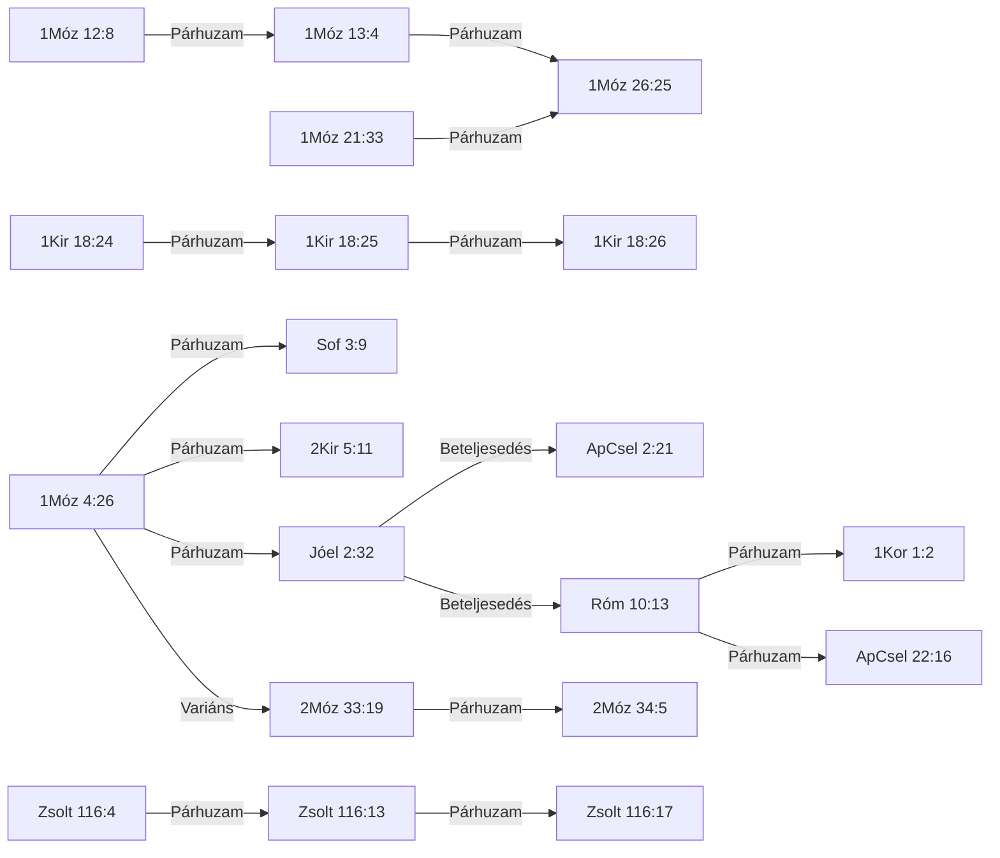

<!-- GENERÁLT: general.py --cel lexikon | rések: motivumok/ISTENTISZT-001.md;motivumlog/lexikon_pilot/ISTENTISZT-001_TUDOMANYOS.md -->

# 📖 ISTENTISZT-001 — Segítségül hívni az Úr nevét

**A motívum.** Az Úr nevének segítségül hívása a Bibliában rögzült formula: a héberben קָרָא בְּשֵׁם יְהוָה (kárá besém Jahve), „segítségül hívni az Úr nevét”. Énós nemzedékében hangzik el először (1Móz 4:26), a pátriárkák oltárainál ismétlődik, a Kármel-próbán a Baál nevének hívásával áll szemben, Jóel próféciájában a megmenekülés ígérete (Jóel 2:32); az Újszövetség ezt az ígéretet idézi (ApCsel 2:21, Róm 10:13), és a gyülekezet Jézus Krisztus nevét hívja segítségül (1Kor 1:2). A motívum ezt a formulát foglalja magában ott, ahol a név után az Úr neve áll; az imádság és a segítségül hívás általában nem tartozik ide. Fordulat-motívum: azonosságát egy állandó szókapcsolat vagy fordulat adja.

**Mi tartozik ide, és mi nem.** Az igehelyen a קָרָא (kárá, hív) igét a בְּשֵׁם (besém, „a nevén”) követi, és a név után az Úr neve, a יְהוָה (Jahve) áll: aktív, invokáló szerkezet („[valaki] segítségül hívja az Úr nevét”). Nem tartozik ide, ahol a név helyén névmási rag áll („nevemet”, „nevedet”, „nevét”: Zak 13:9, Zsolt 105:1, Jer 10:25, Ézs 43:1, 45:3), vagy más név (Ézs 44:5). Az Újszövetségben az ἐπικαλέω (epikaleó) mellett a névnek, az ὄνομα (onoma) szónak és az Úr megnevezésének kell állnia; a puszta „nevedet”, „ezt a nevet” (ApCsel 9:14, 21) és a név nélküli segítségül hívás (2Tim 2:22, Róm 10:12, 14) a fölérendelt fogalomhoz tartozik. A mérce a Károli alapszövege, a Textus Receptus (ApCsel 22:16). Kivétel: a kontrasztként megtartott 1Kir 18:25–26, ahol a név után אֱלֹהֵיכֶם (elóhéchem, „a ti istenteknek”), illetve הַבַּעַל (habbaal, „a Baálnak”) áll. A szenvedő (passzív) נִקְרָא … עַל (nikrá … al) szerkezet (birtoklás, hovatartozás, nem invokáció) kizárja a besorolást, még ha ugyanazt a két gyököt használja is (2Sám 6:2, Jer 7:10–14, 5Móz 28:10; az Újszövetségben a Zsid 11:16).

**Fölérendelt fogalom** (a tágabb kategória: ha egy hely csak ezen át tartozna ide, kimarad). Istentisztelet/imádság általában (bármely invokációs forma, a קָרָא בְשֵׁם (kárá besém) formulán kívül).

*Az azonosító és technikai adatok (azonosító, téma, PaRDeS-szint, státusz, azonosság típusa) a [Kolofonban](#kolofon) állnak.*

## Kivonat

A motívum rövid összefoglalása: miről szól, és hol fordul elő a Bibliában.<!-- olvasói -->

A motívum azt a bibliai formulát követi, amelyben valaki az Úr nevét hívja segítségül: a héberben קָרָא בְּשֵׁם יְהוָה (kárá besém Jahve), szó szerint „hívni az Úr nevén”. A formula Énós nemzedékében kezdődik: „Akkor kezdték segítségül hívni az Úrnak nevét” (1Móz 4:26). Ábrám és Izsák oltáránál ismétlődik (1Móz 12:8, 13:4, 26:25), Beérsebában az örökkévaló Isten nevével (1Móz 21:33). A Kármel-hegyen két név hívása áll szemben egymással, és a Baál nevének hívására „nem jött szó, sem felelet” (1Kir 18:24-26); a zsoltáros a bajban és a szabadulás után is az Úr nevét hívja segítségül (Zsolt 116:4, 13, 17). A fordulópont Jóel mondata: itt a segítségül hívás már nem egy ember vagy egy nemzedék cselekvése, hanem általános ígéret, „mindaz, a ki az Úrnak nevét hívja segítségül, megmenekül” (Jóel 2:32), és Sofóniásnál a népekre is kiterjed (Sof 3:9). Az Újszövetség Jóel mondatát idézi (ApCsel 2:21, Róm 10:13), az 1Kor 1:2-ben pedig a név után Jézus Krisztus neve áll: a gyülekezet azok közössége, „a kik a mi Urunk Jézus Krisztus nevét segítségül hívják bármely helyen”.

A motívum 20 helyen, 10 bibliai könyvben áll: 16 az Ószövetségben, 4 az Újszövetségben. Az ószövetségi helyek közül öt a Genezisben, a pátriárkák történetében áll; kettő Mózes második könyvében, az Úr Mózesnek tett ígéretében és a hozzá tartozó jelenetben (2Móz 33:19, 34:5); négy a Királyok könyveiben (a Kármel-hegyi jelenet három verse és Naámán elvárása, 2Kir 5:11); három a 116. zsoltárban; egy-egy Jóelnél és Sofóniásnál. Az újszövetségi helyek közül kettő Jóel idézete (ApCsel 2:21, Róm 10:13), egy Pál megtérésének elbeszélése (ApCsel 22:16), egy a gyülekezet megnevezése (1Kor 1:2).

Ide az a hely tartozik, amelyben a hívás igéjét (kárá) a név követi (besém, „a nevén”), és a név után az Úr neve, a יְהוָה (Jahve) áll: valaki az Úr nevét hívja segítségül. Ahol a név helyén névmási rag áll, „nevemet”, „nevedet”, „nevét” (például Zak 13:9, Zsolt 105:1, Jer 10:25, Ézs 43:1, 45:3), vagy más név (Ézs 44:5), a hely nem tartozik ide. Az Újszövetségben az ἐπικαλέω (epikaleó) ige mellett a névnek, az ὄνομα (onoma) szónak és az Úr megnevezésének is állnia kell: az ApCsel 9:14 és 9:21 „nevedet”, illetve „ezt a nevet” mondata kimarad, és a név nélküli segítségül hívás is (Róm 10:12, 10:14, 2Tim 2:22). A mérce a Károli alapszövege, a Textus Receptus; az ApCsel 22:16-ban a Textus Receptus a név után az Urat mondja, a kritikai szövegkiadás az Úr helyett névmást olvas (az ő nevét). Kivétel az 1Kir 18:25-26: itt a név után „a ti istenteknek”, illetve „a Baálnak” neve áll, és a két vers a Kármel-hegyi jelenet ellenpontjaként marad a motívumban. Nem tartozik ide a szenvedő szerkezet sem, amely hovatartozást mond ki, nem segítségül hívást: az Úr neve valakin vagy valamin „neveztetik” (nikrá … al, például 2Sám 6:2, Jer 7:10-14, 5Móz 28:10), akkor is, ha ugyanaz a két szó áll benne; az Újszövetségben ilyen a Zsid 11:16, ahol Isten nem szégyenli, „hogy Istenöknek neveztessék”. A 2Móz 33:19 és 34:5 a formula szerkezetét hordozza, a név után az Úr nevével; a magyar fordítás ott kiáltásként, kihirdetésként adja vissza.

A motívum tehát nem az imádság vagy a segítségkérés általában, hanem az a rögzült formula, amelyben az Úr nevét kimondva fordulnak hozzá. Ha a név nem hangzik el, a segélykiáltás a tágabb körbe tartozik; az Újszövetségben ezt nem az ige dönti el, mert az mindkét esetben ugyanaz, hanem a név és az Úr megnevezése. A helyek listája a formula két héber szavának és a görög igének a teljes Bibliában való átnézéséből áll össze; a kizárt versek okonként a kizárt helyek mellékletében szerepelnek.

## Tartalomjegyzék

<!-- GENERÁLT-KEZDET: general.py --cel lexikon#ISTENTISZT-001#tartalom | forrás:  | licenc: minden jog fenntartva | ts=2026-11-12 -->

A szócikk szakaszai. Hogy melyik szakaszt ki írta, a Kolofon szerzőségi mondata mondja meg.<!-- olvasói -->

*A szócikk 15 szakasza, a szakaszra mutató hivatkozással.*

- [Kivonat](#kivonat)
- [Jelmagyarázat és rövidítések](#jelmagyarázat-és-rövidítések)
- [1. Döntési út](#1-döntési-út)
- [2. Előfordulások](#2-előfordulások)
- [3. Kizárt és vizsgált helyek](#3-kizárt-és-vizsgált-helyek)
- [4. Szótári háttér](#4-szótári-háttér)
- [5. LXX-fordítói döntések](#5-lxx-fordítói-döntések)
- [6. Kereszthivatkozások](#6-kereszthivatkozások)
- [7. Kapcsolatok](#7-kapcsolatok)
- [8. Kapcsolódó motívumok](#8-kapcsolódó-motívumok)
- [9. Hatástörténet: ókori fordítások és értelmezők](#9-hatástörténet-ókori-fordítások-és-értelmezők)
- [10. Értelmezés](#10-értelmezés)
- [11. Módszertan és nyitott kérdések](#11-módszertan-és-nyitott-kérdések)
- [12. Irodalom és idézés](#12-irodalom-és-idézés)
- [Kolofon](#kolofon)

<!-- GENERÁLT-VÉGE: lexikon#ISTENTISZT-001#tartalom -->

## Jelmagyarázat és rövidítések

<!-- GENERÁLT-KEZDET: general.py --cel lexikon#ISTENTISZT-001#jelmagyarazat | forrás:  | licenc: minden jog fenntartva | ts=2026-11-12 -->

A szócikkben használt rövidítések, jelek és forrásnevek feloldása. Ha a szócikk egy jelét nem érted, itt keresd.<!-- olvasói -->

*Ez a rész minden szócikkben azonos.*

**PaRDeS-szintek** (a PaRDeS-gyorsreferencia):
- **Peshat** — a szöveg szerinti, szó szerinti értelem.
- **Remez** — csak felismerés/azonosítás, következtetés nélkül.
- **Drash** — normatív, következtető, alkalmazó.
- **Sod** — fegyelmezett, csak szövegből levezethető, gematria/allegorizálás nélkül.

A szint olvasási módot jelöl, nem a szöveg jelentését: a zsidó írásmagyarázat négyes sémájának kategóriáival mondja
meg, hogyan kapcsolódik a hely a motívumhoz (szó szerint, utalásként, következtetésként vagy spirituális olvasatban). Nem
kritikai állítás arról, mit szándékolt a bibliai szerző, és nem a szöveg eredeti, történeti jelentésének szintje. A
besorolást e munka adja, saját szabályai szerint; nevesített magyarázók olvasatát a szócikk nem
gyűjti; az ókori fordítások és értelmezők olvasatát a 9. szakasz mutatja. Egy hely motívumhoz tartozásának bizonyítéka a héber és a görög szöveg, nem
a szint (részletesen: [A PaRDeS-szint mint recepciós címke](../kozlemeny/PARDES_RECEPCIOS_KERET.md)).

**Funkció:** a vers szerepe a motívum ívében — az adatséma szerint
szabad szöveg (nincs zárt értékkészlet), az alábbi táblákban a motívum
szerkesztője által rögzített megnevezés áll.

**Rövidítések:** BDB (Brown–Driver–Briggs), TBESH/TBESG (Tyndale Bible
Encyclopedia — Strong's Hebrew/Greek), Thayer (Thayer's Greek Lexicon),
UBS (UBS Dictionary of New Testament Greek — Louw–Nida szemantikai
doménekkel), L–N (Louw–Nida doménkód), SDBH/SDGNT (Semantic Dictionary
of Biblical Hebrew/Greek), OSHL (Open Scriptures Hebrew Lexicon), TWOT
(Theological Wordbook of the Old Testament — csak számhivatkozás), TSK
(Treasury of Scripture Knowledge), KH (Károli-kereszthivatkozás), LXX
(Septuaginta), MT (Masoretic Text), KJV (King James Version).

**Kiejtés:** a héber és a görög szó mellett zárójelben a magyaros kiejtés, mindkét nyelven szabályos átírás. A
héber kiejtés a pontozott héber szövegből rögzített szabályokkal készül (pl. „וַיִּקְרָא (vajjikrá)”); ahol van kézzel
jóváhagyott alak, az áll. A ragozott szó mellett a saját kiejtése áll, nem a szótári alaké.

**A szótári pontok** (4. Szótári háttér): szavanként számozott pontok követik egymást, mindegyik egy kérdésre felel: 4.1 alapjelentés; 4.2 mélységi szócikk; 4.3 teológiai szócikk; 4.4 jelentésszerkezet, szemantikai mező; 4.5 tömör jelentés, előfordulás; 4.6 LXX-híd; 4.7 megfelelők a másik nyelven; 4.8 nyelvi háttér; 4.9 versenkénti jelentés; 4.10 kiejtés (magyaros); 4.11 visszhang: ókori fordítások (a 9. szakaszban); 4.12 tematikus index (témák és igehely-hivatkozások); 4.13 Károli-megfelelők; 4.14 rejtett / hamis párhuzam. A 4.1–4.10 nyelvenként, szavanként áll, a 4.11–4.14 a motívum egészére vonatkozik.

**Olvasói bevezető** — minden blokk elején egy-két mondatos összefoglaló; az alatta álló dőlt, technikai
mondat a szócikk készítőinek szól.

**Forrásmegjelölés** (dőlt sor vagy a tábla alatti jegyzet, „forrás: …” alakú): melyik adattáblából vagy lekérdezésből és mikor
származik a fölötte álló adat; a „kézi szerkesztés” azt jelöli, hogy az adatot a szerkesztő rögzítette. A teljes
forrássor a szócikk forrásszövegében, rejtett megjegyzésként áll. Az ellenőrzéshez való, olvasáskor átugorható.

**Héber rövidítések a BDB-szövegben** (kiemelve; az egérmutató alatt a feloldás): a BDB a gyakori szavakat egy
betűvel és a rövidítő jellel (׳, geres) írja. **י׳** = יְהוָה (Jahve), a Károliban „az Úr”; a szócikk címszavának
kezdőbetűje (pl. **ק׳** a קָרָא (kárá) szócikkében, **שׁ׳** a שֵׁם (sém) szócikkében) maga a címszó. Más betűnél a feloldás a
szócikk szövegéből derül ki.

A szótári fordításokban a πνεῦμα (pneuma) mindig *szellem*, a ψυχή
(pszükhé) *lélek*; a Károli-idézetek szövege változatlan (pl. »Lélek«).

<!-- GENERÁLT-VÉGE: lexikon#ISTENTISZT-001#jelmagyarazat -->

## 1. Döntési út

<!-- GENERÁLT-KEZDET: general.py --cel lexikon#ISTENTISZT-001#dontesi_ut | forrás: adat/jeloltek.tsv, adat/elofordulasok.tsv, adat/motivumok.tsv, adat/elutasitasi_okok.tsv, konkordancia/Karoli_1908.tsv | licenc: minden jog fenntartva, közkincs | ts=2026-11-12 -->

Ez a szakasz azt mutatja meg, hogyan jutott el a vizsgálat az igehelyekig: mit keresett, hol, mi esett ki és miért, és mi maradt. Az 599 megvizsgált versből 20 tartozik a motívumhoz; minden vers egyszer számít, így a számok összeadódnak.<!-- olvasói -->

*A Döntési út: a motívum keresésének és döntéseinek összegzése; a részletek a 2. és a 3. szakaszban.*

### 1.1. A keresés tárgya

**A motívum:** Segítségül hívni az Úr nevét.

**Ami ide tartozik:** Az igehelyen a קָרָא (kárá, hív) igét a בְּשֵׁם (besém, „a nevén”) követi, és a név után az Úr neve, a יְהוָה (Jahve) áll: aktív, invokáló szerkezet („[valaki] segítségül hívja az Úr nevét”).

**Ami nem:** Nem tartozik ide, ahol a név helyén névmási rag áll („nevemet”, „nevedet”, „nevét”: Zak 13:9, Zsolt 105:1, Jer 10:25, Ézs 43:1, 45:3), vagy más név (Ézs 44:5). Az Újszövetségben az ἐπικαλέω (epikaleó) mellett a névnek, az ὄνομα (onoma) szónak és az Úr megnevezésének kell állnia; a puszta „nevedet”, „ezt a nevet” (ApCsel 9:14, 21) és a név nélküli segítségül hívás (2Tim 2:22, Róm 10:12, 14) a fölérendelt fogalomhoz tartozik. A mérce a Károli alapszövege, a Textus Receptus (ApCsel 22:16). Kivétel: a kontrasztként megtartott 1Kir 18:25–26, ahol a név után אֱלֹהֵיכֶם (elóhéchem, „a ti istenteknek”), illetve הַבַּעַל (habbaal, „a Baálnak”) áll. A szenvedő (passzív) נִקְרָא (nikrá) … עַל (nikrá … al) szerkezet (birtoklás, hovatartozás, nem invokáció) kizárja a besorolást, még ha ugyanazt a két gyököt használja is (2Sám 6:2, Jer 7:10–14, 5Móz 28:10; az Újszövetségben a Zsid 11:16). A motívum nem a fölérendelt fogalom: istentisztelet/imádság általában (bármely invokációs forma, a קָרָא בְשֵׁם (kárá besém) formulán kívül).

### 1.2. A keresés forrásai

**A motívum szavai:** קָרָא (kárá), hívni: megszólítani; שֵׁם (sém), név; ἐπικαλέω (epikaleó), hívni (segítségül)/nevezni.

| Keresés | Vers | Mit nézett |
|---|---|---|
| A szavak minden előfordulása | 204 | A lánc héber és görög szavai a teljes Ó- és Újszövetségben |
| A magyar szavak | 96 | A lánc szavainak magyar megfelelői a teljes Károli-fordításban |
| A szótárak idézőhelyei | 395 | ahol a héber és a görög szótár ezeknél a szavaknál egy verset idéz |
| Kereszthivatkozások ajánlásai | 61 | A kereszthivatkozás-gyűjtemények (TSK, Károli) ajánlásai a motívum helyeihez |
| **Összesen, minden vers egyszer számolva** | **599** | A keresések és az ajánlások együtt, a motívum helyeivel |

*A versszámok a motívum szavainak teljes bibliai kereséséből ([a mérés forrássorai](ISTENTISZT-001_KIZARASOK.md#a-teljesség-mérés-forrássorai)).*

### 1.3. Mi esett ki és miért

| Lépés | Vers | Miért |
|---|---|---|
| **Megvizsgált versek összesen** | **599** | 1.2. lépés minden találata |
| **Csoportosan kizárva** | **470** | A keresés találata, de egy közös ok miatt egyik sem tartozik ide (6 ok, lent lenyitható) |
| **Egyenként elbírálva és elutasítva** | **109** | egyenként olvasott versek, mindegyik saját indokkal (12 ok, lent lenyitható) |
| **A motívumhoz tartozik** | **20** | 20 hely (a tartomány-soroknál több vers egy helyen) |

**Összeadás:** 20 (a motívumhoz tartozik) + 470 (csoportosan kizárva) + 109 (egyenként elutasítva) = 599 megvizsgált vers. Döntés nélkül maradt vers: 0.

#### Csoportosan kizárt versek, okonként

<strong>a hívás igéje a név nélkül</strong> — 246 vers

a kárá áll a versben, a sém nélkül: hívás, kiáltás, meghívás

Példák (a Károli-szöveggel):
<ul><li>1Móz 1:5: <em>És nevezé Isten a világosságot nappalnak, és a setétséget nevezé éjszakának: és lőn este és lőn reggel, első nap.</em></li></ul>
A csoport mind a 246 verse a <a href="ISTENTISZT-001_KIZARASOK.md#a-hívás-igéje-a-név-nélkül--246-vers">kizárt helyek mellékletében</a> áll.

<strong>elnevezés, nem a név segítségül hívása</strong> — 126 vers

a kárá és a sém elnevezésként áll együtt

Példák (a Károli-szöveggel):
<ul><li>1Móz 2:19: <em>És formált vala az Úr Isten a földből mindenféle mezei vadat, és mindenféle égi madarat, és elvivé az emberhez, hogy lássa, minek nevezze azokat; mert a mely nevet adott az ember az élő állatnak, az annak neve.</em></li></ul>
A csoport mind a 126 verse a <a href="ISTENTISZT-001_KIZARASOK.md#elnevezés-nem-a-név-segítségül-hívása--126-vers">kizárt helyek mellékletében</a> áll.

<strong>a Károli-szó más szót fordít</strong> — 51 vers

a hív/kiált/segítségül szó más lexémát fordít

Példák (a Károli-szöveggel):
<ul><li>2Móz 18:4: <em>A másiknak neve pedig Eliézer; mert: Az én atyám Istene segítségül volt nékem és megszabadított engem a Faraó fegyverétől.</em></li></ul>
A csoport mind a 51 verse a <a href="ISTENTISZT-001_KIZARASOK.md#a-károli-szó-más-szót-fordít--51-vers">kizárt helyek mellékletében</a> áll.

<strong>a hívás és a név nem egy szerkezetben</strong> — 21 vers

a kárá és a sém egy versben, de külön szerkezetben

Példák (a Károli-szöveggel):
<ul><li>1Móz 41:52: <em>A másodiknak nevét pedig nevezé Efraimnak: mivel, úgymond, megszaporított engem Isten az én nyomorúságomnak földén.</em></li></ul>
A csoport mind a 21 verse a <a href="ISTENTISZT-001_KIZARASOK.md#a-hívás-és-a-név-nem-egy-szerkezetben--21-vers">kizárt helyek mellékletében</a> áll.

<strong>passzív szerkezet vagy megnevezés (negatív kritérium)</strong> — 14 vers

a negatív kritérium a passzív / megnevező használatot zárja ki

Példák (a Károli-szöveggel):
<ul><li>5Móz 12:5: <em>Hanem azt a helyet, a melyet kiválaszt az Úr, a ti Istenetek minden ti törzsetek közül, hogy az ő nevét oda helyezze és ott lakozzék, azt gyakoroljátok és oda menjetek.</em></li></ul>
A csoport mind a 14 verse a <a href="ISTENTISZT-001_KIZARASOK.md#passzív-szerkezet-vagy-megnevezés-negatív-kritérium--14-vers">kizárt helyek mellékletében</a> áll.

<strong>nem az Úr neve áll a név után</strong> — 12 vers

a besém után névmási rag vagy más név áll

Példák (a Károli-szöveggel):
<ul><li>2Móz 31:2: <em>Ímé, név szerint meghívtam Bésaléelt, a Húr fiának Urinak fiát a Júda nemzetségéből.</em></li></ul>
A csoport mind a 12 verse a <a href="ISTENTISZT-001_KIZARASOK.md#nem-az-úr-neve-áll-a-név-után--12-vers">kizárt helyek mellékletében</a> áll.

#### Egyenként elutasított versek, okonként

<strong>a formula nincs a versben</strong> — 41 vers

az indoklás szerint a versben nincs meg a motívum formulája

Versek: Róm 10:11, Róm 3:13, Jak 3:8, 2Sám 7:9, Zsolt 113:3, Zsolt 114:2, Zsolt 66:1, Zsolt 66:2, Zsolt 66:3, Zsolt 66:4, Zsolt 66:5, Zsolt 118:1, Zsolt 106:1, Róm 9:15, 1Pét 1:6, 1Pét 1:7, 1Sám 13:13, 1Sám 13:14, Zsolt 89:21, Zsolt 89:22, Gal 1:23, ApCsel 2:38, Jón 1:5, Mk 16:15, Mk 16:16, 1Móz 3:15, 1Kor 6:11, ApCsel 10:34, ApCsel 10:35, Gal 4:6, Róm 2:10, Róm 2:11, Róm 2:6, Róm 2:7, Róm 2:8, Róm 2:9, Zsid 12:28, Jel 17:14, Fil 4:19, Róm 3:22, Zsolt 75:2.

A <a href="ISTENTISZT-001_KIZARASOK.md#a-formula-nincs-a-versben--41-vers">kizárt helyek mellékletében</a> is.

<strong>passzív szerkezet vagy megnevezés (negatív kritérium)</strong> — 22 vers

a negatív kritérium a passzív / megnevező használatot zárja ki

Versek: ApCsel 1:23, ApCsel 4:36, ApCsel 10:5, ApCsel 10:18, ApCsel 10:32, ApCsel 11:13, ApCsel 12:12, ApCsel 12:25, ApCsel 15:17, Jak 2:7, Mt 10:3, Mt 10:25, Zsid 11:16, 2Sám 6:2, 1Krón 13:6, Jer 7:10, Jer 7:11, Jer 7:14, Jer 7:30, 5Móz 28:10, 2Sám 20:1, 2Krón 28:15.

A <a href="ISTENTISZT-001_KIZARASOK.md#passzív-szerkezet-vagy-megnevezés-negatív-kritérium--22-vers">kizárt helyek mellékletében</a> is.

<strong>nem az Úr neve áll a név után</strong> — 13 vers

a besém után névmási rag vagy más név áll

Versek: Zak 13:9, ApCsel 9:14, ApCsel 9:21, Zsolt 105:1, 1Krón 16:8, Ézs 12:4, Jer 10:25, Zsolt 79:6, Ézs 43:1, Ézs 44:5, Ézs 45:3, Ézs 41:25, Ézs 64:6.

A <a href="ISTENTISZT-001_KIZARASOK.md#nem-az-úr-neve-áll-a-név-után--13-vers">kizárt helyek mellékletében</a> is.

<strong>név nélküli forma</strong> — 9 vers

a formula része (pl. a hívás) megvan, a név nincs

Versek: Róm 10:14, 2Tim 2:22, Róm 10:12, Zsolt 50:15, Zsolt 91:15, Jer 29:12, Ézs 58:9, Ézs 65:24, Zsolt 86:5.

A <a href="ISTENTISZT-001_KIZARASOK.md#név-nélküli-forma--9-vers">kizárt helyek mellékletében</a> is.

<strong>erkölcsi intelem, nem a formula</strong> — 7 vers

a kereszthivatkozás az erkölcsi intelmet köti össze

Versek: 1Pét 2:11, 1Pét 3:11, 1Kor 6:18, Zsolt 119:9, 1Tim 6:11, Zsid 12:14, 1Tim 4:12.

A <a href="ISTENTISZT-001_KIZARASOK.md#erkölcsi-intelem-nem-a-formula--7-vers">kizárt helyek mellékletében</a> is.

<strong>jogi fellebbezés</strong> — 6 vers

a görög ige jogi értelme (fellebbezni)

Versek: ApCsel 25:11, ApCsel 25:12, ApCsel 25:21, ApCsel 25:25, ApCsel 26:32, ApCsel 28:19.

A <a href="ISTENTISZT-001_KIZARASOK.md#jogi-fellebbezés--6-vers">kizárt helyek mellékletében</a> is.

<strong>névadás</strong> — 6 vers

Isten vagy ember nevet ad, nem segítségül hív

Versek: 1Móz 25:21, 1Móz 25:22, 1Móz 25:23, 1Móz 25:24, 1Móz 25:25, 1Móz 25:26.

A <a href="ISTENTISZT-001_KIZARASOK.md#névadás--6-vers">kizárt helyek mellékletében</a> is.

<strong>eskü vagy tanúhívás</strong> — 1 vers

Isten tanúként hívása, nem segítségül hívás

Versek: 2Kor 1:23.

A <a href="ISTENTISZT-001_KIZARASOK.md#eskü-vagy-tanúhívás--1-vers">kizárt helyek mellékletében</a> is.

<strong>invokáció a formulán kívül</strong> — 1 vers

imádság / invokáció, de nem a formula (a fölérendelt fogalom felé)

Versek: ApCsel 7:59.

A <a href="ISTENTISZT-001_KIZARASOK.md#invokáció-a-formulán-kívül--1-vers">kizárt helyek mellékletében</a> is.

<strong>megszólítás, nem a név segítségül hívása</strong> — 1 vers

Isten megszólítása (pl. Atyának), a név nélkül

Versek: 1Pét 1:17.

A <a href="ISTENTISZT-001_KIZARASOK.md#megszólítás-nem-a-név-segítségül-hívása--1-vers">kizárt helyek mellékletében</a> is.

<strong>nincs meg a hívás + név szerkezete</strong> — 1 vers

a hívás és a név nem az invokáló szerkezetben áll

Versek: Zsolt 99:6.

A <a href="ISTENTISZT-001_KIZARASOK.md#nincs-meg-a-hívás--név-szerkezete--1-vers">kizárt helyek mellékletében</a> is.

<strong>tartalmilag nem kapcsolódik</strong> — 1 vers

a vers témája más

Versek: Zsolt 105:15.

A <a href="ISTENTISZT-001_KIZARASOK.md#tartalmilag-nem-kapcsolódik--1-vers">kizárt helyek mellékletében</a> is.

### 1.4. Mi maradt és miért

<strong>קָרָא (kárá) + שֵׁם (sém)</strong> — 16 hely

16 hely: 5 a Genezisben és 11 az Ószövetség többi könyvében.
<ul><li><a href="#ige-1móz-4-26">1Móz 4:26</a>: A motívum első helye: a segítségül hívás kezdetét mondja ki, személy megnevezése nélkül.</li><li><a href="#ige-1móz-12-8">1Móz 12:8</a>: A segítségül hívás az oltárépítéshez kapcsolódik.</li><li><a href="#ige-1móz-13-4">1Móz 13:4</a>: Ugyanannál az oltárnál ismétlődik a segítségül hívás.</li><li><a href="#ige-1móz-21-33">1Móz 21:33</a>: A segítségül hívott név mellé az örökkévaló Isten jelzője kerül.</li><li><a href="#ige-1móz-26-25">1Móz 26:25</a>: Ábrahám gyakorlatát Izsák ugyanazokkal az elemekkel folytatja.</li><li><a href="#ige-1kir-18-24">1Kir 18:24</a>: A formula két név hívását állítja egymással szembe.</li><li><a href="#ige-1kir-18-25">1Kir 18:25</a>: A formula a Baál prófétáinak szájában, az Úr neve nélkül.</li><li><a href="#ige-1kir-18-26">1Kir 18:26</a>: A Baál nevének hívására nem jön felelet.</li><li><a href="#ige-2kir-5-11">2Kir 5:11</a>: Egy idegen ismeri a formulát, és a prófétától várja.</li><li><a href="#ige-sof-3-9">Sof 3:9</a>: A segítségül hívás minden népre kiterjed.</li><li><a href="#ige-zsolt-116-4">Zsolt 116:4</a>: A segítségül hívás a bajban mondott személyes kérés.</li><li><a href="#ige-zsolt-116-13">Zsolt 116:13</a>: A szabadulás után ugyanaz a formula a hálaadás része.</li><li><a href="#ige-zsolt-116-17">Zsolt 116:17</a>: A zsoltár harmadik segítségül hívása.</li><li><a href="#ige-jóel-2-32">Jóel 2:32</a>: A segítségül hívás a megmenekülés feltétele; az Újszövetség ezt a mondatot idézi.</li><li><a href="#ige-2móz-33-19">2Móz 33:19</a>: A formula szerkezete az Úr saját mondatában; a fordítás kiáltásként adja vissza.</li><li><a href="#ige-2móz-34-5">2Móz 34:5</a>: A 2Móz 33:19-ben ígért jelenetben ugyanaz a szerkezet áll.</li></ul>

<strong>ἐπικαλέω (epikaleó) — hívni (segítségül)/nevezni</strong> — 4 hely

4 hely: 4 az Újszövetségben.
<ul><li><a href="#ige-1kor-1-2">1Kor 1:2</a>: A segítségül hívók Jézus Krisztus nevét hívják.</li><li><a href="#ige-apcsel-22-16">ApCsel 22:16</a>: A segítségül hívás a megtérés és a keresztség mellett.</li><li><a href="#ige-apcsel-2-21">ApCsel 2:21</a>: A Jóel-ígéret az Újszövetségben, szó szerint.</li><li><a href="#ige-róm-10-13">Róm 10:13</a>: Pál a Jóel-ígéretet mindenkire érvényesnek mondja.</li></ul>

### 1.5. Határesetek és nyitott kérdések

- **A 2Móz 33:19 és 34:5: kiáltás vagy segítségül hívás.** A két hely a formula szerkezetét hordozza, a kérdés az, hogyan kell olvasni.
- **Az 1Móz 4:26: kezdet vagy hanyatlás.** A héber mondat azt mondja, hogy Énós napjaiban „kezdték segítségül hívni az Úrnak nevét”, és így fordítja a Károli is.
- **A Róm 10:13 „Ura”: az Úr Jóel könyvében, vagy Jézus.** Pál a Jóel 2:32-t idézi, ahol a héber szövegben az Úr neve, a יְהוָה (Jahve) áll, és a görög fordítás ezt κύριος (küriosz) szóval adja vissza.
- **A Zsolt 116:17 görög szövege.** A görög fordítás szövegében (Zsolt 115:8 a görög számozás szerint) csak a vers első fele áll, a hálaáldozat mondata; a segítségül hívás mondata hiányzik, holott ugyanez a mondat a 116:13-nak megfelelő görög versben megvan.
- **A névmási alak.** A dicséretre hívó „hívjátok segítségül az ő nevét” mondat (Zsolt 105:1, 1Krón 16:8) ugyanazt az igét és a névvel álló elöljárót hordozza, de a név után névmási rag áll; ezek a helyek ezért kimaradnak.

A kérdések kifejtése a 10. (Értelmezés) és a 11. szakaszban (Módszertan és nyitott kérdések) áll.

<!-- GENERÁLT-VÉGE: lexikon#ISTENTISZT-001#dontesi_ut -->

## 2. Előfordulások

<!-- GENERÁLT-KEZDET: general.py --cel lexikon#ISTENTISZT-001#elofordulasok | forrás: adat/elofordulasok.tsv, konkordancia/Karoli_1908.tsv, konkordancia/UBS_DNTG_referenciak.tsv, konkordancia/UBS_DNTG_jelentesek.tsv, adat/forditasok.tsv, adat/szotar_szakasz_cimke.tsv, adat/bdb_vers_jelentes.tsv, adat/thayer_vers_jelentes.tsv, konkordancia/UBS_DBH_referenciak.tsv, konkordancia/UBS_DBH_jelentesek.tsv, konkordancia/Karoli_versmegfeleltetes.tsv, konkordancia/TAHOT_kivonat.tsv | licenc: CC BY 4.0, CC BY-SA 4.0, közkincs, minden jog fenntartva | ts=2026-11-12 -->

A motívum 20 igehelyen fordul elő, 10 bibliai könyvben (16 ószövetségi, 4 újszövetségi hely). 20 hely azonosítása magas megbízhatóságú. **Következtetés:** az Ószövetségben 16, az Újszövetségben 4 hely.<!-- olvasói -->

*A táblázat a motívum 20 igehelyét sorolja fel (forrás: a motívum előfordulás-táblája), kanonikus sorrendben, a Károli-szöveggel (2.1) és az UBS-jelentéssel. A „Jelentés (a szó)” oszlop a szó jelentését a szótár tagolásában adja (a szótári szakaszok címketáblája, a BDB-szótár, a Thayer-szótár; a címke forrása a sor lábjegyzetében), a „Funkció (a motívumban)” a hely motívumbeli funkcióját (szerkesztői döntés, 2026-10-19).*

| Igehely | Kulcsszó | Jelentés (a szó) | Funkció (a motívumban) | PaRDeS-szint | Strong | UBS-jelentés | Megbízhatóság · azonosítás módja |
|---|---|---|---|---|---|---|---|
| [1Móz 4:26](#ige-1móz-4-26) | segítségül hívni az Úrnak nevét — לִקְרֹ֖א (likró); בְּשֵׁ֥ם (besém) | H7121: segítségül hívni · Qal 2.c; H8034: *(nincs hozzárendelés)*<a href="#j-2-1">2.1</a> | kezdet | Drash | H7121+H8034 | H7121: kiáltani [ⓘ](/szo/H7121); nevezni; nevet adni [ⓘ](/szo/H7121) · H8034: név [ⓘ](/szo/H8034) | magas · szó-szintű-gépi<a href="#j-2-1">2.1</a> |
| [1Móz 12:8](#ige-1móz-12-8) | segítségűl hívá az Úr nevét — וַיִּקְרָ֖א (vajjikrá); בְּשֵׁ֥ם (besém) | H7121: segítségül hívni · Qal 2.c; H8034: név: Isten megjelölése · 3<a href="#j-2-2">2.2</a> | oltár és név | Drash | H7121+H8034 | H7121: kiáltani [ⓘ](/szo/H7121) · H8034: név [ⓘ](/szo/H8034) | magas · szó-szintű-gépi<a href="#j-2-2">2.2</a> |
| [1Móz 13:4](#ige-1móz-13-4) | segítségűl hívá ott Ábrám az Úrnak nevét — וַיִּקְרָ֥א (vajjikrá); בְּשֵׁ֥ם (besém) | H7121: segítségül hívni · Qal 2.c; H8034: név: Isten megjelölése · 3<a href="#j-2-3">2.3</a> | visszatérés | Drash | H7121+H8034 | H7121: kiáltani [ⓘ](/szo/H7121) · H8034: név [ⓘ](/szo/H8034) | magas · szó-szintű-gépi<a href="#j-2-3">2.3</a> |
| [1Móz 21:33](#ige-1móz-21-33) | segítségűl hívá ott az örökkévaló Úr Istennek nevét — וַיִּ֨קְרָא (vajjikrá); בְּשֵׁ֥ם (besém) | H7121: segítségül hívni · Qal 2.c; H8034: név: Isten megjelölése · 3<a href="#j-2-3">2.3</a> | jelzővel bővült név | Drash | H7121+H8034 | H7121: kiáltani [ⓘ](/szo/H7121) · H8034: név [ⓘ](/szo/H8034) | magas · szó-szintű-gépi<a href="#j-2-3">2.3</a> |
| [1Móz 26:25](#ige-1móz-26-25) | segítségűl hívá az Úrnak nevét — וַיִּקְרָא֙ (vajjikrá); בְּשֵׁ֣ם (besém) | H7121: segítségül hívni · Qal 2.c; H8034: név: Isten megjelölése · 3<a href="#j-2-4">2.4</a> | öröklés | Drash | H7121+H8034 | H7121: kiáltani [ⓘ](/szo/H7121) · H8034: név [ⓘ](/szo/H8034) | magas · szó-szintű-gépi<a href="#j-2-4">2.4</a> |
| [2Móz 33:19](#ige-2móz-33-19) | kiáltom előtted az Úr nevét — וְקָרָ֧אתִֽי (vekárátí); בְשֵׁ֛ם (vesém) | H7121: a nevet kihirdetni · Qal 3.b; H8034: *(nincs hozzárendelés)*<a href="#j-2-5">2.5</a> | kiáltás a néven | Remez | H7121+H8034 | H7121: kiáltani [ⓘ](/szo/H7121) · H8034: név [ⓘ](/szo/H8034) | magas · szó-szintű-gépi<a href="#j-2-5">2.5</a> |
| [2Móz 34:5](#ige-2móz-34-5) | nevén kiáltá az Urat — וַיִּקְרָ֥א (vajjikrá); בְשֵׁ֖ם (vesém) | H7121: a nevet kihirdetni · Qal 3.b; H8034: *(nincs hozzárendelés)*<a href="#j-2-5">2.5</a> | kiáltás a néven | Remez | H7121+H8034 | H7121: kiáltani [ⓘ](/szo/H7121) · H8034: név [ⓘ](/szo/H8034) | magas · szó-szintű-gépi<a href="#j-2-5">2.5</a> |
| [1Kir 18:24](#ige-1kir-18-24) | segítségül hívom az Úrnak nevét — אֶקְרָ֣א (ekrá); בְשֵׁם (vesém) | H7121: segítségül hívni · Qal 2.c; H8034: *(nincs hozzárendelés)*<a href="#j-2-6">2.6</a> | szembeállítás | Remez | H7121+H8034 | H7121: kiáltani [ⓘ](/szo/H7121) · H8034: név [ⓘ](/szo/H8034) | magas · tartalom-alapú<a href="#j-2-6">2.6</a> |
| [1Kir 18:25](#ige-1kir-18-25) | hívjátok segítségül a ti istenteknek nevét — וְקִרְאוּ֙ (vekireú); בְּשֵׁ֣ם (besém) | H7121: segítségül hívni · Qal 2.c; H8034: *(nincs hozzárendelés)*<a href="#j-2-7">2.7</a> | ellenpont | Remez | H7121+H8034 | H7121: kiáltani [ⓘ](/szo/H7121) · H8034: név [ⓘ](/szo/H8034) | magas · tartalom-alapú<a href="#j-2-7">2.7</a> |
| [1Kir 18:26](#ige-1kir-18-26) | segítségül hívák a Baálnak nevét — וַיִּקְרְא֣וּ (vajjikreú); בְשֵׁם (vesém) | H7121: segítségül hívni · Qal 2.c; H8034: név: hamis istenekről · 4<a href="#j-2-8">2.8</a> | válasz nélküli hívás | Remez | H7121+H8034 | H7121: kiáltani [ⓘ](/szo/H7121) · H8034: név [ⓘ](/szo/H8034) | magas · tartalom-alapú<a href="#j-2-8">2.8</a> |
| [2Kir 5:11](#ige-2kir-5-11) | segítségül hívja az Úrnak, az ő Istenének nevét — וְקָרָא֙ (vekárá); בְּשֵׁם (besém) | H7121: segítségül hívni · Qal 2.c; H8034: *(nincs hozzárendelés)*<a href="#j-2-9">2.9</a> | kívülálló szemével | Remez | H7121+H8034 | H7121: kiáltani [ⓘ](/szo/H7121) · H8034: név [ⓘ](/szo/H8034) | magas · tartalom-alapú<a href="#j-2-9">2.9</a> |
| [Zsolt 116:4](#ige-zsolt-116-4) | Az Úrnak nevét segítségül hívám — אֶקְרָ֑א (ekrá); וּבְשֵֽׁם (úvesém) | H7121: segítségül hívni · Qal 2.c; H8034: *(nincs hozzárendelés)*<a href="#j-2-10">2.10</a> | könyörgés | Remez | H7121+H8034 | H7121: kiáltani [ⓘ](/szo/H7121) · H8034: név [ⓘ](/szo/H8034) | magas · tartalom-alapú<a href="#j-2-10">2.10</a> |
| [Zsolt 116:13](#ige-zsolt-116-13) | Az Úrnak nevét hívom segítségül — אֶקְרָֽא (ekrá); וּבְשֵׁ֖ם (úvesém) | H7121: segítségül hívni · Qal 2.c; H8034: *(nincs hozzárendelés)*<a href="#j-2-10">2.10</a> | hála | Remez | H7121+H8034 | H7121: kiáltani [ⓘ](/szo/H7121) · H8034: név [ⓘ](/szo/H8034) | magas · tartalom-alapú<a href="#j-2-10">2.10</a> |
| [Zsolt 116:17](#ige-zsolt-116-17) | Az Úr nevét hívom segítségül — אֶקְרָֽא (ekrá); וּבְשֵׁ֖ם (úvesém) | H7121: segítségül hívni · Qal 2.c; H8034: *(nincs hozzárendelés)*<a href="#j-2-10">2.10</a> | ismétlés a hálaáldozatnál | Remez | H7121+H8034 | H7121: kiáltani [ⓘ](/szo/H7121) · H8034: név [ⓘ](/szo/H8034) | magas · tartalom-alapú<a href="#j-2-10">2.10</a> |
| [Jóel 2:32](#ige-jóel-2-32) | Az Úrnak nevét hívja segítségül — קֹרֵֽא (kóré); בְּשֵׁ֥ם (besém) | H7121: segítségül hívni · Qal 2.c; H8034: *(nincs hozzárendelés)*<a href="#j-2-10">2.10</a> | ígéret | Remez | H7121+H8034 | H7121: hívni; magához hívni; meghívni [ⓘ](/szo/H7121) *(MT: Jóel 3:5)*; (istenséget) elismerni [ⓘ](/szo/H7121) *(MT: Jóel 3:5)* · H8034: név [ⓘ](/szo/H8034) *(MT: Jóel 3:5)* | magas · tartalom-alapú<a href="#j-2-10">2.10</a> |
| [Sof 3:9](#ige-sof-3-9) | segítségül hívják az Úr nevét — לִקְרֹ֤א (likró); בְּשֵׁ֣ם (besém) | H7121: segítségül hívni · Qal 2.c; H8034: *(nincs hozzárendelés)*<a href="#j-2-10">2.10</a> | Népek ígérete | Remez | H7121+H8034 | H7121: (istenséget) elismerni [ⓘ](/szo/H7121) · H8034: név [ⓘ](/szo/H8034) | magas · tartalom-alapú<a href="#j-2-10">2.10</a> |
| [ApCsel 2:21](#ige-apcsel-2-21) | Az Úrnak nevét segítségül hívja — ἐπικαλέσηται (epikaleszétai) | segítségül hívni, folyamodni valakihez · TBESG 2<a href="#j-2-11">2.11</a> | idézet | Remez | G1941 | segítségül hívni; folyamodni valakihez; segítséget kérni [ⓘ](/szo/G1941) | magas · tartalom-alapú<a href="#j-2-11">2.11</a> |
| [ApCsel 22:16](#ige-apcsel-22-16) | segítségül híván — ἐπικαλεσάμενος (epikaleszamenosz) | segítségül hívni, folyamodni valakihez · TBESG 2<a href="#j-2-11">2.11</a> | keresztség | Remez | G1941 | segítségül hívni; folyamodni valakihez; segítséget kérni [ⓘ](/szo/G1941) | magas · tartalom-alapú<a href="#j-2-11">2.11</a> |
| [Róm 10:13](#ige-róm-10-13) | segítségül hívja az Úr nevét — ἐπικαλέσηται (epikaleszétai) | segítségül hívni, folyamodni valakihez · TBESG 2<a href="#j-2-11">2.11</a> | idézet | Remez | G1941 | segítségül hívni; folyamodni valakihez; segítséget kérni [ⓘ](/szo/G1941) | magas · tartalom-alapú<a href="#j-2-11">2.11</a> |
| [1Kor 1:2](#ige-1kor-1-2) | segítségül hívják — ἐπικαλουμένοις (epikalúmenoisz) | segítségül hívni, folyamodni valakihez · TBESG 2<a href="#j-2-11">2.11</a> | Gyülekezet neve | Remez | G1941 | segítségül hívni; folyamodni valakihez; segítséget kérni [ⓘ](/szo/G1941) | magas · tartalom-alapú<a href="#j-2-11">2.11</a> |

- 2.1Szövegigazolás nélkül; a jelentés: a BDB Qal 2.c szakasza; H8034 — a BDB a verset a 3. szakaszban idézi (a BDB-szótár), de a versben a szó kétszer áll (a STEPBible héber szövege (TAHOT)), és a szótár nem jelöli, melyikre gondol; a BDB-példa ezért nem kerül erre a szóra.<!-- eredeti: [^1]: proveniencia: ‹E1› | igazolas: nincs | jelentés-címke: H7121 — kutatói hozzárendelés a BDB tagolása szerint (`elofordulasok.tsv` jelentes_szam „2.c” → Qal 2.c, `adat/szotar_szakasz_cimke.tsv`); a BDB a verset a Qal 2.c szakaszban idézi (`adat/bdb_vers_jelentes.tsv` sorszam 92), de a versben a szó kétszer áll (`konkordancia/TAHOT_kivonat.tsv`), és a szótár nem jelöli, melyikre gondol; a BDB-példa ezért nem kerül erre a tokenre · H8034 — a BDB a verset a 3. szakaszban idézi (`adat/bdb_vers_jelentes.tsv` sorszam 116), de a versben a szó kétszer áll (`konkordancia/TAHOT_kivonat.tsv`), és a szótár nem jelöli, melyikre gondol; a BDB-példa ezért nem kerül erre a tokenre -->
- 2.2Szövegigazolás nélkül; a jelentés: H7121 — BDB-példa: a BDB a Qal 2.c szakaszban maga idézi a helyet; H8034 — BDB-példa: a BDB a 3. szakaszban maga idézi a helyet (a BDB-szótár).<!-- eredeti: [^2]: proveniencia: ‹E1› | igazolas: nincs | jelentés-címke: H7121 — BDB-példa: a BDB a Qal 2.c szakaszban maga idézi a helyet (`adat/bdb_vers_jelentes.tsv` sorszam 93); ez a kutatói hozzárendelés (2.c → Qal 2.c) alá esik, a címke a finomabb útvonalé · H8034 — BDB-példa: a BDB a 3. szakaszban maga idézi a helyet (`adat/bdb_vers_jelentes.tsv` sorszam 117) -->
- 2.3Szövegigazolás nélkül; a jelentés: a BDB Qal 2.c szakasza; H8034 — BDB-példa: a BDB a 3. szakaszban maga idézi a helyet (a BDB-szótár).<!-- eredeti: [^3]: proveniencia: ‹E1› | igazolas: nincs | jelentés-címke: H7121 — kutatói hozzárendelés a BDB tagolása szerint (`elofordulasok.tsv` jelentes_szam „2.c” → Qal 2.c, `adat/szotar_szakasz_cimke.tsv`) · H8034 — BDB-példa: a BDB a 3. szakaszban maga idézi a helyet (`adat/bdb_vers_jelentes.tsv` sorszam 118) --><!-- eredeti: [^4]: proveniencia: ‹E1› | igazolas: nincs | jelentés-címke: H7121 — kutatói hozzárendelés a BDB tagolása szerint (`elofordulasok.tsv` jelentes_szam „2.c” → Qal 2.c, `adat/szotar_szakasz_cimke.tsv`) · H8034 — BDB-példa: a BDB a 3. szakaszban maga idézi a helyet (`adat/bdb_vers_jelentes.tsv` sorszam 119) -->
- 2.4Szövegigazolás nélkül; a jelentés: a BDB Qal 2.c szakasza; H8034 — a BDB forrásszövege itt a „26:35” helyet idézi (sajtóhiba); javítva: 1Móz 26:25 — a javítás forrása:, kézi sor (hivatkozas_kezi,; indok: a TAHOT és a szövegkörnyezet; szerkesztői döntés); BDB-példa: a BDB a 3. szakaszban maga idézi a helyet (a BDB-szótár).<!-- eredeti: [^5]: proveniencia: ‹E1› | igazolas: nincs | jelentés-címke: H7121 — kutatói hozzárendelés a BDB tagolása szerint (`elofordulasok.tsv` jelentes_szam „2.c” → Qal 2.c, `adat/szotar_szakasz_cimke.tsv`) · H8034 — a BDB forrásszövege itt a „26:35” helyet idézi (sajtóhiba); javítva: 1Móz 26:25 — a javítás forrása: `adat/bdb_forras_javitas.tsv`, kézi sor (`hivatkozas_kezi`, `manual`; indok: a TAHOT és a szövegkörnyezet; DT381 (a)); BDB-példa: a BDB a 3. szakaszban maga idézi a helyet (`adat/bdb_vers_jelentes.tsv` sorszam 120) -->
- 2.5Szövegigazolás nélkül; a jelentés: H7121 — BDB-példa: a BDB a Qal 3.b szakaszban maga idézi a helyet; H8034 — ehhez a szóhoz nincs szerkesztői hozzárendelés és szótári példahely.<!-- eredeti: [^6]: proveniencia: ‹E1› | igazolas: nincs | jelentés-címke: H7121 — BDB-példa: a BDB a Qal 3.b szakaszban maga idézi a helyet (`adat/bdb_vers_jelentes.tsv` sorszam 129); ez a kutatói hozzárendelés (3 → Qal 3) alá esik, a címke a finomabb útvonalé · H8034 — ehhez a tokenhez nincs kutatói hozzárendelés és szótári példahely --><!-- eredeti: [^7]: proveniencia: ‹E1› | igazolas: nincs | jelentés-címke: H7121 — BDB-példa: a BDB a Qal 3.b szakaszban maga idézi a helyet (`adat/bdb_vers_jelentes.tsv` sorszam 130); ez a kutatói hozzárendelés (3 → Qal 3) alá esik, a címke a finomabb útvonalé · H8034 — ehhez a tokenhez nincs kutatói hozzárendelés és szótári példahely -->
- 2.6Szövegigazolás nélkül; a jelentés: a BDB Qal 2.c szakasza; H8034 — a BDB a verset a 4. szakaszban idézi (a BDB-szótár), de a versben a szó kétszer áll (a STEPBible héber szövege (TAHOT)), és a szótár nem jelöli, melyikre gondol; a BDB-példa ezért nem kerül erre a szóra.<!-- eredeti: [^8]: proveniencia: ‹E1› | igazolas: nincs | jelentés-címke: H7121 — kutatói hozzárendelés a BDB tagolása szerint (`elofordulasok.tsv` jelentes_szam „2.c” → Qal 2.c, `adat/szotar_szakasz_cimke.tsv`); a BDB a verset a Qal 2.c szakaszban idézi (`adat/bdb_vers_jelentes.tsv` sorszam 97, 99), de a versben a szó kétszer áll (`konkordancia/TAHOT_kivonat.tsv`), és a szótár nem jelöli, melyikre gondol; a BDB-példa ezért nem kerül erre a tokenre · H8034 — a BDB a verset a 4. szakaszban idézi (`adat/bdb_vers_jelentes.tsv` sorszam 208), de a versben a szó kétszer áll (`konkordancia/TAHOT_kivonat.tsv`), és a szótár nem jelöli, melyikre gondol; a BDB-példa ezért nem kerül erre a tokenre -->
- 2.7Szövegigazolás nélkül; a jelentés: a BDB Qal 2.c szakasza; H8034 — a BDB a helyet nem önállóan idézi, hanem a 4. szakaszban az 1Kir 18:24–25 verstartomány belsejében (a BDB-ben: „1Kin 18:24-25”; a BDB-szótár); a tartomány nincs kibontva (szerkesztői döntés (A)), ezért a hely nem BDB-példa.<!-- eredeti: [^9]: proveniencia: ‹E1› | igazolas: nincs | jelentés-címke: H7121 — kutatói hozzárendelés a BDB tagolása szerint (`elofordulasok.tsv` jelentes_szam „2.c” → Qal 2.c, `adat/szotar_szakasz_cimke.tsv`); a BDB a helyet nem önállóan idézi, hanem a Qal 2.c szakaszban az 1Kir 18:24–25 verstartomány belsejében (a BDB-ben: „1Kin 18:24-25”; `adat/bdb_vers_jelentes.tsv` sorszam 99); a tartomány nincs kibontva (DT382 (A)), ezért a hely nem BDB-példa · H8034 — a BDB a helyet nem önállóan idézi, hanem a 4. szakaszban az 1Kir 18:24–25 verstartomány belsejében (a BDB-ben: „1Kin 18:24-25”; `adat/bdb_vers_jelentes.tsv` sorszam 208); a tartomány nincs kibontva (DT382 (A)), ezért a hely nem BDB-példa -->
- 2.8Szövegigazolás nélkül; a jelentés: H7121 — BDB-példa: a BDB a Qal 2.c szakaszban maga idézi a helyet; H8034 — BDB-példa: a BDB a 4. szakaszban maga idézi a helyet (a BDB-szótár).<!-- eredeti: [^10]: proveniencia: ‹E1› | igazolas: nincs | jelentés-címke: H7121 — BDB-példa: a BDB a Qal 2.c szakaszban maga idézi a helyet (`adat/bdb_vers_jelentes.tsv` sorszam 100); ez a kutatói hozzárendelés (2.c → Qal 2.c) alá esik, a címke a finomabb útvonalé · H8034 — BDB-példa: a BDB a 4. szakaszban maga idézi a helyet (`adat/bdb_vers_jelentes.tsv` sorszam 209) -->
- 2.9Szövegigazolás nélkül; a jelentés: H7121 — BDB-példa: a BDB a Qal 2.c szakaszban maga idézi a helyet; H8034 — ehhez a szóhoz nincs szerkesztői hozzárendelés és szótári példahely.<!-- eredeti: [^11]: proveniencia: ‹E1› | igazolas: nincs | jelentés-címke: H7121 — BDB-példa: a BDB a Qal 2.c szakaszban maga idézi a helyet (`adat/bdb_vers_jelentes.tsv` sorszam 94); ez a kutatói hozzárendelés (2.c → Qal 2.c) alá esik, a címke a finomabb útvonalé · H8034 — ehhez a tokenhez nincs kutatói hozzárendelés és szótári példahely -->
- 2.10Szövegigazolás nélkül; a jelentés: a BDB Qal 2.c szakasza; H8034 — ehhez a szóhoz nincs szerkesztői hozzárendelés és szótári példahely.<!-- eredeti: [^12]: proveniencia: ‹E1› | igazolas: nincs | jelentés-címke: H7121 — kutatói hozzárendelés a BDB tagolása szerint (`elofordulasok.tsv` jelentes_szam „2.c” → Qal 2.c, `adat/szotar_szakasz_cimke.tsv`) · H8034 — ehhez a tokenhez nincs kutatói hozzárendelés és szótári példahely --><!-- eredeti: [^13]: proveniencia: ‹E1› | igazolas: nincs | jelentés-címke: H7121 — kutatói hozzárendelés a BDB tagolása szerint (`elofordulasok.tsv` jelentes_szam „2.c” → Qal 2.c, `adat/szotar_szakasz_cimke.tsv`) · H8034 — ehhez a tokenhez nincs kutatói hozzárendelés és szótári példahely --><!-- eredeti: [^14]: proveniencia: ‹E1› | igazolas: nincs | jelentés-címke: H7121 — kutatói hozzárendelés a BDB tagolása szerint (`elofordulasok.tsv` jelentes_szam „2.c” → Qal 2.c, `adat/szotar_szakasz_cimke.tsv`) · H8034 — ehhez a tokenhez nincs kutatói hozzárendelés és szótári példahely --><!-- eredeti: [^15]: proveniencia: ‹E1› | igazolas: nincs | jelentés-címke: H7121 — kutatói hozzárendelés a BDB tagolása szerint (`elofordulasok.tsv` jelentes_szam „2.c” → Qal 2.c, `adat/szotar_szakasz_cimke.tsv`) · H8034 — ehhez a tokenhez nincs kutatói hozzárendelés és szótári példahely --><!-- eredeti: [^16]: proveniencia: ‹E1› | igazolas: nincs | jelentés-címke: H7121 — kutatói hozzárendelés a BDB tagolása szerint (`elofordulasok.tsv` jelentes_szam „2.c” → Qal 2.c, `adat/szotar_szakasz_cimke.tsv`) · H8034 — ehhez a tokenhez nincs kutatói hozzárendelés és szótári példahely -->
- 2.11Szövegigazolás nélkül; a jelentés: a Thayer TBESG 2 szakasza.<!-- eredeti: [^17]: proveniencia: ‹E1› | igazolas: nincs | jelentés-címke: kutatói hozzárendelés a TBESG tagolása szerint (`elofordulasok.tsv` jelentes_szam „2” → TBESG 2, `adat/szotar_szakasz_cimke.tsv`); a Thayer saját példahelye: Thayer 5 (`adat/thayer_vers_jelentes.tsv` sorszam 37) --><!-- eredeti: [^18]: proveniencia: ‹E1› | igazolas: nincs | jelentés-címke: kutatói hozzárendelés a TBESG tagolása szerint (`elofordulasok.tsv` jelentes_szam „2” → TBESG 2, `adat/szotar_szakasz_cimke.tsv`); a Thayer saját példahelye: Thayer 5 (`adat/thayer_vers_jelentes.tsv` sorszam 41) --><!-- eredeti: [^19]: proveniencia: ‹E1› | igazolas: nincs | jelentés-címke: kutatói hozzárendelés a TBESG tagolása szerint (`elofordulasok.tsv` jelentes_szam „2” → TBESG 2, `adat/szotar_szakasz_cimke.tsv`); a Thayer saját példahelye: Thayer 5 (`adat/thayer_vers_jelentes.tsv` sorszam 42) --><!-- eredeti: [^20]: proveniencia: ‹E1› | igazolas: nincs | jelentés-címke: kutatói hozzárendelés a TBESG tagolása szerint (`elofordulasok.tsv` jelentes_szam „2” → TBESG 2, `adat/szotar_szakasz_cimke.tsv`); a Thayer saját példahelye: Thayer 5 (`adat/thayer_vers_jelentes.tsv` sorszam 43) -->

<!-- közös forrásmegjelölés: Minden sor forrásmegjelölése (‹E1›): forrás: kézi szerkesztés, 2026-11-12 --><!-- eredeti: *Minden sor forrásmegjelölése (‹E1›): `scope=manual | forras=F194 ISTENTISZT-001 2. kiadás, U3 (claude-opus-5-5; a Károli-vers: konkordancia/Karoli_1908.tsv; a 2Móz 33:19, 34:5: DT-F194b) | ts=2026-11-12`* -->

*Az UBS-jelentés az újszövetségi soroknál az UBS Dictionary of New Testament Greek (DNTG), az ószövetségi soroknál az UBS Dictionary of Biblical Hebrew (DBH) igehelyszintű jelentése (az UBS Dictionary of Biblical Hebrew, a Károli-vers az MT-számozásra képezve, a Károli-versmegfeleltetés); szavanként a hivatkozott jelentés(ek) kódja és rövid glosszája; az ⓘ a szónézetre mutat, ahol a teljes UBS-szócikk (definíció és glosszák) áll (szerkesztői döntés, 2026-10-29). A glossza magyarul (forrás: a lexikon fordítástáblája) jön, ahol van; ahol nincs, az angol eredeti áll (fordításra vár) jelöléssel. Ahol a DBH a versre nem hivatkozik, a mező ezt kimondja.*

#### 2.1. Az igehelyek szövege

A fenti táblázat igehelyeinek teljes szövege a Károli-fordításban, a motívumot hordozó szavakkal.<!-- olvasói -->

**1Móz 4:26**
*Séthnek is született fia, és nevezé annak nevét Énósnak. Akkor kezdték segítségül hívni az Úrnak nevét.*
Séth fiának, Énósnak születése után a vers egy kort jelöl meg: „Akkor kezdték segítségül hívni az Úrnak nevét”. A motívum helyei közül ez az első; a mondat nem nevez meg személyt, azt mondja ki, hogy ekkor kezdődött a segítségül hívás.

Funkció: a motívum első helye: a segítségül hívás kezdetét mondja ki, személy megnevezése nélkül

**1Móz 12:8**
*Onnan azután a hegység felé méne Bétheltől keletre és felüté sátorát: Béthel vala nyugatra, Hái pedig keletre, és ott oltárt építe az Úrnak, és segítségűl hívá az Úr nevét.*
Ábrám Béthel és Hái között felüti a sátrát, „és ott oltárt építe az Úrnak, és segítségűl hívá az Úr nevét”. A motívum helyei közül itt kapcsolódik először a segítségül hívás az oltárépítéshez; a kettő az 1Móz 13:4-ben és a 26:25-ben is együtt áll.

Funkció: a segítségül hívás az oltárépítéshez kapcsolódik

**1Móz 13:4**
*Annak az oltárnak helyére, melyet ott elsőben készített vala: és segítségűl hívá ott Ábrám az Úrnak nevét.*
Ábrám visszamegy annak az oltárnak a helyére, „melyet ott elsőben készített vala”, és ott ismét „segítségűl hívá ott Ábrám az Úrnak nevét”. A vers maga utal vissza az 1Móz 12:8 oltárára: a segítségül hívás ugyanazon a helyen ismétlődik.

Funkció: ugyanannál az oltárnál ismétlődik a segítségül hívás

**1Móz 21:33**
*Ábrahám pedig tamariskusfákat ültete Beérsebában, és segítségűl hívá ott az örökkévaló Úr Istennek nevét.*
Ábrahám tamariskusfákat ültet Beérsebában, „és segítségűl hívá ott az örökkévaló Úr Istennek nevét”. A név mellett itt isteni jelző is áll: az örökkévaló Isten, a héberben אֵל עוֹלָם (él olám); oltárt a vers nem említ.

Funkció: a segítségül hívott név mellé az örökkévaló Isten jelzője kerül

**1Móz 26:25**
*Oltárt építe azért ott, és segítségűl hívá az Úrnak nevét, s felvoná ott az ő sátorát; Izsák szolgái pedig kútat ásának ottan.*
Izsák oltárt épít, „és segítségűl hívá az Úrnak nevét”, felüti a sátrát, szolgái pedig kutat ásnak. Ugyanaz a három elem áll itt, oltár, sátor és segítségül hívás, mint Ábrám helyén az 1Móz 12:8-ban: a gyakorlatot a következő nemzedék folytatja.

Funkció: Ábrahám gyakorlatát Izsák ugyanazokkal az elemekkel folytatja

**2Móz 33:19**
*És monda az Úr: Megteszem, hogy az én dicsőségem a te orczád előtt menjen el, és kiáltom előtted az Úr nevét: És könyörülök, a kin könyörülök, kegyelmezek, a kinek kegyelmezek.*
Az Úr azt ígéri Mózesnek, hogy dicsősége elvonul előtte, és azt mondja: „kiáltom előtted az Úr nevét”. A héber szerkezet ugyanaz, mint a segítségül hívás formulájában, a hívás igéje, a név és utána az Úr neve; a magyar fordítás itt kiáltásként adja vissza, nem segítségül hívásként.

Funkció: a formula szerkezete az Úr saját mondatában; a fordítás kiáltásként adja vissza

**2Móz 34:5**
*Az Úr pedig leszálla felhőben, és ott álla ő vele, és nevén kiáltá az Urat:*
Az Úr felhőben leszáll, megáll Mózes mellett, „és nevén kiáltá az Urat”. Ez a 2Móz 33:19-ben ígért jelenet; a héberben ugyanaz a szerkezet áll, a magyar fordítás itt is kiáltásként adja vissza, és a vers nem mondja meg, ki a kiáltó.

Funkció: a 2Móz 33:19-ben ígért jelenetben ugyanaz a szerkezet áll

**1Kir 18:24**
*Akkor hívjátok segítségül a ti istenteknek nevét, és én is segítségül hívom az Úrnak nevét; és a mely isten tűz által felel, az az Isten. És felelvén az egész sokaság, monda: Jó lesz!*
Illés két hívást állít szembe egymással: „hívjátok segítségül a ti istenteknek nevét, és én is segítségül hívom az Úrnak nevét”. Az lesz az Isten, aki tűz által felel: a formula itt annak a mércéje, melyik név hívására jön válasz, és a vers a két név hívását egy mondatban mondja ki.

Funkció: a formula két név hívását állítja egymással szembe

**1Kir 18:25**
*És monda Illés a Baál prófétáinak: Válaszszátok el magatoknak az egyik tulkot, és készítsétek el ti először; mert ti többen vagytok, és hívjátok segítségül a ti istenteknek nevét, de tüzet ne tegyetek alája.*
Illés felszólítja a Baál prófétáit, hogy készítsék el elsőként a tulkot, „és hívjátok segítségül a ti istenteknek nevét”. A név után itt nem az Úr neve áll, hanem a „ti istenteknek” neve, a héberben אֱלֹהֵיכֶם (elóhéchem); a hely ellenpontként tartozik a motívumhoz.

Funkció: a formula a Baál prófétáinak szájában, az Úr neve nélkül

**1Kir 18:26**
*És vevék a tulkot, a melyet nékik adott, és azt elkészíték, és segítségül hívák a Baálnak nevét reggeltől fogva délig, mondván: Baál! hallgass meg minket! De nem jött szó, sem felelet. És ott sántikáltak az oltár körül, a melyet készítettek.*
A Baál prófétái reggeltől délig „segítségül hívák a Baálnak nevét”, de „nem jött szó, sem felelet”. A formula szerkezete megvan, a név helyén azonban a Baál neve áll, a héberben הַבַּעַל (habbaal), és a hívásra nincs válasz.

Funkció: a Baál nevének hívására nem jön felelet

**2Kir 5:11**
*Akkor megharaguvék Naámán és elment, és így szólt: Íme én azt gondoltam, hogy kijő hozzám, és előállván, segítségül hívja az Úrnak, az ő Istenének nevét, és kezével megilleti a beteg helyeket, és úgy gyógyítja meg a kiütést.*
Naámán haragjában elmondja, mit várt Elizeustól: hogy kijön hozzá, és „segítségül hívja az Úrnak, az ő Istenének nevét”. A formulát itt egy idegen mondja ki, Izrael prófétájának várt cselekvéseként, a gyógyítás mozdulata előtt.

Funkció: egy idegen ismeri a formulát, és a prófétától várja

**Zsolt 116:4**
*És az Úrnak nevét segítségül hívám: Kérlek Uram, szabadítsd meg az én lelkemet!*
A zsoltáros felidézi a bajt, amelyben volt: „És az Úrnak nevét segítségül hívám”, és kéri, hogy az Úr szabadítsa meg a lelkét. A formula itt első személyben, a szabadulásért mondott könyörgés szavaként áll.

Funkció: a segítségül hívás a bajban mondott személyes kérés

**Zsolt 116:13**
*A szabadulásért való poharat felemelem, és az Úrnak nevét hívom segítségül.*
A megszabadult zsoltáros fogadalma: „A szabadulásért való poharat felemelem, és az Úrnak nevét hívom segítségül”. Ugyanaz a formula, amely a zsoltár 4. versében a bajban hangzott el, itt a hála cselekvésének része.

Funkció: a szabadulás után ugyanaz a formula a hálaadás része

**Zsolt 116:17**
*Néked áldozom hálaadásnak áldozatával, és az Úr nevét hívom segítségül.*
A zsoltár harmadszor mondja ki a formulát: „Néked áldozom hálaadásnak áldozatával, és az Úr nevét hívom segítségül”. A segítségül hívás itt a hálaáldozat mellett áll, a 13. vers fogadalmát ismételve.

Funkció: a zsoltár harmadik segítségül hívása

**Jóel 2:32**
*De mindaz, a ki az Úrnak nevét hívja segítségül, megmenekül; mert a Sion hegyén és Jeruzsálemben lészen a szabadulás, a mint megigérte az Úr, és a megszabadultak közt lesznek azok, a kiket elhí az Úr!*
A próféta ígérete szerint „mindaz, a ki az Úrnak nevét hívja segítségül, megmenekül”, mert a Sion hegyén és Jeruzsálemben lesz a szabadulás. A héber szöveg számozása szerint ez a Jóel 3:5; a vers görög fordítását idézi az Újszövetség (ApCsel 2:21, Róm 10:13).

Funkció: a segítségül hívás a megmenekülés feltétele; az Újszövetség ezt a mondatot idézi

**Sof 3:9**
*Akkor változtatom majd a népek ajkát tisztává, hogy mind segítségül hívják az Úr nevét, hogy egy akarattal szolgálják őt.*
Isten azt ígéri, hogy a népek ajkát tisztává változtatja, „hogy mind segítségül hívják az Úr nevét, hogy egy akarattal szolgálják őt”. A formula itt nem egy ember vagy Izrael cselekvése, hanem a népekre vonatkozó jövőbeli ígéret.

Funkció: a segítségül hívás minden népre kiterjed

**ApCsel 2:21**
*És lészen, hogy mindaz, a ki az Úrnak nevét segítségül hívja, megtartatik.*
Péter a pünkösdi beszédében Jóel próféciáját idézi: „mindaz, a ki az Úrnak nevét segítségül hívja, megtartatik”. A görög mondat szó szerint a Jóel 2:32 görög fordítása, az ἐπικαλέω (epikaleó) igével és a névvel.

Funkció: a Jóel-ígéret az Újszövetségben, szó szerint

**ApCsel 22:16**
*Most annakokáért mit késedelmezel? Kelj fel és keresztelkedjél meg és mosd le a te bűneidet, segítségül híván az Úrnak nevét.*
Pál megtérésének elbeszélésében Ananiás így szól hozzá: „Kelj fel és keresztelkedjél meg és mosd le a te bűneidet, segítségül híván az Úrnak nevét.” A segítségül hívás a keresztség mellett áll; a Textus Receptus itt az Úr nevét mondja (τοῦ κυρίου, tú küriú), a kritikai szövegkiadás az ő nevét (αὐτοῦ, autú).

Funkció: a segítségül hívás a megtérés és a keresztség mellett

**Róm 10:13**
*Mert minden, a ki segítségül hívja az Úr nevét, megtartatik.*
Pál a hitről és a vallástételről szóló érvelésében Jóelt idézi: „minden, a ki segítségül hívja az Úr nevét, megtartatik”. A görög mondat a Jóel 2:32 görög fordításának mondata, a bevezető tagmondat (καὶ ἔσται, kai esztai) nélkül és egy kötőszóval (γάρ, gar); az előző vers szerint ebben nincs különbség zsidó és görög között.

Funkció: Pál a Jóel-ígéretet mindenkire érvényesnek mondja

**1Kor 1:2**
*Az Isten gyülekezetének, a mely Korinthusban van, a Krisztus Jézusban megszentelteknek, elhívott szenteknek, mindazokkal egybe, a kik a mi Urunk Jézus Krisztus nevét segítségül hívják bármely helyen, a magokén és a miénken:*
Pál a korinthusi gyülekezetet köszönti, „mindazokkal egybe, a kik a mi Urunk Jézus Krisztus nevét segítségül hívják bármely helyen”. A név után itt Jézus Krisztus neve áll, és a segítségül hívók megnevezése a gyülekezetet jelöli.

Funkció: a segítségül hívók Jézus Krisztus nevét hívják

<!-- GENERÁLT-VÉGE: lexikon#ISTENTISZT-001#elofordulasok -->

## 3. Kizárt és vizsgált helyek

<!-- GENERÁLT-KEZDET: general.py --cel lexikon#ISTENTISZT-001#kizart | forrás: adat/jeloltek.tsv, adat/motivumok.tsv | licenc: minden jog fenntartva | ts=2026-11-12 -->

A motívum 20 helyén túl további 579 vers került vizsgálat alá: a motívum szavainak keresése a teljes Ó- és Újszövetségre kiterjedt, és a kereszthivatkozások ajánlásaira is. Egyik sem tartozik a motívumhoz: 109 versről egyenként született döntés, 470 versről közös ok alapján, csoportosan. A leggyakoribb ok: „a hívás igéje a név nélkül” (246 vers), utána „elnevezés, nem a név segítségül hívása” (126 vers). A jelöltek forrása (vers): A szavak keresése 508, Károli-kereszthivatkozás 42, TSK-ajánlás 19, Szerkesztői felvetés 10. **Következtetés:** a motívum minden helyére átlagosan 29 vizsgált vers jut (579 vizsgált vers, 20 motívumhely). A határt leginkább ez az ok húzza meg: „a hívás igéje a név nélkül”.<!-- olvasói -->

*A táblázat a motívum 115 elutasított vagy nyitva maradt jelöltsorát sorolja fel (forrás: a jelöltek döntésnaplója); egy sor több verset is fedhet.*

**Az elutasítás okai:**

| Ok | Vers | Mit jelent | Példa |
|---|---|---|---|
| Hívás igéje a név nélkül | 246 | A kárá áll a versben, a sém nélkül: hívás, kiáltás, meghívás | 1Móz 1:5 |
| elnevezés, nem a név segítségül hívása | 126 | A kárá és a sém elnevezésként áll együtt | 1Móz 2:19 |
| Károli-szó más szót fordít | 51 | Hív/kiált/segítségül szó más lexémát fordít | 2Móz 18:4 |
| Formula nincs a versben | 41 | Az indoklás szerint a versben nincs meg a motívum formulája | Róm 10:11, Róm 3:13 |
| passzív szerkezet vagy megnevezés (negatív kritérium) | 36 | A negatív kritérium a passzív / megnevező használatot zárja ki | ApCsel 1:23, ApCsel 4:36 |
| nem az Úr neve áll a név után | 25 | A besém után névmási rag vagy más név áll | Zak 13:9, ApCsel 9:14 |
| A hívás és a név nem egy szerkezetben | 21 | A kárá és a sém egy versben, de külön szerkezetben | 1Móz 41:52 |
| név nélküli forma | 9 | A formula része (pl. a hívás) megvan, a név nincs | Róm 10:14, 2Tim 2:22 |
| erkölcsi intelem, nem a formula | 7 | A kereszthivatkozás az erkölcsi intelmet köti össze | 1Pét 2:11, 1Pét 3:11 |
| jogi fellebbezés | 6 | Görög ige jogi értelme (fellebbezni) | ApCsel 25:11, ApCsel 25:12 |

További 6 ok, összesen 11 vers: névadás (6); eskü vagy tanúhívás (1); invokáció a formulán kívül (1); megszólítás, nem a név segítségül hívása (1); nincs meg a hívás + név szerkezete (1); tartalmilag nem kapcsolódik (1).

**A jelölés forrása:** TSK-ajánlás 19 · Károli-kereszthivatkozás 42 · A szavak keresése 508 · Szerkesztői felvetés 10

**TSK-ajánlás** (19)

| Igehely | Miért lett jelölt | Indok |
|---|---|---|
| Róm 10:12 | TSK-ajánlás a Zak 13:9 helyről a Róm 10:12 helyre<a href="#j-3-1">3.1</a> | Név nélküli forma: Név nélküli segítségül hívás: az ἐπικαλέω (epikaleó) áll („a kik őt segítségül hívják”), de az ὄνομα (onoma) nem áll mellette. A név nélküli segítségül hívás a fölérendelt fogalomhoz tartozik (szerkesztői döntés). |
| Zsolt 105:15 | TSK-ajánlás az 1Krón 16:8 helyről a Zsolt 105:15 helyre, 22 szavazat<a href="#j-3-2">3.2</a> | Tartalmilag nem kapcsolódik: A próféták érintetlenségéről szól ugyanabban a zsoltárban („Meg ne illessétek az én felkentjeimet”); tartalmilag nem releváns. |
| Róm 10:11 | TSK-ajánlás a Jóel 2:32 helyről a Róm 10:11 helyre, 19 szavazat<a href="#j-3-3">3.3</a> | A formula nincs a versben: Nincs meg a formula a versben: sem az ἐπικαλέω (epikaleó), sem a καλέω (kaleó) nem áll benne. |
| Zsolt 50:15 | TSK-ajánlás a Zak 13:9 helyről, a forráshelyen 46 TSK-találat<a href="#j-3-4">3.4</a> | Név nélküli forma: Név nélküli segítségül hívás: a קָרָא (kárá) Istenhez szól, de a בְּשֵׁם (besém) és az Úr neve nem áll mellette. Ez az imádság általános formája, a fölérendelt fogalomhoz tartozik. |
| Zsolt 91:15 | TSK-ajánlás a Zak 13:9 helyről, a forráshelyen 46 TSK-találat<a href="#j-3-4">3.4</a> | Név nélküli forma: Név nélküli segítségül hívás: a קָרָא (kárá) Istenhez szól, de a בְּשֵׁם (besém) és az Úr neve nem áll mellette. Ez az imádság általános formája, a fölérendelt fogalomhoz tartozik. |
| Jer 29:12 | TSK-ajánlás a Zak 13:9 helyről, a forráshelyen 46 TSK-találat<a href="#j-3-4">3.4</a> | Név nélküli forma: Név nélküli segítségül hívás: a קָרָא (kárá) Istenhez szól, de a בְּשֵׁם (besém) és az Úr neve nem áll mellette. Ez az imádság általános formája, a fölérendelt fogalomhoz tartozik. |
| Ézs 58:9 | TSK-ajánlás a Zak 13:9 helyről, a forráshelyen 46 TSK-találat<a href="#j-3-4">3.4</a> | Név nélküli forma: Név nélküli segítségül hívás: a קָרָא (kárá) Istenhez szól, de a בְּשֵׁם (besém) és az Úr neve nem áll mellette. Ez az imádság általános formája, a fölérendelt fogalomhoz tartozik. |
| Ézs 65:24 | TSK-ajánlás a Zak 13:9 helyről, a forráshelyen 46 TSK-találat<a href="#j-3-4">3.4</a> | Név nélküli forma: Név nélküli segítségül hívás: a קָרָא (kárá) Istenhez szól, de a בְּשֵׁם (besém) és az Úr neve nem áll mellette. Ez az imádság általános formája, a fölérendelt fogalomhoz tartozik. |
| Zsolt 86:5 | TSK-ajánlás<a href="#j-3-5">3.5</a> | Név nélküli forma: Név nélküli segítségül hívás: a קָרָא (kárá) Istenhez szól, de a בְּשֵׁם (besém) és az Úr neve nem áll mellette. Ez az imádság általános formája, a fölérendelt fogalomhoz tartozik. |
| 1Pét 2:11 | TSK-ajánlás a 2Tim 2:22 helyről, a forráshelyen 7 TSK-találat<a href="#j-3-6">3.6</a> | Erkölcsi intelem, nem a formula: A 2Tim 2:22 kereszthivatkozása ide az erkölcsi intelmet köti össze („Az ifjúkori kivánságokat pedig kerüld”), nem a segítségül hívást. |
| 1Pét 3:11 | TSK-ajánlás a 2Tim 2:22 helyről, a forráshelyen 7 TSK-találat<a href="#j-3-6">3.6</a> | Erkölcsi intelem, nem a formula: A 2Tim 2:22 kereszthivatkozása ide az erkölcsi intelmet köti össze („Az ifjúkori kivánságokat pedig kerüld”), nem a segítségül hívást. |
| 1Kor 6:18 | TSK-ajánlás a 2Tim 2:22 helyről, a forráshelyen 7 TSK-találat<a href="#j-3-6">3.6</a> | Erkölcsi intelem, nem a formula: A 2Tim 2:22 kereszthivatkozása ide az erkölcsi intelmet köti össze („Az ifjúkori kivánságokat pedig kerüld”), nem a segítségül hívást. |
| Zsolt 119:9 | TSK-ajánlás a 2Tim 2:22 helyről, a forráshelyen 7 TSK-találat<a href="#j-3-6">3.6</a> | Erkölcsi intelem, nem a formula: A 2Tim 2:22 kereszthivatkozása ide az erkölcsi intelmet köti össze („Az ifjúkori kivánságokat pedig kerüld”), nem a segítségül hívást. |
| 1Tim 6:11 | TSK-ajánlás a 2Tim 2:22 helyről, a forráshelyen 7 TSK-találat<a href="#j-3-6">3.6</a> | Erkölcsi intelem, nem a formula: A 2Tim 2:22 kereszthivatkozása ide az erkölcsi intelmet köti össze („Az ifjúkori kivánságokat pedig kerüld”), nem a segítségül hívást. |
| Zsid 12:14 | TSK-ajánlás a 2Tim 2:22 helyről, a forráshelyen 7 TSK-találat<a href="#j-3-6">3.6</a> | Erkölcsi intelem, nem a formula: A 2Tim 2:22 kereszthivatkozása ide az erkölcsi intelmet köti össze („Az ifjúkori kivánságokat pedig kerüld”), nem a segítségül hívást. |
| 1Tim 4:12 | TSK-ajánlás a 2Tim 2:22 helyről, a forráshelyen 7 TSK-találat<a href="#j-3-6">3.6</a> | Erkölcsi intelem, nem a formula: A 2Tim 2:22 kereszthivatkozása ide az erkölcsi intelmet köti össze („Az ifjúkori kivánságokat pedig kerüld”), nem a segítségül hívást. |
| Jel 17:14 | TSK-ajánlás a Róm 10:12 helyről, 15, 18, 15 szavazat | A formula nincs a versben: Nincs meg a formula a versben: sem a קָרָא בְּשֵׁם (kárá besém) szerkezet, sem az ἐπικαλέω (epikaleó) a névvel. A hely kereszthivatkozás nyomán került a jelöltek közé. |
| Fil 4:19 | TSK-ajánlás a Róm 10:12 helyről, 15, 18, 15 szavazat | A formula nincs a versben: Nincs meg a formula a versben: sem a קָרָא בְּשֵׁם (kárá besém) szerkezet, sem az ἐπικαλέω (epikaleó) a névvel. A hely kereszthivatkozás nyomán került a jelöltek közé. |
| Róm 3:22 | TSK-ajánlás a Róm 10:12 helyről, 15, 18, 15 szavazat | A formula nincs a versben: Nincs meg a formula a versben: sem a קָרָא בְּשֵׁם (kárá besém) szerkezet, sem az ἐπικαλέω (epikaleó) a névvel. A hely kereszthivatkozás nyomán került a jelöltek közé. |

- 3.1Forrás: TSK (Zak 13:9→Róm 10:12; ApCsel 2:21→Róm 10:12) + TAGNT G1941 + Thayer G1941 5. jelentés; szerkesztői döntés; a motívum meghatározása.<!-- eredeti: [^k1]: forrás: `TSK (Zak 13:9→Róm 10:12 Votes 18; ApCsel 2:21→Róm 10:12 Votes 29) + TAGNT G1941 + Thayer G1941 5. jelentés` · a döntés nyoma: `‹K7› · DT476 K2 · motivumok.tsv folerendelt_fogalom` -->
- 3.2Forrás: TSK 1Krón 16:8 → Zsolt 105:15 (22).<!-- eredeti: [^k2]: forrás: `TSK 1Krón 16:8 → Zsolt 105:15 (22); napló: Segitsegul_hivni_az_Urat_kereszthivatkozas_naplo.md §Tartalmi minősítés | ‹K1›` -->
- 3.3Forrás: TSK Jóel 2:32 → Róm 10:11 (19).<!-- eredeti: [^k3]: forrás: `TSK Jóel 2:32 → Róm 10:11 (19); napló: Segitsegul_hivni_az_Urat_kereszthivatkozas_naplo.md §Tartalmi minősítés | ‹K1›` -->
- 3.4Forrás: TSK Zak 13:9 (46 találat).<!-- eredeti: [^k4]: forrás: `TSK Zak 13:9 (46 találat); napló: Segitsegul_hivni_az_Urat_kereszthivatkozas_naplo.md §Tartalmi minősítés | ‹K1›` --><!-- eredeti: [^k5]: forrás: `TSK Zak 13:9 (46 találat); napló: Segitsegul_hivni_az_Urat_kereszthivatkozas_naplo.md §Tartalmi minősítés | ‹K1›` --><!-- eredeti: [^k6]: forrás: `TSK Zak 13:9 (46 találat); napló: Segitsegul_hivni_az_Urat_kereszthivatkozas_naplo.md §Tartalmi minősítés | ‹K1›` --><!-- eredeti: [^k7]: forrás: `TSK Zak 13:9 (46 találat); napló: Segitsegul_hivni_az_Urat_kereszthivatkozas_naplo.md §Tartalmi minősítés | ‹K1›` --><!-- eredeti: [^k8]: forrás: `TSK Zak 13:9 (46 találat); napló: Segitsegul_hivni_az_Urat_kereszthivatkozas_naplo.md §Tartalmi minősítés | ‹K1›` -->
- 3.5Forrás: TSK ApCsel 2:21.<!-- eredeti: [^k9]: forrás: `TSK ApCsel 2:21; napló: Segitsegul_hivni_az_Urat_kereszthivatkozas_naplo.md §Tartalmi minősítés | ‹K1›` -->
- 3.6Forrás: TSK 2Tim 2:22 (7 találat).<!-- eredeti: [^k10]: forrás: `TSK 2Tim 2:22 (7 találat); napló: Segitsegul_hivni_az_Urat_kereszthivatkozas_naplo.md §Tartalmi minősítés | ‹K1›` --><!-- eredeti: [^k11]: forrás: `TSK 2Tim 2:22 (7 találat); napló: Segitsegul_hivni_az_Urat_kereszthivatkozas_naplo.md §Tartalmi minősítés | ‹K1›` --><!-- eredeti: [^k12]: forrás: `TSK 2Tim 2:22 (7 találat); napló: Segitsegul_hivni_az_Urat_kereszthivatkozas_naplo.md §Tartalmi minősítés | ‹K1›` --><!-- eredeti: [^k13]: forrás: `TSK 2Tim 2:22 (7 találat); napló: Segitsegul_hivni_az_Urat_kereszthivatkozas_naplo.md §Tartalmi minősítés | ‹K1›` --><!-- eredeti: [^k14]: forrás: `TSK 2Tim 2:22 (7 találat); napló: Segitsegul_hivni_az_Urat_kereszthivatkozas_naplo.md §Tartalmi minősítés | ‹K1›` --><!-- eredeti: [^k15]: forrás: `TSK 2Tim 2:22 (7 találat); napló: Segitsegul_hivni_az_Urat_kereszthivatkozas_naplo.md §Tartalmi minősítés | ‹K1›` --><!-- eredeti: [^k16]: forrás: `TSK 2Tim 2:22 (7 találat); napló: Segitsegul_hivni_az_Urat_kereszthivatkozas_naplo.md §Tartalmi minősítés | ‹K1›` -->

**Károli-kereszthivatkozás** (42)

| Igehely | Miért lett jelölt | Indok |
|---|---|---|
| Róm 3:13 | Károli-kereszthivatkozás a Zsolt 116:13 helyről<a href="#j-3-7">3.7</a> | A formula nincs a versben: Nincs meg a formula a versben: sem a קָרָא בְּשֵׁם (kárá besém) szerkezet, sem az ἐπικαλέω (epikaleó) a névvel. A hely kereszthivatkozás nyomán került a jelöltek közé. |
| Jak 3:8 | Károli-kereszthivatkozás a Zsolt 116:13 helyről<a href="#j-3-7">3.7</a> | A formula nincs a versben: Nincs meg a formula a versben: sem a קָרָא בְּשֵׁם (kárá besém) szerkezet, sem az ἐπικαλέω (epikaleó) a névvel. A hely kereszthivatkozás nyomán került a jelöltek közé. |
| 2Sám 7:9 | Károli-kereszthivatkozás a Zsolt 116:17 helyről<a href="#j-3-8">3.8</a> | A formula nincs a versben: Nincs meg a formula a versben: sem a קָרָא בְּשֵׁם (kárá besém) szerkezet, sem az ἐπικαλέω (epikaleó) a névvel. A hely kereszthivatkozás nyomán került a jelöltek közé. |
| Zsolt 113:3 | Károli-kereszthivatkozás a Sof 3:9 helyről<a href="#j-3-9">3.9</a> | A formula nincs a versben: Nincs meg a formula a versben: sem a קָרָא בְּשֵׁם (kárá besém) szerkezet, sem az ἐπικαλέω (epikaleó) a névvel. A hely kereszthivatkozás nyomán került a jelöltek közé. |
| Zsolt 114:2 | Károli-kereszthivatkozás a Sof 3:9 helyről<a href="#j-3-9">3.9</a> | A formula nincs a versben: Nincs meg a formula a versben: sem a קָרָא בְּשֵׁם (kárá besém) szerkezet, sem az ἐπικαλέω (epikaleó) a névvel. A hely kereszthivatkozás nyomán került a jelöltek közé. |
| Zsolt 66:1–5 | Károli-kereszthivatkozás az Ézs 12:4 helyről<a href="#j-3-10">3.10</a> | A formula nincs a versben: Nincs meg a formula a versben: sem a קָרָא בְּשֵׁם (kárá besém) szerkezet, sem az ἐπικαλέω (epikaleó) a névvel. A hely kereszthivatkozás nyomán került a jelöltek közé. |
| Zsolt 118:1 | Károli-kereszthivatkozás az Ézs 12:4 helyről<a href="#j-3-10">3.10</a> | A formula nincs a versben: Nincs meg a formula a versben: sem a קָרָא בְּשֵׁם (kárá besém) szerkezet, sem az ἐπικαλέω (epikaleó) a névvel. A hely kereszthivatkozás nyomán került a jelöltek közé. |
| Zsolt 106:1 | Károli-kereszthivatkozás az Ézs 12:4 helyről<a href="#j-3-10">3.10</a> | A formula nincs a versben: Nincs meg a formula a versben: sem a קָרָא בְּשֵׁם (kárá besém) szerkezet, sem az ἐπικαλέω (epikaleó) a névvel. A hely kereszthivatkozás nyomán került a jelöltek közé. |
| Róm 9:15 | Károli-kereszthivatkozás a 2Móz 33:19 helyről<a href="#j-3-11">3.11</a> | A formula nincs a versben: Nincs meg a formula a versben: sem a קָרָא בְּשֵׁם (kárá besém) szerkezet, sem az ἐπικαλέω (epikaleó) a névvel. A hely kereszthivatkozás nyomán került a jelöltek közé. |
| 1Pét 1:6 | Károli-kereszthivatkozás a Zak 13:9 helyről<a href="#j-3-12">3.12</a> | A formula nincs a versben: A Zak 13:9 Károli-kereszthivatkozásának célhelye: a kapcsolat a próbatétel képe, a formula nem áll a versben. |
| 1Pét 1:7 | Károli-kereszthivatkozás a Zak 13:9 helyről<a href="#j-3-12">3.12</a> | A formula nincs a versben: A Zak 13:9 Károli-kereszthivatkozásának célhelye: a kapcsolat a próbatétel képe („tűz által kipróbált aranynál”), a formula nem áll a versben. |
| 1Móz 25:21–26 | Károli-kereszthivatkozás<a href="#j-3-13">3.13</a> | Névadás: Névadás, nem segítségül hívás: a 25:25–26-ban a קָרָא (kárá) és a שֵׁם (sém) az ikrek elnevezésében áll („azért nevezék nevét Ézsaúnak”); a 25:21–24 ugyanennek az elbeszélésnek a bevezetése. |
| 1Sám 13:13–14 | TSK- és Károli-kereszthivatkozás<a href="#j-3-14">3.14</a> | A formula nincs a versben: Nincs meg a formula a versben: sem a קָרָא בְּשֵׁם (kárá besém) szerkezet, sem az ἐπικαλέω (epikaleó) a névvel. A hely kereszthivatkozás nyomán került a jelöltek közé. |
| Zsolt 89:21–22 | TSK- és Károli-kereszthivatkozás<a href="#j-3-14">3.14</a> | A formula nincs a versben: Nincs meg a formula a versben: sem a קָרָא בְּשֵׁם (kárá besém) szerkezet, sem az ἐπικαλέω (epikaleó) a névvel. A hely kereszthivatkozás nyomán került a jelöltek közé. |
| Gal 1:23 | TSK- és Károli-kereszthivatkozás<a href="#j-3-15">3.15</a> | A formula nincs a versben: Nincs meg a formula a versben: sem a קָרָא בְּשֵׁם (kárá besém) szerkezet, sem az ἐπικαλέω (epikaleó) a névvel. A hely kereszthivatkozás nyomán került a jelöltek közé. |
| ApCsel 2:38 | TSK- és Károli-kereszthivatkozás<a href="#j-3-16">3.16</a> | A formula nincs a versben: Nincs meg a formula a versben: sem a קָרָא בְּשֵׁם (kárá besém) szerkezet, sem az ἐπικαλέω (epikaleó) a névvel. A hely kereszthivatkozás nyomán került a jelöltek közé. |
| Jón 1:5 | TSK- és Károli-kereszthivatkozás<a href="#j-3-16">3.16</a> | A formula nincs a versben: Nincs meg a formula a versben: sem a קָרָא בְּשֵׁם (kárá besém) szerkezet, sem az ἐπικαλέω (epikaleó) a névvel. A hely kereszthivatkozás nyomán került a jelöltek közé. |
| Mk 16:15–16 | TSK- és Károli-kereszthivatkozás a Róm 10:14 helyről<a href="#j-3-17">3.17</a> | A formula nincs a versben: Nincs meg a formula a versben: sem a קָרָא בְּשֵׁם (kárá besém) szerkezet, sem az ἐπικαλέω (epikaleó) a névvel. A hely kereszthivatkozás nyomán került a jelöltek közé. |
| 1Móz 3:15 | TSK- és Károli-kereszthivatkozás a Róm 10:14 helyről<a href="#j-3-17">3.17</a> | A formula nincs a versben: Nincs meg a formula a versben: sem a קָרָא בְּשֵׁם (kárá besém) szerkezet, sem az ἐπικαλέω (epikaleó) a névvel. A hely kereszthivatkozás nyomán került a jelöltek közé. |
| 1Kor 6:11 | TSK- és Károli-kereszthivatkozás az 1Kor 1:2 helyről<a href="#j-3-18">3.18</a> | A formula nincs a versben: Nincs meg a formula a versben: sem a קָרָא בְּשֵׁם (kárá besém) szerkezet, sem az ἐπικαλέω (epikaleó) a névvel. A hely kereszthivatkozás nyomán került a jelöltek közé. |
| ApCsel 10:34–35 | TSK- és Károli-kereszthivatkozás az 1Pét 1:17 helyről<a href="#j-3-19">3.19</a> | A formula nincs a versben: Nincs meg a formula a versben: sem a קָרָא בְּשֵׁם (kárá besém) szerkezet, sem az ἐπικαλέω (epikaleó) a névvel. A hely kereszthivatkozás nyomán került a jelöltek közé. |
| Gal 4:6 | TSK- és Károli-kereszthivatkozás az 1Pét 1:17 helyről<a href="#j-3-19">3.19</a> | A formula nincs a versben: Nincs meg a formula a versben: sem a קָרָא בְּשֵׁם (kárá besém) szerkezet, sem az ἐπικαλέω (epikaleó) a névvel. A hely kereszthivatkozás nyomán került a jelöltek közé. |
| Róm 2:10–11 | TSK- és Károli-kereszthivatkozás az 1Pét 1:17 helyről<a href="#j-3-19">3.19</a> | A formula nincs a versben: Nincs meg a formula a versben: sem a קָרָא בְּשֵׁם (kárá besém) szerkezet, sem az ἐπικαλέω (epikaleó) a névvel. A hely kereszthivatkozás nyomán került a jelöltek közé. |
| Róm 2:6–9 | TSK- és Károli-kereszthivatkozás az 1Pét 1:17 helyről<a href="#j-3-19">3.19</a> | A formula nincs a versben: Nincs meg a formula a versben: sem a קָרָא בְּשֵׁם (kárá besém) szerkezet, sem az ἐπικαλέω (epikaleó) a névvel. A hely kereszthivatkozás nyomán került a jelöltek közé. |
| Zsid 12:28 | TSK- és Károli-kereszthivatkozás az 1Pét 1:17 helyről<a href="#j-3-19">3.19</a> | A formula nincs a versben: Nincs meg a formula a versben: sem a קָרָא בְּשֵׁם (kárá besém) szerkezet, sem az ἐπικαλέω (epikaleó) a névvel. A hely kereszthivatkozás nyomán került a jelöltek közé. |

- 3.7Forrás: Károli-KH Zsolt 116:13.<!-- eredeti: [^k20]: forrás: `Károli-KH Zsolt 116:13; napló: Segitsegul_hivni_az_Urat_kereszthivatkozas_naplo.md §Tartalmi minősítés | ‹K1›` --><!-- eredeti: [^k21]: forrás: `Károli-KH Zsolt 116:13; napló: Segitsegul_hivni_az_Urat_kereszthivatkozas_naplo.md §Tartalmi minősítés | ‹K1›` -->
- 3.8Forrás: Károli-KH Zsolt 116:17.<!-- eredeti: [^k22]: forrás: `Károli-KH Zsolt 116:17; napló: Segitsegul_hivni_az_Urat_kereszthivatkozas_naplo.md §Tartalmi minősítés | ‹K1›` -->
- 3.9Forrás: Károli-KH Sof 3:9.<!-- eredeti: [^k23]: forrás: `Károli-KH Zef 3:9; napló: Segitsegul_hivni_az_Urat_kereszthivatkozas_naplo.md §Tartalmi minősítés | ‹K1›` --><!-- eredeti: [^k24]: forrás: `Károli-KH Zef 3:9; napló: Segitsegul_hivni_az_Urat_kereszthivatkozas_naplo.md §Tartalmi minősítés | ‹K1›` -->
- 3.10Forrás: Károli-KH Ézs 12:4.<!-- eredeti: [^k25]: forrás: `Károli-KH Ézs 12:4; napló: Segitsegul_hivni_az_Urat_kereszthivatkozas_naplo.md §Tartalmi minősítés | ‹K1›` --><!-- eredeti: [^k26]: forrás: `Károli-KH Ézs 12:4; napló: Segitsegul_hivni_az_Urat_kereszthivatkozas_naplo.md §Tartalmi minősítés | ‹K1›` --><!-- eredeti: [^k27]: forrás: `Károli-KH Ézs 12:4; napló: Segitsegul_hivni_az_Urat_kereszthivatkozas_naplo.md §Tartalmi minősítés | ‹K1›` -->
- 3.11Forrás: Károli-KH 2Móz 33:19.<!-- eredeti: [^k28]: forrás: `Károli-KH 2Móz 33:19; napló: Segitsegul_hivni_az_Urat_kereszthivatkozas_naplo.md §Tartalmi minősítés | ‹K1›` -->
- 3.12Forrás: Károli-KH Zak 13:9.<!-- eredeti: [^k29]: forrás: `Károli-KH Zak 13:9; napló: Segitsegul_hivni_az_Urat_kereszthivatkozas_naplo.md §Tartalmi minősítés | ‹K1›` --><!-- eredeti: [^k30]: forrás: `Károli-KH Zak 13:9; napló: Segitsegul_hivni_az_Urat_kereszthivatkozas_naplo.md §Tartalmi minősítés | ‹K1›` -->
- 3.13Forrás: Károli-KH ApCsel 2:21.<!-- eredeti: [^k31]: forrás: `Károli-KH ApCsel 2:21; napló: Segitsegul_hivni_az_Urat_kereszthivatkozas_naplo.md §Tartalmi minősítés | ‹K1›` -->
- 3.14Forrás: TSK/Károli-KH ApCsel 9:14.<!-- eredeti: [^k32]: forrás: `TSK/Károli-KH ApCsel 9:14; napló: Segitsegul_hivni_az_Urat_kereszthivatkozas_naplo.md §Tartalmi minősítés | ‹K1›` --><!-- eredeti: [^k33]: forrás: `TSK/Károli-KH ApCsel 9:14; napló: Segitsegul_hivni_az_Urat_kereszthivatkozas_naplo.md §Tartalmi minősítés | ‹K1›` -->
- 3.15Forrás: TSK/Károli-KH ApCsel 9:21.<!-- eredeti: [^k34]: forrás: `TSK/Károli-KH ApCsel 9:21; napló: Segitsegul_hivni_az_Urat_kereszthivatkozas_naplo.md §Tartalmi minősítés | ‹K1›` -->
- 3.16Forrás: TSK/Károli-KH ApCsel 22:16.<!-- eredeti: [^k35]: forrás: `TSK/Károli-KH ApCsel 22:16; napló: Segitsegul_hivni_az_Urat_kereszthivatkozas_naplo.md §Tartalmi minősítés | ‹K1›` --><!-- eredeti: [^k36]: forrás: `TSK/Károli-KH ApCsel 22:16; napló: Segitsegul_hivni_az_Urat_kereszthivatkozas_naplo.md §Tartalmi minősítés | ‹K1›` -->
- 3.17Forrás: TSK/Károli-KH Róm 10:14.<!-- eredeti: [^k37]: forrás: `TSK/Károli-KH Róm 10:14; napló: Segitsegul_hivni_az_Urat_kereszthivatkozas_naplo.md §Tartalmi minősítés | ‹K1›` --><!-- eredeti: [^k38]: forrás: `TSK/Károli-KH Róm 10:14; napló: Segitsegul_hivni_az_Urat_kereszthivatkozas_naplo.md §Tartalmi minősítés | ‹K1›` -->
- 3.18Forrás: TSK/Károli-KH 1Kor 1:2.<!-- eredeti: [^k39]: forrás: `TSK/Károli-KH 1Kor 1:2; napló: Segitsegul_hivni_az_Urat_kereszthivatkozas_naplo.md §Tartalmi minősítés | ‹K1›` -->
- 3.19Forrás: TSK/Károli-KH 1Pét 1:17.<!-- eredeti: [^k40]: forrás: `TSK/Károli-KH 1Pét 1:17; napló: Segitsegul_hivni_az_Urat_kereszthivatkozas_naplo.md §Tartalmi minősítés | ‹K1›` --><!-- eredeti: [^k41]: forrás: `TSK/Károli-KH 1Pét 1:17; napló: Segitsegul_hivni_az_Urat_kereszthivatkozas_naplo.md §Tartalmi minősítés | ‹K1›` --><!-- eredeti: [^k42]: forrás: `TSK/Károli-KH 1Pét 1:17; napló: Segitsegul_hivni_az_Urat_kereszthivatkozas_naplo.md §Tartalmi minősítés | ‹K1›` --><!-- eredeti: [^k43]: forrás: `TSK/Károli-KH 1Pét 1:17; napló: Segitsegul_hivni_az_Urat_kereszthivatkozas_naplo.md §Tartalmi minősítés | ‹K1›` --><!-- eredeti: [^k44]: forrás: `TSK/Károli-KH 1Pét 1:17; napló: Segitsegul_hivni_az_Urat_kereszthivatkozas_naplo.md §Tartalmi minősítés | ‹K1›` -->

**A szavak keresése** (44 sor, 508 vers)

| Igehely | Miért lett jelölt | Indok |
|---|---|---|
| Zak 13:9 | kifejezés keresése a szavak helyzete szerint, szótári, TSK- és Septuaginta-ellenőrzéssel<a href="#j-3-20">3.20</a> | Nem az Úr neve áll a név után: A יִקְרָא (jikrá) után בִשְׁמִי (vismí, „az én nevemet”) áll: névmási rag, nem az Úr neve, a יְהוָה (Jahve). A motívumba csak az a hely tartozik, ahol a név után az Úr neve áll (szerkesztői döntés). |
| Róm 10:14 | kifejezés keresése a szavak helyzete szerint, szótári, TSK- és Septuaginta-ellenőrzéssel<a href="#j-3-21">3.21</a> | Név nélküli forma: Név nélküli segítségül hívás: az ἐπικαλέω (epikaleó) áll („Mimódon hívják azért segítségül azt, a kiben nem hisznek?”), de az ὄνομα (onoma) nem áll mellette. A név nélküli segítségül hívás a fölérendelt fogalomhoz tartozik (szerkesztői döntés). |
| 2Tim 2:22 | kifejezés keresése a szavak helyzete szerint, szótári, TSK- és Septuaginta-ellenőrzéssel<a href="#j-3-21">3.21</a> | Név nélküli forma: Név nélküli segítségül hívás: az ἐπικαλέω (epikaleó) áll („a kik segítségül hívják az Urat tiszta szívből”), de az ὄνομα (onoma) nem áll mellette. A név nélküli segítségül hívás a fölérendelt fogalomhoz tartozik (szerkesztői döntés). |
| 1Pét 1:17 | kifejezés keresése a szavak helyzete szerint, szótári, TSK- és Septuaginta-ellenőrzéssel<a href="#j-3-20">3.20</a> | Megszólítás, nem a név segítségül hívása: „Atyának hívjátok őt” — megszólítás, nem az Úr nevének segítségül hívása; a versben az ὄνομα (onoma) sem áll (szerkesztői döntés). |
| ApCsel 9:14 | kifejezés keresése a szavak helyzete szerint, szótári, TSK- és Septuaginta-ellenőrzéssel<a href="#j-3-22">3.22</a> | Nem az Úr neve áll a név után: A név után nem az Úr neve áll, hanem névmás: τὸ ὄνομά σου (to onoma szú, „a te nevedet”), az Úr megnevezése nélkül. A mérce azonos a héber névmási ragos helyekével: a motívumba csak az a hely tartozik, ahol a név az Úr megnevezett neve (szerkesztői döntés); a hely a fölérendelt fogalomhoz tartozik. |
| ApCsel 9:21 | kifejezés keresése a szavak helyzete szerint, szótári, TSK- és Septuaginta-ellenőrzéssel<a href="#j-3-22">3.22</a> | Nem az Úr neve áll a név után: A név után nem az Úr neve áll, hanem mutató névmás: τὸ ὄνομα τοῦτο (to onoma túto, „ezt a nevet”), az Úr megnevezése nélkül. A mérce azonos a héber névmási ragos helyekével: a motívumba csak az a hely tartozik, ahol a név az Úr megnevezett neve (szerkesztői döntés); a hely a fölérendelt fogalomhoz tartozik. |
| Zsolt 105:1 | kifejezés keresése a szavak helyzete szerint, szótári, TSK- és Septuaginta-ellenőrzéssel<a href="#j-3-20">3.20</a> | Nem az Úr neve áll a név után: A קִרְאוּ (kireú) után בִּשְׁמוֹ (bismó, „az ő nevét”) áll: névmási rag, nem az Úr neve, a יְהוָה (Jahve). A motívumba csak az a hely tartozik, ahol a név után az Úr neve áll (szerkesztői döntés). |
| 1Krón 16:8 | kifejezés keresése a szavak helyzete szerint, szótári, TSK- és Septuaginta-ellenőrzéssel<a href="#j-3-20">3.20</a> | Nem az Úr neve áll a név után: A קִרְאוּ (kireú) után בִשְׁמוֹ (vismó, „az ő nevét”) áll: névmási rag, nem az Úr neve, a יְהוָה (Jahve). A motívumba csak az a hely tartozik, ahol a név után az Úr neve áll (szerkesztői döntés). |
| Ézs 12:4 | kifejezés keresése a szavak helyzete szerint, szótári, TSK- és Septuaginta-ellenőrzéssel<a href="#j-3-20">3.20</a> | Nem az Úr neve áll a név után: A קִרְאוּ (kireú) után בִשְׁמוֹ (vismó, „az Ő nevét”) áll: névmási rag, nem az Úr neve, a יְהוָה (Jahve). A motívumba csak az a hely tartozik, ahol a név után az Úr neve áll (szerkesztői döntés). |
| Jer 10:25 | kifejezés keresése a szavak helyzete szerint, szótári, TSK- és Septuaginta-ellenőrzéssel<a href="#j-3-20">3.20</a> | Nem az Úr neve áll a név után: A קָרָאוּ (káráú) mellett בְּשִׁמְךָ (besimchá, „a te nevedet”) áll: névmási rag, nem az Úr neve, a יְהוָה (Jahve). A motívumba csak az a hely tartozik, ahol a név után az Úr neve áll (szerkesztői döntés). |
| Zsolt 79:6 | kifejezés keresése a szavak helyzete szerint, szótári, TSK- és Septuaginta-ellenőrzéssel<a href="#j-3-20">3.20</a> | Nem az Úr neve áll a név után: A קָרָאוּ (káráú) mellett בְּשִׁמְךָ (besimchá, „a te nevedet”) áll: névmási rag, nem az Úr neve, a יְהוָה (Jahve). A motívumba csak az a hely tartozik, ahol a név után az Úr neve áll (szerkesztői döntés). |
| 2Kor 1:23 | Szó keresése: ἐπικαλέω (epikaleó)<a href="#j-3-23">3.23</a> | Eskü vagy tanúhívás: Esküformás tanúhívás: „Én pedig az Istent hívom bizonyságul az én lelkemre” — Istent tanúnak hívja, nem segítségül. |
| ApCsel 1:23 | Szó keresése: ἐπικαλέω (epikaleó)<a href="#j-3-24">3.24</a> | Passzív szerkezet vagy megnevezés (negatív kritérium): Megnevezés: az ἐπικαλέω (epikaleó) itt szenvedő (passzív) alakban áll, és egy ember mellék- vagy ragadványnevét adja meg; ez nem a név segítségül hívása. |
| ApCsel 4:36 | Szó keresése: ἐπικαλέω (epikaleó)<a href="#j-3-24">3.24</a> | Passzív szerkezet vagy megnevezés (negatív kritérium): Megnevezés: az ἐπικαλέω (epikaleó) itt szenvedő (passzív) alakban áll, és egy ember mellék- vagy ragadványnevét adja meg; ez nem a név segítségül hívása. |
| ApCsel 7:59 | Szó keresése: ἐπικαλέω (epikaleó)<a href="#j-3-25">3.25</a> | Invokáció a formulán kívül: István imája („Uram Jézus, vedd magadhoz az én lelkemet!”) invokáció, de az ἐπικαλέω (epikaleó) mellett nem áll az ὄνομα (onoma): a formulán kívül, a fölérendelt fogalomhoz tartozik. |
| ApCsel 10:5 | Szó keresése: ἐπικαλέω (epikaleó)<a href="#j-3-24">3.24</a> | Passzív szerkezet vagy megnevezés (negatív kritérium): Megnevezés: az ἐπικαλέω (epikaleó) itt szenvedő (passzív) alakban áll, és egy ember mellék- vagy ragadványnevét adja meg; ez nem a név segítségül hívása. |
| ApCsel 10:18 | Szó keresése: ἐπικαλέω (epikaleó)<a href="#j-3-24">3.24</a> | Passzív szerkezet vagy megnevezés (negatív kritérium): Megnevezés: az ἐπικαλέω (epikaleó) itt szenvedő (passzív) alakban áll, és egy ember mellék- vagy ragadványnevét adja meg; ez nem a név segítségül hívása. |
| ApCsel 10:32 | Szó keresése: ἐπικαλέω (epikaleó)<a href="#j-3-24">3.24</a> | Passzív szerkezet vagy megnevezés (negatív kritérium): Megnevezés: az ἐπικαλέω (epikaleó) itt szenvedő (passzív) alakban áll, és egy ember mellék- vagy ragadványnevét adja meg; ez nem a név segítségül hívása. |
| ApCsel 11:13 | Szó keresése: ἐπικαλέω (epikaleó)<a href="#j-3-24">3.24</a> | Passzív szerkezet vagy megnevezés (negatív kritérium): Megnevezés: az ἐπικαλέω (epikaleó) itt szenvedő (passzív) alakban áll, és egy ember mellék- vagy ragadványnevét adja meg; ez nem a név segítségül hívása. |
| ApCsel 12:12 | Szó keresése: ἐπικαλέω (epikaleó)<a href="#j-3-24">3.24</a> | Passzív szerkezet vagy megnevezés (negatív kritérium): Megnevezés: az ἐπικαλέω (epikaleó) itt szenvedő (passzív) alakban áll, és egy ember mellék- vagy ragadványnevét adja meg; ez nem a név segítségül hívása. |
| ApCsel 12:25 | Szó keresése: ἐπικαλέω (epikaleó)<a href="#j-3-24">3.24</a> | Passzív szerkezet vagy megnevezés (negatív kritérium): Megnevezés: az ἐπικαλέω (epikaleó) itt szenvedő (passzív) alakban áll, és egy ember mellék- vagy ragadványnevét adja meg; ez nem a név segítségül hívása. |
| ApCsel 15:17 | Szó keresése: ἐπικαλέω (epikaleó)<a href="#j-3-24">3.24</a> | Passzív szerkezet vagy megnevezés (negatív kritérium): Szenvedő (passzív) szerkezet: a név a népeken áll („a kik az én nevemről neveztetnek”), ez hovatartozás, mint a héber נִקְרָא (nikrá) … עַל (nikrá … al); nem a név segítségül hívása. |
| ApCsel 25:11–12 | Szó keresése: ἐπικαλέω (epikaleó)<a href="#j-3-24">3.24</a> | Jogi fellebbezés: Jogi fellebbezés: az ἐπικαλέω (epikaleó) itt a császárhoz való fellebbezést jelenti, nem a név segítségül hívását. |
| ApCsel 25:21 | Szó keresése: ἐπικαλέω (epikaleó)<a href="#j-3-24">3.24</a> | Jogi fellebbezés: Jogi fellebbezés: az ἐπικαλέω (epikaleó) itt a császárhoz való fellebbezést jelenti, nem a név segítségül hívását. |
| ApCsel 25:25 | Szó keresése: ἐπικαλέω (epikaleó)<a href="#j-3-24">3.24</a> | Jogi fellebbezés: Jogi fellebbezés: az ἐπικαλέω (epikaleó) itt a császárhoz való fellebbezést jelenti, nem a név segítségül hívását. |
| ApCsel 26:32 | Szó keresése: ἐπικαλέω (epikaleó)<a href="#j-3-24">3.24</a> | Jogi fellebbezés: Jogi fellebbezés: az ἐπικαλέω (epikaleó) itt a császárhoz való fellebbezést jelenti, nem a név segítségül hívását. |
| ApCsel 28:19 | Szó keresése: ἐπικαλέω (epikaleó)<a href="#j-3-24">3.24</a> | Jogi fellebbezés: Jogi fellebbezés: az ἐπικαλέω (epikaleó) itt a császárhoz való fellebbezést jelenti, nem a név segítségül hívását. |
| Jak 2:7 | Szó keresése: ἐπικαλέω (epikaleó)<a href="#j-3-24">3.24</a> | Passzív szerkezet vagy megnevezés (negatív kritérium): Szenvedő (passzív) szerkezet: a név a hívőkön áll („a melyről neveztettek”), ez hovatartozás, mint a héber נִקְרָא … עַל (nikrá … al); nem a név segítségül hívása. |
| Mt 10:3 | Szó keresése: ἐπικαλέω (epikaleó)<a href="#j-3-24">3.24</a> | Passzív szerkezet vagy megnevezés (negatív kritérium): Megnevezés: az ἐπικαλέω (epikaleó) itt szenvedő (passzív) alakban áll, és egy ember mellék- vagy ragadványnevét adja meg; ez nem a név segítségül hívása. |
| Mt 10:25 | Szó keresése: ἐπικαλέω (epikaleó)<a href="#j-3-23">3.23</a> | Passzív szerkezet vagy megnevezés (negatív kritérium): Megnevezés jellegű használat: „Ha a házigazdát Belzebubnak hívták” — gúnynév adása, nem a név segítségül hívása. |
| Zsid 11:16 | Szó keresése: ἐπικαλέω (epikaleó)<a href="#j-3-24">3.24</a> | Passzív szerkezet vagy megnevezés (negatív kritérium): Szenvedő (passzív) szerkezet: Isten nevezteti magát az atyák Istenének („hogy Istenöknek neveztessék”), ez hovatartozás, mint a héber נִקְרָא … עַל (nikrá … al); nem a név segítségül hívása. |
| Ézs 41:25 | szópár keresése: H7121 + H8034<a href="#j-3-26">3.26</a> | Nem az Úr neve áll a név után: A יִקְרָא (jikrá) után בִשְׁמִי (vismí, „nevemet”) áll: névmási rag, nem az Úr neve, a יְהוָה (Jahve). A motívumba csak az a hely tartozik, ahol a név után az Úr neve áll (szerkesztői döntés). |
| Ézs 64:6 | szópár keresése: H7121 + H8034<a href="#j-3-27">3.27</a> | Nem az Úr neve áll a név után: A קוֹרֵא (kóré) után בְשִׁמְךָ (vesimchá, „nevedet”) áll: névmási rag, nem az Úr neve, a יְהוָה (Jahve). A motívumba csak az a hely tartozik, ahol a név után az Úr neve áll (szerkesztői döntés). |
| Zsolt 99:6 | szópár keresése: H7121 + H8034<a href="#j-3-28">3.28</a> | Nincs meg a hívás + név szerkezete: A versben a בְּקֹרְאֵי שְׁמוֹ (bekóreé semó, „az ő nevét segítségül hívókkal”) áll, a második tagban pedig az Urat az אֶל (el, „-hoz”) elöljáróval hívják. A קָרָא (kárá) után sehol nem áll a בְּשֵׁם (besém) és az Úr neve: az invokáló szerkezet nincs meg, ezért a hely nem tartozik ide (szerkesztői döntés). |
| 1Móz 1:5 | A motívum szavainak teljes bibliai keresése (a szótárak idézőhelyei, a Károli magyar szava); a csoportosan kizárt 246 vers közül az első | A hívás igéje a név nélkül: A sor 246 verset foglal össze (az igehely az első közülük): a קָרָא (kárá, hív, kiált) igéje a név, a שֵׁם (sém) nélkül áll a versben: hívás, kiáltás vagy meghívás, a név segítségül hívása nélkül. A motívumhoz az a vers tartozik, amelyben a hívás az Úr nevére irányul: a héberben a קָרָא (kárá) után a בְּשֵׁם (besém) és az Úr neve, a יְהוָה (Jahve) áll, a görögben az ἐπικαλέω (epikaleó) mellett az ὄνομα (onoma) és az Úr megnevezése. Ezért egyik sem tartozik ide. |
| 1Móz 2:19 | A motívum szavainak teljes bibliai keresése (a héber vagy görög szó, a szótárak idézőhelyei, a Károli magyar szava); a csoportosan kizárt 126 vers közül az első | Elnevezés, nem a név segítségül hívása: A sor 126 verset foglal össze (az igehely az első közülük): a קָרָא (kárá) és a שֵׁם (sém) egy versben áll, de elnevezésként („nevét X-nek nevezte”), nem a név segítségül hívásaként. A motívumhoz az a vers tartozik, amelyben a hívás az Úr nevére irányul: a héberben a קָרָא (kárá) után a בְּשֵׁם (besém) és az Úr neve, a יְהוָה (Jahve) áll, a görögben az ἐπικαλέω (epikaleó) mellett az ὄνομα (onoma) és az Úr megnevezése. Ezért egyik sem tartozik ide. |
| 2Móz 18:4 | A motívum szavainak teljes bibliai keresése (a szótárak idézőhelyei, a Károli magyar szava); a csoportosan kizárt 51 vers közül az első | A Károli-szó más szót fordít: A sor 51 verset foglal össze (az igehely az első közülük): a Károli hív, kiált vagy segítségül szava ezekben a versekben más héber vagy görög szót fordít; a motívum szavai nem állnak a versben. A motívumhoz az a vers tartozik, amelyben a hívás az Úr nevére irányul: a héberben a קָרָא (kárá) után a בְּשֵׁם (besém) és az Úr neve, a יְהוָה (Jahve) áll, a görögben az ἐπικαλέω (epikaleó) mellett az ὄνομα (onoma) és az Úr megnevezése. Ezért egyik sem tartozik ide. |
| 1Móz 41:52 | A motívum szavainak teljes bibliai keresése (a héber vagy görög szó, a szótárak idézőhelyei, a Károli magyar szava); a csoportosan kizárt 21 vers közül az első | A hívás és a név nem egy szerkezetben: A sor 21 verset foglal össze (az igehely az első közülük): a קָרָא (kárá) és a שֵׁם (sém) egy versben áll, de nem egy szerkezetben: a hívás nem a névre irányul. A motívumhoz az a vers tartozik, amelyben a hívás az Úr nevére irányul: a héberben a קָרָא (kárá) után a בְּשֵׁם (besém) és az Úr neve, a יְהוָה (Jahve) áll, a görögben az ἐπικαλέω (epikaleó) mellett az ὄνομα (onoma) és az Úr megnevezése. Ezért egyik sem tartozik ide. |
| 2Móz 31:2 | A motívum szavainak teljes bibliai keresése (a héber vagy görög szó, a szótárak idézőhelyei, a Károli magyar szava); a csoportosan kizárt 12 vers közül az első | Nem az Úr neve áll a név után: A sor 12 verset foglal össze (az igehely az első közülük): a קָרָא (kárá) és a בְּשֵׁם (besém) egy szerkezetben áll, de a név után nem az Úr neve, a יְהוָה (Jahve) áll, hanem névmási rag vagy más név. A motívumhoz az a vers tartozik, amelyben a hívás az Úr nevére irányul: a héberben a קָרָא (kárá) után a בְּשֵׁם (besém) és az Úr neve, a יְהוָה (Jahve) áll, a görögben az ἐπικαλέω (epikaleó) mellett az ὄνομα (onoma) és az Úr megnevezése. Ezért egyik sem tartozik ide. |
| 5Móz 12:5 | A motívum szavainak teljes bibliai keresése (a Septuaginta-híd); a csoportosan kizárt 14 vers közül az első | Passzív szerkezet vagy megnevezés (negatív kritérium): A sor 14 verset foglal össze (az igehely az első közülük): a héber szövegben a קָרָא (kárá) ige nem áll; a hely, „a melyet kiválaszt az Úr”, az ő nevét viseli („hogy az ő nevét oda helyezze és ott lakozzék”). A görög fordítás ezt szenvedő (passzív) igével adja vissza: ἐπικληθῆναι τὸ ὄνομα αὐτοῦ (epikléthénai to onoma autú). Ez hovatartozás, nem a név segítségül hívása; a negatív kritérium kizárja. |
| 2Sám 20:1 | A motívum szavainak teljes bibliai keresése (a Septuaginta-híd)<a href="#j-3-29">3.29</a> | Passzív szerkezet vagy megnevezés (negatív kritérium): Megnevezés jellegű használat: „kinek neve Séba vala”; a görög fordítás ezt az ἐπικαλούμενος (epikalúmenosz) … ὄνομα αὐτῷ Σαβεε (epikalúmenosz … onoma autó Szabee) alakkal adja vissza, a héber szövegben a קָרָא (kárá) nem áll. |
| 2Krón 28:15 | A motívum szavainak teljes bibliai keresése (a Septuaginta-híd)<a href="#j-3-29">3.29</a> | Passzív szerkezet vagy megnevezés (negatív kritérium): Megnevezés jellegű használat: „a névszerint megnevezett férfiak”; a görög fordítás ezt az οἳ ἐπεκλήθησαν ἐν ὀνόματι (hoi epekléthészan en onomati) alakkal adja vissza, a héber szövegben a קָרָא (kárá) nem áll. |
| Zsolt 75:2 | A motívum szavainak teljes bibliai keresése (a Septuaginta-híd)<a href="#j-3-29">3.29</a> | A formula nincs a versben: Nincs meg a formula a versben: a héber szöveg szerint „neved közel van” (קָרוֹב שְׁמֶךָ, káróv semechá); a görög fordítás ezt ἐπικαλεσόμεθα τὸ ὄνομά σου (epikaleszometha to onoma szú, „segítségül hívjuk a nevedet”) alakban olvassa. A segítségül hívás csak a görög fordításé. |

- 3.20Forrás: a kifejezés keresése, a szótárak, a kereszthivatkozások és a Septuaginta összevetésével; szerkesztői döntés.<!-- eredeti: [^k45]: forrás: `pozíció-alapú frázis-keresés + BDB/TSK/LXX audit, retroaktív F3.1 betöltés` · a döntés nyoma: `‹K4› · DT478` --><!-- eredeti: [^k48]: forrás: `pozíció-alapú frázis-keresés + BDB/TSK/LXX audit, retroaktív F3.1 betöltés` · a döntés nyoma: `‹K7› · DT476 K1` --><!-- eredeti: [^k51]: forrás: `pozíció-alapú frázis-keresés + BDB/TSK/LXX audit, retroaktív F3.1 betöltés` · a döntés nyoma: `‹K4› · DT478` --><!-- eredeti: [^k52]: forrás: `pozíció-alapú frázis-keresés + BDB/TSK/LXX audit, retroaktív F3.1 betöltés` · a döntés nyoma: `‹K4› · DT478` --><!-- eredeti: [^k53]: forrás: `pozíció-alapú frázis-keresés + BDB/TSK/LXX audit, retroaktív F3.1 betöltés` · a döntés nyoma: `‹K4› · DT478` --><!-- eredeti: [^k54]: forrás: `pozíció-alapú frázis-keresés + BDB/TSK/LXX audit, retroaktív F3.1 betöltés` · a döntés nyoma: `‹K4› · DT478` --><!-- eredeti: [^k55]: forrás: `pozíció-alapú frázis-keresés + BDB/TSK/LXX audit, retroaktív F3.1 betöltés` · a döntés nyoma: `‹K4› · DT478` -->
- 3.21Forrás: a kifejezés keresése, a szótárak, a kereszthivatkozások és a Septuaginta összevetésével; szerkesztői döntés; a motívum meghatározása.<!-- eredeti: [^k46]: forrás: `pozíció-alapú frázis-keresés + BDB/TSK/LXX audit, retroaktív F3.1 betöltés` · a döntés nyoma: `‹K7› · DT476 K2 · motivumok.tsv folerendelt_fogalom` --><!-- eredeti: [^k47]: forrás: `pozíció-alapú frázis-keresés + BDB/TSK/LXX audit, retroaktív F3.1 betöltés` · a döntés nyoma: `‹K7› · DT476 K2 · motivumok.tsv folerendelt_fogalom` -->
- 3.22Forrás: a kifejezés keresése, a szótárak, a kereszthivatkozások és a Septuaginta összevetésével.<!-- eredeti: [^k49]: forrás: `pozíció-alapú frázis-keresés + BDB/TSK/LXX audit, retroaktív F3.1 betöltés` --><!-- eredeti: [^k50]: forrás: `pozíció-alapú frázis-keresés + BDB/TSK/LXX audit, retroaktív F3.1 betöltés` -->
- 3.23Forrás: keresés G1941; szerkesztői döntés.<!-- eredeti: [^k56]: forrás: `scan G1941 | ‹K2›` · a döntés nyoma: `Károli-proveniencia (lekerdez.py karoli): scope=range:2Kor 1:23 | forras=Karoli_1908.tsv+Karoli_kereszthivatkozasok.tsv | n=2 | ts=2026-10-21T10:14Z · F110 · DT283` --><!-- eredeti: [^k74]: forrás: `scan G1941 | ‹K2›` · a döntés nyoma: `Károli-proveniencia (lekerdez.py karoli): scope=range:Mt 10:25 | forras=Karoli_1908.tsv+Karoli_kereszthivatkozasok.tsv | n=1 | ts=2026-10-21T10:14Z · F110 · DT283` -->
- 3.24Forrás: keresés G1941.<!-- eredeti: [^k57]: forrás: `scan G1941 | ‹K2›` · a döntés nyoma: `F110 · DT283 K1` --><!-- eredeti: [^k58]: forrás: `scan G1941 | ‹K2›` · a döntés nyoma: `F110 · DT283 K1` --><!-- eredeti: [^k60]: forrás: `scan G1941 | ‹K2›` · a döntés nyoma: `F110 · DT283 K1` --><!-- eredeti: [^k61]: forrás: `scan G1941 | ‹K2›` · a döntés nyoma: `F110 · DT283 K1` --><!-- eredeti: [^k62]: forrás: `scan G1941 | ‹K2›` · a döntés nyoma: `F110 · DT283 K1` --><!-- eredeti: [^k63]: forrás: `scan G1941 | ‹K2›` · a döntés nyoma: `F110 · DT283 K1` --><!-- eredeti: [^k64]: forrás: `scan G1941 | ‹K2›` · a döntés nyoma: `F110 · DT283 K1` --><!-- eredeti: [^k65]: forrás: `scan G1941 | ‹K2›` · a döntés nyoma: `F110 · DT283 K1` --><!-- eredeti: [^k66]: forrás: `scan G1941 | ‹K2›` · a döntés nyoma: `F110 · DT283 K1` --><!-- eredeti: [^k67]: forrás: `scan G1941 | ‹K2›` · a döntés nyoma: `F110 · DT283 K3` --><!-- eredeti: [^k68]: forrás: `scan G1941 | ‹K2›` · a döntés nyoma: `F110 · DT283 K3` --><!-- eredeti: [^k69]: forrás: `scan G1941 | ‹K2›` · a döntés nyoma: `F110 · DT283 K3` --><!-- eredeti: [^k70]: forrás: `scan G1941 | ‹K2›` · a döntés nyoma: `F110 · DT283 K3` --><!-- eredeti: [^k71]: forrás: `scan G1941 | ‹K2›` · a döntés nyoma: `F110 · DT283 K3` --><!-- eredeti: [^k72]: forrás: `scan G1941 | ‹K2›` · a döntés nyoma: `F110 · DT283 K1` --><!-- eredeti: [^k73]: forrás: `scan G1941 | ‹K2›` · a döntés nyoma: `F110 · DT283 K1` --><!-- eredeti: [^k75]: forrás: `scan G1941 | ‹K2›` · a döntés nyoma: `F110 · DT283 K1` -->
- 3.25Forrás: keresés G1941; szerkesztői döntés; a motívum meghatározása.<!-- eredeti: [^k59]: forrás: `scan G1941 | ‹K2›` · a döntés nyoma: `Károli-proveniencia (lekerdez.py karoli): scope=range:ApCsel 7:59 | forras=Karoli_1908.tsv+Karoli_kereszthivatkozasok.tsv | n=2 | ts=2026-10-21T10:14Z · F110 · DT283 · motivumok.tsv folerendelt_fogalom` -->
- 3.26Forrás: kollokacio H7121 H8034; Károli-proveniencia (a lap generátora karoli): forrás: a Károli-fordítás (1908); a Károli-kereszthivatkozások; szerkesztői döntés.<!-- eredeti: [^k76]: forrás: `kollokacio H7121 H8034 | ‹K9›` · a döntés nyoma: `scope=manual | forras=DONTESEK.md DT478 | ts=2026-11-02 · Károli-proveniencia (lekerdez.py karoli): scope=range:Ézs 41:25 | forras=Karoli_1908.tsv+Karoli_kereszthivatkozasok.tsv | n=3 | ts=2026-10-21T10:14Z · DT478 · F110 · DT283` -->
- 3.27Forrás: kollokacio H7121 H8034; Mérés:; a Károli-fordítás (1908); a Károli-kereszthivatkozások; a Septuaginta szövege; a STEPBible görög szövege (TAGNT); Károli-proveniencia (a lap generátora karoli): forrás: a Károli-fordítás (1908); a Károli-kereszthivatkozások; szerkesztői döntés; szerkesztő-chat.<!-- eredeti: [^k77]: forrás: `kollokacio H7121 H8034 | ‹K9›` · a döntés nyoma: `‹K4› · Mérés 2026-10-29: ‹K10› · scope=range:Ézs 64:6 | forras=Karoli_1908.tsv+Karoli_kereszthivatkozasok.tsv | n=1 | ts=2026-10-29T08:31Z | csatorna=cli · scope=range:Ézs 64:6 | forras=LXX_OS/isaiah.tsv+TAGNT_kivonat.tsv | n=27 | ts=2026-10-29T08:32Z | csatorna=cli · ‹K11› · Károli-proveniencia (lekerdez.py karoli): scope=range:Ézs 64:6 | forras=Karoli_1908.tsv+Karoli_kereszthivatkozasok.tsv | n=1 | ts=2026-10-21T10:14Z · DT478 · F110 · DT283 · orkesztrátor-chat 2026-10-29` -->
- 3.28Forrás: kollokacio H7121 H8034; a STEPBible görög szövege (TAGNT); a STEPBible héber szövege (TAHOT) (a lap generátora); a Károli-fordítás (1908); a Károli-kereszthivatkozások; Károli-proveniencia (a lap generátora karoli): forrás: a Károli-fordítás (1908); a Károli-kereszthivatkozások; szerkesztő-chat; a motívumtábla negativ_kriterium; szerkesztői döntés.<!-- eredeti: [^k78]: forrás: `kollokacio H7121 H8034 | scope=TAHOT-teljes+TAGNT-teljes | forras=TAGNT_kivonat.tsv+TAHOT_kivonat.tsv | strong=H7121+H8034 | n=196 | ts=2026-10-20T10:13Z | csatorna=cli (N59, naplok/F126_lefedetlen.py)` · a döntés nyoma: `Mérés 2026-10-29: ‹K10› · scope=range:Zsolt 99:6 | forras=Karoli_1908.tsv+Karoli_kereszthivatkozasok.tsv | n=2 | ts=2026-10-29T08:31Z | csatorna=cli · ‹K11› · Károli-proveniencia (lekerdez.py karoli): scope=range:Zsolt 99:6 | forras=Karoli_1908.tsv+Karoli_kereszthivatkozasok.tsv | n=2 | ts=2026-10-25T16:58Z · orkesztrátor-chat 2026-10-29 · N59 · motivumok.tsv negativ_kriterium · DT283` -->
- 3.29Forrás: a motívum szavainak teljes bibliai keresése, egyenkénti döntés.<!-- eredeti: [^k85]: forrás: `F194 LXX-híd teljesség-mérés, Septuaginta-híd: a LXX-ben ἐπικαλέω + ὄνομα, a héberben a kárá nélkül | ‹K6›` · a döntés nyoma: `naplok/F194_lxx_hid_ISTENTISZT-001.tsv` --><!-- eredeti: [^k86]: forrás: `F194 LXX-híd teljesség-mérés, Septuaginta-híd: a LXX-ben ἐπικαλέω + ὄνομα, a héberben a kárá nélkül | ‹K6›` · a döntés nyoma: `naplok/F194_lxx_hid_ISTENTISZT-001.tsv` --><!-- eredeti: [^k87]: forrás: `F194 LXX-híd teljesség-mérés, Septuaginta-híd: a LXX-ben ἐπικαλέω + ὄνομα, a héberben a kárá nélkül | ‹K6›` · a döntés nyoma: `naplok/F194_lxx_hid_ISTENTISZT-001.tsv` -->

**Szerkesztői felvetés** (10)

| Igehely | Miért lett jelölt | Indok |
|---|---|---|
| Ézs 43:1 | Tematikus tanulmány felvetése (C-minta)<a href="#j-3-30">3.30</a> | Nem az Úr neve áll a név után: A קָרָאתִי (kárátí) után בְשִׁמְךָ (vesimchá, „neveden”) áll: a név a megszólított Jákóbé, nem az Úr neve, a יְהוָה (Jahve). A motívumba csak az a hely tartozik, ahol a név után az Úr neve áll (szerkesztői döntés). |
| Ézs 44:5 | Tematikus tanulmány felvetése (C-minta)<a href="#j-3-30">3.30</a> | Nem az Úr neve áll a név után: A יִקְרָא (jikrá) után בְשֵׁם יַעֲקֹב (vesém jaakóv, „Jákób nevét”) áll: más név, nem az Úr neve, a יְהוָה (Jahve). A motívumba csak az a hely tartozik, ahol a név után az Úr neve áll (szerkesztői döntés). |
| Ézs 45:3 | Tematikus tanulmány felvetése (C-minta)<a href="#j-3-30">3.30</a> | Nem az Úr neve áll a név után: A הַקּוֹרֵא (hakkóré) után בְשִׁמְךָ (vesimchá, „neveden”) áll: a név a megszólított Círusé, nem az Úr neve, a יְהוָה (Jahve). A motívumba csak az a hely tartozik, ahol a név után az Úr neve áll (szerkesztői döntés). |
| 2Sám 6:2 | A tematikus tanulmány felvetése (a szenvedő szerkezet mintája)<a href="#j-3-31">3.31</a> | Passzív szerkezet vagy megnevezés (negatív kritérium): Szenvedő (passzív) szerkezet: a נִקְרָא … עַל (nikrá … al) azt mondja, hogy az Úr neve egy házon, a ládán vagy a népen áll, vagyis az övé. Ez hovatartozás, nem a név segítségül hívása; a negatív kritérium kizárja. |
| 1Krón 13:6 | A tematikus tanulmány felvetése (a szenvedő szerkezet mintája)<a href="#j-3-31">3.31</a> | Passzív szerkezet vagy megnevezés (negatív kritérium): Szenvedő (passzív) szerkezet: a נִקְרָא … עַל (nikrá … al) azt mondja, hogy az Úr neve egy házon, a ládán vagy a népen áll, vagyis az övé. Ez hovatartozás, nem a név segítségül hívása; a negatív kritérium kizárja. |
| Jer 7:10–11 | A tematikus tanulmány felvetése (a szenvedő szerkezet mintája)<a href="#j-3-31">3.31</a> | Passzív szerkezet vagy megnevezés (negatív kritérium): Szenvedő (passzív) szerkezet: a נִקְרָא … עַל (nikrá … al) azt mondja, hogy az Úr neve egy házon, a ládán vagy a népen áll, vagyis az övé. Ez hovatartozás, nem a név segítségül hívása; a negatív kritérium kizárja. |
| Jer 7:14 | A tematikus tanulmány felvetése (a szenvedő szerkezet mintája)<a href="#j-3-31">3.31</a> | Passzív szerkezet vagy megnevezés (negatív kritérium): Szenvedő (passzív) szerkezet: a נִקְרָא … עַל (nikrá … al) azt mondja, hogy az Úr neve egy házon, a ládán vagy a népen áll, vagyis az övé. Ez hovatartozás, nem a név segítségül hívása; a negatív kritérium kizárja. |
| Jer 7:30 | A tematikus tanulmány felvetése (a szenvedő szerkezet mintája)<a href="#j-3-31">3.31</a> | Passzív szerkezet vagy megnevezés (negatív kritérium): Szenvedő (passzív) szerkezet: a נִקְרָא … עַל (nikrá … al) azt mondja, hogy az Úr neve egy házon, a ládán vagy a népen áll, vagyis az övé. Ez hovatartozás, nem a név segítségül hívása; a negatív kritérium kizárja. |
| 5Móz 28:10 | A tematikus tanulmány felvetése (a szenvedő szerkezet mintája)<a href="#j-3-31">3.31</a> | Passzív szerkezet vagy megnevezés (negatív kritérium): Szenvedő (passzív) szerkezet: a נִקְרָא … עַל (nikrá … al) azt mondja, hogy az Úr neve egy házon, a ládán vagy a népen áll, vagyis az övé. Ez hovatartozás, nem a név segítségül hívása; a negatív kritérium kizárja. |

- 3.30Forrás: tematikus:. Előfordulások összegyűjtése (C-minta); szerkesztői döntés.<!-- eredeti: [^k88]: forrás: `tematikus: Segitsegul_hivni_az_Urat_tematikus.md §1. Előfordulások összegyűjtése (C-minta) | ‹K3›` · a döntés nyoma: `‹K8› · DT476 K4 · DT478` --><!-- eredeti: [^k89]: forrás: `tematikus: Segitsegul_hivni_az_Urat_tematikus.md §1. Előfordulások összegyűjtése (C-minta) | ‹K3›` · a döntés nyoma: `‹K8› · DT476 K4 · DT478` --><!-- eredeti: [^k90]: forrás: `tematikus: Segitsegul_hivni_az_Urat_tematikus.md §1. Előfordulások összegyűjtése (C-minta) | ‹K3›` · a döntés nyoma: `‹K8› · DT476 K4 · DT478` -->
- 3.31Forrás: tematikus:. Előfordulások összegyűjtése (a szenvedő szerkezet mintája).<!-- eredeti: [^k91]: forrás: `tematikus: Segitsegul_hivni_az_Urat_tematikus.md §1. Előfordulások összegyűjtése (D-minta) | ‹K3›` · a döntés nyoma: `motivumok.tsv negativ_kriterium` --><!-- eredeti: [^k92]: forrás: `tematikus: Segitsegul_hivni_az_Urat_tematikus.md §1. Előfordulások összegyűjtése (D-minta) | ‹K3›` · a döntés nyoma: `motivumok.tsv negativ_kriterium` --><!-- eredeti: [^k93]: forrás: `tematikus: Segitsegul_hivni_az_Urat_tematikus.md §1. Előfordulások összegyűjtése (D-minta) | ‹K3›` · a döntés nyoma: `motivumok.tsv negativ_kriterium` --><!-- eredeti: [^k94]: forrás: `tematikus: Segitsegul_hivni_az_Urat_tematikus.md §1. Előfordulások összegyűjtése (D-minta) | ‹K3›` · a döntés nyoma: `motivumok.tsv negativ_kriterium` --><!-- eredeti: [^k95]: forrás: `tematikus: Segitsegul_hivni_az_Urat_tematikus.md §1. Előfordulások összegyűjtése (D-minta) | ‹K3›` · a döntés nyoma: `motivumok.tsv negativ_kriterium` --><!-- eredeti: [^k96]: forrás: `tematikus: Segitsegul_hivni_az_Urat_tematikus.md §1. Előfordulások összegyűjtése (D-minta) | ‹K3›` · a döntés nyoma: `motivumok.tsv negativ_kriterium` -->

**Negatív kritérium:** Az igehelyen a קָרָא (kárá, hív) igét a בְּשֵׁם (besém, „a nevén”) követi, és a név után az Úr neve, a יְהוָה (Jahve) áll: aktív, invokáló szerkezet („[valaki] segítségül hívja az Úr nevét”). Nem tartozik ide, ahol a név helyén névmási rag áll („nevemet”, „nevedet”, „nevét”: Zak 13:9, Zsolt 105:1, Jer 10:25, Ézs 43:1, 45:3), vagy más név (Ézs 44:5). Az Újszövetségben az ἐπικαλέω (epikaleó) mellett a névnek, az ὄνομα (onoma) szónak és az Úr megnevezésének kell állnia; a puszta „nevedet”, „ezt a nevet” (ApCsel 9:14, 21) és a név nélküli segítségül hívás (2Tim 2:22, Róm 10:12, 14) a fölérendelt fogalomhoz tartozik. A mérce a Károli alapszövege, a Textus Receptus (ApCsel 22:16). Kivétel: a kontrasztként megtartott 1Kir 18:25–26, ahol a név után אֱלֹהֵיכֶם (elóhéchem, „a ti istenteknek”), illetve הַבַּעַל (habbaal, „a Baálnak”) áll. A szenvedő (passzív) נִקְרָא … עַל (nikrá … al) szerkezet (birtoklás, hovatartozás, nem invokáció) kizárja a besorolást, még ha ugyanazt a két gyököt használja is (2Sám 6:2, Jer 7:10–14, 5Móz 28:10; az Újszövetségben a Zsid 11:16).

<!-- közös forrásmegjelölés: A közös forrásmegjelölések: ‹K1› = forrás: a motívum korábbi kereszthivatkozás-naplója; kézi szerkesztés, 2026-10-11 (43 sor) · ‹K2› = forrás: a STEPBible görög szövege (TAGNT), 2026-10-17 (20 sor) · ‹K3› = forrás: a lap munkaanyaga; kézi szerkesztés, 2026-10-18 (9 sor) · ‹K4› = forrás: kézi szerkesztés, 2026-11-01 (7 sor) · ‹K5› = forrás: a lap munkanaplója, 2026-11-04 (5 sor) · ‹K6› = forrás: a lap munkaanyaga, 2026-11-12 (4 sor) · ‹K7› = forrás: kézi szerkesztés, 2026-11-01 (4 sor) · ‹K8› = forrás: kézi szerkesztés, 2026-11-01 (3 sor) · ‹K9› = forrás: a STEPBible görög szövege (TAGNT); a STEPBible héber szövege (TAHOT), 2026-10-21 (2 sor) · ‹K10› = forrás: a STEPBible görög szövege (TAGNT); a STEPBible héber szövege (TAHOT), 2026-10-29 (2 sor) · ‹K11› = forrás: a STEPBible héber szövege (TAHOT); a lap adattáblája, 2026-10-29 (2 sor) --><!-- eredeti: *A közös forrásmegjelölések: ‹K1› = `scope=manual | forras=Segitsegul_hivni_az_Urat_kereszthivatkozas_naplo.md | ts=2026-10-11` (43 sor) · ‹K2› = `scope=TAGNT-teljes | forras=TAGNT_kivonat.tsv | strong=G1941 | n=31 | ts=2026-10-17T16:58Z | csatorna=cli` (20 sor) · ‹K3› = `scope=manual | forras=Segitsegul_hivni_az_Urat_tematikus.md | ts=2026-10-18` (9 sor) · ‹K4› = `scope=manual | forras=DONTESEK.md DT478 | ts=2026-11-01` (7 sor) · ‹K5› = `scope=ISTENTISZT-001 ELTÉRÉS × TAHOT_kivonat.tsv+TAGNT_kivonat.tsv (tokensorrend) | forras=naplok/F123_ISTTELJ_meres.py, naplok/F123_TUD1B_isttelj_sorok.py | ts=2026-11-04T07:34Z` (5 sor) · ‹K6› = `scope=LXX_OS-teljes: egy versben G1941+G3686 (≤6 szó) | forras=konkordancia/LXX_OS/*.tsv | n=67 | ts=2026-11-12T06:59Z` (4 sor) · ‹K7› = `scope=manual | forras=DONTESEK.md DT476 | ts=2026-11-01` (4 sor) · ‹K8› = `scope=manual | forras=DONTESEK.md DT476+DT478 | ts=2026-11-01` (3 sor) · ‹K9› = `scope=TAHOT-teljes+TAGNT-teljes | forras=TAGNT_kivonat.tsv+TAHOT_kivonat.tsv | strong=H7121+H8034 | n=196 | ts=2026-10-21T09:18Z | csatorna=cli` (2 sor) · ‹K10› = `scope=TAHOT-teljes+TAGNT-teljes | forras=TAGNT_kivonat.tsv+TAHOT_kivonat.tsv | strong=H7121+H8034 | n=196 | ts=2026-10-29T08:32Z | csatorna=cli` (2 sor) · ‹K11› = `scope=range:Ézs 64:6, range:Zsolt 99:6 | forras=TAHOT_kivonat.tsv+BSB_Strongs.tsv (naplok/ISTENTISZT001_ezs64_zsolt99_meres.py, split('\t')) | n=43+12 | ts=2026-10-29T08:51Z` (2 sor)* -->

<!-- GENERÁLT-VÉGE: lexikon#ISTENTISZT-001#kizart -->

## 4. Szótári háttér

<!-- GENERÁLT-KEZDET: general.py --cel lexikon#ISTENTISZT-001#szocikkek | forrás: adat/bdb_szakasz_hu.tsv, adat/bdb_szakaszok.tsv, adat/bdb_vers_jelentes.tsv, adat/elofordulasok.tsv, adat/forditasok.tsv, adat/glosszak_heber_hu.tsv, adat/jeloltek.tsv, adat/karoli_strong, adat/lexikon_hivatkozasok.tsv, adat/nave_tema_hu.tsv, adat/szotar_szakasz_cimke.tsv, adat/szotar_szerepek.tsv, adat/szoto/karoli_szotari_alak.tsv, adat/tematikus_temak.tsv, adat/thayer_szakaszok.tsv, adat/thayer_vers_jelentes.tsv, adat/tiltott_fordulatok.tsv, konkordancia/BDB_teljes_unabridged.tsv, konkordancia/Karoli_1908.tsv, konkordancia/LSJ_teljes.tsv, konkordancia/LXX_versszintu_parok.tsv, konkordancia/MCGED_teljes.tsv, konkordancia/Nave_basokant.tsv, konkordancia/OSHL_lexikalis_index.tsv, konkordancia/SDBH_domenek.tsv, konkordancia/SDGNT_domenek.tsv, konkordancia/SECE_G_teljes.tsv, konkordancia/SECE_H_teljes.tsv, konkordancia/TAGNT_kivonat.tsv, konkordancia/TAHOT_kivonat.tsv, konkordancia/TBESG.txt, konkordancia/TBESH.txt, konkordancia/Thayer_teljes.tsv, konkordancia/UBS_DNTG_jelentesek.tsv, konkordancia/tW_szocikkek.tsv | licenc: CC BY 4.0, CC BY-SA 4.0, közkincs, minden jog fenntartva, © Mounce 1993 | ts=2026-11-12 -->

A motívumot 2 héber szó és 1 görög szó hordozza; héberül: קָרָא (kárá) és שֵׁם (sém); görögül: ἐπικαλέω (epikaleó). Szavanként számozott pontok követik egymást (a pontok rendje a Jelmagyarázatban áll); a 4.2 pont a fő szótár (héberül a BDB, görögül a Thayer) szócikke. Ott elöl, kibontva állnak azok a jelentések, amelyek a motívumot hordozzák; a többi szótár utána következik.<!-- olvasói -->

*A szakasz a motívum 3 szavát tárgyalja, szavanként a szótári pontok rendjében (forrás: a lexikon szótári hivatkozástáblája).*

### Áttekintés: a motívum szavai

A motívum 3 szava egy táblában: a kiejtés, a rövid alapjelentés, a görög fordítás (Septuaginta) az a szava, amely a héber szó verseiben a legjellemzőbben áll vele együtt (a társulás mértéke szerint, nem a puszta gyakoriság szerint), és hogy hány helyen áll a szó a motívumban. A részletek szavanként a 4.1–4.10 pontban.<!-- olvasói -->

| Szó (kiejtés) | Alapjelentés | LXX-megfelelő | Helyek a motívumban |
|---|---|---|---|
| קָרָא (kárá) | hívni: megszólítani | καλέω (kaleó) · 346 vers | 16 |
| שֵׁם (sém) | név | ὄνομα (onoma) · 721 vers | 16 |
| ἐπικαλέω (epikaleó) | hívni (segítségül)/nevezni | héberül: קָרָא (kárá) · 108 vers | 4 |

*Az LXX-megfelelő versszintű együtt-előfordulás (a 4.6 pont párjai: hányszor áll a két szó ugyanabban a versben, a szavak gyakoriságához mérve), nem szavankénti megfeleltetés, és a szó minden ószövetségi versén mér, nem csak a motívum helyein; a motívum láncának verseiben álló görög megfelelőt a 9. szakasz (Hatástörténet) ószövetségi táblázata adja, ezért a kettő eltérhet.*

### Görög szavak: G1941

A motívumot hordozó görög szavak: ἐπικαλέω (epikaleó). Szavanként a szótári adatok a 4.1–4.10 pontban.<!-- olvasói -->

#### 4.1. Alapjelentés

A szó alapjelentése röviden, a STEPBible görög rövid szótára (TBESG, CC BY 4.0) szerint, magyarul; a teljes szócikk a szónézetben.<!-- olvasói -->

**ἐπικαλέω (epikaleó)** — hívni (segítségül)/nevezni · G1941 · [szónézet](/szo/G1941)

#### 4.2. Mélységi szócikk

A szó jelentéseinek teljes rendje a fő szótárban (Thayer). Kibontva azok a jelentések állnak, amelyek a motívumot hordozzák; a többi összecsukva.<!-- olvasói -->

*Szavanként előbb a jelentések rendje áll a Thayer szerint, rövid magyar meghatározással, és az, hogy a motívum helyein melyik jelentésben áll a szó (a jelentések rendjében félkövérrel); ahol a szótár a helyet nem idézi, ott jelentéspont sincs. Alatta, összecsukva, a szótári apparátus: a teljes Thayer-szócikk magyarul, a görög alakok jegyzékével, a klasszikus párhuzamokkal és az igehelyekkel. A szócikkben kiemelve áll minden vers, amely a motívum helye, bármelyik szón áll a motívum sora; az egérmutató alatt a teljes igehellyel. A szótári rész a szóról szól; a hely funkcióját a motívumban a 2. szakasz táblázata adja.*

##### G1941 — ἐπικαλέω (epikaleó) · Thayer

**A jelentések rendje a Thayer szerint**

- 1\. elnevezni
- 2\. — a szótár csak alakot közöl
- 3\. — a szótár csak párhuzamot közöl
- 4\. segítségül hívni
- **5.** segítségül hívni a név kimondásával

**A motívum helyein:** ApCsel 2:21, 22:16, Róm 10:13, 1Kor 1:2 → 5. segítségül hívni a név kimondásával.

<!-- APPARATUS-KEZDET: G1941 -->

Szótári apparátus

*A magyar szöveg a szakaszonkénti Thayer-fordításból (a lexikon fordítástáblája, sz<n> sorok,; szerkesztői döntés, 2026-10-26).*

**A szócikk feje (nyelvi háttér).** ἐπικαλῶ: 1. aorisztosz ἐπεκαλεσα; (szenvedő és közép alak, jelen idő ἐπικαλοῦμαι); perfektum szenvedő ἐπικέκλημαι; pluskvamperfektum egyes szám 3. személy ἐπεκέκλητο, és az augmentum elhagyásával (vö. Winers Grammar, § 12, 5; Buttmann, 33 (29)) ἐπικεκλητο (ApCsel 26:32 Lachmann); 1. aorisztosz szenvedő ἐπεκλήθην; jövő idő közép ἐπικαλέσομαι; 1. aorisztosz közép ἐπεκαλεσάμην; a Septuaginta nagyon gyakran a קָרָא szóra;

1. – 4. (4 szakasz): elnevezni · segítségül hívni

- 1 — elnevezni
- 2 — ἐπικαλεῖται τό ὄνομα τίνος ἐπί τινα, a héber פ עַל פ... שֵׁם נִקְרָא (sém nikrá)... mintájára, „valaki…
- 3 — τίνι (tini) a tárgy tárgyesetével …
- 4 — segítségül hívni (mint a német anrufen), megidézni …

- **5 — segítségül hívni a név kimondásával**

  > Hebraizmusként (mint a יְהוָה בְּשֵׁם קָרָא az Úr nevének kimondásával segítségül hívni, <mark class="motivumhely" title="a motívum helye: 1Móz 4:26">1Móz 4:26</mark>; <mark class="motivumhely" title="a motívum helye: 1Móz 12:8">1Móz 12:8</mark>; <mark class="motivumhely" title="a motívum helye: 2Kir 5:11">2Kir 5:11</mark>, stb.; vö. Gesenius, Thesaurus, o. 1231{b} (vagy Hebrew Lexicon-ja, a קָרָא címszónál); ez a kifejezés abból magyarázódik, hogy az Istenhez intézett imák rendszerint az isteni név segítségül hívásával kezdődtek: Zsolt 3:2; Zsolt 6:2; Zsolt 7:2, stb.) ἐπικαλοῦμαι τό ὄνομα τοῦ κυρίου, segítségül hívom (a magam javára) az Úr nevét, azaz megidézem, imádom, tisztelem az Urat, azaz Krisztust: <mark class="motivumhely" title="a motívum helye: ApCsel 2:21">ApCsel 2:21</mark> (<mark class="motivumhely" title="a motívum helye: Jóel 2:32">Jóel 2:32</mark>-ből); ApCsel 9:14,21; <mark class="motivumhely" title="a motívum helye: ApCsel 22:16">22:16</mark>>; <mark class="motivumhely" title="a motívum helye: Róm 10:13">Róm 10:13</mark>; <mark class="motivumhely" title="a motívum helye: 1Kor 1:2">1Kor 1:2</mark>; τόν κύριον, Róm 10:12; 2Tim 2:22; (a görög írásokban gyakran ἐπικαλεῖσθαι τούς Θεούς, mint Xenophón, Cyril 7, 1, 35; Platón, Tim., o. 27 c.; Polübiosz 15, 1, 13).

*A teljes szócikk: [szónézet](/szo/G1941) · forrás: a Thayer-szótár*

<!-- APPARATUS-VÉGE: G1941 -->

**UBS-domének (Louw–Nida):** 33.131 hívni; nevezni · 33.176 segítségül hívni; folyamodni valakihez; segítséget kérni · 56.15 ügyében fellebbezni; magasabb bírósághoz fellebbezni · 11.28 (Isten) népéhez tartozni; valakinek a népe lenni

#### 4.3. Teológiai szócikk

Szavanként a translationWords (unfoldingWord, CC BY-SA 4.0) magyar szócikkcímei; a szócikkek a szónézetben olvashatók.<!-- olvasói -->

**ἐπικαλέω (epikaleó)** — *call, called, call out, called out *(fordításra vár)** · [szónézet](/szo/G1941)

#### 4.4. Jelentésszerkezet, szemantikai mező

A szó helye a jelentéstani mezők rendszerében: milyen rokon jelentésű szavakkal tartozik egy csoportba.<!-- olvasói -->

**ἐπικαλέω (epikaleó)** · **Szemantikai domén:** Socio-Religious *(fordításra vár)*; Name *(fordításra vár)*; Ask For, Request *(fordításra vár)*; Judicial Hearing, Inquiry *(fordításra vár)*

#### 4.5. Tömör jelentés, előfordulás

A szó jelentései tömören, vagy a hivatkozás arra, ahol a jelentések teljes listája olvasható.<!-- olvasói -->

A teljes UBS-szócikk és a Mounce-glossza szavanként a szónézetben áll: ἐπικαλέω (epikaleó) ([szónézet](/szo/G1941)); a Louw–Nida-doménsor a 4.4 pontban. Forrás: az UBS Dictionary of New Testament Greek.

#### 4.6. LXX-híd

A görög Ószövetség és az Újszövetség közti szóhíd két szón át vezet (a קָרָא (kárá) és a שֵׁם (sém) szaván), és ott erős: szócsalád szerint 15/15 vers; a versenkénti összevetés: [5. LXX-fordítói döntések](#5-lxx-fordítói-döntések).<!-- olvasói -->

A motívum görög szavai (ἐπικαλέω (epikaleó)) az ószövetségi helyek 16 verséből 12 versben állnak a Septuaginta szövegében is; további 3 versben ugyanannak a szócsaládnak egy másik tagja áll.

#### 4.7. Megfelelők a másik nyelven

Az Újszövetség görög szavai a görög Bibliában héber szavakat fordítanak. Ha a héber szó a motívum saját szava, a két rész szó szerint is összekapcsolódik. Az ἐπικαλέω (epikaleó) ilyen: a kétnyelvű szótár szerint héberül a קָרָא (kárá) felel meg neki, és a motívum ószövetségi helyein ez a szó áll (1Móz 4:26, 1Móz 12:8, 1Móz 13:4, 1Móz 21:33, …).<!-- olvasói -->

**G1941 — ἐπικαλέω (epikaleó)** · SECE — héber megfelelők (8):

| Szó | Kiejtés | Strong | Rövid jelentés |
|---|---|---|---|
| זָכַר | záchar | H2142 | emlékezni |
| מָצָא | mácá | H4672 | találni |
| נָקַב | nákav | H5344 | átfúrni; név szerint kijelölni |
| עָשָׂה | ászá | H6213 | csinálni |
| **קָרָא** *(a motívum szava)* | kárá | H7121 vagy H7122 *(a SECE csak a szóalakot adja)* | H7121: hívni: megszólítani / H7122: szembejönni: találkozni |
| שׂוּם | szúm | H7760 vagy H7761 *(a SECE csak a szóalakot adja)* | H7760: helyezni: létrehozni / H7761: tenni: csinálni; elrendelni |
| שָׁכַן | sáchan | H7931 | lakni |
| שֻׁם | sum | H8036 | név |

*A szólista és a sorrend a SECE-é (gyakoriságot nem ad; az ismétlődő szóalak egyszer áll); a Strong-szám a TBESG/TBESH lemmájából vagy a SECE címszavából párosul; a rövid jelentés: héberül a héber glosszák magyar táblája, görögül a TBESG angol glosszája (magyar rövid glossza-tábla a görögre még nincs).*

#### 4.8. Nyelvi háttér

A szó tágabb nyelvi háttere a klasszikus görög nagyszótárban (LSJ).<!-- olvasói -->

*Hivatkozás: G1941: az összetett ige LSJ-szócikke az alapigéhez irányít (καλέω, [kaleó](/szo/G2564)G2564) (a lap adattáblája sora: „ε (e)̓πικαλε (pikale)ìομαι (omai) Middle voice from G1909 and G2564”); az alapige LSJ-szócikke a rokon szavaknál áll (alább): G2564.*

#### 4.9. Versenkénti jelentés

A görög szavak jelentése a motívum minden újszövetségi helyén egyértelmű (4 hely). **Következtetés:** a szavak jelentése a motívum helyein szinte mindenütt egyértelmű.<!-- olvasói -->

A vers-szintű jelentést a [2. Előfordulások](#2-előfordulások) táblázatának „UBS-jelentés” oszlopa mutatja, a szó teljes versenkénti listáját a szónézet. Forrás: az UBS Dictionary of New Testament Greek.

**ἐπικαλέω (epikaleó)** · G1941 · 4 újszövetségi hely: 4 helyen egy jelentés · [szónézet](/szo/G1941)

#### 4.10. Kiejtés (magyaros)

A szó magyaros kiejtése.<!-- olvasói -->

**ἐπικαλέω (epikaleó)** · G1941

### Héber szavak: H7121, H8034

A motívumot hordozó héber szavak: קָרָא (kárá) és שֵׁם (sém). Szavanként a szótári adatok a 4.1–4.10 pontban.<!-- olvasói -->

#### 4.1. Alapjelentés

A szó alapjelentése röviden, a STEPBible héber rövid szótára (TBESH, CC BY 4.0) szerint, magyarul; a teljes szócikk a szónézetben.<!-- olvasói -->

**קָרָא (kárá)** — hívni: megszólítani · H7121 · [szónézet](/szo/H7121)

**שֵׁם (sém)** — név · H8034 · [szónézet](/szo/H8034)

#### 4.2. Mélységi szócikk

A szó jelentéseinek teljes rendje a fő szótárban (BDB). Kibontva azok a jelentések állnak, amelyek a motívumot hordozzák; a többi összecsukva.<!-- olvasói -->

*Szavanként előbb a jelentések rendje áll a BDB szerint, rövid magyar meghatározással, és az, hogy a motívum helyein melyik jelentésben áll a szó (a jelentések rendjében félkövérrel); ahol a szótár a helyet nem idézi, ott jelentéspont sincs. Alatta, összecsukva, a szótári apparátus: a teljes BDB-szócikk magyarul, a rövidítésekkel, az alakok jegyzékével és az igehelyekkel. A szócikkben kiemelve áll minden vers, amely a motívum helye, bármelyik szón áll a motívum sora; az egérmutató alatt a teljes igehellyel. A szótári rész a szóról szól; a hely funkcióját a motívumban a 2. szakasz táblázata adja.*

##### H7121 — קָרָא (kárá) · BDB

**A jelentések rendje a BDB szerint**

- Qal — a szótár csak alakot közöl (25 hely)
    - Qal 1.a — a szótár csak alakot közöl (19 hely)
    - Qal 1.b — hívni, kiáltani, a tárgy oratio recta
    - Qal 2.a — hívni valakit
    - Qal 2.b — segítségért kiáltani, abszolút használatban
    - **Qal 2.c** — segítségül hívni
    - Qal 2.d — későn, accusativus dei-vel
  - **Qal 3** — kihirdetni
    - Qal 3.a — a kihirdetett dolog tárgyesetével
    - **Qal 3.b** — a nevet kihirdetni
    - Qal 3.c *(külön meghatározás nélkül)*
    - Qal 3.d — abszolút használatban kihirdetést tenni
    - Qal 4.a — felolvasni, gyakran
    - Qal 4.b — olvasni, magában
    - Qal 4.c — olvasni, felolvasást hallgatni értelemben
  - Qal 5 — megidézni
    - Qal 5.a — + személy
    - Qal 5.b — + személy
    - Qal 5.c — a személy tárgyesetével
    - Qal 5.d — abszolút használatban hívni, megidézni
    - Qal 5.e — elhívni és megbízni, kinevezni, a személy tárgyesetével
    - Qal 5.f — elhívni és felruházni
  - Qal 6 — hívni
    - Qal 6.a *(külön meghatározás nélkül)*
    - Qal 6.b — csak a megnevezés tárgyesetével
    - Qal 6.c — a személy vagy a hely tárgyesete + megnevező tárgyeset
    - Qal 6.d — a személy tárgyesete + mellékmondat
    - Qal 6.e — nevet adni valaminek
    - Qal 6.f *(külön meghatározás nélkül)*
    - Qal 6.g — a dolgot jelölő
    - Qal 6.h — elöljáróval nevekkel nevezni
    - Qal 6.i — városokat
- Niph'al — a szótár csak alakot közöl (8 hely)
  - Niph'al 1 — a szótár csak alakot közöl (1 hely)
  - Niph'al 2 — szenvedő
    - Niph'al 2.a — kihirdettetni
    - Niph'al 2.b — felolvastatni
    - Niph'al 2.c — megidéztetni
    - Niph'al 2.d — neveztetni
- Pu'al *(külön meghatározás nélkül)*

**A motívum helyein:** 1Móz 4:26, 12:8, 1Kir 18:24, 18:26, 2Kir 5:11 → Qal 2.c — segítségül hívni · 2Móz 33:19, 34:5 → Qal 3.b — a nevet kihirdetni. A szótár ezt a helyet nem idézi: 1Móz 13:4, 21:33, 26:25, Zsolt 116:4, 116:13, 116:17, Jóel 2:32, Sof 3:9. Csak egy verstartomány részeként idézi, jelentésponthoz nem köthető: 1Kir 18:25.

<!-- APPARATUS-KEZDET: H7121 -->

Szótári apparátus

**A szócikk feje (nyelvi háttér).** I. קָרָא ige: hívni, kihirdetni, olvasni (késői héber ua., felolvasni, olvasni; föníciai קרא hívni; arab felolvasni, recitálni (a Korán), a Korán; arámi קְלרא, hívni stb., így óarámi קרא, nabateus ua., palmürai ua., קרה); —

Qal – Qal 2.b (5 szakasz): hívni, kiáltani, a tárgy oratio recta · hívni valakit · segítségért kiáltani, abszolút használatban

- Qal — perfectum <abbr class="rovidites" title="a címszó: קָרָא (kárá)">ק׳</abbr>‎ 1Móz 11:9 és máshol, 3. nőnemű egyes szám consecutivummal וְקָרָזת (vekárázt) Éz…
- Qal 1.a — egyes szám אֶקְרָא (ekrá)‎ 5Móz 32:3 és máshol, וָאֶקְרָאֶר (váekráer)‎ 1Sám 28:15 (Ges § 48d Nes Marg. 15) …
- Qal 1.b — hívni, kiáltani, a tárgy oratio recta [egyenes beszéd] …
- Qal 2.a — hívni valakit …
- Qal 2.b — segítségért kiáltani, abszolút használatban (költészetben és későn) Zak 7:13 …

- **Qal 2.c — segítségül hívni**

  > <abbr class="rovidites" title="a címszó: קָרָא (kárá)">ק׳</abbr> י ׳בְּשֵׁם hívni <abbr class="rovidites" title="יְהוָה (Jahve), az Úr">י׳</abbr> nevével (azaz használni azt a segítségül hívásban): <mark class="motivumhely" title="a motívum helye: 1Móz 4:26">1Móz 4:26</mark>; <mark class="motivumhely" title="a motívum helye: 1Móz 12:8">12:8</mark>; <mark class="motivumhely" title="a motívum helye: 2Kir 5:11">2Kir 5:11</mark>; Jer 10:25 = Zsolt 79:6, összesen 16-szor (<mark class="motivumhely" title="a motívum helye: 1Kir 18:24">1Kir 18:24</mark> annak konkrét kérésére, hogy <abbr class="rovidites" title="יְהוָה (Jahve), az Úr">י׳</abbr> mutassa meg hatalmát), továbbá Ézs 65:1 (l. Pual); Baál nevével <mark class="motivumhely" title="a motívum helye: 1Kir 18:24">1Kir 18:24</mark>-25, <mark class="motivumhely" title="a motívum helye: 1Kir 18:26">26</mark>.

Qal 2.d — későn, accusativus dei-vel (3 hivatkozás)

- Qal 2.d — későn, accusativus dei-vel Ézs 43:22 …

- **Qal 3 — kihirdetni**

  > kihirdetni:

Qal 3.a — a kihirdetett dolog tárgyesetével (23 hivatkozás)

- Qal 3.a — kihirdetett dolog tárgyesetével …

- **Qal 3.b — a nevet kihirdetni**

  > <abbr class="rovidites" title="a címszó: קָרָא (kárá)">ק׳</abbr> שֵׁם <abbr class="rovidites" title="יְהוָה (Jahve), az Úr">י׳</abbr>‎ 5Móz 32:3; Zsolt 99:6; így (korábban) <abbr class="rovidites" title="a címszó: קָרָא (kárá)">ק׳</abbr> י ׳בְשֵׁם‎ <mark class="motivumhely" title="a motívum helye: 2Móz 33:19">2Móz 33:19</mark>; <mark class="motivumhely" title="a motívum helye: 2Móz 34:5">34:5</mark> (JE); vö. <abbr class="rovidites" title="a címszó: קָרָא (kárá)">ק׳</abbr> בְּשֵׁם יַעֲקֹב Ézs 44:5 (de olv. יִקָּרֵא, Lo Che és a legtöbben).

Qal 3.c – Pu'al (30 szakasz): abszolút használatban kihirdetést tenni · felolvasni, gyakran · olvasni, magában · olvasni, felolvasást hallgatni értelemben …

- Qal 3.c — <abbr class="rovidites" title="a címszó: קָרָא (kárá)">ק׳</abbr> עֲלֵי׳בֵּשׁ (alébbés) Zsolt 49:12 …
- Qal 3.d — abszolút használatban kihirdetést tenni (néha + לֵאמֹר אָמַר (lémór ámar)) Bír 7:3 …
- Qal 4.a — felolvasni, gyakran בְּאָוְבֵי, ritkábban לפְנֵי, a tekercset, könyvet jelölő ב elöljáróva…
- Qal 4.b — olvasni, magában, (ב) tekercsben, könyvben, 5Móz 17:19 …
- Qal 4.c — olvasni, felolvasást hallgatni értelemben, 2Kir 22:16.
- Qal 5 — megidézni …
- Qal 5.a — ל + személy …
- Qal 5.b — אֶל (el) + személy 2Móz 10:24 …
- Qal 5.c — személy tárgyesetével 1Móz 41:8, 14 …
- Qal 5.d — abszolút használatban hívni, megidézni Ámós 7:4 (+ a dolgot jelölő ל), Ézs 22:12 (ua.), 1S…
- Qal 5.e — elhívni és megbízni, kinevezni, a személy tárgyesetével, Ézs 48:15 …
- Qal 5.f — elhívni és felruházni (kiváltsággal) Ézs 51:2 …
- Qal 6 — hívni = nevezni
- Qal 6.a — (korai és leggyakoribb használat) valakinek a nevét (שֵׁם) így és így nevezni, két tárgyese…
- Qal 6.b — csak a megnevezés tárgyesetével, Ez 39:11.
- Qal 6.c — személy vagy a hely tárgyesete + megnevező tárgyeset Hós 2:15 (héber számozás: 2:18) …
- Qal 6.d — személy tárgyesete + mellékmondat Zsolt 89:27.
- Qal 6.e — = nevet adni valaminek …
- Qal 6.f — בְּשֵׁם (besém) + ל szerkezettel Ézs 40:26, vö. 65:11 (אַחֵר שֵׁם (achér sém)), Zsolt 147:4 (שֵׁמוֺת (sémót)), Ruth 4:17…
- Qal 6.g — dolgot jelölő ל + עַלאשֵׁם (alsém) szerkezettel 2Sám 18:16.
- Qal 6.h — ב elöljáróval nevekkel nevezni …
- Qal 6.i — városokat (tárgyeset) בְּשֵׁם nevezni, azaz megnevezni őket, Józs 21:9 …
- Niph'al — perfectum 3. hímnemű egyes szám נִקְרָא (nikrá) Jer 4:20 és máshol,
- Niph'al 1 — egyes szám נִקְרֵאתִי (nikrétí) Eszt 4:11 stb. …
- Niph'al 2 — szenvedő …
- Niph'al 2.a — kihirdettetni (vö. Qal 3), שֵׁם <abbr class="rovidites" title="יְהוָה (Jahve), az Úr">י׳</abbr>-ról Jer 44:26 (בְּפֶה (befe) eszközhatározó) …
- Niph'al 2.b — felolvastatni (vö. Qal 4) …
- Niph'al 2.c — megidéztetni (vö. Qal 5) …
- Niph'al 2.d — neveztetni (vö. Qal 6.) …
- Pu'al — (Ezékiel és Ézs 2) perfectum 3. hímnemű egyes szám קֹרָא (kórá) hívatni, alanya megnev. + s…

*ⓘ Megjegyzés: 1Kir 18:25: a BDB a helyet nem önállóan idézi, hanem a Qal 2.c szakaszban az 1Kir 18:24–25 verstartomány belsejében (a BDB-ben: „1Kin 18:24-25”; a BDB-szótár); a tartomány nincs kibontva (szerkesztői döntés, 2026-10-28 (A)), ezért a hely nem BDB-példa.*

*A teljes szócikk: [szónézet](/szo/H7121) · forrás: a BDB-szótár*

<!-- APPARATUS-VÉGE: H7121 -->

##### H8034 — שֵׁם (sém) · BDB

**A jelentések rendje a BDB szerint**

- *első szócikk*
  - 1\. folyóé
    - 2.a rendszerint személyé
    - 2.b hírnév
    - 2.c különösen mint ami az embernek egyfajta halál utáni életet ad, főként…
  - **3.** név: Isten megjelölése
  - **4.** név: hamis istenekről
  - 5\. emlékjel, emlékmű
- *második szócikk (arámi)*
  - A szócikk egésze (nincs számozott jelentése) — név

**A motívum helyein:** 1Móz 4:26, 12:8, 13:4, 21:33, 26:25 → első szócikk, 3. név: Isten megjelölése · 1Kir 18:24, 18:26 → első szócikk, 4. név: hamis istenekről. A szótár ezt a helyet nem idézi: 2Móz 33:19, 34:5, 2Kir 5:11, Zsolt 116:4, 116:13, 116:17, Jóel 2:32, Sof 3:9. Csak egy verstartomány részeként idézi, jelentésponthoz nem köthető: 1Kir 18:25.

<!-- APPARATUS-KEZDET: H8034 -->

Szótári apparátus

**BDB 8776. szócikk · I. שֵׁם** *(a H8034 1. BDB-szócikke a 2-ből)*

**A szócikk feje (nyelvi háttér).** I. שֵׁם hímnemű főnév 2Sám 7:9: név (a √ ismeretlen; Thes שׁמה, vö. Ba ZMG xli (1887), 635; Lag BN 160 ושׁם, arab bélyeg, jel, vö. RS K 213, 303 kk. Kö ii. 1. 104; késői héber = bibliai héber (különösen הַשֵּׁם = יהוה); föníciai שם Lzb 377; asszír šumu; szabeus סם Hom Chr 124; etióp arab,; arámi שְׁמָא שֵׁם, továbbá שֻׁם שׁוּם, (Kö ii. 1. 512), óarámi, palmürai שם Lzb 377); — status absolutus <abbr class="rovidites" title="a címszó: שֵׁם (sém)">שׁ׳</abbr>‎ 1Móz 6:4 és máshol; status constructus <abbr class="rovidites" title="a címszó: שֵׁם (sém)">שׁ׳</abbr>‎ <mark class="motivumhely" title="a motívum helye: 1Móz 12:8">12:8</mark> és máshol, ritkán שֶׁם‎ 1Sám 8:2 és máshol; suffixummal שְׁמִי‎ 2Móz 3:15 és máshol, שִׁמְךָ‎ 1Móz 32:8 (héber számozás: 32:9) és máshol, שְׁמֶ֑ךָ‎ 1Kir 18:31 és máshol, stb.; többes szám שֵׁמוֺת (ritkán שֵׁמֹת‎) 1Móz 2:20 és máshol; status constructus שְׁמוֺת‎ 2Móz 6:16 és máshol, suffixummal שְׁמוֺתָם‎ 4Móz 13:5 (héber számozás: 13:4) és máshol, שְׁמוֺתָן Ez 23:4 (a versben kétszer); — név:

1. – 2.c (4 szakasz): folyóé · rendszerint személyé · hírnév · különösen mint ami az embernek egyfajta halál utáni életet ad, főként…

- 1 — folyóé 1Móz 2:11, 13, 14, állatoké 2:19 …
- 2.a — rendszerint személyé …
- 2.b — = hírnév …
- 2.c — különösen mint ami az embernek egyfajta halál utáni életet ad, főként a fiaiban, שְׁמִי הַז (semí haz)…

- **3 — név: Isten megjelölése**

  > név, mint Isten megjelölése, kifejezetten a <abbr class="rovidites" title="יְהוָה (Jahve), az Úr">י׳</abbr>-é (különösen Jeremiásnál, Ezékielnél, Ézs 2, 3-nál, a Zsoltárokban): — először (a Hexateuchban) a <abbr class="rovidites" title="a BDB rövidítése; a feloldás a szócikk szövegéből derül ki">ק׳</abbr> ׳בְּשׁ <abbr class="rovidites" title="יְהוָה (Jahve), az Úr">י׳</abbr> kifejezésben <mark class="motivumhely" title="a motívum helye: 1Móz 4:26">1Móz 4:26</mark> (J): valamivel hívni, azaz a <abbr class="rovidites" title="יְהוָה (Jahve), az Úr">י׳</abbr> nevet használni az istentiszteletben, így <mark class="motivumhely" title="a motívum helye: 1Móz 12:8">12:8</mark>; <mark class="motivumhely" title="a motívum helye: 1Móz 13:4">13:4</mark>; <mark class="motivumhely" title="a motívum helye: 1Móz 21:33">21:33</mark>; <mark class="motivumhely" title="a motívum helye: 1Móz 26:35">26:35</mark> és máshol (l. קרא‎ 2c); ezért az istentisztelet helyéről שָׁם מאת־שְׁמִי אַוְּכִּיר אֲשֶׁר בְּכָל־הַמָּקוֺם‎ 2Móz 20:24 (Gi 20:21); שָׁם אֶת־שְׁמוֺ [לְשַׁכֵּן] לָשׂוּם‎ 5Móz 12:5, 11 és máshol; בָּנָה בַּיִת לִשְׁמִי‎ 2Sám 7:13 + gyakran; a nép eljön ׳לְשׁ <abbr class="rovidites" title="יְהוָה (Jahve), az Úr">י׳</abbr> Józs 9:9 (R D), így לְמֵעַן <abbr class="rovidites" title="a címszó: שֵׁם (sém)">שׁ׳</abbr>‎ 1Kir 8:41 2Krón 6:32; Ézs 60:9; keresik Zsolt 83:17; ׳בְּשׁ <abbr class="rovidites" title="יְהוָה (Jahve), az Úr">י׳</abbr>-val esküdni 1Sám 20:42; 5Móz 6:13; 10:20; 3Móz 19:12, vö. (לַשָּׁוְא‎) 2Móz 20:7 (a versben kétszer)=5Móz 5:11 (a versben kétszer); ׳תָּפַשׁ <abbr class="rovidites" title="יְהוָה (Jahve), az Úr">י׳</abbr> Péld 30:9; נִקְרָא שְׁמִיעַל stb. a tulajdonjog jeleként (vö. 2a), Jer 7:10 és máshol; = hírneve, dicsősége, לוֺ עָשָׁה-val, l. 1b (1), vö. Józs 7:9; ׳בְּשׁ <abbr class="rovidites" title="יְהוָה (Jahve), az Úr">י׳</abbr>, azaz mint az ő képviselője 2Móz 5:23 (J), 1Sám 17:45; 5Móz 10:8; 2Sám 6:18; 2Kir 2:24 és máshol (l. a 2a végét); különösen mint ami a <abbr class="rovidites" title="יְהוָה (Jahve), az Úr">י׳</abbr> (kinyilatkoztatott) jellemét testesíti meg: <abbr class="rovidites" title="יְהוָה (Jahve), az Úr">י׳</abbr> שְׁמוֺ Ámós 5:8; 9:6; Jer 33:2, לְעֹלָם שְּׁמִי וֶה‎ 2Móz 3:15 (E; || זֵכֶר; alaphely), 6:3 (P); <abbr class="rovidites" title="יְהוָה (Jahve), az Úr">י׳</abbr> שְׁמוֺ׳(א עְבָאוֺת) Ámós 4:13; 5:27; Jer 10:16; 46:18, Jeremiásnál összesen 10-szer, Ézs 2, <abbr class="rovidites" title="יְהוָה (Jahve), az Úr">י׳</abbr> קַנָּא שְׁמוֺ‎ 2Móz 34:14 (J; vö. 20:5; Náh 1:2), קָדוֺשׁ <abbr class="rovidites" title="a címszó: שֵׁם (sém)">שׁ׳</abbr> Ézs 57:15, <abbr class="rovidites" title="a címszó: שֵׁם (sém)">שׁ׳</abbr> [וֺ] קָדְשִׁי Ámós 2:7; Ez 39:7; 43:7; Zsolt 103:1 + gyakran; ezért a megismerés tárgya Ézs 52:6; Jer 48:17, שְׁמֶ֑ךָ יֹדְעֵי Zsolt 9:11 (|| דֹּרְשֶׁיךָ), a szereteté Ézs 56:5, אֹהֲבֵי <abbr class="rovidites" title="a címszó: שֵׁם (sém)">שׁ׳</abbr> Zsolt 5:12; Zsolt 69:37; 119:132, a félelemé 61:6, különösen a dicséreté stb. (בֵּרַח הוֺדָה, הִןכִּיר, חִלֵּל, stb.): אֲוַמֵּר לְשִׁמְךָ‎ 2Sám 22:50 (|| אוֺדְךָ, és így igen gyakran || <abbr class="rovidites" title="יְהוָה (Jahve), az Úr">י׳</abbr>) = Zsolt 18:50, vö. 1Krón 16:10; 29:13; Zsolt 45:18; Ézs 26:13; 1Kir 8:33, 35 2Krón 6:24, 26; Zsolt 8:2; Zsolt 8:10 és máshol; ׳חָבוּלי שְׁמוֺ כְּבוֺד‎ 29:2; 96:8, és sok más kapcsolat; ellentéte חִלֵּל אֶת־שׁ׳ <abbr class="rovidites" title="a BDB rövidítése; a feloldás a szócikk szövegéből derül ki">א׳</abbr>‎ 3Móz 18:21 és máshol, נקב <abbr class="rovidites" title="a címszó: שֵׁם (sém)">שׁ׳</abbr> <abbr class="rovidites" title="יְהוָה (Jahve), az Úr">י׳</abbr>‎ 24:16, שׁ ׳נִאֵץ Zsolt 74:10; 74:18 stb.; הַשּׁ׳ הַנִּכְבָּד וְהַנּוֺרָא‎ 5Móz 28:58, vö. Neh 1:11; לְמַעַן שִׁמְךָ a <abbr class="rovidites" title="יְהוָה (Jahve), az Úr">י׳</abbr>-hoz intézett kérésekben, hogy jelleme szerint cselekedjék Jer 14:7, 21; Ez 20:9, 14; Ézs 48:9; 66:5; Zsolt 25:11; 31:4 és máshol; a <abbr class="rovidites" title="a címszó: שֵׁם (sém)">שׁ׳</abbr> <abbr class="rovidites" title="יְהוָה (Jahve), az Úr">י׳</abbr> hatalmas cselekvő, בְּשִׁמְךָ הוֺשִׁיעֵנִי‎ 54:3 (|| בִּגְבוּרָֽתְךָ), vö. 124:8; a <abbr class="rovidites" title="יְהוָה (Jahve), az Úr">י׳</abbr> י-ról ׳מַלְאַךָ ezt mondja: שְׁמִי בְּקִרְבּוֺ‎ 2Móz 23:21 (E); a הַשֵּׁם a 3Móz 24:11-ben valószínűleg írnoki helyettesítés a <abbr class="rovidites" title="יְהוָה (Jahve), az Úr">י׳</abbr> szó helyett (amelyet már kezdtek kimondhatatlannak tartani, különösen וַיִקֹּב-val, vö. Gei Urschr.273 k. Di Dr-Wh Baen); e használat fejlődéséről és a ׳הַשּׁ megszemélyesített vagy hiposztázisként való zsidó használatáról l. Levy NHWB a címszónál, Jastr s.see — a קָרוֺב שְׁמֶ֑ךָ a Zsolt 75:2-ben feltűnő, de kétséges, < ᵐ5 Dy Che Gr Hup-Now שׁ ׳קֹרְאֵי, Du בִשׁ ׳קָרָנוּ (= קָרָאנוּ).

- **4 — név: hamis istenekről**

  > hamis istenekről: használata tilos 2Móz 23:13 (E), Józs 23:7 (R D), vö. Hós 2:16 (héber számozás: 2:19); Zsolt 16:4; בְּשֵׁם אלהים אחרים szólni 5Móz 18:20; קָרָא בְשׁ׳ <abbr class="rovidites" title="a BDB rövidítése; a feloldás a szócikk szövegéből derül ki">א׳</abbr>‎ <mark class="motivumhely" title="a motívum helye: 1Kir 18:24">1Kir 18:24</mark>-25, <mark class="motivumhely" title="a motívum helye: 1Kir 18:26">26</mark>; יֵלְכוּ בְשׁ׳ <abbr class="rovidites" title="a BDB rövidítése; a feloldás a szócikk szövegéből derül ki">א׳</abbr> Mik 4:5.

5. — emlékjel, emlékmű (2 hivatkozás)

- 5 — = emlékjel, emlékmű Ézs 55:13 (|| אוֺת (ót); így Che Du > = hírnév Di-Kit), וגו מִבָּנִים ׳טוֺב (tóv)…

**BDB 9963. szócikk · שֻׁם (sum) · arámi** *(a H8034 2. BDB-szócikke a 2-ből)*

**A szócikk feje (nyelvi háttér).** שֻׁם hímnemű főnév: név (l. bibliai héber שֵׁם); — status constructus <abbr class="rovidites" title="a címszó: שֵׁם (sém)">שׁ׳</abbr> Ezsd 5:1 és máshol; suffixummal שְׁמֵהּ Dán 2:20 és máshol; többes szám, status constructus שְׁמָהָת Ezsd 5:4, suffixummal תְהֹם‎- 5:10; — név, istenségé: Dán 2:20; 4:5; Ezsd 5:1; 6:12; emberé: Dán 2:26; 4:15; 4:16; 5:12 (mind Dániel), Ezsd 5:4, 10 (a versben kétszer), továbbá 5:14, amihez vö. S-C K 4, 5, s k., 12 k.

*ⓘ Megjegyzés: 1Kir 18:25: a BDB a helyet nem önállóan idézi, hanem a 4. szakaszban az 1Kir 18:24–25 verstartomány belsejében (a BDB-ben: „1Kin 18:24-25”; a BDB-szótár); a tartomány nincs kibontva (szerkesztői döntés, 2026-10-28 (A)), ezért a hely nem BDB-példa.*

*A teljes szócikk: [szónézet](/szo/H8034) · forrás: a BDB-szótár*

<!-- APPARATUS-VÉGE: H8034 -->

#### 4.3. Teológiai szócikk

Szavanként a translationWords (unfoldingWord, CC BY-SA 4.0) magyar szócikkcímei és a szó TWOT-száma: a szócikk száma a Theological Wordbook of the Old Testamentben. A szócikkek a szónézetben olvashatók.<!-- olvasói -->

**קָרָא (kárá)** — *call, called, call out, called out *(fordításra vár)** · *call, called *(fordításra vár)** · *call, called *(fordításra vár)** · *cry, cry out, outcry *(fordításra vár)** · *declare, proclaim, announce *(fordításra vár)** · *praise, praised, praiseworthy *(fordításra vár)** · *preach, preaching, preacher, proclaim, proclamation *(fordításra vár)** · *renown, renowned, famous *(fordításra vár)** · TWOT 2063 · [szónézet](/szo/H7121)

**שֵׁם (sém)** — *pray, prayer *(fordításra vár)** · *renown, renowned, famous *(fordításra vár)** · *report, reported, tell, reputation *(fordításra vár)** · TWOT 2405 · [szónézet](/szo/H8034)

#### 4.4. Jelentésszerkezet, szemantikai mező

A szó helye a jelentéstani mezők rendszerében: milyen rokon jelentésű szavakkal tartozik egy csoportba.<!-- olvasói -->

**קָרָא (kárá)** · **Szemantikai domén:** Great *(fordításra vár)*; Move *(fordításra vár)*; Search *(fordításra vár)*; Space *(fordításra vár)*; Happen *(fordításra vár)*; Associate *(fordításra vár)*; Dissociate *(fordításra vár)*; Meet *(fordításra vár)*; Serve *(fordításra vár)*; Engage *(fordításra vár)*; Shout *(fordításra vár)*; Know *(fordításra vár)*; Name *(fordításra vár)*

**שֵׁם (sém)** · **Szemantikai domén:** Control *(fordításra vár)*; Know *(fordításra vár)*; Name *(fordításra vár)*; Names of People *(fordításra vár)*; Self *(fordításra vár)*

#### 4.5. Tömör jelentés, előfordulás

A szó jelentései tömören, vagy a hivatkozás arra, ahol a jelentések teljes listája olvasható.<!-- olvasói -->

Az UBS héber szótárának jelentései szavanként a szónézetben állnak: קָרָא (kárá) ([szónézet](/szo/H7121)), שֵׁם (sém) ([szónézet](/szo/H8034)). Forrás: az UBS Dictionary of Biblical Hebrew.

#### 4.6. LXX-híd

A görög Ószövetség és az Újszövetség közti szóhíd két szón át vezet (a קָרָא (kárá) és a שֵׁם (sém) szaván), és ott erős: szócsalád szerint 15/15 vers; a versenkénti összevetés: [5. LXX-fordítói döntések](#5-lxx-fordítói-döntések).<!-- olvasói -->

A קָרָא (kárá) a motívum 16 ószövetségi versében áll; a görög fordításban 12 versben ugyanaz a görög szó áll, mint az Újszövetségben; 3 versben ugyanannak a szócsaládnak egy másik tagja áll; 1 versben a szó a görögből hiányzik. **Következtetés:** ennél a szónál a görög Ószövetség az újszövetségi szót vagy annak szócsaládját használja (15/16 vers).

A שֵׁם (sém) a motívum 16 ószövetségi versében áll; a görög fordításban 12 versben ugyanaz a görög szó áll, mint az Újszövetségben; 3 versben ugyanannak a szócsaládnak egy másik tagja áll; 1 versben a szó a görögből hiányzik. **Következtetés:** ennél a szónál a görög Ószövetség az újszövetségi szót vagy annak szócsaládját használja (15/16 vers).

*Mely görög szavak állnak a héber szóval ugyanabban a versben a legerősebb társulással, a szavak gyakoriságához mérve (ugyanaz a mérce, mint az Áttekintés LXX-megfelelőjéé; a szó minden ószövetségi versében, a nyelvtani szavak nélkül); ez nem a fordító szavankénti döntése:*

**קָרָא (kárá)** — 680 vers a Septuagintában (ebből 680 vers görög tartalmi szóval); a legerősebben társuló görög szavak: καλέω ([kaleó](/szo/G2564)G2564): 346 vers; ἐπικαλέω ([epikaleó](/szo/G1941)G1941): 108 vers; ὄνομα ([onoma](/szo/G3686)G3686): 193 vers; ἀναγινώσκω ([anaginószkó](/szo/G0314)G0314): 36 vers; βοάω ([boaó](/szo/G0994)G0994): 38 vers; λέγω ([legó](/szo/G3004)G3004): 267 vers; ἐπονομάζω ([eponomadzó](/szo/G2028)G2028): 29 vers; κράζω ([kradzó](/szo/G2896)G2896): 31 vers; τίκτω ([tiktó](/szo/G5088)G5088): 32 vers; εἰσακούω ([eiszakúó](/szo/G1522)G1522): 29 vers · H7121

**שֵׁם (sém)** — 764 vers a Septuagintában (ebből 764 vers görög tartalmi szóval); a legerősebben társuló görög szavak: ὄνομα ([onoma](/szo/G3686)G3686): 721 vers; καλέω ([kaleó](/szo/G2564)G2564): 116 vers; ἐπικαλέω ([epikaleó](/szo/G1941)G1941): 67 vers; τίκτω ([tiktó](/szo/G5088)G5088): 42 vers; ἐκεῖ ([ekei](/szo/G1563)G1563): 60 vers; υἱός ([ühiosz](/szo/G5207)G5207): 185 vers; οἶκος ([oikosz](/szo/G3624)G3624): 99 vers; οἰκοδομέω ([oikodomeó](/szo/G3618)G3618): 46 vers; κύριος ([küriosz](/szo/G2962)G2962): 294 vers; θυγάτηρ ([thügatér](/szo/G2364)G2364): 47 vers · H8034

*Forrás: a grammatikai szavak listája.*<!-- eredeti: *Proveniencia (a tábla soraiból): scope=LXX_OS-versszint | forras=LXX_OS/*.tsv+grammatikai_strongok.tsv | ts=2026-10-11T12:00Z* -->

#### 4.7. Megfelelők a másik nyelven

A görög Biblia a héber szavakat görög szavakkal adja vissza. Ha ez a görög szó ugyanaz, amely az Újszövetségben áll, a két rész szó szerint is összekapcsolódik. A שֵׁם (sém) a szótár szerint görögül καλέω (kaleó) ’hívni’; ennek szócsaládjából az ἐπικαλέω (epikaleó) ’hívni (segítségül)/nevezni’ áll az Újszövetségben (1Kor 1:2, ApCsel 22:16, ApCsel 2:21, Róm 10:13). A קָרָא (kárá) ilyen: a kétnyelvű szótár szerint görögül ἐπικαλέω (epikaleó), és az Újszövetség is ezzel a szóval beszél (1Kor 1:2, ApCsel 22:16, ApCsel 2:21, Róm 10:13).<!-- olvasói -->

**H7121 — קָרָא (kárá)** · SECE — görög megfelelők (49):

| Szó | Kiejtés | Strong | Rövid jelentés |
|---|---|---|---|
| ἄγω | agó | G0071 | hozni |
| ἀναβοάω | anaboaó | G0310 | kiáltani |
| ἀναγγέλλω | anangelló | G0312 | jelenteni |
| ἀναγινώσκω | anaginószkó | G0314 | olvasni |
| ἀνακράζω | anakradzó | G0349 | felkiáltani |
| ἀνοίγω | anoigó | G0455 | kinyitni |
| ἀντέχομαι | antekhomai | G0472 | ragaszkodni |
| ἀντίκειμαι | antikeimai | G0480 | ellenfélnek lenni |
| ἀπαγγέλλω | apangelló | G0518 | kihirdetni |
| ἀπαντάω | apantaó | G0528 | találkozni |
| ἀπάντησις | apantészisz | G0529 | találkozás |
| βοάω | boaó | G0994 | kiáltani |
| διαῤῥήσσω | diarrésszó | G1284 | széttépni |
| διαστέλλομαι | diasztellomai | G1291 | parancsot adni |
| ἐγκαλέω | egkaleó | G1458 | vádolni |
| εἰσάγω | eiszagó | G1521 | behozni |
| εἰσέρχομαι | eiszerkhomai | G1525 | bemenni |
| εἰσφέρω | eiszferó | G1533 | behozni |
| ἔμπροσθεν | emproszthen | G1715 | előtt |
| ἐναντίον | enantion | G1726 | szemben |
| ἐναντίος | enantiosz | G1727 | ellenséges |
| ἐπάγω | epagó | G1863 | ráhozni |
| **ἐπικαλέομαι** *(a motívum szava)* | epikaleomai | G1941 | hívni (segítségül)/nevezni |
| ἐπιλαμβάνομαι | epilambanomai | G1949 | elkapni |
| ἐπονομάζω | eponomadzó | G2028 | nevezni |
| καλέω | kaleó | G2564 | hívni |
| κηρύσσω | kérüsszó | G2784 | prédikálni |
| κλαίω | klaió | G2799 | sírni |
| κληρόω | kléroó | G2820 | elnyerni |
| κλῆσις | klészisz | G2821 | elhívás |
| κλητός | klétosz | G2822 | elhívott |
| κράζω | kradzó | G2896 | kiáltozni |
| λαλέω | laleó | G2980 | beszélni |
| λαμβάνω | lambanó | G2983 | venni |
| λογίζομαι | logidzomai | G3049 | számlálni |
| μένω | menó | G3306 | maradni |
| μετακαλέω | metakaleó | G3333 | magához hívatni |
| νηστεύω | nészteuó | G3522 | böjtölni |
| ξένος | xenosz | G3581 | idegen |
| ὀνομάζω | onomadzó | G3687 | nevezni |
| παρακαλέω | parakaleó | G3870 | kérni/vigasztalni |
| περιποιέομαι | peripoieomai | G4046 | nyerni |
| προσκαλέομαι | proszkaleomai | G4341 | magához hívni |
| ῥήγνυμι | rhégnümi | G4486 | erőszakosan ledobni |
| συμβαίνω | szümbainó | G4819 | megtörténni |
| συναντάω | szünantaó | G4876 | találkozni |
| σχίζω | szkhidzó | G4977 | hasítani |
| ὑπάντησις | hüpantészisz | G5222 | találkozás |
| φωνέω | fóneó | G5455 | hívni |

**H8034 — שֵׁם (sém)** · SECE — görög megfelelők (6):

| Szó | Kiejtés | Strong | Rövid jelentés |
|---|---|---|---|
| θρόνος | thronosz | G2362 | trón |
| καλέω | kaleó | G2564 | hívni |
| καλός | kalosz | G2570 | jó |
| καύχημα | kaukhéma | G2745 | dicsekedés |
| ὄνομα | onoma | G3686 | név |
| Σήμ | Szém | G4590 | Sém |

*A szólista és a sorrend a SECE-é (gyakoriságot nem ad; az ismétlődő szóalak egyszer áll); a Strong-szám a TBESG/TBESH lemmájából vagy a SECE címszavából párosul; a rövid jelentés: héberül a héber glosszák magyar táblája, görögül a TBESG angol glosszája (magyar rövid glossza-tábla a görögre még nincs).*

#### 4.8. Nyelvi háttér

A szó eredete és nyelvi háttere.<!-- olvasói -->

**קָרָא (kárá)** · alapjelentés: hívni, kihirdetni, olvasni

**שֵׁם (sém)** · alapjelentés: név · gyök (√): ismeretlen

A szavak teljes BDB-szócikkfeje (a nyelvtani alakokkal) a 4.2 pontban áll.

##### Háttér: rokon nyelvek (BDB)

A lánc héber szavainak rokon nyelvi alakjai a BDB-szótár szerint (akkád/asszír, arab, etióp, szír, arámi, óarámi, Tell el-Amarna, sabeus), kiejtéssel és magyar jelentéssel. A rokon nyelv a szó eredetéről szól, nem a motívum funkciójáról.<!-- olvasói -->

| Szó | Rokon nyelv · szó (kiejtés) | Jelentés | Megjegyzés |
|---|---|---|---|
| קָרָא (kárá) — hívni: megszólítani | arab | hangosan olvas, recitál (a Korán); a Korán | A BDB az alakot írás nélkül adja |
| קָרָא (kárá) — hívni: megszólítani | arámi | hív, stb. | A BDB szövegében az alak romlottan áll |
| קָרָא (kárá) — hívni: megszólítani | óarámi קרא | hív | — |

#### 4.9. Versenkénti jelentés

A héber szavak közül a שֵׁם (sém) jelentése a helyén egyértelmű; a קָרָא (kárá) (1Móz 4:26, Jóel 2:32) helyén a szótár több jelentést enged, ezeknél a vers dönt (ez 2 hely a motívum 16 ószövetségi helyéből). **Következtetés:** a szavak jelentése a motívum helyein szinte mindenütt egyértelmű.<!-- olvasói -->

A vers-szintű jelentést a [2. Előfordulások](#2-előfordulások) táblázatának „UBS-jelentés” oszlopa mutatja, a szó teljes versenkénti listáját a szónézet. Forrás: az UBS Dictionary of Biblical Hebrew.

**קָרָא (kárá)** · H7121 · 16 ószövetségi hely: 14 helyen egy jelentés, 2 helyen több vagy jelölt, nem egyértelmű jelentés · [szónézet](/szo/H7121)

**שֵׁם (sém)** · H8034 · 16 ószövetségi hely: 16 helyen egy jelentés · [szónézet](/szo/H8034)

#### 4.10. Kiejtés (magyaros)

A szó magyaros kiejtése.<!-- olvasói -->

**קָרָא (kárá)** · H7121

**שֵׁם (sém)** · H8034

### Nyelvfüggetlen szerepek

A szavakon túli, a motívum egészére vonatkozó pontok: tematikus mutató, a Károli-fordítás magyar szavai, és a rejtett vagy hamis párhuzamok.<!-- olvasói -->

#### 4.11. Visszhang: ókori fordítások (l. [9. Hatástörténet](#9-hatástörténet-ókori-fordítások-és-értelmezők))

#### 4.12. Tematikus index (témák és igehely-hivatkozások)

Egy régi, klasszikus bibliai tárgymutató (Nave, 1897) témái közül azok, amelyek a motívum helyeinek jelentős részét érintik: 5 téma (például: ébredések). Mindegyiknél látszik, a motívum melyik versei tartoznak hozzá. Ezek a témák a motívum környezetét mutatják, nem a meghatározását; a tágabb, általános témák (istentisztelet/imádság általában) szándékosan kimaradtak.<!-- olvasói -->

*Nave tematikus indexe (Nave's Topical Bible, 1897, közkincs). Jelölt az a téma, amely legalább 2 motívumverset érint, a motívumversek aránya a téma összes verséhez legalább 1%, és nem a fölérendelt fogalom felé mutat (4 tiltott téma); a 11 jelöltből a motívumhoz kiválasztott 5 téma áll itt — a döntés és a kimaradt jelöltek indoka: a tematikus index döntései.*

- **ébredések** — 4 motívumvers / 145 témavers (2,8%): 1Kir 18:24, 1Kir 18:25, 1Kir 18:26, ApCsel 2:21
  - pünkösdkor és a pünkösd utáni időkben: ApCsel 2:21
  - Illés: 1Kir 18:24, 1Kir 18:25, 1Kir 18:26
- **kötelezettség** — 2 motívumvers / 19 témavers (10,5%): Zsolt 116:13, Zsolt 116:17
  - elismerése: Zsolt 116:13, Zsolt 116:17
- **bálvány** — 2 motívumvers / 46 témavers (4,3%): 1Kir 18:25, 1Kir 18:26
  - a hozzá szóló imádság meghallgatatlan: 1Kir 18:25, 1Kir 18:26
- **dicsőség** — 2 motívumvers / 80 témavers (2,5%): 2Móz 33:19, 2Móz 34:5
  - Mózesnek megmutatva: 2Móz 33:19, 2Móz 34:5
- **keresők** — 2 motívumvers / 173 témavers (1,2%): ApCsel 2:21, Róm 10:13
  - általános igehelyek: ApCsel 2:21, Róm 10:13

*(forrás: Nave tárgymutatója (1897); a tematikus index döntései; a Nave-témák magyar nevei)*<!-- eredeti: *(proveniencia: scope=adat/elofordulasok.tsv (id=ISTENTISZT-001) | forras=Nave_basokant.tsv+adat/tematikus_temak.tsv+adat/nave_tema_hu.tsv (eszkozok/szerep_nave.py) | n=5 | ts=2026-11-12)* -->

#### 4.13. Károli-megfelelők

A motívum 20 igehelyén a Károli 13 különböző magyar szót használ (szócsaládonként). A motívumot több héber és görög szó hordozza, ezért a magyar szavakat szavanként érdemes nézni: a legalább 3 helyen álló szavaknál a leggyakoribb magyar szó a קָרָא (kárá) + שֵׁם (sém) 16 helyéből 16 helyen „név”; az ἐπικαλέω (epikaleó) 4 helyéből 4 helyen „hív”. **Következtetés:** a קָרָא (kárá) + שֵׁם (sém) és az ἐπικαλέω (epikaleó) helyein a Károli többnyire ugyanazzal a magyar szóval fordít, ezért ezek a szavak magyarul is követhetők. A sorokban a ragozott alakok és az igehelyek állnak.<!-- olvasói -->

*A motívum igehelyeinek Károli-szóalakjai (a motívum előfordulás-táblája, a Károli-szó mezője), szócsaládonként: a szótári alak (a Károli-szavak szótári alakjai, mai helyesírás), a ragozott maradék a rövidebb szótári alakba olvasztva, névelő nélkül; a szóalakok, és hány igehelyen, melyiken.*

- **hív** (18) — hívá, hívom, hívjátok, hívja, hívják, hívák, hívám, hívni, híván: 1Móz 4:26, 1Móz 12:8, 1Móz 13:4, 1Móz 21:33, 1Móz 26:25, 1Kir 18:24, 1Kir 18:25, 1Kir 18:26, 2Kir 5:11, Zsolt 116:4, Zsolt 116:13, Zsolt 116:17, Jóel 2:32, Sof 3:9, ApCsel 2:21, ApCsel 22:16, Róm 10:13, 1Kor 1:2
- **név** (18) — nevét, nevén: 1Móz 4:26, 1Móz 12:8, 1Móz 13:4, 1Móz 21:33, 1Móz 26:25, 2Móz 33:19, 2Móz 34:5, 1Kir 18:24, 1Kir 18:25, 1Kir 18:26, 2Kir 5:11, Zsolt 116:4, Zsolt 116:13, Zsolt 116:17, Jóel 2:32, Sof 3:9, ApCsel 2:21, Róm 10:13
- **segítségül** (18) — segítségül, segítségűl: 1Móz 4:26, 1Móz 12:8, 1Móz 13:4, 1Móz 21:33, 1Móz 26:25, 1Kir 18:24, 1Kir 18:25, 1Kir 18:26, 2Kir 5:11, Zsolt 116:4, Zsolt 116:13, Zsolt 116:17, Jóel 2:32, Sof 3:9, ApCsel 2:21, ApCsel 22:16, Róm 10:13, 1Kor 1:2
- **úr** (16) — Úrnak, Úr, Urat: 1Móz 4:26, 1Móz 12:8, 1Móz 13:4, 1Móz 21:33, 1Móz 26:25, 2Móz 33:19, 2Móz 34:5, 1Kir 18:24, 2Kir 5:11, Zsolt 116:4, Zsolt 116:13, Zsolt 116:17, Jóel 2:32, Sof 3:9, ApCsel 2:21, Róm 10:13
- **isten** (3) — Istennek, Istenének, istenteknek: 1Móz 21:33, 1Kir 18:25, 2Kir 5:11
- **kiált** (2) — kiáltom, kiáltá: 2Móz 33:19, 2Móz 34:5
- **ott** (2) — ott: 1Móz 13:4, 1Móz 21:33
- **baál** (1) — Baálnak: 1Kir 18:26
- **előtt** (1) — előtted: 2Móz 33:19
- **ti** (1) — ti: 1Kir 18:25
- **ábrám** (1) — Ábrám: 1Móz 13:4
- **örökkévaló** (1) — örökkévaló: 1Móz 21:33
- **ő** (1) — ő: 2Kir 5:11

*(forrás: a motívum előfordulás-táblája; a Károli-szavak szótári alakjai)*<!-- eredeti: *(proveniencia: scope=adat/elofordulasok.tsv (id=ISTENTISZT-001, karoli_szo) | forras=adat/elofordulasok.tsv+adat/szoto/karoli_szotari_alak.tsv (eszkozok/szerep_karoli.py) | n=20 | ts=2026-11-12)* -->

#### 4.14. Rejtett / hamis párhuzam

A rejtett és a hamis párhuzam a Károli állandó magyar kulcsszavával mérhető: azzal a magyar szóval, amely a szó motívumhelyeinek legalább felében ugyanabban a szótári alakban áll (legalább 3 helyen álló szónál). Ilyen kulcsszava a motívum 2 szava közül 2-nak van: az ἐπικαλέω (epikaleó): „hív”, „segítségül” és a קָרָא (kárá) + שֵׁם (sém): „név”, „hív”, „segítségül”. A többi szónál nincs ilyen szótári alak (vagy a szó 3 helynél kevesebben áll), ezért azoknál a rejtett és a hamis párhuzam ezzel a módszerrel nem mérhető; a magyar szavaik a 4.13-ban állnak. **Rejtett párhuzam** (a motívum szava áll, de a Károli nem a kulcsszóval fordítja): 2 hely, 2Móz 33:19 — „kiáltom előtted az Úr nevét”, 2Móz 34:5 — „nevén kiáltá az Urat”. **Hamis párhuzam** (a magyar kulcsszó áll, de az eredetiben nem a motívum szava): 17 vers, a „hív” mögött leggyakrabban a שָׁוַע (sáva) (1 versben); a „segítségül” mögött leggyakrabban a שָׁוַע (sáva) (1 versben). **Következtetés:** aki a Károliban a „hív” vagy a „segítségül” vagy a „név” vagy a „hív” vagy a „segítségül” szóra keres, a 35 találat 49%-a nem a motívumhoz tartozik, és a motívum 2 helyét nem találja meg; a motívum ezért ezeknél a szavaknál is az eredeti szavak alapján kereshető, nem a magyar fordítás alapján.<!-- olvasói -->

*Kulcsszó szavanként: ἐπικαλέω (epikaleó): „hív”, „segítségül”; קָרָא (kárá) + שֵׁם (sém): „név”, „hív”, „segítségül” — a szó motívumhelyein a Károli-szóalakok legalább felében álló szótári alak (a Károli–Strong párosításban csak más szóra párosuló magyar szó nélkül).*

**Rejtett párhuzam** (a motívum szava áll, de a Károli nem a kulcsszóval fordítja) — 2 hely.

- 2Móz 33:19 — „kiáltom előtted az Úr nevét” (a szó: קָרָא (kárá) + שֵׁם (sém); a kulcsszó: „hív”, „segítségül”)
- 2Móz 34:5 — „nevén kiáltá az Urat” (a szó: קָרָא (kárá) + שֵׁם (sém); a kulcsszó: „hív”, „segítségül”)

**Hamis párhuzam** (a magyar kulcsszó áll, de az eredetiben nem a motívum szava): a motívumon kívüli Károli-versek, amelyekben valamely kulcsszó áll, a hozzá tartozó motívumszó pedig nem — 17 vers, könyvenként. Ha a versben a motívum egy másik szava áll, a hely után zárójelben.

A 17 vers

- 1Kir 8:52 (a versben: קָרָא (kárá)) — 1 vers
- 1Krón 4:10 (a versben: קָרָא (kárá)), 21:26 (a versben: קָרָא (kárá)) — 2 vers
- Jób 9:16 (a versben: קָרָא (kárá)) — 1 vers
- Zsolt 14:4 (a versben: קָרָא (kárá)), 50:15 (a versben: קָרָא (kárá)), 53:5 (a versben: קָרָא (kárá)), 81:8 (a versben: קָרָא (kárá)), 91:15 (a versben: קָרָא (kárá)), 116:2 (a versben: קָרָא (kárá)), 118:5 (a versben: קָרָא (kárá)), 119:146 (a versben: קָרָא (kárá)) — 8 vers
- Péld 1:28 (a versben: קָרָא (kárá)) — 1 vers
- Ézs 43:22 (a versben: קָרָא (kárá)), 55:6 (a versben: קָרָא (kárá)) — 2 vers
- Sir 3:8, 3:57 (a versben: קָרָא (kárá)) — 2 vers

*(forrás: a Károli-fordítás (1908); a STEPBible héber szövege (TAHOT); a STEPBible görög szövege (TAGNT); a motívum előfordulás-táblája; a Károli-szavak szótári alakjai)*<!-- eredeti: *(proveniencia: scope=Károli teljes (G1941: „hív”, „segítségül”; H7121+H8034: „név”, „hív”, „segítségül”) | forras=Karoli_1908.tsv+TAHOT_kivonat.tsv+TAGNT_kivonat.tsv+adat/elofordulasok.tsv+adat/szoto/karoli_szotari_alak.tsv+adat/karoli_strong (eszkozok/szerep_karoli.py) | n=19 | ts=2026-11-12)* -->

### Rokon szavak

A motívum szavaival rokon, a lapon hivatkozott szavak (görögül a kaleó) szótári anyaga.<!-- olvasói -->

#### G2564 — καλέω (kaleó)

**TWOT:** —

**Szemantikai domén:** Name *(fordításra vár)*; Call *(fordításra vár)*; Invite *(fordításra vár)*

##### LSJ G2564 — (részlet)

>...**II 1. call by name, name**: ὃν Βριάρεων καλέουσι θεοί („akit Briareósznak neveznek az istenek”), Il. 1.403; ὄνομα καλεῖν τινα — „néven nevezni valakit”, Od. 8.550; κ. ὄνομα ἐπί τινι — „nevet adni valaminek”, Pl. Prm. 147d; κ. τινὰ ἐπὶ τῷ ὀνόματι τοῦ πατρός — „apja nevén nevezni”, **Luk 1:59**... Passzívban: ὁ καλούμενος — „az úgynevezett”... **2.** Passzívban: „neveztetni”, majdnem = „lenni”, különösen rokonsági/státusz-kifejezésekkel...

**🇭🇺** … II 1. néven nevezni, nevezni: ὃν Βριάρεων καλέουσι θεοί (hon Briareón kaleúszi theoi) („akit Briareósznak neveznek az istenek„), Iliász 1.403; ὄνομα καλεῖν τινα (onoma kalein tina), „néven nevezni valakit”, Odüsszeia 8.550; κ. ὄνομα ἐπί τινι (k. onoma epi tini), „nevet adni valaminek„, Platón, Parmenidész 147d; κ. τινὰ ἐπὶ τῷ ὀνόματι τοῦ πατρός (k. tina epi tó onomati tú patrosz), „apja nevén nevezni”, Luk 1:59 … Szenvedő alakban: ὁ καλούμενος (ho kalúmenosz), „az úgynevezett„ … 2. Szenvedő alakban: „neveztetni”, majdnem = „lenni”, különösen rokonsági/státusz-kifejezésekkel …

*Forrás: a lap adattáblája*

##### TBESG G2564 — (részlet)

> **καλέω**, -ῶ, [in LXX chiefly for קרא] — **1.** *to call, summon*: with accusative of person(s), Mat.20:8, 25:14, Mrk.3:31, Luk.19:13, Act.4:18; before ἐκ, Mat.2:15 (LXX); metaphorically, 1Pe.2:9. **2.** *to call to one's house, invite*: Luk.14:16, 1Co.10:27, Rev.19:9;... metaphorically, of inviting to partake of the blessings of the kingdom of God: Rom.8:30, 9:24-25, 1Co.7:17-18... **3.** *to call, name, call by name*: pass., Mat.2:23, Luk.1:32, al.; with pred. nom., Mat.5:9, Luk.1:35, Rom.9:26, Jas.2:23, 1Jn.3:1. (AS)

**🇭🇺** καλέω (kaleó) (összevont alakban: καλῶ (kaló)) — a Septuagintában többnyire a קרא (kárá) fordítására szolgál. 1. hívni, odahívni: személy(ek) tárgyesetével, Mt 20:8; 25:14; Mk 3:31; Luk 19:13; ApCsel 4:18; ἐκ (ek) előtt, Mt 2:15 (LXX); átvitt értelemben, 1Pét 2:9. 2. házába hívni, meghívni: Luk 14:16; 1Kor 10:27; Jel 19:9; … átvitt értelemben: meghívni Isten országa áldásaiban való részesedésre: Róm 8:30; 9:24-25; 1Kor 7:17-18 … 3. hívni, nevezni, néven nevezni: szenvedő alakban, Mt 2:23; Luk 1:32 és máshol; állítmánykiegészítő alanyesettel, Mt 5:9; Luk 1:35; Róm 9:26; Jak 2:23; 1Ján 3:1. (Abbott-Smith)

*Forrás: a STEPBible görög rövid szótára (TBESG)*

##### G2564 — καλέω (kaleó) · SECE — héber megfelelők (11)

Mely szavak felelnek meg ennek a szónak a másik bibliai nyelven, egy kétnyelvű szótár (SECE) szerint; a motívum saját szava kiemelve.<!-- olvasói -->

| Szó | Kiejtés | Strong | Rövid jelentés |
|---|---|---|---|
| אָמַר | ámar | H0559 | mondani |
| בֹּוא | bó | H0935 | bejönni: jönni |
| דָבַר | dávar | H1696 | szólni: beszélni |
| הָיָה | hájá | H1961 | lenni |
| זָכַר | záchar | H2142 | emlékezni |
| זָעַק | záak | H2199 | kiáltani; összehívni; összegyűlni |
| לָקַח | lákach | H3947 | venni: fogni |
| עֲלַל | alal | H5954 | bemenni, bejönni; bevinni |
| **קָרָא** *(a motívum szava)* | kárá | H7121 vagy H7122 *(a SECE csak a szóalakot adja)* | H7121: hívni: megszólítani / H7122: szembejönni: találkozni |
| רוּם | rúm | H7311 vagy H7312 vagy H7313 vagy H7314 *(a SECE csak a szóalakot adja)* | H7311: felmagasztalni / H7312: magasság / H7313: felemelkedni; felmagasztalni / H7314: magasság |
| **שֵׁם** *(a motívum szava)* | sém | H8034 vagy H8035 *(a SECE csak a szóalakot adja)* | H8034: név / H8035: Sém |

*A szólista és a sorrend a SECE-é (gyakoriságot nem ad; az ismétlődő szóalak egyszer áll); a Strong-szám a TBESG/TBESH lemmájából vagy a SECE címszavából párosul; a rövid jelentés: héberül a héber glosszák magyar táblája, görögül a TBESG angol glosszája (magyar rövid glossza-tábla a görögre még nincs).*

<!-- GENERÁLT-VÉGE: lexikon#ISTENTISZT-001#szocikkek -->

### Miért fontos ez a lelet

Miért jelentős a fenti szótári anyag a motívum szempontjából.<!-- olvasói -->

#### H7121 — קָרָא (kárá) · BDB

**Jelentősége:** a BDB a hívás igéjének két jelentését választja szét, és a motívum helyei mindkettőben előfordulnak. A Qal 2.c jelentés a segítségül hívás: a szótár meghatározása szerint az Úr nevével hívni, azaz a nevet használni a segítségül hívásban, és ide sorolja az 1Móz 4:26-ot, a 12:8-at, a 2Kir 5:11-et, az 1Kir 18:24-et, a Baál nevével pedig az 1Kir 18:24-26-ot. A Qal 3.b jelentés a név kihirdetése, és ide a 2Móz 33:19-et és a 34:5-öt teszi, az 5Móz 32:3 és a Zsolt 99:6 mellé. A motívum a két jelentést nem a szótár szerint választja szét, hanem a szerkezet szerint: mindkét helyen ugyanaz áll, a hívás igéje, a név és utána az Úr neve. A szótári jelentés a szóról szól, a motívum a formula szerepéről; a kettő egymás mellett áll. A motívum helyei közül a szócikk ezeket nem idézi: 1Móz 13:4, 21:33, 26:25, a Zsolt 116 három verse, Jóel 2:32 és Sof 3:9.

#### H8034 — שֵׁם (sém) · BDB

**Jelentősége:** a név szavánál a BDB külön jelentésként tárgyalja a nevet mint Isten megjelölését, és ennek első helyeként a formulát hozza: az 1Móz 4:26-ot, ahol a szótár magyarázata szerint a nevet az istentiszteletben használják. A Kármel-hegyi jelenet verseit (1Kir 18:24-26) egy másik jelentés alá teszi: a név a hamis istenekről. A szótár tagolása így ugyanazt a határt rajzolja meg, amelyet a motívum a név után álló szóval húz meg: az Úr neve vagy egy másik isten neve.

#### G1941 — ἐπικαλέω (epikaleó) · Thayer

**Jelentősége:** a Thayer-szótár a görög ige jelentései között külön pontban tárgyalja a név kimondásával való segítségül hívást, és hebraizmusnak nevezi: a héber formula görög mása, amelyre az 1Móz 4:26-ot, a 12:8-at és a 2Kir 5:11-et hozza példának. Ugyanide sorolja a motívum mind a négy újszövetségi helyét (ApCsel 2:21, 22:16, Róm 10:13, 1Kor 1:2), és az ApCsel 9:14 és 9:21 két mondatát is. A szótár magyarázata szerint a formula onnan ered, hogy az Istenhez szóló ima rendszerint az isteni név kimondásával kezdődött. A motívum az ApCsel 9:14-et és 9:21-et nem veszi fel, mert ott a név után nem az Úr megnevezése áll, hanem „nevedet”, illetve „ezt a nevet”: a szótár a szó jelentését írja le, a motívum határát a név után álló szó adja.

#### A görög fordítás szavai

**Jelentősége:** a héber hívás-ige görög megfelelőiből a 4.7 pont szójegyzéke 49 különböző szót sorol fel, a formula helyein viszont a görög fordítás többnyire ugyanazt az igét választja. A 16 ószövetségi versből 12-ben az ἐπικαλέω (epikaleó) áll, ugyanaz, amelyet az Újszövetség használ. A 2Móz 33:19-ben és a 34:5-ben ugyanennek a szócsaládnak egy másik tagja, az előtag nélküli καλέω (kaleó) áll. Az 1Kir 18:24-ben a héber hívás-ige kétszer szerepel, és a görög a Baál prófétáinak hívását a kiáltás igéjével (βοάω, boaó), Illésé pedig ἐπικαλέω-val adja vissza. A Zsolt 116:17-ben az itt használt görög szövegkiadásban hiányzik a segítségül hívás mondata (l. a nyitott kérdéseket). A görög fordító tehát a formulát többnyire a segítségül hívás igéjével hozza; a Mózes előtti két helyen az előtag nélküli igét írja.

*Forrás: a BDB-szótár; a Thayer-szótár; a lexikon szótári hivatkozástáblája.*<!-- eredeti: *Proveniencia: scope=H7121 Qal 2.c, Qal 3.b; H8034 3, 4 (a BDB két jelentése és idézett helyei) | forras=adat/bdb_vers_jelentes.tsv + a lap 4.2 pontja | ts=2026-11-12 · a Thayer 5. jelentése: scope=G1941 sz5 | forras=adat/thayer_vers_jelentes.tsv + a lap 4.2 pontja | ts=2026-11-12 · a görög megfelelők száma: scope=H7121 | forras=adat/lexikon_hivatkozasok.tsv (SECE_H) | n=49 | ts=2026-11-12 · a görög fordítás a 16 versen: scope=adat/visszhang_megfelelok.tsv (ISTENTISZT-001, lxx) + a lap 5. szakaszának Összesítése | forras=split('\t') | n=16 (egyező 12, szócsalád 3, hiányzik 1) | ts=2026-11-12* -->

## 5. LXX-fordítói döntések

<!-- GENERÁLT-KEZDET: general.py --cel lexikon#ISTENTISZT-001#lxx | forrás: adat/lxx_dontesek.tsv, adat/visszhang_megfelelok.tsv, konkordancia/LXX_OS/1-kings.tsv, konkordancia/LXX_OS/2-kings.tsv, konkordancia/LXX_OS/exodus.tsv, konkordancia/LXX_OS/genesis.tsv, konkordancia/LXX_OS/joel.tsv, konkordancia/LXX_OS/psalms-lxx.tsv, konkordancia/LXX_OS/zephaniah.tsv | licenc: CC BY 4.0, minden jog fenntartva | ts=2026-11-12 -->

A motívum ószövetségi helyei 16 versre terjednek. A görög Ószövetség és az Újszövetség közti szóhíd két szón át vezet, a קָרָא (kárá) és a שֵׁם (sém) szaván: ezek 15 megállapított versében a görög fordítás 12 versben ugyanazt a szót használja, mint az Újszövetség, 3 versben ugyanannak a szócsaládnak egy másik tagját. 1 versben a szó a görögből hiányzik. **Következtetés:** a nyelvi híd két szón át vezet, és ott erős: szócsalád szerint 15/15 vers.<!-- olvasói -->

*A táblázat a motívum ószövetségi helyeit veti össze a görög fordítással (Septuaginta), versenként.*

| Igehely (Károli) | LXX-igehely | Héber kulcsszó | Görög megfelelő | Egyezés |
|---|---|---|---|---|
| 1Móz 4:26 | 1Móz 4:26 | לִקְרֹ֖א (likró) | ἐπικαλεῖσθαι (epikaleiszthai) (ἐπικαλέω, [epikaleó](/szo/G1941)G1941) | egyező |
| 1Móz 12:8 | 1Móz 12:8 | וַיִּקְרָ֖א (vajjikrá) | ἐπεκαλέσατο (epekaleszato) (ἐπικαλέω, [epikaleó](/szo/G1941)G1941) | egyező |
| 1Móz 13:4 | 1Móz 13:4 | וַיִּקְרָ֥א (vajjikrá) | ἐπεκαλέσατο (ἐπικαλέω, [epikaleó](/szo/G1941)G1941) | egyező |
| 1Móz 21:33 | 1Móz 21:33 | וַיִּ֨קְרָא (vajjikrá) | ἐπεκαλέσατο (ἐπικαλέω, [epikaleó](/szo/G1941)G1941) | egyező |
| 1Móz 26:25 | 1Móz 26:25 | וַיִּקְרָא֙ (vajjikrá) | ἐπεκαλέσατο (ἐπικαλέω, [epikaleó](/szo/G1941)G1941) | egyező |
| 1Kir 18:24 | 1Kir 18:24 | אֶקְרָ֣א (ekrá) | βοάω (boaó) · ἐπικαλέω (boaó · epikaleó) *(társítás)* | ugyanaz a szócsalád |
| 1Kir 18:25 | 1Kir 18:25 | וְקִרְאוּ֙ (vekireú) | ἐπικαλέσασθε (epikaleszaszthe) (ἐπικαλέω, [epikaleó](/szo/G1941)G1941) | egyező |
| 1Kir 18:26 | 1Kir 18:26 | וַיִּקְרְא֣וּ (vajjikreú) | ἐπεκαλοῦντο (epekalúnto) (ἐπικαλέω, [epikaleó](/szo/G1941)G1941) | egyező |
| 2Kir 5:11 | 2Kir 5:11 | וְקָרָא֙ (vekárá) | ἐπικαλέσεται (epikaleszetai) (ἐπικαλέω, [epikaleó](/szo/G1941)G1941) | egyező |
| Sof 3:9 | Sof 3:9 | לִקְרֹ֤א (likró) | ἐπικαλεῖσθαι (ἐπικαλέω, [epikaleó](/szo/G1941)G1941) | egyező |
| Zsolt 116:4 | Zsolt(LXX) 114:4 | אֶקְרָ֑א (ekrá) | ἐπεκαλεσάμην (epekaleszamén) (ἐπικαλέω, [epikaleó](/szo/G1941)G1941) | egyező |
| Zsolt 116:13 | Zsolt(LXX) 115:4 | אֶקְרָֽא (ekrá) | ἐπικαλέσομαι (epikaleszomai) (ἐπικαλέω, [epikaleó](/szo/G1941)G1941) | egyező |
| Zsolt 116:17 | Zsolt(LXX) 115:8 | אֶקְרָֽא (ekrá) | nincs megfelelő a görögben (LXX-minusz) | LXX-minusz |
| Jóel 2:32 | Jóel(LXX) 3:5 | קֹרֵֽא (kóré) | ἐπικαλέσηται (epikaleszétai) (ἐπικαλέω, [epikaleó](/szo/G1941)G1941) | egyező |
| 2Móz 33:19 | 2Móz 33:19 | וְקָרָ֧אתִֽי (vekárátí) | καλέω ([kaleó](/szo/G2564)G2564) | ugyanaz a szócsalád |
| 2Móz 34:5 | 2Móz 34:5 | וַיִּקְרָ֥א (vajjikrá) | καλέω ([kaleó](/szo/G2564)G2564) | ugyanaz a szócsalád |

*A görög megfelelő a Septuaginta szövegéből áll; ahol a versben nem a motívum görög szava áll, a megfelelőt a fordítói döntések táblája adja, a „(társítás)” jelű sorokban pedig a vers ellenőrzött szótársítása (a 9. szakasz ószövetségi táblázatával azonos).*

*Összesítés: egyező=12, ugyanaz a szócsalád=3, eltérő=0, nincs újszövetségi pár=0, LXX-minusz=1, a megfelelő nincs megállapítva=0, versszámozás miatt nem párosítva=0.*

<!-- GENERÁLT-VÉGE: lexikon#ISTENTISZT-001#lxx -->

## 6. Kereszthivatkozások

<!-- GENERÁLT-KEZDET: general.py --cel lexikon#ISTENTISZT-001#kereszthivatkozasok | forrás: konkordancia/TSK_kereszthivatkozasok.tsv, konkordancia/Karoli_kereszthivatkozasok.tsv | licenc: CC BY 4.0, közkincs | ts=2026-11-12 -->

A motívum 20 helyéből 8 helyről mutat utalás más bibliai helyre a hagyományos gyűjteményekben (TSK, Károli), összesen 19. **Következtetés:** a helyek 40%-át a régi kereszthivatkozások is összekötik más helyekkel; hogy ezek közül melyik mutat a motívum saját helyeire, azt a Minősítés mondja meg.<!-- olvasói -->

*A szakasz a motívum 20 helyét veti össze két hagyományos kereszthivatkozás-gyűjteménnyel: a Treasury of Scripture Knowledge (TSK) erős, legalább 15 olvasói szavazatot kapott utalásaival és a Károli-fordítás utalásaival; 8 hely ad legalább egy utalást (összesen 19). 5 hely 7 Károli-utalása nem áll itt, mert a Károli-fordítás nyomtatott kiadása (MEK 00161) nem erősíti meg: Zsolt 116:13, Zsolt 116:17, Sof 3:9, ApCsel 2:21, ApCsel 22:16.*

#### 1Móz 13:4
- Károli-KH: 1Móz 12:8

#### 2Móz 33:19
- Károli-KH: Róm 9:15

#### 2Móz 34:5
- Károli-KH: 2Móz 33:19

#### Jóel 2:32
- TSK: Róm 10:11 (19 szavazat)
- TSK: Róm 10:14 (19 szavazat)
- Károli-KH: Róm 10:13
- Károli-KH: Ézs 10:21
- Károli-KH: Ézs 10:22
- Károli-KH: Abd 1:17

#### ApCsel 2:21
- TSK: Róm 10:12 (29 szavazat)
- TSK: Róm 10:13 (29 szavazat)
- TSK: Jóel 2:32 (26 szavazat)
- TSK: Zsolt 86:5 (20 szavazat)

#### ApCsel 22:16
- TSK: ApCsel 2:38 (15 szavazat)

#### Róm 10:13
- TSK: ApCsel 2:21 (106 szavazat)
- TSK: Jóel 2:32 (103 szavazat)
- Károli-KH: Jóel 2:32
- Károli-KH: ApCsel 2:21

#### 1Kor 1:2
- Károli-KH: 1Kor 6:11

<!-- GENERÁLT-VÉGE: lexikon#ISTENTISZT-001#kereszthivatkozasok -->

### Minősítés

A 19 utalásból 9 a motívum két saját helyét köti össze, ez 7 helyet érint a 20-ból. **Következtetés:** a motívum helyeinek a 35%-a a régi kereszthivatkozás-gyűjteményekben (TSK, Károli) is összetartozik, ez közepes külső megerősítés.<!-- olvasói -->

<!-- GENERÁLT-RÉS: minosites | general.py --cel lexikon | forrás: adat/jeloltek.tsv, adat/elofordulasok.tsv, konkordancia/TSK_kereszthivatkozasok.tsv, konkordancia/Karoli_kereszthivatkozasok.tsv -->

*A külső megerősítés azokat az utalásokat sorolja fel, amelyek a motívum két saját helyét kötik össze a TSK (legalább 15 olvasói szavazattal) vagy a Károli-fordítás kereszthivatkozásai között; alatta a kereszthivatkozásból jelölt helyek és a döntésük (forrás: a jelöltek döntésnaplója).*

**Külső megerősítés** (9 pár):

- 1Móz 13:4 → 1Móz 12:8 — Károli-KH
- Jóel 2:32 → Róm 10:13 — Károli-KH
- 2Móz 34:5 → 2Móz 33:19 — Károli-KH
- ApCsel 2:21 → Róm 10:13 — TSK (29 szavazat)
- ApCsel 2:21 → Jóel 2:32 — TSK (26 szavazat)
- Róm 10:13 → Jóel 2:32 — TSK (103 szavazat)
- Róm 10:13 → ApCsel 2:21 — TSK (106 szavazat)
- Róm 10:13 → Jóel 2:32 — Károli-KH
- Róm 10:13 → ApCsel 2:21 — Károli-KH

Kereszthivatkozásból minősített jelöltek (61 sor; elutasítva 61)

| Igehely | Miért lett jelölt | Indok |
|---|---|---|
| Róm 10:12 | TSK-ajánlás a Zak 13:9 helyről a Róm 10:12 helyre<a href="#j-6-1">6.1</a> | Név nélküli forma: Név nélküli segítségül hívás: az ἐπικαλέω (epikaleó) áll („a kik őt segítségül hívják”), de az ὄνομα (onoma) nem áll mellette. A név nélküli segítségül hívás a fölérendelt fogalomhoz tartozik (szerkesztői döntés). |
| Zsolt 105:15 | TSK-ajánlás az 1Krón 16:8 helyről a Zsolt 105:15 helyre, 22 szavazat<a href="#j-6-2">6.2</a> | Tartalmilag nem kapcsolódik: A próféták érintetlenségéről szól ugyanabban a zsoltárban („Meg ne illessétek az én felkentjeimet”); tartalmilag nem releváns. |
| Róm 10:11 | TSK-ajánlás a Jóel 2:32 helyről a Róm 10:11 helyre, 19 szavazat<a href="#j-6-3">6.3</a> | A formula nincs a versben: Nincs meg a formula a versben: sem az ἐπικαλέω (epikaleó), sem a καλέω (kaleó) nem áll benne. |
| Róm 3:13 | Károli-kereszthivatkozás a Zsolt 116:13 helyről<a href="#j-6-4">6.4</a> | A formula nincs a versben: Nincs meg a formula a versben: sem a קָרָא בְּשֵׁם (kárá besém) szerkezet, sem az ἐπικαλέω (epikaleó) a névvel. A hely kereszthivatkozás nyomán került a jelöltek közé. |
| Jak 3:8 | Károli-kereszthivatkozás a Zsolt 116:13 helyről<a href="#j-6-4">6.4</a> | A formula nincs a versben: Nincs meg a formula a versben: sem a קָרָא בְּשֵׁם (kárá besém) szerkezet, sem az ἐπικαλέω (epikaleó) a névvel. A hely kereszthivatkozás nyomán került a jelöltek közé. |
| 2Sám 7:9 | Károli-kereszthivatkozás a Zsolt 116:17 helyről<a href="#j-6-5">6.5</a> | A formula nincs a versben: Nincs meg a formula a versben: sem a קָרָא בְּשֵׁם (kárá besém) szerkezet, sem az ἐπικαλέω (epikaleó) a névvel. A hely kereszthivatkozás nyomán került a jelöltek közé. |
| Zsolt 113:3 | Károli-kereszthivatkozás a Sof 3:9 helyről<a href="#j-6-6">6.6</a> | A formula nincs a versben: Nincs meg a formula a versben: sem a קָרָא בְּשֵׁם (kárá besém) szerkezet, sem az ἐπικαλέω (epikaleó) a névvel. A hely kereszthivatkozás nyomán került a jelöltek közé. |
| Zsolt 114:2 | Károli-kereszthivatkozás a Sof 3:9 helyről<a href="#j-6-6">6.6</a> | A formula nincs a versben: Nincs meg a formula a versben: sem a קָרָא בְּשֵׁם (kárá besém) szerkezet, sem az ἐπικαλέω (epikaleó) a névvel. A hely kereszthivatkozás nyomán került a jelöltek közé. |
| Zsolt 66:1 | Károli-kereszthivatkozás az Ézs 12:4 helyről<a href="#j-6-7">6.7</a> | A formula nincs a versben: Nincs meg a formula a versben: sem a קָרָא בְּשֵׁם (kárá besém) szerkezet, sem az ἐπικαλέω (epikaleó) a névvel. A hely kereszthivatkozás nyomán került a jelöltek közé. |
| Zsolt 66:2 | Károli-kereszthivatkozás az Ézs 12:4 helyről<a href="#j-6-7">6.7</a> | A formula nincs a versben: Nincs meg a formula a versben: sem a קָרָא בְּשֵׁם (kárá besém) szerkezet, sem az ἐπικαλέω (epikaleó) a névvel. A hely kereszthivatkozás nyomán került a jelöltek közé. |
| Zsolt 66:3 | Károli-kereszthivatkozás az Ézs 12:4 helyről<a href="#j-6-7">6.7</a> | A formula nincs a versben: Nincs meg a formula a versben: sem a קָרָא בְּשֵׁם (kárá besém) szerkezet, sem az ἐπικαλέω (epikaleó) a névvel. A hely kereszthivatkozás nyomán került a jelöltek közé. |
| Zsolt 66:4 | Károli-kereszthivatkozás az Ézs 12:4 helyről<a href="#j-6-7">6.7</a> | A formula nincs a versben: Nincs meg a formula a versben: sem a קָרָא בְּשֵׁם (kárá besém) szerkezet, sem az ἐπικαλέω (epikaleó) a névvel. A hely kereszthivatkozás nyomán került a jelöltek közé. |
| Zsolt 66:5 | Károli-kereszthivatkozás az Ézs 12:4 helyről<a href="#j-6-7">6.7</a> | A formula nincs a versben: Nincs meg a formula a versben: sem a קָרָא בְּשֵׁם (kárá besém) szerkezet, sem az ἐπικαλέω (epikaleó) a névvel. A hely kereszthivatkozás nyomán került a jelöltek közé. |
| Zsolt 118:1 | Károli-kereszthivatkozás az Ézs 12:4 helyről<a href="#j-6-7">6.7</a> | A formula nincs a versben: Nincs meg a formula a versben: sem a קָרָא בְּשֵׁם (kárá besém) szerkezet, sem az ἐπικαλέω (epikaleó) a névvel. A hely kereszthivatkozás nyomán került a jelöltek közé. |
| Zsolt 106:1 | Károli-kereszthivatkozás az Ézs 12:4 helyről<a href="#j-6-7">6.7</a> | A formula nincs a versben: Nincs meg a formula a versben: sem a קָרָא בְּשֵׁם (kárá besém) szerkezet, sem az ἐπικαλέω (epikaleó) a névvel. A hely kereszthivatkozás nyomán került a jelöltek közé. |
| Róm 9:15 | Károli-kereszthivatkozás a 2Móz 33:19 helyről<a href="#j-6-8">6.8</a> | A formula nincs a versben: Nincs meg a formula a versben: sem a קָרָא בְּשֵׁם (kárá besém) szerkezet, sem az ἐπικαλέω (epikaleó) a névvel. A hely kereszthivatkozás nyomán került a jelöltek közé. |
| 1Pét 1:6 | Károli-kereszthivatkozás a Zak 13:9 helyről<a href="#j-6-9">6.9</a> | A formula nincs a versben: A Zak 13:9 Károli-kereszthivatkozásának célhelye: a kapcsolat a próbatétel képe, a formula nem áll a versben. |
| 1Pét 1:7 | Károli-kereszthivatkozás a Zak 13:9 helyről<a href="#j-6-9">6.9</a> | A formula nincs a versben: A Zak 13:9 Károli-kereszthivatkozásának célhelye: a kapcsolat a próbatétel képe („tűz által kipróbált aranynál”), a formula nem áll a versben. |
| Zsolt 50:15 | TSK-ajánlás a Zak 13:9 helyről, a forráshelyen 46 TSK-találat<a href="#j-6-10">6.10</a> | Név nélküli forma: Név nélküli segítségül hívás: a קָרָא (kárá) Istenhez szól, de a בְּשֵׁם (besém) és az Úr neve nem áll mellette. Ez az imádság általános formája, a fölérendelt fogalomhoz tartozik. |
| Zsolt 91:15 | TSK-ajánlás a Zak 13:9 helyről, a forráshelyen 46 TSK-találat<a href="#j-6-10">6.10</a> | Név nélküli forma: Név nélküli segítségül hívás: a קָרָא (kárá) Istenhez szól, de a בְּשֵׁם (besém) és az Úr neve nem áll mellette. Ez az imádság általános formája, a fölérendelt fogalomhoz tartozik. |
| Jer 29:12 | TSK-ajánlás a Zak 13:9 helyről, a forráshelyen 46 TSK-találat<a href="#j-6-10">6.10</a> | Név nélküli forma: Név nélküli segítségül hívás: a קָרָא (kárá) Istenhez szól, de a בְּשֵׁם (besém) és az Úr neve nem áll mellette. Ez az imádság általános formája, a fölérendelt fogalomhoz tartozik. |
| Ézs 58:9 | TSK-ajánlás a Zak 13:9 helyről, a forráshelyen 46 TSK-találat<a href="#j-6-10">6.10</a> | Név nélküli forma: Név nélküli segítségül hívás: a קָרָא (kárá) Istenhez szól, de a בְּשֵׁם (besém) és az Úr neve nem áll mellette. Ez az imádság általános formája, a fölérendelt fogalomhoz tartozik. |
| Ézs 65:24 | TSK-ajánlás a Zak 13:9 helyről, a forráshelyen 46 TSK-találat<a href="#j-6-10">6.10</a> | Név nélküli forma: Név nélküli segítségül hívás: a קָרָא (kárá) Istenhez szól, de a בְּשֵׁם (besém) és az Úr neve nem áll mellette. Ez az imádság általános formája, a fölérendelt fogalomhoz tartozik. |
| Zsolt 86:5 | TSK-ajánlás<a href="#j-6-11">6.11</a> | Név nélküli forma: Név nélküli segítségül hívás: a קָרָא (kárá) Istenhez szól, de a בְּשֵׁם (besém) és az Úr neve nem áll mellette. Ez az imádság általános formája, a fölérendelt fogalomhoz tartozik. |
| 1Móz 25:21 | Károli-kereszthivatkozás<a href="#j-6-12">6.12</a> | Névadás: Névadás, nem segítségül hívás: a 25:25–26-ban a קָרָא (kárá) és a שֵׁם (sém) az ikrek elnevezésében áll („azért nevezék nevét Ézsaúnak”); a 25:21–24 ugyanennek az elbeszélésnek a bevezetése. |
| 1Móz 25:22 | Károli-kereszthivatkozás<a href="#j-6-12">6.12</a> | Névadás: Névadás, nem segítségül hívás: a 25:25–26-ban a קָרָא (kárá) és a שֵׁם (sém) az ikrek elnevezésében áll („azért nevezék nevét Ézsaúnak”); a 25:21–24 ugyanennek az elbeszélésnek a bevezetése. |
| 1Móz 25:23 | Károli-kereszthivatkozás<a href="#j-6-12">6.12</a> | Névadás: Névadás, nem segítségül hívás: a 25:25–26-ban a קָרָא (kárá) és a שֵׁם (sém) az ikrek elnevezésében áll („azért nevezék nevét Ézsaúnak”); a 25:21–24 ugyanennek az elbeszélésnek a bevezetése. |
| 1Móz 25:24 | Károli-kereszthivatkozás<a href="#j-6-12">6.12</a> | Névadás: Névadás, nem segítségül hívás: a 25:25–26-ban a קָרָא (kárá) és a שֵׁם (sém) az ikrek elnevezésében áll („azért nevezék nevét Ézsaúnak”); a 25:21–24 ugyanennek az elbeszélésnek a bevezetése. |
| 1Móz 25:25 | Károli-kereszthivatkozás<a href="#j-6-12">6.12</a> | Névadás: Névadás, nem segítségül hívás: a 25:25–26-ban a קָרָא (kárá) és a שֵׁם (sém) az ikrek elnevezésében áll („azért nevezék nevét Ézsaúnak”); a 25:21–24 ugyanennek az elbeszélésnek a bevezetése. |
| 1Móz 25:26 | Károli-kereszthivatkozás<a href="#j-6-12">6.12</a> | Névadás: Névadás, nem segítségül hívás: a 25:25–26-ban a קָרָא (kárá) és a שֵׁם (sém) az ikrek elnevezésében áll („azért nevezék nevét Ézsaúnak”); a 25:21–24 ugyanennek az elbeszélésnek a bevezetése. |
| 1Pét 2:11 | TSK-ajánlás a 2Tim 2:22 helyről, a forráshelyen 7 TSK-találat<a href="#j-6-13">6.13</a> | Erkölcsi intelem, nem a formula: A 2Tim 2:22 kereszthivatkozása ide az erkölcsi intelmet köti össze („Az ifjúkori kivánságokat pedig kerüld”), nem a segítségül hívást. |
| 1Pét 3:11 | TSK-ajánlás a 2Tim 2:22 helyről, a forráshelyen 7 TSK-találat<a href="#j-6-13">6.13</a> | Erkölcsi intelem, nem a formula: A 2Tim 2:22 kereszthivatkozása ide az erkölcsi intelmet köti össze („Az ifjúkori kivánságokat pedig kerüld”), nem a segítségül hívást. |
| 1Kor 6:18 | TSK-ajánlás a 2Tim 2:22 helyről, a forráshelyen 7 TSK-találat<a href="#j-6-13">6.13</a> | Erkölcsi intelem, nem a formula: A 2Tim 2:22 kereszthivatkozása ide az erkölcsi intelmet köti össze („Az ifjúkori kivánságokat pedig kerüld”), nem a segítségül hívást. |
| Zsolt 119:9 | TSK-ajánlás a 2Tim 2:22 helyről, a forráshelyen 7 TSK-találat<a href="#j-6-13">6.13</a> | Erkölcsi intelem, nem a formula: A 2Tim 2:22 kereszthivatkozása ide az erkölcsi intelmet köti össze („Az ifjúkori kivánságokat pedig kerüld”), nem a segítségül hívást. |
| 1Tim 6:11 | TSK-ajánlás a 2Tim 2:22 helyről, a forráshelyen 7 TSK-találat<a href="#j-6-13">6.13</a> | Erkölcsi intelem, nem a formula: A 2Tim 2:22 kereszthivatkozása ide az erkölcsi intelmet köti össze („Az ifjúkori kivánságokat pedig kerüld”), nem a segítségül hívást. |
| Zsid 12:14 | TSK-ajánlás a 2Tim 2:22 helyről, a forráshelyen 7 TSK-találat<a href="#j-6-13">6.13</a> | Erkölcsi intelem, nem a formula: A 2Tim 2:22 kereszthivatkozása ide az erkölcsi intelmet köti össze („Az ifjúkori kivánságokat pedig kerüld”), nem a segítségül hívást. |
| 1Tim 4:12 | TSK-ajánlás a 2Tim 2:22 helyről, a forráshelyen 7 TSK-találat<a href="#j-6-13">6.13</a> | Erkölcsi intelem, nem a formula: A 2Tim 2:22 kereszthivatkozása ide az erkölcsi intelmet köti össze („Az ifjúkori kivánságokat pedig kerüld”), nem a segítségül hívást. |
| 1Sám 13:13 | TSK- és Károli-kereszthivatkozás<a href="#j-6-14">6.14</a> | A formula nincs a versben: Nincs meg a formula a versben: sem a קָרָא בְּשֵׁם (kárá besém) szerkezet, sem az ἐπικαλέω (epikaleó) a névvel. A hely kereszthivatkozás nyomán került a jelöltek közé. |
| 1Sám 13:14 | TSK- és Károli-kereszthivatkozás<a href="#j-6-14">6.14</a> | A formula nincs a versben: Nincs meg a formula a versben: sem a קָרָא בְּשֵׁם (kárá besém) szerkezet, sem az ἐπικαλέω (epikaleó) a névvel. A hely kereszthivatkozás nyomán került a jelöltek közé. |
| Zsolt 89:21 | TSK- és Károli-kereszthivatkozás<a href="#j-6-14">6.14</a> | A formula nincs a versben: Nincs meg a formula a versben: sem a קָרָא בְּשֵׁם (kárá besém) szerkezet, sem az ἐπικαλέω (epikaleó) a névvel. A hely kereszthivatkozás nyomán került a jelöltek közé. |
| Zsolt 89:22 | TSK- és Károli-kereszthivatkozás<a href="#j-6-14">6.14</a> | A formula nincs a versben: Nincs meg a formula a versben: sem a קָרָא בְּשֵׁם (kárá besém) szerkezet, sem az ἐπικαλέω (epikaleó) a névvel. A hely kereszthivatkozás nyomán került a jelöltek közé. |
| Gal 1:23 | TSK- és Károli-kereszthivatkozás<a href="#j-6-15">6.15</a> | A formula nincs a versben: Nincs meg a formula a versben: sem a קָרָא בְּשֵׁם (kárá besém) szerkezet, sem az ἐπικαλέω (epikaleó) a névvel. A hely kereszthivatkozás nyomán került a jelöltek közé. |
| ApCsel 2:38 | TSK- és Károli-kereszthivatkozás<a href="#j-6-16">6.16</a> | A formula nincs a versben: Nincs meg a formula a versben: sem a קָרָא בְּשֵׁם (kárá besém) szerkezet, sem az ἐπικαλέω (epikaleó) a névvel. A hely kereszthivatkozás nyomán került a jelöltek közé. |
| Jón 1:5 | TSK- és Károli-kereszthivatkozás<a href="#j-6-16">6.16</a> | A formula nincs a versben: Nincs meg a formula a versben: sem a קָרָא בְּשֵׁם (kárá besém) szerkezet, sem az ἐπικαλέω (epikaleó) a névvel. A hely kereszthivatkozás nyomán került a jelöltek közé. |
| Mk 16:15 | TSK- és Károli-kereszthivatkozás a Róm 10:14 helyről<a href="#j-6-17">6.17</a> | A formula nincs a versben: Nincs meg a formula a versben: sem a קָרָא בְּשֵׁם (kárá besém) szerkezet, sem az ἐπικαλέω (epikaleó) a névvel. A hely kereszthivatkozás nyomán került a jelöltek közé. |
| Mk 16:16 | TSK- és Károli-kereszthivatkozás a Róm 10:14 helyről<a href="#j-6-17">6.17</a> | A formula nincs a versben: Nincs meg a formula a versben: sem a קָרָא בְּשֵׁם (kárá besém) szerkezet, sem az ἐπικαλέω (epikaleó) a névvel. A hely kereszthivatkozás nyomán került a jelöltek közé. |
| 1Móz 3:15 | TSK- és Károli-kereszthivatkozás a Róm 10:14 helyről<a href="#j-6-17">6.17</a> | A formula nincs a versben: Nincs meg a formula a versben: sem a קָרָא בְּשֵׁם (kárá besém) szerkezet, sem az ἐπικαλέω (epikaleó) a névvel. A hely kereszthivatkozás nyomán került a jelöltek közé. |
| 1Kor 6:11 | TSK- és Károli-kereszthivatkozás az 1Kor 1:2 helyről<a href="#j-6-18">6.18</a> | A formula nincs a versben: Nincs meg a formula a versben: sem a קָרָא בְּשֵׁם (kárá besém) szerkezet, sem az ἐπικαλέω (epikaleó) a névvel. A hely kereszthivatkozás nyomán került a jelöltek közé. |
| ApCsel 10:34 | TSK- és Károli-kereszthivatkozás az 1Pét 1:17 helyről<a href="#j-6-19">6.19</a> | A formula nincs a versben: Nincs meg a formula a versben: sem a קָרָא בְּשֵׁם (kárá besém) szerkezet, sem az ἐπικαλέω (epikaleó) a névvel. A hely kereszthivatkozás nyomán került a jelöltek közé. |
| ApCsel 10:35 | TSK- és Károli-kereszthivatkozás az 1Pét 1:17 helyről<a href="#j-6-19">6.19</a> | A formula nincs a versben: Nincs meg a formula a versben: sem a קָרָא בְּשֵׁם (kárá besém) szerkezet, sem az ἐπικαλέω (epikaleó) a névvel. A hely kereszthivatkozás nyomán került a jelöltek közé. |
| Gal 4:6 | TSK- és Károli-kereszthivatkozás az 1Pét 1:17 helyről<a href="#j-6-19">6.19</a> | A formula nincs a versben: Nincs meg a formula a versben: sem a קָרָא בְּשֵׁם (kárá besém) szerkezet, sem az ἐπικαλέω (epikaleó) a névvel. A hely kereszthivatkozás nyomán került a jelöltek közé. |
| Róm 2:10 | TSK- és Károli-kereszthivatkozás az 1Pét 1:17 helyről<a href="#j-6-19">6.19</a> | A formula nincs a versben: Nincs meg a formula a versben: sem a קָרָא בְּשֵׁם (kárá besém) szerkezet, sem az ἐπικαλέω (epikaleó) a névvel. A hely kereszthivatkozás nyomán került a jelöltek közé. |
| Róm 2:11 | TSK- és Károli-kereszthivatkozás az 1Pét 1:17 helyről<a href="#j-6-19">6.19</a> | A formula nincs a versben: Nincs meg a formula a versben: sem a קָרָא בְּשֵׁם (kárá besém) szerkezet, sem az ἐπικαλέω (epikaleó) a névvel. A hely kereszthivatkozás nyomán került a jelöltek közé. |
| Róm 2:6 | TSK- és Károli-kereszthivatkozás az 1Pét 1:17 helyről<a href="#j-6-19">6.19</a> | A formula nincs a versben: Nincs meg a formula a versben: sem a קָרָא בְּשֵׁם (kárá besém) szerkezet, sem az ἐπικαλέω (epikaleó) a névvel. A hely kereszthivatkozás nyomán került a jelöltek közé. |
| Róm 2:7 | TSK- és Károli-kereszthivatkozás az 1Pét 1:17 helyről<a href="#j-6-19">6.19</a> | A formula nincs a versben: Nincs meg a formula a versben: sem a קָרָא בְּשֵׁם (kárá besém) szerkezet, sem az ἐπικαλέω (epikaleó) a névvel. A hely kereszthivatkozás nyomán került a jelöltek közé. |
| Róm 2:8 | TSK- és Károli-kereszthivatkozás az 1Pét 1:17 helyről<a href="#j-6-19">6.19</a> | A formula nincs a versben: Nincs meg a formula a versben: sem a קָרָא בְּשֵׁם (kárá besém) szerkezet, sem az ἐπικαλέω (epikaleó) a névvel. A hely kereszthivatkozás nyomán került a jelöltek közé. |
| Róm 2:9 | TSK- és Károli-kereszthivatkozás az 1Pét 1:17 helyről<a href="#j-6-19">6.19</a> | A formula nincs a versben: Nincs meg a formula a versben: sem a קָרָא בְּשֵׁם (kárá besém) szerkezet, sem az ἐπικαλέω (epikaleó) a névvel. A hely kereszthivatkozás nyomán került a jelöltek közé. |
| Zsid 12:28 | TSK- és Károli-kereszthivatkozás az 1Pét 1:17 helyről<a href="#j-6-19">6.19</a> | A formula nincs a versben: Nincs meg a formula a versben: sem a קָרָא בְּשֵׁם (kárá besém) szerkezet, sem az ἐπικαλέω (epikaleó) a névvel. A hely kereszthivatkozás nyomán került a jelöltek közé. |
| Jel 17:14 | TSK-ajánlás a Róm 10:12 helyről, 15, 18, 15 szavazat | A formula nincs a versben: Nincs meg a formula a versben: sem a קָרָא בְּשֵׁם (kárá besém) szerkezet, sem az ἐπικαλέω (epikaleó) a névvel. A hely kereszthivatkozás nyomán került a jelöltek közé. |
| Fil 4:19 | TSK-ajánlás a Róm 10:12 helyről, 15, 18, 15 szavazat | A formula nincs a versben: Nincs meg a formula a versben: sem a קָרָא בְּשֵׁם (kárá besém) szerkezet, sem az ἐπικαλέω (epikaleó) a névvel. A hely kereszthivatkozás nyomán került a jelöltek közé. |
| Róm 3:22 | TSK-ajánlás a Róm 10:12 helyről, 15, 18, 15 szavazat | A formula nincs a versben: Nincs meg a formula a versben: sem a קָרָא בְּשֵׁם (kárá besém) szerkezet, sem az ἐπικαλέω (epikaleó) a névvel. A hely kereszthivatkozás nyomán került a jelöltek közé. |

- 6.1Forrás: TSK (Zak 13:9→Róm 10:12; ApCsel 2:21→Róm 10:12) + TAGNT G1941 + Thayer G1941 5. jelentés; szerkesztői döntés; a motívum meghatározása.<!-- eredeti: [^mj1]: forrás: `TSK (Zak 13:9→Róm 10:12 Votes 18; ApCsel 2:21→Róm 10:12 Votes 29) + TAGNT G1941 + Thayer G1941 5. jelentés` · a döntés nyoma: `scope=manual | forras=DONTESEK.md DT476 | ts=2026-11-01 · DT476 K2 · motivumok.tsv folerendelt_fogalom` -->
- 6.2Forrás: TSK 1Krón 16:8 → Zsolt 105:15 (22).<!-- eredeti: [^mj2]: forrás: `TSK 1Krón 16:8 → Zsolt 105:15 (22); napló: Segitsegul_hivni_az_Urat_kereszthivatkozas_naplo.md §Tartalmi minősítés | ‹M1›` -->
- 6.3Forrás: TSK Jóel 2:32 → Róm 10:11 (19).<!-- eredeti: [^mj3]: forrás: `TSK Jóel 2:32 → Róm 10:11 (19); napló: Segitsegul_hivni_az_Urat_kereszthivatkozas_naplo.md §Tartalmi minősítés | ‹M1›` -->
- 6.4Forrás: Károli-KH Zsolt 116:13.<!-- eredeti: [^mj4]: forrás: `Károli-KH Zsolt 116:13; napló: Segitsegul_hivni_az_Urat_kereszthivatkozas_naplo.md §Tartalmi minősítés | ‹M1›` --><!-- eredeti: [^mj5]: forrás: `Károli-KH Zsolt 116:13; napló: Segitsegul_hivni_az_Urat_kereszthivatkozas_naplo.md §Tartalmi minősítés | ‹M1›` -->
- 6.5Forrás: Károli-KH Zsolt 116:17.<!-- eredeti: [^mj6]: forrás: `Károli-KH Zsolt 116:17; napló: Segitsegul_hivni_az_Urat_kereszthivatkozas_naplo.md §Tartalmi minősítés | ‹M1›` -->
- 6.6Forrás: Károli-KH Sof 3:9.<!-- eredeti: [^mj7]: forrás: `Károli-KH Zef 3:9; napló: Segitsegul_hivni_az_Urat_kereszthivatkozas_naplo.md §Tartalmi minősítés | ‹M1›` --><!-- eredeti: [^mj8]: forrás: `Károli-KH Zef 3:9; napló: Segitsegul_hivni_az_Urat_kereszthivatkozas_naplo.md §Tartalmi minősítés | ‹M1›` -->
- 6.7Forrás: Károli-KH Ézs 12:4.<!-- eredeti: [^mj9]: forrás: `Károli-KH Ézs 12:4; napló: Segitsegul_hivni_az_Urat_kereszthivatkozas_naplo.md §Tartalmi minősítés | ‹M1›` --><!-- eredeti: [^mj10]: forrás: `Károli-KH Ézs 12:4; napló: Segitsegul_hivni_az_Urat_kereszthivatkozas_naplo.md §Tartalmi minősítés | ‹M1›` --><!-- eredeti: [^mj11]: forrás: `Károli-KH Ézs 12:4; napló: Segitsegul_hivni_az_Urat_kereszthivatkozas_naplo.md §Tartalmi minősítés | ‹M1›` --><!-- eredeti: [^mj12]: forrás: `Károli-KH Ézs 12:4; napló: Segitsegul_hivni_az_Urat_kereszthivatkozas_naplo.md §Tartalmi minősítés | ‹M1›` --><!-- eredeti: [^mj13]: forrás: `Károli-KH Ézs 12:4; napló: Segitsegul_hivni_az_Urat_kereszthivatkozas_naplo.md §Tartalmi minősítés | ‹M1›` --><!-- eredeti: [^mj14]: forrás: `Károli-KH Ézs 12:4; napló: Segitsegul_hivni_az_Urat_kereszthivatkozas_naplo.md §Tartalmi minősítés | ‹M1›` --><!-- eredeti: [^mj15]: forrás: `Károli-KH Ézs 12:4; napló: Segitsegul_hivni_az_Urat_kereszthivatkozas_naplo.md §Tartalmi minősítés | ‹M1›` -->
- 6.8Forrás: Károli-KH 2Móz 33:19.<!-- eredeti: [^mj16]: forrás: `Károli-KH 2Móz 33:19; napló: Segitsegul_hivni_az_Urat_kereszthivatkozas_naplo.md §Tartalmi minősítés | ‹M1›` -->
- 6.9Forrás: Károli-KH Zak 13:9.<!-- eredeti: [^mj17]: forrás: `Károli-KH Zak 13:9; napló: Segitsegul_hivni_az_Urat_kereszthivatkozas_naplo.md §Tartalmi minősítés | ‹M1›` --><!-- eredeti: [^mj18]: forrás: `Károli-KH Zak 13:9; napló: Segitsegul_hivni_az_Urat_kereszthivatkozas_naplo.md §Tartalmi minősítés | ‹M1›` -->
- 6.10Forrás: TSK Zak 13:9 (46 találat).<!-- eredeti: [^mj19]: forrás: `TSK Zak 13:9 (46 találat); napló: Segitsegul_hivni_az_Urat_kereszthivatkozas_naplo.md §Tartalmi minősítés | ‹M1›` --><!-- eredeti: [^mj20]: forrás: `TSK Zak 13:9 (46 találat); napló: Segitsegul_hivni_az_Urat_kereszthivatkozas_naplo.md §Tartalmi minősítés | ‹M1›` --><!-- eredeti: [^mj21]: forrás: `TSK Zak 13:9 (46 találat); napló: Segitsegul_hivni_az_Urat_kereszthivatkozas_naplo.md §Tartalmi minősítés | ‹M1›` --><!-- eredeti: [^mj22]: forrás: `TSK Zak 13:9 (46 találat); napló: Segitsegul_hivni_az_Urat_kereszthivatkozas_naplo.md §Tartalmi minősítés | ‹M1›` --><!-- eredeti: [^mj23]: forrás: `TSK Zak 13:9 (46 találat); napló: Segitsegul_hivni_az_Urat_kereszthivatkozas_naplo.md §Tartalmi minősítés | ‹M1›` -->
- 6.11Forrás: TSK ApCsel 2:21.<!-- eredeti: [^mj24]: forrás: `TSK ApCsel 2:21; napló: Segitsegul_hivni_az_Urat_kereszthivatkozas_naplo.md §Tartalmi minősítés | ‹M1›` -->
- 6.12Forrás: Károli-KH ApCsel 2:21.<!-- eredeti: [^mj25]: forrás: `Károli-KH ApCsel 2:21; napló: Segitsegul_hivni_az_Urat_kereszthivatkozas_naplo.md §Tartalmi minősítés | ‹M1›` --><!-- eredeti: [^mj26]: forrás: `Károli-KH ApCsel 2:21; napló: Segitsegul_hivni_az_Urat_kereszthivatkozas_naplo.md §Tartalmi minősítés | ‹M1›` --><!-- eredeti: [^mj27]: forrás: `Károli-KH ApCsel 2:21; napló: Segitsegul_hivni_az_Urat_kereszthivatkozas_naplo.md §Tartalmi minősítés | ‹M1›` --><!-- eredeti: [^mj28]: forrás: `Károli-KH ApCsel 2:21; napló: Segitsegul_hivni_az_Urat_kereszthivatkozas_naplo.md §Tartalmi minősítés | ‹M1›` --><!-- eredeti: [^mj29]: forrás: `Károli-KH ApCsel 2:21; napló: Segitsegul_hivni_az_Urat_kereszthivatkozas_naplo.md §Tartalmi minősítés | ‹M1›` --><!-- eredeti: [^mj30]: forrás: `Károli-KH ApCsel 2:21; napló: Segitsegul_hivni_az_Urat_kereszthivatkozas_naplo.md §Tartalmi minősítés | ‹M1›` -->
- 6.13Forrás: TSK 2Tim 2:22 (7 találat).<!-- eredeti: [^mj31]: forrás: `TSK 2Tim 2:22 (7 találat); napló: Segitsegul_hivni_az_Urat_kereszthivatkozas_naplo.md §Tartalmi minősítés | ‹M1›` --><!-- eredeti: [^mj32]: forrás: `TSK 2Tim 2:22 (7 találat); napló: Segitsegul_hivni_az_Urat_kereszthivatkozas_naplo.md §Tartalmi minősítés | ‹M1›` --><!-- eredeti: [^mj33]: forrás: `TSK 2Tim 2:22 (7 találat); napló: Segitsegul_hivni_az_Urat_kereszthivatkozas_naplo.md §Tartalmi minősítés | ‹M1›` --><!-- eredeti: [^mj34]: forrás: `TSK 2Tim 2:22 (7 találat); napló: Segitsegul_hivni_az_Urat_kereszthivatkozas_naplo.md §Tartalmi minősítés | ‹M1›` --><!-- eredeti: [^mj35]: forrás: `TSK 2Tim 2:22 (7 találat); napló: Segitsegul_hivni_az_Urat_kereszthivatkozas_naplo.md §Tartalmi minősítés | ‹M1›` --><!-- eredeti: [^mj36]: forrás: `TSK 2Tim 2:22 (7 találat); napló: Segitsegul_hivni_az_Urat_kereszthivatkozas_naplo.md §Tartalmi minősítés | ‹M1›` --><!-- eredeti: [^mj37]: forrás: `TSK 2Tim 2:22 (7 találat); napló: Segitsegul_hivni_az_Urat_kereszthivatkozas_naplo.md §Tartalmi minősítés | ‹M1›` -->
- 6.14Forrás: TSK/Károli-KH ApCsel 9:14.<!-- eredeti: [^mj38]: forrás: `TSK/Károli-KH ApCsel 9:14; napló: Segitsegul_hivni_az_Urat_kereszthivatkozas_naplo.md §Tartalmi minősítés | ‹M1›` --><!-- eredeti: [^mj39]: forrás: `TSK/Károli-KH ApCsel 9:14; napló: Segitsegul_hivni_az_Urat_kereszthivatkozas_naplo.md §Tartalmi minősítés | ‹M1›` --><!-- eredeti: [^mj40]: forrás: `TSK/Károli-KH ApCsel 9:14; napló: Segitsegul_hivni_az_Urat_kereszthivatkozas_naplo.md §Tartalmi minősítés | ‹M1›` --><!-- eredeti: [^mj41]: forrás: `TSK/Károli-KH ApCsel 9:14; napló: Segitsegul_hivni_az_Urat_kereszthivatkozas_naplo.md §Tartalmi minősítés | ‹M1›` -->
- 6.15Forrás: TSK/Károli-KH ApCsel 9:21.<!-- eredeti: [^mj42]: forrás: `TSK/Károli-KH ApCsel 9:21; napló: Segitsegul_hivni_az_Urat_kereszthivatkozas_naplo.md §Tartalmi minősítés | ‹M1›` -->
- 6.16Forrás: TSK/Károli-KH ApCsel 22:16.<!-- eredeti: [^mj43]: forrás: `TSK/Károli-KH ApCsel 22:16; napló: Segitsegul_hivni_az_Urat_kereszthivatkozas_naplo.md §Tartalmi minősítés | ‹M1›` --><!-- eredeti: [^mj44]: forrás: `TSK/Károli-KH ApCsel 22:16; napló: Segitsegul_hivni_az_Urat_kereszthivatkozas_naplo.md §Tartalmi minősítés | ‹M1›` -->
- 6.17Forrás: TSK/Károli-KH Róm 10:14.<!-- eredeti: [^mj45]: forrás: `TSK/Károli-KH Róm 10:14; napló: Segitsegul_hivni_az_Urat_kereszthivatkozas_naplo.md §Tartalmi minősítés | ‹M1›` --><!-- eredeti: [^mj46]: forrás: `TSK/Károli-KH Róm 10:14; napló: Segitsegul_hivni_az_Urat_kereszthivatkozas_naplo.md §Tartalmi minősítés | ‹M1›` --><!-- eredeti: [^mj47]: forrás: `TSK/Károli-KH Róm 10:14; napló: Segitsegul_hivni_az_Urat_kereszthivatkozas_naplo.md §Tartalmi minősítés | ‹M1›` -->
- 6.18Forrás: TSK/Károli-KH 1Kor 1:2.<!-- eredeti: [^mj48]: forrás: `TSK/Károli-KH 1Kor 1:2; napló: Segitsegul_hivni_az_Urat_kereszthivatkozas_naplo.md §Tartalmi minősítés | ‹M1›` -->
- 6.19Forrás: TSK/Károli-KH 1Pét 1:17.<!-- eredeti: [^mj49]: forrás: `TSK/Károli-KH 1Pét 1:17; napló: Segitsegul_hivni_az_Urat_kereszthivatkozas_naplo.md §Tartalmi minősítés | ‹M1›` --><!-- eredeti: [^mj50]: forrás: `TSK/Károli-KH 1Pét 1:17; napló: Segitsegul_hivni_az_Urat_kereszthivatkozas_naplo.md §Tartalmi minősítés | ‹M1›` --><!-- eredeti: [^mj51]: forrás: `TSK/Károli-KH 1Pét 1:17; napló: Segitsegul_hivni_az_Urat_kereszthivatkozas_naplo.md §Tartalmi minősítés | ‹M1›` --><!-- eredeti: [^mj52]: forrás: `TSK/Károli-KH 1Pét 1:17; napló: Segitsegul_hivni_az_Urat_kereszthivatkozas_naplo.md §Tartalmi minősítés | ‹M1›` --><!-- eredeti: [^mj53]: forrás: `TSK/Károli-KH 1Pét 1:17; napló: Segitsegul_hivni_az_Urat_kereszthivatkozas_naplo.md §Tartalmi minősítés | ‹M1›` --><!-- eredeti: [^mj54]: forrás: `TSK/Károli-KH 1Pét 1:17; napló: Segitsegul_hivni_az_Urat_kereszthivatkozas_naplo.md §Tartalmi minősítés | ‹M1›` --><!-- eredeti: [^mj55]: forrás: `TSK/Károli-KH 1Pét 1:17; napló: Segitsegul_hivni_az_Urat_kereszthivatkozas_naplo.md §Tartalmi minősítés | ‹M1›` --><!-- eredeti: [^mj56]: forrás: `TSK/Károli-KH 1Pét 1:17; napló: Segitsegul_hivni_az_Urat_kereszthivatkozas_naplo.md §Tartalmi minősítés | ‹M1›` --><!-- eredeti: [^mj57]: forrás: `TSK/Károli-KH 1Pét 1:17; napló: Segitsegul_hivni_az_Urat_kereszthivatkozas_naplo.md §Tartalmi minősítés | ‹M1›` --><!-- eredeti: [^mj58]: forrás: `TSK/Károli-KH 1Pét 1:17; napló: Segitsegul_hivni_az_Urat_kereszthivatkozas_naplo.md §Tartalmi minősítés | ‹M1›` -->

<!-- közös forrásmegjelölés: A közös forrásmegjelölések: ‹M1› = forrás: a motívum korábbi kereszthivatkozás-naplója; kézi szerkesztés, 2026-10-11 (60 sor) --><!-- eredeti: *A közös forrásmegjelölések: ‹M1› = `scope=manual | forras=Segitsegul_hivni_az_Urat_kereszthivatkozas_naplo.md | ts=2026-10-11` (60 sor)* -->

*Forrás: a jelöltek döntésnaplója; a motívum előfordulás-táblája; a Treasury of Scripture Knowledge; a Károli-kereszthivatkozások.*<!-- eredeti: *Proveniencia: `scope=id:ISTENTISZT-001 | forras=adat/jeloltek.tsv+adat/elofordulasok.tsv+konkordancia/TSK_kereszthivatkozasok.tsv+konkordancia/Karoli_kereszthivatkozasok.tsv | ts=2026-11-12`* -->

## 7. Kapcsolatok

<!-- GENERÁLT-KEZDET: general.py --cel lexikon#ISTENTISZT-001#kapcsolatok | forrás: adat/kapcsolatok.tsv | licenc: minden jog fenntartva | ts=2026-11-12 -->

16 kapcsolat 20 helyet köt össze: 13 párhuzam, 2 beteljesedés, 1 variáns; 13 magas, 3 közepes bizonyosságú. **Következtetés:** a motívum helyeit túlnyomórészt párhuzam köti össze: a későbbi hely ugyanazt a szót vagy szerkezetet hozza vissza, nem egy korábbi ígéretet teljesít be, és a kapcsolatok többsége biztos.<!-- olvasói -->

*A táblázat a motívum 16 kapcsolatát sorolja fel (forrás: a kapcsolat-tábla); a kapcsolatok 20 igehelyet kötnek össze. A PaRDeS-szint oszlop a kapcsolat jellegét írja le (Remez: a két hely egymásra mutat), nem a célhely saját szintjét; a helyek szintje a 2. szakaszban áll.*

| Forrás | Cél | Típus | Funkció | Bizonyosság | PaRDeS-szint |
|---|---|---|---|---|---|
| 1Móz 4:26 | Sof 3:9 | Párhuzam | azonos szereposztás (ember hívja segítségül Isten nevét), más kánoni ponton | magas | Remez |
| 1Móz 4:26 | 2Kir 5:11 | Párhuzam | azonos szereposztás, parafrazált formában — nincs szó szerinti egyezés | közepes | Remez |
| 1Móz 4:26 | Jóel 2:32 | Párhuzam | azonos szereposztás, az ószövetségi megfogalmazás csúcspontjáig | magas | Remez |
| Jóel 2:32 | ApCsel 2:21 | Beteljesedés | szó szerinti LXX-idézés, ÓSZ-prófécia → ÚSZ-beteljesedés | magas | Remez |
| Jóel 2:32 | Róm 10:13 | Beteljesedés | szó szerinti LXX-idézés, ÓSZ-prófécia → ÚSZ-beteljesedés | magas | Remez |
| Róm 10:13 | 1Kor 1:2 | Párhuzam | azonos görög ige és név (ἐπικαλέομαι τὸ ὄνομα (epikaleomai to onoma)), egyházi azonosító-formulává válás — nincs szó szerinti idézés | közepes | Remez |
| Róm 10:13 | ApCsel 22:16 | Párhuzam | azonos görög ige és név, megtérés-elbeszélés | közepes | Remez |
| 1Móz 4:26 | 2Móz 33:19 | Variáns | A/B/C tipológia B-esete — azonos szerkezet (קָרָא+שֵׁם – kárá + sém), felcserélt alany/tárgy (Isten mondja ki a saját nevét) | magas | Remez |
| 2Móz 33:19 | 2Móz 34:5 | Párhuzam | ugyanaz a jelenet, ugyanaz a szereposztás (Isten önkinyilatkoztatása) | magas | Remez |
| 1Móz 12:8 | 1Móz 13:4 | Párhuzam | Ábrám explicit visszatér ugyanahhoz az oltárhoz | magas | Drash |
| 1Móz 13:4 | 1Móz 26:25 | Párhuzam | öröklés — azonos szereposztás nemzedékek közt, azonos helyszín (Beérseba) | magas | Drash |
| 1Móz 21:33 | 1Móz 26:25 | Párhuzam | öröklés — azonos szereposztás nemzedékek közt, azonos helyszín | magas | Drash |
| 1Kir 18:24 | 1Kir 18:25 | Párhuzam | egyazon pericope közvetlenül egymást követő versei | magas | Remez |
| 1Kir 18:25 | 1Kir 18:26 | Párhuzam | egyazon pericope közvetlenül egymást követő versei | magas | Remez |
| Zsolt 116:4 | Zsolt 116:13 | Párhuzam | egyazon zsoltáros, szó szerinti ismétlés | magas | Remez |
| Zsolt 116:13 | Zsolt 116:17 | Párhuzam | egyazon zsoltáros, szó szerinti ismétlés | magas | Remez |

Mermaid-ábra

<!-- GENERÁLT-VÉGE: lexikon#ISTENTISZT-001#kapcsolatok -->

### Alátámasztás

Soronként, miért kapta a fenti kapcsolat a funkcióját és a bizonyossági szintjét.<!-- olvasói -->

<!-- GENERÁLT-RÉS: alatamasztas | general.py --cel lexikon | forrás: adat/kapcsolatok.tsv -->

*Generált a kapcsolat-tábla indoklás mezőjéből: soronként miért ez a funkció-címke, miért ez a bizonyossági szint.*

| Kapcsolat | Alátámasztás |
|---|---|
| 1Móz 4:26 → Sof 3:9 | Mindkettő explicit a formulát alkalmazza istentiszteleti kontextusban („segítségül hívni az Úr nevét” / „segítségül hívják mindnyájan az Úr nevét”) — közös, felismerhető hitvallási nyelvezet, nem csak tematikus rokonság. |
| 1Móz 4:26 → 2Kir 5:11 | Naámán nem szó szerint idézi a formulát, hanem parafrazálja („segítségül hívja az Úr, az ő Istene nevét”) — a tartalmi kapcsolat egyértelmű, de nincs szó szerinti szövegi egyezés, innen a Közepes (nem Magas) bizonyosság. |
| 1Móz 4:26 → Jóel 2:32 | A formula szó szerint egyezik: a קָרָא בְּשֵׁם יְהוָה (kárá besém Jahve) az 1Móz 4:26-ban, a motívum első ószövetségi helyén áll („Akkor kezdték segítségül hívni az Úrnak nevét”), és a Jóel 2:32-ben éri el prófétai csúcspontját („mindaz, a ki az Úrnak nevét hívja segítségül, megmenekül”): a motívum első ószövetségi helye és prófétai csúcspontja ugyanazt a kifejezést hordozza, innen a Magas bizonyosság. |
| Jóel 2:32 → ApCsel 2:21; Jóel 2:32 → Róm 10:13 | Az ApCsel és a Róma-levél **szó szerint**, görögül idézi a LXX Jóel-szöveget (πᾶς ὃς ἂν ἐπικαλέσηται τὸ ὄνομα Κυρίου σωθήσεται – pász hosz an epikaleszétai to onoma Küriú szóthészetai) — ez verbális, nem csak tematikus idézés, innen a Magas bizonyosság mindkét NT-kapcsolatnál. |
| Róm 10:13 → 1Kor 1:2 | Azonos görög ige és név: a Róm 10:13-ban „τὸ ὄνομα κυρίου (to onoma küriú)” (ἐπικαλέσηται (epikaleszétai)), itt „a mi Urunk Jézus Krisztus nevét” (ἐπικαλέομαι (epikaleomai) + ὄνομα (onoma)); szó szerinti idézési kapcsolat nincs, a kapcsolat lexikai, innen a közepes bizonyosság. Áthorgonyozva a Róm 10:14-ről |
| Róm 10:13 → ApCsel 22:16 | Azonos görög ige és név: a Róm 10:13-ban „τὸ ὄνομα κυρίου” (ἐπικαλέσηται), itt „az Úrnak nevét” (ἐπικαλέομαι + ὄνομα); szó szerinti idézési kapcsolat nincs, a kapcsolat lexikai, innen a közepes bizonyosság. Áthorgonyozva a Róm 10:14-ről |
| 1Móz 4:26 → 2Móz 33:19 | A lexikai kapocs (azonos H7121+H8034 pár) önmagában Magas bizonyosságú — de a BDB eltérő jelentés alá sorolja (2.c vs. 3.) és a LXX eltérő igét használ (ἐπικαλέομαι – epikaleomai vs. καλέω – kaleó), ezért a *funkcionális* besorolás marad nyitott, a *lexikai* kapcsolat bizonyossága nem. |
| 1Móz 12:8 → 1Móz 13:4 | A szöveg explicit jelzi: Ábrám „**visszatér** ugyanahhoz az oltárhoz” — azonos helyszín, azonos szereplő, közvetlen szövegi utalás, nem rekonstrukció. |
| 1Móz 13:4 → 1Móz 26:25; 1Móz 21:33 → 1Móz 26:25 | Izsák explicit Ábrahám fia, ugyanazon a földrajzi ponton (Beérseba) cselekszik — a genealógiai és helyrajzi kapcsolat mindkét irányban a szövegből, nem következtetésből ered. |
| 1Kir 18:24 → 1Kir 18:25; 1Kir 18:25 → 1Kir 18:26 | Egyazon pericope (a Kármel-hegyi próbatétel) közvetlenül egymást követő versei — a narratív folytonosság szövegi tény, nem értelmezés. |
| Zsolt 116:4 → Zsolt 116:13; Zsolt 116:13 → Zsolt 116:17 | Egyazon zsoltár, egyazon beszélő (a zsoltáros) — a formula szó szerinti, azonos szövegű megismétlése ugyanabban a zsoltárban, három versben (116:4, 116:13, 116:17). |

*Az egyezéseket a héber és a görög szöveg, a Septuaginta és a két kereszthivatkozás-gyűjtemény (TSK, Károli) méri; az indoklás a szerkesztőé.*<!-- scope=manual | forras=DONTESEK.md DT479 | ts=2026-11-01 (2026-11-01) -->

*Rögzített indoklás nélküli kapcsolat-sor (1): 2Móz 33:19 → 2Móz 34:5.*

*Forrás: a kapcsolat-tábla.*<!-- eredeti: *Proveniencia: `scope=id:ISTENTISZT-001 | forras=adat/kapcsolatok.tsv | ts=2026-11-12`* -->

## 8. Kapcsolódó motívumok

<!-- GENERÁLT-KEZDET: general.py --cel lexikon#ISTENTISZT-001#kapcsolodo | forrás: adat/motivum_kapcsolatok.tsv, adat/jeloltek.tsv | licenc: minden jog fenntartva | ts=2026-11-12 -->

3 kapcsolat 2 másik motívummal (ALVIL-001 2, HAMART-001 1), mind „szomszédos”; további 3 döntésre vár. **Következtetés:** a motívum más motívumokhoz eddig csak szövegközelség révén kapcsolódik, tartalmi kapcsolat még nincs igazolva.<!-- olvasói -->

*A táblázat a motívum más motívumokkal való kapcsolatait adja (forrás: a motívumközi kapcsolatok táblája) (minden sor mögött beépített motívumközi jelölt áll, szerkesztői döntés, 2026-10-19); a sor mindkét érintett motívum lapján megjelenik.*

| Kapcsolódó motívum | Itt | Ott | Típus | Funkció | Bizonyosság | PaRDeS-szint | Indoklás |
|---|---|---|---|---|---|---|---|
| [ALVIL-001](ALVIL-001_TUDOMANYOS.md) | ApCsel 2:21 | ApCsel 2:27 | szomszédos | A hívás ígéretének (2:21) alapja, hogy a Messiás nem marad a Seolban | közepes | Remez | Mért: azonos fejezet (ApCsel 2), 6 vers távolság; mindkét vers előfordulás a saját motívumában. A közös fejezet önmagában nem bizonyít szándékos utalást. |
| [ALVIL-001](ALVIL-001_TUDOMANYOS.md) | ApCsel 2:21 | ApCsel 2:31 | szomszédos | A hívás ígéretének (2:21) alapja, hogy a Messiás nem marad a Seolban | közepes | Remez | Mért: azonos fejezet (ApCsel 2), 10 vers távolság; mindkét vers előfordulás a saját motívumában. A közös fejezet önmagában nem bizonyít szándékos utalást. |
| [HAMART-001](HAMART-001_TUDOMANYOS.md) | 1Móz 12:8 | 1Móz 12:3 | szomszédos | A megfordított lánc után az első oltár és hívás | közepes | Remez | Mért: azonos fejezet (1Móz 12), 5 vers távolság; mindkét vers előfordulás a saját motívumában. A közös fejezet önmagában nem bizonyít szándékos utalást. |

*Még nem eldöntött motívumközi kapcsolat: 3 (ALVIL-001: 1, HAMART-001: 1, TEREMT-001: 1).*

*Forrás: a motívumközi kapcsolatok táblája; a jelöltek döntésnaplója.*<!-- eredeti: *Proveniencia: `scope=id:ISTENTISZT-001 | forras=adat/motivum_kapcsolatok.tsv+adat/jeloltek.tsv | ts=2026-11-12`* -->

<!-- GENERÁLT-VÉGE: lexikon#ISTENTISZT-001#kapcsolodo -->

## 9. Hatástörténet: ókori fordítások és értelmezők

A szakasz azt mutatja, hogyan olvasták a motívum láncát a legkorábbi fordítók és értelmezők: az ószövetségi lánc ókori fordításai (Targum, Vulgata, Septuaginta), az újszövetségi helyek latin fordítása és szövegváltozatai, végül az egyházatyák és a rabbinikus hagyomány tanúi.<!-- olvasói -->

### Ókori fordítások: Ószövetség

A táblázat azt mutatja, hogyan adja vissza az ókori fordító a formulát a motívum ószövetségi helyein. A formulát két szó hordozza együtt, a hívás igéje és a név (a kárá és a sém), és a név után az Úr neve áll; a táblázat a formula igéjét követi, mert a fordítás szavát a táblázat igénként rögzíti, a név pedig minden versben a formula része. A versek a motívum azon ószövetségi helyei, amelyekben az ige a héber szövegben áll (16 vers). Egyik fordítás sem adja vissza az igét minden versben ugyanazzal a szóval vagy szócsaláddal. Hogy az egyezés lelet-e, azon múlik, szokásos fordítás-e: a Septuagintánál ez mérhető (hogyan fordítja ugyanazt a héber szót a motívumon kívül), a Targumnál és a Vulgatánál ebből a forrásból nem, ott a táblázat csak a motívum verseit mutatja.<!-- olvasói -->

| Lánc-szó · versek | Targum | Vulgata | LXX | Mit mutat |
|---|---|---|---|---|
| קָרָא (kárá) — hívni: megszólítani 1Móz 4:26, 1Móz 12:8, 1Móz 13:4, 1Móz 21:33, 1Móz 26:25, 2Móz 33:19, 2Móz 34:5, 1Kir 18:24, 1Kir 18:25, 1Kir 18:26, 2Kir 5:11, Zsolt 116:4, Zsolt 116:13, Zsolt 116:17, Jóel 2:32, Sof 3:9 | צְלָא (celá) · 5/7; más szó: 2Móz 33:19 קְרָא (kerá); 2Móz 34:5 קְרָא (kerá); 1Kir 18:24, 1Kir 18:25, 1Kir 18:26, 2Kir 5:11, Zsolt 116:4, Zsolt 116:13, Zsolt 116:17, Jóel 2:32, Sof 3:9: nincs Targum-forrás (az Onkelos csak a Mózes-könyveket fedi) | *invoco* · 12/16; négy versben: 2Móz 33:19 *voco*; Zsolt 116:4 nincs ellenőrzött adat; Zsolt 116:13 nincs ellenőrzött adat; Zsolt 116:17 nincs ellenőrzött adat | ἐπικαλέω (epikaleó) · καλέω (kaleó) · 14/16; két versben: 1Kir 18:24 βοάω (boaó); Zsolt 116:17 nincs megfelelő szó | LXX: egy versben más szó; egy versben nincs megfelelő szó. |

*Egy-egy mező a fordítás szava (kiejtéssel) és az, a lánc hány versében áll ugyanaz (n/N). A „Mit mutat” azt mondja meg, szokásos-e ez a fordítás: a héber szó láncon kívüli ószövetségi verseiben (a láncbeli jelentéssel) a görög versben ugyanaz a szócsalád áll-e. A mérés versenként veti össze a két szöveget, nem szavanként; 80% felett szokásos fordítás, 40–80% gyakori, de nem kizárólagos, 40% alatt a láncban választott szó (félkövér). Targum: Onkelos (közkincs); Vulgata: Clementina (közkincs); LXX: a Septuaginta szövege (CC BY 4.0). A görög megfelelő a Septuaginta szövegéből versenként társítva, az arámi és a latin megfelelő a fordítás szövegéből, a forrásszövegen ellenőrizve; ellenőrizetlen sor nem áll a táblázatban.*

Ez a tábla a láncon belüli fordítói következetességet méri: ugyanazzal a szóval adja-e vissza a fordító a héber szót a lánc minden versében. Hogy a görög szó azonos-e az újszövetségi helyek szavával, azt az [5. szakasz](#5-lxx-fordítói-döntések) mutatja.

A lánc szavainak rokon nyelvi hátterét (a BDB-szótár szerint) a héber szavak 4.8 pontja adja.

### Ókori fordítások: Újszövetség

A motívum lexikai újszövetségi helyein a lánc görög szavai állnak. A táblázat szócsaládonként azt mutatja, hogy a latin Vulgata ugyanazzal a latin szóval adja-e vissza őket, van-e a lánc szavát érintő szövegváltozat, és a Genezis-lánc mely Septuaginta-verseiben áll ugyanez a görög szócsalád. A 1 görög szócsaládból 0 esetében a Vulgata a két szövetségben ugyanazt a latin szócsaládot használja.<!-- olvasói -->

| Görög szó · helyek | Vulgata | Szövegváltozat | Ugyanez a szó a Genezis-lánc Septuagintájában | Mit mutat |
|---|---|---|---|---|
| ἐπικαλέω (epikaleó) 1Kor 1:2, ApCsel 22:16, ApCsel 2:21, Róm 10:13 | 1Kor 1:2 *invocant*; ApCsel 22:16 *invocato*; ApCsel 2:21 *invocaverit*; Róm 10:13 *invocaverit* · 4/4 | nincs a lánc szavát érintő változat | 1Kir 18:25, 1Kir 18:26, 12:8, 13:4, 21:33, 26:25, 4:26, 2Kir 5:11, 2Móz 33:19, 2Móz 34:5, Jóel 2:32, Sof 3:9, Zsolt 116:13, Zsolt 116:4 (ἐπικαλέω, καλέω) | A Vulgata az újszövetségi helyeken 4/4 versben a *invoc-* szócsaládot használja; a Genezis-lánc azon 12 versében, ahol a görög fordításban ugyanez a görög szócsalád áll, 11 versben: a latin szóválasztás a két szövetség között csak részben egyezik. |

*A Vulgata oszlopa a versben álló latin szó és az, hány versben áll a fő latin szócsalád (n/N); a latin megfelelő a Vulgata szövegéből, a forrásszövegen ellenőrizve. Szövegváltozat: az SBL Greek New Testament apparátusa (CC BY 4.0) és a STEPBible TAGNT változatjegyzéke (CC BY 4.0), csak ahol a lánc szavát érinti. A Genezis-lánc Septuagintája: ugyanaz a görög szócsalád a Genezis-lánc ellenőrzött Septuaginta-soraiban (az ószövetségi táblázat LXX-oszlopa); ez szóegyezés, nem tipológiai állítás. Vulgata: Clementina (közkincs). A szír fordítás (Peshitta) nem vizsgált: szabad, digitális forrása nem áll rendelkezésre.*

### Ókori értelmezők

Ez a rész azt mutatja, hogyan olvasták a motívum helyeit az ókori értelmezők. Két fajta tanú áll itt. Az egyiknél egy mondatos összefoglaló mondja meg a forrás szövege alapján, mit lát a tanú a helyben; ahol a tanú a lánc egy másik helyére is utal, a mondat megnevezi. A másik fajta tanú egy versláncban idézi a helyet a lánc más verseivel együtt (a Chain Lineage Browser adata); a kapcsolat értelmezését a szócikk ezekről nem állítja. Hagyományonként (görög, latin, szír, rabbinikus) helyenként legfeljebb egy tanú áll, csak a Remez- és Sod-szintű helyeken; idézet nincs. A motívum 2 helyén 2 tanú áll.<!-- olvasói -->

| Hely | Tanú · hagyomány · kor | Mit lát | Forrás |
|---|---|---|---|
| [Jóel 2:32](#ige-jóel-2-32) | Szent Jeromos, *Commentary on Joel* · latin · 5. sz. | Az ígéretet a feltámadás után teljesedni látja: akik Jeruzsálemben és a Sion hegyén az Úr nevét segítségül hívták, megmenekültek, és a megmaradtak a hívővé lett zsidók. | HistoricalChristianFaith, lekérdezve: 2026-11-12 |
| [Róm 10:13](#ige-róm-10-13) | Órigenész, *Commentary on the Epistle to the Romans (Book 8)* · görög · 3. sz. | Pál mondatát Jóel próféciájaként azonosítja, és a segítségül hívást az Írás kiemelkedő alakjainak jegyeként mutatja be: Énósnál, majd a zsoltárban Mózesnél, Áronnál és Sámuelnél. (Tárgyalt hely: Róm 10:13; Jóel 2:32; 1Móz 4:26.) | HistoricalChristianFaith, lekérdezve: 2026-11-12 |

*A tanúk forrásai: a HistoricalChristianFaith kommentár-adatbázis és a Sefaria (egyházatyák, rabbinikus források), a Glossa Ordinaria jegyzetei és a Chain Lineage Browser. Az összefoglaló mondat a forrásszövegen ellenőrizve áll a táblázatban; a versláncok adata (szerző, mű, század, nyelv, az együtt idézett versek) a lekérdezés megismétlésével ellenőrizve. Az egyházatyák és a rabbinikus források szövegét a szócikk nem idézi. A Chain Lineage Browser bibliai hivatkozásai a BiblIndexből valók (Institut des Sources Chrétiennes, CNRS – HiSoMA, Lyon).*

## 10. Értelmezés

A motívum értelmezése a PaRDeS négy szintjén: szó szerinti értelem, utalás, tanítás, mélyebb réteg. Az állítások alatt a mért adat forrása áll.<!-- olvasói -->

### PaRDeS keretrendszer

**Mit jelent ez a négy szint?** A PaRDeS a zsidó bibliaértelmezés négy rétegének kezdőbetűiből áll össze. A **Peshat** a szöveg szó szerinti értelme: mit mond a vers. A **Remez** a kapcsolatok rétege: milyen más helyekre mutat a szöveg, és melyek mutatnak rá. A **Drash** a tanítás: mit mond az olvasónak a helyek együttese. A **Sod** a legmélyebb réteg, és csak annyit állít, amennyi a helyek szavaiból levezethető. Az állítások alatt a forrássor mondja meg, melyik adat igazolja őket.

**Peshat — a formula szavai.** A formula három szóból áll: a hívás igéjéből (kárá), a névből egy elöljárószóval (besém, „a nevén”, „a névvel”) és az Úr nevéből (Jahve). Szó szerint tehát nem kérést mond, hanem azt, hogy valaki az Úrhoz a nevén szól. Az ige önmagában hívást, kiáltást vagy elnevezést jelent; a segítségül hívás jelentését a név és az utána álló Úr neve adja meg. A pátriárkák helyein a formula cselekvést rögzít: oltárépítés után (1Móz 12:8, 26:25), ugyanannál az oltárnál visszatérve (1Móz 13:4), fa ültetése után (1Móz 21:33). A Targum, a héber szöveg arámi fordítása, ezeken a helyeken a hívás igéje helyett az imádkozás igéjét (celá) írja; Mózes könyveinek hét helyéből ötben így, a 2Móz 33:19-ben és 34:5-ben viszont megtartja a hívás igéjét (kerá).

*Forrás: a lap munkaanyaga, 2026-11-12*<!-- eredeti: *Proveniencia: scope=adat/visszhang_megfelelok.tsv (ISTENTISZT-001, targum, Mózes öt könyve: 7 vers) | forras=split('\t'), a lap 9. szakaszának ószövetségi táblázata | n=7 (צְלָא 5, קְרָא 2) | ts=2026-11-12* -->

**Remez — hová mutat a formula.** A motívum helyei között három kapcsolat erős. Az első Jóel ígéretétől vezet az Újszövetségig: az ApCsel 2:21 görögül szó szerint a Jóel 2:32 görög fordítását hozza, a Róm 10:13 ugyanezt a mondatot a bevezető tagmondat (καὶ ἔσται, kai esztai) nélkül, egy kötőszóval (γάρ, gar). A második a Kármel-hegyi jelenet: ugyanaz a formula áll Illés és a Baál prófétáinak szájában, és a vers maga kimondja a mércét: „a mely isten tűz által felel, az az Isten” (1Kir 18:24). A harmadik a 116. zsoltár: ugyanaz a beszélő háromszor mondja ki ugyanazt a mondatot, előbb a bajban (116:4), aztán a szabadulás után a pohárnál és a hálaáldozatnál (116:13, 17). Közepes erősségű kapcsolat köti az 1Móz 4:26-ot a 2Kir 5:11-hez, és a Róm 10:13-at az 1Kor 1:2-höz és az ApCsel 22:16-hoz: ezekben ugyanaz a szókapcsolat áll, idézés nélkül.

*Forrás: a Septuaginta szövege; a STEPBible görög szövege (TAGNT).*<!-- eredeti: *Proveniencia: scope=adat/kapcsolatok.tsv (id=ISTENTISZT-001) | forras=split('\t') | n=16 (bizonyosság: magas 13, közepes 3) | ts=2026-11-12 · Jóel 2:32 és az újszövetségi idézetek görög szövege: scope=Jóel(LXX) 3:5, ApCsel 2:21, Róm 10:13 | forras=konkordancia/LXX_OS/joel.tsv + TAGNT_kivonat.tsv | ts=2026-11-12* -->

**Drash — mit tanít.** A helyek együttese három tételt mutat. Az első: a formula a névhez kötött. A Kármel-hegyen a hívás igéje és a név szerkezete mindkét oldalon ugyanaz, a különbség a név után álló szó: az Úr neve vagy a Baálé, és a Baál nevének hívására „nem jött szó, sem felelet” (1Kir 18:26). A második: a segítségül hívás egy-egy ember cselekvéséből általános ígéretté tágul. A pátriárkák helyein egy ember vagy egy nemzedék hívja segítségül az Urat; Jóelnél „mindaz”, aki segítségül hívja, megmenekül (Jóel 2:32), Sofóniásnál a népek ajka változik meg, hogy „mind segítségül hívják az Úr nevét” (Sof 3:9), és Pál a Jóel-idézet előtt kimondja, hogy „nincs különbség zsidó meg görög között” (Róm 10:12). A harmadik: az Újszövetségben a név után álló szó Jézus Krisztus. A korinthusi levél a gyülekezetet azokkal együtt köszönti, „a kik a mi Urunk Jézus Krisztus nevét segítségül hívják bármely helyen” (1Kor 1:2). Ez a lap olvasata: a helyek azt mutatják, hogy a formulát a név határozza meg, és hogy a formula köre a helyek sorában egyre tágul.

**Sod — a név, amelyet hívnak, és amelyet kimondanak.** A formula szerkezete két irányban áll a motívumban. Az ember szájában segítségül hívás: Énós nemzedéke, a pátriárkák, a zsoltáros és Jóel ígéretének mindenki hívja segítségül az Úr nevét. Az Úr saját mondatában ugyanez a szerkezet szól: „kiáltom előtted az Úr nevét” (2Móz 33:19). A 34:5 ugyanezt a szerkezetet hozza a kiáltó megnevezése nélkül, és a következő versben „az Úr elvonula ő előtte és kiálta: Az Úr, az Úr” (2Móz 34:6). A motívum helyei szerint tehát az a név, amelyet az ember segítségül hív, ugyanaz, amelyet az Úr maga kiált ki Mózes előtt.

### ⚠️ Vitatott pontok

**A 2Móz 33:19 és 34:5: kiáltás vagy segítségül hívás.** A két hely a formula szerkezetét hordozza, a kérdés az, hogyan kell olvasni. Az egyik olvasat szerint itt az Úr kiáltja ki a saját nevét: a 33:19-ben az Úr beszél („kiáltom előtted az Úr nevét”), a 34:6-ban pedig „az Úr elvonula ő előtte és kiálta: Az Úr, az Úr”; a BDB a két helyet a név kihirdetéséhez sorolja, a görög fordítás az előtag nélküli καλέω (kaleó) igét írja, a Targum pedig nem az imádkozás igéjét, hanem a hívásét. A másik olvasat szerint a 34:5 alanya Mózes, aki az Úr nevét hívja segítségül: a héber mondat a kiáltót külön nem nevezi meg, a szerkezet ugyanaz, mint az emberi segítségül hívás helyein, és a latin fordítás, a Vulgata így is érti: nála Mózes áll ott az Úrral, és ő hívja segítségül az Úr nevét (stetit Moyses cum eo, invocans nomen Domini). A lap a kérdést nem dönti el; mindkét hely a formula szerkezete miatt tartozik a motívumhoz.

**Az 1Móz 4:26: kezdet vagy hanyatlás.** A héber mondat azt mondja, hogy Énós napjaiban „kezdték segítségül hívni az Úrnak nevét”, és így fordítja a Károli is. Az ókori fordítások közül a Targum a mondatot megfordítja: szerinte Énós napjaiban az emberek felhagytak az imádkozással az Úr nevében. A görög fordítás harmadik olvasatot ad: Énós „remélte” (ἤλπισεν, élpiszen) segítségül hívni az Úr nevét. A lap a kérdést nem dönti el; a motívum a vers héber szövegét és a Károli fordítását követi, amely a kezdetet mondja ki.

**A Róm 10:13 „Ura”: az Úr Jóel könyvében, vagy Jézus.** Pál a Jóel 2:32-t idézi, ahol a héber szövegben az Úr neve, a יְהוָה (Jahve) áll, és a görög fordítás ezt κύριος (küriosz) szóval adja vissza. Az egyik olvasat szerint a Róm 10:13 „Úr”-a ugyanaz, mint Jóelnél: Pál a próféta mondatát a maga értelmében idézi. A másik szerint az Úr itt Jézus: négy verssel korábban Pál azt írja: „ha a te száddal vallást teszel az Úr Jézusról, és szívedben hiszed, hogy az Isten feltámasztotta őt a halálból, megtartatol” (Róm 10:9), és az 1Kor 1:2-ben a segítségül hívott név Jézus Krisztus neve. A Thayer-szótár a görög ige ezen jelentésénél a második olvasatot adja. A lap a kérdést nem dönti el.

*Forrás: a Károli-fordítás (1908); a Vulgata (Clementina); a visszhang-megfelelők táblája; a Septuaginta szövege; a STEPBible görög szövege (TAGNT).*<!-- eredeti: *Proveniencia: scope=2Móz 33:19, 34:5, 34:6 (a Károli-szöveg) | forras=konkordancia/Karoli_1908.tsv | ts=2026-11-12 · a Vulgata 2Móz 34:5: scope=2Móz 34:5 | forras=konkordancia/Vulgata_Clementina.tsv, adat/visszhang_megfelelok.tsv | ts=2026-11-12 · a Targum és a görög fordítás az 1Móz 4:26-ban: scope=1Móz 4:26 | forras=adat/visszhang_megfelelok.tsv (targum, lxx) + konkordancia/LXX_OS/genesis.tsv | ts=2026-11-12 · a Róm 10:9, 10:13 és a Thayer 5. jelentése: scope=Róm 10:9, 10:13; G1941 sz5 | forras=Karoli_1908.tsv + TAGNT_kivonat.tsv + a lap 4.2 pontja | ts=2026-11-12* -->

## 11. Módszertan és nyitott kérdések

Hogyan készült a kutatás: a döntések, a korlátok és a nyitva maradt kérdések.<!-- olvasói -->

**Hogyan készült a lista.** A helyeket három keresés ellenőrzi. Az első a formula két héber szavát (a hívás igéjét és a nevet) és a görög igét kereste a teljes Ó- és Újszövetségben, és azokat a verseket vette, amelyekben a héber pár, illetve a görög ige és a név együtt áll: 204 verset talált. A második a Károli-fordítás szavait kereste a teljes magyar szövegben (segítségül, valamint a hív és a kiált ige a név szavával egy versben): 96 verset. A harmadik a szótárak által ezeknél a szavaknál idézett helyeket vetette össze a listával: 395 verset. A három keresés nem független egymástól: az első és a harmadik ugyanazokból a szavakból indul, a második ezeknek a szavaknak a magyar megfelelőiből. Ahol több keresés ugyanazt a helyet hozza, az egybeesés, nem független megerősítés; a keresések arra szolgálnak, hogy egyik se hagyjon ki olyan helyet, amelyet a másik megtalál. A kereszthivatkozás-gyűjtemények ajánlásaival együtt 599 verset vizsgált meg a lista; ebből 470 csoportosan, közös ok miatt esett ki (legtöbbször azért, mert a hívás igéje a név nélkül áll, vagy mert a két szó elnevezést mond ki), 109 egyenként, saját indokkal, és 20 tartozik a motívumhoz. Döntés nélkül nem maradt vers.

*Forrás: a STEPBible héber szövege (TAHOT); a STEPBible görög szövege (TAGNT); a Károli-fordítás (1908); a Károli-szavak szótári alakjai; a BDB-szótár; a Thayer-szótár.*<!-- eredeti: *Proveniencia: scope=TAHOT-teljes+TAGNT-teljes: egy versben (H7121)+(H8034) | (G1941)+(G3686) | forras=TAHOT_kivonat.tsv+TAGNT_kivonat.tsv | strong=G1941+H7121+H8034 | n=204 | ts=2026-11-12 · scope=Karoli_1908-teljes | forras=Karoli_1908.tsv+adat/szoto/karoli_szotari_alak.tsv | szotari_alak=segítségül; hív∧név; kiált∧név | n=96 | ts=2026-11-12 · scope=H7121+G1941 | forras=adat/bdb_vers_jelentes.tsv+adat/thayer_vers_jelentes.tsv (karoli_vers) | n=395 | ts=2026-11-12 · a Döntési út összeadása: scope=a lap 1.3 pontja | n=599 = 20 + 470 + 109 | ts=2026-11-12* -->

**A határ második ellenőrzése.** A listát kétszer nézte át egy második olvasó, aki nem vett részt az összeállításában, és a határ következetességét kérdezte; a kérdésekben a szerkesztő döntött. Az első kör nyomán kikerültek azok a helyek, amelyekben a név után nem az Úr neve, hanem névmási rag áll (például a Zak 13:9), és az újszövetségi helyek közül azok, amelyekben a név nem hangzik el (Róm 10:12, 10:14, 2Tim 2:22, 1Pét 1:17); a Zsolt 99:6 kint maradt, mert benne a hívás és a név nem a formula szerkezetében áll. A 2Móz 33:19 és 34:5 bent maradt, mert a név után az Úr neve áll, és az 1Kir 18:25-26 ellenpontként maradt bent, kimondott kivételként. A második kör ugyanezt a mércét alkalmazta az Újszövetségre: az ApCsel 9:14 és 9:21 kikerült, mert bennük a név után nem az Úr megnevezése áll, hanem „nevedet”, illetve „ezt a nevet”. Így lett a 22 helyből 20.

*Forrás: a lap munkaanyaga, 2026-11-12*<!-- eredeti: *Proveniencia: scope=naplok/HATAR_ISTENTISZT-001.md (Modelles rész: első kör K1–K5, 2026-11-01; második kör K6–K8, 2026-11-09) + adat/jeloltek.tsv (ISTENTISZT-001) | forras=manual: a szerkesztő döntései (DT476, DT478, DT-F194a–d) | ts=2026-11-12* -->

**Melyik görög szöveg a mérce.** Az újszövetségi helyeknél a Károli alapszövege, a Textus Receptus a mérce. A négy újszövetségi hely közül egyben tér el a kritikai szövegkiadás a formula szavában: az ApCsel 22:16-ban a név után a Textus Receptus az Urat mondja (τοῦ κυρίου, tú küriú), a kritikai kiadás névmást, az ő nevét (αὐτοῦ, autú); a latin Vulgata itt a kritikai szöveget követi. Az ApCsel 2:21 és az 1Kor 1:2 szövegváltozatai a formulát nem érintik, a Róm 10:13-on nincs szövegváltozat.

*Forrás: az SBL Greek New Testament apparátusa; a STEPBible görög szövege (TAGNT); a visszhang-megfelelők táblája.*<!-- eredeti: *Proveniencia: scope=ApCsel 2:21, 22:16, Róm 10:13, 1Kor 1:2 | forras=konkordancia/SBLGNT_apparatus.tsv + TAGNT_kivonat.tsv + adat/visszhang_megfelelok.tsv (vulgata, ApCsel 22:16) | ts=2026-11-12* -->

### Nyitott kérdések

1. **A Zsolt 116:17 görög szövege.** A görög fordítás szövegében (Zsolt 115:8 a görög számozás szerint) csak a vers első fele áll, a hálaáldozat mondata; a segítségül hívás mondata hiányzik, holott ugyanez a mondat a 116:13-nak megfelelő görög versben megvan. Nyitott, hogy ez a görög szöveghagyomány egészére jellemző-e, vagy csak az itt használt szövegkiadásra.
2. **A névmási alak.** A dicséretre hívó „hívjátok segítségül az ő nevét” mondat (Zsolt 105:1, 1Krón 16:8) ugyanazt az igét és a névvel álló elöljárót hordozza, de a név után névmási rag áll; ezek a helyek ezért kimaradnak. Nyitott, hogy önálló, szomszédos motívumot alkotnak-e: a dicséret és a hálaadás felszólítását, amely az Úr tetteit hirdeti a népek között.

*Forrás: a Septuaginta szövege; a Károli-fordítás (1908); a STEPBible héber szövege (TAHOT); a jelöltek döntésnaplója.*<!-- eredeti: *Proveniencia: scope=Zsolt 116:13, 116:17 | forras=konkordancia/LXX_OS/psalms-lxx.tsv (Psalms (LXX) 115:4, 115:8) | ts=2026-11-12 · scope=Zsolt 105:1, 1Krón 16:8 | forras=Karoli_1908.tsv + TAHOT_kivonat.tsv + adat/jeloltek.tsv (elutasítva: nem az Úr neve áll a név után) | ts=2026-11-12* -->

## 12. Irodalom és idézés

<!-- GENERÁLT-KEZDET: general.py --cel lexikon#ISTENTISZT-001#idezes | forrás:  | licenc: minden jog fenntartva | ts=2026-11-12 -->

Hogyan hivatkozz erre a szócikkre, és mely szótárakból, adatforrásokból készült.<!-- olvasói -->

*Ez a rész a motívum hivatkozási adatait, a ténylegesen felhasznált szótárakat (teljes névvel, forrásonként) és az adatforrásokat adja.*

**Hogyan hivatkozz:** az idézési forma a [Kolofon](#kolofon) „Hogyan idézd” bekezdésében áll.

**Felhasznált szótárak:**
- BDB (Brown–Driver–Briggs, A Hebrew and English Lexicon of the Old Testament, 1906) (a BDB-szótár, közkincs)
- LSJ (Liddell-Scott-Jones, A Greek-English Lexicon) (a lap adattáblája, CC BY-SA 4.0)
- LXX (Septuaginta — lxx-morph + GreekWordList szövegkorpusz) (a lap adattáblája, a Septuaginta szövege, CC BY 4.0)
- Mounce (Mounce Concise Greek-English Dictionary) (az MCGED görög szótár, © Mounce 1993)
- OSHL (Open Scriptures Hebrew Lexicon) — csak TWOT-szám (az Open Scriptures héber lexikona, CC BY 4.0)
- SDBH (Semantic Dictionary of Biblical Hebrew) (az SDBH szemantikai szótár, CC BY-SA 4.0)
- SDGNT (Semantic Dictionary of Biblical Greek) (az SDGNT szemantikai szótár, CC BY-SA 4.0)
- SECE (Strong's Exhaustive Concordance, Enhanced) (a SECE szólista, közkincs)
- TBESG (Tyndale Brief lexicon of Extended Strongs for Greek) (a STEPBible görög rövid szótára (TBESG), CC BY 4.0)
- TBESH (Tyndale Brief lexicon of Extended Strongs for Hebrew) (a STEPBible héber rövid szótára (TBESH), CC BY 4.0)
- TSK (Treasury of Scripture Knowledge) (a Treasury of Scripture Knowledge, CC BY 4.0)
- Thayer (Thayer's Greek-English Lexicon of the New Testament) (a Thayer-szótár, közkincs)
- UBS (UBS Dictionary of New Testament Greek — Louw–Nida szemantikai domének) (az UBS Dictionary of New Testament Greek, CC BY-SA 4.0)
- UBS DBH (UBS Dictionary of Biblical Hebrew — Semantic Dictionary of Biblical Hebrew) (az UBS Dictionary of Biblical Hebrew, CC BY-SA 4.0)
- tW (Translation Words — unfoldingWord) (a translationWords szócikkei, CC BY-SA 4.0)

**Adatforrások:**
- BDB-szótár (közkincs)
- Motívum előfordulás-táblája (adatoszlopok: CC BY 4.0, a nyílt adatmagban; igehelyenkénti magyarázat: minden jog fenntartva)
- Lexikon fordítástáblája (magyar fordítás: minden jog fenntartva; a lefordított szótárszöveg licence a szótár saját soránál áll)
- Héber glosszák magyar táblája (CC BY 4.0)
- Jelöltek döntésnaplója (CC BY 4.0, a nyílt adatmagban)
- Kapcsolat-tábla (CC BY 4.0, a nyílt adatmagban)
- Károli–Strong párosítás (CC BY 4.0, https://doi.org/10.5281/zenodo.24141884)
- Lexikon szótári hivatkozástáblája (CC BY 4.0, CC BY-SA 4.0, közkincs)
- LXX-fordítói döntések táblája (minden jog fenntartva)
- Motívumtábla (CC BY 4.0, a nyílt adatmagban)
- Nave-témák magyar nevei (minden jog fenntartva)
- Szótári szakaszok címketáblája (minden jog fenntartva)
- Szótári pontok rendje (minden jog fenntartva)
- Károli-szavak szótári alakjai (minden jog fenntartva)
- Tematikus index döntései (minden jog fenntartva)
- Thayer-szótár (közkincs)
- Tiltott fordulatok listája (minden jog fenntartva)
- Visszhang-megfelelők táblája (minden jog fenntartva)
- Ókori tanúk táblája (minden jog fenntartva)
- Károli-fordítás (1908) (közkincs)
- Károli-kereszthivatkozások (közkincs)
- Károli-versmegfeleltetés (minden jog fenntartva)
- Septuaginta versszintű szópárjai (minden jog fenntartva)
- STEPBible héber szövege (TAHOT) (CC BY 4.0)
- Nave tárgymutatója (1897) (közkincs)
- SBL Greek New Testament apparátusa (CC BY 4.0)
- STEPBible görög szövege (TAGNT) (CC BY 4.0)
- HistoricalChristianFaith kommentár-adatbázis (metaadat) (közkincs)
- Targum (közkincs) (közkincs)
- Vulgata (Clementina) (közkincs)

<!-- GENERÁLT-VÉGE: lexikon#ISTENTISZT-001#idezes -->

## Kolofon

<!-- GENERÁLT-KEZDET: general.py --cel lexikon#ISTENTISZT-001#kolofon | forrás: adat/bdb_szakasz_hu.tsv, adat/bdb_szakaszok.tsv, adat/bdb_vers_jelentes.tsv, adat/elofordulasok.tsv, adat/forditasok.tsv, adat/glosszak_heber_hu.tsv, adat/jeloltek.tsv, adat/kapcsolatok.tsv, adat/karoli_strong, adat/kiadasok.tsv, adat/lap_atnezesek.tsv, adat/lap_javitasok.tsv, adat/lexikon_hivatkozasok.tsv, adat/lxx_dontesek.tsv, adat/motivumok.tsv, adat/nave_tema_hu.tsv, adat/res_forras.tsv, adat/szotar_szakasz_cimke.tsv, adat/szotar_szerepek.tsv, adat/szoto/karoli_szotari_alak.tsv, adat/tematikus_temak.tsv, adat/thayer_szakaszok.tsv, adat/thayer_vers_jelentes.tsv, adat/tiltott_fordulatok.tsv, adat/visszhang_megfelelok.tsv, adat/visszhang_tanuk.tsv, konkordancia/BDB_teljes_unabridged.tsv, konkordancia/Karoli_1908.tsv, konkordancia/Karoli_kereszthivatkozasok.tsv, konkordancia/Karoli_versmegfeleltetes.tsv, konkordancia/LSJ_teljes.tsv, konkordancia/LXX_OS/1-kings.tsv, konkordancia/LXX_OS/2-kings.tsv, konkordancia/LXX_OS/exodus.tsv, konkordancia/LXX_OS/genesis.tsv, konkordancia/LXX_OS/joel.tsv, konkordancia/LXX_OS/psalms-lxx.tsv, konkordancia/LXX_OS/zephaniah.tsv, konkordancia/LXX_versszintu_parok.tsv, konkordancia/MCGED_teljes.tsv, konkordancia/Nave_basokant.tsv, konkordancia/OSHL_lexikalis_index.tsv, konkordancia/SBLGNT_apparatus.tsv, konkordancia/SDBH_domenek.tsv, konkordancia/SDGNT_domenek.tsv, konkordancia/SECE_G_teljes.tsv, konkordancia/SECE_H_teljes.tsv, konkordancia/TAGNT_kivonat.tsv, konkordancia/TAGNT_valtozatok.tsv, konkordancia/TAHOT_kivonat.tsv, konkordancia/TBESG.txt, konkordancia/TBESH.txt, konkordancia/TSK_kereszthivatkozasok.tsv, konkordancia/Tanu_atyak_index.tsv, konkordancia/Targum_PD.tsv, konkordancia/Thayer_teljes.tsv, konkordancia/UBS_DBH_jelentesek.tsv, konkordancia/UBS_DBH_referenciak.tsv, konkordancia/UBS_DNTG_jelentesek.tsv, konkordancia/UBS_DNTG_referenciak.tsv, konkordancia/Vulgata_Clementina.tsv, konkordancia/tW_szocikkek.tsv | licenc: CC BY 4.0, CC BY-SA 4.0, közkincs, minden jog fenntartva, © Mounce 1993 | ts=2026-11-12 -->

A lap technikai adatai: a motívum azonosítója és állapota, és minden forrás, amelyből a lap készült.<!-- olvasói -->

*Ez a rész a motívum azonosító adatait, a lap kiadási állapotát és a lap minden forrását, licencével együtt, sorolja fel.*

**Szerzőség.** Az értelmező szakaszokat (Kivonat, Miért fontos ez a lelet, Értelmezés, Módszertan és nyitott kérdések) mesterséges intelligencia (claude-opus-5-5) írta az adatok alapján; a szerző átnézte (2026.11.04) és jóváhagyta. A többi szakasz az adattáblákból generált. A mesterséges intelligencia szerepét, az ellenőrzés menetét és azt, amit az ellenőrzés nem állít, a [Nyilatkozat a mesterséges intelligencia használatáról](../kozlemeny/MI_NYILATKOZAT.md) írja le.

**Hogyan idézd.** Demeter Tamás: *Logosz-lexikon*, „Segítségül hívni az Úr nevét” (ISTENTISZT-001), 1. kiadás, 2026.11.04, https://logoszlexikon.hu/ISTENTISZT-001/1. A lap adatai (előfordulások, kizárt helyek) nyílt adatkészletként is elérhetők: https://doi.org/10.5281/zenodo.24141612.

**Módszertani elvek.** A bibliai intertextualitás-kutatás bevett mércéje Richard B. Hays hét kérdése arról, valóban visszhangoz-e egy szöveg egy korábbit. A módszer a tematikus koherenciát fedi (a kizáró feltétel és a fölérendelt fogalom); részben fedi a hozzáférhetőséget (a Septuaginta-megfelelés), a hangerőt (a közös szavak és szópárok) és az értelmezéstörténetet; a visszatérést a teljes korpuszon méri, nem szerzőnként; a kielégítő értelem csak értelmezésként, mérés nélkül áll; a történeti hihetőséget nem fedi, mert ókori közel-keleti és keltezési réteg nincs. A részletes leképezés a lexikon módszertani közleményében áll („A módszer Hays hét kritériumának tükrében”).

**Hatókör.** A lap állításai a bibliai korpuszra (héber Ószövetség, görög Újszövetség, Septuaginta) vonatkoznak. Ókori közel-keleti (ugariti, mezopotámiai, egyiptomi) összehasonlító réteg a munkában nincs, ezért ha a lap nem hoz közel-keleti párhuzamot, az a módszer határa, nem negatív lelet ([Az ókori közel-keleti háttér határa](../kozlemeny/KOZEL_KELETI_HATAR.md)).

| Mező | Érték |
|---|---|
| ID | ISTENTISZT-001 |
| Rövid cím | Névbe vetett segítségülhívás |
| Teljes cím | Segítségül hívni az Úr nevét |
| Téma | Pneumatológia/istentisztelet |
| PaRDeS-szint | Drash |
| Státusz | 1. kiadás (2026.11.04) |
| Meghatározás | Az Úr nevének segítségül hívása a Bibliában rögzült formula: a héberben קָרָא בְּשֵׁם יְהוָה (kárá besém Jahve), „segítségül hívni az Úr nevét”. Énós nemzedékében hangzik el először (1Móz 4:26), a pátriárkák oltárainál ismétlődik, a Kármel-próbán a Baál nevének hívásával áll szemben, Jóel próféciájában a megmenekülés ígérete (Jóel 2:32); az Újszövetség ezt az ígéretet idézi (ApCsel 2:21, Róm 10:13), és a gyülekezet Jézus Krisztus nevét hívja segítségül (1Kor 1:2). A motívum ezt a formulát foglalja magában ott, ahol a név után az Úr neve áll; az imádság és a segítségül hívás általában nem tartozik ide. |
| Azonosság típusa | formulaikus |
| Negatív kritérium | Az igehelyen a קָרָא (kárá, hív) igét a בְּשֵׁם (besém, „a nevén”) követi, és a név után az Úr neve, a יְהוָה (Jahve) áll: aktív, invokáló szerkezet („[valaki] segítségül hívja az Úr nevét”). Nem tartozik ide, ahol a név helyén névmási rag áll („nevemet”, „nevedet”, „nevét”: Zak 13:9, Zsolt 105:1, Jer 10:25, Ézs 43:1, 45:3), vagy más név (Ézs 44:5). Az Újszövetségben az ἐπικαλέω (epikaleó) mellett a névnek, az ὄνομα (onoma) szónak és az Úr megnevezésének kell állnia; a puszta „nevedet”, „ezt a nevet” (ApCsel 9:14, 21) és a név nélküli segítségül hívás (2Tim 2:22, Róm 10:12, 14) a fölérendelt fogalomhoz tartozik. A mérce a Károli alapszövege, a Textus Receptus (ApCsel 22:16). Kivétel: a kontrasztként megtartott 1Kir 18:25–26, ahol a név után אֱלֹהֵיכֶם (elóhéchem, „a ti istenteknek”), illetve הַבַּעַל (habbaal, „a Baálnak”) áll. A szenvedő (passzív) נִקְרָא (nikrá) … עַל (nikrá … al) szerkezet (birtoklás, hovatartozás, nem invokáció) kizárja a besorolást, még ha ugyanazt a két gyököt használja is (2Sám 6:2, Jer 7:10–14, 5Móz 28:10; az Újszövetségben a Zsid 11:16). |
| Fölérendelt fogalom | istentisztelet/imádság általában (bármely invokációs forma, a קָרָא בְשֵׁם (kárá besém) formulán kívül) |
| Sablon-megfelelőség | v12 |
| Generálva | 2026-11-12 |
| Kiadás | 1 |
| Próza modellje | claude-opus-5-5 |
| Szerkesztői átnézés és javítás | A teljes lapot a szerkesztő átnézte; a modell-lektor által jelzett helyek javítását ő hagyta jóvá, módosította vagy vetette el (2026.11.04) |

**Változásjegyzék**

| Kiadás | Dátum | Mi változott |
|---|---|---|
| 1 | 2026.11.04 | Az arany lap első kiadása, amely a 2026.11.04-i lektori javítással vált véglegessé: a határ első ellenőrzésének öt szerkesztői döntése átvezetve, az igehelyek alatti idézetek a Károli-szövegre igazítva, a kézi próza belső és angol szavai olvasói szövegre cserélve, a szótári rész jelhibái javítva, és az olvasói szöveg ellenőrzése hibát már nem talált. A kizárt helyek összesítője verseket számol, nem táblasorokat (560 vers, ebből 456 a teljes szókeresés öt csoportos sorában), és az indoklásokban a szavak Strong-száma jelölt alakban áll. 2026.11.04: a próza nem változott, a gép a következőkkel egészítette ki a lapot: a Kolofonba a mesterséges intelligencia használatáról szóló nyilatkozatra mutató hivatkozás, a „Hogyan idézd” bekezdés, a módszertani elvek (Hays-leképezés) és a hatókör (ókori közel-keleti határ), a Jelmagyarázatba a PaRDeS-szint recepciós keretezése került; az Irodalom és idézés szakaszából kimaradt a GitHub-cím. |

---

| Forrás | Licenc | Szakasz |
|---|---|---|
| BDB-szótár | közkincs | 2. Előfordulások, 4. Szótári háttér |
| HistoricalChristianFaith kommentár-adatbázis (metaadat) | közkincs | 9. Hatástörténet |
| Héber glosszák magyar táblája | CC BY 4.0 | 4. Szótári háttér |
| Jelöltek döntésnaplója | CC BY 4.0, a nyílt adatmagban | 3. Kizárt és vizsgált helyek, 4. Szótári háttér |
| Kapcsolat-tábla | CC BY 4.0, a nyílt adatmagban | 7. Kapcsolatok |
| Károli-fordítás (1908) | közkincs | 2. Előfordulások, 4. Szótári háttér |
| Károli-kereszthivatkozások | közkincs | 6. Kereszthivatkozások |
| Károli-szavak szótári alakjai | minden jog fenntartva | 4. Szótári háttér |
| Károli-versmegfeleltetés | minden jog fenntartva | 2. Előfordulások |
| Károli–Strong párosítás | CC BY 4.0, https://doi.org/10.5281/zenodo.24141884 | 4. Szótári háttér |
| Lap adattáblája | CC BY 4.0, CC BY-SA 4.0 | 4. Szótári háttér, 5. LXX-fordítói döntések |
| Lexikon fordítástáblája | magyar fordítás: minden jog fenntartva; a lefordított szótárszöveg licence a szótár saját soránál áll | 2. Előfordulások, 4. Szótári háttér |
| Lexikon szótári hivatkozástáblája | CC BY 4.0, CC BY-SA 4.0, közkincs | 4. Szótári háttér |
| LXX-fordítói döntések táblája | minden jog fenntartva | 5. LXX-fordítói döntések |
| MACULA héber nyelvi adatkészlet (Biblica) | CC BY 4.0 | 2. Előfordulások, 4. Szótári háttér |
| MCGED görög szótár | © Mounce 1993 | 4. Szótári háttér |
| Motívum előfordulás-táblája | adatoszlopok: CC BY 4.0, a nyílt adatmagban; igehelyenkénti magyarázat: minden jog fenntartva | 2. Előfordulások, 4. Szótári háttér |
| Motívumtábla | CC BY 4.0, a nyílt adatmagban | 3. Kizárt és vizsgált helyek |
| Nave tárgymutatója (1897) | közkincs | 4. Szótári háttér |
| Nave-témák magyar nevei | minden jog fenntartva | 4. Szótári háttér |
| Open Scriptures héber lexikona | CC BY 4.0 | 2. Előfordulások, 4. Szótári háttér |
| SBL Greek New Testament apparátusa | CC BY 4.0 | 9. Hatástörténet |
| SDBH szemantikai szótár | CC BY-SA 4.0 | 4. Szótári háttér |
| SDGNT szemantikai szótár | CC BY-SA 4.0 | 4. Szótári háttér |
| SECE szólista | közkincs | 4. Szótári háttér |
| Septuaginta szövege | CC BY 4.0 | 5. LXX-fordítói döntések |
| Septuaginta versszintű szópárjai | minden jog fenntartva | 4. Szótári háttér |
| STEPBible görög rövid szótára (TBESG) | CC BY 4.0 | 4. Szótári háttér |
| STEPBible görög szövege (TAGNT) | CC BY 4.0 | 4. Szótári háttér, 9. Hatástörténet |
| STEPBible héber rövid szótára (TBESH) | CC BY 4.0 | 4. Szótári háttér |
| STEPBible héber szövege (TAHOT) | CC BY 4.0 | 2. Előfordulások, 4. Szótári háttér |
| Szótári pontok rendje | minden jog fenntartva | 4. Szótári háttér |
| Szótári szakaszok címketáblája | minden jog fenntartva | 2. Előfordulások, 4. Szótári háttér |
| Targum (közkincs) | közkincs | 9. Hatástörténet |
| Tematikus index döntései | minden jog fenntartva | 4. Szótári háttér |
| Thayer-szótár | közkincs | 2. Előfordulások, 4. Szótári háttér |
| Tiltott fordulatok listája | minden jog fenntartva | 4. Szótári háttér |
| TranslationWords szócikkei | CC BY-SA 4.0 | 4. Szótári háttér |
| Treasury of Scripture Knowledge | CC BY 4.0 | 6. Kereszthivatkozások |
| UBS Dictionary of Biblical Hebrew | CC BY-SA 4.0 | 2. Előfordulások |
| UBS Dictionary of New Testament Greek | CC BY-SA 4.0 | 2. Előfordulások, 4. Szótári háttér |
| Visszhang-megfelelők táblája | minden jog fenntartva | 5. LXX-fordítói döntések, 9. Hatástörténet |
| Vulgata (Clementina) | közkincs | 9. Hatástörténet |
| Ókori tanúk táblája | minden jog fenntartva | 9. Hatástörténet |

*Mounce Concise Greek-English Dictionary, Copyright 1993 All Rights Reserved, www.teknia.com/greek-dictionary*

*LSJ forrás: Liddell-Scott-Jones, Perseus Digital Library (lexica repó), CC BY-SA 4.0.*

*lxx-morph, © Seth Kushniryk, CC BY 4.0, github.com/OpenScriptorium/lxx-morph.*

*Data created by www.STEPBible.org based on work at Tyndale House Cambridge (CC BY 4.0)*

*TWOT: Theological Wordbook of the Old Testament — csak a szócikk száma áll hivatkozásként (az OSHL-indexből, Open Scriptures Hebrew Bible Project), a mű szövegét a lexikonoldal nem idézi.*

*(UBS Dictionary of Biblical Hebrew © United Bible Societies, 2023. Adapted from Semantic Dictionary of Biblical Hebrew © 2000-2023 United Bible Societies.)*

*(UBS Dictionary of New Testament Greek, © United Bible Societies, 2023. Adapted from Semantic Dictionary of Biblical Greek: © United Bible Societies 2018-2023, which is adapted from Greek-English Lexicon of the New Testa­ment: Based on Semantic Domains, Eds. J P Louw, Eugene Albert Nida © United Bible Societies 1988, 1989.)*

*Translation Words (tW), CC BY-SA 4.0 (https://creativecommons.org/licenses/by-sa/4.0/). The original work by unfoldingWord is available from unfoldingword.org/utw. Felhasználás: a lexikonoldal a szócikkek azonosítóit és a forrást nevezi meg a szónézet mutatójaként; a szócikkek szövegét nem közli.*

<!-- GENERÁLT-VÉGE: lexikon#ISTENTISZT-001#kolofon -->
