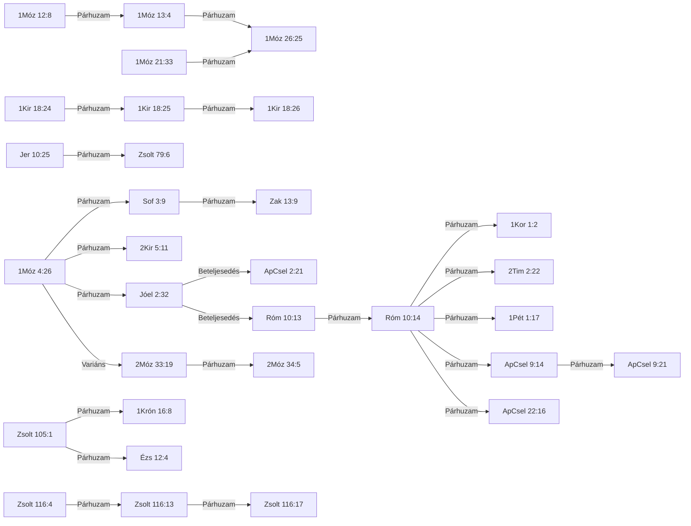

<!-- GENERÁLT: general.py --cel lexikon | rések: motivumok/ISTENTISZT-001.md;motivumlog/lexikon_pilot/ISTENTISZT-001_TUDOMANYOS.md -->

# 📖 ISTENTISZT-001 — Segítségül hívni az Úr nevét

## Kivonat *(kézi)*

A motívum az ószövetségi קָרָא בְּשֵׁם יְהוָה (kárá besém JHVH), „segítségül hívni az Úr nevét" formulát és újszövetségi folytatását követi: formulaikus azonosság, 33 igehelyen (23 ószövetségi, 10 újszövetségi). A formula az 1Móz 4:26-ban jelenik meg először, a pátriárkák oltárépítéséhez kötődik, majd a zsoltárokban és a prófétáknál liturgikus és eszkatológiai formává válik (Jóel 2:32). A Septuaginta a 23 ószövetségi helyből 19-et az ἐπικαλέω (epikaleó) igével ad vissza; eltér a két isteni önkihirdetésnél (2Móz 33:19; 34:5: καλέω, kaleó) és az Ézs 12:4-ben (βοάω, boaó), a Zsolt 116:17-ben pedig a tagmondat hiányzik a görögből. Az Újszövetség a Jóel 2:32-t szó szerint idézi (ApCsel 2:21; Róm 10:13), és a formulát Krisztusra alkalmazza: a „segítségül hívók" a korai gyülekezet önmegnevezésévé válnak (ApCsel 9:14, 21; 1Kor 1:2).

## Tartalomjegyzék

<!-- GENERÁLT-KEZDET: general.py --cel lexikon#ISTENTISZT-001#tartalom | forrás:  | licenc: minden jog fenntartva | ts=2026-10-29 -->

*Ez a blokk a lexikon-oldal 14 szakaszának tartalomjegyzékét adja (LEXV2_2_BRIEF.md G1).*

- [Kivonat](#kivonat)
- [Jelmagyarázat és rövidítések](#jelmagyarázat-és-rövidítések)
- [1. Előfordulások](#1-előfordulások)
- [1/b. Kizárt és vizsgált helyek](#1b-kizárt-és-vizsgált-helyek)
- [2. Szótári háttér](#2-szótári-háttér)
- [3. LXX-fordítói döntések](#3-lxx-fordítói-döntések)
- [4. Kereszthivatkozások](#4-kereszthivatkozások)
- [5. Kapcsolatok](#5-kapcsolatok)
- [5/b. Kapcsolódó motívumok](#5b-kapcsolódó-motívumok)
- [6. Értelmezés](#6-értelmezés)
- [6/b. Alkalmazás és tanítói egyezés](#6b-alkalmazás-és-tanítói-egyezés)
- [7. Módszertan és nyitott kérdések](#7-módszertan-és-nyitott-kérdések)
- [8. Irodalom és idézés](#8-irodalom-és-idézés)
- [Kolofon](#kolofon)

<!-- GENERÁLT-VÉGE: lexikon#ISTENTISZT-001#tartalom -->

## Jelmagyarázat és rövidítések

<!-- GENERÁLT-KEZDET: general.py --cel lexikon#ISTENTISZT-001#jelmagyarazat | forrás:  | licenc: minden jog fenntartva | ts=2026-10-29 -->

*Ez a blokk közös, minden lexikon-oldalon szó szerint azonos szöveg (G10).*

**PaRDeS-szintek** (`sablonok/PaRDeS_gyorsreferencia.md`):
- **Peshat** — a szöveg szerinti, szó szerinti értelem.
- **Remez** — csak felismerés/azonosítás, következtetés nélkül.
- **Drash** — normatív, következtető, alkalmazó.
- **Sod** — fegyelmezett, csak szövegből levezethető, gematria/allegorizálás nélkül.

**Funkció:** a vers szerepe a motívum ívében — az `adat/SEMA.md` szerint
szabad szöveg (nincs zárt értékkészlet), az alábbi táblákban a motívum
saját study-jából átvett megnevezéssel szerepel.

**Rövidítések:** BDB (Brown–Driver–Briggs), TBESH/TBESG (Tyndale Bible
Encyclopedia — Strong's Hebrew/Greek), Thayer (Thayer's Greek Lexicon),
UBS (UBS Dictionary of New Testament Greek — Louw–Nida szemantikai
doménekkel), L–N (Louw–Nida doménkód), SDBH/SDGNT (Semantic Dictionary
of Biblical Hebrew/Greek), OSHL (Open Scriptures Hebrew Lexicon), TWOT
(Theological Wordbook of the Old Testament — csak számhivatkozás), TSK
(Treasury of Scripture Knowledge), KH (Károli-kereszthivatkozás), LXX
(Septuaginta), MT (Masoretic Text), KJV (King James Version).

A szótári fordításokban a πνεῦμα (pneuma) mindig *szellem*, a ψυχή
(pszükhé) *lélek*; a Károli-idézetek szövege változatlan (pl. »Lélek«).

<!-- GENERÁLT-VÉGE: lexikon#ISTENTISZT-001#jelmagyarazat -->

## 1. Előfordulások

<!-- GENERÁLT-KEZDET: general.py --cel lexikon#ISTENTISZT-001#elofordulasok | forrás: adat/elofordulasok.tsv, konkordancia/Karoli_1908.tsv, konkordancia/UBS_DNTG_referenciak.tsv, konkordancia/UBS_DNTG_jelentesek.tsv, adat/forditasok.tsv, adat/szotar_szakasz_cimke.tsv, adat/bdb_vers_jelentes.tsv, adat/thayer_vers_jelentes.tsv, konkordancia/UBS_DBH_referenciak.tsv, konkordancia/UBS_DBH_jelentesek.tsv, konkordancia/Karoli_versmegfeleltetes.tsv, konkordancia/TAHOT_kivonat.tsv | licenc: CC BY 4.0, CC BY-SA 4.0, közkincs, minden jog fenntartva | ts=2026-10-29 -->

*Ez a blokk a `[ID: ISTENTISZT-001]` motívum 33 igehely-sorát fedi az `elofordulasok.tsv`-ből, kanonikus sorrendben, a Károli-szöveggel (1/a) és az UBS-jelentés renderidejű hozzárendelésével (G3). A „Jelentés (a szó)” oszlop a szó jelentését a szótár tagolásában adja (`adat/szotar_szakasz_cimke.tsv`, `adat/bdb_vers_jelentes.tsv`, `adat/thayer_vers_jelentes.tsv`; a címke forrása a sor lábjegyzetében, ⓘ), a „Funkció (a motívumban)” a hely motívumbeli funkcióját (F131, DT272 (d)).*

| Igehely | Kulcsszó | Jelentés (a szó) | Funkció (a motívumban) | PaRDeS-szint | Strong | UBS-jelentés | Megbízhatóság · azonosítás módja |
|---|---|---|---|---|---|---|---|
| [1Móz 4:26](#ige-1móz-4-26) | segítségül hívni az Úrnak nevét — קְרֹ֖א (k.Ro'); שֵׁ֥ם (Shem) | H7121: segítségül hívni · Qal 2.c; H8034: *(nincs hozzárendelés)* ⓘ[^1] | 🌱 alap-előfordulás | Drash | H7121+H8034 | H7121: `006562001001000` — kiáltani [ⓘ](/szo/H7121); `006562001009000` — nevezni; nevet adni [ⓘ](/szo/H7121) · H8034: `007442001001000` — név [ⓘ](/szo/H8034) | magas · szó-szintű-gépi[^1] |
| [1Móz 12:8](#ige-1móz-12-8) | segítségűl hívá az Úr nevét — יִּקְרָ֖א (i.yik.Ra'); שֵׁ֥ם (Shem) | H7121: segítségül hívni · Qal 2.c; H8034: név: Isten megjelölése · 3 ⓘ[^2] | 🔁 ismétlődés | Drash | H7121+H8034 | H7121: `006562001001000` — kiáltani [ⓘ](/szo/H7121) · H8034: `007442001001000` — név [ⓘ](/szo/H8034) | magas · szó-szintű-gépi[^2] |
| [1Móz 13:4](#ige-1móz-13-4) | segítségűl hívá ott Ábrám az Úrnak nevét — יִּקְרָ֥א (i.yik.Ra'); שֵׁ֥ם (Shem) | H7121: segítségül hívni · Qal 2.c; H8034: név: Isten megjelölése · 3 ⓘ[^3] | ⭐ küszöb-előfordulás | Drash | H7121+H8034 | H7121: `006562001001000` — kiáltani [ⓘ](/szo/H7121) · H8034: `007442001001000` — név [ⓘ](/szo/H8034) | magas · szó-szintű-gépi[^3] |
| [1Móz 21:33](#ige-1móz-21-33) | segítségűl hívá ott az örökkévaló Úr Istennek nevét — יִּ֨קְרָא (i.Yik.ra'-); שֵׁ֥ם (Shem) | H7121: segítségül hívni · Qal 2.c; H8034: név: Isten megjelölése · 3 ⓘ[^4] | ➕ bővülés | Drash | H7121+H8034 | H7121: `006562001001000` — kiáltani [ⓘ](/szo/H7121) · H8034: `007442001001000` — név [ⓘ](/szo/H8034) | magas · szó-szintű-gépi[^4] |
| [1Móz 26:25](#ige-1móz-26-25) | segítségűl hívá az Úrnak nevét — יִּקְרָא֙ (i.yik.Ra'); שֵׁ֣ם (Shem) | H7121: segítségül hívni · Qal 2.c; H8034: név: Isten megjelölése · 3 ⓘ[^5] | 👨‍👦 öröklés | Drash | H7121+H8034 | H7121: `006562001001000` — kiáltani [ⓘ](/szo/H7121) · H8034: `007442001001000` — név [ⓘ](/szo/H8034) | magas · szó-szintű-gépi[^5] |
| [2Móz 33:19](#ige-2móz-33-19) | kiáltom előtted az Úr nevét — קָרָ֧אתִֽי (ka.Ra.ti); שֵׁ֛ם (Shem) | H7121: a nevet kihirdetni · Qal 3.b; H8034: *(nincs hozzárendelés)* ⓘ[^6] | ❓ be nem sorolható | Remez | H7121+H8034 | H7121: `006562001001000` — kiáltani [ⓘ](/szo/H7121) · H8034: `007442001001000` — név [ⓘ](/szo/H8034) | magas · szó-szintű-gépi[^6] |
| [2Móz 34:5](#ige-2móz-34-5) | nevén kiáltá az Urat — יִּקְרָ֥א (i.yik.Ra'); שֵׁ֖ם (Shem) | H7121: a nevet kihirdetni · Qal 3.b; H8034: *(nincs hozzárendelés)* ⓘ[^7] | ❓ be nem sorolható | Remez | H7121+H8034 | H7121: `006562001001000` — kiáltani [ⓘ](/szo/H7121) · H8034: `007442001001000` — név [ⓘ](/szo/H8034) | magas · szó-szintű-gépi[^7] |
| [1Kir 18:24](#ige-1kir-18-24) | segítségül hívom az Úrnak nevét — אֶקְרָ֣א ('ek.Ra'); שֵׁם (shem-) | H7121: segítségül hívni · Qal 2.c; H8034: *(nincs hozzárendelés)* ⓘ[^8] | ⚔️ nyilvános versengés | Remez | H7121+H8034 | H7121: `006562001001000` — kiáltani [ⓘ](/szo/H7121) · H8034: `007442001001000` — név [ⓘ](/szo/H8034) | magas · tartalom-alapú[^8] |
| [1Kir 18:25](#ige-1kir-18-25) | hívjátok segítségül a ti istenteknek nevét — קִרְאוּ֙ (kir.'U); שֵׁ֣ם (Shem) | H7121: segítségül hívni · Qal 2.c; H8034: *(nincs hozzárendelés)* ⓘ[^9] | ⚔️ nyilvános versengés (folytatás) | Remez | H7121+H8034 | H7121: `006562001001000` — kiáltani [ⓘ](/szo/H7121) · H8034: `007442001001000` — név [ⓘ](/szo/H8034) | magas · tartalom-alapú[^9] |
| [1Kir 18:26](#ige-1kir-18-26) | segítségül hívák a Baálnak nevét — יִּקְרְא֣וּ (i.yik.re.'U); שֵׁם (shem-) | H7121: segítségül hívni · Qal 2.c; H8034: név: hamis istenekről · 4 ⓘ[^10] | ⚔️ nyilvános versengés (folytatás) | Remez | H7121+H8034 | H7121: `006562001001000` — kiáltani [ⓘ](/szo/H7121) · H8034: `007442001001000` — név [ⓘ](/szo/H8034) | magas · tartalom-alapú[^10] |
| [2Kir 5:11](#ige-2kir-5-11) | segítségül hívja az Úrnak, az ő Istenének nevét — קָרָא֙ (ka.Ra'); שֵׁם (shem-) | H7121: segítségül hívni · Qal 2.c; H8034: *(nincs hozzárendelés)* ⓘ[^11] | 🔁 ismétlődés, kívülálló szemszögéből | Remez | H7121+H8034 | H7121: `006562001001000` — kiáltani [ⓘ](/szo/H7121) · H8034: `007442001001000` — név [ⓘ](/szo/H8034) | magas · tartalom-alapú[^11] |
| [1Krón 16:8](#ige-1krón-16-8) | hívjátok segítségül az ő nevét — קִרְא֣וּ (kir.'U); שְׁמ֔ (sh.M) | H7121: segítségül hívni · Qal 2.c; H8034: *(nincs hozzárendelés)* ⓘ[^12] | ⇄ párhuzam | Remez | H7121+H8034 | H7121: `006562001001000` — kiáltani [ⓘ](/szo/H7121) · H8034: `007442001001000` — név [ⓘ](/szo/H8034) | magas · tartalom-alapú[^12] |
| [Zsolt 79:6](#ige-zsolt-79-6) | nem hívják segítségül a te nevedet — קָרָֽאוּ (ka.Ra.'u); שִׁמְ (shim.) | H7121: segítségül hívni · Qal 2.c; H8034: *(nincs hozzárendelés)* ⓘ[^13] | ⇄🚫 párhuzam, tagadó forma | Remez | H7121+H8034 | H7121: `006562001011000` — (istenséget) elismerni [ⓘ](/szo/H7121) · H8034: `007442001001000` — név [ⓘ](/szo/H8034) | magas · tartalom-alapú[^13] |
| [Zsolt 105:1](#ige-zsolt-105-1) | hívjátok segítségül az ő nevét — קִרְא֣וּ (kir.'U); שְׁמ֑ (sh.M) | H7121: segítségül hívni · Qal 2.c; H8034: *(nincs hozzárendelés)* ⓘ[^14] | ⇄ párhuzam | Remez | H7121+H8034 | H7121: `006562001001000` — kiáltani [ⓘ](/szo/H7121) · H8034: `007442001001000` — név [ⓘ](/szo/H8034) | magas · tartalom-alapú[^14] |
| [Zsolt 116:4](#ige-zsolt-116-4) | az Úrnak nevét segítségül hívám — אֶקְרָ֑א ('ek.Ra'); שֵֽׁם (shem-) | H7121: segítségül hívni · Qal 2.c; H8034: *(nincs hozzárendelés)* ⓘ[^15] | 🔁 ismétlődés, személyes könyörgésben | Remez | H7121+H8034 | H7121: `006562001001000` — kiáltani [ⓘ](/szo/H7121) · H8034: `007442001001000` — név [ⓘ](/szo/H8034) | magas · tartalom-alapú[^15] |
| [Zsolt 116:13](#ige-zsolt-116-13) | az Úrnak nevét hívom segítségül — אֶקְרָֽא ('ek.Ra'); שֵׁ֖ם (Shem) | H7121: segítségül hívni · Qal 2.c; H8034: *(nincs hozzárendelés)* ⓘ[^16] | 🔁 ismétlődés, személyes könyörgésben | Remez | H7121+H8034 | H7121: `006562001001000` — kiáltani [ⓘ](/szo/H7121) · H8034: `007442001001000` — név [ⓘ](/szo/H8034) | magas · tartalom-alapú[^16] |
| [Zsolt 116:17](#ige-zsolt-116-17) | az Úr nevét hívom segítségül — אֶקְרָֽא ('ek.Ra'); שֵׁ֖ם (Shem) | H7121: segítségül hívni · Qal 2.c; H8034: *(nincs hozzárendelés)* ⓘ[^17] | 🔁 ismétlődés, személyes könyörgésben | Remez | H7121+H8034 | H7121: `006562001001000` — kiáltani [ⓘ](/szo/H7121) · H8034: `007442001001000` — név [ⓘ](/szo/H8034) | magas · tartalom-alapú[^17] |
| [Ézs 12:4](#ige-ézs-12-4) | magasztaljátok az Ő nevét — קִרְא֣וּ (kir.'U); שְׁמֽ (she.M) | H7121: segítségül hívni · Qal 2.c; H8034: *(nincs hozzárendelés)* ⓘ[^18] | ⇄ párhuzam | Remez | H7121+H8034 | H7121: `006562001001000` — kiáltani [ⓘ](/szo/H7121) · H8034: `007442001001000` — név [ⓘ](/szo/H8034); `007442001004000` — név; önmaga [ⓘ](/szo/H8034) | közepes · tartalom-alapú[^18] |
| [Ézs 64:6](#ige-ézs-64-6) | segítségül hívta volna nevedet — קוֹרֵ֣א (ko.Re'); שִׁמְ (shim.) | H7121: segítségül hívni · Qal 2.c; H8034: *(nincs hozzárendelés)* ⓘ[^19] | 🚫 tagadó forma | Remez | H7121+H8034 | H7121: `006562001011000` — (istenséget) elismerni [ⓘ](/szo/H7121) · H8034: `007442001001000` — név [ⓘ](/szo/H8034) | magas · tartalom-alapú[^19] |
| [Jer 10:25](#ige-jer-10-25) | nem hívják segítségül a te nevedet — קָרָ֑אוּ (ka.Ra.'u); שִׁמְ (shim.) | H7121: segítségül hívni · Qal 2.c; H8034: *(nincs hozzárendelés)* ⓘ[^20] | ⇄🚫 párhuzam, tagadó forma | Remez | H7121+H8034 | H7121: `006562001011000` — (istenséget) elismerni [ⓘ](/szo/H7121) · H8034: `007442001001000` — név [ⓘ](/szo/H8034) | magas · tartalom-alapú[^20] |
| [Jóel 2:32](#ige-jóel-2-32) | az Úrnak nevét hívja segítségül — קֹרֵֽא (ko.Re'); שֵׁ֥ם (Shem) | H7121: segítségül hívni · Qal 2.c; H8034: *(nincs hozzárendelés)* ⓘ[^21] | 🎯 előkép/beteljesedés | Remez | H7121+H8034 | H7121: `006562001006000` — hívni; magához hívni; meghívni [ⓘ](/szo/H7121) *(MT: Jóel 3:5)*; `006562001011000` — (istenséget) elismerni [ⓘ](/szo/H7121) *(MT: Jóel 3:5)* · H8034: `007442001001000` — név [ⓘ](/szo/H8034) *(MT: Jóel 3:5)* | magas · tartalom-alapú[^21] |
| [Sof 3:9](#ige-sof-3-9) | segítségül hívják az Úr nevét — קְרֹ֤א (k.Ro'); שֵׁ֣ם (Shem) | H7121: segítségül hívni · Qal 2.c; H8034: *(nincs hozzárendelés)* ⓘ[^22] | 🔮 eszkatológiai kitekintés | Remez | H7121+H8034 | H7121: `006562001011000` — (istenséget) elismerni [ⓘ](/szo/H7121) · H8034: `007442001001000` — név [ⓘ](/szo/H8034) | magas · tartalom-alapú[^22] |
| [Zak 13:9](#ige-zak-13-9) | segítségül hívja ... nevemet — יִקְרָ֣א (yik.Ra'); שְׁמִ֗ (sh.M) | H7121: segítségül hívni · Qal 2.c; H8034: *(nincs hozzárendelés)* ⓘ[^23] | 🔮 eszkatológiai kitekintés (folytatás) | Remez | H7121+H8034 | H7121: `006562001001000` — kiáltani [ⓘ](/szo/H7121) · H8034: `007442001001000` — név [ⓘ](/szo/H8034) | magas · tartalom-alapú[^23] |
| [ApCsel 2:21](#ige-apcsel-2-21) | az Úrnak nevét segítségül hívja — ἐπικαλέσηται (epikaleszétai) | segítségül hívni, folyamodni valakihez · TBESG 2 ⓘ[^24] | 🎯 előkép/beteljesedés (idézet) | Remez | G1941 | 33.176 — segítségül hívni; folyamodni valakihez; segítséget kérni [ⓘ](/szo/G1941) | magas · tartalom-alapú[^24] |
| [ApCsel 9:14](#ige-apcsel-9-14) | segítségül hívják — ἐπικαλουμένους (epikalúmenúsz) | segítségül hívni, folyamodni valakihez · TBESG 2 ⓘ[^25] | 🎯 előkép/beteljesedés (kiterjesztés) | Remez | G1941 | 11.28 — (Isten) népéhez tartozni; valakinek a népe lenni [ⓘ](/szo/G1941) | magas · tartalom-alapú[^25] |
| [ApCsel 9:21](#ige-apcsel-9-21) | hívják segítségül — ἐπικαλουμένους (epikalúmenúsz) | segítségül hívni, folyamodni valakihez · TBESG 2 ⓘ[^26] | 🔁 ismétlődés | Remez | G1941 | 33.131 — hívni; nevezni [ⓘ](/szo/G1941) | magas · tartalom-alapú[^26] |
| [ApCsel 22:16](#ige-apcsel-22-16) | segítségül híván — ἐπικαλεσάμενος (epikaleszamenosz) | segítségül hívni, folyamodni valakihez · TBESG 2 ⓘ[^27] | 🎯 előkép/beteljesedés (kiterjesztés) | Remez | G1941 | 33.176 — segítségül hívni; folyamodni valakihez; segítséget kérni [ⓘ](/szo/G1941) | magas · tartalom-alapú[^27] |
| [Róm 10:12](#ige-róm-10-12) | segítségül hívják — ἐπικαλουμένους (epikalúmenúsz) | segítségül hívni, folyamodni valakihez · TBESG 2 ⓘ[^28] | 🎯 előkép/beteljesedés (bevezetés) | Remez | G1941 | 33.176 — segítségül hívni; folyamodni valakihez; segítséget kérni [ⓘ](/szo/G1941) | magas · tartalom-alapú[^28] |
| [Róm 10:13](#ige-róm-10-13) | segítségül hívja az Úr nevét — ἐπικαλέσηται (epikaleszétai) | segítségül hívni, folyamodni valakihez · TBESG 2 ⓘ[^29] | 🎯 előkép/beteljesedés (idézet) | Remez | G1941 | 33.176 — segítségül hívni; folyamodni valakihez; segítséget kérni [ⓘ](/szo/G1941) | magas · tartalom-alapú[^29] |
| [Róm 10:14](#ige-róm-10-14) | hívják segítségül — ἐπικαλέσωνται (epikaleszóntai) | segítségül hívni, folyamodni valakihez · TBESG 2 ⓘ[^30] | 🎯 előkép/beteljesedés (folytatás) | Remez | G1941 | 33.176 — segítségül hívni; folyamodni valakihez; segítséget kérni [ⓘ](/szo/G1941) | magas · tartalom-alapú[^30] |
| [1Kor 1:2](#ige-1kor-1-2) | segítségül hívják — ἐπικαλουμένοις (epikalúmenoisz) | segítségül hívni, folyamodni valakihez · TBESG 2 ⓘ[^31] | 🎯 előkép/beteljesedés (kiterjesztés) | Remez | G1941 | 33.176 — segítségül hívni; folyamodni valakihez; segítséget kérni [ⓘ](/szo/G1941) | magas · tartalom-alapú[^31] |
| [2Tim 2:22](#ige-2tim-2-22) | segítségül hívják — ἐπικαλουμένων (epikalúmenón) | segítségül hívni, folyamodni valakihez · TBESG 2 ⓘ[^32] | 🎯 előkép/beteljesedés (kiterjesztés) | Remez | G1941 | 33.176 — segítségül hívni; folyamodni valakihez; segítséget kérni [ⓘ](/szo/G1941) | magas · tartalom-alapú[^32] |
| [1Pét 1:17](#ige-1pét-1-17) | hívjátok — ἐπικαλεῖσθε (epikaleiszthe) | segítségül hívni, folyamodni valakihez · TBESG 2 ⓘ[^33] | 🎯 előkép/beteljesedés (kiterjesztés) | Remez | G1941 | 33.131 — hívni; nevezni [ⓘ](/szo/G1941) *(jelölt, nem egyértelmű)*; 33.176 — segítségül hívni; folyamodni valakihez; segítséget kérni [ⓘ](/szo/G1941) *(jelölt, nem egyértelmű)* | magas · tartalom-alapú[^33] |

[^1]: proveniencia: scope=manual | forras=Segitsegul_hivni_az_Urat_tematikus.md | ts=2026-09-05 | igazolas: nincs | jelentés-címke: H7121 — kutatói hozzárendelés a BDB tagolása szerint (`elofordulasok.tsv` jelentes_szam „2.c” → Qal 2.c, `adat/szotar_szakasz_cimke.tsv`); a BDB a verset a Qal 2.c szakaszban idézi (`adat/bdb_vers_jelentes.tsv` sorszam 92), de a versben a szó kétszer áll (`konkordancia/TAHOT_kivonat.tsv`), és a szótár nem jelöli, melyikre gondol; a BDB-példa ezért nem kerül erre a tokenre · H8034 — a BDB a verset a 3. szakaszban idézi (`adat/bdb_vers_jelentes.tsv` sorszam 116), de a versben a szó kétszer áll (`konkordancia/TAHOT_kivonat.tsv`), és a szótár nem jelöli, melyikre gondol; a BDB-példa ezért nem kerül erre a tokenre
[^2]: proveniencia: scope=manual | forras=Segitsegul_hivni_az_Urat_tematikus.md | ts=2026-09-05 | igazolas: nincs | jelentés-címke: H7121 — BDB-példa: a BDB a Qal 2.c szakaszban maga idézi a helyet (`adat/bdb_vers_jelentes.tsv` sorszam 93); ez a kutatói hozzárendelés (2.c → Qal 2.c) alá esik, a címke a finomabb útvonalé · H8034 — BDB-példa: a BDB a 3. szakaszban maga idézi a helyet (`adat/bdb_vers_jelentes.tsv` sorszam 117)
[^3]: proveniencia: scope=manual | forras=Segitsegul_hivni_az_Urat_tematikus.md | ts=2026-09-05 | igazolas: nincs | jelentés-címke: H7121 — kutatói hozzárendelés a BDB tagolása szerint (`elofordulasok.tsv` jelentes_szam „2.c” → Qal 2.c, `adat/szotar_szakasz_cimke.tsv`) · H8034 — BDB-példa: a BDB a 3. szakaszban maga idézi a helyet (`adat/bdb_vers_jelentes.tsv` sorszam 118)
[^4]: proveniencia: scope=manual | forras=Segitsegul_hivni_az_Urat_tematikus.md | ts=2026-09-05 | igazolas: nincs | jelentés-címke: H7121 — kutatói hozzárendelés a BDB tagolása szerint (`elofordulasok.tsv` jelentes_szam „2.c” → Qal 2.c, `adat/szotar_szakasz_cimke.tsv`) · H8034 — BDB-példa: a BDB a 3. szakaszban maga idézi a helyet (`adat/bdb_vers_jelentes.tsv` sorszam 119)
[^5]: proveniencia: scope=manual | forras=Segitsegul_hivni_az_Urat_tematikus.md | ts=2026-09-05 | igazolas: nincs | jelentés-címke: H7121 — kutatói hozzárendelés a BDB tagolása szerint (`elofordulasok.tsv` jelentes_szam „2.c” → Qal 2.c, `adat/szotar_szakasz_cimke.tsv`) · H8034 — a BDB forrásszövege itt a „26:35” helyet idézi (sajtóhiba); javítva: 1Móz 26:25 — a javítás forrása: `adat/bdb_forras_javitas.tsv`, kézi sor (`hivatkozas_kezi`, `manual`; indok: a TAHOT és a szövegkörnyezet; DT381 (a)); BDB-példa: a BDB a 3. szakaszban maga idézi a helyet (`adat/bdb_vers_jelentes.tsv` sorszam 120)
[^6]: proveniencia: scope=manual | forras=Segitsegul_hivni_az_Urat_tematikus.md | ts=2026-09-05 | igazolas: nincs | jelentés-címke: H7121 — BDB-példa: a BDB a Qal 3.b szakaszban maga idézi a helyet (`adat/bdb_vers_jelentes.tsv` sorszam 129); ez a kutatói hozzárendelés (3 → Qal 3) alá esik, a címke a finomabb útvonalé · H8034 — ehhez a tokenhez nincs kutatói hozzárendelés és szótári példahely
[^7]: proveniencia: scope=manual | forras=Segitsegul_hivni_az_Urat_tematikus.md | ts=2026-09-05 | igazolas: nincs | jelentés-címke: H7121 — BDB-példa: a BDB a Qal 3.b szakaszban maga idézi a helyet (`adat/bdb_vers_jelentes.tsv` sorszam 130); ez a kutatói hozzárendelés (3 → Qal 3) alá esik, a címke a finomabb útvonalé · H8034 — ehhez a tokenhez nincs kutatói hozzárendelés és szótári példahely
[^8]: proveniencia: scope=manual | forras=Segitsegul_hivni_az_Urat_tematikus.md | ts=2026-09-05 | igazolas: nincs | jelentés-címke: H7121 — kutatói hozzárendelés a BDB tagolása szerint (`elofordulasok.tsv` jelentes_szam „2.c” → Qal 2.c, `adat/szotar_szakasz_cimke.tsv`); a BDB a verset a Qal 2.c szakaszban idézi (`adat/bdb_vers_jelentes.tsv` sorszam 97, 99), de a versben a szó kétszer áll (`konkordancia/TAHOT_kivonat.tsv`), és a szótár nem jelöli, melyikre gondol; a BDB-példa ezért nem kerül erre a tokenre · H8034 — a BDB a verset a 4. szakaszban idézi (`adat/bdb_vers_jelentes.tsv` sorszam 208), de a versben a szó kétszer áll (`konkordancia/TAHOT_kivonat.tsv`), és a szótár nem jelöli, melyikre gondol; a BDB-példa ezért nem kerül erre a tokenre
[^9]: proveniencia: scope=manual | forras=Segitsegul_hivni_az_Urat_tematikus.md | ts=2026-09-05 | igazolas: nincs | jelentés-címke: H7121 — kutatói hozzárendelés a BDB tagolása szerint (`elofordulasok.tsv` jelentes_szam „2.c” → Qal 2.c, `adat/szotar_szakasz_cimke.tsv`); a BDB a helyet nem önállóan idézi, hanem a Qal 2.c szakaszban az 1Kir 18:24–25 verstartomány belsejében (a BDB-ben: „1Kin 18:24-25”; `adat/bdb_vers_jelentes.tsv` sorszam 99); a tartomány nincs kibontva (DT382 (A)), ezért a hely nem BDB-példa · H8034 — a BDB a helyet nem önállóan idézi, hanem a 4. szakaszban az 1Kir 18:24–25 verstartomány belsejében (a BDB-ben: „1Kin 18:24-25”; `adat/bdb_vers_jelentes.tsv` sorszam 208); a tartomány nincs kibontva (DT382 (A)), ezért a hely nem BDB-példa
[^10]: proveniencia: scope=manual | forras=Segitsegul_hivni_az_Urat_tematikus.md | ts=2026-09-05 | igazolas: nincs | jelentés-címke: H7121 — BDB-példa: a BDB a Qal 2.c szakaszban maga idézi a helyet (`adat/bdb_vers_jelentes.tsv` sorszam 100); ez a kutatói hozzárendelés (2.c → Qal 2.c) alá esik, a címke a finomabb útvonalé · H8034 — BDB-példa: a BDB a 4. szakaszban maga idézi a helyet (`adat/bdb_vers_jelentes.tsv` sorszam 209)
[^11]: proveniencia: scope=manual | forras=Segitsegul_hivni_az_Urat_tematikus.md | ts=2026-09-05 | igazolas: nincs | jelentés-címke: H7121 — BDB-példa: a BDB a Qal 2.c szakaszban maga idézi a helyet (`adat/bdb_vers_jelentes.tsv` sorszam 94); ez a kutatói hozzárendelés (2.c → Qal 2.c) alá esik, a címke a finomabb útvonalé · H8034 — ehhez a tokenhez nincs kutatói hozzárendelés és szótári példahely
[^12]: proveniencia: scope=manual | forras=Segitsegul_hivni_az_Urat_tematikus.md | ts=2026-09-05 | igazolas: nincs | jelentés-címke: H7121 — kutatói hozzárendelés a BDB tagolása szerint (`elofordulasok.tsv` jelentes_szam „2.c” → Qal 2.c, `adat/szotar_szakasz_cimke.tsv`) · H8034 — ehhez a tokenhez nincs kutatói hozzárendelés és szótári példahely
[^13]: proveniencia: scope=manual | forras=Segitsegul_hivni_az_Urat_tematikus.md | ts=2026-09-05 | igazolas: nincs | jelentés-címke: H7121 — BDB-példa: a BDB a Qal 2.c szakaszban maga idézi a helyet (`adat/bdb_vers_jelentes.tsv` sorszam 96); ez a kutatói hozzárendelés (2.c → Qal 2.c) alá esik, a címke a finomabb útvonalé; a kutatói jelentésszám minősítője („tagadva”) nem a szó jelentése, a címkébe nem kerül (N-F131b) · H8034 — ehhez a tokenhez nincs kutatói hozzárendelés és szótári példahely
[^14]: proveniencia: scope=manual | forras=Segitsegul_hivni_az_Urat_tematikus.md | ts=2026-09-05 | igazolas: nincs | jelentés-címke: H7121 — kutatói hozzárendelés a BDB tagolása szerint (`elofordulasok.tsv` jelentes_szam „2.c” → Qal 2.c, `adat/szotar_szakasz_cimke.tsv`) · H8034 — ehhez a tokenhez nincs kutatói hozzárendelés és szótári példahely
[^15]: proveniencia: scope=manual | forras=Segitsegul_hivni_az_Urat_tematikus.md | ts=2026-09-05 | igazolas: nincs | jelentés-címke: H7121 — kutatói hozzárendelés a BDB tagolása szerint (`elofordulasok.tsv` jelentes_szam „2.c” → Qal 2.c, `adat/szotar_szakasz_cimke.tsv`) · H8034 — ehhez a tokenhez nincs kutatói hozzárendelés és szótári példahely
[^16]: proveniencia: scope=manual | forras=Segitsegul_hivni_az_Urat_tematikus.md | ts=2026-09-05 | igazolas: nincs | jelentés-címke: H7121 — kutatói hozzárendelés a BDB tagolása szerint (`elofordulasok.tsv` jelentes_szam „2.c” → Qal 2.c, `adat/szotar_szakasz_cimke.tsv`) · H8034 — ehhez a tokenhez nincs kutatói hozzárendelés és szótári példahely
[^17]: proveniencia: scope=manual | forras=Segitsegul_hivni_az_Urat_tematikus.md | ts=2026-09-05 | igazolas: nincs | jelentés-címke: H7121 — kutatói hozzárendelés a BDB tagolása szerint (`elofordulasok.tsv` jelentes_szam „2.c” → Qal 2.c, `adat/szotar_szakasz_cimke.tsv`) · H8034 — ehhez a tokenhez nincs kutatói hozzárendelés és szótári példahely
[^18]: proveniencia: scope=manual | forras=Segitsegul_hivni_az_Urat_tematikus.md | ts=2026-09-05 | igazolas: nincs | jelentés-címke: H7121 — kutatói hozzárendelés a BDB tagolása szerint (`elofordulasok.tsv` jelentes_szam „2.c” → Qal 2.c, `adat/szotar_szakasz_cimke.tsv`) · H8034 — ehhez a tokenhez nincs kutatói hozzárendelés és szótári példahely
[^19]: proveniencia: scope=TAHOT-teljes+TAGNT-teljes | forras=TAGNT_kivonat.tsv+TAHOT_kivonat.tsv | strong=H7121+H8034 | n=196 | ts=2026-10-29T08:32Z | csatorna=cli | igazolas: TAHOT-igazolt | jelentés-címke: H7121 — kutatói hozzárendelés a BDB tagolása szerint (`elofordulasok.tsv` jelentes_szam „2.c” → Qal 2.c, `adat/szotar_szakasz_cimke.tsv`); a kutatói jelentésszám minősítője („tagadva”) nem a szó jelentése, a címkébe nem kerül (N-F131b) · H8034 — ehhez a tokenhez nincs kutatói hozzárendelés és szótári példahely
[^20]: proveniencia: scope=manual | forras=Segitsegul_hivni_az_Urat_tematikus.md | ts=2026-09-05 | igazolas: nincs | jelentés-címke: H7121 — BDB-példa: a BDB a Qal 2.c szakaszban maga idézi a helyet (`adat/bdb_vers_jelentes.tsv` sorszam 95); ez a kutatói hozzárendelés (2.c → Qal 2.c) alá esik, a címke a finomabb útvonalé; a kutatói jelentésszám minősítője („tagadva”) nem a szó jelentése, a címkébe nem kerül (N-F131b) · H8034 — ehhez a tokenhez nincs kutatói hozzárendelés és szótári példahely
[^21]: proveniencia: scope=manual | forras=Segitsegul_hivni_az_Urat_tematikus.md | ts=2026-09-05 | igazolas: nincs | jelentés-címke: H7121 — kutatói hozzárendelés a BDB tagolása szerint (`elofordulasok.tsv` jelentes_szam „2.c” → Qal 2.c, `adat/szotar_szakasz_cimke.tsv`) · H8034 — ehhez a tokenhez nincs kutatói hozzárendelés és szótári példahely
[^22]: proveniencia: scope=manual | forras=Segitsegul_hivni_az_Urat_tematikus.md | ts=2026-09-05 | igazolas: nincs | jelentés-címke: H7121 — kutatói hozzárendelés a BDB tagolása szerint (`elofordulasok.tsv` jelentes_szam „2.c” → Qal 2.c, `adat/szotar_szakasz_cimke.tsv`); a kutatói jelentésszám minősítője („rokon”) nem a szó jelentése, a címkébe nem kerül (N-F131b) · H8034 — ehhez a tokenhez nincs kutatói hozzárendelés és szótári példahely
[^23]: proveniencia: scope=manual | forras=Segitsegul_hivni_az_Urat_tematikus.md | ts=2026-09-08 | igazolas: nincs | jelentés-címke: H7121 — kutatói hozzárendelés a BDB tagolása szerint (`elofordulasok.tsv` jelentes_szam „2.c” → Qal 2.c, `adat/szotar_szakasz_cimke.tsv`) · H8034 — ehhez a tokenhez nincs kutatói hozzárendelés és szótári példahely
[^24]: proveniencia: scope=manual | forras=Segitsegul_hivni_az_Urat_tematikus.md | ts=2026-09-05 | igazolas: nincs | jelentés-címke: kutatói hozzárendelés a TBESG tagolása szerint (`elofordulasok.tsv` jelentes_szam „2” → TBESG 2, `adat/szotar_szakasz_cimke.tsv`); a Thayer saját példahelye: Thayer 5 (`adat/thayer_vers_jelentes.tsv` sorszam 37)
[^25]: proveniencia: scope=manual | forras=Segitsegul_hivni_az_Urat_tematikus.md | ts=2026-09-08 | igazolas: nincs | jelentés-címke: kutatói hozzárendelés a TBESG tagolása szerint (`elofordulasok.tsv` jelentes_szam „2” → TBESG 2, `adat/szotar_szakasz_cimke.tsv`); a Thayer saját példahelye: Thayer 5 (`adat/thayer_vers_jelentes.tsv` sorszam 39)
[^26]: proveniencia: scope=manual | forras=Segitsegul_hivni_az_Urat_tematikus.md | ts=2026-09-08 | igazolas: nincs | jelentés-címke: kutatói hozzárendelés a TBESG tagolása szerint (`elofordulasok.tsv` jelentes_szam „2” → TBESG 2, `adat/szotar_szakasz_cimke.tsv`); a Thayer saját példahelye: Thayer 5 (`adat/thayer_vers_jelentes.tsv` sorszam 40)
[^27]: proveniencia: scope=manual | forras=Segitsegul_hivni_az_Urat_tematikus.md | ts=2026-09-08 | igazolas: nincs | jelentés-címke: kutatói hozzárendelés a TBESG tagolása szerint (`elofordulasok.tsv` jelentes_szam „2” → TBESG 2, `adat/szotar_szakasz_cimke.tsv`); a Thayer saját példahelye: Thayer 5 (`adat/thayer_vers_jelentes.tsv` sorszam 41)
[^28]: proveniencia: scope=manual | forras=TSK (Zak 13:9→Róm 10:12 Votes 18; ApCsel 2:21→Róm 10:12 Votes 29) + TAGNT G1941 + Thayer G1941 5. jelentés | ts=2026-09-22 | igazolas: nincs | jelentés-címke: kutatói hozzárendelés a TBESG tagolása szerint (`elofordulasok.tsv` jelentes_szam „2” → TBESG 2, `adat/szotar_szakasz_cimke.tsv`); a Thayer saját példahelye: Thayer 5 (`adat/thayer_vers_jelentes.tsv` sorszam 44)
[^29]: proveniencia: scope=manual | forras=Segitsegul_hivni_az_Urat_tematikus.md | ts=2026-09-05 | igazolas: nincs | jelentés-címke: kutatói hozzárendelés a TBESG tagolása szerint (`elofordulasok.tsv` jelentes_szam „2” → TBESG 2, `adat/szotar_szakasz_cimke.tsv`); a Thayer saját példahelye: Thayer 5 (`adat/thayer_vers_jelentes.tsv` sorszam 42)
[^30]: proveniencia: scope=manual | forras=Segitsegul_hivni_az_Urat_tematikus.md | ts=2026-09-06 | igazolas: nincs | jelentés-címke: kutatói hozzárendelés a TBESG tagolása szerint (`elofordulasok.tsv` jelentes_szam „2” → TBESG 2, `adat/szotar_szakasz_cimke.tsv`); a Thayer a helyet nem idézi (`adat/thayer_vers_jelentes.tsv`)
[^31]: proveniencia: scope=manual | forras=Segitsegul_hivni_az_Urat_tematikus.md | ts=2026-09-08 | igazolas: nincs | jelentés-címke: kutatói hozzárendelés a TBESG tagolása szerint (`elofordulasok.tsv` jelentes_szam „2” → TBESG 2, `adat/szotar_szakasz_cimke.tsv`); a Thayer saját példahelye: Thayer 5 (`adat/thayer_vers_jelentes.tsv` sorszam 43)
[^32]: proveniencia: scope=manual | forras=Segitsegul_hivni_az_Urat_tematikus.md | ts=2026-09-08 | igazolas: nincs | jelentés-címke: kutatói hozzárendelés a TBESG tagolása szerint (`elofordulasok.tsv` jelentes_szam „2” → TBESG 2, `adat/szotar_szakasz_cimke.tsv`); a Thayer saját példahelye: Thayer 5 (`adat/thayer_vers_jelentes.tsv` sorszam 45)
[^33]: proveniencia: scope=manual | forras=Segitsegul_hivni_az_Urat_tematikus.md | ts=2026-09-08 | igazolas: nincs | jelentés-címke: kutatói hozzárendelés a TBESG tagolása szerint (`elofordulasok.tsv` jelentes_szam „2” → TBESG 2, `adat/szotar_szakasz_cimke.tsv`); a Thayer saját példahelye: Thayer 1 (`adat/thayer_vers_jelentes.tsv` sorszam 15)

*Az UBS-jelentés az újszövetségi soroknál az UBS Dictionary of New Testament Greek (DNTG), az ószövetségi soroknál az UBS Dictionary of Biblical Hebrew (DBH) igehelyszintű jelentése (`konkordancia/UBS_DBH_referenciak.tsv`, a Károli-vers az MT-számozásra képezve, `konkordancia/Karoli_versmegfeleltetes.tsv`); tokenenként a hivatkozott jelentés(ek) kódja és rövid glosszája; az ⓘ a szónézetre mutat, ahol a teljes UBS-szócikk (definíció és glosszák) áll (DT-F121g). A glossza magyarul a `forditasok.tsv`-ből jön, ahol van; ahol nincs, az angol eredeti áll `(fordításra vár)` jelöléssel. Ahol a DBH a versre nem hivatkozik, a cella ezt kimondja.*

#### 1/a. Az igehelyek szövege

**1Móz 4:26**
*Séthnek is született fia, és nevezé annak nevét Énósnak. Akkor kezdték segítségül hívni az Úrnak nevét.*
A formula első előfordulása — Séth fia, Énós nemzedéke; a Kain-vonal önerős civilizációépítése utáni korszakváltás jele.
Funkció: a motívum legelső megjelenése a kánonban, minden későbbi eset erre vezethető vissza

**1Móz 12:8**
*Onnan azután a hegység felé méne Bétheltől keletre és felüté sátorát: Béthel vala nyugatra, Hái pedig keletre, és ott oltárt építe az Úrnak, és segítségűl hívá az Úr nevét.*
Ábrám, Bétel-Ai között — oltárépítés + segítségül hívás első összekapcsolása.
Funkció: a formula második, még nem rögzült szokásként ismétlődő megjelenése

**1Móz 13:4**
*Annak az oltárnak helyére, melyet ott elsőben készített vala: és segítségűl hívá ott Ábrám az Úrnak nevét.*
Ábrám visszatér ugyanahhoz az oltárhoz Egyiptomból; a formula tudatos, felkeresett szokássá válik.
Funkció: a 3. genezisi eset, ami miatt a motívum elérte az önálló tematikus feldolgozáshoz szükséges gyakoriságot

**1Móz 21:33**
*Ábrahám pedig tamariskusfákat ültete Beérsebában, és segítségűl hívá ott az örökkévaló Úr Istennek nevét.*
Ábrahám, Beérseba — a formula kiegészül egy isteni jelzővel: אֵל עוֹלָם (él olám), "örökkévaló Isten".
Funkció: a formula első alkalommal egészül ki isteni jelzővel, új teológiai tartalmat hordozva

**1Móz 26:25**
*Oltárt építe azért ott, és segítségűl hívá az Úrnak nevét, s felvoná ott az ő sátorát; Izsák szolgái pedig kútat ásának ottan.*
Izsák, Beérseba — a minta szó szerint átöröklődik a második pátriárka-nemzedékre, ugyanazon a helyszínen.
Funkció: a gyakorlat generációk között, tudatos folytonossággal adódik át

**2Móz 33:19**
*És monda az Úr: Megteszem, hogy az én dicsőségem a te orczád előtt menjen el, és kiáltom előtted az Úr nevét: És könyörülök, a kin könyörülök, kegyelmezek, a kinek kegyelmezek.*
Isten maga jelenti ki Mózesnek: "kihirdetem előtted az Úr nevét" — nem az ember hívja segítségül Isten nevét, hanem Isten mondja ki a sajátját.
Funkció: a szereplők szerepe felcserélődik, egyik meglévő kategóriába sem illik tisztán (A/B/C tipológia, B-eset)

**2Móz 34:5**
*Az Úr pedig leszálla felhőben, és ott álla ő vele, és nevén kiáltá az Urat:*
Ugyanaz a jelenet folytatása: "az Úr nevében kiáltott" — Isten végrehajtja az előző fejezetben megígért önkihirdetést.
Funkció: a szereplők szerepe felcserélődik, egyik meglévő kategóriába sem illik tisztán (A/B/C tipológia, B-eset)

**1Kir 18:24**
*Akkor hívjátok segítségül a ti istenteknek nevét, és én is segítségül hívom az Úrnak nevét; és a mely isten tűz által felel, az az Isten. És felelvén az egész sokaság, monda: Jó lesz!*
Illés a Kármelen: "ti a ti isteneitek nevét hívjátok, és én segítségül hívom az Úr nevét" — nyilvános, versengő kontextus, a kontraszt magán a versen belül.
Funkció: a formula először jelenik meg nyilvános, két isten közötti próbatételi kontextusban

**1Kir 18:25**
*És monda Illés a Baál prófétáinak: Válaszszátok el magatoknak az egyik tulkot, és készítsétek el ti először; mert ti többen vagytok, és hívjátok segítségül a ti istenteknek nevét, de tüzet ne tegyetek alája.*
A Baál-próféták felszólítása: "hívjátok segítségül a ti istenetek nevét".
Funkció: a próbatétel gyakorlati végrehajtása

**1Kir 18:26**
*És vevék a tulkot, a melyet nékik adott, és azt elkészíték, és segítségül hívák a Baálnak nevét reggeltől fogva délig, mondván: Baál! hallgass meg minket! De nem jött szó, sem felelet. És ott sántikáltak az oltár körül, a melyet készítettek.*
A Baál-próféták ismétlődő, sikertelen invokációja — a formula kudarca a kontraszt kiteljesedése.
Funkció: a próbatétel kudarca

**2Kir 5:11**
*Akkor megharaguvék Naámán és elment, és így szólt: Íme én azt gondoltam, hogy kijő hozzám, és előállván, segítségül hívja az Úrnak, az ő Istenének nevét, és kezével megilleti a beteg helyeket, és úgy gyógyítja meg a kiütést.*
Naámán elvárása Elizeus felől — a formula ismertsége a nem-izraeli szereplő szájában is.

**1Krón 16:8**
*Dícsérjétek az Urat, hívjátok segítségül az ő nevét, hirdessétek minden népek között az ő nagy dolgait.*
A Zsolt 105:1 szinte szó szerinti megismétlése a frigyláda Sátor elé állításának liturgiájában.
Funkció: formulai/liturgikus örökség a genezisi hagyományból, nem narratív folytonosság

**Zsolt 79:6**
*Ontsd ki haragodat a pogányokra, a kik nem ismernek téged, és az országokra, a melyek nem hívják segítségül a te nevedet;*
A Jer 10:25 szinte szó szerinti párhuzama, azonos vádló szerkezettel.
Funkció: a formula elmulasztása mint vád, fordított szórenddel

**Zsolt 105:1**
*Magasztaljátok az Urat, hívjátok segítségül az ő nevét, hirdessétek a népek között az ő cselekedeteit!*
"Hívjátok segítségül az ő nevét, hirdessétek a népek közt az ő cselekedeteit" — a genezisi hagyományból örökölt formula önálló, liturgikus felhasználása, nem a történetszál narratív folytatása.
Funkció: formulai/liturgikus örökség a genezisi hagyományból, nem narratív folytonosság

**Zsolt 116:4**
*És az Úrnak nevét segítségül hívám: Kérlek Uram, szabadítsd meg az én lelkemet!*
A zsoltáros saját, személyes hála-könyörgésének első megfogalmazása: "segítségül hívom az Úr nevét".

**Zsolt 116:13**
*A szabadulásért való poharat felemelem, és az Úrnak nevét hívom segítségül.*
A formula második, szó szerinti megismétlése ugyanabban a zsoltárban, a "szabadulás poharának" felemelése kontextusában.

**Zsolt 116:17**
*Néked áldozom hálaadásnak áldozatával, és az Úr nevét hívom segítségül.*
A formula harmadik megismétlése, hála-áldozat felajánlása kontextusában.

**Ézs 12:4**
*És így szólotok ama napon: Adjatok hálát az Úrnak, magasztaljátok az Ő nevét, hirdessétek a népek közt nagyságos dolgait, mondjátok, hogy nagy az Ő neve.*
Szó szerint majdnem azonos a Zsolt 105:1-gyel, eszkatológiai hálaének kontextusban.
Funkció: formulai/liturgikus örökség a genezisi hagyományból, nem narratív folytonosság

**Ézs 64:6**
*S nem volt, a ki segítségül hívta volna nevedet, a ki felserkenne és beléd fogóznék, mert orczádat elrejtéd tőlünk, és álnokságainkban minket megolvasztál.*
"S nem volt, a ki segítségül hívta volna nevedet" — a formula tagadó formában, első személyű többes számú versben („tőlünk”, „minket”).
Funkció: a formula elmulasztása, első személyű többes számú versben, egyenes szórenddel

**Jer 10:25**
*Öntsd ki haragodat ama nemzetekre, a melyek nem ismernek téged, és ama nemzetségekre, a melyek nem hívják segítségül a te nevedet; mert megették Jákóbot, bizony megették őt, és elemésztették őt, és lakóhelyét elpusztították!*
"…a nemzetségekre, akik a Te nevedet nem hívják segítségül" — a formula tagadó, vádló formában, fordított szórenddel.
Funkció: a formula elmulasztása mint vád, fordított szórenddel

**Jóel 2:32**
*De mindaz, a ki az Úrnak nevét hívja segítségül, megmenekül; mert a Sion hegyén és Jeruzsálemben lészen a szabadulás, a mint megigérte az Úr, és a megszabadultak közt lesznek azok, a kiket elhí az Úr!*
Az ószövetségi megfogalmazás csúcspontja: "mindaz, aki segítségül hívja az Úr nevét, megmenekül" — ezt Péter (ApCsel 2:21) és Pál (Róm 10:13) is szó szerint idézi. Károli-számozás: Jóel 3:5.
Funkció: az ÓSZ-i ígéret, amit az ÚSZ tételesen, szó szerint idéz

**Sof 3:9**
*Akkor változtatom majd a népek ajkát tisztává, hogy mind segítségül hívják az Úr nevét, hogy egy akarattal szolgálják őt.*
Eszkatológiai ígéret — a népek megtisztított ajka egy akarattal hívja segítségül az Urat.
Funkció: a formula jövőbeli, univerzális beteljesedésének előrevetítése

**Zak 13:9**
*És beviszem a harmadrészt a tűzbe, és megtisztítom őket, a mint tisztítják az ezüstöt és megpróbálom őket, a mint próbálják az aranyat; ő segítségül hívja az én nevemet és én felelni fogok néki; ezt mondom: Népem ő! Ő pedig ezt mondja: Az Úr az én Istenem!*
Sof 3:9 párja: a megtisztított maradék segítségül hívja Isten nevét, és Isten válaszol — kétirányú szövetségi megerősítés.
Funkció: kétirányú szövetségi megerősítéssé bővíti az ígéretet

**ApCsel 2:21**
*És lészen, hogy mindaz, a ki az Úrnak nevét segítségül hívja, megtartatik.*
Péter pünkösdi beszéde szó szerint idézi a LXX Jóel 2:32-t: "mindaz, a ki az Úrnak nevét segítségül hívja, megtartatik."
Funkció: az ÚSZ szó szerint idézi a Jóel 2:32-t

**ApCsel 9:14**
*És itt is hatalma van a főpapoktól, hogy mindazokat megkötözze, kik a te nevedet segítségül hívják.*
"…mindazokat…, kik a te nevedet segítségül hívják" — Saul üldözési célpontjainak leírása, a korai keresztények azonosító megnevezése.
Funkció: a formula önálló egyházi azonosító-formulává válik

**ApCsel 9:21**
*Álmélkodnak vala pedig mindnyájan, a kik hallák, és mondának: Nem ez-é az, a ki pusztította Jeruzsálemben azokat, a kik ezt a nevet hívják segítségül, és ide is azért jött, hogy őket fogva vigye a főpapokhoz?*
"…a kik ezt a nevet hívják segítségül" — az ApCsel 9:14-es leírás közvetlen megismétlése ugyanabban a fejezetben.
Funkció: az ApCsel 9:14-es leírás közvetlen megismétlése

**ApCsel 22:16**
*Most annakokáért mit késedelmezel? Kelj fel és keresztelkedjél meg és mosd le a te bűneidet, segítségül híván az Úrnak nevét.*
"…segítségül híván az Úrnak nevét" — Pál saját megtérés-elbeszélésében, a keresztséggel összekapcsolva.
Funkció: a formula önálló egyházi azonosító-formulává válik

**Róm 10:12**
*Mert nincs különbség zsidó meg görög között; mert ugyanaz az Ura mindeneknek, a ki kegyelemben gazdag mindenekhez, a kik őt segítségül hívják.*
"…ugyanaz az Ura mindeneknek, a ki kegyelemben gazdag mindenekhez, a kik őt segítségül hívják" — a 10:13-as Jóel-idézet közvetlen bevezetése: a segítségül hívók körét zsidóra és görögre egyaránt kiterjeszti.
Funkció: a 10:13 idézetét előkészítő egyetemes kiterjesztés

**Róm 10:13**
*Mert minden, a ki segítségül hívja az Úr nevét, megtartatik.*
Pál szó szerint idézi a LXX Jóel 2:32-t: "minden, a ki segítségül hívja az Úr nevét, megtartatik." — erre épül a 10:14 kérdéssora.
Funkció: az ÚSZ szó szerint idézi a Jóel 2:32-t

**Róm 10:14**
*Mimódon hívják azért segítségül azt, a kiben nem hisznek? Mimódon hisznek pedig abban, a ki felől nem hallottak? Mimódon hallanának pedig prédikáló nélkül?*
Pál közvetlenül folytatja az érvelést: "Mimódon hívják segítségül, a kiben nem hittek?" — ugyanaz a görög ige, mint 10:13-nál.
Funkció: Pál közvetlenül továbbviszi az érvelést ugyanabban a szakaszban

**1Kor 1:2**
*Az Isten gyülekezetének, a mely Korinthusban van, a Krisztus Jézusban megszentelteknek, elhívott szenteknek, mindazokkal egybe, a kik a mi Urunk Jézus Krisztus nevét segítségül hívják bármely helyen, a magokén és a miénken:*
"…mindazokkal egybe, a kik a mi Urunk Jézus Krisztus nevét segítségül hívják bármely helyen" — a formula első explicit alkalmazása Krisztusra, a gyülekezet önmeghatározása.
Funkció: a formula önálló egyházi azonosító-formulává válik

**2Tim 2:22**
*Az ifjúkori kivánságokat pedig kerüld; hanem kövessed az igazságot, a hitet, a szeretetet, a békességet azokkal egyetembe, a kik segítségül hívják az Urat tiszta szívből.*
"…azokkal egyetembe, a kik segítségül hívják az Urat tiszta szívből" — a segítségül hívás mint közösségválasztási kritérium.
Funkció: a formula önálló egyházi azonosító-formulává válik

**1Pét 1:17**
*És ha Atyának hívjátok őt, a ki személyválogatás nélkül ítél, kinek-kinek cselekedete szerint, félelemmel töltsétek a ti jövevénységtek idejét:*
"…ha Atyának hívjátok őt…" — az invokáció "Atya" megszólításra alkalmazva; a görög ige azonos, a Károli nem tartja meg a "segítségül" szót.
Funkció: a formula önálló egyházi azonosító-formulává válik

<!-- GENERÁLT-VÉGE: lexikon#ISTENTISZT-001#elofordulasok -->

## 1/b. Kizárt és vizsgált helyek

<!-- GENERÁLT-KEZDET: general.py --cel lexikon#ISTENTISZT-001#kizart | forrás: adat/jeloltek.tsv, adat/motivumok.tsv | licenc: minden jog fenntartva | ts=2026-10-29 -->

*Ez a blokk a `[ID: ISTENTISZT-001]` motívum 93 elutasított/nyitva maradt jelöltjét fedi a `jeloltek.tsv`-ből (G7).*

- **Zsolt 105:15** (elutasítva, `TSK 1Krón 16:8 → Zsolt 105:15 (22); napló: Segitsegul_hivni_az_Urat_kereszthivatkozas_naplo.md §Tartalmi minősítés | scope=manual | forras=Segitsegul_hivni_az_Urat_kereszthivatkozas_naplo.md | ts=2026-10-11`): ellenőrizve, tartalmilag NEM releváns (a próféták érintetlenségéről szól, ugyanabban a zsoltárban)
- **Róm 10:11** (elutasítva, `TSK Jóel 2:32 → Róm 10:11 (19); napló: Segitsegul_hivni_az_Urat_kereszthivatkozas_naplo.md §Tartalmi minősítés | scope=manual | forras=Segitsegul_hivni_az_Urat_kereszthivatkozas_naplo.md | ts=2026-10-11`): ellenőrizve, nincs ἐπικαλέομαι / καλέω a versben, NEM releváns
- **Róm 3:13** (elutasítva, `Károli-KH Zsolt 116:13; napló: Segitsegul_hivni_az_Urat_kereszthivatkozas_naplo.md §Tartalmi minősítés | scope=manual | forras=Segitsegul_hivni_az_Urat_kereszthivatkozas_naplo.md | ts=2026-10-11`): ellenőrizve, nem tartalmazza a H7121+H8034 / ἐπικαλέομαι formulát, NEM releváns
- **Jak 3:8** (elutasítva, `Károli-KH Zsolt 116:13; napló: Segitsegul_hivni_az_Urat_kereszthivatkozas_naplo.md §Tartalmi minősítés | scope=manual | forras=Segitsegul_hivni_az_Urat_kereszthivatkozas_naplo.md | ts=2026-10-11`): ellenőrizve, nem tartalmazza a H7121+H8034 / ἐπικαλέομαι formulát, NEM releváns
- **2Sám 7:9** (elutasítva, `Károli-KH Zsolt 116:17; napló: Segitsegul_hivni_az_Urat_kereszthivatkozas_naplo.md §Tartalmi minősítés | scope=manual | forras=Segitsegul_hivni_az_Urat_kereszthivatkozas_naplo.md | ts=2026-10-11`): ellenőrizve, nem tartalmazza a H7121+H8034 / ἐπικαλέομαι formulát, NEM releváns
- **Zsolt 113:3** (elutasítva, `Károli-KH Zef 3:9; napló: Segitsegul_hivni_az_Urat_kereszthivatkozas_naplo.md §Tartalmi minősítés | scope=manual | forras=Segitsegul_hivni_az_Urat_kereszthivatkozas_naplo.md | ts=2026-10-11`): ellenőrizve, nem tartalmazza a H7121+H8034 / ἐπικαλέομαι formulát, NEM releváns
- **Zsolt 114:2** (elutasítva, `Károli-KH Zef 3:9; napló: Segitsegul_hivni_az_Urat_kereszthivatkozas_naplo.md §Tartalmi minősítés | scope=manual | forras=Segitsegul_hivni_az_Urat_kereszthivatkozas_naplo.md | ts=2026-10-11`): ellenőrizve, nem tartalmazza a H7121+H8034 / ἐπικαλέομαι formulát, NEM releváns
- **Zsolt 66:1** (elutasítva, `Károli-KH Ézs 12:4; napló: Segitsegul_hivni_az_Urat_kereszthivatkozas_naplo.md §Tartalmi minősítés | scope=manual | forras=Segitsegul_hivni_az_Urat_kereszthivatkozas_naplo.md | ts=2026-10-11`): ellenőrizve, nem tartalmazza a H7121+H8034 / ἐπικαλέομαι formulát, NEM releváns
- **Zsolt 66:2** (elutasítva, `Károli-KH Ézs 12:4; napló: Segitsegul_hivni_az_Urat_kereszthivatkozas_naplo.md §Tartalmi minősítés | scope=manual | forras=Segitsegul_hivni_az_Urat_kereszthivatkozas_naplo.md | ts=2026-10-11`): ellenőrizve, nem tartalmazza a H7121+H8034 / ἐπικαλέομαι formulát, NEM releváns
- **Zsolt 66:3** (elutasítva, `Károli-KH Ézs 12:4; napló: Segitsegul_hivni_az_Urat_kereszthivatkozas_naplo.md §Tartalmi minősítés | scope=manual | forras=Segitsegul_hivni_az_Urat_kereszthivatkozas_naplo.md | ts=2026-10-11`): ellenőrizve, nem tartalmazza a H7121+H8034 / ἐπικαλέομαι formulát, NEM releváns
- **Zsolt 66:4** (elutasítva, `Károli-KH Ézs 12:4; napló: Segitsegul_hivni_az_Urat_kereszthivatkozas_naplo.md §Tartalmi minősítés | scope=manual | forras=Segitsegul_hivni_az_Urat_kereszthivatkozas_naplo.md | ts=2026-10-11`): ellenőrizve, nem tartalmazza a H7121+H8034 / ἐπικαλέομαι formulát, NEM releváns
- **Zsolt 66:5** (elutasítva, `Károli-KH Ézs 12:4; napló: Segitsegul_hivni_az_Urat_kereszthivatkozas_naplo.md §Tartalmi minősítés | scope=manual | forras=Segitsegul_hivni_az_Urat_kereszthivatkozas_naplo.md | ts=2026-10-11`): ellenőrizve, nem tartalmazza a H7121+H8034 / ἐπικαλέομαι formulát, NEM releváns
- **Zsolt 118:1** (elutasítva, `Károli-KH Ézs 12:4; napló: Segitsegul_hivni_az_Urat_kereszthivatkozas_naplo.md §Tartalmi minősítés | scope=manual | forras=Segitsegul_hivni_az_Urat_kereszthivatkozas_naplo.md | ts=2026-10-11`): ellenőrizve, nem tartalmazza a H7121+H8034 / ἐπικαλέομαι formulát, NEM releváns
- **Zsolt 106:1** (elutasítva, `Károli-KH Ézs 12:4; napló: Segitsegul_hivni_az_Urat_kereszthivatkozas_naplo.md §Tartalmi minősítés | scope=manual | forras=Segitsegul_hivni_az_Urat_kereszthivatkozas_naplo.md | ts=2026-10-11`): ellenőrizve, nem tartalmazza a H7121+H8034 / ἐπικαλέομαι formulát, NEM releváns
- **Róm 9:15** (elutasítva, `Károli-KH 2Móz 33:19; napló: Segitsegul_hivni_az_Urat_kereszthivatkozas_naplo.md §Tartalmi minősítés | scope=manual | forras=Segitsegul_hivni_az_Urat_kereszthivatkozas_naplo.md | ts=2026-10-11`): ellenőrizve, nem tartalmazza a H7121+H8034 / ἐπικαλέομαι formulát, NEM releváns
- **1Pét 1:6** (elutasítva, `Károli-KH Zak 13:9; napló: Segitsegul_hivni_az_Urat_kereszthivatkozas_naplo.md §Tartalmi minősítés | scope=manual | forras=Segitsegul_hivni_az_Urat_kereszthivatkozas_naplo.md | ts=2026-10-11`): Zak 13:9 Károli-KH célhelye. A napló (61. sor) szerint a Zak 13:9 célhelyei közül a formulát a már dokumentált Jóel 2:32, ApCsel 2:21 és Róm 10:14 mellett egyedül a Róm 10:12 tartalmazza, az 1Pét 1:6–7 nem; NEM releváns
- **1Pét 1:7** (elutasítva, `Károli-KH Zak 13:9; napló: Segitsegul_hivni_az_Urat_kereszthivatkozas_naplo.md §Tartalmi minősítés | scope=manual | forras=Segitsegul_hivni_az_Urat_kereszthivatkozas_naplo.md | ts=2026-10-11`): Zak 13:9 Károli-KH célhelye. A napló (61. sor) szerint a Zak 13:9 célhelyei közül a formulát a már dokumentált Jóel 2:32, ApCsel 2:21 és Róm 10:14 mellett egyedül a Róm 10:12 tartalmazza, az 1Pét 1:6–7 nem; NEM releváns
- **Zsolt 50:15** (elutasítva, `TSK Zak 13:9 (46 találat); napló: Segitsegul_hivni_az_Urat_kereszthivatkozas_naplo.md §Tartalmi minősítés | scope=manual | forras=Segitsegul_hivni_az_Urat_kereszthivatkozas_naplo.md | ts=2026-10-11`): név nélküli segítségül hívás (H7121, שֵׁם nélkül): rokon igei használat, nem a formula, NEM a motívum része
- **Zsolt 91:15** (elutasítva, `TSK Zak 13:9 (46 találat); napló: Segitsegul_hivni_az_Urat_kereszthivatkozas_naplo.md §Tartalmi minősítés | scope=manual | forras=Segitsegul_hivni_az_Urat_kereszthivatkozas_naplo.md | ts=2026-10-11`): név nélküli segítségül hívás (H7121, שֵׁם nélkül): rokon igei használat, nem a formula, NEM a motívum része
- **Jer 29:12** (elutasítva, `TSK Zak 13:9 (46 találat); napló: Segitsegul_hivni_az_Urat_kereszthivatkozas_naplo.md §Tartalmi minősítés | scope=manual | forras=Segitsegul_hivni_az_Urat_kereszthivatkozas_naplo.md | ts=2026-10-11`): név nélküli segítségül hívás (H7121, שֵׁם nélkül): rokon igei használat, nem a formula, NEM a motívum része
- **Ézs 58:9** (elutasítva, `TSK Zak 13:9 (46 találat); napló: Segitsegul_hivni_az_Urat_kereszthivatkozas_naplo.md §Tartalmi minősítés | scope=manual | forras=Segitsegul_hivni_az_Urat_kereszthivatkozas_naplo.md | ts=2026-10-11`): név nélküli segítségül hívás (H7121, שֵׁם nélkül): rokon igei használat, nem a formula, NEM a motívum része
- **Ézs 65:24** (elutasítva, `TSK Zak 13:9 (46 találat); napló: Segitsegul_hivni_az_Urat_kereszthivatkozas_naplo.md §Tartalmi minősítés | scope=manual | forras=Segitsegul_hivni_az_Urat_kereszthivatkozas_naplo.md | ts=2026-10-11`): név nélküli segítségül hívás (H7121, שֵׁם nélkül): rokon igei használat, nem a formula, NEM a motívum része
- **Zsolt 86:5** (elutasítva, `TSK ApCsel 2:21; napló: Segitsegul_hivni_az_Urat_kereszthivatkozas_naplo.md §Tartalmi minősítés | scope=manual | forras=Segitsegul_hivni_az_Urat_kereszthivatkozas_naplo.md | ts=2026-10-11`): név nélküli H7121: rokon, NEM a formula
- **1Móz 25:21** (elutasítva, `Károli-KH ApCsel 2:21; napló: Segitsegul_hivni_az_Urat_kereszthivatkozas_naplo.md §Tartalmi minősítés | scope=manual | forras=Segitsegul_hivni_az_Urat_kereszthivatkozas_naplo.md | ts=2026-10-11`): a 25:25-26-ban a H7121+H8034 névadás ("nevezék nevét Ézsaunak"), nem segítségül hívás — NEM releváns
- **1Móz 25:22** (elutasítva, `Károli-KH ApCsel 2:21; napló: Segitsegul_hivni_az_Urat_kereszthivatkozas_naplo.md §Tartalmi minősítés | scope=manual | forras=Segitsegul_hivni_az_Urat_kereszthivatkozas_naplo.md | ts=2026-10-11`): a 25:25-26-ban a H7121+H8034 névadás ("nevezék nevét Ézsaunak"), nem segítségül hívás — NEM releváns
- **1Móz 25:23** (elutasítva, `Károli-KH ApCsel 2:21; napló: Segitsegul_hivni_az_Urat_kereszthivatkozas_naplo.md §Tartalmi minősítés | scope=manual | forras=Segitsegul_hivni_az_Urat_kereszthivatkozas_naplo.md | ts=2026-10-11`): a 25:25-26-ban a H7121+H8034 névadás ("nevezék nevét Ézsaunak"), nem segítségül hívás — NEM releváns
- **1Móz 25:24** (elutasítva, `Károli-KH ApCsel 2:21; napló: Segitsegul_hivni_az_Urat_kereszthivatkozas_naplo.md §Tartalmi minősítés | scope=manual | forras=Segitsegul_hivni_az_Urat_kereszthivatkozas_naplo.md | ts=2026-10-11`): a 25:25-26-ban a H7121+H8034 névadás ("nevezék nevét Ézsaunak"), nem segítségül hívás — NEM releváns
- **1Móz 25:25** (elutasítva, `Károli-KH ApCsel 2:21; napló: Segitsegul_hivni_az_Urat_kereszthivatkozas_naplo.md §Tartalmi minősítés | scope=manual | forras=Segitsegul_hivni_az_Urat_kereszthivatkozas_naplo.md | ts=2026-10-11`): a 25:25-26-ban a H7121+H8034 névadás ("nevezék nevét Ézsaunak"), nem segítségül hívás — NEM releváns
- **1Móz 25:26** (elutasítva, `Károli-KH ApCsel 2:21; napló: Segitsegul_hivni_az_Urat_kereszthivatkozas_naplo.md §Tartalmi minősítés | scope=manual | forras=Segitsegul_hivni_az_Urat_kereszthivatkozas_naplo.md | ts=2026-10-11`): a 25:25-26-ban a H7121+H8034 névadás ("nevezék nevét Ézsaunak"), nem segítségül hívás — NEM releváns
- **1Pét 2:11** (elutasítva, `TSK 2Tim 2:22 (7 találat); napló: Segitsegul_hivni_az_Urat_kereszthivatkozas_naplo.md §Tartalmi minősítés | scope=manual | forras=Segitsegul_hivni_az_Urat_kereszthivatkozas_naplo.md | ts=2026-10-11`): az erkölcsi intelmet köti össze — NEM releváns
- **1Pét 3:11** (elutasítva, `TSK 2Tim 2:22 (7 találat); napló: Segitsegul_hivni_az_Urat_kereszthivatkozas_naplo.md §Tartalmi minősítés | scope=manual | forras=Segitsegul_hivni_az_Urat_kereszthivatkozas_naplo.md | ts=2026-10-11`): az erkölcsi intelmet köti össze — NEM releváns
- **1Kor 6:18** (elutasítva, `TSK 2Tim 2:22 (7 találat); napló: Segitsegul_hivni_az_Urat_kereszthivatkozas_naplo.md §Tartalmi minősítés | scope=manual | forras=Segitsegul_hivni_az_Urat_kereszthivatkozas_naplo.md | ts=2026-10-11`): az erkölcsi intelmet köti össze — NEM releváns
- **Zsolt 119:9** (elutasítva, `TSK 2Tim 2:22 (7 találat); napló: Segitsegul_hivni_az_Urat_kereszthivatkozas_naplo.md §Tartalmi minősítés | scope=manual | forras=Segitsegul_hivni_az_Urat_kereszthivatkozas_naplo.md | ts=2026-10-11`): az erkölcsi intelmet köti össze — NEM releváns
- **1Tim 6:11** (elutasítva, `TSK 2Tim 2:22 (7 találat); napló: Segitsegul_hivni_az_Urat_kereszthivatkozas_naplo.md §Tartalmi minősítés | scope=manual | forras=Segitsegul_hivni_az_Urat_kereszthivatkozas_naplo.md | ts=2026-10-11`): az erkölcsi intelmet köti össze — NEM releváns
- **Zsid 12:14** (elutasítva, `TSK 2Tim 2:22 (7 találat); napló: Segitsegul_hivni_az_Urat_kereszthivatkozas_naplo.md §Tartalmi minősítés | scope=manual | forras=Segitsegul_hivni_az_Urat_kereszthivatkozas_naplo.md | ts=2026-10-11`): az erkölcsi intelmet köti össze — NEM releváns
- **1Tim 4:12** (elutasítva, `TSK 2Tim 2:22 (7 találat); napló: Segitsegul_hivni_az_Urat_kereszthivatkozas_naplo.md §Tartalmi minősítés | scope=manual | forras=Segitsegul_hivni_az_Urat_kereszthivatkozas_naplo.md | ts=2026-10-11`): az erkölcsi intelmet köti össze — NEM releváns
- **1Sám 13:13** (elutasítva, `TSK/Károli-KH ApCsel 9:14; napló: Segitsegul_hivni_az_Urat_kereszthivatkozas_naplo.md §Tartalmi minősítés | scope=manual | forras=Segitsegul_hivni_az_Urat_kereszthivatkozas_naplo.md | ts=2026-10-11`): ellenőrizve, nem tartalmazza a H7121+H8034 / ἐπικαλέομαι formulát, NEM releváns
- **1Sám 13:14** (elutasítva, `TSK/Károli-KH ApCsel 9:14; napló: Segitsegul_hivni_az_Urat_kereszthivatkozas_naplo.md §Tartalmi minősítés | scope=manual | forras=Segitsegul_hivni_az_Urat_kereszthivatkozas_naplo.md | ts=2026-10-11`): ellenőrizve, nem tartalmazza a H7121+H8034 / ἐπικαλέομαι formulát, NEM releváns
- **Zsolt 89:21** (elutasítva, `TSK/Károli-KH ApCsel 9:14; napló: Segitsegul_hivni_az_Urat_kereszthivatkozas_naplo.md §Tartalmi minősítés | scope=manual | forras=Segitsegul_hivni_az_Urat_kereszthivatkozas_naplo.md | ts=2026-10-11`): ellenőrizve, nem tartalmazza a H7121+H8034 / ἐπικαλέομαι formulát, NEM releváns
- **Zsolt 89:22** (elutasítva, `TSK/Károli-KH ApCsel 9:14; napló: Segitsegul_hivni_az_Urat_kereszthivatkozas_naplo.md §Tartalmi minősítés | scope=manual | forras=Segitsegul_hivni_az_Urat_kereszthivatkozas_naplo.md | ts=2026-10-11`): ellenőrizve, nem tartalmazza a H7121+H8034 / ἐπικαλέομαι formulát, NEM releváns
- **Gal 1:23** (elutasítva, `TSK/Károli-KH ApCsel 9:21; napló: Segitsegul_hivni_az_Urat_kereszthivatkozas_naplo.md §Tartalmi minősítés | scope=manual | forras=Segitsegul_hivni_az_Urat_kereszthivatkozas_naplo.md | ts=2026-10-11`): ellenőrizve, nem tartalmazza a H7121+H8034 / ἐπικαλέομαι formulát, NEM releváns
- **ApCsel 2:38** (elutasítva, `TSK/Károli-KH ApCsel 22:16; napló: Segitsegul_hivni_az_Urat_kereszthivatkozas_naplo.md §Tartalmi minősítés | scope=manual | forras=Segitsegul_hivni_az_Urat_kereszthivatkozas_naplo.md | ts=2026-10-11`): ellenőrizve, nem tartalmazza a H7121+H8034 / ἐπικαλέομαι formulát, NEM releváns
- **Jón 1:5** (elutasítva, `TSK/Károli-KH ApCsel 22:16; napló: Segitsegul_hivni_az_Urat_kereszthivatkozas_naplo.md §Tartalmi minősítés | scope=manual | forras=Segitsegul_hivni_az_Urat_kereszthivatkozas_naplo.md | ts=2026-10-11`): ellenőrizve, nem tartalmazza a H7121+H8034 / ἐπικαλέομαι formulát, NEM releváns
- **Mk 16:15** (elutasítva, `TSK/Károli-KH Róm 10:14; napló: Segitsegul_hivni_az_Urat_kereszthivatkozas_naplo.md §Tartalmi minősítés | scope=manual | forras=Segitsegul_hivni_az_Urat_kereszthivatkozas_naplo.md | ts=2026-10-11`): ellenőrizve, nem tartalmazza a H7121+H8034 / ἐπικαλέομαι formulát, NEM releváns
- **Mk 16:16** (elutasítva, `TSK/Károli-KH Róm 10:14; napló: Segitsegul_hivni_az_Urat_kereszthivatkozas_naplo.md §Tartalmi minősítés | scope=manual | forras=Segitsegul_hivni_az_Urat_kereszthivatkozas_naplo.md | ts=2026-10-11`): ellenőrizve, nem tartalmazza a H7121+H8034 / ἐπικαλέομαι formulát, NEM releváns
- **1Móz 3:15** (elutasítva, `TSK/Károli-KH Róm 10:14; napló: Segitsegul_hivni_az_Urat_kereszthivatkozas_naplo.md §Tartalmi minősítés | scope=manual | forras=Segitsegul_hivni_az_Urat_kereszthivatkozas_naplo.md | ts=2026-10-11`): ellenőrizve, nem tartalmazza a H7121+H8034 / ἐπικαλέομαι formulát, NEM releváns
- **1Kor 6:11** (elutasítva, `TSK/Károli-KH 1Kor 1:2; napló: Segitsegul_hivni_az_Urat_kereszthivatkozas_naplo.md §Tartalmi minősítés | scope=manual | forras=Segitsegul_hivni_az_Urat_kereszthivatkozas_naplo.md | ts=2026-10-11`): ellenőrizve, nem tartalmazza a H7121+H8034 / ἐπικαλέομαι formulát, NEM releváns
- **ApCsel 10:34** (elutasítva, `TSK/Károli-KH 1Pét 1:17; napló: Segitsegul_hivni_az_Urat_kereszthivatkozas_naplo.md §Tartalmi minősítés | scope=manual | forras=Segitsegul_hivni_az_Urat_kereszthivatkozas_naplo.md | ts=2026-10-11`): ellenőrizve, nem tartalmazza a H7121+H8034 / ἐπικαλέομαι formulát, NEM releváns
- **ApCsel 10:35** (elutasítva, `TSK/Károli-KH 1Pét 1:17; napló: Segitsegul_hivni_az_Urat_kereszthivatkozas_naplo.md §Tartalmi minősítés | scope=manual | forras=Segitsegul_hivni_az_Urat_kereszthivatkozas_naplo.md | ts=2026-10-11`): ellenőrizve, nem tartalmazza a H7121+H8034 / ἐπικαλέομαι formulát, NEM releváns
- **Gal 4:6** (elutasítva, `TSK/Károli-KH 1Pét 1:17; napló: Segitsegul_hivni_az_Urat_kereszthivatkozas_naplo.md §Tartalmi minősítés | scope=manual | forras=Segitsegul_hivni_az_Urat_kereszthivatkozas_naplo.md | ts=2026-10-11`): ellenőrizve, nem tartalmazza a H7121+H8034 / ἐπικαλέομαι formulát, NEM releváns
- **Róm 2:10** (elutasítva, `TSK/Károli-KH 1Pét 1:17; napló: Segitsegul_hivni_az_Urat_kereszthivatkozas_naplo.md §Tartalmi minősítés | scope=manual | forras=Segitsegul_hivni_az_Urat_kereszthivatkozas_naplo.md | ts=2026-10-11`): ellenőrizve, nem tartalmazza a H7121+H8034 / ἐπικαλέομαι formulát, NEM releváns
- **Róm 2:11** (elutasítva, `TSK/Károli-KH 1Pét 1:17; napló: Segitsegul_hivni_az_Urat_kereszthivatkozas_naplo.md §Tartalmi minősítés | scope=manual | forras=Segitsegul_hivni_az_Urat_kereszthivatkozas_naplo.md | ts=2026-10-11`): ellenőrizve, nem tartalmazza a H7121+H8034 / ἐπικαλέομαι formulát, NEM releváns
- **Róm 2:6** (elutasítva, `TSK/Károli-KH 1Pét 1:17; napló: Segitsegul_hivni_az_Urat_kereszthivatkozas_naplo.md §Tartalmi minősítés | scope=manual | forras=Segitsegul_hivni_az_Urat_kereszthivatkozas_naplo.md | ts=2026-10-11`): ellenőrizve, nem tartalmazza a H7121+H8034 / ἐπικαλέομαι formulát, NEM releváns
- **Róm 2:7** (elutasítva, `TSK/Károli-KH 1Pét 1:17; napló: Segitsegul_hivni_az_Urat_kereszthivatkozas_naplo.md §Tartalmi minősítés | scope=manual | forras=Segitsegul_hivni_az_Urat_kereszthivatkozas_naplo.md | ts=2026-10-11`): ellenőrizve, nem tartalmazza a H7121+H8034 / ἐπικαλέομαι formulát, NEM releváns
- **Róm 2:8** (elutasítva, `TSK/Károli-KH 1Pét 1:17; napló: Segitsegul_hivni_az_Urat_kereszthivatkozas_naplo.md §Tartalmi minősítés | scope=manual | forras=Segitsegul_hivni_az_Urat_kereszthivatkozas_naplo.md | ts=2026-10-11`): ellenőrizve, nem tartalmazza a H7121+H8034 / ἐπικαλέομαι formulát, NEM releváns
- **Róm 2:9** (elutasítva, `TSK/Károli-KH 1Pét 1:17; napló: Segitsegul_hivni_az_Urat_kereszthivatkozas_naplo.md §Tartalmi minősítés | scope=manual | forras=Segitsegul_hivni_az_Urat_kereszthivatkozas_naplo.md | ts=2026-10-11`): ellenőrizve, nem tartalmazza a H7121+H8034 / ἐπικαλέομαι formulát, NEM releváns
- **Zsid 12:28** (elutasítva, `TSK/Károli-KH 1Pét 1:17; napló: Segitsegul_hivni_az_Urat_kereszthivatkozas_naplo.md §Tartalmi minősítés | scope=manual | forras=Segitsegul_hivni_az_Urat_kereszthivatkozas_naplo.md | ts=2026-10-11`): ellenőrizve, nem tartalmazza a H7121+H8034 / ἐπικαλέομαι formulát, NEM releváns
- **Jel 17:14** (elutasítva, `TSK Róm 10:12 (15, 18, 15); napló: Segitsegul_hivni_az_Urat_kereszthivatkozas_naplo.md §Tartalmi minősítés | scope=manual | forras=Segitsegul_hivni_az_Urat_kereszthivatkozas_naplo.md | ts=2026-10-11`): ellenőrizve, nem tartalmazza a H7121+H8034 / ἐπικαλέομαι formulát, NEM releváns
- **Fil 4:19** (elutasítva, `TSK Róm 10:12 (15, 18, 15); napló: Segitsegul_hivni_az_Urat_kereszthivatkozas_naplo.md §Tartalmi minősítés | scope=manual | forras=Segitsegul_hivni_az_Urat_kereszthivatkozas_naplo.md | ts=2026-10-11`): ellenőrizve, nem tartalmazza a H7121+H8034 / ἐπικαλέομαι formulát, NEM releváns
- **Róm 3:22** (elutasítva, `TSK Róm 10:12 (15, 18, 15); napló: Segitsegul_hivni_az_Urat_kereszthivatkozas_naplo.md §Tartalmi minősítés | scope=manual | forras=Segitsegul_hivni_az_Urat_kereszthivatkozas_naplo.md | ts=2026-10-11`): ellenőrizve, nem tartalmazza a H7121+H8034 / ἐπικαλέομαι formulát, NEM releváns
- **2Kor 1:23** (elutasítva, `scan G1941 | scope=TAGNT-teljes | forras=TAGNT_kivonat.tsv | strong=G1941 | n=31 | ts=2026-10-17T16:58Z | csatorna=cli`): F110 szűrő (DT283), A osztály, kézi olvasás: Károli: „Én pedig az Istent hívom bizonyságul az én lelkemre” — esküformás tanúhívás, nem segítségül hívás/imádság; negatív kritérium: nem invokáció | Károli-proveniencia (lekerdez.py karoli): scope=range:2Kor 1:23 | forras=Karoli_1908.tsv+Karoli_kereszthivatkozasok.tsv | n=2 | ts=2026-10-21T10:14Z
- **ApCsel 1:23** (elutasítva, `scan G1941 | scope=TAGNT-teljes | forras=TAGNT_kivonat.tsv | strong=G1941 | n=31 | ts=2026-10-17T16:58Z | csatorna=cli`): F110 szűrő (DT283), K1_passziv: passzív/megnevezett (was called); negatív kritérium: passzív/megnevezés jellegű vagy jogi használat, nem aktív invokáció
- **ApCsel 4:36** (elutasítva, `scan G1941 | scope=TAGNT-teljes | forras=TAGNT_kivonat.tsv | strong=G1941 | n=31 | ts=2026-10-17T16:58Z | csatorna=cli`): F110 szűrő (DT283), K1_passziv: passzív/megnevezett (having been called); negatív kritérium: passzív/megnevezés jellegű vagy jogi használat, nem aktív invokáció
- **ApCsel 7:59** (elutasítva, `scan G1941 | scope=TAGNT-teljes | forras=TAGNT_kivonat.tsv | strong=G1941 | n=31 | ts=2026-10-17T16:58Z | csatorna=cli`): F110 szűrő (DT283), A osztály, kézi olvasás: nincs ὄνομα — invokáció a קָרָא בְשֵׁם / ἐπικαλέομαι τὸ ὄνομα formulán kívül (motivumok.tsv, fölérendelt fogalom); Károli: „ki imádkozik és ezt mondja vala: Uram Jézus, vedd magadhoz az én lelkemet!” | Károli-proveniencia (lekerdez.py karoli): scope=range:ApCsel 7:59 | forras=Karoli_1908.tsv+Karoli_kereszthivatkozasok.tsv | n=2 | ts=2026-10-21T10:14Z
- **ApCsel 10:5** (elutasítva, `scan G1941 | scope=TAGNT-teljes | forras=TAGNT_kivonat.tsv | strong=G1941 | n=31 | ts=2026-10-17T16:58Z | csatorna=cli`): F110 szűrő (DT283), K1_passziv: passzív/megnevezett (is called); negatív kritérium: passzív/megnevezés jellegű vagy jogi használat, nem aktív invokáció
- **ApCsel 10:18** (elutasítva, `scan G1941 | scope=TAGNT-teljes | forras=TAGNT_kivonat.tsv | strong=G1941 | n=31 | ts=2026-10-17T16:58Z | csatorna=cli`): F110 szűrő (DT283), K1_passziv: passzív/megnevezett (is being called); negatív kritérium: passzív/megnevezés jellegű vagy jogi használat, nem aktív invokáció
- **ApCsel 10:32** (elutasítva, `scan G1941 | scope=TAGNT-teljes | forras=TAGNT_kivonat.tsv | strong=G1941 | n=31 | ts=2026-10-17T16:58Z | csatorna=cli`): F110 szűrő (DT283), K1_passziv: passzív/megnevezett (is called); negatív kritérium: passzív/megnevezés jellegű vagy jogi használat, nem aktív invokáció
- **ApCsel 11:13** (elutasítva, `scan G1941 | scope=TAGNT-teljes | forras=TAGNT_kivonat.tsv | strong=G1941 | n=31 | ts=2026-10-17T16:58Z | csatorna=cli`): F110 szűrő (DT283), K1_passziv: passzív/megnevezett (is called); negatív kritérium: passzív/megnevezés jellegű vagy jogi használat, nem aktív invokáció
- **ApCsel 12:12** (elutasítva, `scan G1941 | scope=TAGNT-teljes | forras=TAGNT_kivonat.tsv | strong=G1941 | n=31 | ts=2026-10-17T16:58Z | csatorna=cli`): F110 szűrő (DT283), K1_passziv: passzív/megnevezett (is called); negatív kritérium: passzív/megnevezés jellegű vagy jogi használat, nem aktív invokáció
- **ApCsel 12:25** (elutasítva, `scan G1941 | scope=TAGNT-teljes | forras=TAGNT_kivonat.tsv | strong=G1941 | n=31 | ts=2026-10-17T16:58Z | csatorna=cli`): F110 szűrő (DT283), K1_passziv: passzív/megnevezett (having been called); negatív kritérium: passzív/megnevezés jellegű vagy jogi használat, nem aktív invokáció
- **ApCsel 15:17** (elutasítva, `scan G1941 | scope=TAGNT-teljes | forras=TAGNT_kivonat.tsv | strong=G1941 | n=31 | ts=2026-10-17T16:58Z | csatorna=cli`): F110 szűrő (DT283), K1_passziv: passzív/megnevezett (has been called); negatív kritérium: passzív/megnevezés jellegű vagy jogi használat, nem aktív invokáció
- **ApCsel 25:11** (elutasítva, `scan G1941 | scope=TAGNT-teljes | forras=TAGNT_kivonat.tsv | strong=G1941 | n=31 | ts=2026-10-17T16:58Z | csatorna=cli`): F110 szűrő (DT283), K3_jogi: jogi fellebbezés: Kaisar/Szebasztosz a környezetben (I appeal!); negatív kritérium: passzív/megnevezés jellegű vagy jogi használat, nem aktív invokáció
- **ApCsel 25:12** (elutasítva, `scan G1941 | scope=TAGNT-teljes | forras=TAGNT_kivonat.tsv | strong=G1941 | n=31 | ts=2026-10-17T16:58Z | csatorna=cli`): F110 szűrő (DT283), K3_jogi: jogi fellebbezés: Kaisar/Szebasztosz a környezetben (You have appealed,); negatív kritérium: passzív/megnevezés jellegű vagy jogi használat, nem aktív invokáció
- **ApCsel 25:21** (elutasítva, `scan G1941 | scope=TAGNT-teljes | forras=TAGNT_kivonat.tsv | strong=G1941 | n=31 | ts=2026-10-17T16:58Z | csatorna=cli`): F110 szűrő (DT283), K3_jogi: jogi fellebbezés: Kaisar/Szebasztosz a környezetben (having appealed for); negatív kritérium: passzív/megnevezés jellegű vagy jogi használat, nem aktív invokáció
- **ApCsel 25:25** (elutasítva, `scan G1941 | scope=TAGNT-teljes | forras=TAGNT_kivonat.tsv | strong=G1941 | n=31 | ts=2026-10-17T16:58Z | csatorna=cli`): F110 szűrő (DT283), K3_jogi: jogi fellebbezés: Kaisar/Szebasztosz a környezetben (having appealed to); negatív kritérium: passzív/megnevezés jellegű vagy jogi használat, nem aktív invokáció
- **ApCsel 26:32** (elutasítva, `scan G1941 | scope=TAGNT-teljes | forras=TAGNT_kivonat.tsv | strong=G1941 | n=31 | ts=2026-10-17T16:58Z | csatorna=cli`): F110 szűrő (DT283), K3_jogi: jogi fellebbezés: Kaisar/Szebasztosz a környezetben (he had appealed); negatív kritérium: passzív/megnevezés jellegű vagy jogi használat, nem aktív invokáció
- **ApCsel 28:19** (elutasítva, `scan G1941 | scope=TAGNT-teljes | forras=TAGNT_kivonat.tsv | strong=G1941 | n=31 | ts=2026-10-17T16:58Z | csatorna=cli`): F110 szűrő (DT283), K3_jogi: jogi fellebbezés: Kaisar/Szebasztosz a környezetben (to appeal to); negatív kritérium: passzív/megnevezés jellegű vagy jogi használat, nem aktív invokáció
- **Jak 2:7** (elutasítva, `scan G1941 | scope=TAGNT-teljes | forras=TAGNT_kivonat.tsv | strong=G1941 | n=31 | ts=2026-10-17T16:58Z | csatorna=cli`): F110 szűrő (DT283), K1_passziv: passzív/megnevezett (having been called); negatív kritérium: passzív/megnevezés jellegű vagy jogi használat, nem aktív invokáció
- **Mt 10:3** (elutasítva, `scan G1941 | scope=TAGNT-teljes | forras=TAGNT_kivonat.tsv | strong=G1941 | n=31 | ts=2026-10-17T16:58Z | csatorna=cli`): F110 szűrő (DT283), K1_passziv: passzív/megnevezett (having been called); negatív kritérium: passzív/megnevezés jellegű vagy jogi használat, nem aktív invokáció
- **Mt 10:25** (elutasítva, `scan G1941 | scope=TAGNT-teljes | forras=TAGNT_kivonat.tsv | strong=G1941 | n=31 | ts=2026-10-17T16:58Z | csatorna=cli`): F110 szűrő (DT283), B osztály, kézi olvasás: Károli: „Ha a házigazdát Belzebubnak hívták” — megnevezés, nem invokáció; negatív kritérium: passzív/megnevezés jellegű használat | Károli-proveniencia (lekerdez.py karoli): scope=range:Mt 10:25 | forras=Karoli_1908.tsv+Karoli_kereszthivatkozasok.tsv | n=1 | ts=2026-10-21T10:14Z
- **Zsid 11:16** (elutasítva, `scan G1941 | scope=TAGNT-teljes | forras=TAGNT_kivonat.tsv | strong=G1941 | n=31 | ts=2026-10-17T16:58Z | csatorna=cli`): F110 szűrő (DT283), K1_passziv: passzív/megnevezett (to be called); negatív kritérium: passzív/megnevezés jellegű vagy jogi használat, nem aktív invokáció
- **Ézs 43:1** (elutasítva, `tematikus: Segitsegul_hivni_az_Urat_tematikus.md §1. Előfordulások összegyűjtése (C-minta) | scope=manual | forras=Segitsegul_hivni_az_Urat_tematikus.md | ts=2026-10-18`): C-minta: Isten szólít néven egy embert (alany: Isten, tárgy: ember neve), nem a motívum A-mintája (alany: ember, tárgy: Isten neve); a קָרָא + שֵׁם szerkezet közös, a motívumhoz nem tartozik
- **Ézs 44:5** (elutasítva, `tematikus: Segitsegul_hivni_az_Urat_tematikus.md §1. Előfordulások összegyűjtése (C-minta) | scope=manual | forras=Segitsegul_hivni_az_Urat_tematikus.md | ts=2026-10-18`): C-minta: Isten szólít néven egy embert (alany: Isten, tárgy: ember neve), nem a motívum A-mintája (alany: ember, tárgy: Isten neve); a קָרָא + שֵׁם szerkezet közös, a motívumhoz nem tartozik
- **Ézs 45:3** (elutasítva, `tematikus: Segitsegul_hivni_az_Urat_tematikus.md §1. Előfordulások összegyűjtése (C-minta) | scope=manual | forras=Segitsegul_hivni_az_Urat_tematikus.md | ts=2026-10-18`): C-minta: Isten szólít néven egy embert (alany: Isten, tárgy: ember neve), nem a motívum A-mintája (alany: ember, tárgy: Isten neve); a קָרָא + שֵׁם szerkezet közös, a motívumhoz nem tartozik
- **2Sám 6:2** (elutasítva, `tematikus: Segitsegul_hivni_az_Urat_tematikus.md §1. Előfordulások összegyűjtése (D-minta) | scope=manual | forras=Segitsegul_hivni_az_Urat_tematikus.md | ts=2026-10-18`): D-minta: passzív נִקְרָא...עַל (nikrá … al) szerkezet, birtoklás/hovatartozás, nem invokáció; eltérő igealak (aktív vs. passzív), elöljárószó (בְּ vs. עַל) és jelentés — a negatív kritérium (motivumok.tsv) kizárja
- **1Krón 13:6** (elutasítva, `tematikus: Segitsegul_hivni_az_Urat_tematikus.md §1. Előfordulások összegyűjtése (D-minta) | scope=manual | forras=Segitsegul_hivni_az_Urat_tematikus.md | ts=2026-10-18`): D-minta: passzív נִקְרָא...עַל (nikrá … al) szerkezet, birtoklás/hovatartozás, nem invokáció; eltérő igealak (aktív vs. passzív), elöljárószó (בְּ vs. עַל) és jelentés — a negatív kritérium (motivumok.tsv) kizárja
- **Jer 7:10** (elutasítva, `tematikus: Segitsegul_hivni_az_Urat_tematikus.md §1. Előfordulások összegyűjtése (D-minta) | scope=manual | forras=Segitsegul_hivni_az_Urat_tematikus.md | ts=2026-10-18`): D-minta: passzív נִקְרָא...עַל (nikrá … al) szerkezet, birtoklás/hovatartozás, nem invokáció; eltérő igealak (aktív vs. passzív), elöljárószó (בְּ vs. עַל) és jelentés — a negatív kritérium (motivumok.tsv) kizárja
- **Jer 7:11** (elutasítva, `tematikus: Segitsegul_hivni_az_Urat_tematikus.md §1. Előfordulások összegyűjtése (D-minta) | scope=manual | forras=Segitsegul_hivni_az_Urat_tematikus.md | ts=2026-10-18`): D-minta: passzív נִקְרָא...עַל (nikrá … al) szerkezet, birtoklás/hovatartozás, nem invokáció; eltérő igealak (aktív vs. passzív), elöljárószó (בְּ vs. עַל) és jelentés — a negatív kritérium (motivumok.tsv) kizárja
- **Jer 7:14** (elutasítva, `tematikus: Segitsegul_hivni_az_Urat_tematikus.md §1. Előfordulások összegyűjtése (D-minta) | scope=manual | forras=Segitsegul_hivni_az_Urat_tematikus.md | ts=2026-10-18`): D-minta: passzív נִקְרָא...עַל (nikrá … al) szerkezet, birtoklás/hovatartozás, nem invokáció; eltérő igealak (aktív vs. passzív), elöljárószó (בְּ vs. עַל) és jelentés — a negatív kritérium (motivumok.tsv) kizárja
- **Jer 7:30** (elutasítva, `tematikus: Segitsegul_hivni_az_Urat_tematikus.md §1. Előfordulások összegyűjtése (D-minta) | scope=manual | forras=Segitsegul_hivni_az_Urat_tematikus.md | ts=2026-10-18`): D-minta: passzív נִקְרָא...עַל (nikrá … al) szerkezet, birtoklás/hovatartozás, nem invokáció; eltérő igealak (aktív vs. passzív), elöljárószó (בְּ vs. עַל) és jelentés — a negatív kritérium (motivumok.tsv) kizárja
- **5Móz 28:10** (elutasítva, `tematikus: Segitsegul_hivni_az_Urat_tematikus.md §1. Előfordulások összegyűjtése (D-minta) | scope=manual | forras=Segitsegul_hivni_az_Urat_tematikus.md | ts=2026-10-18`): D-minta: passzív נִקְרָא...עַל (nikrá … al) szerkezet, birtoklás/hovatartozás, nem invokáció; eltérő igealak (aktív vs. passzív), elöljárószó (בְּ vs. עַל) és jelentés — a negatív kritérium (motivumok.tsv) kizárja
- **Ézs 41:25** (nyitva, `kollokacio H7121 H8034 | scope=TAHOT-teljes+TAGNT-teljes | forras=TAGNT_kivonat.tsv+TAHOT_kivonat.tsv | strong=H7121+H8034 | n=196 | ts=2026-10-21T09:18Z | csatorna=cli`): F110 szűrő (DT283), B osztály, kézi olvasás: Károli: „hirdeti nevemet” (TAHOT: „from [the] rising of [the] sun he will call on name my”) — aktív קרא + בְּ + שֵׁם, az Úr a beszélő. A szabály átengedi; elbírálatlan, a motívum-menet dönt | Károli-proveniencia (lekerdez.py karoli): scope=range:Ézs 41:25 | forras=Karoli_1908.tsv+Karoli_kereszthivatkozasok.tsv | n=3 | ts=2026-10-21T10:14Z
- **Zsolt 99:6** (elutasítva, `kollokacio H7121 H8034 | scope=TAHOT-teljes+TAGNT-teljes | forras=TAGNT_kivonat.tsv+TAHOT_kivonat.tsv | strong=H7121+H8034 | n=196 | ts=2026-10-20T10:13Z | csatorna=cli (N-F126a, naplok/F126_lefedetlen.py)`): N-F126a, kézi olvasás: Károli: „Sámuel az ő nevét segítségül hívókkal egybe, segítségül hívják vala az Urat, és meghallgatá őket” (TAHOT: קֹרְאֵי שְׁמוֹ, H7121+H8034; a versben H6030 is) — aktív קרא + név, Isten segítségül hívása, meghallgatással; a motívum A-mintája. Eddig sem előfordulás, sem jelölt nem volt. Döntés (felhasználó, 2026-10-29, orkesztrátor-chat, szó szerint: „Igen, így”; a kérdés: „Ézs 64:6 beépítve, Zsolt 99:6 elutasítva?”): elutasítva a negatív kritérium szerint (adat/motivumok.tsv: קָרָא + בְּ aktív, invokáló szerkezet kell). Saját mérés, TAHOT: וּשְׁמוּאֵל בְּקֹרְאֵי שְׁמוֹ קֹרִאים אֶל־יְהוָה — a בְּ (H9003) az igenév előtt áll („azok között, akik hívják”), a név (H8034 + 3. sz. birtokos rag) az igenév birtokos szerkezetében, a második tagban אֶל (H0413) + יְהוָה; kárá + בְּ + név szerkezet nincs, így a fenti „A-minta” olvasat nem áll. Előzmény: DT283 (JSir 3:55, 5Móz 32:3: a בְּ nélküli szerkezet kiszűrve marad, a kritérium nem változik). Mérés 2026-10-29: scope=TAHOT-teljes+TAGNT-teljes | forras=TAGNT_kivonat.tsv+TAHOT_kivonat.tsv | strong=H7121+H8034 | n=196 | ts=2026-10-29T08:32Z | csatorna=cli · scope=range:Zsolt 99:6 | forras=Karoli_1908.tsv+Karoli_kereszthivatkozasok.tsv | n=2 | ts=2026-10-29T08:31Z | csatorna=cli · scope=range:Ézs 64:6, range:Zsolt 99:6 | forras=TAHOT_kivonat.tsv+BSB_Strongs.tsv (naplok/ISTENTISZT001_ezs64_zsolt99_meres.py, split('\t')) | n=43+12 | ts=2026-10-29T08:51Z | Károli-proveniencia (lekerdez.py karoli): scope=range:Zsolt 99:6 | forras=Karoli_1908.tsv+Karoli_kereszthivatkozasok.tsv | n=2 | ts=2026-10-25T16:58Z

**Negatív kritérium** (`motivumok.tsv`): az igehelynek a קָרָא (kárá) + בְּ (be) (aktív, invokáló szerkezet: "[valaki] hívja segítségül [Isten nevét]") mintát kell mutatnia — a passzív נִקְרָא...עַל (nikrá … al) szerkezet (birtoklás/hovatartozás kifejezése, nem invokáció) kizárja a besorolást, még akkor is, ha ugyanazt a két gyököt használja (l. D-minta, 2Sám 6:2, Jer 7:10-14, 5Móz 28:10, ÚSZ-párja Zsid 11:16)

<!-- GENERÁLT-VÉGE: lexikon#ISTENTISZT-001#kizart -->

## 2. Szótári háttér

<!-- GENERÁLT-KEZDET: general.py --cel lexikon#ISTENTISZT-001#szocikkek | forrás: adat/bdb_szakasz_hu.tsv, adat/bdb_szakaszok.tsv, adat/bdb_vers_jelentes.tsv, adat/forditasok.tsv, adat/glosszak_heber_hu.tsv, adat/lexikon_hivatkozasok.tsv, adat/szotar_szakasz_cimke.tsv, adat/szotar_szerepek.tsv, adat/thayer_szakaszok.tsv, adat/thayer_vers_jelentes.tsv, adat/tiltott_fordulatok.tsv, konkordancia/BDB_teljes_unabridged.tsv, konkordancia/LSJ_teljes.tsv, konkordancia/LXX_versszintu_parok.tsv, konkordancia/MCGED_teljes.tsv, konkordancia/OSHL_lexikalis_index.tsv, konkordancia/SDBH_domenek.tsv, konkordancia/SDGNT_domenek.tsv, konkordancia/SECE_G_teljes.tsv, konkordancia/SECE_H_teljes.tsv, konkordancia/TBESG.txt, konkordancia/TBESH.txt, konkordancia/Thayer_teljes.tsv, konkordancia/UBS_DNTG_jelentesek.tsv, konkordancia/tW_szocikkek.tsv | licenc: CC BY 4.0, CC BY-SA 4.0, közkincs, minden jog fenntartva, © Mounce 1993 | ts=2026-10-29 -->

*Ez a blokk a `[ID: ISTENTISZT-001]` motívum 3 Strong-tokenjét fedi, szerepenként a szerepmátrix (`szotar_szerepek.tsv`) sorrendjében, van jelentés-hivatkozással a `lexikon_hivatkozasok.tsv`-ből.*

### Görög szavak: G1941

#### Jelentéstartomány (szótári gerinc)

##### G1941 — ἐπικαλέω (epikaleó) · Thayer

*Szótári gerinc (DT272): a szó jelentéstartománya a Thayer tagolásában (`adat/thayer_szakaszok.tsv`), magyarul. A motívumot hordozó szakaszok kibontva állnak, a többi összecsukva. Kiemelve, felirat nélkül: a Thayer saját példahelyei a motívum igehelyei közül (`adat/thayer_vers_jelentes.tsv`). A szótári blokk a szóról szól; a hely motívumbeli funkcióját az 1. szakasz táblázata adja.*

*A magyar szöveg a szakaszonkénti Thayer-fordításból (`adat/forditasok.tsv`, `sz<n>` sorok, #142; DT373).*

**A szócikk feje (nyelvi háttér).** ἐπικαλῶ: 1. aorisztosz ἐπεκαλεσα; (szenvedő és közép alak, jelen idő ἐπικαλοῦμαι); perfektum szenvedő ἐπικέκλημαι; pluskvamperfektum egyes szám 3. személy ἐπεκέκλητο, és az augmentum elhagyásával (vö. Winers Grammar, § 12, 5; Buttmann, 33 (29)) ἐπικεκλητο (ApCsel 26:32 Lachmann); 1. aorisztosz szenvedő ἐπεκλήθην; jövő idő közép ἐπικαλέσομαι; 1. aorisztosz közép ἐπεκαλεσάμην; a Septuaginta nagyon gyakran a קָרָא szóra;

- **`1` — elnevezni**

  > 1. nevet adni valakinek, elnevezni: τινα (Xenophón, Platón és mások), Mt 10:25 G T Tr WH (Rec. ἐκάλεσαν); szenvedő alakban ὁ ἐπικαλούμενος, akit elneveznek, Luk 22:3 R G L; ApCsel 10:18; ApCsel 11:13; ApCsel 12:12; ApCsel 15:22 R G; továbbá ὅς ἐπικαλεῖται, ApCsel 10:5, ApCsel 10:32; ὁ ἐπικληθείς, Mt 10:3 (R G); ApCsel 4:36; ApCsel 12:25; azaz ὅς ἐπεκλήθη, ApCsel 1:23. Közép erejű szenvedő alak (vö. Winers Grammar, § 38, 3): megengedni, hogy elnevezzék: Zsid 11:16; közép alak τινα-val: **1Pét 1:17** εἰ πατέρα ἐπικαλεῖσθε τόν stb. azaz ha (magatoknak) Atyaként hívjátok őt, azaz ha Atyátoknak nevezitek őt.

2 – 4 (3 szakasz)

- `2` — ἐπικαλεῖται τό ὄνομα τίνος ἐπί τινα, a héber פ עַל פ... שֵׁם נִקְרָא... mintájára, „valaki…
- `3` — τίνι a tárgy tárgyesetével
- `4` — segítségül hívni (mint a német anrufen), megidézni

- **`5` — segítségül hívni a név kimondásával**

  > 5. Hebraizmusként (mint a יְהוָה בְּשֵׁם קָרָא az Úr nevének kimondásával segítségül hívni, 1Móz 4:26; 1Móz 12:8; 2Kir 5:11, stb.; vö. Gesenius, Thesaurus, o. 1231{b} (vagy Hebrew Lexicon-ja, a קָרָא címszónál); ez a kifejezés abból magyarázódik, hogy az Istenhez intézett imák rendszerint az isteni név segítségül hívásával kezdődtek: Zsolt 3:2; Zsolt 6:2; Zsolt 7:2, stb.) ἐπικαλοῦμαι τό ὄνομα τοῦ κυρίου, segítségül hívom (a magam javára) az Úr nevét, azaz megidézem, imádom, tisztelem az Urat, azaz Krisztust: **ApCsel 2:21** (Jóel 2:32-ből ()); **ApCsel 9:14**,**21**; **22:16**>; **Róm 10:13**; **1Kor 1:2**; τόν κύριον, **Róm 10:12**; **2Tim 2:22**; (a görög írásokban gyakran ἐπικαλεῖσθαι τούς Θεούς, mint Xenophón, Cyril 7, 1, 35; Platón, Tim., o. 27 c.; Polübiosz 15, 1, 13).

*ⓘ Kutatói megjegyzés: a szótár nem idézi: Róm 10:14.*

*A teljes szócikk: [szónézet: /szo/G1941](/szo/G1941) · forrás: `konkordancia/Thayer_teljes.tsv`*

**UBS-domének (Louw–Nida):** 33.131 hívni; nevezni · 33.176 segítségül hívni; folyamodni valakihez; segítséget kérni · 56.15 ügyében fellebbezni; magasabb bírósághoz fellebbezni · 11.28 (Isten) népéhez tartozni; valakinek a népe lenni

#### 1. Alapjelentés

##### TBESG G1941 — 1. jelentés

> to call, name, surname : with accusative (cl.), Mat.10:25; pass., Act.1:23 4:36 10:5, 18 10:22 11:13 12:12, 25 , Heb.11:16 ; τ. ὄνομα, before ἐπί (denoting possession, as Heb. עַל. . שֻׁם קָרָא), Act.15:17 (LXX), Jas.2:7 (see. CB on Amo.9:12 ).

**🇭🇺** hívni, nevezni, nevet adni: tárgyesettel (klasszikus), Mt 10:25; szenvedő alakban: ApCsel 1:23; 4:36; 10:5, 18, 22; 11:13; 12:12, 25; Zsid 11:16; τ. ὄνομα (t. onoma), ἐπί (epi) előtt (birtoklást jelölve, mint a héb. עַל. . שֻׁם קָרָא (kárá sum … al)): ApCsel 15:17 (LXX), Jak 2:7 (l. CB, Ámós 9:12-höz).

*Forrás: konkordancia/TBESG.txt*

##### TBESG G1941 — 2. jelentés

> Mid. (so also act.; cl., LXX), to call upon, invoke, appeal to (θεόν, θεούς, Hdt., Xen., al.; cf. Deiss., LAE , 426): Καίσαρα (Σεβαστόν, Act.25:25 ), Act.25:11-12, 21 26:32 28:19 ; sc. τ. Κύριον Ἰησοῦν, Act.7:59; μάρτυρα (cl.) τ. θεόν, 2Co.1:23; πατέρα, 1Pe.1:17; τ. κύριον, Rom.10:12 , 2Ti.2:22 ; τ. ὄνομα κυρίου (μου, σου; like Heb. יְהוָֹה שֻׁם קָרָא), Act.2:21 (LXX) Act.9:14, 21 22:16 , Rom.10:13-14 " (LXX) 1Co.1:2 (Cremer, 335, 742).† (AS)

**🇭🇺** Közép alakban (így cselekvő alakban is; klasszikus, LXX): segítségül hívni, invokálni, folyamodni valakihez (θεόν (theon), θεούς (theúsz): Hérodotosz, Xenophón és mások; vö. Deissmann, LAE, 426): Καίσαρα (Kaiszara) (Σεβαστόν (Szebaszton), ApCsel 25:25), ApCsel 25:11-12, 21; 26:32; 28:19; ti. τ. Κύριον Ἰησοῦν (t. Kürion Iészún), ApCsel 7:59; μάρτυρα (martüra) (klasszikus) τ. θεόν (t. theon), 2Kor 1:23; πατέρα (patera), 1Pét 1:17; τ. κύριον (t. kürion), Róm 10:12; 2Tim 2:22; τ. ὄνομα κυρίου (t. onoma küriú) (μου (mú), σου (szú); mint a héb. יְהוָֹה שֻׁם קָרָא (kárá sum JHVH)), ApCsel 2:21 (LXX); 9:14, 21; 22:16; Róm 10:13-14 (LXX); 1Kor 1:2. † (Abbott-Smith; † = minden újszövetségi előfordulás felsorolva)

*Forrás: konkordancia/TBESG.txt*

#### 2. Mélységi szócikk

*Hivatkozás: a Thayer-szócikk a fenti „Jelentéstartomány (szótári gerinc)” blokkban áll (DT371).*

#### 3. Teológiai szócikk

**G1941** · tW: `kt/call-speakloudly` — a szócikkek szövege a szónézetben: [szónézet: /szo/G1941](/szo/G1941) · forrás: `konkordancia/tW_szocikkek.tsv`

#### 4. Jelentésszerkezet, szemantikai mező

**G1941** · **Szemantikai domén:** 011002 Socio-Religious, 033009 Name, 033012 Ask For, Request, 056004 Judicial Hearing, Inquiry

#### 5. Tömör jelentés, előfordulás

**G1941** · a teljes UBS DNTG-szócikk és a Mounce-glossza a szónézetben: [szónézet: /szo/G1941](/szo/G1941) · forrás: `konkordancia/UBS_DNTG_jelentesek.tsv`; a Louw–Nida-doménsor a fenti jelentéstartományban áll.

#### 6. LXX-híd

*Hivatkozás: l. a 3. szakaszt (LXX-fordítói döntések).*

#### 7. Megfelelők a másik nyelven

**G1941** · SECE — héber megfelelők (8): זָכַר, מָצָא, נָקַב, עָשָׂה, קָרָא, שׂוּם, שָׁכַן, שֻׁם

*Hivatkozás: a kézi SECE-táblázatok a 2/b szakaszban a #70-ig változatlanul állnak (l. 2/b), ha van.*

#### 8. Nyelvi háttér

*Hivatkozás: a motívum saját tokenjeihez nincs LSJ-sor a `lexikon_hivatkozasok.tsv`-ben; a rokon szavaknál (alább) és a kézi 2/b szakaszban l.*

#### 9. Versenkénti jelentés

*Hivatkozás: l. az 1. szakasz táblázatát (UBS-jelentés oszlop; csak újszövetségi sorok).*

#### 10. Kiejtés (magyaros)

**G1941** · ἐπικαλέω (epikaleó)

### Héber szavak: H7121, H8034

#### Jelentéstartomány (szótári gerinc)

##### H7121 — קָרָא (kárá) · BDB

*Szótári gerinc (DT272): a szó jelentéstartománya a BDB tagolásában (`adat/bdb_szakaszok.tsv`), magyarul (`adat/bdb_szakasz_hu.tsv`). A motívumot hordozó szakaszok kibontva állnak, a többi összecsukva; a jel a BDB útvonalából készül. Kiemelve, felirat nélkül: a BDB saját példahelyei a motívum igehelyei közül (`adat/bdb_vers_jelentes.tsv`). A szótári blokk a szóról szól; a hely motívumbeli funkcióját az 1. szakasz táblázata adja.*

**A szócikk feje (nyelvi háttér).** H7121. qara I. קָרָא_724 ige: hívni, kihirdetni, olvasni (késői héber ua., felolvasni, olvasni; föníciai קרא hívni; arab felolvasni, recitálni (a '†or°¹n), a †or°a¹n; arámi קְלרא, hívni stb., így óarámi קרא, nabateus ua., palmürai ua., קרה); —

Qal – Qal 2.b (5 szakasz)

- `Qal` — Qal_655 perfectum ׳ק 1Móz 11:9 és máshol, 3. nőnemű egyes szám consecutivummal וְקָרָזת Éz…
- `Qal 1.a` — egyes szám אֶקְרָא 5Móz 32:3 és máshol, וָאֶקְרָאֶר 1Sám 28:15 (Ges^§ 48d Nes^Marg. 15)
- `Qal 1.b` — hívni, kiáltani, a tárgy oratio recta [egyenes beszéd]
- `Qal 2.a` — hívni valakit
- `Qal 2.b` — segítségért kiáltani, abszolút használatban (költészetben és későn) Zak 7:13

- **`Qal 2.c` — segítségül hívni**

  > c. ׳ק י ׳בְּשֵׁם hívni ׳י nevével (azaz használni azt a segítségül hívásban): **1Móz 4:26**; **12:8**; **2Kir 5:11**; **Jer 10:25** = **Zsolt 79:6**, összesen 16-szor (**1Kir 18:24** annak konkrét kérésére, hogy ׳י mutassa meg hatalmát), továbbá Ézs 65:1 (l. Pu`al); Baál nevével **1Kir 18:24**-25, **26**.

Qal 2.d (1 szakasz)

- `Qal 2.d` — későn, accusativus dei-vel Ézs 43:22

- **`Qal 3` — kihirdetni**

  > 3 kihirdetni:

Qal 3.a (1 szakasz)

- `Qal 3.a` — kihirdetett dolog tárgyesetével

- **`Qal 3.b` — a nevet kihirdetni**

  > b. ׳ק י ׳שֵׁם 5Móz 32:3; Zsolt 99:6; így (korábban) ׳ק י ׳בְשֵׁם **2Móz 33:19**; **34:5** (JE); vö. ׳ק יַעֲקֹב בְּשֵׁם Ézs 44:5 (de olv. יִקָּרֵא, Lo Che és a legtöbben).

Qal 3.c – Pu'al (30 szakasz)

- `Qal 3.c` — ׳ק עֲלֵי׳בֵּשׁ Zsolt 49:12
- `Qal 3.d` — abszolút használatban kihirdetést tenni (néha + לֵאמֹר אָמַר,) Bír 7:3
- `Qal 4.a` — felolvasni, gyakran בְּאָוְבֵי, ritkábban לפְנֵי, a tekercset, könyvet jelölő ב elöljáróva…
- `Qal 4.b` — olvasni, magában, (ב) tekercsben, könyvben, 5Móz 17:19
- `Qal 4.c` — olvasni, felolvasást hallgatni értelemben, 2Kir 22:16.
- `Qal 5` — megidézni
- `Qal 5.a` — ל + személy
- `Qal 5.b` — אֶל + személy 2Móz 10:24
- `Qal 5.c` — személy tárgyesetével 1Móz 41:8, 14
- `Qal 5.d` — abszolút használatban hívni, megidézni Ámós 7:4 (+ a dolgot jelölő ל), Ézs 22:12 (ua.), 1S…
- `Qal 5.e` — elhívni és megbízni, kinevezni, a személy tárgyesetével, Ézs 48:15
- `Qal 5.f` — elhívni és felruházni (kiváltsággal) Ézs 51:2
- `Qal 6` — hívni = nevezni
- `Qal 6.a` — (korai és leggyakoribb használat) valakinek a nevét (שֵׁם) így és így nevezni, két tárgyese…
- `Qal 6.b` — csak a megnevezés tárgyesetével, Ez 39:11.
- `Qal 6.c` — személy vagy a hely tárgyesete + megnevező tárgyeset Hós 2:18
- `Qal 6.d` — személy tárgyesete + mellékmondat Zsolt 89:27.
- `Qal 6.e` — = nevet adni valaminek
- `Qal 6.f` — בְּשֵׁם + ל szerkezettel Ézs 40:26, vö. 65:11 (אַחֵר שֵׁם), Zsolt 147:4 (שֵׁמוֺת), Ruth 4:17…
- `Qal 6.g` — dolgot jelölő ל + עַלאשֵׁם szerkezettel 2Sám 18:16.
- `Qal 6.h` — ב elöljáróval nevekkel nevezni
- `Qal 6.i` — városokat (tárgyeset) בְּשֵׁם nevezni, azaz megnevezni őket, Józs 21:9
- `Niph'al` — Niph`al perfectum 3. hímnemű egyes szám נִקְרָא Jer 4:20 és máshol,
- `Niph'al 1` — egyes szám נִקְרֵאתִי Eszt 4:11 stb.
- `Niph'al 2` — szenvedő
- `Niph'al 2.a` — kihirdettetni (vö. Qal 3), י ׳שֵׁם-ról Jer 44:26 (בְּפֶה eszközhatározó)
- `Niph'al 2.b` — felolvastatni vö. Qal 4)
- `Niph'al 2.c` — megidéztetni (vö. Qal 5
- `Niph'al 2.d` — neveztetni (vö. Qal 6.)
- `Pu'al` — Pu`al (Ezékiel és Ézs^2) perfectum 3. hímnemű egyes szám קֹרָא hívatni, alanya megnev. + s…

*ⓘ Kutatói megjegyzés: a szótár nem idézi: 1Móz 13:4, 1Móz 21:33, 1Móz 26:25, 1Krón 16:8, Zsolt 105:1, Zsolt 116:4, Zsolt 116:13, Zsolt 116:17, Ézs 12:4, Ézs 64:6, Jóel 2:32, Sof 3:9, Zak 13:9 · 1Kir 18:25: a BDB a helyet nem önállóan idézi, hanem a Qal 2.c szakaszban az 1Kir 18:24–25 verstartomány belsejében (a BDB-ben: „1Kin 18:24-25”; `adat/bdb_vers_jelentes.tsv` sorszam 99); a tartomány nincs kibontva (DT382 (A)), ezért a hely nem BDB-példa.*

*A teljes szócikk: [szónézet: /szo/H7121](/szo/H7121) · forrás: `konkordancia/BDB_teljes_unabridged.tsv`*

##### H8034 — שֵׁם (sém) · BDB

*Szótári gerinc (DT272): a szó jelentéstartománya a BDB tagolásában (`adat/bdb_szakaszok.tsv`), magyarul (`adat/bdb_szakasz_hu.tsv`). A motívumot hordozó szakaszok kibontva állnak, a többi összecsukva; a jel a BDB útvonalából készül. Kiemelve, felirat nélkül: a BDB saját példahelyei a motívum igehelyei közül (`adat/bdb_vers_jelentes.tsv`). A szótári blokk a szóról szól; a hely motívumbeli funkcióját az 1. szakasz táblázata adja.*

**A szócikk feje (nyelvi háttér).** H8034. shem I. שֵׁם_864 hímnemű főnév^2Sám 7:9: név (a √ ismeretlen; Thes שׁמה, vö. Ba^ZMG xli (1887), 635; Lag^BN 160 ושׁם, arab bélyeg, jel, vö. RS^K 213, 303 kk. Kö^ii.

1 – 2.c (4 szakasz)

- `1` — 104
- `2.a` — rendszerint személyé
- `2.b` — = hírnév
- `2.c` — különösen mint ami az embernek egyfajta halál utáni életet ad, főként a fiaiban, שְׁמִי הַז…

- **`3` — név: Isten megjelölése**

  > 3 név, mint Isten megjelölése, kifejezetten a ׳י-é (különösen Jeremiásnál, Ezékielnél, Ézs^2, 3-nál, a Zsoltárokban): — először (a Hexateuchban) a ׳ק ׳בְּשׁ ׳י kifejezésben **1Móz 4:26** (J): valamivel hívni, azaz a ׳י nevet használni az istentiszteletben, így **12:8**; **13:4**; **21:33**; **26:35** és máshol (l. קרא 2c); ezért az istentisztelet helyéről שָׁם מאתשְֿׁמִי אַוְּכִּיר אֲשֶׁר בְּכָלהַֿמָּקוֺם 2Móz 20:24 (Gi 20:21); שָׁם אֶתשְֿׁמוֺ [לְשַׁכֵּן] לָשׂוּם 5Móz 12:5, 11 és máshol; לִשְׁמִי בַּיִת בָּנָה 2Sám 7:13 + gyakran; a nép eljön ׳לְשׁ ׳י Józs 9:9 (R^D), így שׁ ׳לְמֵעַן 1Kir 8:41 2Krón 6:32; Ézs 60:9; keresik Zsolt 83:17; ׳בְּשׁ ׳י-val esküdni 1Sám 20:42; 5Móz 6:13; 10:20; 3Móz 19:12, vö. (לַשָּׁוְא) 2Móz 20:7 (a versben kétszer)=5Móz 5:11 (a versben kétszer); ׳תָּפַשׁ ׳י Péld 30:9; שְׁמִיעַלֿ נִקְרָא stb. a tulajdonjog jeleként (vö. 2a), Jer 7:10 és máshol ; = hírneve, dicsősége, לוֺ עָשָׁה-val, l. 1b (1), vö. Józs 7:9; ׳בְּשׁ ׳י, azaz mint az ő képviselője 2Móz 5:23 (J), 1Sám 17:45; 5Móz 10:8; 2Sám 6:18; 2Kir 2:24 és máshol (l. a 2a végét); különösen mint ami a ׳י (kinyilatkoztatott) jellemét testesíti meg: ׳י שְׁמוֺ Ámós 5:8; 9:6; Jer 33:2, לְעֹלָם שְּׁמִי וֶה 2Móz 3:15 (E; || זֵכֶר; alaphely), 6:3 (P); ׳י שְׁמוֺ׳(א עְבָאוֺת ) Ámós 4:13; 5:27; Jer 10:16; 46:18, Jeremiásnál összesen 10-szer, Ézs^2, ׳י שְׁמוֺ קַנָּא 2Móz 34:14 (J; vö. 20:5; Náh 1:2), שׁ ׳קָדוֺשׁ Ézs 57:15, ׳שׁ [וֺ] קָדְשִׁי Ámós 2:7; Ez 39:7; 43:7; Zsolt 103:1 + gyakran; ezért a megismerés tárgya Ézs 52:6; Jer 48:17, שְׁמֶ֑ךָ יֹדְעֵי Zsolt 9:11 (|| דֹּרְשֶׁיךָ), a szereteté Ézs 56:5, שׁ ׳אֹהֲבֵי Zsolt 5:12; Zsolt 69:37; 119:132, a félelemé 61:6, különösen a dicséreté stb. (בֵּרַח הוֺדָה, הִןכִּיר, חִלֵּל,, stb.): אֲוַמֵּר לְשִׁמְךָ 2Sám 22:50 (|| אוֺדְךָ, és így igen gyakran || ׳י) = Zsolt 18:50, vö. 1Krón 16:10; 29:13; Zsolt 45:18; Ézs 26:13; 1Kir 8:33, 35 2Krón 6:24, 26; Zsolt 8:2; Zsolt 8:10 és máshol; ׳חָבוּלי שְׁמוֺ כְּבוֺד 29:2; 96:8, és sok más kapcsolat; ellentéte אֶתשֿׁ ׳חִלֵּל ׳א 3Móz 18:21 és máshol, שׁ ׳נקב ׳י 24:16, שׁ ׳נִאֵץ Zsolt 74:10; 74:18 stb.; ׳הַשּׁ וְהַנּוֺרָא הַנִּכְבָּד 5Móz 28:58, vö. Neh 1:11; שִׁמְךָ לְמַעַן a ׳י-hoz intézett kérésekben, hogy jelleme szerint cselekedjék Jer 14:7, 21; Ez 20:9, 14; Ézs 48:9; 66:5; Zsolt 25:11; 31:4 és máshol; a ׳שׁ ׳י hatalmas cselekvő, הוֺשִׁיעֵנִי בְּשִׁמְךָ 54:3 (|| בִּגְבוּרָֽתְךָ), vö. 124:8; a ׳י י-ról ׳מַלְאַךָ ezt mondja: בְּקִרְבּוֺ שְׁמִי 2Móz 23:21 (E); a הַשֵּׁם a 3Móz 24:11-ben valószínűleg írnoki helyettesítés a ׳י szó helyett (amelyet már kezdtek kimondhatatlannak tartani, különösen וַיִקֹּב-val, vö. Gei^Urschr.273 k. Di Dr-Wh Baen); e használat fejlődéséről és a ׳הַשּׁ megszemélyesített vagy hiposztázisként való zsidó használatáról l. Levy^NHWB a címszónál, Jastr^s.see — a שְׁמֶ֑ךָ קָרוֺב a Zsolt 75:2-ben feltűnő, de kétséges, < ᵐ5 Dy Che Gr Hup-Now שׁ ׳קֹרְאֵי, Du בִשׁ ׳קָרָנוּ (= קָרָאנוּ).

- **`4` — név: hamis istenekről**

  > 4 hamis istenekről: használata tilos 2Móz 23:13 (E), Józs 23:7 (R^D), vö. Hós 2:19; Zsolt 16:4; אחרים אלהים בְּשֵׁם szólni 5Móz 18:20; בְשׁ ׳קָרָא ׳א **1Kir 18:24**-25, **26**; בְשׁ ׳יֵלְכוּ ׳א Mik 4:5.

5 (1 szakasz)

- `5` — = emlékjel, emlékmű Ézs 55:13 (|| אוֺת *(kutatói jelölés: a szakaszhatár horgonnyal illesztve, ellenőrzendő; `adat/bdb_szakasz_hu.tsv` kategoria = horgonnyal)*

*ⓘ Kutatói megjegyzés: a szótári példahely a magyar szövegben nem található, kiemelés nincs: bdb_vers_jelentes.tsv sorszam 3 (1Móz 12:8, fej) · a szótár nem idézi: 2Móz 33:19, 2Móz 34:5, 2Kir 5:11, 1Krón 16:8, Zsolt 79:6, Zsolt 105:1, Zsolt 116:4, Zsolt 116:13, Zsolt 116:17, Ézs 12:4, Ézs 64:6, Jer 10:25, Jóel 2:32, Sof 3:9, Zak 13:9 · 1Kir 18:25: a BDB a helyet nem önállóan idézi, hanem a 4. szakaszban az 1Kir 18:24–25 verstartomány belsejében (a BDB-ben: „1Kin 18:24-25”; `adat/bdb_vers_jelentes.tsv` sorszam 208); a tartomány nincs kibontva (DT382 (A)), ezért a hely nem BDB-példa.*

*A teljes szócikk: [szónézet: /szo/H8034](/szo/H8034) · forrás: `konkordancia/BDB_teljes_unabridged.tsv`*

#### 1. Alapjelentés

**H7121** · hívni: megszólítani *(a TBESH rövid jelentése magyarul, `adat/glosszak_heber_hu.tsv`)* · a teljes TBESH-szócikk: [szónézet: /szo/H7121](/szo/H7121) · forrás: `konkordancia/TBESH.txt`

**H8034** · név *(a TBESH rövid jelentése magyarul, `adat/glosszak_heber_hu.tsv`)* · a teljes TBESH-szócikk: [szónézet: /szo/H8034](/szo/H8034) · forrás: `konkordancia/TBESH.txt`

#### 2. Mélységi szócikk

*Hivatkozás: a BDB-szócikk a fenti „Jelentéstartomány (szótári gerinc)” blokkban áll (DT371).*

#### 3. Teológiai szócikk

**H7121** · **TWOT:** 2063

**H7121** · tW: `kt/call-speakloudly`, `kt/call-toname`, `kt/call-tosummon`, `other/cry`, `other/declare`, `other/praise`, `other/preach`, `other/renown` — a szócikkek szövege a szónézetben: [szónézet: /szo/H7121](/szo/H7121) · forrás: `konkordancia/tW_szocikkek.tsv`

**H8034** · **TWOT:** 2405

**H8034** · tW: `kt/pray`, `other/renown`, `other/report` — a szócikkek szövege a szónézetben: [szónézet: /szo/H8034](/szo/H8034) · forrás: `konkordancia/tW_szocikkek.tsv`

#### 4. Jelentésszerkezet, szemantikai mező

**H7121** · **Szemantikai domén:** 002001002012 Great, 002002001012 Move, 002002001016 Search, 002002001017 Space, 002002003003 Happen, 002003002002 Associate, 002003002009 Dissociate, 002003002015 Meet, 002003002022 Serve, 002003003011 Engage, 002004001009005 Shout, 002004002007 Know, 002004002010 Name

**H8034** · **Szemantikai domén:** 002003002007 Control, 002004002007 Know, 002004002010 Name, 003001007 Names of People, 003001016 Self

#### 5. Tömör jelentés, előfordulás

**H7121** · az UBS DBH jelentései a szónézetben: [szónézet: /szo/H7121](/szo/H7121) · forrás: `konkordancia/UBS_DBH_jelentesek.tsv`

**H8034** · az UBS DBH jelentései a szónézetben: [szónézet: /szo/H8034](/szo/H8034) · forrás: `konkordancia/UBS_DBH_jelentesek.tsv`

#### 6. LXX-híd

*Hivatkozás: l. a 3. szakaszt (LXX-fordítói döntések).*

*Versszintű együtt-előfordulás, nem szóillesztés (a token összes ÓSZ-i helye, a grammatikai szavak szűrésével; nem LXX-fordítói döntés):*

**H7121** · 680 vers az LXX_OS-ben (ebből 680 vers görög tartalmi szóval); leggyakoribb görög társak: καλέω (kaleó, G2564): 346 vers; λέγω (legó, G3004): 267 vers; κύριος (küriosz, G2962): 236 vers; ὄνομα (onoma, G3686): 193 vers; εἰμί (eimi, G1510): 129 vers; πᾶς (pasz, G3956): 129 vers; θεός (theosz, G2316): 127 vers; ἐπικαλέω (epikaleó, G1941): 108 vers; υἱός (ühiosz, G5207): 98 vers; ἡμέρα (hémera, G2250): 84 vers

**H8034** · 764 vers az LXX_OS-ben (ebből 764 vers görög tartalmi szóval); leggyakoribb görög társak: ὄνομα (onoma, G3686): 721 vers; κύριος (küriosz, G2962): 294 vers; υἱός (ühiosz, G5207): 185 vers; εἰμί (eimi, G1510): 180 vers; λέγω (legó, G3004): 171 vers; θεός (theosz, G2316): 138 vers; πᾶς (pasz, G3956): 128 vers; καλέω (kaleó, G2564): 116 vers; οἶκος (oikosz, G3624): 99 vers; γῆ (gé, G1093): 87 vers

*Proveniencia (a tábla soraiból): scope=LXX_OS-versszint | forras=LXX_OS/*.tsv+grammatikai_strongok.tsv | ts=2026-10-11T12:00Z*

#### 7. Megfelelők a másik nyelven

**H7121** · SECE — görög megfelelők (49): ἄγω, ἀναβοάω, ἀναγγέλλω, ἀναγινώσκω, ἀνακράζω, ἀνοίγω, ἀντέχομαι, ἀντίκειμαι, ἀπαγγέλλω, ἀπαντάω, ἀπάντησις, βοάω, διαῤῥήσσω, διαστέλλομαι, ἐγκαλέω, εἰσάγω, εἰσέρχομαι, εἰσφέρω, ἔμπροσθεν, ἐναντίον, ἐναντίος, ἐπάγω, ἐπικαλέομαι, ἐπιλαμβάνομαι, ἐπονομάζω, καλέω, κηρύσσω, κλαίω, κληρόω, κλῆσις, κλητός, κράζω, λαλέω, λαμβάνω, λογίζομαι, μένω, μετακαλέω, νηστεύω, ξένος, ὀνομάζω, παρακαλέω, περιποιέομαι, προσκαλέομαι, ῥήγνυμι, συμβαίνω, συναντάω, σχίζω, ὑπάντησις, φωνέω

**H8034** · SECE — görög megfelelők (6): θρόνος, καλέω, καλός, καύχημα, ὄνομα, Σήμ

*Hivatkozás: a kézi SECE-táblázatok a 2/b szakaszban a #70-ig változatlanul állnak (l. 2/b), ha van.*

#### 8. Nyelvi háttér

*Hivatkozás: a BDB-szócikk feje (nyelvi háttér) a fenti „Jelentéstartomány (szótári gerinc)” blokkban áll (DT371).*

#### 9. Versenkénti jelentés

**H7121** · az UBS DBH versenkénti jelentése a szónézetben: [szónézet: /szo/H7121](/szo/H7121) · forrás: `konkordancia/UBS_DBH_jelentesek.tsv`

**H8034** · az UBS DBH versenkénti jelentése a szónézetben: [szónézet: /szo/H8034](/szo/H8034) · forrás: `konkordancia/UBS_DBH_jelentesek.tsv`

#### 10. Kiejtés (magyaros)

**H7121** · קָרָא (kárá)

**H8034** · שֵׁם (sém)

### Nyelvfüggetlen szerepek

#### 12. Tematikus index (témák és igehely-hivatkozások)

<!-- ÜRES-BLOKK: Tematikus index (témák és igehely-hivatkozások) | javaslat -->
*(üres blokk: javaslat; a hiány nincs kitöltve gyenge vagy asszociatív anyaggal)*

#### 13. Károli-megfelelők (+ SZPA)

<!-- ÜRES-BLOKK: Károli-megfelelők (+ SZPA) | javaslat -->
*(üres blokk: javaslat; a hiány nincs kitöltve gyenge vagy asszociatív anyaggal)*

#### 14. Rejtett / hamis párhuzam

<!-- ÜRES-BLOKK: Rejtett / hamis párhuzam | javaslat -->
*(üres blokk: javaslat; a hiány nincs kitöltve gyenge vagy asszociatív anyaggal)*

### Rokon szavak

#### G0994 — βοάω (boaó)

**TWOT:** —

**Szemantikai domén:** 033006 Speak, Talk

##### TBESG G0994 — (részlet)

> **βοάω**, -ῶ (βοή), [in LXX chiefly for זעק, צעק, קרא] — **1. absol., to cry, call out**: Mat.3:3, 27:46, Mrk.1:3, 15:34, Luk.3:4, 9:38, 18:38, Jhn.1:23, Act.8:7, 17:6, 25:24, Gal.4:27. **2. C. dative, to call on for help** (Heb. זעק על, Hos.7:14, al.), Luk.18:7. **SYN.: καλέω, to call, invite, summon; κράζω, to cry, harshly or inarticulately, as animals; κραυγάζω, intensive of κράζω. βοάω expresses emotion, whether joy, fear, etc.** (AS)

**🇭🇺** βοάω (boaó) (összevont alakban: βοῶ (boó); vö. βοή (boé)) — a Septuagintában többnyire a זעק (záak), צעק (cáak), קרא (kárá) fordítására szolgál. 1. Önmagában (tárgy nélkül): kiáltani, felkiáltani: Mt 3:3; 27:46; Mk 1:3; 15:34; Lk 3:4; 9:38; 18:38; Jn 1:23; ApCsel 8:7; 17:6; 25:24; Gal 4:27. 2. Részes esettel: segítségért kiáltani (héb. זעק על (záak al), Hós 7:14 és máshol), Lk 18:7. Szinonimák: καλέω (kaleó): hívni, meghívni, összehívni; κράζω (kradzó): kiáltani, durván vagy artikulálatlanul, mint az állatok; κραυγάζω (kraugadzó): a κράζω (kradzó) nyomatékos alakja. A βοάω (boaó) érzelmet fejez ki, legyen az öröm, félelem stb. (Abbott-Smith)

*Forrás: konkordancia/TBESG.txt*

##### Thayer G994 — (teljes szócikk)

> G994 — βοάω βόω; (imperfect ἐβόων, Act 21:34 Rec.); 1 aorist ἐβόησα; (βοή); from Homer down; in the Sept. mostly for קָרָא, זָעַק, צָעַק, to cry aloud, shout (Latinboo); 1. to raise a cry: of joy, Gal 4:27 (from Isa 54:1); of pain, Mat 27:46 L marginal reading Tr WH; Act 8:7. 2. to cry i. e. speak with a high, strong voice: Mat 3:3, Mar 1:3, Luk 3:4, Joh 1:23 (all from Isa 40:3); Mar 15:34; Luk 9:38 (R G ἀναβοάω); (Luk 18:38); Act 17:6; Act 21:34 Rec.; (R G ἐπιβοάω). 3. πρός τινα to cry to one for help, implore his aid: Luk 18:7 (T Tr WH αὐτῷ; cf. Winer's Grammar, 212 (199)) (1Sa 7:8; 1Ch 5:20; Hos 7:14, etc. for אֶל זָעַק). (Compare: ἀναβοάω, ἐπιβοάω.)

**🇭🇺** G994 — βοάω βόω; (imperfectum ἐβόων, ApCsel 21:34 Rec.); 1. aorisztosz ἐβόησα; (βοή); Homérosztól kezdve; a Septuagintában többnyire a קָרָא, זָעַק, צָעַק fordítása: hangosan kiáltani, kiabálni (latinul boo). 1. kiáltást hallatni: örömében, Gal 4:27 (Ézs 54:1 nyomán); fájdalmában, Mt 27:46 L széljegyzet Tr WH; ApCsel 8:7. 2. kiáltani, azaz magas, erős hangon beszélni: Mt 3:3, Mk 1:3, Luk 3:4, Ján 1:23 (mind Ézs 40:3 nyomán); Mk 15:34; Luk 9:38 (R G ἀναβοάω); (Luk 18:38); ApCsel 17:6; ApCsel 21:34 Rec.; (R G ἐπιβοάω). 3. πρός τινα: valakihez segítségért kiáltani, segítségét kérni: Luk 18:7 (T Tr WH αὐτῷ; vö. Winer's Grammar, 212 (199)) (1Sám 7:8; 1Krón 5:20; Hós 7:14 stb., a אֶל זָעַק fordításaként). (Vö.: ἀναβοάω, ἐπιβοάω.)

*Forrás: konkordancia/Thayer_teljes.tsv*

#### G2564 — καλέω (kaleó)

**TWOT:** —

**Szemantikai domén:** 033009 Name, 033029 Call, 033030 Invite

##### LSJ G2564 — (részlet)

> ...**II 1. call by name, name**: ὃν Βριάρεων καλέουσι θεοί ("akit Briareósznak neveznek az istenek"), Il. 1.403; ὄνομα καλεῖν τινα — "néven nevezni valakit", Od. 8.550; κ. ὄνομα ἐπί τινι — "nevet adni valaminek", Pl. Prm. 147d; κ. τινὰ ἐπὶ τῷ ὀνόματι τοῦ πατρός — "apja nevén nevezni", **Luk 1:59**... Passzívban: ὁ καλούμενος — "az úgynevezett"... **2.** Passzívban: "neveztetni", majdnem = "lenni", különösen rokonsági/státusz-kifejezésekkel...

**🇭🇺** … II 1. néven nevezni, nevezni: ὃν Βριάρεων καλέουσι θεοί (hon Briareón kaleúszi theoi) („akit Briareósznak neveznek az istenek"), Iliász 1.403; ὄνομα καλεῖν τινα (onoma kalein tina), „néven nevezni valakit", Odüsszeia 8.550; κ. ὄνομα ἐπί τινι (k. onoma epi tini), „nevet adni valaminek", Platón, Parmenidész 147d; κ. τινὰ ἐπὶ τῷ ὀνόματι τοῦ πατρός (k. tina epi tó onomati tú patrosz), „apja nevén nevezni", Lk 1:59 … Szenvedő alakban: ὁ καλούμενος (ho kalúmenosz), „az úgynevezett" … 2. Szenvedő alakban: „neveztetni", majdnem = „lenni", különösen rokonsági/státusz-kifejezésekkel …

*Forrás: konkordancia/LSJ_teljes.tsv*

##### TBESG G2564 — (részlet)

> **καλέω**, -ῶ, [in LXX chiefly for קרא] — **1.** *to call, summon*: with accusative of person(s), Mat.20:8, 25:14, Mrk.3:31, Luk.19:13, Act.4:18; before ἐκ, Mat.2:15 (LXX); metaphorically, 1Pe.2:9. **2.** *to call to one's house, invite*: Luk.14:16, 1Co.10:27, Rev.19:9; ... metaphorically, of inviting to partake of the blessings of the kingdom of God: Rom.8:30, 9:24-25, 1Co.7:17-18... **3.** *to call, name, call by name*: pass., Mat.2:23, Luk.1:32, al.; with pred. nom., Mat.5:9, Luk.1:35, Rom.9:26, Jas.2:23, 1Jn.3:1. (AS)

**🇭🇺** καλέω (kaleó) (összevont alakban: καλῶ (kaló)) — a Septuagintában többnyire a קרא (kárá) fordítására szolgál. 1. hívni, odahívni: személy(ek) tárgyesetével, Mt 20:8; 25:14; Mk 3:31; Lk 19:13; ApCsel 4:18; ἐκ (ek) előtt, Mt 2:15 (LXX); átvitt értelemben, 1Pét 2:9. 2. házába hívni, meghívni: Lk 14:16; 1Kor 10:27; Jel 19:9; … átvitt értelemben: meghívni Isten országa áldásaiban való részesedésre: Róm 8:30; 9:24-25; 1Kor 7:17-18 … 3. hívni, nevezni, néven nevezni: szenvedő alakban, Mt 2:23; Lk 1:32 és máshol; állítmánykiegészítő alanyesettel, Mt 5:9; Lk 1:35; Róm 9:26; Jak 2:23; 1Jn 3:1. (Abbott-Smith)

*Forrás: konkordancia/TBESG.txt*

<!-- GENERÁLT-VÉGE: lexikon#ISTENTISZT-001#szocikkek -->

### 2/b. Kiegészítő szótári adatok *(generált)*

<!-- GENERÁLT-RÉS: 2b | general.py --cel lexikon | forrás: adat/lexikon_hivatkozasok.tsv -->

*Generált a `lexikon_hivatkozasok.tsv`-ből: a szerepmátrixon (2. szakasz) túli szótári sorok (SECE_G, SECE_H, MCGED).*

**SECE_G G1941 — (részlet)**

> LN: 11.28, 33.131, 33.176, 56.15 GK: G2126 Hebrew: זָכַר, מָצָא, נָקַב, עָשָׂה, קָרָא, קָרָא, שׂוּם, שָׁכַן, שֻׁם

*Forrás: konkordancia/SECE_G_teljes.tsv*

**SECE_H H7121 — (részlet)**

> TWOT: 2063 GK: H7924 Greek: ἄγω, ἀναβοάω, ἀναγγέλλω, ἀναγινώσκω, ἀνακράζω, ἀνοίγω, ἀντέχομαι, ἀντίκειμαι, ἀπαγγέλλω, ἀπαντάω, ἀπάντησις, βοάω, διαῤῥήσσω, διαστέλλομαι, ἐγκαλέω, εἰσάγω, εἰσέρχομαι, εἰσφέρω, ἔμπροσθεν, ἐναντίον, ἐναντίος, ἐπάγω, ἐπικαλέομαι, ἐπικαλέομαι, ἐπιλαμβάνομαι, ἐπονομάζω, ἐπονομάζω, καλέω, κηρύσσω, κλαίω, κληρόω, κλῆσις, κλητός, κράζω, λαλέω, λαμβάνω, λογίζομαι, μένω, μετακαλέω, νηστεύω, ξένος, ὀνομάζω, παρακαλέω, περιποιέομαι, προσκαλέομαι, ῥήγνυμι, συμβαίνω, συναντάω, σχίζω, ὑπάντησις, φωνέω

*Forrás: konkordancia/SECE_H_teljes.tsv*

**SECE_H H8034 — (részlet)**

> TWOT: 2405 GK: H9005 Greek: θρόνος, καλέω, καλός, καύχημα, ὄνομα, ὄνομα, Σήμ

*Forrás: konkordancia/SECE_H_teljes.tsv*

**SECE_G G0994 — (részlet)**

> LN: 33.81 GK: G1066 Hebrew: אָמַר, הָגָה, הָמָה, זָעַק, זַעַק, כָּנָה, נָהַם, נָהַק, נָשָׂא, פָּצַח, צָהַל, צָוַח, צָעַק, צָרַח, קָרָא, רוּעַ, רָעַם, שָׁאַג, שָׁבַע, שָׁעָה

*Forrás: konkordancia/SECE_G_teljes.tsv*

**SECE_G G2564 — (részlet)**

> LN: 33.129, 33.131, 33.307, 33.312, 33.315 GK: G2813 Hebrew: אָמַר, בֹּוא, דָבַר, הָיָה, זָכַר, זָעַק, לָקַח, עֲלַל, קָרָא, רוּם, שֵׁם

*Forrás: konkordancia/SECE_G_teljes.tsv*

*Proveniencia: `scope=id:ISTENTISZT-001 | forras=adat/lexikon_hivatkozasok.tsv | ts=2026-10-29`*

### Miért fontos ez a lelet *(kézi)*

#### G1941

**Miért fontos ez a lelet:** a Thayer **explicit** szétválasztja a "héberies" (Hebraistically) 5. jelentésárnyalatot a sima 4. "invokálni" jelentésárnyalattól — ez egy **harmadik, tőlünk teljesen független forrás** (BDB és Abbott-Smith után), ami megerősíti, hogy a mi motívumunk nem csupán "invokáció általában", hanem egy **specifikusan héber eredetű, azonosított nyelvi mintázat**, amit a görög fordítói/kommentár-hagyomány is külön kategóriaként kezel.

#### G0994

*(Megjegyzés: a G0994 nem a motívum saját tokenje, ezért a 2. szakasz generált része nem ad hozzá szócikket; LXX-beli szerepét a 3. szakasz mutatja: Ézs 12:4.)*

**Miért fontos ez a lelet:** a Thayer megerősíti az Abbott-Smith szinonima-magyarázatát (βοάω (boaó) ≠ ἐπικαλέομαι (epikaleomai), más érzelmi regiszter), és pontosítja, hogy az Ézs 12:4-nél használt fordítói döntés (βοάω, boaó) illeszkedik a βοάω (boaó) tipikus LXX-forrásaihoz (Ézs 40:3, Ézs 54:1 — mindkettő Ézsaiás-részlet, ahogy a mi versünk is!) — vagyis a fordító **stílusregiszterben és forráskönyvben is konzisztens** választást tett, nem véletlenszerű eltérést az ἐπικαλέομαι-tól (epikaleomai).

#### Kiemelt módszertani jelentőség

**Kiemelt módszertani jelentőség:** mindhárom ige SECE-listája tartalmazza a קָרָא-t (kárá) (kiemelve) mint egyik lehetséges héber forrását — ez **független megerősítés** arra, amit a mai LXX-audit talált: a קָרָא (kárá) fordítása mindhárom göröggel (ἐπικαλέομαι – epikaleomai, καλέω – kaleó, βοάω – boaó) **általánosan bevett, dokumentált gyakorlat** volt, nem a mi két "kivételes" versünkre (2Móz 33:19/34:5; Ézs 12:4) jellemző egyedi eset. A Louw-Nida domain-számok egy teljesen új, **jelentés szerinti** keresési dimenziót nyitnak meg a jövőre nézve — a jelenlegi Strong-szám-alapú módszertan csak azonos-gyökű szavakat talál meg, a Louw-Nida-alapú keresés viszont *azonos jelentésmezőbe* tartozó, eltérő gyökű szavakat is felszínre hozhatna.

**Kiemelés jelentősége:** a fenti **2.c** és **3.** jelentések —
kiemelve, mert a motívum funkcionális kettéválasztásának (emberi
invokáció vs. isteni önki­hirdetés) ez a lexikográfiai, BDB-szintű
alapja. A **2.c** citációs listája (Gen 4:26; 12:8; 2Kin 5:11; Jer
10:25 = Psa 79:6; 1Kin 18:24; Baal 1Kin 18:24-26) **önállóan, a mi
kutatásunktól függetlenül** csaknem pontosan egyezik a study saját
audit-eredményével — beleértve a Jer 10:25 = Psa 79:6 párt.

**Jelentősége:** a **"√ unknown"** (gyök ismeretlen) jelölés a szócikk
legelején azt jelzi: nincs tovább vezethető etimológia.

**Jelentősége:** a καλέω (kaleó) klasszikus göröngben (Homérosztól kezdve) elsősorban **"néven nevezni, elnevezni"** jelentésben áll — ez pontosan megegyezik azzal a jelentés-ággal, amit a 2Móz 33:19/34:5-nél azonosítottunk (BDB 3. jelentés, "proclaim/kihirdetni"; Thayer 1. jelentés, "to surname"). **Az LSJ tehát klasszikus görög irodalmi háttérrel is megerősíti**: a καλέω (kaleó) elsődleges, legrégebbi jelentése a "megnevezés" aktusa, nem az "invokáció" — így nyelvtörténetileg is indokolt, hogy a fordító pont ezt az igét választotta Isten *önmegnevező* aktusára, nem az ἐπικαλέομαι-t (epikaleomai) (ami maga is a καλέω-ból (kaleó) képzett, de már specializálódott "segítségül hívás" jelentéssel).

*(Az ἐπικαλέω (epikaleó) LSJ-szócikke maga csak átirányít a καλέω (kaleó) alapigéhez — klasszikus lexikográfiai gyakorlat összetett igéknél, önálló LSJ-tartalom nincs rá.)*

**Kereszt-elemzés a három ige között (a szótár SYN.-jegyzete alapján):**
a βοάω (boaó) saját szinonima-magyarázata explicit szembeállítja magát a
καλέω-val (kaleó) és a κράζω-val (kradzó) — ez azt jelenti, hogy az Ézs 12:4 fordítója
egy **tudatos, a szótár által is dokumentált stilisztikai spektrumból**
választott, nem véletlenül tért el a "szabvány" ἐπικαλέομαι-tól (epikaleomai).

## 3. LXX-fordítói döntések

<!-- GENERÁLT-KEZDET: general.py --cel lexikon#ISTENTISZT-001#lxx | forrás: adat/lxx_dontesek.tsv, konkordancia/LXX_OS/1-chronicles.tsv, konkordancia/LXX_OS/1-kings.tsv, konkordancia/LXX_OS/2-kings.tsv, konkordancia/LXX_OS/exodus.tsv, konkordancia/LXX_OS/genesis.tsv, konkordancia/LXX_OS/isaiah.tsv, konkordancia/LXX_OS/jeremiah-lxx.tsv, konkordancia/LXX_OS/joel.tsv, konkordancia/LXX_OS/psalms-lxx.tsv, konkordancia/LXX_OS/zechariah.tsv, konkordancia/LXX_OS/zephaniah.tsv | licenc: CC BY 4.0, minden jog fenntartva | ts=2026-10-29 -->

*Ez a blokk a `[ID: ISTENTISZT-001]` motívum ÓSZ-i előfordulásait veti össze az `LXX_OS`-szel (G5), soronként a Károli-vers minden versére.*

| Igehely (Károli) | LXX-igehely | Héber kulcsszó | Görög megfelelő | Egyezés | Forrás |
|---|---|---|---|---|---|
| 1Móz 4:26 | 1Móz 4:26 | קְרֹ֖א (k.Ro') | ἐπικαλεῖσθαι (ἐπικαλέω, epikaleó G1941) | egyező | LXX_OS |
| 1Móz 12:8 | 1Móz 12:8 | יִּקְרָ֖א (i.yik.Ra') | ἐπεκαλέσατο (ἐπικαλέω, epikaleó G1941) | egyező | LXX_OS |
| 1Móz 13:4 | 1Móz 13:4 | יִּקְרָ֥א (i.yik.Ra') | ἐπεκαλέσατο (ἐπικαλέω, epikaleó G1941) | egyező | LXX_OS |
| 1Móz 21:33 | 1Móz 21:33 | יִּ֨קְרָא (i.Yik.ra'-) | ἐπεκαλέσατο (ἐπικαλέω, epikaleó G1941) | egyező | LXX_OS |
| 1Móz 26:25 | 1Móz 26:25 | יִּקְרָא֙ (i.yik.Ra') | ἐπεκαλέσατο (ἐπικαλέω, epikaleó G1941) | egyező | LXX_OS |
| 1Kir 18:24 | 1Kir 18:24 | אֶקְרָ֣א ('ek.Ra') | ἐπικαλέσομαι (ἐπικαλέω, epikaleó G1941) | egyező | LXX_OS |
| 1Kir 18:25 | 1Kir 18:25 | קִרְאוּ֙ (kir.'U) | ἐπικαλέσασθε (ἐπικαλέω, epikaleó G1941) | egyező | LXX_OS |
| 1Kir 18:26 | 1Kir 18:26 | יִּקְרְא֣וּ (i.yik.re.'U) | ἐπεκαλοῦντο (ἐπικαλέω, epikaleó G1941) | egyező | LXX_OS |
| 2Kir 5:11 | 2Kir 5:11 | קָרָא֙ (ka.Ra') | ἐπικαλέσεται (ἐπικαλέω, epikaleó G1941) | egyező | LXX_OS |
| Sof 3:9 | Sof 3:9 | קְרֹ֤א (k.Ro') | ἐπικαλεῖσθαι (ἐπικαλέω, epikaleó G1941) | egyező | LXX_OS |
| Zak 13:9 | Zak 13:9 | יִקְרָ֣א (yik.Ra') | ἐπικαλέσεται (ἐπικαλέω, epikaleó G1941) | egyező | LXX_OS |
| Zsolt 116:4 | Zsolt(LXX) 114:4 | אֶקְרָ֑א ('ek.Ra') | ἐπεκαλεσάμην (ἐπικαλέω, epikaleó G1941) | egyező | LXX_OS |
| Zsolt 116:13 | Zsolt(LXX) 115:4 | אֶקְרָֽא ('ek.Ra') | ἐπικαλέσομαι (ἐπικαλέω, epikaleó G1941) | egyező | LXX_OS |
| Zsolt 116:17 | Zsolt(LXX) 115:8 | אֶקְרָֽא ('ek.Ra') | nincs megfelelő a görögben (LXX-minusz) | LXX-minusz | adat/lxx_dontesek.tsv |
| Jóel 2:32 | Jóel(LXX) 3:5 | קֹרֵֽא (ko.Re') | ἐπικαλέσηται (ἐπικαλέω, epikaleó G1941) | egyező | LXX_OS |
| Zsolt 105:1 | Zsolt(LXX) 104:1 | קִרְא֣וּ (kir.'U) | ἐπικαλεῖσθε (ἐπικαλέω, epikaleó G1941) | egyező | LXX_OS |
| 1Krón 16:8 | 1Krón 16:8 | קִרְא֣וּ (kir.'U) | ἐπικαλεῖσθε (ἐπικαλέω, epikaleó G1941) | egyező | LXX_OS |
| Ézs 12:4 | Ézs 12:4 | קִרְא֣וּ (kir.'U) | βοάω (boaó G0994) | eltérő | adat/lxx_dontesek.tsv |
| Jer 10:25 | Jer 10:25 | קָרָ֑אוּ (ka.Ra.'u) | ἐπεκαλέσαντο (ἐπικαλέω, epikaleó G1941) | egyező | LXX_OS |
| Zsolt 79:6 | Zsolt(LXX) 78:6 | קָרָֽאוּ (ka.Ra.'u) | ἐπεκαλέσαντο (ἐπικαλέω, epikaleó G1941) | egyező | LXX_OS |
| Ézs 64:6 | Ézs 64:6 | קוֹרֵ֣א (ko.Re') | ἐπικαλούμενος (ἐπικαλέω, epikaleó G1941) | egyező | LXX_OS |
| 2Móz 33:19 | 2Móz 33:19 | קָרָ֧אתִֽי (ka.Ra.ti) | καλέω (kaleó G2564) | eltérő | adat/lxx_dontesek.tsv |
| 2Móz 34:5 | 2Móz 34:5 | יִּקְרָ֥א (i.yik.Ra') | καλέω (kaleó G2564) | eltérő | adat/lxx_dontesek.tsv |

*Összesítés: egyező=19, eltérő=3, LXX-minusz=1, kutatói azonosítás függőben=0, szamozas_elteres=0.*

<!-- GENERÁLT-VÉGE: lexikon#ISTENTISZT-001#lxx -->

## 4. Kereszthivatkozások

<!-- GENERÁLT-KEZDET: general.py --cel lexikon#ISTENTISZT-001#kereszthivatkozasok | forrás: konkordancia/TSK_kereszthivatkozasok.tsv, konkordancia/Karoli_kereszthivatkozasok.tsv | licenc: CC BY 4.0, közkincs | ts=2026-10-29 -->

*Ez a blokk a `[ID: ISTENTISZT-001]` motívum 33 igehelyét veti össze a TSK (Votes ≥ 15) és a Károli-KH táblával; 24 igehely ad legalább egy találatot (107 találat összesen), 0 igehely versenkénti kereséssel nem vizsgálható.*

#### 1Móz 13:4
- Károli-KH: 1Móz 12:8

#### 2Móz 33:19
- Károli-KH: Róm 9:15

#### 2Móz 34:5
- Károli-KH: 2Móz 33:19

#### 1Krón 16:8
- TSK: Zsolt 105:1 (Votes: 22)
- TSK: Zsolt 105:15 (Votes: 22)
- TSK: Ézs 12:4 (Votes: 18)
- Károli-KH: Ésa 12:4-5

#### Zsolt 79:6
- Károli-KH: Jer 10:25

#### Zsolt 105:1
- TSK: Ézs 12:4 (Votes: 24)
- Károli-KH: Zsolt 47:2-4
- Károli-KH: 1Krón 16:8-10

#### Zsolt 116:13
- Károli-KH: Róm 3:13
- Károli-KH: Jak 3:8

#### Zsolt 116:17
- Károli-KH: 2Sám 7:9

#### Ézs 12:4
- Károli-KH: Zsolt 66:1-5
- Károli-KH: Zsolt 118:1
- Károli-KH: Zsolt 106:1
- Károli-KH: 1Krón 16:8-10

#### Ézs 64:6
- Károli-KH: 2Kir 17:8-19

#### Jer 10:25
- Károli-KH: Zsolt 79:6

#### Jóel 2:32
- TSK: Róm 10:11 (Votes: 19)
- TSK: Róm 10:14 (Votes: 19)
- Károli-KH: Róm 10:13

#### Sof 3:9
- Károli-KH: Zsolt 113:3
- Károli-KH: Zsolt 114:2

#### Zak 13:9
- TSK: Zsolt 50:15 (Votes: 130)
- TSK: Jer 29:11 (Votes: 113)
- TSK: Jer 29:12 (Votes: 113)
- TSK: ApCsel 2:21 (Votes: 83)
- TSK: Ézs 65:23 (Votes: 69)
- TSK: Ézs 65:24 (Votes: 69)
- TSK: Ézs 48:10 (Votes: 66)
- TSK: 1Pét 1:6 (Votes: 60)
- TSK: 1Pét 1:7 (Votes: 60)
- TSK: Zsolt 34:16 (Votes: 59)
- TSK: Zsolt 34:20 (Votes: 59)
- TSK: Zsolt 91:15 (Votes: 58)
- TSK: Jel 21:7 (Votes: 42)
- TSK: 1Pét 4:12 (Votes: 42)
- TSK: Jer 30:22 (Votes: 41)
- TSK: Ézs 43:2 (Votes: 38)
- TSK: Jak 1:12 (Votes: 37)
- TSK: 5Móz 26:17 (Votes: 30)
- TSK: 5Móz 26:19 (Votes: 30)
- TSK: Zsolt 66:10 (Votes: 28)
- TSK: Zsolt 66:12 (Votes: 28)
- TSK: Hós 2:20 (Votes: 27)
- TSK: Hós 2:22 (Votes: 27)
- TSK: Zak 10:6 (Votes: 25)
- TSK: Mal 3:2 (Votes: 24)
- TSK: Mal 3:3 (Votes: 24)
- TSK: Zsid 8:10 (Votes: 22)
- TSK: Jób 23:10 (Votes: 22)
- TSK: Zak 8:8 (Votes: 19)
- TSK: Ézs 58:9 (Votes: 19)
- TSK: Mt 22:29 (Votes: 19)
- TSK: Mt 22:32 (Votes: 19)
- TSK: Jer 31:33 (Votes: 19)
- TSK: 3Móz 26:12 (Votes: 19)
- TSK: Róm 10:12 (Votes: 18)
- TSK: Róm 10:14 (Votes: 18)
- TSK: Péld 17:3 (Votes: 16)
- TSK: Zak 12:10 (Votes: 16)
- TSK: Zsolt 144:15 (Votes: 16)
- TSK: Jel 21:3 (Votes: 16)
- TSK: Jel 21:4 (Votes: 16)
- TSK: 1Kor 3:11 (Votes: 15)
- TSK: 1Kor 3:13 (Votes: 15)
- TSK: Ez 37:27 (Votes: 15)
- TSK: Jóel 2:32 (Votes: 15)
- TSK: Ez 36:28 (Votes: 15)
- Károli-KH: 1Pét 1:6-7

#### ApCsel 2:21
- TSK: Róm 10:12 (Votes: 29)
- TSK: Róm 10:13 (Votes: 29)
- TSK: Jóel 2:32 (Votes: 26)
- TSK: Zsolt 86:5 (Votes: 20)
- Károli-KH: 1Móz 25:21-26

#### ApCsel 9:14
- Károli-KH: 1Sám 13:13-14
- Károli-KH: Zsolt 89:21-22

#### ApCsel 9:21
- Károli-KH: Gal 1:23

#### ApCsel 22:16
- TSK: ApCsel 2:38 (Votes: 15)
- Károli-KH: Jón 1:5

#### Róm 10:12
- TSK: Fil 4:19 (Votes: 18)
- TSK: Jel 17:14 (Votes: 15)
- TSK: Róm 3:22 (Votes: 15)
- Károli-KH: Csel 10:34-35

#### Róm 10:13
- TSK: ApCsel 2:21 (Votes: 106)
- TSK: Jóel 2:32 (Votes: 103)
- Károli-KH: Jóel 2:32
- Károli-KH: Csel 2:21

#### Róm 10:14
- TSK: Mk 16:15 (Votes: 23)
- TSK: Mk 16:16 (Votes: 23)
- Károli-KH: 1Móz 3:15

#### 1Kor 1:2
- Károli-KH: 1Kor 6:11

#### 2Tim 2:22
- TSK: 1Pét 2:11 (Votes: 37)
- TSK: 1Pét 3:11 (Votes: 34)
- TSK: 1Kor 6:18 (Votes: 25)
- TSK: Zsolt 119:9 (Votes: 22)
- TSK: 1Tim 6:11 (Votes: 22)
- TSK: Zsid 12:14 (Votes: 19)
- TSK: 1Tim 4:12 (Votes: 18)
- Károli-KH: 1Kor 1:2

#### 1Pét 1:17
- TSK: ApCsel 10:34 (Votes: 20)
- TSK: ApCsel 10:35 (Votes: 20)
- Károli-KH: Gal 4:6
- Károli-KH: Róm 2:6-11
- Károli-KH: Zsid 12:28

<!-- GENERÁLT-VÉGE: lexikon#ISTENTISZT-001#kereszthivatkozasok -->

### Minősítés *(generált)*

<!-- GENERÁLT-RÉS: minosites | general.py --cel lexikon | forrás: adat/jeloltek.tsv, adat/elofordulasok.tsv, konkordancia/TSK_kereszthivatkozasok.tsv, konkordancia/Karoli_kereszthivatkozasok.tsv -->

*Generált: a független megerősítés a TSK (Votes ≥ 15) és a Károli-KH találatainak metszete a motívum előfordulás-igehelyeivel; a minősített jelöltek a `jeloltek.tsv`-ből (`forras_kereses`: TSK / Károli-KH).*

**Független megerősítés** (20 pár):

- 1Móz 13:4 → 1Móz 12:8 — Károli-KH
- Zak 13:9 → Róm 10:12 — TSK (Votes 18)
- Zak 13:9 → Róm 10:14 — TSK (Votes 18)
- Zak 13:9 → ApCsel 2:21 — TSK (Votes 83)
- Zak 13:9 → Jóel 2:32 — TSK (Votes 15)
- Jóel 2:32 → Róm 10:14 — TSK (Votes 19)
- Jóel 2:32 → Róm 10:13 — Károli-KH
- 2Tim 2:22 → 1Kor 1:2 — Károli-KH
- Zsolt 105:1 → Ézs 12:4 — TSK (Votes 24)
- 1Krón 16:8 → Ézs 12:4 — TSK (Votes 18)
- 1Krón 16:8 → Zsolt 105:1 — TSK (Votes 22)
- Jer 10:25 → Zsolt 79:6 — Károli-KH
- Zsolt 79:6 → Jer 10:25 — Károli-KH
- 2Móz 34:5 → 2Móz 33:19 — Károli-KH
- ApCsel 2:21 → Róm 10:12 — TSK (Votes 29)
- ApCsel 2:21 → Róm 10:13 — TSK (Votes 29)
- ApCsel 2:21 → Jóel 2:32 — TSK (Votes 26)
- Róm 10:13 → Jóel 2:32 — TSK (Votes 103)
- Róm 10:13 → ApCsel 2:21 — TSK (Votes 106)
- Róm 10:13 → Jóel 2:32 — Károli-KH

**Kereszthivatkozásból minősített jelöltek** (61 sor; beépítve 1, elutasítva 60):

| Igehely | Döntés | Forrás-keresés | Indoklás |
|---|---|---|---|
| Róm 10:12 | beépítve | TSK (Zak 13:9→Róm 10:12 Votes 18; ApCsel 2:21→Róm 10:12 Votes 29) + TAGNT G1941 + Thayer G1941 5. jelentés | "…ugyanaz az Ura mindeneknek, a ki kegyelemben gazdag mindenekhez, a kik őt segítségül hívják" — a 10:13-as Jóel-idézet közvetlen bevezetése: a segítségül hívók körét zsidóra és görögre egyaránt kiterjeszti. |
| Zsolt 105:15 | elutasítva | TSK 1Krón 16:8 → Zsolt 105:15 (22); napló: Segitsegul_hivni_az_Urat_kereszthivatkozas_naplo.md §Tartalmi minősítés \| scope=manual \| forras=Segitsegul_hivni_az_Urat_kereszthivatkozas_naplo.md \| ts=2026-10-11 | ellenőrizve, tartalmilag NEM releváns (a próféták érintetlenségéről szól, ugyanabban a zsoltárban) |
| Róm 10:11 | elutasítva | TSK Jóel 2:32 → Róm 10:11 (19); napló: Segitsegul_hivni_az_Urat_kereszthivatkozas_naplo.md §Tartalmi minősítés \| scope=manual \| forras=Segitsegul_hivni_az_Urat_kereszthivatkozas_naplo.md \| ts=2026-10-11 | ellenőrizve, nincs ἐπικαλέομαι / καλέω a versben, NEM releváns |
| Róm 3:13 | elutasítva | Károli-KH Zsolt 116:13; napló: Segitsegul_hivni_az_Urat_kereszthivatkozas_naplo.md §Tartalmi minősítés \| scope=manual \| forras=Segitsegul_hivni_az_Urat_kereszthivatkozas_naplo.md \| ts=2026-10-11 | ellenőrizve, nem tartalmazza a H7121+H8034 / ἐπικαλέομαι formulát, NEM releváns |
| Jak 3:8 | elutasítva | Károli-KH Zsolt 116:13; napló: Segitsegul_hivni_az_Urat_kereszthivatkozas_naplo.md §Tartalmi minősítés \| scope=manual \| forras=Segitsegul_hivni_az_Urat_kereszthivatkozas_naplo.md \| ts=2026-10-11 | ellenőrizve, nem tartalmazza a H7121+H8034 / ἐπικαλέομαι formulát, NEM releváns |
| 2Sám 7:9 | elutasítva | Károli-KH Zsolt 116:17; napló: Segitsegul_hivni_az_Urat_kereszthivatkozas_naplo.md §Tartalmi minősítés \| scope=manual \| forras=Segitsegul_hivni_az_Urat_kereszthivatkozas_naplo.md \| ts=2026-10-11 | ellenőrizve, nem tartalmazza a H7121+H8034 / ἐπικαλέομαι formulát, NEM releváns |
| Zsolt 113:3 | elutasítva | Károli-KH Zef 3:9; napló: Segitsegul_hivni_az_Urat_kereszthivatkozas_naplo.md §Tartalmi minősítés \| scope=manual \| forras=Segitsegul_hivni_az_Urat_kereszthivatkozas_naplo.md \| ts=2026-10-11 | ellenőrizve, nem tartalmazza a H7121+H8034 / ἐπικαλέομαι formulát, NEM releváns |
| Zsolt 114:2 | elutasítva | Károli-KH Zef 3:9; napló: Segitsegul_hivni_az_Urat_kereszthivatkozas_naplo.md §Tartalmi minősítés \| scope=manual \| forras=Segitsegul_hivni_az_Urat_kereszthivatkozas_naplo.md \| ts=2026-10-11 | ellenőrizve, nem tartalmazza a H7121+H8034 / ἐπικαλέομαι formulát, NEM releváns |
| Zsolt 66:1 | elutasítva | Károli-KH Ézs 12:4; napló: Segitsegul_hivni_az_Urat_kereszthivatkozas_naplo.md §Tartalmi minősítés \| scope=manual \| forras=Segitsegul_hivni_az_Urat_kereszthivatkozas_naplo.md \| ts=2026-10-11 | ellenőrizve, nem tartalmazza a H7121+H8034 / ἐπικαλέομαι formulát, NEM releváns |
| Zsolt 66:2 | elutasítva | Károli-KH Ézs 12:4; napló: Segitsegul_hivni_az_Urat_kereszthivatkozas_naplo.md §Tartalmi minősítés \| scope=manual \| forras=Segitsegul_hivni_az_Urat_kereszthivatkozas_naplo.md \| ts=2026-10-11 | ellenőrizve, nem tartalmazza a H7121+H8034 / ἐπικαλέομαι formulát, NEM releváns |
| Zsolt 66:3 | elutasítva | Károli-KH Ézs 12:4; napló: Segitsegul_hivni_az_Urat_kereszthivatkozas_naplo.md §Tartalmi minősítés \| scope=manual \| forras=Segitsegul_hivni_az_Urat_kereszthivatkozas_naplo.md \| ts=2026-10-11 | ellenőrizve, nem tartalmazza a H7121+H8034 / ἐπικαλέομαι formulát, NEM releváns |
| Zsolt 66:4 | elutasítva | Károli-KH Ézs 12:4; napló: Segitsegul_hivni_az_Urat_kereszthivatkozas_naplo.md §Tartalmi minősítés \| scope=manual \| forras=Segitsegul_hivni_az_Urat_kereszthivatkozas_naplo.md \| ts=2026-10-11 | ellenőrizve, nem tartalmazza a H7121+H8034 / ἐπικαλέομαι formulát, NEM releváns |
| Zsolt 66:5 | elutasítva | Károli-KH Ézs 12:4; napló: Segitsegul_hivni_az_Urat_kereszthivatkozas_naplo.md §Tartalmi minősítés \| scope=manual \| forras=Segitsegul_hivni_az_Urat_kereszthivatkozas_naplo.md \| ts=2026-10-11 | ellenőrizve, nem tartalmazza a H7121+H8034 / ἐπικαλέομαι formulát, NEM releváns |
| Zsolt 118:1 | elutasítva | Károli-KH Ézs 12:4; napló: Segitsegul_hivni_az_Urat_kereszthivatkozas_naplo.md §Tartalmi minősítés \| scope=manual \| forras=Segitsegul_hivni_az_Urat_kereszthivatkozas_naplo.md \| ts=2026-10-11 | ellenőrizve, nem tartalmazza a H7121+H8034 / ἐπικαλέομαι formulát, NEM releváns |
| Zsolt 106:1 | elutasítva | Károli-KH Ézs 12:4; napló: Segitsegul_hivni_az_Urat_kereszthivatkozas_naplo.md §Tartalmi minősítés \| scope=manual \| forras=Segitsegul_hivni_az_Urat_kereszthivatkozas_naplo.md \| ts=2026-10-11 | ellenőrizve, nem tartalmazza a H7121+H8034 / ἐπικαλέομαι formulát, NEM releváns |
| Róm 9:15 | elutasítva | Károli-KH 2Móz 33:19; napló: Segitsegul_hivni_az_Urat_kereszthivatkozas_naplo.md §Tartalmi minősítés \| scope=manual \| forras=Segitsegul_hivni_az_Urat_kereszthivatkozas_naplo.md \| ts=2026-10-11 | ellenőrizve, nem tartalmazza a H7121+H8034 / ἐπικαλέομαι formulát, NEM releváns |
| 1Pét 1:6 | elutasítva | Károli-KH Zak 13:9; napló: Segitsegul_hivni_az_Urat_kereszthivatkozas_naplo.md §Tartalmi minősítés \| scope=manual \| forras=Segitsegul_hivni_az_Urat_kereszthivatkozas_naplo.md \| ts=2026-10-11 | Zak 13:9 Károli-KH célhelye. A napló (61. sor) szerint a Zak 13:9 célhelyei közül a formulát a már dokumentált Jóel 2:32, ApCsel 2:21 és Róm 10:14 mellett egyedül a Róm 10:12 tartalmazza, az 1Pét 1:6–7 nem; NEM releváns |
| 1Pét 1:7 | elutasítva | Károli-KH Zak 13:9; napló: Segitsegul_hivni_az_Urat_kereszthivatkozas_naplo.md §Tartalmi minősítés \| scope=manual \| forras=Segitsegul_hivni_az_Urat_kereszthivatkozas_naplo.md \| ts=2026-10-11 | Zak 13:9 Károli-KH célhelye. A napló (61. sor) szerint a Zak 13:9 célhelyei közül a formulát a már dokumentált Jóel 2:32, ApCsel 2:21 és Róm 10:14 mellett egyedül a Róm 10:12 tartalmazza, az 1Pét 1:6–7 nem; NEM releváns |
| Zsolt 50:15 | elutasítva | TSK Zak 13:9 (46 találat); napló: Segitsegul_hivni_az_Urat_kereszthivatkozas_naplo.md §Tartalmi minősítés \| scope=manual \| forras=Segitsegul_hivni_az_Urat_kereszthivatkozas_naplo.md \| ts=2026-10-11 | név nélküli segítségül hívás (H7121, שֵׁם nélkül): rokon igei használat, nem a formula, NEM a motívum része |
| Zsolt 91:15 | elutasítva | TSK Zak 13:9 (46 találat); napló: Segitsegul_hivni_az_Urat_kereszthivatkozas_naplo.md §Tartalmi minősítés \| scope=manual \| forras=Segitsegul_hivni_az_Urat_kereszthivatkozas_naplo.md \| ts=2026-10-11 | név nélküli segítségül hívás (H7121, שֵׁם nélkül): rokon igei használat, nem a formula, NEM a motívum része |
| Jer 29:12 | elutasítva | TSK Zak 13:9 (46 találat); napló: Segitsegul_hivni_az_Urat_kereszthivatkozas_naplo.md §Tartalmi minősítés \| scope=manual \| forras=Segitsegul_hivni_az_Urat_kereszthivatkozas_naplo.md \| ts=2026-10-11 | név nélküli segítségül hívás (H7121, שֵׁם nélkül): rokon igei használat, nem a formula, NEM a motívum része |
| Ézs 58:9 | elutasítva | TSK Zak 13:9 (46 találat); napló: Segitsegul_hivni_az_Urat_kereszthivatkozas_naplo.md §Tartalmi minősítés \| scope=manual \| forras=Segitsegul_hivni_az_Urat_kereszthivatkozas_naplo.md \| ts=2026-10-11 | név nélküli segítségül hívás (H7121, שֵׁם nélkül): rokon igei használat, nem a formula, NEM a motívum része |
| Ézs 65:24 | elutasítva | TSK Zak 13:9 (46 találat); napló: Segitsegul_hivni_az_Urat_kereszthivatkozas_naplo.md §Tartalmi minősítés \| scope=manual \| forras=Segitsegul_hivni_az_Urat_kereszthivatkozas_naplo.md \| ts=2026-10-11 | név nélküli segítségül hívás (H7121, שֵׁם nélkül): rokon igei használat, nem a formula, NEM a motívum része |
| Zsolt 86:5 | elutasítva | TSK ApCsel 2:21; napló: Segitsegul_hivni_az_Urat_kereszthivatkozas_naplo.md §Tartalmi minősítés \| scope=manual \| forras=Segitsegul_hivni_az_Urat_kereszthivatkozas_naplo.md \| ts=2026-10-11 | név nélküli H7121: rokon, NEM a formula |
| 1Móz 25:21 | elutasítva | Károli-KH ApCsel 2:21; napló: Segitsegul_hivni_az_Urat_kereszthivatkozas_naplo.md §Tartalmi minősítés \| scope=manual \| forras=Segitsegul_hivni_az_Urat_kereszthivatkozas_naplo.md \| ts=2026-10-11 | a 25:25-26-ban a H7121+H8034 névadás ("nevezék nevét Ézsaunak"), nem segítségül hívás — NEM releváns |
| 1Móz 25:22 | elutasítva | Károli-KH ApCsel 2:21; napló: Segitsegul_hivni_az_Urat_kereszthivatkozas_naplo.md §Tartalmi minősítés \| scope=manual \| forras=Segitsegul_hivni_az_Urat_kereszthivatkozas_naplo.md \| ts=2026-10-11 | a 25:25-26-ban a H7121+H8034 névadás ("nevezék nevét Ézsaunak"), nem segítségül hívás — NEM releváns |
| 1Móz 25:23 | elutasítva | Károli-KH ApCsel 2:21; napló: Segitsegul_hivni_az_Urat_kereszthivatkozas_naplo.md §Tartalmi minősítés \| scope=manual \| forras=Segitsegul_hivni_az_Urat_kereszthivatkozas_naplo.md \| ts=2026-10-11 | a 25:25-26-ban a H7121+H8034 névadás ("nevezék nevét Ézsaunak"), nem segítségül hívás — NEM releváns |
| 1Móz 25:24 | elutasítva | Károli-KH ApCsel 2:21; napló: Segitsegul_hivni_az_Urat_kereszthivatkozas_naplo.md §Tartalmi minősítés \| scope=manual \| forras=Segitsegul_hivni_az_Urat_kereszthivatkozas_naplo.md \| ts=2026-10-11 | a 25:25-26-ban a H7121+H8034 névadás ("nevezék nevét Ézsaunak"), nem segítségül hívás — NEM releváns |
| 1Móz 25:25 | elutasítva | Károli-KH ApCsel 2:21; napló: Segitsegul_hivni_az_Urat_kereszthivatkozas_naplo.md §Tartalmi minősítés \| scope=manual \| forras=Segitsegul_hivni_az_Urat_kereszthivatkozas_naplo.md \| ts=2026-10-11 | a 25:25-26-ban a H7121+H8034 névadás ("nevezék nevét Ézsaunak"), nem segítségül hívás — NEM releváns |
| 1Móz 25:26 | elutasítva | Károli-KH ApCsel 2:21; napló: Segitsegul_hivni_az_Urat_kereszthivatkozas_naplo.md §Tartalmi minősítés \| scope=manual \| forras=Segitsegul_hivni_az_Urat_kereszthivatkozas_naplo.md \| ts=2026-10-11 | a 25:25-26-ban a H7121+H8034 névadás ("nevezék nevét Ézsaunak"), nem segítségül hívás — NEM releváns |
| 1Pét 2:11 | elutasítva | TSK 2Tim 2:22 (7 találat); napló: Segitsegul_hivni_az_Urat_kereszthivatkozas_naplo.md §Tartalmi minősítés \| scope=manual \| forras=Segitsegul_hivni_az_Urat_kereszthivatkozas_naplo.md \| ts=2026-10-11 | az erkölcsi intelmet köti össze — NEM releváns |
| 1Pét 3:11 | elutasítva | TSK 2Tim 2:22 (7 találat); napló: Segitsegul_hivni_az_Urat_kereszthivatkozas_naplo.md §Tartalmi minősítés \| scope=manual \| forras=Segitsegul_hivni_az_Urat_kereszthivatkozas_naplo.md \| ts=2026-10-11 | az erkölcsi intelmet köti össze — NEM releváns |
| 1Kor 6:18 | elutasítva | TSK 2Tim 2:22 (7 találat); napló: Segitsegul_hivni_az_Urat_kereszthivatkozas_naplo.md §Tartalmi minősítés \| scope=manual \| forras=Segitsegul_hivni_az_Urat_kereszthivatkozas_naplo.md \| ts=2026-10-11 | az erkölcsi intelmet köti össze — NEM releváns |
| Zsolt 119:9 | elutasítva | TSK 2Tim 2:22 (7 találat); napló: Segitsegul_hivni_az_Urat_kereszthivatkozas_naplo.md §Tartalmi minősítés \| scope=manual \| forras=Segitsegul_hivni_az_Urat_kereszthivatkozas_naplo.md \| ts=2026-10-11 | az erkölcsi intelmet köti össze — NEM releváns |
| 1Tim 6:11 | elutasítva | TSK 2Tim 2:22 (7 találat); napló: Segitsegul_hivni_az_Urat_kereszthivatkozas_naplo.md §Tartalmi minősítés \| scope=manual \| forras=Segitsegul_hivni_az_Urat_kereszthivatkozas_naplo.md \| ts=2026-10-11 | az erkölcsi intelmet köti össze — NEM releváns |
| Zsid 12:14 | elutasítva | TSK 2Tim 2:22 (7 találat); napló: Segitsegul_hivni_az_Urat_kereszthivatkozas_naplo.md §Tartalmi minősítés \| scope=manual \| forras=Segitsegul_hivni_az_Urat_kereszthivatkozas_naplo.md \| ts=2026-10-11 | az erkölcsi intelmet köti össze — NEM releváns |
| 1Tim 4:12 | elutasítva | TSK 2Tim 2:22 (7 találat); napló: Segitsegul_hivni_az_Urat_kereszthivatkozas_naplo.md §Tartalmi minősítés \| scope=manual \| forras=Segitsegul_hivni_az_Urat_kereszthivatkozas_naplo.md \| ts=2026-10-11 | az erkölcsi intelmet köti össze — NEM releváns |
| 1Sám 13:13 | elutasítva | TSK/Károli-KH ApCsel 9:14; napló: Segitsegul_hivni_az_Urat_kereszthivatkozas_naplo.md §Tartalmi minősítés \| scope=manual \| forras=Segitsegul_hivni_az_Urat_kereszthivatkozas_naplo.md \| ts=2026-10-11 | ellenőrizve, nem tartalmazza a H7121+H8034 / ἐπικαλέομαι formulát, NEM releváns |
| 1Sám 13:14 | elutasítva | TSK/Károli-KH ApCsel 9:14; napló: Segitsegul_hivni_az_Urat_kereszthivatkozas_naplo.md §Tartalmi minősítés \| scope=manual \| forras=Segitsegul_hivni_az_Urat_kereszthivatkozas_naplo.md \| ts=2026-10-11 | ellenőrizve, nem tartalmazza a H7121+H8034 / ἐπικαλέομαι formulát, NEM releváns |
| Zsolt 89:21 | elutasítva | TSK/Károli-KH ApCsel 9:14; napló: Segitsegul_hivni_az_Urat_kereszthivatkozas_naplo.md §Tartalmi minősítés \| scope=manual \| forras=Segitsegul_hivni_az_Urat_kereszthivatkozas_naplo.md \| ts=2026-10-11 | ellenőrizve, nem tartalmazza a H7121+H8034 / ἐπικαλέομαι formulát, NEM releváns |
| Zsolt 89:22 | elutasítva | TSK/Károli-KH ApCsel 9:14; napló: Segitsegul_hivni_az_Urat_kereszthivatkozas_naplo.md §Tartalmi minősítés \| scope=manual \| forras=Segitsegul_hivni_az_Urat_kereszthivatkozas_naplo.md \| ts=2026-10-11 | ellenőrizve, nem tartalmazza a H7121+H8034 / ἐπικαλέομαι formulát, NEM releváns |
| Gal 1:23 | elutasítva | TSK/Károli-KH ApCsel 9:21; napló: Segitsegul_hivni_az_Urat_kereszthivatkozas_naplo.md §Tartalmi minősítés \| scope=manual \| forras=Segitsegul_hivni_az_Urat_kereszthivatkozas_naplo.md \| ts=2026-10-11 | ellenőrizve, nem tartalmazza a H7121+H8034 / ἐπικαλέομαι formulát, NEM releváns |
| ApCsel 2:38 | elutasítva | TSK/Károli-KH ApCsel 22:16; napló: Segitsegul_hivni_az_Urat_kereszthivatkozas_naplo.md §Tartalmi minősítés \| scope=manual \| forras=Segitsegul_hivni_az_Urat_kereszthivatkozas_naplo.md \| ts=2026-10-11 | ellenőrizve, nem tartalmazza a H7121+H8034 / ἐπικαλέομαι formulát, NEM releváns |
| Jón 1:5 | elutasítva | TSK/Károli-KH ApCsel 22:16; napló: Segitsegul_hivni_az_Urat_kereszthivatkozas_naplo.md §Tartalmi minősítés \| scope=manual \| forras=Segitsegul_hivni_az_Urat_kereszthivatkozas_naplo.md \| ts=2026-10-11 | ellenőrizve, nem tartalmazza a H7121+H8034 / ἐπικαλέομαι formulát, NEM releváns |
| Mk 16:15 | elutasítva | TSK/Károli-KH Róm 10:14; napló: Segitsegul_hivni_az_Urat_kereszthivatkozas_naplo.md §Tartalmi minősítés \| scope=manual \| forras=Segitsegul_hivni_az_Urat_kereszthivatkozas_naplo.md \| ts=2026-10-11 | ellenőrizve, nem tartalmazza a H7121+H8034 / ἐπικαλέομαι formulát, NEM releváns |
| Mk 16:16 | elutasítva | TSK/Károli-KH Róm 10:14; napló: Segitsegul_hivni_az_Urat_kereszthivatkozas_naplo.md §Tartalmi minősítés \| scope=manual \| forras=Segitsegul_hivni_az_Urat_kereszthivatkozas_naplo.md \| ts=2026-10-11 | ellenőrizve, nem tartalmazza a H7121+H8034 / ἐπικαλέομαι formulát, NEM releváns |
| 1Móz 3:15 | elutasítva | TSK/Károli-KH Róm 10:14; napló: Segitsegul_hivni_az_Urat_kereszthivatkozas_naplo.md §Tartalmi minősítés \| scope=manual \| forras=Segitsegul_hivni_az_Urat_kereszthivatkozas_naplo.md \| ts=2026-10-11 | ellenőrizve, nem tartalmazza a H7121+H8034 / ἐπικαλέομαι formulát, NEM releváns |
| 1Kor 6:11 | elutasítva | TSK/Károli-KH 1Kor 1:2; napló: Segitsegul_hivni_az_Urat_kereszthivatkozas_naplo.md §Tartalmi minősítés \| scope=manual \| forras=Segitsegul_hivni_az_Urat_kereszthivatkozas_naplo.md \| ts=2026-10-11 | ellenőrizve, nem tartalmazza a H7121+H8034 / ἐπικαλέομαι formulát, NEM releváns |
| ApCsel 10:34 | elutasítva | TSK/Károli-KH 1Pét 1:17; napló: Segitsegul_hivni_az_Urat_kereszthivatkozas_naplo.md §Tartalmi minősítés \| scope=manual \| forras=Segitsegul_hivni_az_Urat_kereszthivatkozas_naplo.md \| ts=2026-10-11 | ellenőrizve, nem tartalmazza a H7121+H8034 / ἐπικαλέομαι formulát, NEM releváns |
| ApCsel 10:35 | elutasítva | TSK/Károli-KH 1Pét 1:17; napló: Segitsegul_hivni_az_Urat_kereszthivatkozas_naplo.md §Tartalmi minősítés \| scope=manual \| forras=Segitsegul_hivni_az_Urat_kereszthivatkozas_naplo.md \| ts=2026-10-11 | ellenőrizve, nem tartalmazza a H7121+H8034 / ἐπικαλέομαι formulát, NEM releváns |
| Gal 4:6 | elutasítva | TSK/Károli-KH 1Pét 1:17; napló: Segitsegul_hivni_az_Urat_kereszthivatkozas_naplo.md §Tartalmi minősítés \| scope=manual \| forras=Segitsegul_hivni_az_Urat_kereszthivatkozas_naplo.md \| ts=2026-10-11 | ellenőrizve, nem tartalmazza a H7121+H8034 / ἐπικαλέομαι formulát, NEM releváns |
| Róm 2:10 | elutasítva | TSK/Károli-KH 1Pét 1:17; napló: Segitsegul_hivni_az_Urat_kereszthivatkozas_naplo.md §Tartalmi minősítés \| scope=manual \| forras=Segitsegul_hivni_az_Urat_kereszthivatkozas_naplo.md \| ts=2026-10-11 | ellenőrizve, nem tartalmazza a H7121+H8034 / ἐπικαλέομαι formulát, NEM releváns |
| Róm 2:11 | elutasítva | TSK/Károli-KH 1Pét 1:17; napló: Segitsegul_hivni_az_Urat_kereszthivatkozas_naplo.md §Tartalmi minősítés \| scope=manual \| forras=Segitsegul_hivni_az_Urat_kereszthivatkozas_naplo.md \| ts=2026-10-11 | ellenőrizve, nem tartalmazza a H7121+H8034 / ἐπικαλέομαι formulát, NEM releváns |
| Róm 2:6 | elutasítva | TSK/Károli-KH 1Pét 1:17; napló: Segitsegul_hivni_az_Urat_kereszthivatkozas_naplo.md §Tartalmi minősítés \| scope=manual \| forras=Segitsegul_hivni_az_Urat_kereszthivatkozas_naplo.md \| ts=2026-10-11 | ellenőrizve, nem tartalmazza a H7121+H8034 / ἐπικαλέομαι formulát, NEM releváns |
| Róm 2:7 | elutasítva | TSK/Károli-KH 1Pét 1:17; napló: Segitsegul_hivni_az_Urat_kereszthivatkozas_naplo.md §Tartalmi minősítés \| scope=manual \| forras=Segitsegul_hivni_az_Urat_kereszthivatkozas_naplo.md \| ts=2026-10-11 | ellenőrizve, nem tartalmazza a H7121+H8034 / ἐπικαλέομαι formulát, NEM releváns |
| Róm 2:8 | elutasítva | TSK/Károli-KH 1Pét 1:17; napló: Segitsegul_hivni_az_Urat_kereszthivatkozas_naplo.md §Tartalmi minősítés \| scope=manual \| forras=Segitsegul_hivni_az_Urat_kereszthivatkozas_naplo.md \| ts=2026-10-11 | ellenőrizve, nem tartalmazza a H7121+H8034 / ἐπικαλέομαι formulát, NEM releváns |
| Róm 2:9 | elutasítva | TSK/Károli-KH 1Pét 1:17; napló: Segitsegul_hivni_az_Urat_kereszthivatkozas_naplo.md §Tartalmi minősítés \| scope=manual \| forras=Segitsegul_hivni_az_Urat_kereszthivatkozas_naplo.md \| ts=2026-10-11 | ellenőrizve, nem tartalmazza a H7121+H8034 / ἐπικαλέομαι formulát, NEM releváns |
| Zsid 12:28 | elutasítva | TSK/Károli-KH 1Pét 1:17; napló: Segitsegul_hivni_az_Urat_kereszthivatkozas_naplo.md §Tartalmi minősítés \| scope=manual \| forras=Segitsegul_hivni_az_Urat_kereszthivatkozas_naplo.md \| ts=2026-10-11 | ellenőrizve, nem tartalmazza a H7121+H8034 / ἐπικαλέομαι formulát, NEM releváns |
| Jel 17:14 | elutasítva | TSK Róm 10:12 (15, 18, 15); napló: Segitsegul_hivni_az_Urat_kereszthivatkozas_naplo.md §Tartalmi minősítés \| scope=manual \| forras=Segitsegul_hivni_az_Urat_kereszthivatkozas_naplo.md \| ts=2026-10-11 | ellenőrizve, nem tartalmazza a H7121+H8034 / ἐπικαλέομαι formulát, NEM releváns |
| Fil 4:19 | elutasítva | TSK Róm 10:12 (15, 18, 15); napló: Segitsegul_hivni_az_Urat_kereszthivatkozas_naplo.md §Tartalmi minősítés \| scope=manual \| forras=Segitsegul_hivni_az_Urat_kereszthivatkozas_naplo.md \| ts=2026-10-11 | ellenőrizve, nem tartalmazza a H7121+H8034 / ἐπικαλέομαι formulát, NEM releváns |
| Róm 3:22 | elutasítva | TSK Róm 10:12 (15, 18, 15); napló: Segitsegul_hivni_az_Urat_kereszthivatkozas_naplo.md §Tartalmi minősítés \| scope=manual \| forras=Segitsegul_hivni_az_Urat_kereszthivatkozas_naplo.md \| ts=2026-10-11 | ellenőrizve, nem tartalmazza a H7121+H8034 / ἐπικαλέομαι formulát, NEM releváns |

*Proveniencia: `scope=id:ISTENTISZT-001 | forras=adat/jeloltek.tsv+adat/elofordulasok.tsv+konkordancia/TSK_kereszthivatkozasok.tsv+konkordancia/Karoli_kereszthivatkozasok.tsv | ts=2026-10-29`*

## 5. Kapcsolatok

<!-- GENERÁLT-KEZDET: general.py --cel lexikon#ISTENTISZT-001#kapcsolatok | forrás: adat/kapcsolatok.tsv | licenc: minden jog fenntartva | ts=2026-10-29 -->

*Ez a blokk a `[ID: ISTENTISZT-001]` motívum 25 kapcsolat-sorát fedi a `kapcsolatok.tsv`-ből, 31 igehely-csomóponttal.*

| Forrás | Cél | Típus | Funkció | Bizonyosság | PaRDeS-szint |
|---|---|---|---|---|---|
| 1Móz 4:26 | Sof 3:9 | Párhuzam | azonos szereposztás (ember hívja segítségül Isten nevét), más kánoni ponton | magas | Remez |
| 1Móz 4:26 | 2Kir 5:11 | Párhuzam | azonos szereposztás, parafrazált formában — nincs szó szerinti egyezés | közepes | Remez |
| 1Móz 4:26 | Jóel 2:32 | Párhuzam | azonos szereposztás, az ószövetségi megfogalmazás csúcspontjáig | magas | Remez |
| Jóel 2:32 | ApCsel 2:21 | Beteljesedés | szó szerinti LXX-idézés, ÓSZ-prófécia → ÚSZ-beteljesedés | magas | Remez |
| Jóel 2:32 | Róm 10:13 | Beteljesedés | szó szerinti LXX-idézés, ÓSZ-prófécia → ÚSZ-beteljesedés | magas | Remez |
| Róm 10:13 | Róm 10:14 | Párhuzam | azonos szereposztás, közvetlen folytatás ugyanabban a szakaszban | magas | Remez |
| Róm 10:14 | 1Kor 1:2 | Párhuzam | azonos görög ige (ἐπικαλέομαι, epikaleomai), egyházi azonosító-formulává válás — nincs szó szerinti idézés | közepes | Remez |
| Róm 10:14 | 2Tim 2:22 | Párhuzam | azonos görög ige, egyházi azonosító-formulává válás | közepes | Remez |
| Róm 10:14 | 1Pét 1:17 | Párhuzam | azonos görög ige, egyházi azonosító-formulává válás | közepes | Remez |
| Róm 10:14 | ApCsel 9:14 | Párhuzam | azonos görög ige, üldözési kontextus | közepes | Remez |
| ApCsel 9:14 | ApCsel 9:21 | Párhuzam | szó szerinti megismétlés ugyanabban a fejezetben | magas | Remez |
| Róm 10:14 | ApCsel 22:16 | Párhuzam | azonos görög ige, megtérés-elbeszélés | közepes | Remez |
| 1Móz 4:26 | 2Móz 33:19 | Variáns | A/B/C tipológia B-esete — azonos szerkezet (קָרָא+שֵׁם – kárá + sém), felcserélt alany/tárgy (Isten mondja ki a saját nevét) | magas | Remez |
| 2Móz 33:19 | 2Móz 34:5 | Párhuzam | ugyanaz a jelenet, ugyanaz a szereposztás (Isten önkinyilatkoztatása) | magas | Remez |
| 1Móz 12:8 | 1Móz 13:4 | Párhuzam | Ábrám explicit visszatér ugyanahhoz az oltárhoz | magas | Drash |
| 1Móz 13:4 | 1Móz 26:25 | Párhuzam | öröklés — azonos szereposztás nemzedékek közt, azonos helyszín (Beérseba) | magas | Drash |
| 1Móz 21:33 | 1Móz 26:25 | Párhuzam | öröklés — azonos szereposztás nemzedékek közt, azonos helyszín | magas | Drash |
| 1Kir 18:24 | 1Kir 18:25 | Párhuzam | egyazon pericope közvetlenül egymást követő versei | magas | Remez |
| 1Kir 18:25 | 1Kir 18:26 | Párhuzam | egyazon pericope közvetlenül egymást követő versei | magas | Remez |
| Zsolt 116:4 | Zsolt 116:13 | Párhuzam | egyazon zsoltáros, szó szerinti ismétlés | magas | Remez |
| Zsolt 116:13 | Zsolt 116:17 | Párhuzam | egyazon zsoltáros, szó szerinti ismétlés | magas | Remez |
| Zsolt 105:1 | 1Krón 16:8 | Párhuzam | csaknem szó szerint azonos szöveg (1Krón 16 a Zsolt 105/96/106 összeállítását idézi) | magas | Remez |
| Zsolt 105:1 | Ézs 12:4 | Párhuzam | szinte szó szerinti egyezés a formulában | magas | Remez |
| Jer 10:25 | Zsolt 79:6 | Párhuzam | csaknem szóról szóra azonos, tagadó forma; Károli-KH mindkét irányban megerősíti | magas | Remez |
| Sof 3:9 | Zak 13:9 | Párhuzam | azonos szereposztás, kétirányú megerősítéssel kiegészítve | magas | Remez |

Mermaid-ábra

<!-- GENERÁLT-VÉGE: lexikon#ISTENTISZT-001#kapcsolatok -->

### Alátámasztás *(generált)*

<!-- GENERÁLT-RÉS: alatamasztas | general.py --cel lexikon | forrás: adat/kapcsolatok.tsv -->

*Generált a `kapcsolatok.tsv` `indoklas` mezőjéből: soronként miért ez a funkció-címke, miért ez a bizonyossági szint.*

| Kapcsolat | Alátámasztás |
|---|---|
| 1Móz 4:26 → Sof 3:9 | Mindkettő explicit a formulát alkalmazza istentiszteleti kontextusban ("segítségül hívni az Úr nevét" / "segítségül hívják mindnyájan az Úr nevét") — közös, felismerhető hitvallási nyelvezet, nem csak tematikus rokonság. |
| 1Móz 4:26 → 2Kir 5:11 | Naámán nem szó szerint idézi a formulát, hanem parafrazálja ("segítségül hívja az Úr, az ő Istene nevét") — a tartalmi kapcsolat egyértelmű, de nincs szó szerinti szövegi egyezés, innen a Közepes (nem Magas) bizonyosság. |
| 1Móz 4:26 → Jóel 2:32 | Az ApCsel és a Róma-levél **szó szerint**, görögül idézi a LXX Jóel-szöveget (πᾶς ὃς ἂν ἐπικαλέσηται τὸ ὄνομα Κυρίου σωθήσεται – pász hosz an epikaleszétai to onoma Küriú szóthészetai) — ez verbális, nem csak tematikus idézés, innen a Magas bizonyosság mindkét NT-kapcsolatnál. *(A cella „Magas bizonyosság mindkét NT-kapcsolatnál” mondata a Jóel 2:32 → ApCsel 2:21 és a Jóel 2:32 → Róm 10:13 sorra szól, nem erre az ÓSZ–ÓSZ párra.)* |
| Jóel 2:32 → ApCsel 2:21; Jóel 2:32 → Róm 10:13 | Az ApCsel és a Róma-levél **szó szerint**, görögül idézi a LXX Jóel-szöveget (πᾶς ὃς ἂν ἐπικαλέσηται τὸ ὄνομα Κυρίου σωθήσεται – pász hosz an epikaleszétai to onoma Küriú szóthészetai) — ez verbális, nem csak tematikus idézés, innen a Magas bizonyosság mindkét NT-kapcsolatnál. |
| Róm 10:13 → Róm 10:14 | Ugyanaz a görög ige (ἐπικαλέομαι, epikaleomai), Pál közvetlenül folytatódó érvelésében ugyanabban a szakaszban. |
| Róm 10:14 → 1Kor 1:2; Róm 10:14 → 2Tim 2:22; Róm 10:14 → 1Pét 1:17; Róm 10:14 → ApCsel 9:14; Róm 10:14 → ApCsel 22:16 | Azonos görög ige (ἐπικαλέομαι – epikaleomai / ἐπικαλεῖσθε – epikaleiszthe), de nincs szó szerinti idézési kapcsolat a Jóel-lánchoz vagy egymáshoz — a kapcsolat lexikai (azonos G1941 szó, azonos jelentés-ág), nem verbális idézés, innen a Közepes (nem Magas) bizonyosság. |
| ApCsel 9:14 → ApCsel 9:21 | Ugyanaz a leírás, ugyanabban a fejezetben, néhány verssel később szó szerint megismételve ("kik ezt a nevet hívják segítségül") — Magas bizonyosság. |
| 1Móz 4:26 → 2Móz 33:19 | A lexikai kapocs (azonos H7121+H8034 pár) önmagában Magas bizonyosságú — de a BDB eltérő jelentés alá sorolja (2.c vs. 3.) és a LXX eltérő igét használ (ἐπικαλέομαι – epikaleomai vs. καλέω – kaleó), ezért a *funkcionális* besorolás marad nyitott, a *lexikai* kapcsolat bizonyossága nem. |
| 1Móz 12:8 → 1Móz 13:4 | A szöveg explicit jelzi: Ábrám "**visszatér** ugyanahhoz az oltárhoz" — azonos helyszín, azonos szereplő, közvetlen szövegi utalás, nem rekonstrukció. |
| 1Móz 13:4 → 1Móz 26:25; 1Móz 21:33 → 1Móz 26:25 | Izsák explicit Ábrahám fia, ugyanazon a földrajzi ponton (Beérseba) cselekszik — a genealógiai és helyrajzi kapcsolat mindkét irányban a szövegből, nem következtetésből ered. |
| 1Kir 18:24 → 1Kir 18:25; 1Kir 18:25 → 1Kir 18:26 | Egyazon pericope (a Kármel-hegyi próbatétel) közvetlenül egymást követő versei — a narratív folytonosság szövegi tény, nem értelmezés. |
| Zsolt 116:4 → Zsolt 116:13; Zsolt 116:13 → Zsolt 116:17 | Egyazon zsoltár, egyazon beszélő (a zsoltáros) — a formula szó szerinti, azonos szövegű megismétlése ugyanabban a versben, háromszor. |
| Zsolt 105:1 → 1Krón 16:8 | A két szöveg **majdnem szó szerint azonos** — 1Krón 16 ismerten a Zsolt 105/96/106 összeállítását idézi a frigyláda Sátor elé helyezésekor; ez bibliakritikailag jól dokumentált szövegpárhuzam, nem feltételezés. |
| Zsolt 105:1 → Ézs 12:4 | Szinte szó szerinti egyezés a formulában, de nincs explicit idézési jelzés egyik szövegben sem — a Magas bizonyosság a szövegi hasonlóság mértékén alapul, nem irodalomkritikai konszenzuson a közvetlen függésről. |
| Jer 10:25 → Zsolt 79:6 | A két vers csaknem szóról szóra megegyezik (jól ismert, kommentárokban gyakran tárgyalt szövegpárhuzam a két könyv között) — a Magas bizonyosság indokolt. |
| Sof 3:9 → Zak 13:9 | Mindkettő explicit, egyértelműen eszkatológiai ígéretként fogalmazza meg a segítségül hívást; Zak 13:9 kétirányú szövetségi megerősítéssel egészíti ki (Isten is válaszol) — közös próféciai regiszter, innen a Magas bizonyosság. |

*Rögzített indoklás nélküli kapcsolat-sor (1): 2Móz 33:19 → 2Móz 34:5.*

*Proveniencia: `scope=id:ISTENTISZT-001 | forras=adat/kapcsolatok.tsv | ts=2026-10-29`*

## 5/b. Kapcsolódó motívumok

<!-- GENERÁLT-KEZDET: general.py --cel lexikon#ISTENTISZT-001#kapcsolodo | forrás: adat/motivum_kapcsolatok.tsv, adat/jeloltek.tsv | licenc: minden jog fenntartva | ts=2026-10-29 -->

*Ez a blokk a `[ID: ISTENTISZT-001]` motívum motívumközi kapcsolatait adja a `motivum_kapcsolatok.tsv`-ből (minden sor mögött beépített motívumközi jelölt áll, DT277); a sor mindkét érintett motívum lapján megjelenik.*

| Kapcsolódó motívum | Itt | Ott | Típus | Funkció | Bizonyosság | PaRDeS-szint | Indoklás |
|---|---|---|---|---|---|---|---|
| [ALVIL-001](ALVIL-001_TUDOMANYOS.md) | ApCsel 2:21 | ApCsel 2:27 | szomszédos | a hívás ígéretének (2:21) alapja, hogy a Messiás nem marad a Seólban | közepes | Remez | Mért: azonos fejezet (ApCsel 2), 6 vers távolság; mindkét vers előfordulás a saját motívumában. A közös fejezet önmagában nem bizonyít szándékos utalást. Döntés: DT280 (felhasználó, 2026-10-20). |
| [ALVIL-001](ALVIL-001_TUDOMANYOS.md) | ApCsel 2:21 | ApCsel 2:31 | szomszédos | a hívás ígéretének (2:21) alapja, hogy a Messiás nem marad a Seólban | közepes | Remez | Mért: azonos fejezet (ApCsel 2), 10 vers távolság; mindkét vers előfordulás a saját motívumában. A közös fejezet önmagában nem bizonyít szándékos utalást. Döntés: DT280 (felhasználó, 2026-10-20). |
| [HAMART-001](HAMART-001_TUDOMANYOS.md) | 1Móz 12:8 | 1Móz 12:3 | szomszédos | a megfordított lánc után az első oltár és hívás | közepes | Remez | Mért: azonos fejezet (1Móz 12), 5 vers távolság; mindkét vers előfordulás a saját motívumában. A közös fejezet önmagában nem bizonyít szándékos utalást. Döntés: DT280 (felhasználó, 2026-10-20). |

*Döntésre váró motívumközi jelölt (`jeloltek.tsv`, `nyitva`): 5 — ALVIL-001: 1, HAMART-001: 1, TEREMT-001: 3.*

*Proveniencia: `scope=id:ISTENTISZT-001 | forras=adat/motivum_kapcsolatok.tsv+adat/jeloltek.tsv | ts=2026-10-29`*

<!-- GENERÁLT-VÉGE: lexikon#ISTENTISZT-001#kapcsolodo -->

## 6. Értelmezés *(kézi)*

### PaRDeS keretrendszer

**PaRDeS keretrendszer — a motívum egészére alkalmazva**

**Mit jelent ez a négy szint?** A PaRDeS a zsidó bibliaértelmezés
négy hagyományos rétegének kezdőbetűiből áll össze — mindegyik más
kérdést tesz fel ugyanarról a szövegről:

- **Peshat** (פְּשָׁט, "egyszerű") — mit mond a szöveg a
  legközvetlenebb, szó szerinti értelmében? Mi történik a
  történetben, mit tesznek a szereplők?
- **Remez** (רֶמֶז, "utalás") — hová mutat ez a szöveg még? Milyen más
  bibliai helyekkel cseng össze, milyen nagyobb ívbe illeszkedik? Itt
  még csak a kapcsolat *felismerése* a cél, következtetés nélkül —
  azt már a következő szint vonja le.
- **Drash** (דְּרַשׁ, "keresés/magyarázat") — mit tanulhatunk ebből,
  mit kell tennünk vele? Ez a normatív, alkalmazó szint: erkölcsi
  vagy gyakorlati tanulság, amit a szöveg felkínál.
- **Sod** (סוֹד, "titok") — van-e ennek mélyebb, spirituális rétege?
  Ez a legfegyelmezettebb szint: csak akkor szólal meg, ha
  ténylegesen levezethető a szövegből, nem szabad, hogy találgatás
  vagy allegorizálás legyen.

**Peshat:** a genezisi öt előfordulás (4:26, 12:8, 13:4, 21:33, 26:25)
egyetlen, folytonos gyakorlatot ír le: a hívő ember Isten nevének
invokálásával fejezi ki függőségét és hódolatát — jellemzően egy
konkrét, helyhez kötött kultikus jelhez kapcsolva (oltárépítés 12:8,
13:4 és 26:25 esetén; fa ültetése 21:33-nál). A gyakorlat nem
egyszeri esemény, hanem nemzedékeken át öröklődő szokás (Ábrahám →
Izsák), amely konkrét földrajzi pontokhoz kötődik (Bétel-Ai,
Beérseba).

- **1Móz 13:4** — Nem új esemény, hanem tudatos visszatérés: a hűtlenség (egyiptomi kitérő) helyéről az imádat helyére.
- **1Móz 21:33** — az egyetlen genezisi hely, ahol a formula önmagában teológiai kijelentést is hordoz Isten természetéről.

**Peshat — a motívum közepe:**

**A Kármel-jelenet (1Kir 18:24–26).** A 18:24-ben Illés a próbát két név szembeállításaként mondja ki: „Akkor hívjátok segítségül a ti istenteknek nevét, és én is segítségül hívom az Úrnak nevét; és a mely isten tűz által felel, az az Isten.” A 18:25-ben Baál prófétái kapják a felszólítást: „hívjátok segítségül a ti istenteknek nevét”. A 18:26-ban végrehajtják: „segítségül hívák a Baálnak nevét reggeltől fogva délig, mondván: Baál! hallgass meg minket! De nem jött szó, sem felelet.” A segítségül hívás szerkezete (קָרָא בְּשֵׁם, kárá besém) a két félnél azonos; a 18:25–26-ban a megszólított név Baálé (H1168), a 18:24-ben Illésé az Úré (H3068). A „felel” ige (H6030) a 18:24-ben és a 18:26-ban áll.

Értelmezés (Peshat): a két fél ugyanazt teszi — egy nevet hív segítségül —, és a próba azt dönti el, melyik név az Istené: Baálé vagy az Úré.

*Proveniencia: scope=adat/elofordulasok.tsv (id=ISTENTISZT-001, n=32) | forras=TAHOT_kivonat.tsv+Karoli_1908.tsv (naplok/F126_meres.py, split('\t')) | ts=2026-10-20T10:11Z · scope=range:1Kir 18:24, range:1Kir 18:25, range:1Kir 18:26 | forras=Karoli_1908.tsv+Karoli_kereszthivatkozasok.tsv | ts=2026-10-20T10:08Z | csatorna=cli*

**A kívülálló elvárása (2Kir 5:11).** Naámán azt várta, hogy a próféta „kijő hozzám, és előállván, segítségül hívja az Úrnak, az ő Istenének nevét, és kezével megilleti a beteg helyeket”; a vers azzal kezdődik, hogy Naámán ezért megharagudott és elment. Az előfordulás funkciója a táblában: „ismétlődés, kívülálló szemszögéből”.

Értelmezés (Peshat): a kívülálló a próféta Istenének, az Úrnak a nevét várja segítségül hívni, szemmel látható szertartásként; a történet ezt az elvárást nem teljesíti.

*Proveniencia: scope=adat/elofordulasok.tsv (id=ISTENTISZT-001, n=32) | forras=elofordulasok.tsv (funkcio)+Karoli_1908.tsv (naplok/F126_meres.py, split('\t')) | ts=2026-10-20T10:11Z · scope=range:2Kir 5:11 | forras=Karoli_1908.tsv+Karoli_kereszthivatkozasok.tsv | ts=2026-10-20T10:08Z | csatorna=cli*

**A név a hirdetés hármasában (1Krón 16:8; Zsolt 105:1; Ézs 12:4).** Az 1Krón 16:8-ban és a Zsolt 105:1-ben a felszólítás három tagja ugyanaz: „Dícsérjétek / Magasztaljátok az Urat, hívjátok segítségül az ő nevét, hirdessétek minden / a népek között az ő nagy dolgait / cselekedeteit”. Az Ézs 12:4-ben ugyanez a hármas áll, és a név kétszer: „magasztaljátok az Ő nevét … mondjátok, hogy nagy az Ő neve.” Mért tény: a „hálát ad” ige (H3034) a motívum 33 helye közül csak ebben a háromban áll, és a két első vers tartalmi szókészlete teljesen azonos.

Értelmezés (Peshat): a név segítségül hívása itt nem egyéni kérés, hanem közösségi felszólítás, amely a hálaadás és a népek közti hirdetés közé áll; az Ézs 12:4-ben a név maga is a kimondás tárgya („nagy az Ő neve”).

*Proveniencia: scope=adat/elofordulasok.tsv (id=ISTENTISZT-001, n=32) | forras=TAHOT_kivonat.tsv+grammatikai_strongok.tsv+Karoli_1908.tsv (naplok/F126_meres.py, split('\t')) | ts=2026-10-20T10:11Z · scope=range:1Krón 16:8, range:Zsolt 105:1, range:Ézs 12:4 | forras=Karoli_1908.tsv+Karoli_kereszthivatkozasok.tsv | ts=2026-10-20T10:08Z | csatorna=cli · scope=adat/elofordulasok.tsv (id=ISTENTISZT-001, n=33) | forras=TAHOT_kivonat.tsv (naplok/ISTENTISZT001_ezs64_zsolt99_meres.py, split('\t')) | ts=2026-10-29T08:37Z*

**ApCsel 9:21.** A vers az ApCsel 9:14 megnevezését ismétli meg, más beszélő szájából. A 9:14 a megszólított Úrhoz szól („kik a te nevedet segítségül hívják”); a 9:21-ben a hallgatók beszélnek harmadik személyben arról, aki üldözte „azokat, a kik ezt a nevet hívják segítségül”. A vers „mindnyájan” szava (πάντες, pantesz) a hallgatókra vonatkozik („Álmélkodnak vala pedig mindnyájan, a kik hallák”), a hívókra nem.

Értelmezés (Peshat): a kívülállók szájában a csoport ismertetőjegye a név, amelyet segítségül hívnak („ezt a nevet”); ezen túl a hely a 9:14 ismétléseként tartozik a motívumhoz (Párhuzam, magas bizonyosság), további értelmezést a szöveg nem kínál.

*Proveniencia: scope=adat/elofordulasok.tsv (id=ISTENTISZT-001, n=32) | forras=TAGNT_kivonat.tsv+Karoli_1908.tsv+kapcsolatok.tsv (naplok/F126_meres.py, split('\t')) | ts=2026-10-20T10:11Z · scope=range:ApCsel 9:14, range:ApCsel 9:21 | forras=Karoli_1908.tsv+Karoli_kereszthivatkozasok.tsv | ts=2026-10-20T10:08Z | csatorna=cli*

**Remez:** a minta a Séthita vonaltól a pátriárkákon át húzódik
tovább, a próféták nyilvános, versengő kontextusán (1Kir 18) és a
zsoltáros személyes könyörgésén (Zsolt 116) át egy eszkatológiai,
univerzális ígéretig (Sof 3:9, Zak 13:9; Jóel 3:5/2:32), amely
Pünkösdkor (ApCsel 2:21) és Pál evangéliumi érvelésében (Róm
10:13-14) nyeri el végső alkalmazását.

**Miért nem csak véletlen szóegyezés ez:**
amikor Péter és Pál görögül idézik a formulát, egy görög igét
használnak (ἐπικαλέομαι, epikaleomai), aminek önmagában elég tág, általános
jelentése van — bárkit meg lehet vele "szólítani", akár egy pogány
istent is. Felmerülhetne tehát a kérdés: tényleg ugyanarról a
dologról van szó, mint a genezisi történetben, vagy csak egy tág
jelentésű szót választottak, ami történetesen illik ide?

A válasz most, hogy három egymástól teljesen független szótár
(a héber BDB, és két külön görög szótár, a TBESG és Thayer)
is elérhető, egyértelműbb, mint korábban volt. A Thayer
ugyanis **külön kategóriába** teszi azt az esetet, amikor ezt a görög
igét kifejezetten **egy héber kifejezés fordításaként** használják —
külön véve attól az esettől, amikor csak simán "hívnak/szólítanak"
valakit. Vagyis maga a szótár mondja ki: ez nem esetleges
szóhasználat, hanem tudatos fordítás egy már ismert héber mintára.

Ez azért erősebb bizonyíték, mint egyetlen forrásra támaszkodni:
három, egymástól független szótárkészítő, más korban, más módszerrel
dolgozva jutott ugyanarra a következtetésre. Egyetlen olvasat esetén
felmerülhetne, hogy a kapcsolat csak belelátás, nem valódi — de mivel
maguk a szótárak, egymástól függetlenül, külön kezelik ezt az esetet,
ez megerősíti a motívum valódiságát: Pál és Péter nem véletlenül
fogalmaznak úgy, mint a Genezis, hanem tudatosan ugyanazt a régi
mintát viszik tovább, csak már görögül.

**Lexikai kiegészítés — Remez-szint:** a lexikon-oldal
adatrétege (1-4. szakasz) három olyan leletet hozott, amely a fenti
Remez-ívet pontosítja.

**1. A Septuaginta fordítói következetessége.** A 23 ószövetségi
igehely közül 19-ben ugyanaz a görög ige áll, az ἐπικαλέομαι
(epikaleomai). A három eltérés nem szórvány, hanem magyarázható:
a 2Móz 33:19-ben és a 34:5-ben a καλέω (kaleó) alapige áll, és ez
pontosan a fenti A/B/C tipológia B-esete — ott nem ember hívja Isten
nevét, hanem Isten hirdeti ki a sajátját, és a fordító is jelzi a
szereposztás megfordulását. Az Ézs 12:4-ben a βοάω (boaó), a
„hangos kiáltás" igéje áll, az eszkatológiai, nyilvános hirdetés
regiszterében. A Zsolt 116:17-nél pedig a görögből maga a tagmondat
hiányzik (LXX-minusz), tehát ott nincs fordítói döntés, amit
értelmezni lehetne. A formula görög megfelelője tehát stabil, és
ahol nem az, ott az eltérésnek önálló jelentése van.

**2. A Thayer jelentés-tagolása.** A Thayer öt jelentés-ágra bontja
az igét: elnevezni (1.), valakinek a nevét rá-hívni
valakire (2.), váddal illetni (3.), segítségül hívni — segítőként,
tanúként, illetve bíróként, azaz valakihez fellebbezni (4.), és
külön, ötödikként azt az esetet, amikor a szó a héber
קָרָא בְּשֵׁם יְהוָה (kárá besém JHVH) fordítása. A motívum
újszövetségi helyei — ApCsel 2:21; 9:14, 21; 22:16; Róm 10:12-13;
1Kor 1:2; 2Tim 2:22 — ebben az ötödik ágban állnak. Vagyis nem a tág
„hívni" jelentésről van szó, hanem arról a szűk kategóriáról,
amelyet maga a szótár köt a héber formulához.

**3. A Róm 10:12.** A 10:13-as Jóel-idézetet
egy olyan mondat vezeti be, amely ugyanezt az igét használja, és a
segítségül hívók körét zsidóra és görögre egyaránt kiterjeszti. Az
egyetemes ígéret tehát nem a 13. versnél kezdődik: a 12. vers már
kimondja, hogy ugyanaz az Úr gazdag mindazokhoz, akik őt segítségül
hívják.

**Remez — a motívum közepe:** az alábbi felismerések a név segítségül hívását követik a motívum helyein; a versek kísérő szavai csak mért tényként állnak. Ahol két hely közös szókészlete áll egymás mellett, az közös szókészlet, nem idézés és nem szándékos utalás.

**Két oltár.** Az „oltár” (מִזְבֵּחַ, mizbéah, H4196) a motívum 33 helye közül négyben áll: a pátriárkák három oltáránál (1Móz 12:8; 13:4; 26:25) és a Kármelen, ahol Baál prófétái „sántikáltak az oltár körül, a melyet készítettek” (1Kir 18:26).

Értelmezés (Remez): a külső forma — oltár és a név segítségül hívása — a pátriárkáknál és Baál prófétáinál ugyanaz; a két helycsoportot a megszólított név választja el: ott az Úr neve, itt Baálé. A próba tárgyát a szöveg maga nevezi meg: melyik „az Isten” (1Kir 18:24).

*Proveniencia: scope=adat/elofordulasok.tsv (id=ISTENTISZT-001, n=32) | forras=TAHOT_kivonat.tsv+Karoli_1908.tsv (naplok/F126_meres.py, split('\t')) | ts=2026-10-20T10:11Z · scope=TAHOT-teljes+TAGNT-teljes | forras=TAGNT_kivonat.tsv+TAHOT_kivonat.tsv | strong=H7121+H4196 | n=18 | ts=2026-10-20T10:08Z | csatorna=cli · scope=adat/elofordulasok.tsv (id=ISTENTISZT-001, n=33) | forras=TAHOT_kivonat.tsv (naplok/ISTENTISZT001_ezs64_zsolt99_meres.py, split('\t')) | ts=2026-10-29T08:37Z*

**Zsolt 116:4.** A vers a formula első előfordulása a zsoltárban: „És az Úrnak nevét segítségül hívám: Kérlek Uram, szabadítsd meg az én lelkemet!” A hívó az Úr nevét hívja segítségül, és a vers többi része maga a kérés. A hely a zsoltáron belüli ismétlés révén kapcsolódik a motívumhoz (Zsolt 116:4 → 116:13 → 116:17); a név segítségül hívásáról a motívum többi helyéhez az adat új összefüggést nem ad, ezért a próza itt nem értelmez tovább.

*Proveniencia: scope=adat/elofordulasok.tsv (id=ISTENTISZT-001, n=32) | forras=TAHOT_kivonat.tsv+Karoli_1908.tsv+kapcsolatok.tsv (naplok/F126_meres.py, split('\t')) | ts=2026-10-20T10:11Z · scope=range:Zsolt 116:4 | forras=Karoli_1908.tsv+Karoli_kereszthivatkozasok.tsv | ts=2026-10-20T10:08Z | csatorna=cli*

**Zsolt 116:13.** A vers a formula második előfordulása ugyanabban a zsoltárban: „A szabadulásért való poharat felemelem, és az Úrnak nevét hívom segítségül.” Kísérő szavai közül a „szabadulás” (H3444), a „pohár” (H3563) és a „felemel” (H5375) a motívum 33 helye közül csak itt áll; a Jóel 2:32 „szabadulás” szava más héber szó (H6413). A hely a zsoltáron belüli ismétlés révén tartozik a motívumhoz (Zsolt 116:4 → 116:13 → 116:17); a motívum többi helyéhez az adat új összefüggést nem ad, ezért a próza itt nem értelmez tovább.

*Proveniencia: scope=adat/elofordulasok.tsv (id=ISTENTISZT-001, n=32) | forras=TAHOT_kivonat.tsv+Karoli_1908.tsv+kapcsolatok.tsv (naplok/F126_meres.py, split('\t')) | ts=2026-10-20T10:11Z · scope=adat/elofordulasok.tsv (id=ISTENTISZT-001, n=33) | forras=TAHOT_kivonat.tsv (naplok/ISTENTISZT001_ezs64_zsolt99_meres.py, split('\t')) | ts=2026-10-29T08:37Z*

**A név körül: küldetés és vád.** A liturgikus versekben a felszólítás így szól: „hívjátok segítségül az ő nevét, hirdessétek minden / a népek között” (1Krón 16:8; Zsolt 105:1). A Zsolt 79:6-ban és a Jer 10:25-ben a harag azokra a nemzetekre szól, „a melyek nem hívják segítségül a te nevedet”. A Sof 3:9-ben a népek ajka megtisztul, „hogy mind segítségül hívják az Úr nevét”. Mért tény: az „ismer” ige (H3045) a bekezdés öt verse közül négyben áll (1Krón 16:8, Zsolt 105:1, Zsolt 79:6, Jer 10:25), a Sof 3:9-ben nem; a motívum helyei közül az Ézs 12:4-ben is (Károli: „hirdessétek” az 1Krón 16:8-ban, a Zsolt 105:1-ben és az Ézs 12:4-ben, illetve „nem ismernek” a két vádló versben); a népeket a liturgikus versek az עַם (am, H5971), a két vádló vers a גּוֹי (gój, H1471) szóval nevezik. A tagadó forma egy első személyű többes számú versben is áll: „S nem volt, a ki segítségül hívta volna nevedet … orczádat elrejtéd tőlünk, és álnokságainkban minket megolvasztál” (Ézs 64:6); ebben a versben sem az „ismer” ige, sem a népek két szava nem áll.

Értelmezés (Remez): a név segítségül hívása körül két irány áll: a nevet segítségül hívó közösség a népek felé fordul, a nemzetek elleni vád megnevezett oka pedig az, hogy a nevet nem hívják segítségül. A Sof 3:9-ben a népek maguk hívják a nevet; a három helycsoport egymás mellé állítása felismerés.

*Proveniencia: scope=adat/elofordulasok.tsv (id=ISTENTISZT-001, n=32) | forras=TAHOT_kivonat.tsv+Karoli_1908.tsv (naplok/F126_meres.py, split('\t')) | ts=2026-10-20T10:11Z · scope=range:1Krón 16:8, range:Zsolt 105:1, range:Zsolt 79:6, range:Jer 10:25, range:Sof 3:9 | forras=Karoli_1908.tsv+Karoli_kereszthivatkozasok.tsv | ts=2026-10-20T10:08Z | csatorna=cli · scope=adat/elofordulasok.tsv (id=ISTENTISZT-001, n=33) | forras=TAHOT_kivonat.tsv (naplok/ISTENTISZT001_ezs64_zsolt99_meres.py, split('\t')) | ts=2026-10-29T08:37Z · scope=range:Ézs 64:6 | forras=Karoli_1908.tsv+Karoli_kereszthivatkozasok.tsv | n=1 | ts=2026-10-29T08:31Z | csatorna=cli · scope=range:Ézs 64:6, range:Zsolt 99:6 | forras=TAHOT_kivonat.tsv+BSB_Strongs.tsv (naplok/ISTENTISZT001_ezs64_zsolt99_meres.py, split('\t')) | n=43+12 | ts=2026-10-29T08:51Z*

**„Mindaz, a ki”.** A hívókra vonatkozó „mind” az ószövetségi helyek közül a Jóel 2:32-ben („mindaz, a ki az Úrnak nevét hívja segítségül”) és a Sof 3:9-ben („hogy mind segítségül hívják az Úr nevét”) áll (כֹּל, kol, H3605), az újszövetségiek közül öt helyen (πᾶς, pász: ApCsel 2:21; 9:14; Róm 10:12; 10:13; 1Kor 1:2). A genezisi helyeken a hívó egyetlen személy (Károli: „segítségűl hívá”, 1Móz 12:8; 13:4; 21:33; 26:25).

Értelmezés (Remez): az Úr nevének segítségül hívása egyes szereplők gyakorlatából mindazok jegyévé tágul, akik a nevet hívják; az 1Kor 1:2 a nevet meg is nevezi („a mi Urunk Jézus Krisztus nevét”), a Róm 10:12 a hívók körét zsidóra és görögre mondja ki (l. fent, 3.).

*Proveniencia: scope=adat/elofordulasok.tsv (id=ISTENTISZT-001, n=32) | forras=TAHOT_kivonat.tsv+TAGNT_kivonat.tsv+Karoli_1908.tsv (naplok/F126_meres.py, split('\t')) | ts=2026-10-20T10:11Z · scope=range:1Kor 1:2 | forras=Karoli_1908.tsv+Karoli_kereszthivatkozasok.tsv | ts=2026-10-20T10:08Z | csatorna=cli*

**Róm 10:14.** A vers a 10:13 Jóel-idézetét — „minden, a ki segítségül hívja az Úr nevét, megtartatik” — kérdéssorral folytatja: „Mimódon hívják azért segítségül azt, a kiben nem hisznek? Mimódon hisznek pedig abban, a ki felől nem hallottak? Mimódon hallanának pedig prédikáló nélkül?” A 10:14-ben a „név” szó nem áll; a „segítségül hív” (ἐπικαλέομαι, epikaleomai) tárgya névmás, amely a 10:13 Urára utal vissza. Mért tény: a versben a „hisz” (πιστεύω, piszteuó) és a „hall” (ἀκούω, akuó) kétszer, a „hirdet” (κηρύσσω, kérüsszó) egyszer áll. Szövegi adat: a TAGNT szerint a „hívják segítségül” alak (ἐπικαλέσωνται, epikaleszóntai), valamint a „hisznek” és a „hallanának” alakja hat kiadásban áll (NA28, NA27, Tyndale House, SBL, Westcott–Hort, Tregelles), a Textus Receptus és a bizánci szöveg nélkül; az utóbbiak alakját a repó adata nem tartalmazza.

Értelmezés (Peshat): a kérdéssor a 10:13-ban ígért segítségül hívásra kérdez vissza: az Úr nevét az hívja segítségül, aki hisz benne. Értelmezés (Remez): a hit, a hallás és a hirdető így a név segítségül hívásának előzményeiként áll a versben, és a Jóel-ígéret a sor végére kerül.

*Proveniencia: scope=adat/elofordulasok.tsv (id=ISTENTISZT-001, n=32) | forras=TAGNT_kivonat.tsv (Kritikai kiadás)+Karoli_1908.tsv+kapcsolatok.tsv (naplok/F126_meres.py, split('\t')) | ts=2026-10-20T10:11Z · scope=range:Róm 10:13, range:Róm 10:14 | forras=Karoli_1908.tsv+Karoli_kereszthivatkozasok.tsv | ts=2026-10-20T10:08Z | csatorna=cli*

**Drash:** a motívum azt tanítja, hogy az istentisztelet magja nem a
nyilvános teljesítmény vagy a rituálé pontossága, hanem a
**függőség tudatos, névvel azonosított kifejezése**. Ábrahám és
Izsák párhuzama azt is megmutatja, hogy ez a fajta istentisztelet
**taníthatóvá és örökölhetővé** válik.

*(Remez-szintű kiegészítés, l. 7. szakasz — Módszertani napló, A/B/C tipológia):* ugyanez a קָרָא+שֵׁם (kárá + sém)
szókapcsolat, felcserélt alany/tárgy-szereposztásban, Isten
önkinyilatkoztatását (2Móz 33:19/34:5) és Isten névadó tettét egy
emberen (Ézs 43:1, 44:5, 45:3) is kifejezheti — a motívum tehát nem
elszigetelt emberi gyakorlat, hanem egy tágabb, kölcsönös isteni-emberi
kommunikációs mintázat egyik pólusa.

**Sod** *(fegyelmezetten, csak a fenti rétegekből levezetve)*: a
bűneset és Kain testvérgyilkossága utáni emberiség első dokumentált
lelki válasza nem az önmegváltás kísérlete, hanem a segítségül
hívás — a névbe vetett függőség beismerése, éles ellentétben a
Bábel-építőkkel, akik "nevet akarnak szerezni maguknak" (1Móz 11:4).
Ez tematikus, nem lexikai párhuzam. A réteg fegyelmezetten
változatlan marad.

⚠️ *(a Rashi-vita itt is releváns: ha a 4:26 valójában a
bálványimádás kezdetét jelzi, a Sod-szintű "első pozitív lelki
válasz" olvasat módosulna — a projekt a többségi olvasatot követi, de
a vitát nem hallgatja el)*

⚠️ Vitatott pont: 1Móz 4:26 értelmezése — a többségi olvasat (Wenham, Hamilton, Cassuto) pozitív istentiszteleti kezdetként érti, míg Rashi és a targumim egy ága a בְּ שֵׁם formulát a *chalal* ("profanizálni") gyökkel köti össze, a bálványimádás kezdeteként olvasva a verset; a projekt a többségi olvasatot követi, a vitát dokumentálja.

### Új felismerés — a D-minta görög folytatása *(kézi)*

A tematikus study a D-mintát (נִקְרָא...עַל, nikrá … al — „valakinek
a nevét hívják valakire", a birtoklás és a hovatartozás kifejezése)
héber oldalon azonosította. A lexikon-oldal két, egymástól független
görög szótára ennek a szerkezetnek **önálló újszövetségi folytatását**
mutatja.

A Thayer a 2. jelentés-ágban kifejezetten a héber mintára hivatkozva
adja meg az ἐπικαλεῖται τό ὄνομα τίνος ἐπί τινα (epikaleitai to onoma
tinosz epi tina) szerkezetet, és két helyet sorol ide: az ApCsel
15:17-et — amely az Ám 9:12-t idézi — és a Jak 2:7-et. Az UBS szótár
ugyanezt külön jelentésként kezeli (Louw–Nida 11.28: „elismertnek
lenni úgy, mint aki ahhoz tartozik, akinek a nevét rá hívták"), és
**az ApCsel 9:14-et is ide sorolja**, nem a „segítségül hívni"
jelentéshez; a szócikk megjegyzése ezt a verset a hagyományos
értelmezéstől eltérőként nevezi meg. Az 1Pét 1:17 hozzárendelése a
forrásban kettős marad.

Ez azt jelenti, hogy a formula két iránya az Újszövetségben is
megmarad. Az egyik irányban az ember hívja segítségül a nevet
(ApCsel 2:21; Róm 10:13); a másikban a név hívatik rá az emberre,
és ez teszi őt odatartozóvá (ApCsel 15:17; Jak 2:7). Az ApCsel 9:14
azért érdekes, mert a szövege az első irányhoz áll közel („akik a te
nevedet segítségül hívják"), a szótár mégis a másodikba sorolja: a
tanítványok itt már *azok, akikre a Név hívatott*, vagyis a formula
azonosító, csoportmegnevező szerepet kap.

**Amit ez a felismerés NEM állít.** Nem állítja, hogy az ApCsel 9:14
fordítása hibás volna, sem azt, hogy a „segítségül hívni" olvasat
elvetendő — csak azt, hogy az UBS besorolása egy második olvasati
lehetőséget dokumentál. Nem állítja, hogy az Ám 9:12, az ApCsel 15:17
és a Jak 2:7 a motívum előfordulása volna: ezek a helyek a
jeloltek.tsv-ben nem szerepelnek, és a negatív kritérium (aktív
קָרָא בְּ, kárá be szerkezet) szerint nem is felelnének meg neki. És
nem állít semmit a Sod-szintről: a megfigyelés lexikai és Remez-szintű.

**Nyitott kérdés a folytatáshoz.** Fel kell-e venni a D-minta görög
folytatását külön vizsgált (nem beépített) jelölt-körként a
jeloltek.tsv-be, negatív kritériummal együtt — és át kell-e vezetni a
felismerést a tematikus study 2. és 3. pontjába? A döntésig ez a
szakasz a lexikon-oldalon marad.

## 6/b. Alkalmazás és tanítói egyezés *(kézi)*

### Alkalmazás és tanítványság *(kézi)*

**Alkalmazási kérdések** *(a tanulmány saját Peshat/Remez/Drash/Sod rétegeiből, kiegészítve a saját fájlban nevesített tanítói forrással: Derek Prince ⚠️ részleges/beágyazott; a többi jóváhagyott tanítónál, Kenneth Hagint is beleértve, nincs igazolt forrás (gap))*:

1. *Mit jelent ez a mai hívő mindennapi életében?* A segítségül hívás nem passzív érzés, hanem hitbeli cselekvés: az Úr nevét az hívja segítségül, aki hisz benne (Róm 10:14, l. a PaRDeS keretrendszer szakaszát); a genezisi pátriárkák pedig azt mutatják, hogy ez egy visszatérő, helyhez köthető, akár nemzedékről nemzedékre átadható gyakorlattá is válhat.
2. *Milyen konkrét lépést, döntést vagy szokásváltozást von maga után?* Ábrahám és Izsák mintája szerint: a segítségül hívás nem egyszeri esemény, hanem tudatosan felkeresett/fenntartott gyakorlat — érdemes "saját Beérsebát" (állandó imádati pontot/szokást) kialakítani.
3. *Milyen érzelmi/lelki ellenállás merülhet fel?* A Bábel-mintázat (saját név felmagasztalása) folyamatos kísértés az önerőből való megfelelésre; Derek Prince a levertségből való saját szabadulásáról szóló beszámolóiban a Jóel 2:32 ígéretére támaszkodva hívta segítségül az Úr nevét (a tanítói fájl 3.1) — a szöveg is azt mutatja, hogy pontosan ez (a függőség beismerése) a helyes válasz.

### Tanítói egyezés *(kézi)*

A vizsgált 13 tanítóból **1 tanítónál (Derek Prince) van megbízható, URL-lel igazolt, nevesíthető anyag; 12 tanítónál gap.** Egyik találat sem ✅ (dedikált mű): a motívumra Prince-nél sem ismert önálló tanítás.

| Tanító | Legjobb erősség | ✅ | ⚠️ | gap |
|---|---|---|---|---|
| Derek Prince | ⚠️ | 0 | 6 | 1 (1Móz 4:26, Zsolt 116, Kármel, ApCsel 22:16, 1Kor 1:2) |
| Kenneth Hagin | gap | 0 | 0 | 1 |
| Andrew Wommack | gap | 0 | 0 | 2 |
| Smith Wigglesworth | gap | 0 | 0 | 1 |
| F. F. Bosworth | gap | 0 | 0 | 1 |
| John G. Lake | gap | 0 | 0 | 1 |
| Kenneth Copeland | gap | 0 | 0 | 2 (önálló és csoportos) |
| Charles Capps, Oral Roberts | gap | 0 | 0 | csoportos keresésből |
| Ern Baxter, Bob Mumford, Don Basham, Charles Simpson | gap | 0 | 0 | csoportos keresésből |

Összes sor: 0 ✅, 6 ⚠️ (mind Derek Prince), a táblázat gap-sorai a tanítói keresési napló tanítónkénti szakaszaiban (`motivumok/naplok/ISTENTISZT-001_tanitoi_kereses.md`).

**Mi igazolt Prince-nél:**
- **Jóel 2:32 (a kiinduló kivonat 1. csomópontja):** ötször is (*War on Earth*, *How I Came To Grips With Demons*, *Deliverance From The Fleshly Nature*, *The Prayer of Release*, *You've Got to Have Hope*), mindig a szabadulás-ígéret alapjaként, nem a formula exegézisével; a *How I Came To Grips With Demons* köti a leginkább a Jóel-könyv Lélek-kitöltés-gondolatához.
- **Róm 10:12–13 (a kiinduló kivonat 2. csomópontja):** *The Roman Pilgrimage (Part 15)*, a zsidó–görög egyenlőség keretében; a 10:14 nem szerepel.
- **Az 1Móz 4:26, az 1Kir 18, a Zsolt 116, az ApCsel 22:16, az 1Kor 1:2** (és a kiinduló kivonat többi igehelye): nincs igazolt anyag (gap).

**M4 forrás-ellenőrzés (2026.10.20):** a 6 ⚠️ és a Wommack *Receive Jesus* sor (a napló Wommack-táblájának 1. sora) forrását friss Sonnet subagent nyitotta meg; a másik Wommack-sor (*Discipleship Evangelism study guide*, a Wommack-tábla 2. sora) forrását az M4 nem nyitotta meg, az ítéletet a session hozta (`claude-opus-5-5`); az erősségek nem változtak (a *Deliverance From The Fleshly Nature* Jóel 2:32-azonosítása a KJV-szövegegyezésből tett következtetés, `manual`). Napló: `naplok/F130_TANITOI_KERESES_ISTENTISZT_naplo.md`.

**Figyelmeztetések a felhasználónak:**
- A találatok a szabadulás/deliverance témakörben jelennek meg; a „segítségül hívni az Úr nevét” formula tipológiáját, a név jelentését vagy az ószövetségi gyakorlatot egyik forrás sem tárgyalja. Használatuk: a Jóel 2:32 igehelyre való tényleges hivatkozás, nem a motívum értelmezése.
- A Hagin- és Wommack-gap forrás-hozzáférési korlát is (403, olvashatatlan PDF), nem csak tartalmi hiány; ez kézi, böngészős ellenőrzéssel pótolható. A Wommack *Receive Jesus* oldal ténylegesen idézi a Róm 10:13-at, de csak üdvösség-ima részeként; a besorolás (gap) mérlegelhető.
- A keresőmotor (általános, nem könyvtár- vagy átirat-specifikus) korlátozott; a gap nem bizonyítja, hogy a tanító nem tanított a témáról, csak azt, hogy ezen a menetben nem volt igazolható forrás.

## 7. Módszertan és nyitott kérdések *(kézi)*

A H7121+H8034 együttes-előfordulás teljes ÓSZ-scanje a „call [X’s] name” („valakinek a nevét/nevén hívni”) gyermeknévadási formulát zajként hozta felszínre: a puszta gyökpár-egyezés nem elég a besoroláshoz, a versen belüli és szomszédos versre kiterjedő, pozíció-alapú keresés ezért szükséges feltétele a lelet megbízhatóságának.

A BDB H7121 2.c citációs listájának egyezése a motívum saját audit-eredményével a Jer 10:25 = Zsolt 79:6 párnál nem független megerősítés: ezt a párt a kutatás a BDB-idézet alapján találta meg, nem önálló kereséssel.

**Négy forrás egybeesése a határeseteken.** A 2Móz 33:19-ben és a 34:5-ben — ahol nem az ember hívja segítségül Isten nevét, hanem Isten kiáltja ki a sajátját — négy forrás jelöli ugyanazt az eltérést a motívum többi helyétől: a BDB a 3. jelentéshez sorolja („kihirdetni”; a többi hely 2.c), a görög fordítás a καλέω (kaleó) igét adja (a 23 ószövetségi hely közül 19-ben ἐπικαλέομαι (epikaleomai) áll), a BSB „proclaim”-et ír (a többi helyen a „call” valamely alakját, az Ézs 12:4 kivételével), a Károli „kiált”-ot (csak e két helyen). Az Ézs 12:4-ben három forrás tér el: a görög fordítás βοάω (boaó), a BSB „proclaim”, a Károli „magasztaljátok”; a BDB viszont 2.c-t ad. A B-eset határa tehát nem egyetlen szótári besoroláson áll: négy fordítói és szótári forrás ugyanazt a két verset különíti el, az Ézs 12:4 átmeneti eset. Korlát: a négy forrás egybeesése mért, a függetlenségük nem (a BSB fordítóinak szótárhasználatát a repó adata nem mutatja), ezért ez egybeesés, nem független megerősítés. A βοάω (boaó) nem csak az Ézs 12:4 görög szövegében áll: az 1Kir 18:24-ben a Baál-hívók felszólítását is ez adja, Illés saját hívását ott az ἐπικαλέομαι (epikaleomai), ezért a vers az egyező helyek között van.

*Proveniencia: scope=adat/elofordulasok.tsv (id=ISTENTISZT-001, n=32) | forras=elofordulasok.tsv (jelentes_szam, karoli_szo)+BSB_Strongs.tsv+Konyv_normalizalo_tabla.tsv+lxx_dontesek.tsv (naplok/F126_meres.py, split('\t')) | ts=2026-10-20T10:11Z · scope=range:<a 22 ószövetségi hely> | forras=LXX_OS/*.tsv+TAGNT_kivonat.tsv | ts=2026-10-20T10:07Z–10:08Z | csatorna=cli (23 sor: naplok/F126_lekerdezesek.tsv; összesítés: naplok/F126_lxx_osszesit.py) · scope=range:Ézs 64:6 | forras=LXX_OS/isaiah.tsv+TAGNT_kivonat.tsv | n=27 | ts=2026-10-29T08:32Z | csatorna=cli · scope=range:Ézs 64:6, range:Zsolt 99:6 | forras=TAHOT_kivonat.tsv+BSB_Strongs.tsv (naplok/ISTENTISZT001_ezs64_zsolt99_meres.py, split('\t')) | n=43+12 | ts=2026-10-29T08:51Z (BSB Isa.64.7: „one calls”)*

#### A "be nem sorolható" eset mögötti hármas tipológia (A/B/C)

Az elutasított jelöltek (Ézs 43:1, 44:5, 45:3
— "Isten néven szólít egy embert") és a "be nem sorolható" eset
(2Móz 33:19/34:5 — "Isten kihirdeti saját nevét") **együtt nézve nem
véletlen zaj, hanem egy koherens, háromtagú mintázat** részei. A
קָרָא (kárá) + שֵׁם (sém) szerkezet ugyanazokkal a szavakkal, de szisztematikusan
variálódó alany/tárgy-szereposztással három, egymástól élesen
elkülönülő teológiai aktust fejez ki:

| Minta | Alany | Tárgy | Igehelyek | Eddigi kezelés |
|---|---|---|---|---|
| **A — fő motívum** | ember | Isten neve | a 15 emberi-invokációs eset (l. 1. pont) | ✅ a study fő tárgya |
| **B** | Isten | saját neve | 2Móz 33:19, 34:5 | "be nem sorolható" — l. 1. pont |
| **C** | Isten | ember neve | Ézs 43:1, 44:5, 45:3 | ❌ elutasítva, "hamis pozitív" |

⚠ ELTÉRÉS: a táblázat „15 emberi-invokációs eset" száma a pilot, a 7-soros bővítés előtti állapotára vonatkozik; a jelenlegi „Előfordulások" tábla 31 igehelyet tartalmaz, az emberi-invokációs esetek száma rajta nem mért.

**Miért fontos ez:** a "B" eset eddig elszigetelt anomáliaként szerepelt
a study-ban ("nem sorolható be a meglévő funkciók egyikébe sem"). A
"C" jelöltek pedig egyszerűen ki lettek zárva, mint a motívumhoz nem
tartozó zaj. Együtt nézve viszont kiderül: **mindhárom minta ugyanannak
a nyelvi szerkezetnek a szisztematikus variánsa**, nem esetleges
egybeesés — a "B" tehát nem a "be nem sorolható" kategóriába, hanem egy
**önálló, felismerhető harmadik mintázatba** tartozik, aminek a "C" is
tagja.

**Amit ez a felismerés NEM állít:**

- Nem állítja, hogy A/B/C motívum-szinten összetartozna (a study
  fókusza jogosan marad az A mintán) — csak azt, hogy a **lexikai
  szerkezet szintjén** van egy magasabb rendű, közös minta.
- Nem old meg semmit a KAPCSOLATOK-réteg funkció-készletében — a
  "be nem sorolható" címke a study-ban marad, amíg nincs döntés arról,
  hogy a lexikonban legyen-e egy negyedik, formális funkció-kategória
  (pl. "TIPOLÓGIAI VÁLTOZAT" vagy hasonló) erre a jelenségre.

##### D — negyedik minta: נִקְרָא...עַל (nikrá … al; birtoklás/hovatartozás), kizárva

A H7121+H8034 kombinált teljes-előfordulás scan
(`archivum/ISTENTISZT-001/Segitsegul_hivni_az_Urat_tematikus.md`,
v2-bővítés) egy negyedik, nyelvtanilag élesen elkülönülő szerkezetet is
felszínre hozott: **נִקְרָא...עַל** (*nikrá...al*, "[egy név] hivatik ...
felette/rajta") — passzív nifal ige + עַל (al) elöljárószó, szemben a fő
motívum aktív קָרָא (kárá) + בְּ (be) szerkezetével. Ez nem invokációt fejez ki, hanem
**birtoklást/hovatartozást**: "X az Ő nevéről neveztetik", azaz X
Istenhez tartozik, az Ő tulajdona. Példák: a frigyláda (2Sám 6:2, 1Krón
13:6), a jeruzsálemi templom (Jer 7:10-11,14,30), Izráel egésze (5Móz
28:10).

**Ez a motívumhoz NEM tartozik** — Q3-fegyelem: azonos két gyök, de
eltérő grammatikai forma (aktív vs. passzív), eltérő elöljárószó (בְּ – be
vs. עַל – al), és eltérő jelentés (invokáció vs. birtoklás). **ÚSZ-párja:**
Zsid 11:16 (ugyanez a D-minta, passzív "neveztetni" értelemben, G1941)
— emiatt explicit kizárva, annak ellenére, hogy Strong-szinten (G1941)
azonos szót használ, mint a fő motívum ÚSZ-i helyei.

**Kapcsolata az A/B/C tipológiához:** a D-minta ugyanannak a
קָרָא+שֵׁם (kárá + sém) szerkezetnek egy negyedik szisztematikus variánsa — de mivel
az alany itt nem személy (Isten vagy ember), hanem egy tárgy/hely/nép,
amire a név *rájuk mondatik*, ez nem simán illeszkedik az A/B/C sorba
(ahol mindhárom esetben egy invokáló/megnevező cselekvő és egy
megnevezett/invokált fél áll szemben); a D inkább egy ötödik dimenzió
(birtoklás-kifejezés), nem az A/B/C egyenes folytatása.

### Nyitott kérdések és séma-korlátok

5. **UBS-besorolás** — az UBS Greek New Testament Dictionary az ApCsel 9:14 ἐπικαλουμένους (epikalúmenúsz) alakját nem a 33.176-os „segítségül hívni" jelentéshez sorolja, hanem a 11.28-hoz („Isten népéhez tartozni", szó szerint: „akire valakinek a nevét hívják"), és a 11.28 megjegyzése ezt a verset a hagyományos értelmezéstől eltérőként kifejezetten megnevezi; az 1Pét 1:17 hozzárendelése kettős (33.131 és 33.176). Mindkettő a 6. Értelmezés feldolgozandó kérdése; a lexikon-adat (1. szakasz, UBS-oszlop) a forrás besorolását mutatja.

## 8. Irodalom és idézés

<!-- GENERÁLT-KEZDET: general.py --cel lexikon#ISTENTISZT-001#idezes | forrás:  | licenc: minden jog fenntartva | ts=2026-10-29 -->

*Ez a blokk a `[ID: ISTENTISZT-001]` motívum hivatkozási adatait, a ténylegesen felhasznált szótárakat (teljes névvel, forrásfájlonként) és az adatforrásokat adja (G9, LEXV2_3-ig szűkítve).*

**Hogyan hivatkozz:**
- ID: `ISTENTISZT-001`
- Cím: Segítségül hívni az Úr nevét
- Státusz: publikálható (`v3`, 2026.09.22)
- Generálva: 2026-10-29
- Fájl: `https://github.com/Basesoft777/Bible-Study/blob/main/lexikon/ISTENTISZT-001_TUDOMANYOS.md`

**Felhasznált szótárak:**
- BDB (Brown–Driver–Briggs, A Hebrew and English Lexicon of the Old Testament, 1906) (`konkordancia/BDB_teljes_unabridged.tsv`, közkincs)
- LSJ (Liddell-Scott-Jones, A Greek-English Lexicon) (`konkordancia/LSJ_teljes.tsv`, CC BY-SA 4.0)
- LXX (Septuaginta — lxx-morph + GreekWordList szövegkorpusz) (`konkordancia/LXX_OS/1-chronicles.tsv`, `konkordancia/LXX_OS/1-kings.tsv`, `konkordancia/LXX_OS/2-kings.tsv`, `konkordancia/LXX_OS/exodus.tsv`, `konkordancia/LXX_OS/genesis.tsv`, `konkordancia/LXX_OS/isaiah.tsv`, `konkordancia/LXX_OS/jeremiah-lxx.tsv`, `konkordancia/LXX_OS/joel.tsv`, `konkordancia/LXX_OS/psalms-lxx.tsv`, `konkordancia/LXX_OS/zechariah.tsv`, `konkordancia/LXX_OS/zephaniah.tsv`, CC BY 4.0)
- Mounce (Mounce Concise Greek-English Dictionary) (`konkordancia/MCGED_teljes.tsv`, © Mounce 1993)
- OSHL (Open Scriptures Hebrew Lexicon) — csak TWOT-szám (`konkordancia/OSHL_lexikalis_index.tsv`, CC BY 4.0)
- SDBH (Semantic Dictionary of Biblical Hebrew) (`konkordancia/SDBH_domenek.tsv`, CC BY-SA 4.0)
- SDGNT (Semantic Dictionary of Biblical Greek) (`konkordancia/SDGNT_domenek.tsv`, CC BY-SA 4.0)
- SECE (Strong's Exhaustive Concordance, Enhanced) (`konkordancia/SECE_G_teljes.tsv`, `konkordancia/SECE_H_teljes.tsv`, közkincs)
- TBESG (Tyndale Brief lexicon of Extended Strongs for Greek) (`konkordancia/TBESG.txt`, CC BY 4.0)
- TBESH (Tyndale Brief lexicon of Extended Strongs for Hebrew) (`konkordancia/TBESH.txt`, CC BY 4.0)
- TSK (Treasury of Scripture Knowledge) (`konkordancia/TSK_kereszthivatkozasok.tsv`, CC BY 4.0)
- Thayer (Thayer's Greek-English Lexicon of the New Testament) (`konkordancia/Thayer_teljes.tsv`, közkincs)
- UBS (UBS Dictionary of New Testament Greek — Louw–Nida szemantikai domének) (`konkordancia/UBS_DNTG_jelentesek.tsv`, `konkordancia/UBS_DNTG_referenciak.tsv`, CC BY-SA 4.0)
- UBS DBH (UBS Dictionary of Biblical Hebrew — Semantic Dictionary of Biblical Hebrew) (`konkordancia/UBS_DBH_jelentesek.tsv`, `konkordancia/UBS_DBH_referenciak.tsv`, CC BY-SA 4.0)
- tW (Translation Words — unfoldingWord) (`konkordancia/tW_szocikkek.tsv`, CC BY-SA 4.0)

**Adatforrások:**
- `adat/bdb_szakasz_hu.tsv` (közkincs)
- `adat/bdb_szakaszok.tsv` (közkincs)
- `adat/bdb_vers_jelentes.tsv` (közkincs)
- `adat/elofordulasok.tsv` (minden jog fenntartva)
- `adat/forditasok.tsv` (közkincs, minden jog fenntartva)
- `adat/glosszak_heber_hu.tsv` (CC BY 4.0)
- `adat/jeloltek.tsv` (minden jog fenntartva)
- `adat/kapcsolatok.tsv` (minden jog fenntartva)
- `adat/lexikon_hivatkozasok.tsv` (CC BY 4.0, CC BY-SA 4.0, közkincs)
- `adat/lxx_dontesek.tsv` (minden jog fenntartva)
- `adat/motivumok.tsv` (minden jog fenntartva)
- `adat/szotar_szakasz_cimke.tsv` (minden jog fenntartva)
- `adat/szotar_szerepek.tsv` (minden jog fenntartva)
- `adat/thayer_szakaszok.tsv` (közkincs)
- `adat/thayer_vers_jelentes.tsv` (közkincs)
- `adat/tiltott_fordulatok.tsv` (minden jog fenntartva)
- `konkordancia/Karoli_1908.tsv` (közkincs)
- `konkordancia/Karoli_kereszthivatkozasok.tsv` (közkincs)
- `konkordancia/Karoli_versmegfeleltetes.tsv` (minden jog fenntartva)
- `konkordancia/LXX_versszintu_parok.tsv` (minden jog fenntartva)
- `konkordancia/TAHOT_kivonat.tsv` (CC BY 4.0)

<!-- GENERÁLT-VÉGE: lexikon#ISTENTISZT-001#idezes -->

## Kolofon

<!-- GENERÁLT-KEZDET: general.py --cel lexikon#ISTENTISZT-001#kolofon | forrás: adat/bdb_szakasz_hu.tsv, adat/bdb_szakaszok.tsv, adat/bdb_vers_jelentes.tsv, adat/elofordulasok.tsv, adat/forditasok.tsv, adat/glosszak_heber_hu.tsv, adat/jeloltek.tsv, adat/kapcsolatok.tsv, adat/lexikon_hivatkozasok.tsv, adat/lxx_dontesek.tsv, adat/motivumok.tsv, adat/szotar_szakasz_cimke.tsv, adat/szotar_szerepek.tsv, adat/thayer_szakaszok.tsv, adat/thayer_vers_jelentes.tsv, adat/tiltott_fordulatok.tsv, konkordancia/BDB_teljes_unabridged.tsv, konkordancia/Karoli_1908.tsv, konkordancia/Karoli_kereszthivatkozasok.tsv, konkordancia/Karoli_versmegfeleltetes.tsv, konkordancia/LSJ_teljes.tsv, konkordancia/LXX_OS/1-chronicles.tsv, konkordancia/LXX_OS/1-kings.tsv, konkordancia/LXX_OS/2-kings.tsv, konkordancia/LXX_OS/exodus.tsv, konkordancia/LXX_OS/genesis.tsv, konkordancia/LXX_OS/isaiah.tsv, konkordancia/LXX_OS/jeremiah-lxx.tsv, konkordancia/LXX_OS/joel.tsv, konkordancia/LXX_OS/psalms-lxx.tsv, konkordancia/LXX_OS/zechariah.tsv, konkordancia/LXX_OS/zephaniah.tsv, konkordancia/LXX_versszintu_parok.tsv, konkordancia/MCGED_teljes.tsv, konkordancia/OSHL_lexikalis_index.tsv, konkordancia/SDBH_domenek.tsv, konkordancia/SDGNT_domenek.tsv, konkordancia/SECE_G_teljes.tsv, konkordancia/SECE_H_teljes.tsv, konkordancia/TAHOT_kivonat.tsv, konkordancia/TBESG.txt, konkordancia/TBESH.txt, konkordancia/TSK_kereszthivatkozasok.tsv, konkordancia/Thayer_teljes.tsv, konkordancia/UBS_DBH_jelentesek.tsv, konkordancia/UBS_DBH_referenciak.tsv, konkordancia/UBS_DNTG_jelentesek.tsv, konkordancia/UBS_DNTG_referenciak.tsv, konkordancia/tW_szocikkek.tsv | licenc: CC BY 4.0, CC BY-SA 4.0, közkincs, minden jog fenntartva, © Mounce 1993 | ts=2026-10-29 -->

*Ez a blokk a `[ID: ISTENTISZT-001]` motívum törzsadatait (`motivumok.tsv`) és a lexikon-oldalon ténylegesen felhasznált forrásokat sorolja fel.*

| Mező | Érték |
|---|---|
| ID | `ISTENTISZT-001` |
| Rövid UI-címke | Névbe vetett segítségülhívás |
| Teljes cím | Segítségül hívni az Úr nevét |
| Téma | Pneumatológia/istentisztelet |
| PaRDeS-szint | Drash |
| Státusz | publikálható (`v3`, 2026.09.22) |
| Azonosság típusa | formulaikus |
| Negatív kritérium | az igehelynek a קָרָא (kárá) + בְּ (be) (aktív, invokáló szerkezet: "[valaki] hívja segítségül [Isten nevét]") mintát kell mutatnia — a passzív נִקְרָא...עַל (nikrá … al) szerkezet (birtoklás/hovatartozás kifejezése, nem invokáció) kizárja a besorolást, még akkor is, ha ugyanazt a két gyököt használja (l. D-minta, 2Sám 6:2, Jer 7:10-14, 5Móz 28:10, ÚSZ-párja Zsid 11:16) |
| Fölérendelt fogalom | istentisztelet/imádság általában (bármely invokációs forma, a קָרָא בְשֵׁם (kárá besém) formulán kívül) |
| Forrás-study | `motivumok/ISTENTISZT-001.md` `motivumlog/lexikon_pilot/ISTENTISZT-001_TUDOMANYOS.md` |
| Kereszthivatkozás-napló | generált (`adat/jeloltek.tsv`); a régi napló archívum: `archivum/ISTENTISZT-001/Segitsegul_hivni_az_Urat_kereszthivatkozas_naplo.md` |
| Sablon-megfelelőség | v12 |

---

| Forrás | Fájl | Licenc | Blokk |
|---|---|---|---|
| `bdb_szakasz_hu.tsv` | `adat/bdb_szakasz_hu.tsv` | közkincs | szocikkek |
| `bdb_szakaszok.tsv` | `adat/bdb_szakaszok.tsv` | közkincs | szocikkek |
| `bdb_vers_jelentes.tsv` | `adat/bdb_vers_jelentes.tsv` | közkincs | elofordulasok, szocikkek |
| `elofordulasok.tsv` | `adat/elofordulasok.tsv` | minden jog fenntartva | elofordulasok |
| `forditasok.tsv` | `adat/forditasok.tsv` | közkincs, minden jog fenntartva | elofordulasok, szocikkek |
| `glosszak_heber_hu.tsv` | `adat/glosszak_heber_hu.tsv` | CC BY 4.0 | szocikkek |
| `jeloltek.tsv` | `adat/jeloltek.tsv` | minden jog fenntartva | kizart |
| `kapcsolatok.tsv` | `adat/kapcsolatok.tsv` | minden jog fenntartva | kapcsolatok |
| `lexikon_hivatkozasok.tsv` | `adat/lexikon_hivatkozasok.tsv` | CC BY 4.0, CC BY-SA 4.0, közkincs | szocikkek |
| `lxx_dontesek.tsv` | `adat/lxx_dontesek.tsv` | minden jog fenntartva | lxx |
| `motivumok.tsv` | `adat/motivumok.tsv` | minden jog fenntartva | kizart |
| `szotar_szakasz_cimke.tsv` | `adat/szotar_szakasz_cimke.tsv` | minden jog fenntartva | elofordulasok, szocikkek |
| `szotar_szerepek.tsv` | `adat/szotar_szerepek.tsv` | minden jog fenntartva | szocikkek |
| `thayer_szakaszok.tsv` | `adat/thayer_szakaszok.tsv` | közkincs | szocikkek |
| `thayer_vers_jelentes.tsv` | `adat/thayer_vers_jelentes.tsv` | közkincs | elofordulasok, szocikkek |
| `tiltott_fordulatok.tsv` | `adat/tiltott_fordulatok.tsv` | minden jog fenntartva | szocikkek |
| `BDB_teljes_unabridged.tsv` | `konkordancia/BDB_teljes_unabridged.tsv` | közkincs | szocikkek |
| `Karoli_1908.tsv` | `konkordancia/Karoli_1908.tsv` | közkincs | elofordulasok |
| `Karoli_kereszthivatkozasok.tsv` | `konkordancia/Karoli_kereszthivatkozasok.tsv` | közkincs | kereszthivatkozasok |
| `Karoli_versmegfeleltetes.tsv` | `konkordancia/Karoli_versmegfeleltetes.tsv` | minden jog fenntartva | elofordulasok |
| `LSJ_teljes.tsv` | `konkordancia/LSJ_teljes.tsv` | CC BY-SA 4.0 | szocikkek |
| `1-chronicles.tsv` | `konkordancia/LXX_OS/1-chronicles.tsv` | CC BY 4.0 | lxx |
| `1-kings.tsv` | `konkordancia/LXX_OS/1-kings.tsv` | CC BY 4.0 | lxx |
| `2-kings.tsv` | `konkordancia/LXX_OS/2-kings.tsv` | CC BY 4.0 | lxx |
| `exodus.tsv` | `konkordancia/LXX_OS/exodus.tsv` | CC BY 4.0 | lxx |
| `genesis.tsv` | `konkordancia/LXX_OS/genesis.tsv` | CC BY 4.0 | lxx |
| `isaiah.tsv` | `konkordancia/LXX_OS/isaiah.tsv` | CC BY 4.0 | lxx |
| `jeremiah-lxx.tsv` | `konkordancia/LXX_OS/jeremiah-lxx.tsv` | CC BY 4.0 | lxx |
| `joel.tsv` | `konkordancia/LXX_OS/joel.tsv` | CC BY 4.0 | lxx |
| `psalms-lxx.tsv` | `konkordancia/LXX_OS/psalms-lxx.tsv` | CC BY 4.0 | lxx |
| `zechariah.tsv` | `konkordancia/LXX_OS/zechariah.tsv` | CC BY 4.0 | lxx |
| `zephaniah.tsv` | `konkordancia/LXX_OS/zephaniah.tsv` | CC BY 4.0 | lxx |
| `LXX_versszintu_parok.tsv` | `konkordancia/LXX_versszintu_parok.tsv` | minden jog fenntartva | szocikkek |
| `MCGED_teljes.tsv` | `konkordancia/MCGED_teljes.tsv` | © Mounce 1993 | szocikkek |
| `OSHL_lexikalis_index.tsv` | `konkordancia/OSHL_lexikalis_index.tsv` | CC BY 4.0 | szocikkek |
| `SDBH_domenek.tsv` | `konkordancia/SDBH_domenek.tsv` | CC BY-SA 4.0 | szocikkek |
| `SDGNT_domenek.tsv` | `konkordancia/SDGNT_domenek.tsv` | CC BY-SA 4.0 | szocikkek |
| `SECE_G_teljes.tsv` | `konkordancia/SECE_G_teljes.tsv` | közkincs | szocikkek |
| `SECE_H_teljes.tsv` | `konkordancia/SECE_H_teljes.tsv` | közkincs | szocikkek |
| `TAHOT_kivonat.tsv` | `konkordancia/TAHOT_kivonat.tsv` | CC BY 4.0 | elofordulasok |
| `TBESG.txt` | `konkordancia/TBESG.txt` | CC BY 4.0 | szocikkek |
| `TBESH.txt` | `konkordancia/TBESH.txt` | CC BY 4.0 | szocikkek |
| `TSK_kereszthivatkozasok.tsv` | `konkordancia/TSK_kereszthivatkozasok.tsv` | CC BY 4.0 | kereszthivatkozasok |
| `Thayer_teljes.tsv` | `konkordancia/Thayer_teljes.tsv` | közkincs | szocikkek |
| `UBS_DBH_jelentesek.tsv` | `konkordancia/UBS_DBH_jelentesek.tsv` | CC BY-SA 4.0 | elofordulasok |
| `UBS_DBH_referenciak.tsv` | `konkordancia/UBS_DBH_referenciak.tsv` | CC BY-SA 4.0 | elofordulasok |
| `UBS_DNTG_jelentesek.tsv` | `konkordancia/UBS_DNTG_jelentesek.tsv` | CC BY-SA 4.0 | elofordulasok, szocikkek |
| `UBS_DNTG_referenciak.tsv` | `konkordancia/UBS_DNTG_referenciak.tsv` | CC BY-SA 4.0 | elofordulasok |
| `tW_szocikkek.tsv` | `konkordancia/tW_szocikkek.tsv` | CC BY-SA 4.0 | szocikkek |

*Mounce Concise Greek-English Dictionary, Copyright 1993 All Rights Reserved, www.teknia.com/greek-dictionary*

*LSJ forrás: Liddell-Scott-Jones, Perseus Digital Library (`lexica` repó), CC BY-SA 4.0.*

*lxx-morph, © Seth Kushniryk, CC BY 4.0, github.com/OpenScriptorium/lxx-morph.; Data created by www.STEPBible.org based on work at Tyndale House Cambridge (CC BY 4.0)*

*TWOT: Theological Wordbook of the Old Testament — csak a szócikk száma áll hivatkozásként (az OSHL-indexből, Open Scriptures Hebrew Bible Project), a mű szövegét a lexikonoldal nem idézi.*

*Data created by www.STEPBible.org based on work at Tyndale House Cambridge (CC BY 4.0)*

*(UBS Dictionary of Biblical Hebrew © United Bible Societies, 2023.  Adapted from Semantic Dictionary of Biblical Hebrew © 2000-2023 United Bible Societies.)*

*(UBS Dictionary of New Testament Greek, © United Bible Societies, 2023. Adapted from Semantic Dictionary of Biblical Greek: © United Bible Societies 2018-2023, which is adapted from Greek-English Lexicon of the New Testa­ment: Based on Semantic Domains, Eds. J P Louw, Eugene Albert Nida © United Bible Societies 1988, 1989.)*

*Translation Words (tW), CC BY-SA 4.0 (https://creativecommons.org/licenses/by-sa/4.0/). The original work by unfoldingWord is available from unfoldingword.org/utw. Felhasználás: a lexikonoldal a szócikkek azonosítóit és a forrásfájlt nevezi meg a szónézet mutatójaként; a szócikkek szövegét nem közli.*

<!-- GENERÁLT-VÉGE: lexikon#ISTENTISZT-001#kolofon -->
