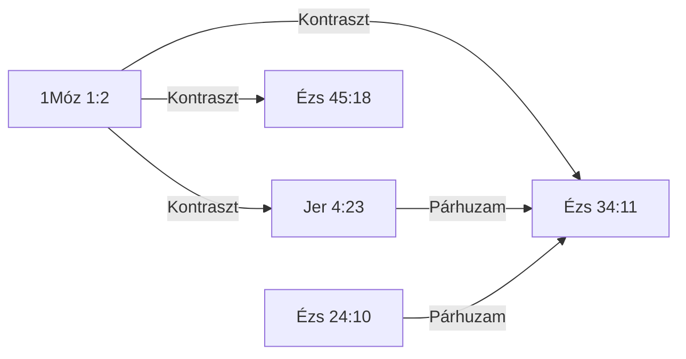

<!-- GENERÁLT: general.py --cel lexikon | rések: motivumok/TEREMT-002.md -->

# 📖 TEREMT-002 — Tohu va-vohu (תֹהוּ וָבֹהוּ, tóhú vávóhú) — a föld kietlen és puszta állapota a teremtéskor és az ítéletkor

## Kivonat

A motívum rövid összefoglalása: miről szól, és hol fordul elő a Bibliában.<!-- olvasói -->

A תֹהוּ וָבֹהוּ (*tohu va-vohu*, kiejtése: tóhú vávóhú) szópár a héber Ószövetségben pontosan három versben áll együtt: 1Móz 1:2, Jer 4:23 és Ézs 34:11.[^koll] Második tagja, a *bohu*, a páron kívül egyetlen versben sem fordul elő,[^scan-bohu] így a pár nem két szó alkalmi találkozása, hanem rögzített formula. Az 1Móz 1:2-ben a föld állapotát nevezi meg, mielőtt Isten szava rendet teremt rajta; Jeremiásnál Júda, Ézsaiásnál Edom ítéletét írja le ugyanez a pár.[^d-elof]

Ide az a hely tartozik, ahol a תֹהוּ (*tohu*) és a בֹהוּ (*bohu*) ugyanabban a versben áll; Károlinál ez „kietlen és puszta” (1Móz 1:2; Jer 4:23), illetve „a pusztaság mérőkötele és a semmiségnek kövei” (Ézs 34:11).[^d-elof] A *tohu* egyedül nem elég: a 19 *tohu*-versből 16-ban a pár nem áll,[^scan-tohu] és ezek nem tartoznak ide, akár „semmiség”, „hiábavaló” értelemben áll a szó (Ézs 40:17; 44:9), akár puszta, úttalan vidékről szól (5Móz 32:10; Zsolt 107:40).[^d-mot] A magyar szó sem dönt: a Zsolt 107:40 „kietlenben” szava mögött a héberben csak a *tohu* áll, a pár nem.[^k-zsolt10740][^d-jel] Kivétel nincs; az Ézs 45:18 és az Ézs 24:10 a *tohu* miatt a motívum mellett áll, kapcsolt helyként, de nem előfordulás (3. pont, Remez).[^d-kapcs]

A motívum nem az ítélet vagy a pusztulás általában, hanem a föld egy megnevezett állapota: az, amelyből az 1Móz 1:3 rendezése kiindul, és amelybe a prófétai ítélet-szöveg a földet visszarendeződni látja. Ha egy szöveg a pusztulást írja le (elsötétülő eget, rengő földet, romba dőlt várost), de a két szót nem mondja ki, a hely a tágabb körbe tartozik, akkor is, ha a kép rokon (Jóel 2:10; Mt 24:29).[^d-mot] Nem a kép dönt, hanem a szópár.

A Septuaginta a párt mindhárom helyen másként fordítja: ἀόρατος καὶ ἀκατασκεύαστος (aoratosz kai akataszkeuasztosz), οὐθέν (úthen), illetve σπαρτίον γεωμετρίας ἐρήμου (szpartion geómetriasz erémú), és az Ézs 34:11 „semmiség köveinek” nincs görög megfelelője.[^lxx-gen][^lxx-jer][^lxx-ezs] Görög lexikai híd az Újszövetség felé nem mutatható ki: az ἀκατασκεύαστος, a σπαρτίον (szpartion) és a γεωμετρίας (geómetriasz) az LXX_OS-ben Strong-szám nélkül áll, így újszövetségi előfordulásuk nem számolható — ez üres eredmény, nem negatív lelet;[^lxx-gen][^lxx-ezs] a Strong-számmal bíró szavak újszövetségi előfordulásai értelmezés szerint nem a föld állapotáról szólnak (2. pont, „Septuaginta”).

## Tartalomjegyzék

<!-- GENERÁLT-KEZDET: general.py --cel lexikon#TEREMT-002#tartalom | forrás:  | licenc: minden jog fenntartva | ts=2026-11-03 -->

A lap szakaszai. Hogy melyik szakaszt ki írta, a Kolofon szerzőségi mondata mondja meg.<!-- olvasói -->

*Ez a blokk a lexikon-oldal 14 szakaszának tartalomjegyzékét adja (LEXV2_2_BRIEF.md G1).*

- [Kivonat](#kivonat)
- [Jelmagyarázat és rövidítések](#jelmagyarázat-és-rövidítések)
- [1. Előfordulások](#1-előfordulások)
- [1/b. Kizárt és vizsgált helyek](#1b-kizárt-és-vizsgált-helyek)
- [2. Szótári háttér](#2-szótári-háttér)
- [3. LXX-fordítói döntések](#3-lxx-fordítói-döntések)
- [4. Kereszthivatkozások](#4-kereszthivatkozások)
- [5. Kapcsolatok](#5-kapcsolatok)
- [5/b. Kapcsolódó motívumok](#5b-kapcsolódó-motívumok)
- [6. Értelmezés](#6-értelmezés)
- [6/b. Alkalmazás és tanítói egyezés](#6b-alkalmazás-és-tanítói-egyezés)
- [7. Módszertan és nyitott kérdések](#7-módszertan-és-nyitott-kérdések)
- [8. Irodalom és idézés](#8-irodalom-és-idézés)
- [Kolofon](#kolofon)

<!-- GENERÁLT-VÉGE: lexikon#TEREMT-002#tartalom -->

## Jelmagyarázat és rövidítések

<!-- GENERÁLT-KEZDET: general.py --cel lexikon#TEREMT-002#jelmagyarazat | forrás:  | licenc: minden jog fenntartva | ts=2026-11-04 -->

A lapon használt rövidítések, jelek és forrásnevek feloldása. Ha a lap egy jelét nem érted, itt keresd.<!-- olvasói -->

*Ez a blokk közös, minden lexikon-oldalon szó szerint azonos szöveg (G10).*

**PaRDeS-szintek** (`sablonok/PaRDeS_gyorsreferencia.md`):
- **Peshat** — a szöveg szerinti, szó szerinti értelem.
- **Remez** — csak felismerés/azonosítás, következtetés nélkül.
- **Drash** — normatív, következtető, alkalmazó.
- **Sod** — fegyelmezett, csak szövegből levezethető, gematria/allegorizálás nélkül.

A szint olvasási módot jelöl, nem a szöveg jelentését: a zsidó írásmagyarázat négyes sémájának kategóriáival mondja
meg, hogyan kapcsolódik a hely a motívumhoz (szó szerint, utalásként, következtetésként vagy spirituális olvasatban). Nem
kritikai állítás arról, mit szándékolt a bibliai szerző, és nem a szöveg eredeti, történeti jelentésének szintje. A
besorolást e munka adja, saját szabályai szerint; hogy egy nevesített magyarázó egy helyet ténylegesen hogyan olvasott,
azt a Tanítói egyezés dokumentálja, ahol van. Egy hely motívumhoz tartozásának bizonyítéka a héber és a görög szöveg, nem
a szint (részletesen: [A PaRDeS-szint mint recepciós címke](../kozlemeny/PARDES_RECEPCIOS_KERET.md)).

**Funkció:** a vers szerepe a motívum ívében — az `adat/SEMA.md` szerint
szabad szöveg (nincs zárt értékkészlet), az alábbi táblákban a motívum
saját study-jából átvett megnevezéssel szerepel.

**Rövidítések:** BDB (Brown–Driver–Briggs), TBESH/TBESG (Tyndale Bible
Encyclopedia — Strong's Hebrew/Greek), Thayer (Thayer's Greek Lexicon),
UBS (UBS Dictionary of New Testament Greek — Louw–Nida szemantikai
doménekkel), L–N (Louw–Nida doménkód), SDBH/SDGNT (Semantic Dictionary
of Biblical Hebrew/Greek), OSHL (Open Scriptures Hebrew Lexicon), TWOT
(Theological Wordbook of the Old Testament — csak számhivatkozás), TSK
(Treasury of Scripture Knowledge), KH (Károli-kereszthivatkozás), LXX
(Septuaginta), MT (Masoretic Text), KJV (King James Version).

**Kiejtés:** a héber és a görög szó mellett zárójelben a magyaros kiejtés, mindkét nyelven szabályos átírás. A
héber kiejtés a pontozott héber szövegből rögzített szabályokkal készül (pl. „וַיִּקְרָא (vajjikrá)”); ahol van kézzel
jóváhagyott alak, az áll. A ragozott szó mellett a saját kiejtése áll, nem a szótári alaké.

**Olvasói bevezető** — minden blokk elején egy-két mondatos összefoglaló; az alatta álló dőlt, technikai
mondat a lap készítőinek szól.

**Proveniencia-sor** (dőlt, `scope=… | forras=… | ts=…` alakú): honnan és mikor származik a fölötte álló adat — milyen
körre (`scope`), melyik adattáblából vagy lekérdezésből (`forras`), mikor (`ts`); a `manual` kézi rögzítést jelöl. Az
ellenőrzéshez való, olvasáskor átugorható.

**Közös forrásmegjelölés** (‹E1›, ‹K1›, ‹M1› …): ha egy blokk több sora ugyanabból a forrásból jön, a soron csak a jel
áll, a teljes proveniencia-sor egyszer, a blokk alatt. Az előtag a blokkot jelöli: E az előfordulások, K a kizárt és
vizsgált helyek, M a minősítés.

**Héber rövidítések a BDB-szövegben** (kiemelve; az egérmutató alatt a feloldás): a BDB a gyakori szavakat egy
betűvel és a rövidítő jellel (׳, geres) írja. **י׳** = יְהוָה (JHVH), a Károliban „az Úr”; a szócikk címszavának
kezdőbetűje (pl. **ק׳** a קָרָא (kárá) szócikkében, **שׁ׳** a שֵׁם (sém) szócikkében) maga a címszó. Más betűnél a feloldás a
szócikk szövegéből derül ki.

A szótári fordításokban a πνεῦμα (pneuma) mindig *szellem*, a ψυχή
(pszükhé) *lélek*; a Károli-idézetek szövege változatlan (pl. »Lélek«).

<!-- GENERÁLT-VÉGE: lexikon#TEREMT-002#jelmagyarazat -->

## 1. Előfordulások

<!-- GENERÁLT-KEZDET: general.py --cel lexikon#TEREMT-002#elofordulasok | forrás: adat/elofordulasok.tsv, konkordancia/Karoli_1908.tsv, konkordancia/UBS_DNTG_referenciak.tsv, konkordancia/UBS_DNTG_jelentesek.tsv, adat/forditasok.tsv, adat/szotar_szakasz_cimke.tsv, adat/bdb_vers_jelentes.tsv, adat/thayer_vers_jelentes.tsv, konkordancia/UBS_DBH_referenciak.tsv, konkordancia/UBS_DBH_jelentesek.tsv, konkordancia/Karoli_versmegfeleltetes.tsv | licenc: CC BY-SA 4.0, közkincs, minden jog fenntartva | ts=2026-11-04 -->

A motívum 3 igehelyen fordul elő, 3 bibliai könyvben (3 ószövetségi hely). 3 hely azonosítása magas megbízhatóságú. **Következtetés:** a motívum néhány könyvben, csak az Ószövetségben fordul elő, és a helyek szinte mind biztosan azonosítottak.<!-- olvasói -->

*Ez a blokk a `[ID: TEREMT-002]` motívum 3 igehely-sorát fedi az `elofordulasok.tsv`-ből, kanonikus sorrendben, a Károli-szöveggel (1/a) és az UBS-jelentés renderidejű hozzárendelésével (G3). A „Jelentés (a szó)” oszlop a szó jelentését a szótár tagolásában adja (`adat/szotar_szakasz_cimke.tsv`, `adat/bdb_vers_jelentes.tsv`, `adat/thayer_vers_jelentes.tsv`; a címke forrása a sor lábjegyzetében), a „Funkció (a motívumban)” a hely motívumbeli funkcióját (F131, DT272 (d)).*

| Igehely | Kulcsszó | Jelentés (a szó) | Funkció (a motívumban) | PaRDeS-szint | Strong | UBS-jelentés | Megbízhatóság · azonosítás módja |
|---|---|---|---|---|---|---|---|
| [1Móz 1:2](#ige-1móz-1-2) | kietlen és puszta — תֹ֙הוּ֙ (tóhú); וָבֹ֔הוּ (vábóhú) | H8414: formátlanság · 1; H0922: *(nincs címke: tagolatlan)*[^1] | prototípus: a föld teremtés előtti, rendezetlen állapota, amelyre a Jer 4:23 és az Ézs 34:11 ítélet-szövege visszautal | Peshat | H8414+H0922 | H8414: pusztaság; kietlenség; káosz [ⓘ](/szo/H8414) · H0922: üresség; pusztaság [ⓘ](/szo/H0922) | magas · szó-szintű-gépi[^1] |
| [Ézs 34:11](#ige-ézs-34-11) | pusztaság … semmiségnek — תֹ֖הוּ (tóhú); בֹֽהוּ (bóhú) | H8414: formátlanság · 1; H0922: *(nincs címke: tagolatlan)*[^2] | ítélet-alkalmazás Edomra: a tohu/bohu mint a rombolás mérőeszköze | Remez | H8414+H0922 | H8414: pusztaság; kietlenség; káosz [ⓘ](/szo/H8414) · H0922: üresség; pusztaság [ⓘ](/szo/H0922) | magas · tartalom-alapú[^2] |
| [Jer 4:23](#ige-jer-4-23) | kietlen és puszta — תֹ֖הוּ (tóhú); וָבֹ֑הוּ (vábóhú) | H8414: formátlanság · 1; H0922: *(nincs címke: tagolatlan)*[^3] | ítélet-alkalmazás Júdára: a föld visszarendeződése a teremtés előtti állapotba (4:23–26) | Remez | H8414+H0922 | H8414: pusztaság; kietlenség; káosz [ⓘ](/szo/H8414) · H0922: üresség; pusztaság [ⓘ](/szo/H0922) | magas · tartalom-alapú[^3] |

[^1]: proveniencia: ‹E1› | igazolas: TAHOT-igazolt | jelentés-címke: H8414 — BDB-példa: a BDB az 1. szakaszban maga idézi a helyet (`adat/bdb_vers_jelentes.tsv` sorszam 2); ez a kutatói hozzárendelés (1 → 1) alá esik, a címke a finomabb útvonalé · H0922 — BDB-példa: a BDB a tagolatlan szakaszban maga idézi a helyet (`adat/bdb_vers_jelentes.tsv` sorszam 1)
[^2]: proveniencia: ‹E1› | igazolas: TAHOT-igazolt | jelentés-címke: H8414 — BDB-példa: a BDB az 1. szakaszban maga idézi a helyet (`adat/bdb_vers_jelentes.tsv` sorszam 4); ez a kutatói hozzárendelés (1 → 1) alá esik, a címke a finomabb útvonalé · H0922 — BDB-példa: a BDB a tagolatlan szakaszban maga idézi a helyet (`adat/bdb_vers_jelentes.tsv` sorszam 3)
[^3]: proveniencia: ‹E1› | igazolas: TAHOT-igazolt | jelentés-címke: H8414 — BDB-példa: a BDB az 1. szakaszban maga idézi a helyet (`adat/bdb_vers_jelentes.tsv` sorszam 3); ez a kutatói hozzárendelés (1 → 1) alá esik, a címke a finomabb útvonalé · H0922 — BDB-példa: a BDB a tagolatlan szakaszban maga idézi a helyet (`adat/bdb_vers_jelentes.tsv` sorszam 2)

*Minden sor forrásmegjelölése (‹E1›): `scope=TAHOT-teljes+TAGNT-teljes | forras=TAGNT_kivonat.tsv+TAHOT_kivonat.tsv | strong=H8414+H0922 | n=3 + naplok/F12_kitoltes.tsv | ts=2026-09-25T11:02Z`*

*Az UBS-jelentés az újszövetségi soroknál az UBS Dictionary of New Testament Greek (DNTG), az ószövetségi soroknál az UBS Dictionary of Biblical Hebrew (DBH) igehelyszintű jelentése (`konkordancia/UBS_DBH_referenciak.tsv`, a Károli-vers az MT-számozásra képezve, `konkordancia/Karoli_versmegfeleltetes.tsv`); tokenenként a hivatkozott jelentés(ek) kódja és rövid glosszája; az ⓘ a szónézetre mutat, ahol a teljes UBS-szócikk (definíció és glosszák) áll (DT393). A glossza magyarul a `forditasok.tsv`-ből jön, ahol van; ahol nincs, az angol eredeti áll `(fordításra vár)` jelöléssel. Ahol a DBH a versre nem hivatkozik, a cella ezt kimondja.*

#### 1/a. Az igehelyek szövege

A fenti táblázat igehelyeinek teljes szövege a Károli-fordításban, a motívumot hordozó szavakkal.<!-- olvasói -->

**1Móz 1:2**
*A föld pedig kietlen és puszta vala, és setétség vala a mélység színén, és az Isten Lelke lebeg vala a vizek felett.*
„A föld pedig kietlen és puszta vala” — a תֹהוּ וָבֹהוּ (tóhú vávóhú) pár a föld teremtés előtti állapotának megnevezése

Funkció: a föld teremtés előtti, rendezetlen állapota, amelyre a Jer 4:23 és az Ézs 34:11 ítélet-szövege visszautal

**Ézs 34:11**
*És örökségül bírándja azt ökörbika, sündisznó; és gém és holló lakja azt, és fölvonják rá a pusztaság mérőkötelét és a semmiségnek köveit.*
„fölvonják rá a pusztaság mérőkötelét és a semmiségnek köveit” — a תֹהוּ וָבֹהוּ (tóhú vávóhú) pár Edom ítéletében, mérőkötél és függőón képében

Funkció: a tohu/bohu mint a rombolás mérőeszköze

**Jer 4:23**
*Nézek a földre, de ímé kietlen és puszta; és az égre, de nincsen világossága!*
„Nézek a földre, de ímé kietlen és puszta” — az 1Móz 1:2 párja Júda ítéletének képeként

Funkció: a föld visszarendeződése a teremtés előtti állapotba (4:23–26)

<!-- GENERÁLT-VÉGE: lexikon#TEREMT-002#elofordulasok -->

## 1/b. Kizárt és vizsgált helyek

<!-- GENERÁLT-KEZDET: general.py --cel lexikon#TEREMT-002#kizart | forrás: adat/jeloltek.tsv, adat/motivumok.tsv | licenc: minden jog fenntartva | ts=2026-11-04 -->

68 verset vizsgáltunk meg egyenként, jelöltként; elutasítva: 68. A leggyakoribb ok: „a tohu és bohu szópár nincs a versben” (41 vers), utána „a formula nincs a versben” (18 vers). A jelöltek forrása (vers): TSK-ajánlás 40, Gépi keresés 16, Károli-kereszthivatkozás 12. **Következtetés:** a motívum minden helyére átlagosan 23 vizsgált vers jut (68 vizsgált vers, 3 motívumhely). A határt leginkább ez az ok húzza meg: „a tohu és bohu szópár nincs a versben”.<!-- olvasói -->

*Ez a blokk a `[ID: TEREMT-002]` motívum 63 elutasított/nyitva maradt jelöltjét fedi a `jeloltek.tsv`-ből (G7).*

**Az elutasítás okai:** a tohu és bohu szópár nincs a versben 41 · a formula nincs a versben 18 · a jelölés forrásadata hibás 9

**A jelölés forrása:** TSK-ajánlás 40 · Károli-kereszthivatkozás 12 · Gépi keresés 16

**TSK-ajánlás** (40)

| Igehely | Miért lett jelölt | Döntés és indok |
|---|---|---|
| Zsolt 104:30 | TSK-ajánlás az 1Móz 1:2 helyről, 61 szavazat[^k1] | **elutasítva** — a formula nincs a versben: negatív kritérium: nincs H8414+H0922 pár — kereszthivatkozás-célpont, a versben sem tohu, sem bohu. |
| Zsolt 33:6 | TSK-ajánlás az 1Móz 1:2 helyről, 40 szavazat[^k2] | **elutasítva** — a formula nincs a versben: negatív kritérium: nincs H8414+H0922 pár — kereszthivatkozás-célpont, a versben sem tohu, sem bohu. |
| Ézs 40:12 | TSK-ajánlás az 1Móz 1:2 helyről, 28 szavazat[^k3] | **elutasítva** — a formula nincs a versben: negatív kritérium: nincs H8414+H0922 pár — kereszthivatkozás-célpont, a versben sem tohu, sem bohu. |
| Ézs 40:14 | TSK-ajánlás az 1Móz 1:2 helyről, 28 szavazat[^k4] | **elutasítva** — a formula nincs a versben: negatív kritérium: nincs H8414+H0922 pár — kereszthivatkozás-célpont, a versben sem tohu, sem bohu. |
| Jób 26:14 | TSK-ajánlás az 1Móz 1:2 helyről, 7 szavazat[^k5] | **elutasítva** — a formula nincs a versben: negatív kritérium: nincs H8414+H0922 pár — kereszthivatkozás-célpont, a versben sem tohu, sem bohu. |
| Náh 2:10 | TSK-ajánlás az 1Móz 1:2 helyről, -14 szavazat[^k6] | **elutasítva** — a formula nincs a versben: negatív kritérium: nincs H8414+H0922 pár — kereszthivatkozás-célpont, a versben sem tohu, sem bohu. |
| Mt 24:29 | TSK-ajánlás a Jer 4:23 helyről, 35 szavazat[^k7] | **elutasítva** — a tohu és bohu szópár nincs a versben: negatív kritérium: nincs H8414+H0922 pár. Kozmikus elsötétülés (nap, hold, csillagok) — a Jer 4:23 „nincsen világossága” képével rokon, de lexikai pár nélkül: a fölérendelt fogalom felé húz. TSK 35. |
| Mk 13:24 | TSK-ajánlás a Jer 4:23 helyről, 29 szavazat[^k8] | **elutasítva** — a tohu és bohu szópár nincs a versben: negatív kritérium: nincs H8414+H0922 pár. Az Mt 24:29 szinoptikus párhuzama: elsötétülés, tohu/bohu nélkül. TSK 29. |
| Mk 13:25 | TSK-ajánlás a Jer 4:23 helyről, 29 szavazat[^k9] | **elutasítva** — a tohu és bohu szópár nincs a versben: negatív kritérium: nincs H8414+H0922 pár. Csillaghullás, az egek megrendülése — pár nélkül. TSK 29. |
| Ézs 13:10 | TSK-ajánlás a Jer 4:23 helyről, 26 szavazat[^k10] | **elutasítva** — a tohu és bohu szópár nincs a versben: negatív kritérium: nincs H8414+H0922 pár. Babilon-ítélet égi elsötétüléssel — a pusztulás-kép, pár nélkül. TSK 26. |
| Jóel 3:15 | TSK-ajánlás a Jer 4:23 helyről, 26 szavazat[^k11] | **elutasítva** — a tohu és bohu szópár nincs a versben: negatív kritérium: nincs H8414+H0922 pár. Nap és hold elsötétülése — pár nélkül. TSK 26. |
| Jóel 3:16 | TSK-ajánlás a Jer 4:23 helyről, 26 szavazat[^k12] | **elutasítva** — a tohu és bohu szópár nincs a versben: negatív kritérium: nincs H8414+H0922 pár. Az egek és a föld megrendülése — pár nélkül; a vers ráadásul oltalom-ígérettel zárul. TSK 26. |
| Luk 21:25 | TSK-ajánlás a Jer 4:23 helyről, 21 szavazat[^k13] | **elutasítva** — a tohu és bohu szópár nincs a versben: negatív kritérium: nincs H8414+H0922 pár. Jelek a napban, holdban, csillagokban — pár nélkül. TSK 21. |
| Luk 21:26 | TSK-ajánlás a Jer 4:23 helyről, 21 szavazat[^k14] | **elutasítva** — a tohu és bohu szópár nincs a versben: negatív kritérium: nincs H8414+H0922 pár. Az egek erősségeinek megrendülése — pár nélkül. TSK 21. |
| Ez 32:7 | TSK-ajánlás a Jer 4:23 helyről, 20 szavazat[^k15] | **elutasítva** — a tohu és bohu szópár nincs a versben: negatív kritérium: nincs H8414+H0922 pár. A fáraó-sirató égi elsötétülése — pár nélkül. TSK 20. |
| Ez 32:8 | TSK-ajánlás a Jer 4:23 helyről, 20 szavazat[^k16] | **elutasítva** — a tohu és bohu szópár nincs a versben: negatív kritérium: nincs H8414+H0922 pár. „Sötétséget bocsátok földedre” — a Jer 4:23 fény-hiányához legközelebb álló kép, de pár nélkül. TSK 20. |
| Ámós 8:9 | TSK-ajánlás a Jer 4:23 helyről, 18 szavazat[^k17] | **elutasítva** — a tohu és bohu szópár nincs a versben: negatív kritérium: nincs H8414+H0922 pár. Délben lenyugvó nap — pár nélkül. TSK 18. |
| Jóel 2:10 | TSK-ajánlás a Jer 4:23 helyről, 18 szavazat[^k18] | **elutasítva** — a tohu és bohu szópár nincs a versben: negatív kritérium: nincs H8414+H0922 pár. Föld- és ég-rengés, elsötétülés — pár nélkül. TSK 18. |
| Jóel 2:30 | TSK-ajánlás a Jer 4:23 helyről, 17 szavazat[^k19] | **elutasítva** — a tohu és bohu szópár nincs a versben: negatív kritérium: nincs H8414+H0922 pár. Jelek az égen és a földön (vér, tűz, füst) — pár nélkül, elsötétülés sincs benne. TSK 17. |
| Jóel 2:31 | TSK-ajánlás a Jer 4:23 helyről, 17 szavazat[^k20] | **elutasítva** — a tohu és bohu szópár nincs a versben: negatív kritérium: nincs H8414+H0922 pár. A nap sötétséggé, a hold vérré válik — pár nélkül. TSK 17. |
| ApCsel 2:19 | TSK-ajánlás a Jer 4:23 helyről, 17 szavazat[^k21] | **elutasítva** — a tohu és bohu szópár nincs a versben: negatív kritérium: nincs H8414+H0922 pár. A Jóel 2:30 idézete — pár nélkül. TSK 17. |
| ApCsel 2:20 | TSK-ajánlás a Jer 4:23 helyről, 17 szavazat[^k22] | **elutasítva** — a tohu és bohu szópár nincs a versben: negatív kritérium: nincs H8414+H0922 pár. A Jóel 2:31 idézete — pár nélkül; a LXX-híd sem köti a tohu-hoz (a Jer 4:23 LXX-e οὐθέν (úthen)). TSK 17. |
| Ézs 5:30 | TSK-ajánlás a Jer 4:23 helyről, 16 szavazat[^k23] | **elutasítva** — a tohu és bohu szópár nincs a versben: negatív kritérium: nincs H8414+H0922 pár. „A földre néz, de ímé sűrű sötétség” — a Jer 4:23 szerkezetének legközelebbi párja (néz → föld → sötétség), de pár nélkül. TSK 16. |
| Mt 24:35 | TSK-ajánlás a Jer 4:23 helyről, 15 szavazat[^k24] | **elutasítva** — a tohu és bohu szópár nincs a versben: negatív kritérium: nincs H8414+H0922 pár. „Az ég és a föld elmúlnak” — elmúlás, nem visszarendeződés; pár nélkül. TSK 15. |
| Ézs 24:19 | TSK-ajánlás a Jer 4:23 helyről, 12 szavazat[^k25] | **elutasítva** — a tohu és bohu szópár nincs a versben: negatív kritérium: nincs H8414+H0922 pár. A föld összetörése az Ézs 24 keretében (l. Ézs 24:10) — pár nélkül. TSK 12. |
| Ézs 24:23 | TSK-ajánlás a Jer 4:23 helyről, 12 szavazat[^k26] | **elutasítva** — a tohu és bohu szópár nincs a versben: negatív kritérium: nincs H8414+H0922 pár. A hold és a nap megszégyenülése a Sion-királyság előtt — pár nélkül. TSK 12. |
| Jel 20:11 | TSK-ajánlás a Jer 4:23 helyről, 12 szavazat[^k27] | **elutasítva** — a tohu és bohu szópár nincs a versben: negatív kritérium: nincs H8414+H0922 pár. A föld és az ég eltűnése a trón elől — megszűnés, nem a teremtés előtti állapot; pár nélkül. TSK 12. |
| Jer 9:10 | TSK-ajánlás a Jer 4:23 helyről, 8 szavazat[^k28] | **elutasítva** — a tohu és bohu szópár nincs a versben: negatív kritérium: nincs H8414+H0922 pár. A Jer 4:25 visszhangja („az ég madaraitól fogva a barmokig minden elköltözik”), tehát a Jer 4:23–26 egység motívum-rokona — de tohu/bohu nélkül. TSK 8. |
| 2Kir 21:13 | TSK-ajánlás az Ézs 34:11 helyről, 6 szavazat[^k29] | **elutasítva** — a formula nincs a versben: negatív kritérium: nincs H8414+H0922 pár — kereszthivatkozás-célpont, a versben sem tohu, sem bohu. |
| JSir 2:8 | TSK-ajánlás az Ézs 34:11 helyről, 6 szavazat[^k30] | **elutasítva** — a formula nincs a versben: negatív kritérium: nincs H8414+H0922 pár — kereszthivatkozás-célpont, a versben sem tohu, sem bohu. |
| Sof 2:14 | TSK-ajánlás az Ézs 34:11 helyről, 5 szavazat[^k31] | **elutasítva** — a formula nincs a versben: negatív kritérium: nincs H8414+H0922 pár — kereszthivatkozás-célpont, a versben sem tohu, sem bohu. |
| Jel 18:2 | TSK-ajánlás az Ézs 34:11 helyről, 4 szavazat[^k32] | **elutasítva** — a formula nincs a versben: negatív kritérium: nincs H8414+H0922 pár — kereszthivatkozás-célpont, a versben sem tohu, sem bohu. |
| Ézs 14:23 | TSK-ajánlás az Ézs 34:11 helyről, 3 szavazat[^k33] | **elutasítva** — a formula nincs a versben: negatív kritérium: nincs H8414+H0922 pár — kereszthivatkozás-célpont, a versben sem tohu, sem bohu. |
| 2Sám 8:2 | TSK-ajánlás az Ézs 34:11 helyről, 3 szavazat[^k34] | **elutasítva** — a formula nincs a versben: negatív kritérium: nincs H8414+H0922 pár — kereszthivatkozás-célpont, a versben sem tohu, sem bohu. |
| Mal 1:3–4 | TSK-ajánlás az Ézs 34:11 helyről, 2 szavazat[^k35] | **elutasítva** — a formula nincs a versben: negatív kritérium: nincs H8414+H0922 pár — kereszthivatkozás-célpont, a versben sem tohu, sem bohu. |
| Jel 18:21 | TSK-ajánlás az Ézs 34:11 helyről, 2 szavazat[^k36] | **elutasítva** — a formula nincs a versben: negatív kritérium: nincs H8414+H0922 pár — kereszthivatkozás-célpont, a versben sem tohu, sem bohu. |
| Jel 18:23 | TSK-ajánlás az Ézs 34:11 helyről, 2 szavazat[^k37] | **elutasítva** — a formula nincs a versben: negatív kritérium: nincs H8414+H0922 pár — kereszthivatkozás-célpont, a versben sem tohu, sem bohu. |
| Ézs 13:20 | TSK-ajánlás az Ézs 34:11 helyről, 2 szavazat[^k38] | **elutasítva** — a formula nincs a versben: negatív kritérium: nincs H8414+H0922 pár — kereszthivatkozás-célpont, a versben sem tohu, sem bohu. |
| Ézs 13:22 | TSK-ajánlás az Ézs 34:11 helyről, 2 szavazat[^k39] | **elutasítva** — a formula nincs a versben: negatív kritérium: nincs H8414+H0922 pár — kereszthivatkozás-célpont, a versben sem tohu, sem bohu. |

**Károli-kereszthivatkozás** (7 sor, 12 vers)

| Igehely | Miért lett jelölt | Döntés és indok |
|---|---|---|
| Jer 9:15 | Károli-kereszthivatkozás a Jer 4:23 helyről[^k40] | **elutasítva** — a tohu és bohu szópár nincs a versben: negatív kritérium: nincs H8414+H0922 pár. Károli-KH a Jer 4:23-hoz: üröm és mérges víz — tartalmi kapcsolat nem látszik; pár nélkül. (Az igazítást nem vizsgáltam.) |
| Zsolt 80:6-7 | Károli-kereszthivatkozás a Jer 4:23 helyről[^k41] | **elutasítva** — a tohu és bohu szópár nincs a versben: negatív kritérium: nincs H8414+H0922 pár. Károli-KH a Jer 4:23-hoz: könnyek kenyere, szomszédok csúfja — tartalmi kapcsolat nem látszik; pár nélkül. (Az igazítást nem vizsgáltam.) |
| Ézs 66:12 | Károli-kereszthivatkozás az Ézs 34:11 helyről[^k42] | **elutasítva** — a jelölés forrásadata hibás |
| Ez 34:12-16 | Károli-kereszthivatkozás az Ézs 34:11 helyről[^k43] | **elutasítva** — a jelölés forrásadata hibás |
| Ján 10:11 | Károli-kereszthivatkozás az Ézs 34:11 helyről[^k44] | **elutasítva** — a jelölés forrásadata hibás |
| 1Móz 33:13 | Károli-kereszthivatkozás az Ézs 34:11 helyről[^k45] | **elutasítva** — a jelölés forrásadata hibás |
| 4Móz 11:12 | Károli-kereszthivatkozás az Ézs 34:11 helyről[^k46] | **elutasítva** — a jelölés forrásadata hibás |

**Gépi keresés** (16)

| Igehely | Miért lett jelölt | Döntés és indok |
|---|---|---|
| 1Sám 12:21 | gépi Strong-keresés: H8414[^k47] | **elutasítva** — a tohu és bohu szópár nincs a versben: negatív kritérium: nincs H8414+H0922 pár — önálló tohu (a „puszta vidék” vagy a „semmiség/hiábavalóság” jelentésben). |
| 5Móz 32:10 | gépi Strong-keresés: H8414[^k48] | **elutasítva** — a tohu és bohu szópár nincs a versben: negatív kritérium: nincs H8414+H0922 pár — önálló tohu (a „puszta vidék” vagy a „semmiség/hiábavalóság” jelentésben). |
| Jób 6:18 | gépi Strong-keresés: H8414[^k49] | **elutasítva** — a tohu és bohu szópár nincs a versben: negatív kritérium: nincs H8414+H0922 pár — önálló tohu (a „puszta vidék” vagy a „semmiség/hiábavalóság” jelentésben). |
| Jób 12:24 | gépi Strong-keresés: H8414[^k50] | **elutasítva** — a tohu és bohu szópár nincs a versben: negatív kritérium: nincs H8414+H0922 pár — önálló tohu (a „puszta vidék” vagy a „semmiség/hiábavalóság” jelentésben). |
| Jób 26:7 | gépi Strong-keresés: H8414, TSK-ajánlással[^k51] | **elutasítva** — a tohu és bohu szópár nincs a versben: negatív kritérium: nincs H8414+H0922 pár — önálló tohu (a „puszta vidék” vagy a „semmiség/hiábavalóság” jelentésben). |
| Zsolt 107:40 | gépi Strong-keresés: H8414[^k52] | **elutasítva** — a tohu és bohu szópár nincs a versben: negatív kritérium: nincs H8414+H0922 pár — önálló tohu (a „puszta vidék” vagy a „semmiség/hiábavalóság” jelentésben). |
| Ézs 24:10 | gépi Strong-keresés: H8414, TSK-ajánlással[^k53] | **elutasítva** — a tohu és bohu szópár nincs a versben: negatív kritérium: nincs H8414+H0922 pár; ítélet-kontextusú önálló tohu (rommá lőn; Ézs 24:1,3 bákak) — kapcsolatként felvéve |
| Ézs 29:21 | gépi Strong-keresés: H8414[^k54] | **elutasítva** — a tohu és bohu szópár nincs a versben: negatív kritérium: nincs H8414+H0922 pár — önálló tohu (a „puszta vidék” vagy a „semmiség/hiábavalóság” jelentésben). |
| Ézs 40:17 | gépi Strong-keresés: H8414[^k55] | **elutasítva** — a tohu és bohu szópár nincs a versben: negatív kritérium: nincs H8414+H0922 pár — önálló tohu (a „puszta vidék” vagy a „semmiség/hiábavalóság” jelentésben). |
| Ézs 40:23 | gépi Strong-keresés: H8414[^k56] | **elutasítva** — a tohu és bohu szópár nincs a versben: negatív kritérium: nincs H8414+H0922 pár — önálló tohu (a „puszta vidék” vagy a „semmiség/hiábavalóság” jelentésben). |
| Ézs 41:29 | gépi Strong-keresés: H8414[^k57] | **elutasítva** — a tohu és bohu szópár nincs a versben: negatív kritérium: nincs H8414+H0922 pár — önálló tohu (a „puszta vidék” vagy a „semmiség/hiábavalóság” jelentésben). |
| Ézs 44:9 | gépi Strong-keresés: H8414[^k58] | **elutasítva** — a tohu és bohu szópár nincs a versben: negatív kritérium: nincs H8414+H0922 pár — önálló tohu (a „puszta vidék” vagy a „semmiség/hiábavalóság” jelentésben). |
| Ézs 45:18 | gépi Strong-keresés: H8414, TSK-ajánlással[^k59] | **elutasítva** — a tohu és bohu szópár nincs a versben: negatív kritérium: nincs H8414+H0922 pár. Önálló tohu, bohu nélkül — a negatív kritérium kizárja. Tartalmilag a legerősebb nem-pár vers: az Úr „nem tohu-nak teremtette” a földet, az 1Móz 1:2 állapotának kifejezett ellenpontja (Károli: „nem hiába”). Kapcsolatként felvéve (1Móz 1:2 → Ézs 45:18, Kontraszt). |
| Ézs 45:19 | gépi Strong-keresés: H8414[^k60] | **elutasítva** — a tohu és bohu szópár nincs a versben: negatív kritérium: nincs H8414+H0922 pár — önálló tohu (a „puszta vidék” vagy a „semmiség/hiábavalóság” jelentésben). |
| Ézs 49:4 | gépi Strong-keresés: H8414[^k61] | **elutasítva** — a tohu és bohu szópár nincs a versben: negatív kritérium: nincs H8414+H0922 pár — önálló tohu (a „puszta vidék” vagy a „semmiség/hiábavalóság” jelentésben). |
| Ézs 59:4 | gépi Strong-keresés: H8414[^k62] | **elutasítva** — a tohu és bohu szópár nincs a versben: negatív kritérium: nincs H8414+H0922 pár — önálló tohu (a „puszta vidék” vagy a „semmiség/hiábavalóság” jelentésben). |

**Negatív kritérium:** az igehelynek a תֹהוּ וָבֹהוּ (tohu va-vohu) szópárt kell tartalmaznia (H8414 + H0922 egy versben) — a תֹּהוּ (tóhú) önmagában nem elég, sem a „semmiség/hiábavalóság” jelentésben (Ézs 40:17, 44:9), sem a „puszta, úttalan vidék” jelentésben (5Móz 32:10, Zsolt 107:40); és a lexikai pár nélküli kozmikus elsötétülés- vagy pusztulás-kép sem (Jóel 2:10, Mt 24:29)

[^k1]: forrás: `TSK 1Móz 1:2 (Votes=61)`
[^k2]: forrás: `TSK 1Móz 1:2 (Votes=40)`
[^k3]: forrás: `TSK 1Móz 1:2 (Votes=28)`
[^k4]: forrás: `TSK 1Móz 1:2 (Votes=28)`
[^k5]: forrás: `TSK 1Móz 1:2 (Votes=7)`
[^k6]: forrás: `TSK 1Móz 1:2 (Votes=-14)`
[^k7]: forrás: `TSK Jer 4:23 (Votes=35)`
[^k8]: forrás: `TSK Jer 4:23 (Votes=29)`
[^k9]: forrás: `TSK Jer 4:23 (Votes=29)`
[^k10]: forrás: `TSK Jer 4:23 (Votes=26)`
[^k11]: forrás: `TSK Jer 4:23 (Votes=26)`
[^k12]: forrás: `TSK Jer 4:23 (Votes=26)`
[^k13]: forrás: `TSK Jer 4:23 (Votes=21)`
[^k14]: forrás: `TSK Jer 4:23 (Votes=21)`
[^k15]: forrás: `TSK Jer 4:23 (Votes=20)`
[^k16]: forrás: `TSK Jer 4:23 (Votes=20)`
[^k17]: forrás: `TSK Jer 4:23 (Votes=18)`
[^k18]: forrás: `TSK Jer 4:23 (Votes=18)`
[^k19]: forrás: `TSK Jer 4:23 (Votes=17)`
[^k20]: forrás: `TSK Jer 4:23 (Votes=17)`
[^k21]: forrás: `TSK Jer 4:23 (Votes=17)`
[^k22]: forrás: `TSK Jer 4:23 (Votes=17)`
[^k23]: forrás: `TSK Jer 4:23 (Votes=16)`
[^k24]: forrás: `TSK Jer 4:23 (Votes=15)`
[^k25]: forrás: `TSK Jer 4:23 (Votes=12)`
[^k26]: forrás: `TSK Jer 4:23 (Votes=12)`
[^k27]: forrás: `TSK Jer 4:23 (Votes=12)`
[^k28]: forrás: `TSK Jer 4:23 (Votes=8)`
[^k29]: forrás: `TSK Ézs 34:11 (Votes=6)`
[^k30]: forrás: `TSK Ézs 34:11 (Votes=6)`
[^k31]: forrás: `TSK Ézs 34:11 (Votes=5)`
[^k32]: forrás: `TSK Ézs 34:11 (Votes=4)`
[^k33]: forrás: `TSK Ézs 34:11 (Votes=3)`
[^k34]: forrás: `TSK Ézs 34:11 (Votes=3)`
[^k35]: forrás: `TSK Ézs 34:11 (Votes=2)`
[^k36]: forrás: `TSK Ézs 34:11 (Votes=2)`
[^k37]: forrás: `TSK Ézs 34:11 (Votes=2)`
[^k38]: forrás: `TSK Ézs 34:11 (Votes=2)`
[^k39]: forrás: `TSK Ézs 34:11 (Votes=2)`
[^k40]: forrás: `Károli-KH (forrás-vers: Jer 4:23)`
[^k41]: forrás: `Károli-KH (forrás-vers: Jer 4:23)`
[^k42]: forrás: `Károli-KH (forrás-vers: Ézs 34:11)` · indoklás (nyers): adathiba: az Isa.34.11 lista az Isa.40.11 másolata
[^k43]: forrás: `Károli-KH (forrás-vers: Ézs 34:11)` · indoklás (nyers): adathiba: az Isa.34.11 lista az Isa.40.11 másolata
[^k44]: forrás: `Károli-KH (forrás-vers: Ézs 34:11)` · indoklás (nyers): adathiba: az Isa.34.11 lista az Isa.40.11 másolata
[^k45]: forrás: `Károli-KH (forrás-vers: Ézs 34:11)` · indoklás (nyers): adathiba: az Isa.34.11 lista az Isa.40.11 másolata
[^k46]: forrás: `Károli-KH (forrás-vers: Ézs 34:11)` · indoklás (nyers): adathiba: az Isa.34.11 lista az Isa.40.11 másolata
[^k47]: forrás: `scan H8414`
[^k48]: forrás: `scan H8414`
[^k49]: forrás: `scan H8414`
[^k50]: forrás: `scan H8414`
[^k51]: forrás: `scan H8414; TSK 1Móz 1:2 (Votes=35)`
[^k52]: forrás: `scan H8414`
[^k53]: forrás: `scan H8414; TSK Ézs 34:11 (Votes=2)`
[^k54]: forrás: `scan H8414`
[^k55]: forrás: `scan H8414`
[^k56]: forrás: `scan H8414`
[^k57]: forrás: `scan H8414`
[^k58]: forrás: `scan H8414`
[^k59]: forrás: `scan H8414; TSK 1Móz 1:2 (Votes=55)`
[^k60]: forrás: `scan H8414`
[^k61]: forrás: `scan H8414`
[^k62]: forrás: `scan H8414`

<!-- GENERÁLT-VÉGE: lexikon#TEREMT-002#kizart -->

## 2. Szótári háttér

<!-- GENERÁLT-KEZDET: general.py --cel lexikon#TEREMT-002#szocikkek | forrás: adat/bdb_szakasz_hu.tsv, adat/bdb_szakaszok.tsv, adat/bdb_vers_jelentes.tsv, adat/elofordulasok.tsv, adat/glosszak_heber_hu.tsv, adat/jeloltek.tsv, adat/karoli_strong, adat/lexikon_hivatkozasok.tsv, adat/szotar_szakasz_cimke.tsv, adat/szotar_szerepek.tsv, adat/szoto/karoli_szotari_alak.tsv, adat/tiltott_fordulatok.tsv, konkordancia/BDB_teljes_unabridged.tsv, konkordancia/Karoli_1908.tsv, konkordancia/LXX_versszintu_parok.tsv, konkordancia/OSHL_lexikalis_index.tsv, konkordancia/SDBH_domenek.tsv, konkordancia/SECE_G_teljes.tsv, konkordancia/SECE_H_teljes.tsv, konkordancia/TAGNT_kivonat.tsv, konkordancia/TAHOT_kivonat.tsv, konkordancia/TBESH.txt, konkordancia/tW_szocikkek.tsv | licenc: CC BY 4.0, CC BY-SA 4.0, közkincs, minden jog fenntartva | ts=2026-11-04 -->

A motívumot hordozó szavak szótári háttere: héberül a bóhú (H0922) és a tóhú (H8414). Minden szónál számozott pontok követik egymást; a 2. pont a fő szótár (héberül a BDB) szócikke. Ott elöl, kibontva állnak azok a jelentések, amelyek a motívumot hordozzák; a többi szótár utána következik.<!-- olvasói -->

*Ez a blokk a `[ID: TEREMT-002]` motívum 2 Strong-tokenjét fedi, szerepenként a szerepmátrix (`szotar_szerepek.tsv`) sorrendjében, van jelentés-hivatkozással a `lexikon_hivatkozasok.tsv`-ből.*

### A motívum kulcsszavai

A motívumot egy szókapcsolat hordozza: héberül a bóhú és a tóhú együtt (3 hely). **Következtetés:** az Ószövetségben két szó együttes jelenléte kell a motívumhoz.<!-- olvasói -->

*Gerinc-kombinációnként (az `elofordulasok.tsv` `strong` mezője, 3 sor); a jelentés az 1. szerep rövid jelentése; a Károli-kulcsszó a 14. szerep szabálya szerint (`eszkozok/szerep_karoli.py`: a motívumsorok Károli-szóalakjainak legalább felében álló szótári alak). Csak megjelenítés.*

| Héber/görög szavak | Szavak (kiejtéssel) | Jelentés | Károli-kulcsszavak |
|---|---|---|---|
| H0922 + H8414 | בֹּהוּ (bóhú) + תֹּ֫הוּ (tóhú) | üresség + formátlanság | „puszta”, „kietlen” |

### Görög szavak

<!-- ÜRES-NYELV: gorog | nincs Strong-token -->
A motívum görög szavainak szótári anyaga. A motívumnak ezen a nyelven nincs saját szava, ezért ez a rész üres; a szótári anyag a másik nyelv szavainál áll.<!-- olvasói -->

*A motívumnak nincs görög Strong-tokenje; a görög szerepek nem alkalmazhatók.*

### Héber szavak: H0922, H8414

A motívumot hordozó héber szavak (héberül a bóhú (H0922) és a tóhú (H8414)) szótári anyaga, számozott pontokban: minden pont egy kérdésre felel (alapjelentés, fő szótár, teológiai szócikk, jelentésmező, …).<!-- olvasói -->

#### 1. Alapjelentés

A szó alapjelentése röviden, a STEPBible rövid szótára szerint.<!-- olvasói -->

**H0922** · üresség *(a TBESH rövid jelentése magyarul)* · a teljes TBESH-szócikk: [szónézet: /szo/H0922](/szo/H0922) · forrás: `konkordancia/TBESH.txt`

**H8414** · formátlanság *(a TBESH rövid jelentése magyarul)* · a teljes TBESH-szócikk: [szónézet: /szo/H8414](/szo/H8414) · forrás: `konkordancia/TBESH.txt`

#### 2. Mélységi szócikk

A szó jelentéseinek teljes rendje a fő szótárban (BDB). Kibontva azok a jelentések állnak, amelyek a motívumot hordozzák; a többi összecsukva.<!-- olvasói -->

##### H0922 — בֹּהוּ (bóhú) · BDB

*Szótári gerinc (DT272): a szó jelentéstartománya a BDB tagolásában (`adat/bdb_szakaszok.tsv`), magyarul (`adat/bdb_szakasz_hu.tsv`). A motívumot hordozó szakaszok kibontva állnak, a többi összecsukva; a jel a BDB útvonalából készül. Kiemelve, felirat nélkül: a BDB saját példahelyei a motívum igehelyei közül (`adat/bdb_vers_jelentes.tsv`). A szótári blokk a szóról szól; a hely motívumbeli funkcióját az 1. szakasz táblázata adja.*

**A szócikk feje (nyelvi háttér).** H922. bohu בֹּ֫הוּ főnév [hímnemű]: üresség (az alakról l. Ges § 84a, 1 b Sta § 95, 198 a, a használatról vö. Lag Or. ii. 60 k.) mindig a תֹּהוּ szóval, l. ott; — תֹּהוּ וָבֹהוּ‎ 1Móz 1:2 az ősi földről; Jer 4:23 a <abbr class="rovidites" title="יְהוָה (JHVH), az Úr">י׳</abbr> ítélete alatt álló földről; קַותהֹוּ וְאַבְנֵי בֹהוּ Ézs 34:11: a pusztaság mérőzsinórja és az üresség kövei, azaz függőónok, amelyeket nem a szokott módon építésre, hanem falak lerombolására használnak; vö. Di & l. alább אבן‎ 6

*ⓘ Kutatói megjegyzés: a szótári példahely a magyar szövegben nem található, kiemelés nincs: bdb_vers_jelentes.tsv sorszam 1 (1Móz 1:2, tagolatlan): az útvonal nincs a szakasztáblában; bdb_vers_jelentes.tsv sorszam 3 (Ézs 34:11, tagolatlan): az útvonal nincs a szakasztáblában; bdb_vers_jelentes.tsv sorszam 2 (Jer 4:23, tagolatlan): az útvonal nincs a szakasztáblában.*

*A teljes szócikk: [szónézet: /szo/H0922](/szo/H0922) · forrás: `konkordancia/BDB_teljes_unabridged.tsv`*

##### H8414 — תֹּ֫הוּ (tóhú) · BDB

*Szótári gerinc (DT272): a szó jelentéstartománya a BDB tagolásában (`adat/bdb_szakaszok.tsv`), magyarul (`adat/bdb_szakasz_hu.tsv`). A motívumot hordozó szakaszok kibontva állnak, a többi összecsukva; a jel a BDB útvonalából készül. Kiemelve, felirat nélkül: a BDB saját példahelyei a motívum igehelyei közül (`adat/bdb_vers_jelentes.tsv`). A szótári blokk a szóról szól; a hely motívumbeli funkcióját az 1. szakasz táblázata adja.*

**A szócikk feje (nyelvi háttér).** H8414. tohu תֹּ֫הוּ hímnemű főnév 1Sám 12:21 (Albr ZAW xvi (1896), 112): formátlanság, zűrzavar, valótlanság, üresség (az alapjelentés nehezen megragadható; Vrss rendszerint Κενόν, οὐδέν, μάταιον, inane, vacuum, vanum; vö. Lag Or. ii. 60; BN 144); —

- **`1` — formátlanság**

  > formátlanság, az ősi földről **1Móz 1:2** (P), az ősi káoszba visszasüllyesztett földről **Jer 4:23** (mindkettő + וָבֹהוּ: és üresség), **Ézs 34:11** ׳קַות (|| אַבְנֵי בֹהוּ‎), 45:18 לֹא <abbr class="rovidites" title="a címszó: תֹּ֫הוּ (tóhú)">ת׳</abbr> בְרָאָהּ (|| יְצָרָתּ לָשֶׁבֶת‎); 24:10 ׳קִרְיַתאתּ: a káosz városa (a romba dőlt városról); = semmiség, üres tér, Jób 26:7 עַלתּ׳ תֹּלֶה אֶרֶץ; üres, úttalan pusztaságról 5Móz 32:10 (|| מִדְבָּר), Jób 6:18; 12:24 = Zsolt 107:40.

2 (1 szakasz)

- `2` — átvitt értelemben arról, ami üres, valótlan, mint a bálványok 1Sám 12:21…

*A teljes szócikk: [szónézet: /szo/H8414](/szo/H8414) · forrás: `konkordancia/BDB_teljes_unabridged.tsv`*

#### 3. Teológiai szócikk

Teológiai szócikk a szóról (mit jelent a bibliai gondolkodásban), vagy a hivatkozás arra, ahol olvasható.<!-- olvasói -->

**H0922** · **TWOT:** 205a

**H0922** · *a forrás nem tárgyalja* *(tW)*

**H8414** · **TWOT:** 2494a

**H8414** · tW: `other/desert`, `other/ruin`, `other/vain`, `other/waste` — a szócikkek szövege a szónézetben: [szónézet: /szo/H8414](/szo/H8414) · forrás: `konkordancia/tW_szocikkek.tsv`

#### 4. Jelentésszerkezet, szemantikai mező

A szó helye a jelentéstani mezők rendszerében: milyen rokon jelentésű szavakkal tartozik egy csoportba.<!-- olvasói -->

**H0922** · **Szemantikai domén:** 002002002006 Non-Exist

**H8414** · **Szemantikai domén:** 002001002030 Worthless, 002002002006 Non-Exist

#### 5. Tömör jelentés, előfordulás

A szó jelentései tömören, vagy a hivatkozás arra, ahol a jelentések teljes listája olvasható.<!-- olvasói -->

**H0922** · az UBS DBH jelentései a szónézetben: [szónézet: /szo/H0922](/szo/H0922) · forrás: `konkordancia/UBS_DBH_jelentesek.tsv`

**H8414** · az UBS DBH jelentései a szónézetben: [szónézet: /szo/H8414](/szo/H8414) · forrás: `konkordancia/UBS_DBH_jelentesek.tsv`

#### 6. LXX-híd

A motívumnak nincs görög szava, ezért az újszövetségi szóval való egyezés nem mérhető; a görög fordítás (Septuaginta) a motívum 3 ószövetségi helyéből 2 helyen saját görög szóval adja vissza, 1 helyen az azonosítás függőben. **Következtetés:** a motívum a görög Ószövetségen át nyelvileg nem kapcsolódik az Újszövetséghez; a görög szöveg azt mutatja, hogyan adta vissza a fordító a héber szavakat (3. LXX-fordítói döntések).<!-- olvasói -->

*Hivatkozás: l. a 3. szakaszt (LXX-fordítói döntések).*

**H0922 — בֹּהוּ (bóhú)** · a motívum 3 ószövetségi versében, ahol ez a szó áll, a görög szöveg a motívum görög szavát (—) használja-e: eltérő 1 · azonosításra vár 2 — versenként: [3. LXX-fordítói döntések](#3-lxx-fordítói-döntések)

**H8414 — תֹּ֫הוּ (tóhú)** · a motívum 3 ószövetségi versében, ahol ez a szó áll, a görög szöveg a motívum görög szavát (—) használja-e: eltérő 2 · azonosításra vár 1 — versenként: [3. LXX-fordítói döntések](#3-lxx-fordítói-döntések)

*Versszintű együtt-előfordulás, nem szóillesztés (a token összes ÓSZ-i helye, a grammatikai szavak szűrésével; nem LXX-fordítói döntés):*

**H0922** · 3 vers a Septuagintában (ebből 3 vers görög tartalmi szóval); leggyakoribb görög társak: γῆ ([gé](/szo/G1093)G1093): 2 vers; εἰμί ([eimi](/szo/G1510)G1510): 2 vers; ἄβυσσος ([abüsszosz](/szo/G0012)G0012): 1 vers; ἀόρατος ([aoratosz](/szo/G0517)G0517): 1 vers; ἐπάνω ([epanó](/szo/G1883)G1883): 1 vers; ἐπιβάλλω ([epiballó](/szo/G1911)G1911): 1 vers; ἐπιβλέπω ([epiblepó](/szo/G1914)G1914): 1 vers; ἐπιφέρω ([epiferó](/szo/G2018)G2018): 1 vers; ἔρημος ([erémosz](/szo/G2048)G2048): 1 vers; θεός ([theosz](/szo/G2316)G2316): 1 vers

**H8414** · 19 vers a Septuagintában (ebből 19 vers görög tartalmi szóval); leggyakoribb görög társak: γῆ ([gé](/szo/G1093)G1093): 8 vers; εἰμί ([eimi](/szo/G1510)G1510): 8 vers; οὐδείς ([údeisz](/szo/G3762)G3762): 7 vers; πᾶς ([pasz](/szo/G3956)G3956): 5 vers; ποιέω ([poieó](/szo/G4160)G4160): 5 vers; μάταιος ([mataiosz](/szo/G3152)G3152): 4 vers; ἄρχων ([arkhón](/szo/G0758)G0758): 3 vers; θεός ([theosz](/szo/G2316)G2316): 3 vers; κύριος ([küriosz](/szo/G2962)G2962): 3 vers; λέγω ([legó](/szo/G3004)G3004): 3 vers

*Proveniencia (a tábla soraiból): scope=LXX_OS-versszint | forras=LXX_OS/*.tsv+grammatikai_strongok.tsv | ts=2026-10-11T12:00Z*

#### 7. Megfelelők a másik nyelven

A kétnyelvű szótár (SECE) a tóhú szónak 6 megfelelőjét adja a másik bibliai nyelven; a motívumnak a másik nyelven nincs saját szava, de a megfelelők között van az aoratosz és az erémosz, amelyekkel a Septuaginta a motívum helyein fordít. **Következtetés:** a szótár ismeri azokat a szavakat, amelyekkel a fordítás a szót visszaadja; a motívumnak a másik nyelven nincs párja.<!-- olvasói -->

**H0922** · *a forrás nem tárgyalja* *(SECE: nincs görög megfelelő-lista)*

**H8414 — תֹּ֫הוּ (tóhú)** · SECE — görög megfelelők (6):

| Szó | Kiejtés | Strong | Rövid jelentés |
|---|---|---|---|
| ἄδικος | adikosz | G0094 | igazságtalan |
| ἀόρατος | aoratosz | G0517 | láthatatlan |
| δίψος | dipszosz | G1373 | szomjúság |
| ἔρημος | erémosz | G2048 | puszta |
| κενός | kenosz | G2756 | üres |
| μάταιος | mataiosz | G3152 | hiábavaló |

*A szólista és a sorrend a SECE-é (gyakoriságot nem ad; az ismétlődő szóalak egyszer áll); a Strong-szám a TBESG/TBESH lemmájából vagy a SECE címszavából párosul; a rövid jelentés: héberül `adat/glosszak_heber_hu.tsv`, görögül a TBESG angol glosszája (magyar rövid glossza-tábla a görögre még nincs).*

#### 8. Nyelvi háttér

A szó eredete és nyelvi háttere.<!-- olvasói -->

**H0922 — בֹּהוּ (bóhú)** · alapjelentés: üresség — a teljes szócikkfej a 2. szerepben („A szócikk feje (nyelvi háttér)”).

**H8414 — תֹּ֫הוּ (tóhú)** · alapjelentés: formátlanság *(a TBESH rövid jelentése; a BDB-fej nem mondja ki)* — a teljes szócikkfej a 2. szerepben („A szócikk feje (nyelvi háttér)”).

#### 9. Versenkénti jelentés

A motívum 3 ószövetségi helyéből 3 helyen a bóhú egyetlen jelentésben áll; a motívum 3 ószövetségi helyéből 3 helyen a tóhú egyetlen jelentésben áll. **Következtetés:** a szavak jelentése a motívum helyein szinte mindenütt egyértelmű.<!-- olvasói -->

**H0922 — בֹּהוּ (bóhú)** · a motívum 3 ószövetségi helyén a vers-szintű jelentést az [1. Előfordulások](#1-előfordulások) táblázatának „UBS-jelentés” oszlopa mutatja (3 helyen egy jelentés); a szó teljes versenkénti listája a szónézetben: [szónézet: /szo/H0922](/szo/H0922) · forrás: `konkordancia/UBS_DBH_jelentesek.tsv`.

**H8414 — תֹּ֫הוּ (tóhú)** · a motívum 3 ószövetségi helyén a vers-szintű jelentést az [1. Előfordulások](#1-előfordulások) táblázatának „UBS-jelentés” oszlopa mutatja (3 helyen egy jelentés); a szó teljes versenkénti listája a szónézetben: [szónézet: /szo/H8414](/szo/H8414) · forrás: `konkordancia/UBS_DBH_jelentesek.tsv`.

#### 10. Kiejtés (magyaros)

A szó magyaros kiejtése.<!-- olvasói -->

**H0922** · בֹּהוּ (bóhú)

**H8414** · תֹּ֫הוּ (tóhú)

### Nyelvfüggetlen szerepek

A szavakon túli, a motívum egészére vonatkozó pontok: tematikus mutató, a Károli-fordítás magyar szavai, és a rejtett vagy hamis párhuzamok.<!-- olvasói -->

#### 12. Tematikus index (témák és igehely-hivatkozások)

Mely témákhoz sorolja a szót és helyeit egy régi bibliai témagyűjtemény (Nave).<!-- olvasói -->

<!-- ÜRES-BLOKK: Tematikus index (témák és igehely-hivatkozások) | javaslat -->
*(üres blokk: javaslat; a hiány nincs kitöltve gyenge vagy asszociatív anyaggal)*

#### 13. Károli-megfelelők

A motívum 3 igehelyén a Károli 3 különböző magyar szót használ. A leggyakoribbak (igehelyek száma): „puszta” 3, „kietlen” 2, „semmiség” 1. **Következtetés:** a Károli a motívumot szinte mindenütt (a helyek 100%-án) ugyanazzal a szóval adja vissza, ezért magyarul olvasva is jól követhető. A sorokban a ragozott alakok és az igehelyek állnak.<!-- olvasói -->

*A motívum igehelyeinek Károli-szóalakjai (`adat/elofordulasok.tsv`, `karoli_szo`), szótári alakonként (`adat/szoto/karoli_szotari_alak.tsv`, mai helyesírás), névelő nélkül: a szóalakok, és hány igehelyen, melyiken.*

- **puszta** (3) — puszta, pusztaság: 1Móz 1:2, Ézs 34:11, Jer 4:23
- **kietlen** (2) — kietlen: 1Móz 1:2, Jer 4:23
- **semmiség** (1) — semmiségnek: Ézs 34:11

*(proveniencia: scope=adat/elofordulasok.tsv (id=TEREMT-002, karoli_szo) | forras=adat/elofordulasok.tsv+adat/szoto/karoli_szotari_alak.tsv (eszkozok/szerep_karoli.py) | n=3 | ts=2026-11-04)*

#### 14. Rejtett / hamis párhuzam

A motívum 3 helye közül 1 helyen a héber vagy görög szövegben megvan a motívum szava (héberül a bóhú és a tóhú), de a Károli más magyar szóval fordítja, például: Ézs 34:11 — „pusztaság … semmiségnek”. Ez a **rejtett párhuzam**. Ezeken a helyeken a Károli a motívum magyar kulcsszavai helyett jellemzően ezt írja: „semmiség” (1 hely). Ugyanakkor 15 olyan vers van, amelyben magyarul ugyanazok a szavak állnak („puszta” és „kietlen”), de az eredetiben nem a motívum szavai, például: 3Móz 16:22 — „Hogy vigye el magán a bak minden ő hamisságukat kietlen földre”. Ez a **hamis párhuzam**. **Következtetés:** aki a Károliban ezekre a magyar szavakra keres, a motívum 1 helyét nem találja meg, hacsak nem keres ezekre is: „semmiség”, és a 17 találat 88%-a nem a motívumhoz tartozik. A motívumot ezért az eredeti szavak alapján kell keresni, nem a magyar fordítás alapján.<!-- olvasói -->

*Kulcsszavak gerinc-kombinációnként: H0922+H8414: „puszta”, „kietlen” — az e kombinációjú motívumsorok Károli-szóalakjainak legalább felében álló szótári alak, a Károli–Strong párosításban csak idegen Strongra párosuló szavak nélkül. Csak megjelenítés: jelölt ezekből csak az `adat/jeloltek.tsv`-n át lesz.*

**Rejtett párhuzam** (ugyanaz a Strong, más magyar szó): a motívum igehelyei, ahol a Károli a saját szókapcsolatának valamely kulcsszavát nem használja — 1 hely.

- Ézs 34:11 — „pusztaság … semmiségnek” (H8414+H0922; hiányzik: kietlen)

**Hamis párhuzam** (ugyanaz a magyar szó, a motívum szókapcsolata nélkül): Károli-versek valamely szókapcsolat minden kulcsszavával, amelyekben a motívum egyik szókapcsolata sem teljes — 15 vers. A versben álló motívumszó (a szókapcsolat egy része) a vers után áll; a magyar kulcsszavak mindkét szövetségben ugyanazt a kifejezést keresik.

A 15 vers

- 3Móz 16:22 — Hogy vigye el magán a bak minden ő hamisságukat kietlen földre, és hogy bocsássa el a bakot a pusztában. · *a motívum szavaiból a versben: nincs*
- Zsolt 78:40 — Hányszor keserítették őt a pusztában, hányszor illették fájdalommal a kietlenben?! · *a motívum szavaiból a versben: nincs*
- Ézs 35:1 — Örvend a puszta és a kietlen hely, örül a pusztaság és virul mint őszike. · *a motívum szavaiból a versben: nincs*
- Ézs 35:6 — Akkor ugrándoz, mint szarvas a sánta, és ujjong a néma nyelve, mert a pusztában víz fakad, és patakok a kietlenben. · *a motívum szavaiból a versben: nincs*
- Ézs 40:3 — Egy szó kiált: A pusztában készítsétek az Úrnak útát, ösvényt egyengessetek a kietlenben a mi Istenünknek! · *a motívum szavaiból a versben: nincs*
- Ézs 41:19 — A pusztában czédrust, akáczot nevelek és mirtust és olajfát, plántálok a kietlenben cziprust, platánt, sudarczédrussal együtt, · *a motívum szavaiból a versben: nincs*
- Ézs 43:19 — Ímé, újat cselekszem; most készül, avagy nem tudjátok még? Igen, a pusztában utat szerzek, és a kietlenben folyóvizeket. · *a motívum szavaiból a versben: nincs*
- Ézs 43:20 — Dicsőítni fog engem a mező vada, a sakálok és struczok, hogy vizet szereztem a pusztában; a kietlenben folyóvizeket, hogy választott népemnek inni adjak. · *a motívum szavaiból a versben: nincs*
- Ézs 51:3 — Mert megvígasztalja az Úr Siont, megvígasztalja minden romjait, és pusztáját olyanná teszi, mint az Éden, és kietlenjét olyanná, mint az Úrnak kertje, öröm és vígasság találtatik abban, hálaadás és dicséret szava! · *a motívum szavaiból a versben: nincs*
- Ézs 64:9 — Szentségednek városai pusztává lettenek, Sion pusztává lőn, Jeruzsálem kietlenné. · *a motívum szavaiból a versben: nincs*
- Jer 2:6 — Még csak azt sem mondták: Hol van az Úr, a ki felhozott minket Égyiptom földéről, a ki vezérelt minket a pusztában, a kietlen és járatlan földön, a szomjúságnak és a halál árnyékának földén, a melyen nem vonult át ember, és a hol halandó nem lakott? · *a motívum szavaiból a versben: nincs*
- Ez 6:14 — Kinyújtom azért kezemet reájok, és teszem a földet kietlen pusztasággá, a pusztától fogva Dibláig minden lakóhelyökön, hadd tudják meg, hogy én vagyok az Úr! · *a motívum szavaiból a versben: nincs*
- Jóel 2:3 — Előtte tűz emészt, utána láng lobog; előtte a föld olyan, mint az Éden kertje, utána pedig kietlen pusztaság; meg sem menekülhet tőle semmi. · *a motívum szavaiból a versben: nincs*
- Jóel 3:19 — Égyiptom pusztasággá lészen, Edom pedig kietlen sivataggá; a Júda fiain való erőszakosságért, mert ártatlan vért ontottak azoknak földén. · *a motívum szavaiból a versben: nincs*
- Sof 2:13 — És kinyújtja kezét észak felé, és elveszti Assiriát, Ninivét pusztasággá teszi, kietlenné, mint egy sivatag. · *a motívum szavaiból a versben: nincs*

*(proveniencia: scope=Károli teljes (H0922+H8414: „puszta”, „kietlen”) | forras=Karoli_1908.tsv+TAHOT_kivonat.tsv+TAGNT_kivonat.tsv+adat/elofordulasok.tsv+adat/szoto/karoli_szotari_alak.tsv+adat/karoli_strong (eszkozok/szerep_karoli.py) | n=16 | ts=2026-11-04)*

<!-- GENERÁLT-VÉGE: lexikon#TEREMT-002#szocikkek -->

### Miért fontos ez a lelet

Miért jelentős a fenti szótári anyag a motívum szempontjából.<!-- olvasói -->

#### H0922 — בֹּהוּ (bóhú) · BDB

**Miért fontos ez a lelet:** a szótár maga mondja ki, amit a kollokáció mér: a *bohu* „mindig a תֹּהוּ (tóhú) szóval” áll. A pár kötöttsége tehát nemcsak a három vers számlálásából következik (P4), hanem a szócikk saját megállapítása is; a *bohu* önálló jelentés nélkül, csak a pár tagjaként él. Ezért tagolatlan a szócikke, és ezért elég a motívumot a pár egészén vizsgálni.

#### H8414 — תֹּהוּ (tóhú) · BDB

**Miért fontos ez a lelet:** a szótár a *tohu* két jelentését (1. formátlanság; 2. átvitt értelemben az üres, valótlan, a bálványok) ott választja szét, ahol a P2 mező-hipotézise a két ágat: a semmiség-ág versei (Ézs 40:17; 41:29; 44:9; 49:4) a 2. jelentés alatt állnak, a motívum mindhárom előfordulása az 1. alatt.[^bdb-vers] Az 1. jelentés alatt azonban a pár nélküli *tohu*-versek is ott vannak (Ézs 45:18; 24:10; 5Móz 32:10; Jób 6:18; 12:24; 26:7; Zsolt 107:40).[^bdb-vers] A szótári tagolás tehát a mező két ágát választja szét, a motívum határát nem: azt az 1. jelentésen belül a pár húzza meg (Kivonat). A jelentés a szóról szól, a határ a formuláé.

## 3. LXX-fordítói döntések

<!-- GENERÁLT-KEZDET: general.py --cel lexikon#TEREMT-002#lxx | forrás: adat/lxx_dontesek.tsv, konkordancia/LXX_OS/genesis.tsv, konkordancia/LXX_OS/isaiah.tsv, konkordancia/LXX_OS/jeremiah-lxx.tsv | licenc: CC BY 4.0, minden jog fenntartva | ts=2026-11-04 -->

A motívumnak nincs görög szava, ezért az újszövetségi szóval való egyezés nem mérhető; a görög fordítás (Septuaginta) a motívum 3 ószövetségi helyéből 2 helyen saját görög szóval adja vissza, 1 helyen az azonosítás függőben. **Következtetés:** a motívum a görög Ószövetségen át nyelvileg nem kapcsolódik az Újszövetséghez; a görög szöveg azt mutatja, hogyan adta vissza a fordító a héber szavakat (3. LXX-fordítói döntések).<!-- olvasói -->

*Ez a blokk a `[ID: TEREMT-002]` motívum ÓSZ-i előfordulásait veti össze az `LXX_OS`-szel (G5), soronként a Károli-vers minden versére.*

| Igehely (Károli) | LXX-igehely | Héber kulcsszó | Görög megfelelő | Egyezés | Forrás |
|---|---|---|---|---|---|
| 1Móz 1:2 | 1Móz 1:2 | תֹ֙הוּ֙ (tóhú) | ἀόρατος ([aoratosz](/szo/G0517)G0517) | eltérő | adat/lxx_dontesek.tsv |
| Jer 4:23 | Jer 4:23 | תֹ֖הוּ (tóhú) | — | kutatói azonosítás függőben | Septuaginta |
| Ézs 34:11 | Ézs 34:11 | תֹ֖הוּ (tóhú) | ἔρημος ([erémosz](/szo/G2048)G2048) | eltérő | adat/lxx_dontesek.tsv |

*Összesítés: egyező=0, eltérő=2, LXX-minusz=0, kutatói azonosítás függőben=1, szamozas_elteres=0.*

<!-- GENERÁLT-VÉGE: lexikon#TEREMT-002#lxx -->

## 4. Kereszthivatkozások

<!-- GENERÁLT-KEZDET: general.py --cel lexikon#TEREMT-002#kereszthivatkozasok | forrás: konkordancia/TSK_kereszthivatkozasok.tsv, konkordancia/Karoli_kereszthivatkozasok.tsv | licenc: CC BY 4.0, közkincs | ts=2026-11-03 -->

A motívum 3 helyéből 2 helyről mutat utalás más bibliai helyre a hagyományos gyűjteményekben (TSK, Károli), összesen 26. **Következtetés:** a helyek 67%-át a régi kereszthivatkozások is összekötik más helyekkel; hogy ezek közül melyik mutat a motívum saját helyeire, azt a Minősítés mondja meg.<!-- olvasói -->

*Ez a blokk a `[ID: TEREMT-002]` motívum 3 igehelyét veti össze a TSK (Votes ≥ 15) és a Károli-KH táblával; 2 igehely ad legalább egy találatot (26 találat összesen), 0 igehely versenkénti kereséssel nem vizsgálható. 2 igehely Károli-KH listája kimaradt, mert egy másik vers listájának másolata (`eszkozok/karoli_kh_epseg.py`, DT557): Ézs 34:11, Jer 4:23.*

#### 1Móz 1:2
- TSK: Jer 4:23 (Votes: 84)
- TSK: Zsolt 104:30 (Votes: 61)
- TSK: Ézs 45:18 (Votes: 55)
- TSK: Zsolt 33:6 (Votes: 40)
- TSK: Jób 26:7 (Votes: 35)
- TSK: Ézs 40:12 (Votes: 28)
- TSK: Ézs 40:14 (Votes: 28)

#### Jer 4:23
- TSK: Mt 24:29 (Votes: 35)
- TSK: Mk 13:24 (Votes: 29)
- TSK: Mk 13:25 (Votes: 29)
- TSK: Ézs 13:10 (Votes: 26)
- TSK: Jóel 3:15 (Votes: 26)
- TSK: Jóel 3:16 (Votes: 26)
- TSK: 1Móz 1:2 (Votes: 21)
- TSK: Luk 21:25 (Votes: 21)
- TSK: Luk 21:26 (Votes: 21)
- TSK: Ez 32:7 (Votes: 20)
- TSK: Ez 32:8 (Votes: 20)
- TSK: Ámós 8:9 (Votes: 18)
- TSK: Jóel 2:10 (Votes: 18)
- TSK: Jóel 2:30 (Votes: 17)
- TSK: Jóel 2:31 (Votes: 17)
- TSK: ApCsel 2:19 (Votes: 17)
- TSK: ApCsel 2:20 (Votes: 17)
- TSK: Ézs 5:30 (Votes: 16)
- TSK: Mt 24:35 (Votes: 15)

<!-- GENERÁLT-VÉGE: lexikon#TEREMT-002#kereszthivatkozasok -->

### Minősítés

A 26 utalásból 2 a motívum két saját helyét köti össze, ez 2 helyet érint a 3-ból. **Következtetés:** a motívum helyeinek a 67%-a két független gyűjteményben is összetartozik, ez közepes külső megerősítés.<!-- olvasói -->

<!-- GENERÁLT-RÉS: minosites | general.py --cel lexikon | forrás: adat/jeloltek.tsv, adat/elofordulasok.tsv, konkordancia/TSK_kereszthivatkozasok.tsv, konkordancia/Karoli_kereszthivatkozasok.tsv -->

*Generált: a független megerősítés a TSK (Votes ≥ 15) és a Károli-KH találatainak metszete a motívum előfordulás-igehelyeivel; a minősített jelöltek a `jeloltek.tsv`-ből (`forras_kereses`: TSK / Károli-KH).*

**Független megerősítés** (2 pár):

- 1Móz 1:2 → Jer 4:23 — TSK (Votes 84)
- Jer 4:23 → 1Móz 1:2 — TSK (Votes 21)

Kereszthivatkozásból minősített jelöltek (47 sor; elutasítva 47)

| Igehely | Miért lett jelölt | Döntés és indok |
|---|---|---|
| Zsolt 104:30 | TSK-ajánlás az 1Móz 1:2 helyről, 61 szavazat[^mj1] | **elutasítva** — a formula nincs a versben: negatív kritérium: nincs H8414+H0922 pár — kereszthivatkozás-célpont, a versben sem tohu, sem bohu. |
| Zsolt 33:6 | TSK-ajánlás az 1Móz 1:2 helyről, 40 szavazat[^mj2] | **elutasítva** — a formula nincs a versben: negatív kritérium: nincs H8414+H0922 pár — kereszthivatkozás-célpont, a versben sem tohu, sem bohu. |
| Ézs 40:12 | TSK-ajánlás az 1Móz 1:2 helyről, 28 szavazat[^mj3] | **elutasítva** — a formula nincs a versben: negatív kritérium: nincs H8414+H0922 pár — kereszthivatkozás-célpont, a versben sem tohu, sem bohu. |
| Ézs 40:14 | TSK-ajánlás az 1Móz 1:2 helyről, 28 szavazat[^mj4] | **elutasítva** — a formula nincs a versben: negatív kritérium: nincs H8414+H0922 pár — kereszthivatkozás-célpont, a versben sem tohu, sem bohu. |
| Jób 26:14 | TSK-ajánlás az 1Móz 1:2 helyről, 7 szavazat[^mj5] | **elutasítva** — a formula nincs a versben: negatív kritérium: nincs H8414+H0922 pár — kereszthivatkozás-célpont, a versben sem tohu, sem bohu. |
| Náh 2:10 | TSK-ajánlás az 1Móz 1:2 helyről, -14 szavazat[^mj6] | **elutasítva** — a formula nincs a versben: negatív kritérium: nincs H8414+H0922 pár — kereszthivatkozás-célpont, a versben sem tohu, sem bohu. |
| Mt 24:29 | TSK-ajánlás a Jer 4:23 helyről, 35 szavazat[^mj7] | **elutasítva** — a tohu és bohu szópár nincs a versben: negatív kritérium: nincs H8414+H0922 pár. Kozmikus elsötétülés (nap, hold, csillagok) — a Jer 4:23 „nincsen világossága” képével rokon, de lexikai pár nélkül: a fölérendelt fogalom felé húz. TSK 35. |
| Mk 13:24 | TSK-ajánlás a Jer 4:23 helyről, 29 szavazat[^mj8] | **elutasítva** — a tohu és bohu szópár nincs a versben: negatív kritérium: nincs H8414+H0922 pár. Az Mt 24:29 szinoptikus párhuzama: elsötétülés, tohu/bohu nélkül. TSK 29. |
| Mk 13:25 | TSK-ajánlás a Jer 4:23 helyről, 29 szavazat[^mj9] | **elutasítva** — a tohu és bohu szópár nincs a versben: negatív kritérium: nincs H8414+H0922 pár. Csillaghullás, az egek megrendülése — pár nélkül. TSK 29. |
| Ézs 13:10 | TSK-ajánlás a Jer 4:23 helyről, 26 szavazat[^mj10] | **elutasítva** — a tohu és bohu szópár nincs a versben: negatív kritérium: nincs H8414+H0922 pár. Babilon-ítélet égi elsötétüléssel — a pusztulás-kép, pár nélkül. TSK 26. |
| Jóel 3:15 | TSK-ajánlás a Jer 4:23 helyről, 26 szavazat[^mj11] | **elutasítva** — a tohu és bohu szópár nincs a versben: negatív kritérium: nincs H8414+H0922 pár. Nap és hold elsötétülése — pár nélkül. TSK 26. |
| Jóel 3:16 | TSK-ajánlás a Jer 4:23 helyről, 26 szavazat[^mj12] | **elutasítva** — a tohu és bohu szópár nincs a versben: negatív kritérium: nincs H8414+H0922 pár. Az egek és a föld megrendülése — pár nélkül; a vers ráadásul oltalom-ígérettel zárul. TSK 26. |
| Luk 21:25 | TSK-ajánlás a Jer 4:23 helyről, 21 szavazat[^mj13] | **elutasítva** — a tohu és bohu szópár nincs a versben: negatív kritérium: nincs H8414+H0922 pár. Jelek a napban, holdban, csillagokban — pár nélkül. TSK 21. |
| Luk 21:26 | TSK-ajánlás a Jer 4:23 helyről, 21 szavazat[^mj14] | **elutasítva** — a tohu és bohu szópár nincs a versben: negatív kritérium: nincs H8414+H0922 pár. Az egek erősségeinek megrendülése — pár nélkül. TSK 21. |
| Ez 32:7 | TSK-ajánlás a Jer 4:23 helyről, 20 szavazat[^mj15] | **elutasítva** — a tohu és bohu szópár nincs a versben: negatív kritérium: nincs H8414+H0922 pár. A fáraó-sirató égi elsötétülése — pár nélkül. TSK 20. |
| Ez 32:8 | TSK-ajánlás a Jer 4:23 helyről, 20 szavazat[^mj16] | **elutasítva** — a tohu és bohu szópár nincs a versben: negatív kritérium: nincs H8414+H0922 pár. „Sötétséget bocsátok földedre” — a Jer 4:23 fény-hiányához legközelebb álló kép, de pár nélkül. TSK 20. |
| Ámós 8:9 | TSK-ajánlás a Jer 4:23 helyről, 18 szavazat[^mj17] | **elutasítva** — a tohu és bohu szópár nincs a versben: negatív kritérium: nincs H8414+H0922 pár. Délben lenyugvó nap — pár nélkül. TSK 18. |
| Jóel 2:10 | TSK-ajánlás a Jer 4:23 helyről, 18 szavazat[^mj18] | **elutasítva** — a tohu és bohu szópár nincs a versben: negatív kritérium: nincs H8414+H0922 pár. Föld- és ég-rengés, elsötétülés — pár nélkül. TSK 18. |
| Jóel 2:30 | TSK-ajánlás a Jer 4:23 helyről, 17 szavazat[^mj19] | **elutasítva** — a tohu és bohu szópár nincs a versben: negatív kritérium: nincs H8414+H0922 pár. Jelek az égen és a földön (vér, tűz, füst) — pár nélkül, elsötétülés sincs benne. TSK 17. |
| Jóel 2:31 | TSK-ajánlás a Jer 4:23 helyről, 17 szavazat[^mj20] | **elutasítva** — a tohu és bohu szópár nincs a versben: negatív kritérium: nincs H8414+H0922 pár. A nap sötétséggé, a hold vérré válik — pár nélkül. TSK 17. |
| ApCsel 2:19 | TSK-ajánlás a Jer 4:23 helyről, 17 szavazat[^mj21] | **elutasítva** — a tohu és bohu szópár nincs a versben: negatív kritérium: nincs H8414+H0922 pár. A Jóel 2:30 idézete — pár nélkül. TSK 17. |
| ApCsel 2:20 | TSK-ajánlás a Jer 4:23 helyről, 17 szavazat[^mj22] | **elutasítva** — a tohu és bohu szópár nincs a versben: negatív kritérium: nincs H8414+H0922 pár. A Jóel 2:31 idézete — pár nélkül; a LXX-híd sem köti a tohu-hoz (a Jer 4:23 LXX-e οὐθέν). TSK 17. |
| Ézs 5:30 | TSK-ajánlás a Jer 4:23 helyről, 16 szavazat[^mj23] | **elutasítva** — a tohu és bohu szópár nincs a versben: negatív kritérium: nincs H8414+H0922 pár. „A földre néz, de ímé sűrű sötétség” — a Jer 4:23 szerkezetének legközelebbi párja (néz → föld → sötétség), de pár nélkül. TSK 16. |
| Mt 24:35 | TSK-ajánlás a Jer 4:23 helyről, 15 szavazat[^mj24] | **elutasítva** — a tohu és bohu szópár nincs a versben: negatív kritérium: nincs H8414+H0922 pár. „Az ég és a föld elmúlnak” — elmúlás, nem visszarendeződés; pár nélkül. TSK 15. |
| Ézs 24:19 | TSK-ajánlás a Jer 4:23 helyről, 12 szavazat[^mj25] | **elutasítva** — a tohu és bohu szópár nincs a versben: negatív kritérium: nincs H8414+H0922 pár. A föld összetörése az Ézs 24 keretében (l. Ézs 24:10) — pár nélkül. TSK 12. |
| Ézs 24:23 | TSK-ajánlás a Jer 4:23 helyről, 12 szavazat[^mj26] | **elutasítva** — a tohu és bohu szópár nincs a versben: negatív kritérium: nincs H8414+H0922 pár. A hold és a nap megszégyenülése a Sion-királyság előtt — pár nélkül. TSK 12. |
| Jel 20:11 | TSK-ajánlás a Jer 4:23 helyről, 12 szavazat[^mj27] | **elutasítva** — a tohu és bohu szópár nincs a versben: negatív kritérium: nincs H8414+H0922 pár. A föld és az ég eltűnése a trón elől — megszűnés, nem a teremtés előtti állapot; pár nélkül. TSK 12. |
| Jer 9:10 | TSK-ajánlás a Jer 4:23 helyről, 8 szavazat[^mj28] | **elutasítva** — a tohu és bohu szópár nincs a versben: negatív kritérium: nincs H8414+H0922 pár. A Jer 4:25 visszhangja („az ég madaraitól fogva a barmokig minden elköltözik”), tehát a Jer 4:23–26 egység motívum-rokona — de tohu/bohu nélkül. TSK 8. |
| Jer 9:15 | Károli-kereszthivatkozás a Jer 4:23 helyről[^mj29] | **elutasítva** — a tohu és bohu szópár nincs a versben: negatív kritérium: nincs H8414+H0922 pár. Károli-KH a Jer 4:23-hoz: üröm és mérges víz — tartalmi kapcsolat nem látszik; pár nélkül. (Az igazítást nem vizsgáltam.) |
| Zsolt 80:6-7 | Károli-kereszthivatkozás a Jer 4:23 helyről[^mj30] | **elutasítva** — a tohu és bohu szópár nincs a versben: negatív kritérium: nincs H8414+H0922 pár. Károli-KH a Jer 4:23-hoz: könnyek kenyere, szomszédok csúfja — tartalmi kapcsolat nem látszik; pár nélkül. (Az igazítást nem vizsgáltam.) |
| 2Kir 21:13 | TSK-ajánlás az Ézs 34:11 helyről, 6 szavazat[^mj31] | **elutasítva** — a formula nincs a versben: negatív kritérium: nincs H8414+H0922 pár — kereszthivatkozás-célpont, a versben sem tohu, sem bohu. |
| JSir 2:8 | TSK-ajánlás az Ézs 34:11 helyről, 6 szavazat[^mj32] | **elutasítva** — a formula nincs a versben: negatív kritérium: nincs H8414+H0922 pár — kereszthivatkozás-célpont, a versben sem tohu, sem bohu. |
| Sof 2:14 | TSK-ajánlás az Ézs 34:11 helyről, 5 szavazat[^mj33] | **elutasítva** — a formula nincs a versben: negatív kritérium: nincs H8414+H0922 pár — kereszthivatkozás-célpont, a versben sem tohu, sem bohu. |
| Jel 18:2 | TSK-ajánlás az Ézs 34:11 helyről, 4 szavazat[^mj34] | **elutasítva** — a formula nincs a versben: negatív kritérium: nincs H8414+H0922 pár — kereszthivatkozás-célpont, a versben sem tohu, sem bohu. |
| Ézs 14:23 | TSK-ajánlás az Ézs 34:11 helyről, 3 szavazat[^mj35] | **elutasítva** — a formula nincs a versben: negatív kritérium: nincs H8414+H0922 pár — kereszthivatkozás-célpont, a versben sem tohu, sem bohu. |
| 2Sám 8:2 | TSK-ajánlás az Ézs 34:11 helyről, 3 szavazat[^mj36] | **elutasítva** — a formula nincs a versben: negatív kritérium: nincs H8414+H0922 pár — kereszthivatkozás-célpont, a versben sem tohu, sem bohu. |
| Mal 1:3 | TSK-ajánlás az Ézs 34:11 helyről, 2 szavazat[^mj37] | **elutasítva** — a formula nincs a versben: negatív kritérium: nincs H8414+H0922 pár — kereszthivatkozás-célpont, a versben sem tohu, sem bohu. |
| Mal 1:4 | TSK-ajánlás az Ézs 34:11 helyről, 2 szavazat[^mj38] | **elutasítva** — a formula nincs a versben: negatív kritérium: nincs H8414+H0922 pár — kereszthivatkozás-célpont, a versben sem tohu, sem bohu. |
| Jel 18:21 | TSK-ajánlás az Ézs 34:11 helyről, 2 szavazat[^mj39] | **elutasítva** — a formula nincs a versben: negatív kritérium: nincs H8414+H0922 pár — kereszthivatkozás-célpont, a versben sem tohu, sem bohu. |
| Jel 18:23 | TSK-ajánlás az Ézs 34:11 helyről, 2 szavazat[^mj40] | **elutasítva** — a formula nincs a versben: negatív kritérium: nincs H8414+H0922 pár — kereszthivatkozás-célpont, a versben sem tohu, sem bohu. |
| Ézs 13:20 | TSK-ajánlás az Ézs 34:11 helyről, 2 szavazat[^mj41] | **elutasítva** — a formula nincs a versben: negatív kritérium: nincs H8414+H0922 pár — kereszthivatkozás-célpont, a versben sem tohu, sem bohu. |
| Ézs 13:22 | TSK-ajánlás az Ézs 34:11 helyről, 2 szavazat[^mj42] | **elutasítva** — a formula nincs a versben: negatív kritérium: nincs H8414+H0922 pár — kereszthivatkozás-célpont, a versben sem tohu, sem bohu. |
| Ézs 66:12 | Károli-kereszthivatkozás az Ézs 34:11 helyről[^mj43] | **elutasítva** — a jelölés forrásadata hibás |
| Ez 34:12-16 | Károli-kereszthivatkozás az Ézs 34:11 helyről[^mj44] | **elutasítva** — a jelölés forrásadata hibás |
| Ján 10:11 | Károli-kereszthivatkozás az Ézs 34:11 helyről[^mj45] | **elutasítva** — a jelölés forrásadata hibás |
| 1Móz 33:13 | Károli-kereszthivatkozás az Ézs 34:11 helyről[^mj46] | **elutasítva** — a jelölés forrásadata hibás |
| 4Móz 11:12 | Károli-kereszthivatkozás az Ézs 34:11 helyről[^mj47] | **elutasítva** — a jelölés forrásadata hibás |

[^mj1]: forrás: `TSK 1Móz 1:2 (Votes=61)`
[^mj2]: forrás: `TSK 1Móz 1:2 (Votes=40)`
[^mj3]: forrás: `TSK 1Móz 1:2 (Votes=28)`
[^mj4]: forrás: `TSK 1Móz 1:2 (Votes=28)`
[^mj5]: forrás: `TSK 1Móz 1:2 (Votes=7)`
[^mj6]: forrás: `TSK 1Móz 1:2 (Votes=-14)`
[^mj7]: forrás: `TSK Jer 4:23 (Votes=35)`
[^mj8]: forrás: `TSK Jer 4:23 (Votes=29)`
[^mj9]: forrás: `TSK Jer 4:23 (Votes=29)`
[^mj10]: forrás: `TSK Jer 4:23 (Votes=26)`
[^mj11]: forrás: `TSK Jer 4:23 (Votes=26)`
[^mj12]: forrás: `TSK Jer 4:23 (Votes=26)`
[^mj13]: forrás: `TSK Jer 4:23 (Votes=21)`
[^mj14]: forrás: `TSK Jer 4:23 (Votes=21)`
[^mj15]: forrás: `TSK Jer 4:23 (Votes=20)`
[^mj16]: forrás: `TSK Jer 4:23 (Votes=20)`
[^mj17]: forrás: `TSK Jer 4:23 (Votes=18)`
[^mj18]: forrás: `TSK Jer 4:23 (Votes=18)`
[^mj19]: forrás: `TSK Jer 4:23 (Votes=17)`
[^mj20]: forrás: `TSK Jer 4:23 (Votes=17)`
[^mj21]: forrás: `TSK Jer 4:23 (Votes=17)`
[^mj22]: forrás: `TSK Jer 4:23 (Votes=17)`
[^mj23]: forrás: `TSK Jer 4:23 (Votes=16)`
[^mj24]: forrás: `TSK Jer 4:23 (Votes=15)`
[^mj25]: forrás: `TSK Jer 4:23 (Votes=12)`
[^mj26]: forrás: `TSK Jer 4:23 (Votes=12)`
[^mj27]: forrás: `TSK Jer 4:23 (Votes=12)`
[^mj28]: forrás: `TSK Jer 4:23 (Votes=8)`
[^mj29]: forrás: `Károli-KH (forrás-vers: Jer 4:23)`
[^mj30]: forrás: `Károli-KH (forrás-vers: Jer 4:23)`
[^mj31]: forrás: `TSK Ézs 34:11 (Votes=6)`
[^mj32]: forrás: `TSK Ézs 34:11 (Votes=6)`
[^mj33]: forrás: `TSK Ézs 34:11 (Votes=5)`
[^mj34]: forrás: `TSK Ézs 34:11 (Votes=4)`
[^mj35]: forrás: `TSK Ézs 34:11 (Votes=3)`
[^mj36]: forrás: `TSK Ézs 34:11 (Votes=3)`
[^mj37]: forrás: `TSK Ézs 34:11 (Votes=2)`
[^mj38]: forrás: `TSK Ézs 34:11 (Votes=2)`
[^mj39]: forrás: `TSK Ézs 34:11 (Votes=2)`
[^mj40]: forrás: `TSK Ézs 34:11 (Votes=2)`
[^mj41]: forrás: `TSK Ézs 34:11 (Votes=2)`
[^mj42]: forrás: `TSK Ézs 34:11 (Votes=2)`
[^mj43]: forrás: `Károli-KH (forrás-vers: Ézs 34:11)` · indoklás (nyers): adathiba: az Isa.34.11 lista az Isa.40.11 másolata
[^mj44]: forrás: `Károli-KH (forrás-vers: Ézs 34:11)` · indoklás (nyers): adathiba: az Isa.34.11 lista az Isa.40.11 másolata
[^mj45]: forrás: `Károli-KH (forrás-vers: Ézs 34:11)` · indoklás (nyers): adathiba: az Isa.34.11 lista az Isa.40.11 másolata
[^mj46]: forrás: `Károli-KH (forrás-vers: Ézs 34:11)` · indoklás (nyers): adathiba: az Isa.34.11 lista az Isa.40.11 másolata
[^mj47]: forrás: `Károli-KH (forrás-vers: Ézs 34:11)` · indoklás (nyers): adathiba: az Isa.34.11 lista az Isa.40.11 másolata

*Proveniencia: `scope=id:TEREMT-002 | forras=adat/jeloltek.tsv+adat/elofordulasok.tsv+konkordancia/TSK_kereszthivatkozasok.tsv+konkordancia/Karoli_kereszthivatkozasok.tsv | ts=2026-11-04`*

## 5. Kapcsolatok

<!-- GENERÁLT-KEZDET: general.py --cel lexikon#TEREMT-002#kapcsolatok | forrás: adat/kapcsolatok.tsv | licenc: minden jog fenntartva | ts=2026-11-03 -->

5 kapcsolat 5 helyet köt össze: 3 kontraszt, 2 párhuzam; 2 magas, 3 alacsonyabb bizonyosságú. **Következtetés:** a motívum helyei között többféle kapcsolat van, egyik sem uralkodó, és a kapcsolatok többsége bizonytalan.<!-- olvasói -->

*Ez a blokk a `[ID: TEREMT-002]` motívum 5 kapcsolat-sorát fedi a `kapcsolatok.tsv`-ből, 5 igehely-csomóponttal.*

| Forrás | Cél | Típus | Funkció | Bizonyosság | PaRDeS-szint |
|---|---|---|---|---|---|
| 1Móz 1:2 | Jer 4:23 | Kontraszt | ugyanaz az állapot, fordított irány: a teremtés kiinduló rendezetlensége Júda ítéleteként visszatér (Jer 4:23–26 a rend elemeit sorra visszavonja); TSK 84 | magas | Remez |
| 1Móz 1:2 | Ézs 34:11 | Kontraszt | a pár a rombolás mérőeszközeként: a rendező mérés Edom fölött fordítva (mérőkötél és függőón); a pár kizárólagossága a kollokációval igazolt | magas | Remez |
| Jer 4:23 | Ézs 34:11 | Párhuzam | két nép-ítélet (Júda, Edom) ugyanazzal a párral; a TSK közvetlenül nem köti össze | közepes | Remez |
| 1Móz 1:2 | Ézs 45:18 | Kontraszt | „nem tohu-nak teremtette, lakásul alkotta” — az 1Móz 1:2 állapota nem a cél; a végpont nem előfordulás (precedens: KIRALY-001 2Móz 19:6 → 1Pét 2:9) | közepes | Remez |
| Ézs 24:10 | Ézs 34:11 | Párhuzam | ítélet-kontextusú önálló tohu (qirjat-tohu, „rommá lőn” — H7665) az Ézs 24 föld-kiüresítő keretében (24:1, 24:3: H1238 bákak), Edom tohu/bohu-ítéletével párhuzamban; a végpont nem előfordulás | alacsony | Remez |

Mermaid-ábra

<!-- GENERÁLT-VÉGE: lexikon#TEREMT-002#kapcsolatok -->

### Alátámasztás

Soronként, miért kapta a fenti kapcsolat a funkcióját és a bizonyossági szintjét.<!-- olvasói -->

<!-- GENERÁLT-RÉS: alatamasztas | general.py --cel lexikon | forrás: adat/kapcsolatok.tsv -->

*Generált a `kapcsolatok.tsv` `indoklas` mezőjéből: soronként miért ez a funkció-címke, miért ez a bizonyossági szint.*

A motívum 5 kapcsolat-sorának egyikéhez sincs rögzített indoklás.

*Proveniencia: `scope=id:TEREMT-002 | forras=adat/kapcsolatok.tsv | ts=2026-11-04`*

## 5/b. Kapcsolódó motívumok

<!-- GENERÁLT-KEZDET: general.py --cel lexikon#TEREMT-002#kapcsolodo | forrás: adat/motivum_kapcsolatok.tsv, adat/jeloltek.tsv | licenc: minden jog fenntartva | ts=2026-11-04 -->

A motívumnak még nincs rögzített kapcsolata más motívummal.<!-- olvasói -->

*Ez a blokk a `[ID: TEREMT-002]` motívum motívumközi kapcsolatait adja a `motivum_kapcsolatok.tsv`-ből (minden sor mögött beépített motívumközi jelölt áll, DT277); a sor mindkét érintett motívum lapján megjelenik.*

A motívumhoz nincs rögzített motívumközi kapcsolat.

*Proveniencia: `scope=id:TEREMT-002 | forras=adat/motivum_kapcsolatok.tsv+adat/jeloltek.tsv | ts=2026-11-04`*

<!-- GENERÁLT-VÉGE: lexikon#TEREMT-002#kapcsolodo -->

## 6. Értelmezés

A motívum értelmezése a PaRDeS négy szintjén: szó szerinti értelem, utalás, tanítás, mélyebb réteg. Az állítások alatt a mért adat forrása áll.<!-- olvasói -->

**Peshat.** A három szöveg szó szerint ugyanazt az állapotot mondja ki a földről, három különböző helyzetben. Az 1Móz 1:2 a föld állapotát írja le a teremtő szavak előtt: kietlen és puszta. A kiinduló-állapot olvasat szerint a vers nem mond el semmilyen eseményt, amely ezt az állapotot előidézte, csak állapotot rögzít (a restitúciós olvasat ezt másként látja; l. ⚠️ Vitatott pontok). Ez az állapot az, amelyből a következő versek rendezése kiindul — az első teremtő szó a világosság: „Legyen világosság: és lőn világosság.”[^k-gen3]

A Jer 4:23–26 négy „nézek”-mondatban látja a földet: kietlen és puszta, az egeknek nincs világosságuk; a hegyek reszketnek, a halmok ingadoznak; „egy ember sincsen; és az ég madarai is mind elmenekültek”; a bő termő föld pusztává lett, és minden városa összeomlott „az Úr előtt, az ő haragjának tüze előtt”.[^k-jer][^k-jer24][^k-jer25][^k-jer26] A következő vers az egész országra mondja ki a pusztulást, és határt is szab neki: „de nem vetem végét!”[^k-jer27] A szöveg Júda ítéletéről szól.[^d-elof]

Az Ézs 34:11 Edomot írja le az ítélet után: pusztai állatok veszik birtokba, és fölé feszítik a *tohu* mérőkötelét és a *bohu* köveit.[^k-ezs][^d-elof] Az előző vers szerint a föld „nemzetségről nemzetségre pusztán marad, soha örökké senki át nem megy rajta”.[^k-ezs3410]

Együtt olvasva: a pár mindig a föld vagy egy ország állapotára vonatkozik — az Ézs 34:11-ben is a mérőeszközök azt mérik ki, mivé lesz az ország —, és mindig a lakhatatlanságot nevezi meg — az 1Móz 1:2-ben azért, mert a rend még nincs megteremtve (a kiinduló-állapot olvasat szerint először, a restitúciós olvasat szerint újra; l. ⚠️ Vitatott pontok), az ítéletben azért, mert a rend megszűnt.

**Remez.** Az előfordulások sorrendje egy ívet rajzol. Megfigyelés: a két prófétai szöveg ugyanazt a párt használja, mint az 1Móz 1:2;[^koll] a Jer 4:23 ugyanazzal a mellérendelt alakkal, és szintén a földről (ott a הָאָרֶץ (háárec) a רָאִיתִי (ráítí, „nézek”) tárgya).[^tahot3] A kiinduló-állapot olvasat szerint az 1Móz 1:2 a prototípus: az állapot, amelyre a két prófétai szöveg visszautal, ugyanaz az állapot, fordított irányból elérve; a két prófétai szöveg egymással párhuzamos. Ezt a besorolást a kutatás adata is így rögzíti (Kontraszt, illetve Párhuzam), de ez a rögzítés maga is értelmezés, nem a szöveg független tanúsága.[^d-kapcs] A kapcsolat az 1Móz 1:2 és a Jer 4:23 között a legerősebb: a TSK mindkét irányban jelöli (84, illetve 21 szavazattal).[^d-jel]

A Jer 4:23–26 a teremtési rend elemeit sorra veszi vissza: világosság, hegyek, ember, madarak, termőföld.[^d-kapcs][^d-jel] A sorrend első eleme, a hiányzó világosság, éppen az, amit Isten az 1Móz 1:3-ban elsőként szól a rendezetlen földre.[^k-gen3][^p2] Az Ézs 34:11 más eszközzel mondja ugyanezt: a mérés, amely az építés rendjét adja, itt a rombolás mértéke lesz.[^d-kapcs]

Az ív harmadik pontja az Ézs 45:18, amely a *tohu*-t a pár nélkül, tagadva használja: az Úr a földet „nem hiába teremté…, hanem lakásul alkotá”: a versben a *tohu* és a „lakásul” egymással szemben áll.[^k-ezs4518][^scan-tohu] Ez a kapcsolat a formula szempontjából tematikus, nem lexikai: a versben csak a *tohu* áll, a pár nem, ezért előfordulás-sora nincs.[^d-kapcs][^d-jel] A „lakásul” szóval párhuzamban a prófétai szövegek a lakatlanságot írják le: Jeremiásnál „egy ember sincsen”, Ézsaiásnál pusztai állatok lakják az országot.[^k-jer25][^k-ezs] Az Ézs 24:10 „álnokság városa” (*qirjat-tohu*) az Ézs 24 föld-kiüresítő keretében párhuzamos kép, alacsony bizonyosságú kapcsolatként; a *tohu* (H8414) itt lexikailag közös,[^scan-tohu] a pár viszont hiányzik, ezért a kapcsolat a formula szempontjából tematikus, nem lexikai.[^d-kapcs][^k-ezs2410]

*Elhatárolás.* Az 1Móz 1:2 a TEREMT-001 (*tehóm*, a mélység) motívumnak is előfordulása, de más mondatrésszel és más funkcióval: ott a „mélység” a kozmikus közeg, amelyen a sötétség van; itt a „kietlen és puszta” a föld állítmánya.[^gate] A *tehóm*-ív, az ősvizek és az ἄβυσσος (abüsszosz) képe, nem része ennek a motívumnak.

**Drash.** A motívum egészéből egy tanítás olvasható ki: a lakható világ rendje nem magától értetődő adottság, hanem rendezett állapot, amelyet Isten szava hozott létre a kietlen és puszta földön, és amely a hozzá való viszonyban áll fenn. A próféták ezért írhatják le az ítéletet a teremtés szókincsével: Júda és Edom ítéletében a föld abba az állapotba rendeződik vissza, amelyből a rend kiindult. Az ítélet így nem idegen erő betörése a teremtésbe, hanem a rend visszavétele: a föld abba az állapotba kerül, amelyből a Teremtő szava kiemelte.

A két prófétai szöveg között feszültség van, és ez maga is a tanítás része. Jeremiásnál a visszarendeződésnek határa van („de nem vetem végét”),[^k-jer27] Ézsaiásnál Edom pusztasága nemzedékeken át tart.[^k-ezs3410] A *tohu va-vohu* tehát nem egyetlen ítélet-sablon: ugyanaz a kép hordozhat határolt ítéletet és tartós pusztulást is.

Ha az Ézs 45:18 a *tohu*-t mint célt tagadja (a kiinduló-állapot olvasat szerint; l. ⚠️ Vitatott pontok), akkor a *tohu*-állapot nem a teremtés célja, a cél a lakhatóság (Remez-szintű kiegészítés, l. 3. pont, Remez: Ézs 45:18). Ebben az olvasatban a teremtés célja a *tohu*-állapotnál erősebb szó: a Teremtő szándéka nem a kietlen föld, ezért a visszarendeződés sem utolsó szava. A restitúciós olvasat ugyanebből a versből azt vezeti le, hogy a föld eredetileg sem *tohu*-nak készült; a lakhatóság mint cél mindkét olvasatban áll, a különbség a *tohu* eredetében van.

**Sod.** Ugyanaz a szókincs írja le a világot a rend előtt és az ítélet után. A rend tehát nem a föld tulajdonsága, hanem a Teremtő szavának folyamatos ajándéka; ahol a Teremtővel való viszony megszakad, ott a föld visszafelé mutatja a teremtés útját.

**⚠️ Vitatott pontok.** Vitatott, hogy az 1Móz 1:2 állapota a teremtés kiinduló állapota-e, vagy egy korábbi ítélet eredménye. A két olvasat:

- *Kiinduló-állapot olvasat:* az 1Móz 1:2 a föld állapotát írja le, mielőtt Isten szava rendet teremt rajta; a próféták ezt az állapotot idézik vissza az ítélet leírására.
- *Restitúciós („hézag-”) olvasat:* az 1Móz 1:1 és 1:2 között egy korábbi ítélet áll; ezt a Jer 4:23-mal és az Ézs 45:18-cal támasztja alá — ha a *tohu va-vohu* a prófétáknál ítéletet jelent, és az Úr a földet „nem *tohu*-nak” teremtette, akkor az 1Móz 1:2 is ítélet nyoma volna.

A szövegből mindkét irányban tehetők megfigyelések.

*Közös, nem különböztető tények.* Mindkét olvasat elfogadja, hogy a Jer 4:23 és az Ézs 34:11 ítéletet ír le (Júda, „az Úr haragjának tüze”; Edom),[^k-jer26][^d-elof] és hogy az 1Móz 1:2 után az 1:3 rendező szava következik.[^k-gen3] A BDB ugyanabban a szócikkben az 1Móz 1:2-t „of primaeval earth”, a Jer 4:23 földjét „of land reduced to primaeval chaos” jelöléssel adja (magyarul: „az ősi földről”, illetve „az ősi káoszba visszasüllyesztett földről”).[^bdb-tohu][^ford-tohu]

*A kiinduló-állapot olvasat mellett:* az 1Móz 1:2 állapotot rögzít, és eseményt — ítéletet sem — nem nevez meg;[^k-gen] e szerint az olvasat szerint a הָיְתָה (hájtá) „vala” jelentésű (nyelvtani értelmezés, `manual`), és Károli is „vala”-nak fordítja;[^k-gen] a BDB fenti keretezése (az 1Móz 1:2 „ősi föld”, nem ítélet eredménye) ezt az olvasatot követi (szótári értelmezés, `manual`, nem a vita eldöntése);[^bdb-tohu] a próféták szókincse a teremtés-elbeszélésből kölcsönözhető anélkül, hogy az elbeszélés maga ítéletet feltételezne.

*A restitúciós olvasat mellett:* a pár három előfordulásából kettő kifejezetten ítélet eredményét írja le, és a formula ezt a használatot sugallhatja az első előfordulásra is;[^koll][^d-elof] e szerint az olvasat szerint a הָיְתָה „lett” értelemben is olvasható (nyelvtani értelmezés, `manual`); az Ézs 45:18 kimondja, hogy az Úr a földet nem *tohu*-nak teremtette, amit ez az olvasat a föld eredeti teremtésére vonatkoztat.[^k-ezs4518]

*A két olvasat képviselői.* A restitúciós olvasat nevesített képviselője Derek Prince: a *Spiritual Conflict* sorozat első előadásában a párt mindhárom helyén tárgyalja, a Jer 4:23-at és az Ézs 34:11-et ítélet-párhuzamként olvassa az 1Móz 1:2-re, és az Ézs 45:18-at döntő érvnek tartja (a tanítói fájl 3.1). A kiinduló-állapot olvasat nevesített képviselője a jóváhagyott tanítói körből nem került elő; ez explicit hiány (7. pont).

Hogy az Ézs 45:18 a *tohu*-t mint célt vagy mint kiinduló állapotot tagadja-e, és hogy a הָיְתָה „vala” vagy „lett”, maga is az értelmezés tárgya. A szöveg-adat a vitát nem dönti el; a próza többi részében az egyik olvasatra épülő mondatok feltételes jelölést kapnak.

## 6/b. Alkalmazás és tanítói egyezés

### Alkalmazás és tanítványság

Mit jelent a motívum a hívő életében ma.<!-- olvasói -->

A 3. pont megállapításaiból három alkalmazás következik.

Az első a rend ajándék-jellege (Drash, Sod). A lakható világ — fény, termőföld, ember és állat helye — nem semleges háttér, hanem rendezett ajándék. A tanítvány ezért a teremtett rendet nem birtokként, hanem bizalomként kezeli, amely a Teremtőhöz való viszonyban marad meg.

A második az ítélet olvasása (Peshat, Drash). A próféták az ítéletet a teremtés szavaival mondják el, és ebből látszik, mi a tét: az ítélet nemcsak embereket ér, hanem a föld lakhatóságát is — ember, madár, termőföld és város tűnik el a látomásból. Jeremiás ugyanakkor határt is hall az ítéletben („de nem vetem végét”); a tanítvány az ítélet-szövegekben ezt a határt is keresi, nem csak a pusztulást.

A harmadik a remény iránya (Remez, Drash). A Teremtő szándéka a lakhatóság (Ézs 45:18), nem a kietlenség; a *tohu*-állapot ezért az ítéletben nem Isten utolsó szava. Hogy a kezdetben a *tohu* a teremtés első állapota volt-e, vagy már egy ítélet nyoma, azt a két olvasat eltérően látja (3. pont, ⚠️); az 1Móz 1:2 után azonban mindkettőben az 1:3 rendező szava következik. A tanítvány reménye a lakható rend helyreállítására irányul, nem a pusztulás szemléletére.

### Tanítói egyezés

Nevesített bibliatanítók, akik a motívumról ugyanerre jutottak, forrásmegjelöléssel.<!-- olvasói -->

A vizsgált **18 tanítóból 1 tanítónál (Derek Prince) van URL-lel igazolt, nevesíthető anyag a *tohu va-vohu* párra; 17 tanítónál gap.** Prince-nél két találat-sor (1 ✅, 1 ⚠️) és egy, a párra nem vonatkozó gap-sor áll.

| Tanító | Legjobb erősség | ✅ | ⚠️ | gap |
|---|---|---|---|---|
| Derek Prince | ✅ | 1 | 1 | 1 (*The Adamic Race*: csak 1Móz 1:2, a pár szavai nélkül) |
| Kenneth Hagin | gap | 0 | 0 | 1 (403, nem nyitható meg) |
| Andrew Wommack | gap | 0 | 0 | 1 |
| Kenneth Copeland | gap | 0 | 0 | 1 |
| Charles Capps | gap | 0 | 0 | 1 |
| Gordon Lindsay | gap | 0 | 0 | 1 |
| Fred Price, Jerry Savelle | gap | 0 | 0 | csoportos keresésből |
| John G. Lake, Smith Wigglesworth, F. F. Bosworth | gap | 0 | 0 | csoportos keresésből |
| Ern Baxter, Bob Mumford, Don Basham, Charles Simpson | gap | 0 | 0 | csoportos keresésből |
| T. L. Osborn, Oral Roberts, Kathryn Kuhlman | gap | 0 | 0 | csoportos keresésből |

**Mi igazolt Prince-nél (megnyitott átiratok alapján):**
- **A pár mindhárom helye (1Móz 1:2, Jer 4:23, Ézs 34:11):** egyedül a *How Conflict Began: The Pre-Adamic Period* (MA-1001-100-ENG) tárgyalja együtt, a restitúciós („hézag-”) olvasat érveként: az ítélet-használat a prófétáknál az 1Móz 1:2-t is ítélet nyomának mutatja, ezt támasztja alá az Ézs 45:18.
- **Csak az 1Móz 1:2 (és a pár nélküli Ézs 45:18):** *The Rebellion Of Lucifer* (MA-1002-100-ENG); a Jer 4:23-at és az Ézs 34:11-et ott nem említi.
- **Nem a pár:** *The Adamic Race* (MA-1004-100-ENG): csak az 1Móz 1:2, a *tohu*/*bohu* szavak nélkül.

**Kapcsolat a study vitatott pontjával (3. pont, ⚠️; 7. pont, 1. nyitott kérdés):** Prince a **restitúciós olvasat** nevesített képviselője, a study saját érvanyagával egyezően (Jer 4:23, Ézs 45:18; a הָיְתָה (hájtá) „lett”). A **kiinduló-állapot olvasat** nevesített képviselője a jóváhagyott körből nem került elő; a kör többi tagjánál gap, tehát az olvasat másik oldala forrás híján bemutatatlan. Hogy ez kitölthető-e a listán kívüli (nem jóváhagyott) forrással, a felhasználó döntése; listán kívüli forrás nincs bevonva.

**A keresés korlátai:**
- Az átiratok nem számozottak, ezért a „hely” a szakasz, nem a sor; a tartalmuk összefoglaló kivonatból származik, nem soronkénti olvasásból. A ✅ forrás (MA-1001) Jer 4:23- és Ézs 34:11-megnevezése az átiraton ellenőrzött: az előadás mindkét verset név szerint idézi, a két héber szót megnevezi, és a három helyet a pár egyetlen három együttes előfordulásaként, ítélet-párhuzamként tárgyalja.
- A Hagin-gap hozzáférési korlát (403), nem tartalmi negatív lelet; kézi, böngészős ellenőrzéssel pótolható.
- A keresőmotor általános, nem könyvtár- vagy átirat-specifikus; a gap nem bizonyítja, hogy a tanító nem tanított a témáról, csak azt, hogy nem volt igazolható forrás. A csoportos keresésekre ez fokozottan áll.

## 7. Módszertan és nyitott kérdések

Hogyan készült a kutatás: a döntések, a korlátok és a nyitva maradt kérdések.<!-- olvasói -->

A három előfordulás szótári jelentése (a *tohu* 1. jelentése) a szótár saját példahelyeiből gépileg vezethető le: a szótár mindhárom verset az 1. jelentés alatt idézi, és a versben pontosan egy *tohu* áll.[^bdb-vers] A szótári besorolás és a motívum határa ezért nem két független tanú: a szótár a szóról mond jelentést, a motívumot a formula határolja.

A 2. pont BDB-idézeteinek magyar fordítása gépi, és ugyanaz a modell írta, amely ezt a prózát. A magyar szöveg ezért nem független olvasata az angol szócikknek; ahol a próza a szótárra épít, az angol eredeti a mérvadó, és a próza mindkettőt idézi.

A P3 teljes scanje a héber szöveg egészére fut; a 2026-11-02-i újrafuttatás a 2026-10-08-i futással azonos számokat adott (19 *tohu*-vers, 3 *bohu*-vers, 3 kollokáció).[^scan-tohu][^scan-bohu][^koll]

### Nyitott kérdések

1. **A vitatott pont képviselői.** A restitúciós olvasat nevesített képviselője megvan (Derek Prince, 3. pont), a kiinduló-állapot olvasaté a jóváhagyott tanítói körből nincs; ez explicit hiány. Hogy a jóváhagyott körön kívüli forrás bevonható-e, a felhasználó döntése.
2. **A régi kifejezés.** A motívum nem a teremtés visszavonását állítja, hanem a föld visszarendeződését az 1Móz 1:2-ben megnevezett állapotba („a föld kietlen és puszta állapota a teremtéskor és az ítéletkor”); ezt az állapotot a kiinduló-állapot olvasat a teremtés előttinek, a restitúciós olvasat egy korábbi ítélet nyomának tartja (3. pont, ⚠️).

## 8. Irodalom és idézés

<!-- GENERÁLT-KEZDET: general.py --cel lexikon#TEREMT-002#idezes | forrás:  | licenc: minden jog fenntartva | ts=2026-11-04 -->

Hogyan hivatkozz erre a lapra, és mely szótárakból, adatforrásokból készült.<!-- olvasói -->

*Ez a blokk a `[ID: TEREMT-002]` motívum hivatkozási adatait, a ténylegesen felhasznált szótárakat (teljes névvel, forrásfájlonként) és az adatforrásokat adja (G9, LEXV2_3-ig szűkítve).*

**Hogyan hivatkozz:**
- ID: `TEREMT-002`
- Cím: Tohu va-vohu (תֹהוּ וָבֹהוּ, tóhú vávóhú) — a föld kietlen és puszta állapota a teremtéskor és az ítéletkor
- Státusz: feldolgozás alatt (`v1`, 2026.09.25)
- Generálva: 2026-11-04
- Hely: `<KANONIKUS_FORRAS_URL>`
- Idézési forma: a Kolofon „Hogyan idézd” bekezdése

**Felhasznált szótárak:**
- BDB (Brown–Driver–Briggs, A Hebrew and English Lexicon of the Old Testament, 1906) (`konkordancia/BDB_teljes_unabridged.tsv`, közkincs)
- LXX (Septuaginta — lxx-morph + GreekWordList szövegkorpusz) (`konkordancia/LXX_OS/genesis.tsv`, `konkordancia/LXX_OS/isaiah.tsv`, `konkordancia/LXX_OS/jeremiah-lxx.tsv`, CC BY 4.0)
- OSHL (Open Scriptures Hebrew Lexicon) — csak TWOT-szám (`konkordancia/OSHL_lexikalis_index.tsv`, CC BY 4.0)
- SDBH (Semantic Dictionary of Biblical Hebrew) (`konkordancia/SDBH_domenek.tsv`, CC BY-SA 4.0)
- SECE (Strong's Exhaustive Concordance, Enhanced) (`konkordancia/SECE_G_teljes.tsv`, `konkordancia/SECE_H_teljes.tsv`, közkincs)
- TBESH (Tyndale Brief lexicon of Extended Strongs for Hebrew) (`konkordancia/TBESH.txt`, CC BY 4.0)
- TSK (Treasury of Scripture Knowledge) (`konkordancia/TSK_kereszthivatkozasok.tsv`, CC BY 4.0)
- UBS (UBS Dictionary of New Testament Greek — Louw–Nida szemantikai domének) (`konkordancia/UBS_DNTG_jelentesek.tsv`, `konkordancia/UBS_DNTG_referenciak.tsv`, CC BY-SA 4.0)
- UBS DBH (UBS Dictionary of Biblical Hebrew — Semantic Dictionary of Biblical Hebrew) (`konkordancia/UBS_DBH_jelentesek.tsv`, `konkordancia/UBS_DBH_referenciak.tsv`, CC BY-SA 4.0)
- tW (Translation Words — unfoldingWord) (`konkordancia/tW_szocikkek.tsv`, CC BY-SA 4.0)

**Adatforrások:**
- `adat/bdb_szakasz_hu.tsv` (közkincs)
- `adat/bdb_szakaszok.tsv` (közkincs)
- `adat/bdb_vers_jelentes.tsv` (közkincs)
- `adat/elofordulasok.tsv` (minden jog fenntartva)
- `adat/forditasok.tsv` (minden jog fenntartva)
- `adat/glosszak_heber_hu.tsv` (CC BY 4.0)
- `adat/jeloltek.tsv` (minden jog fenntartva)
- `adat/kapcsolatok.tsv` (minden jog fenntartva)
- `adat/karoli_strong` (minden jog fenntartva)
- `adat/lexikon_hivatkozasok.tsv` (közkincs)
- `adat/lxx_dontesek.tsv` (minden jog fenntartva)
- `adat/motivumok.tsv` (minden jog fenntartva)
- `adat/szotar_szakasz_cimke.tsv` (minden jog fenntartva)
- `adat/szotar_szerepek.tsv` (minden jog fenntartva)
- `adat/szoto/karoli_szotari_alak.tsv` (minden jog fenntartva)
- `adat/thayer_vers_jelentes.tsv` (közkincs)
- `adat/tiltott_fordulatok.tsv` (minden jog fenntartva)
- `konkordancia/Karoli_1908.tsv` (közkincs)
- `konkordancia/Karoli_kereszthivatkozasok.tsv` (közkincs)
- `konkordancia/Karoli_versmegfeleltetes.tsv` (minden jog fenntartva)
- `konkordancia/LXX_versszintu_parok.tsv` (minden jog fenntartva)
- `konkordancia/TAHOT_kivonat.tsv` (CC BY 4.0)
- `konkordancia/TAGNT_kivonat.tsv` (CC BY 4.0)

<!-- GENERÁLT-VÉGE: lexikon#TEREMT-002#idezes -->

<!-- GENERÁLT-KEZDET: general.py --cel lexikon#TEREMT-002#res_labjegyzet | forrás: motivumok/TEREMT-002.md | licenc: minden jog fenntartva | ts=2026-11-03 -->

*A kézi rések (Kivonat, Miért fontos, Értelmezés, Módszertan) forrásjegyzetei, a kézi forrás „Proveniencia-sorok” szakaszából.*

[^koll]: proveniencia: scope=TAHOT-teljes+TAGNT-teljes | forras=TAGNT_kivonat.tsv+TAHOT_kivonat.tsv | strong=H8414+H0922 | n=3 | ts=2026-11-02T11:38Z
[^scan-bohu]: proveniencia: scope=TAHOT-teljes | forras=TAHOT_kivonat.tsv | strong=H0922 | n=3 | ts=2026-11-02T11:38Z
[^d-elof]: proveniencia: scope=id=TEREMT-002 (kapcsolodas, funkcio, karoli_szo, gerinc_elem, jelentes_szam) | forras=adat/elofordulasok.tsv | n=3 | ts=2026-11-02
[^scan-tohu]: proveniencia: scope=TAHOT-teljes | forras=TAHOT_kivonat.tsv | strong=H8414 | n=19 | ts=2026-11-02T11:38Z
[^d-mot]: proveniencia: scope=id=TEREMT-002 (negativ_kriterium, folerendelt_fogalom) | forras=adat/motivumok.tsv | n=1 | ts=2026-11-02
[^k-zsolt10740]: proveniencia: scope=range:Zsolt 107:40 | forras=Karoli_1908.tsv+Karoli_kereszthivatkozasok.tsv | ts=2026-11-02 (a vers Károli-szövege: „út nélkül való kietlenben”; a jelölt `karoli_szo`-ja: „kietlenben”)
[^d-jel]: proveniencia: scope=id=TEREMT-002 (dontes, indoklas, forras_kereses, karoli_szo) | forras=adat/jeloltek.tsv | n=66 | ts=2026-11-02
[^d-kapcs]: proveniencia: scope=id=TEREMT-002 (tipus, funkcio, bizonyossag) | forras=adat/kapcsolatok.tsv | n=5 | ts=2026-11-02
[^lxx-gen]: proveniencia: scope=range:1Móz 1:2 | forras=LXX_OS/genesis.tsv+TAGNT_kivonat.tsv | n=19 | ts=2026-11-02T11:33Z
[^lxx-jer]: proveniencia: scope=range:Jer 4:23 | forras=LXX_OS/jeremiah-lxx.tsv+TAGNT_kivonat.tsv | n=17 | ts=2026-11-02T11:33Z
[^lxx-ezs]: proveniencia: scope=range:Ézs 34:11 | forras=LXX_OS/isaiah.tsv+TAGNT_kivonat.tsv | n=23 | ts=2026-11-02T11:33Z
[^bdb-vers]: proveniencia: scope=strong=H8414+H0922, a BDB saját példahelyei | forras=adat/bdb_vers_jelentes.tsv (H8414 -/1: a motívum három verse + Ézs 45:18, 24:10, 5Móz 32:10, Jób 6:18, 12:24, 26:7, Zsolt 107:40; H8414 -/2: többek közt Ézs 40:17, 41:29, 44:9, 49:4; H0922: tagolatlan) + naplok/F148_levezetes_TEREMT-002.tsv (szakasz_cimke_levezet.py, jelzés nélkül) + naplok/F12_kitoltes.tsv | n=3 | ts=2026-11-02
[^k-gen3]: proveniencia: scope=range:1Móz 1:3 | forras=Karoli_1908.tsv+Karoli_kereszthivatkozasok.tsv | n=1 | ts=2026-11-02T11:39Z
[^k-jer]: proveniencia: scope=range:Jer 4:23 | forras=Karoli_1908.tsv+Karoli_kereszthivatkozasok.tsv | n=2 | ts=2026-11-02T11:39Z
[^k-jer24]: proveniencia: scope=range:Jer 4:24 | forras=Karoli_1908.tsv+Karoli_kereszthivatkozasok.tsv | n=1 | ts=2026-11-02T11:39Z
[^k-jer25]: proveniencia: scope=range:Jer 4:25 | forras=Karoli_1908.tsv+Karoli_kereszthivatkozasok.tsv | n=1 | ts=2026-11-02T11:39Z
[^k-jer26]: proveniencia: scope=range:Jer 4:26 | forras=Karoli_1908.tsv+Karoli_kereszthivatkozasok.tsv | n=1 | ts=2026-11-02T11:39Z
[^k-jer27]: proveniencia: scope=range:Jer 4:27 | forras=Karoli_1908.tsv+Karoli_kereszthivatkozasok.tsv | n=1 | ts=2026-11-02T11:39Z
[^k-ezs]: proveniencia: scope=range:Ézs 34:11 | forras=Karoli_1908.tsv+Karoli_kereszthivatkozasok.tsv | n=5 | ts=2026-11-02T11:39Z
[^k-ezs3410]: proveniencia: scope=range:Ézs 34:10 | forras=Karoli_1908.tsv+Karoli_kereszthivatkozasok.tsv | n=1 | ts=2026-11-02T11:39Z
[^tahot3]: proveniencia: scope=range:1Móz 1:2+Jer 4:23+Ézs 34:11 | forras=TAHOT_kivonat.tsv (sorkivonat `split('\t')`-tel, nem `lekerdez.py`-alparancs) | n=59 | ts=2026-10-08T06:23Z
[^p2]: proveniencia: scope=manual | forras=naplok/T1_TEREMT002_scan.md 2.1–2.2 (mező-hipotézis; a kollokációk saját sorai: naplok/T1_TEREMT002_auditok_munkalap.tsv) | ts=2026-09-25
[^k-ezs4518]: proveniencia: scope=range:Ézs 45:18 | forras=Karoli_1908.tsv+Karoli_kereszthivatkozasok.tsv | n=2 | ts=2026-11-02T11:39Z
[^k-ezs2410]: proveniencia: scope=range:Ézs 24:10 | forras=Karoli_1908.tsv+Karoli_kereszthivatkozasok.tsv | n=0 | ts=2026-11-02T11:39Z
[^gate]: proveniencia: scope=manual | forras=naplok/T1_TEREMT002_gate.md 3. pont (átfedés-számítás és funkció-különbség) | ts=2026-09-25
[^bdb-tohu]: proveniencia: scope=strong=H8414 (Teljes_szocikk, részlet) | forras=BDB_teljes_unabridged.tsv (sorkivonat `split('\t')`-tel, nem `lekerdez.py`-alparancs) | strong=H8414 | n=1 | ts=2026-10-08T06:42Z
[^ford-tohu]: proveniencia: scope=szotar=BDB, strong=H8414, mezo=forditas_hu (részlet) | forras=adat/forditasok.tsv (sorkivonat `split('\t')`-tel) | strong=H8414 | n=1 | allapot=opus (gépi fordítás, claude-opus-5-5, 2026.10.01) | ts=2026-10-08T06:42Z
[^k-gen]: proveniencia: scope=range:1Móz 1:2 | forras=Karoli_1908.tsv+Karoli_kereszthivatkozasok.tsv | n=0 | ts=2026-11-02T11:39Z

<!-- GENERÁLT-VÉGE: lexikon#TEREMT-002#res_labjegyzet -->

## Kolofon

<!-- GENERÁLT-KEZDET: general.py --cel lexikon#TEREMT-002#kolofon | forrás: adat/bdb_szakasz_hu.tsv, adat/bdb_szakaszok.tsv, adat/bdb_vers_jelentes.tsv, adat/elofordulasok.tsv, adat/forditasok.tsv, adat/glosszak_heber_hu.tsv, adat/jeloltek.tsv, adat/kapcsolatok.tsv, adat/karoli_strong, adat/lexikon_hivatkozasok.tsv, adat/lxx_dontesek.tsv, adat/motivumok.tsv, adat/res_forras.tsv, adat/szotar_szakasz_cimke.tsv, adat/szotar_szerepek.tsv, adat/szoto/karoli_szotari_alak.tsv, adat/thayer_vers_jelentes.tsv, adat/tiltott_fordulatok.tsv, konkordancia/BDB_teljes_unabridged.tsv, konkordancia/Karoli_1908.tsv, konkordancia/Karoli_kereszthivatkozasok.tsv, konkordancia/Karoli_versmegfeleltetes.tsv, konkordancia/LXX_OS/genesis.tsv, konkordancia/LXX_OS/isaiah.tsv, konkordancia/LXX_OS/jeremiah-lxx.tsv, konkordancia/LXX_versszintu_parok.tsv, konkordancia/OSHL_lexikalis_index.tsv, konkordancia/SDBH_domenek.tsv, konkordancia/SECE_G_teljes.tsv, konkordancia/SECE_H_teljes.tsv, konkordancia/TAGNT_kivonat.tsv, konkordancia/TAHOT_kivonat.tsv, konkordancia/TBESH.txt, konkordancia/TSK_kereszthivatkozasok.tsv, konkordancia/UBS_DBH_jelentesek.tsv, konkordancia/UBS_DBH_referenciak.tsv, konkordancia/UBS_DNTG_jelentesek.tsv, konkordancia/UBS_DNTG_referenciak.tsv, konkordancia/tW_szocikkek.tsv | licenc: CC BY 4.0, CC BY-SA 4.0, közkincs, minden jog fenntartva | ts=2026-11-04 -->

A lap technikai adatai: a motívum azonosítója és állapota, és minden forrás, amelyből a lap készült.<!-- olvasói -->

*Ez a blokk a `[ID: TEREMT-002]` motívum törzsadatait (`motivumok.tsv`) és a lexikon-oldalon ténylegesen felhasznált forrásokat sorolja fel.*

**Szerzőség.** Az értelmező szakaszok (Kivonat, Miért fontos ez a lelet, Értelmezés, Alkalmazás és tanítványság, Tanítói egyezés, Módszertan és nyitott kérdések) még nincsenek kiadva: a szerző nem hagyta jóvá őket. A többi szakasz az adattáblákból generált. A mesterséges intelligencia szerepét, az ellenőrzés menetét és azt, amit az ellenőrzés nem állít, a [Nyilatkozat a mesterséges intelligencia használatáról](../kozlemeny/MI_NYILATKOZAT.md) írja le.

**Hogyan idézd.** A lap szövegét a szócikkek mint mű részeként: [HELYŐRZŐ: SZERZŐ NEVE]: *[HELYŐRZŐ: TERMÉKNÉV] — szócikkek*, „Tohu va-vohu (תֹהוּ וָבֹהוּ, tóhú vávóhú) — a föld kietlen és puszta állapota a teremtéskor és az ítéletkor” (`TEREMT-002`), kiadás előtti változat, még nem idézhető, `<KANONIKUS_FORRAS_URL>`; minden jog fenntartva. Az adatokat (motívum, előfordulások, kizárt helyek, döntések) a nyílt adatmagként: [HELYŐRZŐ: SZERZŐ NEVE]: *[HELYŐRZŐ: TERMÉKNÉV] — nyílt adatmag*, adatkészlet, CC BY 4.0 (a nyílt kiadással), DOI: `<DOI>`. A két idézési egységet a [`CITATION.cff`](../CITATION.cff) írja le.

**Módszertani elvek.** Hogy a módszer elemei a bibliai intertextualitás-kutatásban bevett mérce, Richard B. Hays hét kritériuma közül melyiknek felelnek meg, és melyiket nem fedik (a történeti hihetőséget nem), [A módszer Hays hét kritériumának tükrében](../kozlemeny/HAYS_LEKEPEZES.md) mutatja be.

**Hatókör.** A lap állításai a bibliai korpuszra (héber Ószövetség, görög Újszövetség, Septuaginta) vonatkoznak. Ókori közel-keleti (ugariti, mezopotámiai, egyiptomi) összehasonlító réteg a munkában nincs, ezért ha a lap nem hoz közel-keleti párhuzamot, az a módszer határa, nem negatív lelet ([Az ókori közel-keleti háttér határa](../kozlemeny/KOZEL_KELETI_HATAR.md)).

| Mező | Érték |
|---|---|
| ID | `TEREMT-002` |
| Rövid UI-címke | Tohu va-vohu |
| Teljes cím | Tohu va-vohu (תֹהוּ וָבֹהוּ, tóhú vávóhú) — a föld kietlen és puszta állapota a teremtéskor és az ítéletkor |
| Téma | Teremtéstan + Eszkatológia |
| PaRDeS-szint | Remez |
| Státusz | feldolgozás alatt (`v1`, 2026.09.25) |
| Azonosság típusa | formulaikus |
| Negatív kritérium | az igehelynek a תֹהוּ וָבֹהוּ (tohu va-vohu) szópárt kell tartalmaznia (H8414 + H0922 egy versben) — a תֹּהוּ (tóhú) önmagában nem elég, sem a „semmiség/hiábavalóság” jelentésben (Ézs 40:17, 44:9), sem a „puszta, úttalan vidék” jelentésben (5Móz 32:10, Zsolt 107:40); és a lexikai pár nélküli kozmikus elsötétülés- vagy pusztulás-kép sem (Jóel 2:10, Mt 24:29) |
| Fölérendelt fogalom | az isteni ítélet mint pusztulás / kozmikus felbomlás általában (prófétai pusztulás-, elsötétülés- és romhalmaz-képek), a תֹהוּ וָבֹהוּ (tohu va-vohu) páron kívül |
| Forrás-study | `motivumok/TEREMT-002.md` |
| Kereszthivatkozás-napló | nincs rögzítve |
| Sablon-megfelelőség | nincs rögzítve |
| Kiadás | nincs kiadva — feldolgozás alatt |
| Próza modellje | nincs kiadva — feldolgozás alatt |

**Változásjegyzék**

Még nincs kiadás, ezért nincs változás sem rögzítve; a jegyzék az első kiadással indul.

---

| Forrás | Fájl | Licenc | Blokk |
|---|---|---|---|
| `bdb_szakasz_hu.tsv` | `adat/bdb_szakasz_hu.tsv` | közkincs | szocikkek |
| `bdb_szakaszok.tsv` | `adat/bdb_szakaszok.tsv` | közkincs | szocikkek |
| `bdb_vers_jelentes.tsv` | `adat/bdb_vers_jelentes.tsv` | közkincs | elofordulasok, szocikkek |
| `elofordulasok.tsv` | `adat/elofordulasok.tsv` | minden jog fenntartva | elofordulasok, szocikkek |
| `forditasok.tsv` | `adat/forditasok.tsv` | minden jog fenntartva | elofordulasok |
| `glosszak_heber_hu.tsv` | `adat/glosszak_heber_hu.tsv` | CC BY 4.0 | szocikkek |
| `jeloltek.tsv` | `adat/jeloltek.tsv` | minden jog fenntartva | kizart, szocikkek |
| `kapcsolatok.tsv` | `adat/kapcsolatok.tsv` | minden jog fenntartva | kapcsolatok |
| `karoli_strong` | `adat/karoli_strong` | minden jog fenntartva | szocikkek |
| `lexikon_hivatkozasok.tsv` | `adat/lexikon_hivatkozasok.tsv` | közkincs | szocikkek |
| `lxx_dontesek.tsv` | `adat/lxx_dontesek.tsv` | minden jog fenntartva | lxx |
| `motivumok.tsv` | `adat/motivumok.tsv` | minden jog fenntartva | kizart |
| `szotar_szakasz_cimke.tsv` | `adat/szotar_szakasz_cimke.tsv` | minden jog fenntartva | elofordulasok, szocikkek |
| `szotar_szerepek.tsv` | `adat/szotar_szerepek.tsv` | minden jog fenntartva | szocikkek |
| `karoli_szotari_alak.tsv` | `adat/szoto/karoli_szotari_alak.tsv` | minden jog fenntartva | szocikkek |
| `thayer_vers_jelentes.tsv` | `adat/thayer_vers_jelentes.tsv` | közkincs | elofordulasok |
| `tiltott_fordulatok.tsv` | `adat/tiltott_fordulatok.tsv` | minden jog fenntartva | szocikkek |
| `BDB_teljes_unabridged.tsv` | `konkordancia/BDB_teljes_unabridged.tsv` | közkincs | szocikkek |
| `Karoli_1908.tsv` | `konkordancia/Karoli_1908.tsv` | közkincs | elofordulasok, szocikkek |
| `Karoli_kereszthivatkozasok.tsv` | `konkordancia/Karoli_kereszthivatkozasok.tsv` | közkincs | kereszthivatkozasok |
| `Karoli_versmegfeleltetes.tsv` | `konkordancia/Karoli_versmegfeleltetes.tsv` | minden jog fenntartva | elofordulasok |
| `genesis.tsv` | `konkordancia/LXX_OS/genesis.tsv` | CC BY 4.0 | lxx |
| `isaiah.tsv` | `konkordancia/LXX_OS/isaiah.tsv` | CC BY 4.0 | lxx |
| `jeremiah-lxx.tsv` | `konkordancia/LXX_OS/jeremiah-lxx.tsv` | CC BY 4.0 | lxx |
| `LXX_versszintu_parok.tsv` | `konkordancia/LXX_versszintu_parok.tsv` | minden jog fenntartva | szocikkek |
| `OSHL_lexikalis_index.tsv` | `konkordancia/OSHL_lexikalis_index.tsv` | CC BY 4.0 | szocikkek |
| `SDBH_domenek.tsv` | `konkordancia/SDBH_domenek.tsv` | CC BY-SA 4.0 | szocikkek |
| `SECE_G_teljes.tsv` | `konkordancia/SECE_G_teljes.tsv` | közkincs | szocikkek |
| `SECE_H_teljes.tsv` | `konkordancia/SECE_H_teljes.tsv` | közkincs | szocikkek |
| `TAGNT_kivonat.tsv` | `konkordancia/TAGNT_kivonat.tsv` | CC BY 4.0 | szocikkek |
| `TAHOT_kivonat.tsv` | `konkordancia/TAHOT_kivonat.tsv` | CC BY 4.0 | szocikkek |
| `TBESH.txt` | `konkordancia/TBESH.txt` | CC BY 4.0 | szocikkek |
| `TSK_kereszthivatkozasok.tsv` | `konkordancia/TSK_kereszthivatkozasok.tsv` | CC BY 4.0 | kereszthivatkozasok |
| `UBS_DBH_jelentesek.tsv` | `konkordancia/UBS_DBH_jelentesek.tsv` | CC BY-SA 4.0 | elofordulasok |
| `UBS_DBH_referenciak.tsv` | `konkordancia/UBS_DBH_referenciak.tsv` | CC BY-SA 4.0 | elofordulasok |
| `UBS_DNTG_jelentesek.tsv` | `konkordancia/UBS_DNTG_jelentesek.tsv` | CC BY-SA 4.0 | elofordulasok |
| `UBS_DNTG_referenciak.tsv` | `konkordancia/UBS_DNTG_referenciak.tsv` | CC BY-SA 4.0 | elofordulasok |
| `tW_szocikkek.tsv` | `konkordancia/tW_szocikkek.tsv` | CC BY-SA 4.0 | szocikkek |

*lxx-morph, © Seth Kushniryk, CC BY 4.0, github.com/OpenScriptorium/lxx-morph.*

*Data created by www.STEPBible.org based on work at Tyndale House Cambridge (CC BY 4.0)*

*TWOT: Theological Wordbook of the Old Testament — csak a szócikk száma áll hivatkozásként (az OSHL-indexből, Open Scriptures Hebrew Bible Project), a mű szövegét a lexikonoldal nem idézi.*

*(UBS Dictionary of Biblical Hebrew © United Bible Societies, 2023.  Adapted from Semantic Dictionary of Biblical Hebrew © 2000-2023 United Bible Societies.)*

*(UBS Dictionary of New Testament Greek, © United Bible Societies, 2023. Adapted from Semantic Dictionary of Biblical Greek: © United Bible Societies 2018-2023, which is adapted from Greek-English Lexicon of the New Testa­ment: Based on Semantic Domains, Eds. J P Louw, Eugene Albert Nida © United Bible Societies 1988, 1989.)*

*Translation Words (tW), CC BY-SA 4.0 (https://creativecommons.org/licenses/by-sa/4.0/). The original work by unfoldingWord is available from unfoldingword.org/utw. Felhasználás: a lexikonoldal a szócikkek azonosítóit és a forrásfájlt nevezi meg a szónézet mutatójaként; a szócikkek szövegét nem közli.*

<!-- GENERÁLT-VÉGE: lexikon#TEREMT-002#kolofon -->
